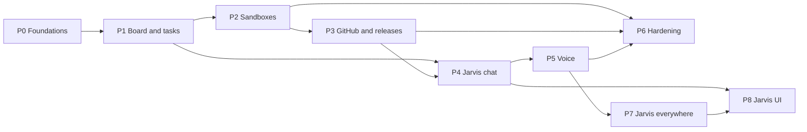

## P15-46 — suggestions create approvals (#1494)

Implemented shared staging guidance, bounded hosted calendar-offer repair and
calendar tap approval through the existing feed and single-use action. Focused
regressions cover propose → yes/ja, direct instructions, older pending proposals,
failed staging, expiry/replacement, tap replay and owner/agent authorization.
Local checks passed: 1,234 agent tests, 2,888 expanded backend tests, 33 web tests,
and 200 native Core tests (an unrelated voice timing failure passed on rerun).
Affected lint/build checks, synthetic local HTTP approval and secret scanning
passed; read-only review found no remaining significant issues. Post-CodeQL
approval checks passed (105 tests). Python CodeQL found no alerts; JavaScript
analysis was skipped for database size and Swift database creation failed.
Implementation and local qualification are complete. Live model and native
device acceptance remain unverified; no deployment is included.

Review-status follow-up: PR #1495 is already non-draft. At head `3085770`,
[CI](https://github.com/DanAakesen/jarvis/actions/runs/41291128508) and
[GitHub CodeQL](https://github.com/DanAakesen/jarvis/actions/runs/41291128372)
passed; these are separate from the local scanner limitations above.
[PR title logs](https://github.com/DanAakesen/jarvis/actions/runs/41291128460)
require `P15-46: Bind Jarvis calendar suggestions to change approvals`.
The available tools cannot edit PR metadata, and the browser is signed out;
title correction remains outstanding. Original Apple source review was blocked
by direct source access; the native screenshot follow-up read relevant Button,
HIG Buttons, sheet-detent and XCTest documentation through the browser. See the
source audit in `docs/decisions.md`; this does not establish pre-implementation
source review for the original work.

Main synchronization: merged `c0c12f6f` in two-parent commit `39a8cc87`,
retaining #1493 Chat formatting, #1500 bell behavior and both conflicting
decision-log entries. Merged approval regressions passed: 121 backend tests and
532 agent tests; backend lint/build and 24 web feed tests also passed.
Danish/English calendar approval screenshot coverage is implemented in the
existing Simulator job, with four light/dark captures and retained XCUI
attachments. Both native approval surfaces reuse localized controls; calendar
review sheets use the native large detent. Local fixture qualification passed:
57 pipeline tests, 36 focused Core tests, Swift parsing and fixture typechecking.
Next: inspect fresh updated-head CI and actual Simulator captures, correct the
title and verify its gate, and perform live model/device acceptance.

## Managed policy failure causes (#1373; 30 October 2026)

Implemented optional sanitized `providerCause` across hosted error events,
backend failure logging/chat streams, browser errors and system smoke contracts.
Closed reasons and uncertain-claim blocking remain unchanged. Focused offline
tests cover allow-lists, unsafe values and synthetic provider rejection.

Blocked acceptance: the original live rejected parameter is not yet known, and
no original-path Copilot turn was verified. `_create_response` remains unchanged
rather than weakening policy based on a hypothesis. Next: capture a new safe
cause, reproduce/correct that request rejection and qualify a live turn. No grant,
deployment, claim reset or default cutover is included.

## Managed test conversation failures (#1350; 29 October 2026)

The managed text canary passed in Deploy 40928130267, but the owner reported
failed real test-conversation replies. The first live cause remains unverified.
This repair accepts omitted optional function-call status only within a completed
response, preserves fixed managed error codes through the UI, and distinguishes
known failures before inference from uncertain work. Native conversation creation
waits until shared context is prepared. Known failed sources stay consumed;
uncertain inference/action claims stay active and are never reset or replayed.
Production-wrapper tests now use a stateful claim fixture for initial text/tool
turns, safe follow-up, consumed-source rejection and uncertain-action blocking.
Next: exact-head qualification/review and live original-path validation. No grant,
default cutover or claim reset is included.

CI found the release smoke formatter's hosted-origin list missing the newly
preserved managed codes. Its static finite list now matches the backend; exact
parity, unknown-code redaction and failure-only acceptance assertions stay intact.

## Managed canary failure visibility (#1350; 29 October 2026)

PR #1357 merged after qualification. Manual Deploy 40884299864 passed provisioning
at 14:03:43 UTC, configured the pinned target and passed backend readiness, then
failed the canary assertion at 14:05:08. All eight Current chat checks passed;
research failed separately. The canary's private response was deleted and not
uploaded, so its specific reason is unavailable through retained workflow logs.

The local workflow-handoff correction reports only existing fixed reason/stage
labels, bounded HTTP status and allowlisted model/effort constants on failure.
The fallback stage is the known `managed_text_canary` operation; no new Python
runtime instrumentation is included. It preserves the gate, private bodies, existing resource,
credentials, roles and defaults. Metadata-based runtime availability currently
does not consult canary success; it may offer Copilot despite a failed canary.
Actual authenticated availability and a working managed response remain unverified.
No availability policy change is included in this diagnostic correction.
All 35 handoff/provisioning/deploy-plan tests, scoped Ruff, compilation and shell
syntax checks pass locally; independent review found no blocker. Exact-head CI
and a new reviewed handoff remain pending.

## Managed identity readback correction (#1350; 29 October 2026)

PR #1355 merged after full exact-head qualification. Automatic Deploy 40867958702
applied all components and passed readiness and all eight chat smoke checks;
research failed separately. Approved manual Deploy 40877005757 reused those
components and reached `agent_identity_unverified` after validating one active
comparison version, before endpoint pinning/backend activation/canary. Do not
create a duplicate or infer a missing grant from that combined check.
Its separate acceptance also reported `acceptance_check_failed` for chat canary,
`github_issue_unavailable` for GitHub read and `research_runner_failed`.

The local correction accepts documented unset identity status with enabled
effective state and a valid unchanged principal. Explicit disabled/unknown
states still fail; fixed codes distinguish the rejected component. All 30
provisioning/handoff/deploy-plan tests, scoped Ruff, compilation and shell syntax
checks pass locally. Reviewed qualification precedes another existing-resource handoff. No live
correction, Copilot response or UI acceptance is claimed.

## Runtime comparison candidate (#1350; 29 October 2026)

The local candidate contains the managed protocol adapter and definition
validator, immutable SQL test-session metadata, scoped history/default exclusion,
source-verified bridge selection, and the approved chat-menu selector with a
separate labelled test view. The managed option remains disabled until real
definition/model/effort readback and deployment pass. Durable source/turn
claims, agent-only binding routes/client and shared application-policy transport
are now implemented locally. Identical backend disconnect/reattach and steering
fixtures execute for both choices. The owner declined extra transcript filtering
from normal search/context/summaries; preserve those existing contracts. No target, identity grant or production
default was created or changed. The [adapter checkpoint](docs/managed-chat-adapter.md)
lists the missing policy and provisioning evidence.

The last-mile source is assembled: lazy Python factory, pinned backend target
reader/configuration, authoritative fixed manifest read, scoped provisioning
script and default-off manual Deploy handoff. That handoff creates the comparison
agent using existing OIDC, configures only its three backend target values and
calls a fixed text canary with the actual bridge identity. No new credential or
blanket role grant is added. Local SQL execution was blocked by Forbidden pulling
the pinned SQL Server image. Actual Database CI passed all four new runtime
contracts and found three stale expected-table assertions in the shared schema
inventory. The candidate adds the three table names without weakening equality.
CI 40864485219 then passed Database and Web, but Backend found two lifecycle
fixture shutdown timeouts after their assertions. Exact Node 22.23.3 reproduction
identified an unrequested replacement fetch socket; teardown-only connection
cleanup passes all four lifecycle cases locally. Exact-head requalification
is pending. No live
provisioning or canary has been run.

The settings correction is merged in #1353. Deploy 40852006540 passed every chat
smoke scenario at 09:55 UTC; research remains down independently with
`research_runner_failed`. This is passing chat smoke evidence, not ordinary-chat,
research or two-runtime acceptance. Local test evidence and open boundaries are
recorded in [migration notes](docs/main-chat-harness-migration.md).

## Whole-Jarvis logging scope replaces backend-only (#1341; 29 October 2026)

The owner confirmed read-only logs for the backend, hosted agents, coding runners,
deployments and supporting services, excluding unrelated projects. Retain the
Foundry Reader assignment; its removal proposal is stopped and was never applied.
The earlier narrow grant approval does not authorize new whole-system access.
The current reader stays disabled. See [source inventory and grant proposal](docs/jarvis-logs.md).

Independent local work adds a metadata-only catalogue to the existing preflight:
exact canonical resources plus ownership tags, and known-table plan/resource-field
metadata. Neither a shared workspace nor tags alone establishes ownership. Private
values remain in the existing mode-0600 report; public output is fixed labels.
No data query, new grant, security mode, credential, ingestion or retention change.
Runtime multi-source reading, its single capability replacement, exact expanded
grant approval, source routing and whole-system enforcement remain pending.

The owner subsequently approved the exact issue scope update, inventory/design
PR publication with test results, readiness and integration after checks. The one
authorized issue-update retry succeeded. Reconcile current main `9f831509` without
altering its chat/research fix; four documentation-prefix conflicts retain both
scopes. Parent owns readiness/merge. New persistent grants remain unapproved.
Combined local validation passes 35 backend-log Python tests, 45 pipeline tests
and 13 main smoke-reason tests, scoped Ruff, byte compilation and diff checks.
All eight inventory-only and fourteen main-only file blobs match their parents.
No new Azure inventory execution or whole-system runtime implementation is claimed.

## Test-settings correction (#1350; 29 October 2026)

The owner requires tests to use the same role settings. The correction
removes smoke's forced-none effort and separate token cap while retaining the
existing saved-setting resolution and read-only guards. It records bounded
effective-effort telemetry without adding fallback values. Local validation:
1,025 hosted tests/Ruff/compilation and 56 research/vision tests plus backend lint
pass. The owner approved including this correction with the finite diagnostics
in #1353; exact-head qualification, independent review and live acceptance remain
pending.
See [local scope and remaining evidence](docs/smoke-settings-1350.md).

## Live reasoning rejection and separate research evidence (#1350; 29 October 2026)

PR #1351 merged after CI 40839366476. Deploy 40840605441 passed application/agent
deployment and readiness, then failed live acceptance: the required chat scenarios
report `model_bad_request_reasoning`; research is independently down. Primary
Terra documentation supports none, so no parameter/setting change is justified
yet. Prepare fixed reasoning code/subfield distinctions and separate research
boundary reasons. Local checks pass 1,019 hosted tests, 349 focused backend tests,
backend lint/build and 13 sanitizer tests. The full backend suite passes 6,902
tests with one skip. The baseline is still unresolved.
Preserve main `82fff9f5` and the original log task's scope. Next: reviewed normal
release evidence before choosing a correction; managed path/UI work remains
unreleased. See [migration evidence](docs/main-chat-harness-migration.md).

## Reconcile log diagnostics with current main (#1341; 29 October 2026)

Merge main `938bb48f` (#1351 chat rejection diagnostics) into log-diagnostic head
`f8a94f6d`. Four documentation-prefix conflicts retain both scopes; PRODUCT
merges automatically. All seven diagnostic-only and seven main-only file blobs
remain identical to their respective parents. Combined validation passes 703
backend tests across 13 suites, all 944 hosted-agent tests and 112 Python
log/smoke/pipeline/deploy tests, backend lint/build, hosted-agent and log-script
Ruff, and Python byte compilation. Broader root Ruff reports four inherited
findings in main's unchanged smoke_reasons.py (I001 and three TRY004); preserve
that blob. Local Node 24/npm 11 is distinct from pinned exact-head hosted CI.
The owner separately approved this diagnostic PR's publication and test results,
readiness and integration after checks. The parent owns readiness/merge; one
previously denied creation retry is now authorized. No grant, workspace-mode
change, foreign-control waiver or reader activation occurred.

## Foundry log permission diagnosis (#1341; 29 October 2026)

Main #1349 deployed as `c05cfada`; Deploy #40836577365 passed infrastructure,
backend/web/agent rollout and readiness, then failed live chat/research acceptance.
The actual backend identity matched. Unfiltered console, other-app and other-table
queries returned 403; Foundry returned 400 and no foreign workspace was configured.
These are pre-grant observations, not own-backend access or isolation proof.

This follow-up corrects the fixed Foundry aggregate to `AzureDiagnostics` and asks
for permission metadata. The backend classifies only fixed permission states in
memory and discards identifiers/provider text. HTTP and permission verdicts stay
separate, including metadata accompanying errors; a 400 or empty result never
clears the existing resource-grant warning. The metadata preflight verifies the
runtime Foundry target and reads paginated ARM `assignedTo` inventories at the
workspace, Foundry and existing subscription scopes. Unavailable or truncated
inventories remain incomplete; no Graph grant or additional access is requested.

No role, workspace mode, foreign-control requirement or activation changes.
Local validation passes 434 backend tests across ten suites, 29 Python log
tests, 26 deploy-script tests and 45 pipeline tests, backend lint/build and scoped
Ruff/byte compilation. Local Node 24/npm 11 differs from pinned CI Node 22/npm 10;
exact-head hosted qualification remains pending. After review and normal main
deployment, inspect the fixed verdicts and resolve any effective
resource-log grant before the approved conditional grant and fresh-process proof.
The separate migration task owns baseline chat BadRequest diagnosis.

## Main chat harness migration (#1350; 29 October 2026)

One [migration issue](https://github.com/DanAakesen/jarvis/issues/1350) is claimed
by Codex. Stage 1 adds fixed rejected-field diagnostics to the existing chat
failure and release evidence path; the live BadRequest root cause remains
unresolved. The unchanged hosted baseline passes 930 local tests; the diagnostic
candidate passes 944. Next: independent review/qualification, then actual release
evidence before selecting a fix. Later runtime/UI/comparison/cutover stages remain
pending. Dan approved Test agent runtime in the chat menu, Current/Copilot selection
and a separate labelled conversation with no mid-conversation switch. The
[migration notes](docs/main-chat-harness-migration.md) include manual test questions
and outstanding model, grant and parity decisions. No production default changes.

## Fixed backend-identity authorization observations (#1341; 29 October 2026)

Main #1348 merged as `8d0288b0`. Deploy #40828872899 passed metadata preflight,
Bicep, backend/web rollout, hosted agent version 159 and deterministic readiness.
Live acceptance still failed with research down and chat `error_badrequesterror`;
application fixes are applied, not accepted. No log grant or reader activation
occurred. Preflight reported `existing_resource_log_grant_requires_review` and
`negative_workspace_candidate_missing` after matching live identity, runtime,
workspace, console schema and exact built-in permissions.

The next scoped increment prepares fixed, read-only backend-identity observations
through the existing authenticated deployment smoke route. Same-job private
preflight data becomes a private Bicep parameter file; only validated target IDs
enter backend configuration. The probe matches the credential's principal to the
verified backend principal, runs only bounded aggregate queries, and returns fixed
verdicts. It checks unfiltered console rows, other-app rows, another table, an
actual foreign workspace when configured, and the existing Foundry resource
query path. Missing controls, allowed-but-empty queries, provider errors and
partial/malformed responses remain inconclusive. No grant, new credential,
permission change, new route, model tool, UI, retention or reader enablement.

Local validation passes 408 focused backend tests across nine suites and 24 backend-log Python tests,
backend lint/build, scoped Ruff/byte compilation and Bicep 0.44.1 offline build.
Compiled-template comparison preserves every resource property/role/retention/
capacity/output after removing only four probe parameters and environment entries.
Repository scripts pass 165 cases; three require missing PowerShell. Settings,
capability, production-catalogue and parity tests are included in the 408 passing
backend cases. Hosted qualification and live probe execution remain pending.

Local synthetic checks and offline compilation qualify only this code; actual
backend-identity observations require normal independent review and main release.
They are cached once per backend process and carry a timestamp; new grants require
fresh observations after the grant and full positive/negative proof. Neither a
successful metadata preflight nor these observations alone authorizes activation.
The real foreign-workspace control and existing-resource permission review remain
blockers. No private IDs or log records may enter public pipeline evidence.

## Backend log preflight ARM correction (#1341; 28 October 2026)

29 October reconciliation integrates current main `10d6d170` (#1345). Only
PLAN and agent-context prefixes conflict; both histories are retained. The verifier
fix and test blobs match `9b920f85`; every #1345 implementation, migration and
artifact blob is preserved from main. Fresh exact-head qualification is required.

PR #1346 merged as `61d19366` after qualified CI #40759821759 and independent
review. Main Deploy #40761349594 stopped before Bicep at
`builtin_role_mismatch`; backend, agent, web, readiness and acceptance were
skipped. No assignment or activation occurred. The verifier used the CLI-model
`properties.roleType` instead of ARM REST `properties.type`. An ARM-shaped
fixture reproduces the failure; the field correction and explicit rejection of
CLI-only/custom-role shapes pass all 15 preflight tests, scoped Ruff and byte
compilation. Exact permissions and all other gates remain. Next: independent
review/normal qualification of this correction, then repeat the main preflight;
only its actual successful readback can precede conditional grant/probe work.
The earlier provider BadRequest/live-conversation failure remains unresolved.

## Reconcile review fixes with current main (#1343; 28 October 2026)

Integrate main `61d193668d94ac07c0c19df38eb8dd4a503ec37b` (merged #1346)
into #1345 after recovery head `2f039761` passed CI 40760736915. The only
overlap is five documentation prefixes; both entries are retained. Non-overlapping
implementation, tests, workflows and artifacts retain their parent blobs; only
documentation is combined/annotated. No Azure command, grant, activation or
deployment is run here. Combined checks pass 388 backend tests, 14 synthetic
Python preflight tests and backend lint/build. Full qualification must pass on the resulting
head; earlier-head green is retained history, not its qualification. Coordinator
review/merge remains separate. Do not retry the failed PR-body metadata write.

## Approved log activation preflight and awareness (#1341; 28 October 2026)

PR #1342 is merged as `0df74dee`. The owner has approved persistent read access to
only backend log records plus basic workspace metadata. No further owner approval
is needed for that exact scope. Follow-up `codex/1341-backend-log-activation` adds
an executable metadata-only preflight in the existing main-only deployment path,
and explicit configured/unavailable log guidance for main chat. It creates no
role assignment and leaves the reader off. The preflight is the next required
live step because this executor has no permitted direct Azure route. Actual
identity/schema/access findings must precede the approved conditional assignment
and backend-identity enforcement probes; candidates and synthetic tests are not
proof. No private identifiers enter public evidence. Next: scoped draft
review/normal qualification, then the existing main OIDC preflight.
Continue the already-approved activation from that result; do not merge this PR
from the implementation worker or request another generic permission. Local
checks pass 14 synthetic preflight cases and 246 reader/instruction/settings/
chat-voice parity tests, backend lint/build and scoped Ruff/byte compilation. The
full backend run passed 6,763 tests with one skip and found four parity failures
from naming an absent tool in disabled instructions. That guidance now avoids
the absent tool name; all four pass in the 246-test rerun. Exact-head full hosted
qualification remains pending. Repository script discovery passes all available
checks; three existing setup tests require missing PowerShell.

## Owner-approved review fixes (#1343; 28 October 2026)

Implement the eight approved findings on `codex/fix-eight-review-gaps-1343` under
[issue #1343](https://github.com/DanAakesen/jarvis/issues/1343), claimed by Codex.
All eight fixes are implemented in [PR #1345](https://github.com/DanAakesen/jarvis/pull/1345)
for independent review and coordinator release; no own
merge or deployment. Scope covers issue delivery/origin and completion recovery,
Gmail receipts, chat warning/queue reload persistence, oversized worker-start
feedback and explicit Settings approval values. The owner's replacement for
Settings is sticky mobile heading/Save, preserving desktop behavior; no draft
guard/autosave/persistence. Optional audit findings and Azure log work are excluded.
Local regression/aggregate checks and browser evidence are recorded in the PR
and [validation report](docs/review-fixes-1343.md);
SQL Server CI and physical iPhone/live acceptance remain distinct release evidence.
Workflow-owned status cells are not edited by this change.

Local checks: full web 2,447 and contracts 174 passed; final conversation rerun
126 passed; backend/web lint and builds passed. Backend aggregate had 6,776
passed, two failed, one skipped. Corrected the stale approval-text assertion;
both affected suites then passed 16 tests with original limits. See the report
for SQL CI, Node 22 and physical-device limits. Next: independent review and
normal qualification. The coordinator marked the PR ready. Hosted SQL run
40756774334 had 281 passes and two test-setup failures: the index query omitted
the expected new index, and the second Workspaces rollback needed to unwind
0068 again. Both are corrected without weakening assertions; qualification must
run on the correction's new head.

Qualification of `5cf8da23` passed (CI 40757610202): SQL 283, backend 6,778 plus
one skipped, web 2,448, contracts 174. A subsequent bot finding reproduced loss
of the whole recovery snapshot for a 100,001-character partial reply. The scoped
follow-up aligns read/write validation to 512 KiB UTF-8, retains valid entries
independently and prioritizes queue/warning data when partial context exceeds
the snapshot budget. Boundary and ConversationHistory checks pass 141 tests;
new-head CI is required before merge. Do not retry the failed PR-body update.

## Backend log reader (#1341; P11-42; 28 October 2026)

Follow-up review found that rejected Content-Length cleanup could await a
transport cancellation forever and retain the single-query gate. Cleanup is now
nonblocking, consistent with the streamed-body path. Two synthetic regressions
use invalid/oversized lengths and never-resolving cancellation, then prove another
query enters the provider. All 44 reader tests and backend lint/build pass.
The original head's qualification is superseded;
normal exact-head hosted checks are required for this correction. No permission
or activation change is included.

Codex claimed [#1341](https://github.com/DanAakesen/jarvis/issues/1341) and branched
`codex/1341-backend-logs` from current main `00493374`. The default-off retained
backend-log reader, authenticated sensitive read integration and synthetic
regressions are implemented in [#1342](https://github.com/DanAakesen/jarvis/pull/1342).
Seven focused suites pass 262 tests; backend lint/build pass. Full backend: 300
files pass, one fails (6,760 passed, one failed, one skipped); the workspace-language
acknowledgement case passes an isolated rerun with its original timeout. The final
shared-instruction/reader rerun passes 59 tests. Hosted agent: 930 passed plus Ruff
and byte compilation. Repository scripts: 141 pass; three need missing `pwsh`.
Local runtime is Node 24.19.0/npm 11.9.0; hosted Node 22 remains pending. Same
integrity-pinned public npm packages installed after the configured mirror 403;
the lockfile is unchanged. The exact Azure conditional
grant is proposed only in [docs/backend-logs.md](docs/backend-logs.md); no role or
assignment/configuration activation is applied by merge/deploy. Next: review and
hosted qualification, then action-time owner approval and deployed schema,
effective-grant and other-app exclusion proof before activation. Separate app
review findings are outside this task.

## Terra main-chat preparation (#1337; 27 October 2026)

Owner-approved issue/claim and draft PR preparation on
`codex/1337-terra-main-chat`, from main `0ce12d35`. Prepare the Foundry deployment
with required `terraChatCapacity` and prefer deployed Terra for main chat; retain
saved choices and existing role/tool defaults. Draft PR [#1338](https://github.com/DanAakesen/jarvis/pull/1338)
is published. Full backend: 300 files, 6,718 passed and one skipped. Hosted agent:
930 passed plus Ruff/byte compilation. Backend lint/build and Bicep v0.44.1
offline build/lint pass; baseline template comparison preserves every existing
resource property/capacity. Repository scripts: 141 passed; three require missing
PowerShell. Documentation review confirms Danish Voice Live uses the voice role;
only its hosted-agent fallback inherits chat. On 28 October, prepare requested
capacity 150 in the existing parameter file, matching the established chat
allocation. The previously missing parameter was a draft-design gap, not a need
for a new Azure login. Existing main-only Deploy/OIDC validates Azure acceptance;
PR CI checks the template offline. Live quota remains unobserved.
Microsoft's public Global Standard short/long list rates are sourced in
`infra/README.md`; account rates and Azure tier billing rules remain unverified.
Dan approved USD 20/month and accepted existing alerts; no new budget subsystem
or repeated budget/sign-in question is required.
Resumed validation: five focused backend suites pass 220 tests, including the
persisted Terra owner-setting update and owner/agent readbacks; backend
lint/build and updated Bicep v0.44.1 build/lint pass. All required deployment
parameters are supplied by committed parameters plus existing script inputs.
Next: independent review and hosted Node 22 qualification, followed by
normal release and a saved-owner chat-only Settings update. No merge, deployment,
paid inference or live model-selection verification is claimed.

## Deadline notification details (#1335; 27 October 2026)

Scoped correction on `fix/1335-notification-task-details`, from main `d74bdd82`:
deadline findings retain bounded task names and bundled alert lines show due
times. Existing records refresh through normal upserts; no migration or delivery
policy change. Implementation and 124 focused pipeline/privacy tests pass, as do
workspace lint/build and Python components. All 15 initial backend/vault-mirror
timing failures pass targeted reruns without changing timeouts. Three repository
script checks need missing PowerShell. Next: coordinator review and hosted
qualification. No merge, deployment or phone acceptance is claimed.

## Mobile composer first-tap control focus (#1315; 27 October 2026)

Owner transferred implementation from Copilot after supplying real iPhone event
metadata. Shared scoped mouse-down guard implemented; diagnostic remains intact.
Local validation passes: 155 files / 2,437 tests, focused 153, lint/build and
browser replay/native-touch/scroll checks. Next: coordinator review, scoped PR
through approved publication boundary, normal hosted checks and owner review.
No automatic merge or unrelated Stop share implementation.

## Diagnostic native-event sampling correction (#1315; local follow-up)

Native Chromium confirmed that capture microtasks can label cancellation before
React handles Send. Defer settled samples to a task and preserve only categorical
target metadata that native SVG dispatch can clear. No new trace fields or input
behavior changes. Based on combined main67b581dd; retain both merged features.
Next: normal follow-up PR qualification, review and owner manual merge, then normal
exact-tree release. No gate weakening or stale deployment retry.

## Temporary mobile composer diagnostic (#1315; 26 October 2026)

Implementation and local validation complete: passive, bounded, content-free
in-memory tap/focus/viewport trace plus explicit Copy Send diagnostic in phone
Plus. No speculative Send fallback. Full web: 155 files / 2,428 tests passed;
lint/build and synthetic Chromium scroll/type/Send/copy/privacy checks passed.
Next: draft PR, normal hosted qualification, review and owner manual merge.
The actual first-tap keyboard-dismissal bug and physical iOS cause remain unresolved.

## Mobile keyboard scroll (#1323; 26 October 2026)

## Whole-number meal estimate lists (#1327; 26 October 2026)

Display kcal and all nutrient grams rounded to whole numbers in one canonical
meal-estimate list. Retain protein, calories, fat, carbohydrates and fiber; keep
unknown distinct from zero. Calculations, stored values, approval fingerprints
and idempotency retain full precision. Chat and voice consolidate existing
nutrition bullets using server presentation; acknowledgment-only replies still
receive the complete list. Validate with synthetic fractional nutrition fixtures.

Implementation and local review complete in PR #1325. Outside taps dismiss only
after release; scrolling, cancellation and multi-touch retain composer focus.
Local validation: web 2,405 passed / one contrast timeout; unchanged contrast rerun
7 passed; lint/build and Chromium scroll/type/Send passed. Next: hosted checks,
coordinator queue integration after camera/Health, review and authorized release.
Physical iOS acceptance remains unverified.
## Unified camera delivery (#1317; 26 October 2026)

Implementation on `fix/1317-unified-camera`: automatic sampled-frame delivery,
truthful receiving status, explicit standing narration, approved removal of the
user-inactivity cutoff, permission-checked Jarvis start/stop, obsolete camera action
cleanup and bounded lifecycle. Local checks and synthetic browser evidence are
in `docs/ui/screenshots/1317/README.md`. Rebased onto combined menu main `1c1029a3` without conflicts; independent integration
review passed. Exact-head hosted qualification remains before the authorized normal
merge/deployment workflow; no production release is claimed yet.

# Project plan

## Chat bubble frost (#1324; local qualification, 26 October 2026)

Integrated main 92fbd42c (video, Health lists, keyboard scroll and meal precision). Implemented
shared lighter Plus/bubble/header frost, a mobile shown-state corner correction,
and the existing desktop fade through cached item-level masks. Local evidence and check outcomes are recorded in
`docs/ui/screenshots/chat-bubble-frost/`. Parent coordinates integration after
camera, Health and keyboard-scroll work, then checked merge/deployment.

## Health meal estimate correction (#1321; 26 October 2026)

Implement Health tool branding and server-derived protein/calorie/fat lists in
lookup replies, proposal presentation and retained voice history. Preserve data
namespaces and approval protections. Synthetic checks and browser evidence are in
`docs/ui/screenshots/1321/`. Draft PR #1322 is rebased onto plus-menu main
`1c1029a3`; review, CI and camera/release coordination remain parent-owned. No production meal replay or write is part of this work.

## Composer Plus readability (#1319; 26 October 2026)

Implemented the scoped composer Plus readability, bottom-up action order and Voice waveform correction. Local verification is recorded in `docs/ui/screenshots/1319/README.md`. The first candidate passed 2,394 web tests. The transparency-preserving review correction passed 196 focused checks, contracts/web lint/build and synthetic Chromium visual QA; exact-head aggregate hosted qualification remains pending. Draft PR #1320 is open; a review correction preserves translucency using native top-layer popup blur. Final integration remains pending; integrated main 496182bc (meal recovery #1314 and Send #1316). The revised queue places this fix before camera #1318; no unmerged camera work is imported.

## Desktop composer parity (#1309; 26 October 2026)

Implemented shared two-row styling, desktop Dictate/Voice placement, aligned
composer width and wrapper stacking, with attachment errors above the surface.
Synthetic actual-App QA covers desktop normal/resized/maximized/restored states,
repeated Plus interaction, Dictate start/stop, attachments/errors and phone layout.
Follow-up fixed the initial vertical seam when the room fallback status is shown;
the browser fixture now asserts vertical adjacency before any resize and after it.
Draft PR #1313 now incorporates main `83563177` (attachment #1308, preview
#1312 and continuous Dictate #1310), preserving their implementations. Combined
web tests and rendered composer/preview regressions pass. Coordinator owns the
merge slot after mobile composer #1307. Final integration incorporates main
`3688ef4e`, preserving mobile visibility/measurement/focus guards; 2,387 web tests
and combined desktop/mobile/Voice QA pass. Exact-head hosted checks and accepted
deployment remain release gates.

## Mobile Chat-only composer (#1303; 26 October 2026)

Use the current route and Workspaces pane state to show mobile composer variants
only on Chat, with Workspaces closed. Keep the
conversation mounted, release hidden-input focus and keyboard state on departure,
and remove unused composer clearance on other pages. Desktop stays unchanged.
Synthetic actual-App navigation evidence is in `docs/ui/screenshots/mobile-chat-only-1303/`.
Parent owns final qualification, review and release.

## Continuous draft dictation (#1305; 26 October 2026)

Implemented on a separate branch from main `d7667964`: interim transcript
replacement, automatic restart through pauses, repeatable explicit Stop, and
visible fatal failures. Evidence and verification are in
`docs/ui/screenshots/1305/README.md`. Reconciled attachment #1308 and preview
#1312 from main `57ae85a0`, preserving their changes. Final exact-head checks
and independent review precede the coordinator-authorized sequential merge.
Physical iPhone acceptance remains pending.

## Preview follow-up #1304

Implemented shared-material switch/close controls, removed visible camera badges, and retained/refreshed fitted geometry across stream replacement/resume. Synthetic mobile/desktop regression QA passed for dragging, repeated switching, pause/resume aspect changes and viewport restoration. Normal web checks are recorded in the PR; no physical-device acceptance or release claimed.

## #1311 — Accepted meal request recovery (26 October 2026)

Implementation: detached accepted chat execution, bounded replay, return-time
reattachment/history refresh, explicit cancellation support, and synthetic disconnect,
approval/expiry/cancellation and once-only replay coverage. Published as draft
PR #1314. Rebased onto main `5dd52b07` after desktop #1313, preserving the
merged UI changes. Next: exact-head qualification; the parent owns merge/deploy. No real meal retry or write is authorized.

## Settled glass and dock selection (#1301; 26 October 2026)

Draft PR #1302 corrects the measured double menu fade, inconsistent phone blur,
and excluded header; it unifies requested chrome surfaces and makes dock
selection icon-only. Started from main `df3fafa5`, preserving merged #1298 and
#1300 keyboard/startup behavior. Actual-App Chromium tests cover settled and
repeated opens, delayed settings, dark/light, reduced motion, focus outlines
and pixel transmission through each named surface. Evidence and exact check
results are in `docs/ui/screenshots/1301/README.md`. Coordinator owns review,
hosted exact-head checks and release; no merge or deployment by this executor.

## Startup navigation correction (#1299; 26 October 2026)

The owner reports bottom navigation missing at startup until a tap. The released
hook interpreted programmatic composer focus as an open keyboard. The correction
requires viewport evidence and preserves equal-height resize event ordering,
keyboard dismissal/reopening and composer-control focus handoff. Actual-App
untouched-startup and typing evidence is in `docs/ui/screenshots/startup-navigation-1299/`.
Parent owns final review, merge/deployment and physical-device acceptance.

## iPhone keyboard follow-up (#1295; 26 October 2026)

Owner acceptance of #1293 failed despite release: the dock remained above the
keyboard. The old height-gap fixture missed the equal-height resized-layout
case. A focused-composer fallback now covers both event orders and already-short
mount/enable, with navigation restored on focus departure or observed expansion.
Runtime scope is only `phone-chat-viewport.ts`; other shipped UI stays unchanged.
Focused regressions cover safe composer-control focus handoff as well as keyboard
resize. Actual-App synthetic captures and measured geometry are in `docs/ui/screenshots/iphone-keyboard-1295/`. Physical iPhone
acceptance and parent-owned hosted qualification/release remain outstanding.

## Camera movement and clearer menus (#1296; 26 October 2026)

Draft PR #1297 implements touch/pointer movement of the preview video, tinted
translucent overlay controls, reliable repeated plus presses, and clearer
composer/bottom-dock/menu surfaces. Composer icons remain borderless; header,
chat backdrop and keyboard behavior are unchanged. Synthetic full-App Chromium
QA covers 320px/390px touch and 1440px pointer layouts. Final evidence and limits
are in `docs/ui/screenshots/1296/README.md`. Parent owns exact-head hosted checks,
review and release; no physical iPhone acceptance or deployment is claimed.

## Mobile corrections (#1293; 26 October 2026)

Implemented the requested full-width message row, lower borderless icon controls,
external errors, keyboard-covered navigation clearance, six-entry menu pages with
three dots, clear backdrop and shared subtle translucency. Dictation distinguishes
requested stop cancellation from genuine failures, retains final text until end,
and ignores callbacks from retired recognizers. The review correction preserves
attachment pills inside the composer, above the full-width draft; only attachment
errors/problems render outside. A decoded 96×64 synthetic PNG verifies uploading,
ready, and failed-upload layouts at 390px/320px. Regression cases cover these
lifecycle orderings, menu accessibility and viewport updates.

Synthetic complete-App and actual-component Chromium captures at 320px/390px and
1440px are in `docs/ui/screenshots/mobile-corrections-1293/`. The parent/coordinator
inspected the four private source images; this executor's supported helper failed
with `download failed`, without a diagnostic classifying denial versus connectivity.
No private pixels were downloaded or published by this executor. Explicit text
requirements were implemented under the parent's follow-up instruction.

The scoped web/contracts frozen install succeeded without registry changes after
the full repository install hit a configured-feed 403. Final local checks are
recorded in the evidence README. Node 24.19.0/npm 11.9.0 differs from pinned CI
Node 22/npm 10; normal hosted qualification remains required. PR #1294 stays draft
for parent source-reference review. Physical iPhone/WebKit keyboard and real
microphone acceptance remain unverified. No merge or deployment performed.

## Workspaces identifier completion (#1279; 25 October 2026)

- Canonical navigation/snapshot, API routes, tools, stores and SQL columns now
  use Workspaces names; legacy Folio clients and data retain explicit
  compatibility aliases and reversible migration 0067.
- Reconciled coordinated main
  `771c56d4f9c12891830f2313ce6d54c5d6477d2f` in two-parent merge `6be8f0b`.
  The selected bottom Chat/Health/Workspaces/Menu navigation remains intact;
  Workspaces opens the renamed saved-item pane, and Software Factory remains a
  separate `/factory/kanban` destination. The food invitation/composer, compact
  attachment pill, image previews, camera preview CSS and mobile timestamp fix
  remain together.
- Full web validation passed: 153 test files / 2,351 tests, lint and production
  build. The build retains its existing large-chunk warning.
- Actual-App Chromium with synthetic history at 390×844 confirmed the Workspaces
  control opened `#workspaces-pane` without changing `/`, while Factory remained
  linked to `/factory/kanban`. The timestamp was static 8 px below long message
  text; document width stayed 390 px. A 47 px image attachment pill remained
  above the composer input with 16 px spacing and no horizontal overflow. At
  1440×900 the timestamp remained absolute and document width stayed 1440 px.
  No browser errors were observed.
- Exact-merge-head CI `40249598963` passed all required jobs and its aggregate
  gate, including SQL Server migration/database contracts; infrastructure was
  skipped. GitHub CodeQL `40249598917` passed all four analyses.

## Mobile browser food confirmation repair (#1290)

Clarified mobile/desktop browser versus telephone-call tool guidance and trusted
runtime channel instructions. Guidance now requires backend estimate staging
before inviting confirmation, with no authority from historical agreement.
Merged main `dd929aa` with #1259 acknowledgement, #1264 project clarification and #1282 shared
`PendingAction` lifecycle. Food approval retains that lifecycle and exact-proposal
authority; no second confirmation state or parser/phone permission change.

The pending food call now publishes its exact Now review and a session-bound voice
invitation. Voice presentation can proceed during tool work without bypassing
speech, response, settings or presence gates. Expired queued invitations are
discarded; interruption preserves the original tool's result continuation.
Typed-chat follow-up now streams the source/session-bound proposal into the active
conversation while the tool waits, rather than relying on an unopened Now popover.
The existing bubble shows the exact plain-text summary and invites a reply;
withdrawal, expiry and completion remove its transient presentation.
Synthetic HTTP tests read the live invitation before steering; renderer tests
require the visible review before `Log it`. Scratch Chromium at desktop/mobile
widths verified invitation, composer reply and synthetic receipt without overflow.
English/Danish
direct/discovery WebSocket tests receive invitation transcript/audio frames before
a new owner reply and then receive the committed result once. Focused tests and
backend build/lint pass. Full-tree qualification covers workspace lint/tests/builds,
Python components, isolated SQL contracts and security review;
real-SQL, live-provider and physical mobile-device acceptance remain separate.
Next acceptance requires live invitation/recognition/playback, not acknowledgement
alone. No production food writes.

## Shared confirmation lifecycle (#1281; 25 October 2026)

Google, Factory/GitHub and browser owner interactions now share immutable
proposals, reply eligibility, cancellation/expiry, consumption and execution
through `core/pending-action.ts`. Tool permission and food revision/presence
checks remain with their tools. Browser-only proposals remain browser-only.
Focused synthetic text/voice and browser regressions pass; live owner/device
acceptance remains unverified. Current-main reconciliation includes the verified
food merge `d0d679f` and retains its routing, timing and persisted-reply SQL
fixture unchanged. Project clarification and acknowledgment remain in their
separate PRs; this merge does not introduce their branch-only changes.
Earlier backend build/lint, secret scanning and read-only review passed.
Coordination review inspected #1278 `a09dfc1`, #1264 `fa3de91` (including
`dc742dd` clarification behavior) and #1259 `f229ec7`. Preserve the food
owner-interactions API on the shared lifecycle; no stream deadline or playback
gate changes belong here. The overlapping Factory merge must retain
clarification-specific provenance and target revalidation separately from
action approval. Combined-head qualification passed on `c0aed2f`: exact-head CI
`40239192479` and all four CodeQL analyses in `40239192419` succeeded.
Food API reconciliation passed 622 targeted tests (one skipped), backend build,
scoped lint and read-only review. It preserves the immediate-reply and
same-millisecond food timestamp behavior without changing other action families.
Local JavaScript CodeQL analysis was skipped because the database exceeded its
size limit; the exact-head GitHub CodeQL run passed all four analyses. Next: live
owner/device acceptance.

## Natural food-estimate confirmation (#1277)

Implemented estimate-only natural reply binding through the shared one-time
approval service, text steering and English/Danish browser-voice transcript
paths. Cancellation, expiry, exact proposal/source identity, idempotent intake
receipts and button-only correction/deletion remain intact. Browser and backend
chat streams use existing budgets (browser 240-second ingress ceiling, backend
210-second food read budget below ingress); food's 180-second
operation and 120-second approval limits are unchanged.

Synthetic confirmation, replay, preparation/review timing, HTTP and English/Danish
WebSocket regressions pass locally, along with backend/web builds and lint.
Read-only review found no remaining significant issues. Chromium transport smoke
checks at 1440px and 390px verified the streamed receipt and sanitized disconnect
recovery with synthetic responses, not the signed-in production workflow.
Qualification repair: merged main `5c0a61c`, then its successor `ac871bf`, retaining
the food and main decision-log entries.
The failing real-SQL review fixture now supplies the SQL conversation store and
persisted source/replies instead of a session-only stub. Its clock follows the
persisted source; browser and natural approval variants retain rejection,
one-time consumption, intake replay, correction and deletion assertions.
Full combined-tree qualification is being rerun; earlier-head CI is not acceptance
of this repaired candidate.
Next: live hosted-provider, microphone recognition and physical-device acceptance;
these remain unverified. No personal food data or production writes are part of
this change.

## Research result recovery (#1237; 25 October 2026)

Implemented saved Folio/job references, separate Workspace delivery state and an
owner-only reopen action using the existing stable report window. Focused backend,
contract and web tests passed; the delivery-acknowledgement persistence regression
also passes. Backend/web builds and lint pass. The SQL integration command could
not start because this environment has no isolated loopback SQL Server
configuration. Next: scan secrets, run CodeQL and review the final diff.
Physical phone acceptance remains separate.

## P9-124: Natural first reply before tool work in chat and voice (#1258)

Reuses the active model stream to deliver one contextual first-person
acknowledgment before tool work; direct answers stay immediate. Chat keeps the
acknowledgment as a transient segment, and hosted voice emits a separate text
item before resuming the model stream. Realtime voice proceeds with a received
request after terminal-response delivery even when initial acknowledgment
playback is missing or negative; cancellation, barge-in and genuine delivery
failures remain authoritative. No playback receipt proves physical-speaker
output. Synthetic fixtures cover ordering, cancellation, stale receipts and
silent rounds. The approach adds no model request or artificial delay; live
timing and physical audio acceptance remain unmeasured. Next: final-head
aggregate CI and owner-run live/device acceptance. No merge or deployment is
authorized.

## Per-finding chat and voice feedback (#1240)

Implemented the shared `proactive_item_feedback` capability, UI/tool feedback
validation reuse, owner-message grounding, bounded contextual references,
local-time/DST validation, replay protection and conditional feedback writes.
Synthetic chat/voice dispatcher, store and existing delivery tests pass locally.
No live feedback, preference changes, migration or deployment was performed.
Next: PR review and CI; live owner acceptance remains unverified.

Current-main integration (24 October): retained the merged #1236 task-write/
stale-write and #1235 food-review behavior alongside #1240. Combined instruction
wording is compacted within the existing budget; qualification must use the new
head, including SQL CI. Live acceptance remains separate.

## Safe conversational task writes (#1236; 23 October 2026)

- Implemented shared Tasks API/chat/voice create, complete/reopen and edit writes,
  exact task identity/version checks, and version-required full-note replacement.
- Local synthetic checks passed: 172 backend tests (including 26 shared-service
  tests), 26 panel tests and 107 hosted-agent tests; backend/web builds and scoped
  lint passed. Secret scanning found none. Python CodeQL found no alerts;
  JavaScript analysis was skipped for database size and automated review was
  unavailable.
- Independent review identified a stale-draft rebase on panel refresh; edits now
  retain their original identity/version, with a regression test.
- Next: real iOS/Obsidian sync and live speech
  acceptance remain owner-run and are not claimed by synthetic tests.

Integration checkpoint: #883 merged on 17 October at
`705af7c7c02c3154a646dda66d79790d71af8f54`, with its actual tree matching
the qualified pipeline correction. This release candidate combines the
qualified Daily feed source `76eee47f` and fixed chat-origin evidence source
`6d972cb6` on that main. Their source checks and independent reviews are
retained evidence, not qualification of this combined tree. One combined
qualification and normal release replace two consecutive deployments.

The accepted #882 baseline remains backend341/agent109. The later normal
Deploy39043117488 proved all four component identities could be reused without
rebuilding or reapplying them, but required chat-capabilities acceptance failed
with `agent_error`. Its immutable receipt remains `accepted=false`; #820 owns
the functional follow-through and #880 stays open. This integration does not
claim to fix that historical failure or complete private Daily acceptance.

## Visible Daily page (18 October 2026; P12-15 / #730)

Dan, after the invisible Daily slices: "I have no idea what is built and cannot
see anything." Daily now opens on an overview before any record table. Under
"What Daily holds today" it lists each retained collection the backend exposes
(measurements, sleep, workouts, food history, saved favourites, meal plans, brief
history, sync evidence) with one plain sentence on what it is for. Each row
shows what a read-only, one-record check found: Has records, None returned
(which never claims the original source is empty) or Could not read (with Retry).
Open takes the row into the existing record browser and Back returns. It uses
only the two existing owner-bound endpoints, `GET /daily/capabilities` and
`POST /daily/query`, and adds no endpoint, writer, calculation, migration,
provider call, account, consent, secret or import. Nothing in it is stored,
estimated or invented.

The page, route and navigation exist only when the web build sets
`VITE_DAILY_ENABLED` to exactly `true`. It is off by default (a missing value or
`false` is off; any other value stops the build) and no workflow or Bicep file
sets it in this change, so every environment keeps the released navigation. Dan
pre-authorised switching Daily on for his account once the page is live and
checked; that is the next, separate change (`JARVIS_DAILY_ENABLED` and
`VITE_DAILY_ENABLED`), not part of this one.

Checked in a real headless Chromium at 390×844 touch (dark and light), 320, 768
and 1280 px against synthetic responses (details in DESIGN.md). Local runs are not
qualification, and no live backend, private data, physical phone or acceptance is
claimed.

## Daily switched on for the owner (18 October 2026; P12-15 / #730)

Dan pre-authorised this twice: "Yes, switch it on once it's live and checked",
then, asleep and on autopilot, "Yes, ship all daily if possible. You can take
decisions as I would, as good as you can, we can always change it." The page
above is merged, so this one change turns Daily on in production through exactly
two reviewed files: `JARVIS_DAILY_ENABLED` in the backend container environment
in `infra/main.bicep`, and `VITE_DAILY_ENABLED` in the web build step of
`deploy.yml`. The code defaults stay off, and the scan test now allows only those
two files and checks their literal values.

What appears for Dan's own account: the Daily overview page ("What Daily holds
today"), its side-rail and phone-menu entry, the Nutrition targets section in
Settings (empty until he enters his own values) and the six owner-bound Daily
tools. Nothing else is added: no migration, account, consent, grant, secret,
RBAC, resource or import, no MCP connector, Google or Gmail feed, health upload,
job or timer, and no provider, device or private read or write. Any change under
`infra/` re-applies all four release components, so one Deploy carries the
infrastructure, backend, web and agent together.

Next is the live check after that Deploy; it is not claimed here. Rollback is
reverting the whole change, scan test included, or setting both switches to
`false` and updating the scan test in the same commit. Acceptance with Dan's real
figures, the original Google source and a physical phone stays open.

## On-demand Daily views (18 October 2026; P12-16 / #731)

The overview page shows what Daily holds; this slice lets Dan ask Jarvis to show
it. One new owner-bound, read-only tool, `daily_show`, reads through the same
bounded read model as the Daily page and `daily_query`, builds a table, chart or
detail from the stored values, and publishes it through the existing workspace
view lifecycle. There is no new endpoint, renderer, page, widget or GenUI engine.

With a workspace tab open Dan can ask for measurements ("show my steps for the
last two weeks"), sleep ("chart my sleep"), workouts, one workout's heart rate,
food history, saved favourites, meal plans or sync status. Each request is one page
(at most 366 days and 200 rows, 100 for meals, favourites and plans); there is no
paging. Brief history and single-record detail stay with `daily_query`. Nothing is
calculated or estimated, and a missing value is unknown, never zero. Every table,
chart and detail carries a footnote with the source, period, read time and "completeness
and freshness are not established"; an empty read is a plain sentence with its own read
time. View IDs are stable (for example `daily-workouts-table` and `daily-sync`; a
measurement or heart-rate view is keyed by what it shows, not by its date window), so
asking again refreshes the same window rather than opening another. Table cells keep
whole words and numbers, and a wide table scrolls inside the window.

Gates: the tool is sensitive and phone-denied, works only for the signed-in owner
the Daily composition resolved (a connector or any other user is refused before
SQL), and refuses before reading when no workspace tab is connected, pointing Jarvis
to `daily_query` for a text answer. A 25-second overall deadline sits under the
agent's 30-second read timeout, so a slow read fails with the tool's own message and
a late success after the deadline is never reported as success.

It belongs to the Daily composition and follows its switch. With Daily off, Jarvis is
unchanged; with Daily on, the catalogue holds seven Daily tools instead of six. The
former global count and reserve condition is superseded by #1204. It changes no flag
and adds no migration, account, consent, grant,
secret, RBAC, resource or import, and no provider, device or private read or write.
The reserved Status, Recomp, Review and Ready view IDs stay unused and #723 stays
withdrawn.

Checked with synthetic data: 45 builder and 82 tool tests, the web renderer tests,
and a real headless Chromium at 390×844 and 1280×800 (details in DESIGN.md). Local
runs are not qualification; CI is, and no live data, physical phone or acceptance is
claimed. Rollback is reverting this change.

## Proactive assistance (17 October 2026; P13-01 / #917)

The first delivery-proof milestone is approved. P13-01 builds the owner-bound
backend, SQL records and encrypted Web Push path behind the exact-true,
default-off `JARVIS_PUSH_ENABLED` gate. The parallel web work is P13-02. Neither
sets a deployment value. P13-03 (#934, 18 October 2026) enables milestone 1, the
user-triggered test, in the production deploy by setting `JARVIS_PUSH_ENABLED` in
`infra/main.bicep` and `VITE_PUSH_ENABLED` in the web build step; the code
defaults stay off. P13-14 (#935, 18 October 2026) enables milestone 2, the silent
read-only checks, the same way, by setting `JARVIS_PROACTIVE_ENABLED` and
`VITE_PROACTIVE_ENABLED`. P13-15 (#936, 18 October 2026) enables milestones 3 and
4, the add-only suggested todos and the time-critical alerts and reminders, the same
way, by setting `JARVIS_PROACTIVE_TODO_WRITES_ENABLED` and
`JARVIS_PROACTIVE_ALERTS_ENABLED` in `infra/main.bicep` only (no web flag). No
change adds a Teams path.
Provider acceptance and local tests do not prove that an iPhone displayed the
notification. Physical-device delivery remains unverified.

## Owner nutrition targets (17 October 2026; P12-09 / #724)

Dan ruled that the suggestion budget reads owner-entered Settings, not a default,
an estimate or a coaching rule. This first slice adds the three owner-bound
targets (resting energy burn, daily deficit, protein): `GET`/`PATCH
/daily/nutrition-targets` for the signed-in owner and the sensitive
`daily_nutrition_targets` tool, whose changes need the exact browser Now
approval. They are Daily-owned `dbo.settings` rows, so there is no migration and
no core Settings change. All of it stays behind the default-off Daily gate (Daily
off = Jarvis unchanged); the default-off composition below is its only caller. Dan
enters his own values; none is stored in code, tests or documents.

Slices, in order. Second (#899): the budget/candidate adapter and the read-only
`daily_nutrition_suggest` tool (allowance = resting burn + active energy so far
today - deficit; unknowns flagged, never zero; only meals logged in Jarvis
count; saved favourites are the only candidates). Third (#901): the web
Settings section, shown only while Daily is on, saving on its own with no
defaults, placeholders or example figures. Last: the default-off composition,
next section. No provider, private or device access, live probe, Daily
activation or acceptance is claimed.

## Default-off Daily composition (17 October 2026; P12-09 / #724)

Dan gave the go for Daily. This is the last invisible slice: one composition
module, `daily/composition.ts`, behind `JARVIS_DAILY_ENABLED`. Absent or `false`
is off, exactly `true` is on, and anything else stops startup with a
configuration error that never echoes the value. The code default is off. Only
two reviewed production deployment files set it (next sections), and a scan test
fails if any other configuration file ever mentions it.

Off composes nothing: the route table, tool catalogue, capability instructions,
voice session tools, health response, startup, jobs and timers stay those of
Jarvis without Daily, which tests compare against a Daily-free application. On
composes one owner-bound module over the existing nutrition data: the
capabilities, query and nutrition-targets routes and six tools (seven since the
on-demand views of P12-16). #1204 supersedes the former global count and reserve;
description and serialized-size checks remain. It
adds no MCP connector, Frida lookup, Google or Gmail feed,
health upload, job or timer. SQL and a UUID owner are required or startup fails;
a signed-in user who is not that owner, a runner or a connector is refused before
any SQL, and an agent reaches the targets only through the approved tool. No
migration, account, consent, grant, secret, RBAC, resource or import is added, and
no provider, device or private data is read or written.

The visible Daily page (P12-15 / #730) is recorded in its own section.

## On-screen views authority (17 October 2026; P11-09 / #885)

P0 from Dan's live test (find hotels in Gmail, show them, stage in the calendar,
confirm): step 1 worked, but Jarvis could not put anything on screen in voice or
chat, and a raw JSON dump appeared after the Gmail check. Three causes, shipped
as small PRs:

1. Authority and presentation. A realtime voice tool call runs on the owner's
   authenticated socket and was refused as a browser caller, so the relay now
   runs each model-issued call inside an in-process Jarvis-origin scope (owner
   only; browser, HTTP owner token, reflex and other users unchanged). Voice
   presentation of Google results shows a clean list or text, never raw JSON or
   message bodies. Regressions cover voice create/update/arrange/close,
   browser and non-owner refusal, the scope boundary and each presentation shape.
2. Specific refusals and model guidance (PR 2, with Google truncation
   honesty). Chat refusals came from generated-view validation returning one
   generic message; the voice path shares the same validators. A refusal now
   names the field to fix and says nothing was changed or shown, using only
   static wording and known key names, so the model corrects once and never
   misdescribes the cause. Regressions cover the exact refused shapes in chat
   and voice with identical messages. The same PR closes Codex's P1 on #888: a
   Google result the tool reports as truncated, or that the presenter cuts to
   fit, shows a static note in the view and a `partial` source, so free time
   from an incomplete event list is never presented as complete.
3. Offline end-to-end (PR 3). `apps/backend/src/google/hotel-booking-flow.test.ts`
   drives in-memory Gmail and Calendar through find, show view, stage
   (`awaiting_confirmation`), a later plain "yes" and confirm, in chat (the Jarvis
   agent over `/tools/*`) and in voice (the owner's session inside the relay's
   call scope, with the relay answering the reply from backend state). It also
   covers a decline, a confirm attempted by the staging message or a non-approval
   message being refused with nothing written, a repeated yes writing nothing
   again, no raw ids, bodies or codes on screen or in the audit record, and the
   owner's browser being refused while Jarvis creates the same view.

No provider call, live probe or replay of Dan's mail. Dan's live re-test closes
#885; merged source is not acceptance.

## Stable GitHub chat acceptance (#1415, 30 October 2026)

Implemented receipt-based issue-700 validation and one paced retry for
`github_issue_unavailable`, sharing the existing two-attempt cap with throttling.
Full backend tests (7,236 passed, one skipped), smoke-reason tests (13), backend
lint and build pass. Genuine read failures retain their safe reason and fail the
aggregate. Review and secret scan found no issues; CodeQL found no Python alerts
but skipped JavaScript because its database was too large. Next: normal CI and
repeated live acceptance on unchanged production; local fixtures do not prove
live stability.

## Chat acceptance fix-forward (#820, 17 October 2026)

Three consecutive main deploys failed different chat checks with the bare
`agent_error`: 39043117488 `chat_capabilities`; 39046081711 `chat_github_read` and
`chat_navigation`; 39049389385 (`c00818b7`, #816) `chat_navigation` and
`chat_plain_approval`. No #884 origin code surfaced, the failing set moves
between builds, and the cause is not established. #816 is not the cause by code
path: smoke turns never open its coordination client, which an agent test now
pins.

The candidate adds fixed backend-side failure labels (`agent_*`), separate
`agent_error_code_missing` / `agent_error_code_unlisted` buckets for hosted error
events, and one bounded retry of a conversation check that threw, inside the
unchanged 55-second suite deadline. No model, prompt, assertion, timeout,
credential, workflow or #816 lifecycle change. Degraded identity/no-timestamp
reasons stay off HTTP for already-open web clients, so they exist only in
`system.smoke_check` events. Locally passing: backend chat-agent, chat-canary and
system-status tests (219, via an uncommitted vitest alias for `voice/relay.ts`),
smoke-reasons parity tests (11) and pipeline tests (38), plus scoped ESLint, tsc
and Ruff. The agent regression test is left to CI (`azure.ai.agentserver` is not
installed locally). Next: normal pinned CI/CodeQL and independent review, then the
existing main-only release; the next deploy's labelled evidence drives the
follow-up. #820 and #880 remain open and #884 stays frozen; source qualification
is not production acceptance.

## Chat acceptance origin provenance (#820, 17 October 2026)

Retained Deploy39043117488 at705af7c7/treee79dbd60 failed required
`chat_capabilities=agent_error`; aggregate canary failed, plain approval passed,
and all four components reused accepted baselinef6530a59/backend341/agent109.
Exact qualification/readiness/reuse succeeded. This does not demonstrate a
pipeline defect or identify the historical failure cause.

The bounded source candidate repairs demonstrated evidence loss: the hosted
SSE client already retains origin codes, but the canary discarded every code
except `catalogue_unavailable`. Preserve a finite fixed allowlist through the
existing canary, status reader and acceptance/release artifacts. Unknown origins
still become `agent_error`; no arbitrary exception/provider text is retained.
Synthetic checks cover prompt isolation, the real SSE-to-report projection,
backend/Python allowlist parity, redaction, failed acceptance and unchanged
producer identities. No prompt, predicate, deadline, retry, model, workflow,
connection lifecycle (#816), Daily or permission change.

All122 script tests pass locally with synthetic `GITHUB_RUN_ATTEMPT=2`,
plus scoped Ruff/whitespace checks. Backend tests could not collect locally
because `vitest` is absent; no dependency graph was restored or substituted.
Next: normal pinned exact-candidate CI and independent review, then the existing
main-only release path. This is an evidence-only improvement, not a proven
historical root fix. #820's original attribution and #880's accepted=false
release blocker remain open; source qualification is not production acceptance.

## Pipeline event-order recovery (#880, 17 October 2026)

#882 merged normally atf6530a59 with the verified qualified tree; automatic
Deploy39041096612 passed all8 jobs and its verified immutable receipt records
all4 components applied/accepted=true (backend341,agent109). Required smoke
passed; only pre-existing nonblocking PC bridge was down. #880 stays open for
the bounded follow-up, not because this first rollout lacked acceptance.
#881 integrated520c9ba8 hit an observed pipeline race:
ready-event CI39041201026 was cancelled by delayed draft-snapshot CI39041201353,
which then skipped. No Daily source failure was observed.

One cancelled-ready-run recovery,39041201026 attempt2, was admitted without
overlapping CI or rerunning green CodeQL/review. This builder owns the minimal
prevention follow-up: isolate draft concurrency, keep ready supersession and
required gates unchanged, use a distinct unqualified aggregate name for draft
snapshots, test both admission orders, qualify exact source and
return the PR/runtime evidence to the integration owner. No extra worker or
production dispatch.

The one recovery's application/SQL/image jobs passed; script discovery correctly
failed an attempt2-sensitive fixture. Pin that fixture's intended attempt1 and
add real previous-attempt-shape coverage, then run the script suite with
synthetic `GITHUB_RUN_ATTEMPT=2`. No repeated recovery or gate weakening.
All118 script cases pass under that environment; scoped Ruff/actionlint and
whitespace checks pass. Current #883 source needs normal exact-head CI/review.
Daily's independent later first-attempt green does not erase the failed
attempt2 or establish this fixture correction.

## Continuous pipeline delivery (#880, 17 October 2026; implementation candidate)

Operating model 2 is the current focus: the coordinator owns responsive intake,
the canonical GitHub backlog, dispatch and integration/conflicts, not feature
development, tests or diagnostic reproductions. At most two builders own source,
regressions and their pipeline failures. No old timer or autopilot change.

The candidate extends existing CI/Deploy rather than adding a platform. It selects
affected checks and dependencies conservatively, requires exact-tree CI receipts
before Azure access, retains compatible applied component versions independently
of final acceptance, and publishes bounded content-free failure evidence.
Readiness and probabilistic live conversation acceptance are separate required
results. Missing/unknown required smoke checks fail closed; existing explicit
nonblocking checks remain so. There is no routine Dan acceptance/batch cutoff.

Local 35 pipeline, seven smoke formatter and 11 planner cases pass, with scoped
Ruff and Actions validation. The validator's sole ignored schema diagnostic is
the unchanged production `concurrency.queue: max` feature; it is not removed.
The first full local script run exposed a missing `run_attempt` in a synthetic
fixture; that fixture was corrected and the narrow cases reran successfully.
Initial43aa CI39038876598 passed all12 jobs and all four CodeQL analyses.
Review found a secret-derived fingerprint; the correction compares sensitive
budget configuration only in memory through the existing authorised main-only
identity, never persists a value/hash, and requires successor qualification.
Verified applied state, not a newer docs-only main commit, controls supersession.
ca9a CI39039891173 and all four analyses passed. Its exact-head review found
missing read-only plan PR permission and agent-created backend revision
attribution. The correction adds that read scope and distinct revision provenance
while retaining the original immutable image producer; new source needs normal CI.
Normal exact-candidate PR CI supplies the full runtime qualification; its
actual run/artifact result is retained on #880/PR rather than generating a
documentation-only CI rerun. #880 stays open through review. Main merge and
actual release belong to the integration owner, not this builder. No live provider
reproduction or causal-fix claim for Deploy39032686994 is part of this work;
its `chat_plain_approval` / generic `agent_error` cause remains unproven.

## Inactive Daily feed tools (17 October 2026; P12-09 / #724)

Bounded source continuation adds optional `DailyData.feeds` / `daily_feed` over
the retained #725 services: attention/calendar/conflict reads, exact active
suppression reads, reviewed manual refresh, dismiss, Received and restoration.
Existing query versions, production default-off composition and nutrition MCP
allowlist stay unchanged. No new page, schema, grant, schedule or dispatcher.

Native browser approval binds frozen selectors and the actual stored target;
owner transactions recheck fingerprints and publish the existing refresh only
after acknowledged new commits. Replays/no-ops stay quiet. All direct feed
entrypoints explicitly deny the nutrition-only principal.

Synthetic schema/service/native-confirmation, real dispatcher/audit/module,
relay/agent deadline and isolated SQL regressions are authored. Local npm test
and build cannot start: this isolated worktree has no Vitest/TypeScript graph.
Python Ruff passes; selected Python tests cannot collect without OpenTelemetry.
No restore, substitute graph, SQL image, live provider or manual reproduction was
used. Exact-head pinned CI and integrated-candidate qualification remain next.
The coordinator owns integration/release; the implementation owner fixes source
pipeline failures. Keep #724/#725 open and native/private acceptance gates intact.

Initial pinned CI39038540472 passed all other component jobs and3794backend
tests; one new dispatcher assertion incorrectly expected root403 for another
verified human. Add feed-owner validation at the tool boundary and assert the
existing200/error resource-denial envelope, redacted audit and no service call.
Keep runner/connector root403 checks. The corrected source needs qualification;
prior green jobs do not qualify its changed head.

Integrated520c review5558252668 found the180second enclosing feed budget left
no persistence time after120second approval and60second provider work.
Correct only Daily feed to210second service/relay and225second agent read below
unchanged240second ingress; food/unrelated budgets remain intact. Added actual
native-approval/refresh lifecycle regression at119second approval plus59second
providers and10second persistence. The corrected head needs qualification; the
pipeline owner separately owns520c's Python release-state fixture failure and
the delayed draft-event cancellation race.

Successor801e normal CI39041917082 and all four analyses passed, including the
near-expiry lifecycle test. Exact-head review5558345536 then identified missing
write-side suppression capacity:1001st entries poisoned bounded reads/reviewed
restore. The correction rejects new active entries at1,000 per type under lock,
retains updates/no-ops and uses exact-key restoration independent of listing.
Real SQL cases cover both types at1000/1001, unchanged failure notifications,
owner isolation, restoration/replacement and already oversized known-key recovery.
The shared service also proves native restore survives listing unavailability.
The corrected head requires qualification;801e greens are retained history.

Initialf069 qualification passed application checks and234SQL assertions; the
two new oversized-list controls failed because the existing transaction wrapper
discarded the explicit safe limit `ToolFailure`. Preserve that known safe failure
without exposing unknown SQL/provider exceptions, then qualify the successor.
No review is requested on this superseded base before parent integrates705af7c7.

## Release diagnosis (17 October 2026; safe CI reason codes)

Continue autonomously without direct Azure or credentials. Both new owned
read-only Status browser attempts reached sign-in, so neither performed login,
storage/token inspection or a new model check. The app remains applied and
verification blocked as recorded below.

Add a bounded fixed-allowlist formatter to the existing Deploy smoke log. It
prints only code-defined check/reason identifiers, never report details or
model/tool/provider/user text. Keep the existing status validation, deadline and
required acceptance predicate unchanged; no green retry or no-op fake success.
Local12 targeted script tests and Ruff pass. Existing Bicep0.44.1 offline
build/lint pass without Azure access or upgrade.

Historical #879 selected all parts under the then-current deploy planner;
#880 supersedes that selection policy without an acceptance waiver. No IaC, identity, scope, resource,
secret or environment configuration changes. Normal exact-head qualification
and existing main-only deployment must precede any new diagnostic result.

## Retained brief history (17 October 2026; P12-14 / #729)

Source #878 is merged as `cca9c9d7`, exactly matching qualified `a9478e16`
tree `b0487147`. Final normal CI passed all10 jobs:3754 backend,231 SQL,1081 web
and48 contracts; all four actual analyses and exact-head review passed, with the
compatibility finding resolved. Backend0000339 and web were updated by normal
Deploy39029329877; health200/root/settings passed, infrastructure/agent skipped.
**Deployment acceptance is blocked**, not complete: first smoke failed GitHub
chat read plus its aggregate canary. One bounded failed-smoke-only recheck
recovered GitHub read but failed chat navigation; no rebuild or third retry.
The underlying reason is unproved. Need the retained safe reason codes/logs;
direct Azure access is not permitted and Dan was unavailable for that question.
Keep the healthy applied artifacts and all native/private gates unchanged.

Next bounded inactive source work makes existing `briefing_runs` accessible
through the same Daily query/tool and page, not a new screen, generator or
notification system. The existing schema already retains the data; private
import/reconciliation is still gated. Add bounded metadata paging and exact
owned body detail, preserve raw stored timestamps/IDs and unknown freshness,
and keep historical delivery distinct from any new send. Explicitly deny the
nutrition-only connector at the brief boundary.

The bounded source and local/synthetic checks are ready for normal pinned CI;
real SQL/full runtime qualification and release are still required. Keep #729 and
its native #723/#725 dependency links unchanged (#723 is closed not_planned, not
completed acceptance). Daily stays
default-off, original Daily canonical, recurring Daily notifications disabled
and existing non-Daily notifications untouched. Real imported history/provider/
device/activation/cutover acceptance remains open.

Initial665 CI passed application checks but its final SQL persisted-byte
assertion compared SQL bigint text as a JS number; use an exact BigInt comparison
without weakening the threshold. Review also found an upgrade-compatibility
gap: old v1 clients reject an expanded source list. Keep the original nine-source
advertisement for legacy Accept headers and explicitly negotiate capability v2
through standard Accept, with v1 fallback for new clients on old backends.
No CORS expansion, new query selector or activation follows. The corrected head
requires fresh normal qualification.

The compatibility successor's SQL/web checks passed. One new HTTP assertion
was too literal about Fastify's legal `version="2"` response formatting; assert
the parsed MIME essence/version instead, and accept both quoted/unquoted v2
request parameters. The version, source-set and all refusal assertions remain.

## Inactive single Daily page (17 October 2026; delivered source slice)

Delivered #877 as actual main `fa4e52f9`, matching qualified `db166834` tree
`195b4771`. Final normal CI39022400980 passed all10 jobs (3748 backend,1077 web,
46 contracts), all four actual CodeQL analyses and exact-head review without
findings. Normal Deploy39023166005 released backend0000338 and web; infrastructure
and agent skipped. Health200 and web root/settings passed. Actual smoke13/15ok
retains PC bridge down and recurring chat identity degraded, without attribution.
Receipt6232661562 was independently read back. Owned browser/5175 stopped.
The slice remains inactive and #730 is not complete.

Dan explicitly reiterated that Jarvis needs tools for everything around Daily.
Treat retained workflow parity across the page, chat and voice as completion
criteria, including read/filter/detail/presentation actions, not just writes.
Existing inactive tools cover the shared queries, direct/reviewed intake,
saved-food/plans/preferences and Frida reference lookup. Check the remaining
presentation/control and retained integration workflows before claiming the
page or migration complete; do not substitute UI-only behavior for a tool.

Backend source wiring below is delivered inactive. Under the standing migration
mandate and delegated autonomy while Dan is unavailable, prepare one reversible,
default-off page; this is not affirmative approval of private operations or
activation. The owned source now browses measurements, sleep, workouts/detail/
heart rate, food history, favourites, plans and sync evidence through the same
bounded query DTOs as `daily_query`, with periods, exact cursor paging, raw
record inspection and direct-observation charts. It reuses the current shell,
conversation, shared controls and existing Now invalidation connection.

`App` defaults `dailyEnabled` to false; production bootstrap/public configuration
are unchanged. Client and backend both refuse unavailable Daily navigation.
Existing query plus workspace/GenUI tools provide equivalent requested data and
visuals, not remote mutation of this page's local filters. Tool guidance makes
that distinction explicit; writes retain the delivered native approval rules.
This source slice is deployed inactive, not accepted as all of #730.
Native dependencies #724/#725 and private/grant/provider/client/device/export/
reconciliation/activation/cutover gates stay open. Original Daily remains
canonical; no repeated Google consent, private export or fabricated budget.

Focused local web checks passed144 across six files, including default-off and
explicit desktop/phone composition, navigation acknowledgements, account-key
cache disposal, query interruption and serialized/coalesced refresh. A test-only
React compiler lint correction retained the owner assertions and its rerun
passed; source lint, web types, shared instruction15 checks and JS syntax pass.
Full local contract collection remains blocked by missing Fastify, with zero
assertions from that attempt; final normal pinned CI must cover it.
Actual App inspection used only synthetic auth/records at1440px and390/320px
touch viewports, both appearances, native period application, paging/charts,
workout/heart-rate/sync and empty/error/recovery/denial states. Wide tables now
scroll within their keyboard-focusable region rather than breaking values into
tiny columns. Default-off made no Daily API requests. No real account, provider,
device or imported-source acceptance is claimed.

First normal source CI39021933844 found four forwarded settings/voice assertions
requiring the existing phrase `relay refusal reasons` after the navigation
guidance was compacted; 3744 backend cases passed and four failed. Restore that
wording and add it to the fast pure instruction guard without weakening the
forwarding assertions or15000-codepoint budget. The first run's web/container/
SQL and four CodeQL analyses passed; its exact-head source review had no findings.
The corrected head requires fresh normal qualification before release.

## Internal Frida reference lookup (17 October 2026; P12-09 / #724)

Delivered in #876 / actual `9334d3ed`, matching qualified `a8d920e2` tree
`6da17b0c`. First normal CI passed all ten jobs (3746backend/230SQL/732agentPython),
all four actual CodeQL analyses and exact-head automatic review without findings.
Normal Deploy39012842333 selected backend only: ready backend0000337/health200.
Actual smoke13/15ok retains PC bridge down and recurring chat identity degraded;
identity was ok in #875, with no source attribution or extra canary. Receipt
6231173591 and #724 opening were read back. One cancelled board-only metadata
job was recovered; source CI/review were not rerun.

This inactive batch binds the existing pinned Frida adapter to owner-authorised
`daily_food_lookup`, only when a provider is explicitly supplied to Daily data.
Existing module arguments and production/read-only compositions without that
capability remain unchanged. Shared component validation preserves null amounts;
public reference results retain attribution, incomplete totals and retrieval
times without logging intake or claiming acceptance. The adapter/read operation
is bounded to20seconds within unchanged ordinary agent/voice budgets.
Pure schema checks passed9 and changed TypeScript lint passed. Real HTTP/tool/data
owner/composition/relay and existing external-protocol cases passed pinned CI;
no live provider, private data, new account or activation action is included.
Recommendations still need authoritative remaining-budget data, not model guesses.

## Internal Daily saved-food integration (17 October 2026; P12-09 / #724)

Delivered in #875 / `195bc89c`, matching qualified `14e94a34` tree `c12eca94`.
First normal CI passed all ten jobs (3729backend/230SQL/732agentPython), four
actual CodeQL analyses and automatic exact-head review without findings. Normal
Deploy39010283459 selected backend+agent: ready/healthy backend0000336,
active Foundry107, routine health200 and14/15smokeok; only the existing PC bridge
warning remains. Release receipt6230819873 and the #724 opening were read back.
No qualification rerun, waiver or extra live canary was needed.

This inactive batch adds sensitive `daily_saved_food`: owned lookup and
preference reads plus browser-reviewed favourite/alias, plan save/soft-delete
and canonical preference writes. Reuse the delivered store, snapshots, revision
locks, native authority and commit refresh; direct exact/favourite logging stays
one-step. An additive fifth factory preserves the existing fourth-argument
contract and independent opt-in. Shared external saved schemas remain unchanged;
internal operation IDs and estimate provenance come from the verified source,
not model fields. Preference commits now refresh favourites; repeats stay silent.
Full entrypoint tracing found the browser voice relay's separate 30-second
cap. Both reviewed food tools now receive 180 seconds there, with unchanged
session cancellation and other tools' budgets, alongside their 210-second agent
read limit. Real relay controls cover both exceptions and existing outcomes.
The pure shared-schema selection passed10 cases locally; actual tool/HTTP/SQL,
compilation and exact-head review/release were subsequently qualified above.
Daily stays off, original Daily canonical, and all private/client/device and
export/reconciliation/delta/rollback/cutover gates remain.

## Internal Daily reviewed changes (17 October 2026; P12-09 / #724)

Delivered in #874 / merge `f1d410b1`, qualified source `d17fe622` and actual
matching tree `c0f112bf`. Normal Deploy `39006050135` passed backend and agent,
with infrastructure/web correctly skipped. Backend revision `0000335` ready
and healthy, hosted-agent version `106` active. Actual smoke: 14/15 ok; the
existing PC bridge warning remains, while chat identity reported ok this run
without a causal-fix claim. The full release receipt and #724 opening were
independently read back. This is inactive source delivery, not activation or
actual client/device acceptance.

The optional `daily_food_review` supports estimated intake,
exact-key/revision corrections and soft deletion in the same independently
opt-in internal composition. Reuse actual Now one-time confirmation, canonical
nutrition storage, source identity, safe receipts and acknowledged refresh.
Reviews are explicitly browser-only and present-mode; no Teams health-data
fallback, model acceptance, new dispatcher or redundant exact/favourite review.
Snapshots freeze before approval, target revisions are checked again before
the existing SQL lock, and uncertain results need an actual matching receipt.
No production composition, schema, package or original Daily changes.

Pure checks initially passed 95 assertions. Changed-file lint then found one
unused test parameter; it was corrected. Final review/model selection passed
50 assertions, then the final schema/review selection passed all 15 cases.
Changed-file lint passes with zero warnings. Source includes the real SQL
confirmation-to-intake workflow, Fastify input-schema branch preservation,
provenance and overlapping-receipt controls. Normal pinned tool/application/SQL
CI, independent review and authorised release were still pending at that point.
Initial CI39002775817 passed 3691/3692 backend assertions and all other
components, including SQL; CodeQL ran all four analyses successfully. Its one
new real HTTP-schema failure revealed unknown nutrient nulls coerced to zero.
The correction uses one nullable numeric type and expands null/zero HTTP
controls. Independent review found the hosted-agent 30-second approval timeout;
the first correction gave this tool a 390-second response-read deadline. Corrective
pure review checks pass 16 cases, changed TypeScript lint and Python Ruff pass.
Local HTTP/Python collection is blocked by missing Fastify/OpenTelemetry, not
accepted as a pass. Corrective5c8da563 passed all ten normal CI job entries,
but further review identified the real 240-second ingress ceiling. Food now
uses an explicit two-minute card expiry, three-minute whole-operation bound
and 210-second agent read limit; other approvals remain five minutes.
SQL, card and timer share the same lifetime, with no detached mutation queue.
Fresh pinned qualification and exact-head review were required for that correction.
Ingress-safe `766ffd3f` passed all ten CI job entries (3698 backend, 229 SQL
and 730 Python tests) and all four actual CodeQL analyses. Its completed review
found one remaining pre-execution phone path: generic approval could wait before
either food tool rejected the unsupported session. The correction adds a
dispatcher capability that refuses both food tools before approval, preserving
other phone tools. Real HTTP denial/precedence controls and actual food metadata
assertions cover the correction. Final `d17fe622` passed all ten CI job entries
(3700 backend, 229 SQL, 730 hosted-agent Python tests), all four actual CodeQL
analyses and completed exact-head independent review without findings. All
three genuine findings were proved, replied to inline and resolved before
normal guarded merge and the release above.
Broader conversation/spoken acceptance, actual hosted client/provider/device,
private reconciliation and cutover remain open. #724 stays open/default-off.

## Internal Daily intake authority (17 October 2026; P12-09 / #724)

The saved-food batch #872 is merged and deployed. The current source candidate
adds an independently opt-in `daily_food` tool to the existing registry.
It derives exact-label quantities or a saved favourite name from the verified
current Dan message, not model arguments. One source-message key protects
retries; favourite snapshots are rechecked under SQL locks. No redundant
confirmation is added for these explicit direct requests.

Implemented source includes strict input, owner/agent/session checks, committed
receipt recovery, source-edit/deletion refusal and unit/SQL/composition cases.
Pure local checks pass; local tool execution is blocked by missing `jose`.
Initial `a618a802` passed all ten CI jobs (3656 backend and 228 SQL tests)
and all four actual CodeQL analyses. Independent review found one overlapping
retry/favourite-edit receipt race. The correction re-reads and validates the
actual operation receipt after a known conflict/uncertain write result, without
retrying the write; deterministic unit and real SQL interleaving cover it.
Final head `b8cfe830` passed all ten CI job entries, four actual CodeQL
analyses and final independent review. Preserve its first unchanged web failure
and one failed-jobs-only diagnostic rerun; no intermittent UI fix is claimed.
#873 merged as `53d0dfb1` with exact qualified tree `d83654b5`; normal
Deploy `39000178688` succeeded, backend revision `0000334` ready and health200.
Actual smoke was 13/15 ok, with retained nonblocking PC bridge and
identity-response warnings. The release and #724 receipts were read back.
This deliberately bounded syntax is not complete internal nutrition parity:
the next reviewed source continuation is above; broader conversational wording
remains unfinished. Production composition stays off; #724 stays open and all
account, private migration, real-client/device and cutover gates remain.

## Retained Daily saved-food writes (17 October 2026; P12-09 / #724)

After deployed #871, implement favourite/alias saves, plan snapshots/save/soft
deletion and persistent canonical food preferences in one inactive connector
continuation. Reuse native review and owner-bound SQL, bind displayed source
values under lock and return real receipts. Additive 0050 protects concurrency,
clears and the expanded audit allowlist; deployed 0049 stays unchanged.
Normal exact-head qualification/release remains required. #724 stays open;
internal trusted-message authority and real client/account/device/cutover
acceptance are not completed by this slice.

## Retained Daily saved-food lookup (17 October 2026; P12-09 / #724)

#870's inactive connector is deployed. Continue retained parity by exposing
saved favourite/alias and exact historical-name lookup through its existing
`lookup_food`, with shared DTOs, no provider fallback and unchanged Frida input.
Use normal exact-head qualification/release; #724 stays in progress. No new
tool, migration, authority, account linking or Daily activation is included.

## CI workspace scoping (16 October 2026; P11-08 / #868)

Web CI was running the root scripts across all three npm workspaces, repeating
the dedicated Backend job. Scope its lint, tests and build to contracts plus web,
in that order. Preserve every component, container, SQL and CodeQL check and the
aggregate gate; no path skips, weaker assertions or dependency changes. Clean
Daily CI `38975315146` observed Web at 8m19s and Backend at 6m01s; these are one
run's durations, not a promised speedup. Qualify this correction normally.

## Voice summaries on screen (16 October 2026; P11-07 / #865)

Delivered in #866 / `4129f9bb`: ordinary realtime tools now call the existing voice presentation
service. Successful Calendar proposals display only their returned summary
in the existing text view; simple "show me" guidance prefers matching views
or text/list, without changing approval or provider writes. Four new executor
regressions reproduce the missing hook before the fix; the complete local
realtime/guidance selection passes 65 tests, including review's approval/decline
race correction: the internal pending lookup cannot overwrite the final receipt.
The original missing-dependency
and first-candidate instruction-budget failures remain recorded separately.
Final `0672dfb8` passed ten actual CI jobs and four actual CodeQL analyses;
normal Deploy `38971353611` passed backend release and smoke, with only the
known disconnected-PC warning. No new renderer, frontend campaign, private action or native-device
acceptance claim. Existing #839/#860 human acceptance gates stay open.

## Header and Factory follow-up integration (16 October 2026)

The priority mobile hotfix in #863 shipped first as `6192574e`, with normal
Deploy `38953446877` passing web deployment and smoke. The public
`main-BHyATt-B.js` matches that exact build and returns HTTP 200. Only the
disconnected PC bridge is a nonblocking smoke warning; `chat_identity` is ok.
The PM integration branch combines
the independently reviewed header #862 and bounded Factory-status #861 fixes
together for one subsequent normal qualification/release, without changing
their runtime or test blobs. This avoids a redundant full CI/deploy cycle for
two already-ready, non-overlapping corrections; it must not delay the hotfix.
An ordinary merge records actual mobile main without changing the integrated
tree. Require exact-head full CI, all four CodeQL analyses and normal serial
deployment/smoke; record the actual results on the PR and linked issues.
No individual green or skipped draft run qualifies
the combination. #811's historical 502/performance acceptance and #860's
native-phone acceptance remain open; Daily and existing sign-ins are unchanged.

## Mobile composer focus hotfix (16 October 2026)

P11-06 / #860 takes priority over header #859 and Factory parity. Fresh base is
released `3d3a12ab`. Actual-App controlled Chromium reproduces a saved desktop
composer at top546 while the phone dock is top766; the new Workspace regression
fails against unchanged released code because it publishes a desktop anchor in
phone mode. The local candidate suspends manual geometry and desktop-only
Move/resize chrome on phones, preserving saved desktop placement.

Local verification: 139 Workspace/viewport/layout/style tests and 10 selected
actual-App/history draft/lifecycle/reader-following cases pass. Changed-file
lint, full web typecheck and production web build pass. Controlled actual-App
Chromium checks pass with default/saved layouts in dark/light, ordinary/reduced
motion, repeated keyboard-rectangle changes, hide/close/restore and
portrait/landscape/desktop transitions. Drafts and saved preferences survive.
PM's independent source review of `5b3a5933` found no blocker; subsequent changes
are tests/evidence/docs only. Exact final head `315c85b6` passed full normal CI
`38952176445` and all four actual CodeQL analyses in `38951934641`. #863 merged
as `6192574e`, tree `52bc3fe6`, and normal web Deploy `38953446877` passed.
Header source and App.test.tsx were untouched by that release. #860 remains open
with `needs-decision` for genuine physical-phone acceptance, not more
implementation or a fictitious device pass. Native Project Jarvis reads
Needs Dan. The workflow-owned task table currently reads Not started; that
generated value is not an implementation/release receipt and is not manually
rewritten here.

## Combined release candidate (16 October 2026; source integration)

The existing Factory worktree combines the frozen Factory v2, common/header
frontend v1, final Mobile v2 delta, final Calendar v4 and current inactive
Daily v3 on exact base `2823585`. Competing documentation prepends retain each
owner's scoped sections; Mobile replaces only its own v1 text. All 381 generated
PLAN table rows and their statuses remain unchanged. No unrelated #816 transport
or withdrawn mail extraction is added. Only approved GFM manifest/lock changes
extend dependencies; Daily remains off with no production registration.

The initial 71-path candidate was published as `2f9b59d3` in PR #858.
Its first full pinned CI run passed the SQL, Python, Foundry, agent-image,
runner, PC and backend-container groups, but five backend test failures also
failed the root Web job. Narrow corrections restore Calendar read/write proof
guidance and registered sanitized logging, and correct Factory integration
fixtures/assertions without changing cache runtime behaviour. A four-line App
fixture correction supplies valid settings/jobs responses; it is not proof of
the earlier missing-heading failure's cause. These corrections require fresh
exact-head CI before merge.

Daily's original, uninstrumented current-v3 query suite subsequently passed
12/12; unchanged actual-source nutrition passed 27/27 and four-file lint was
clean. Both earlier timeouts remain historical failures with unknown cause.
Combined frontend types and changed-web lint passed; its first regression run
had 354 passes and three failures, including the known Windows locale
assertion. A focused diagnostic passed four selected cases without resolving
the earlier two additional failures' causes. Production build and guarded
browser qualification remain outstanding. Earlier lane sections describe
their historical stages, not substitutes for these gates.

Dan authorised one combined normal PR/CI/release after active work is ready,
followed by the handoff. The parent alone publishes/deploys. Next: run the
correction union through full CI and finish exact-source frontend qualification
in the existing Style snapshot before release. No live gain,
historical-502 cause, physical-phone acceptance or issue completion is claimed.

## Calendar batch and reply recovery (16 October 2026; local candidate)

Reconciled #839 / historical draft #849 against exact released `28235851`:
#848 already consolidated task-15's original pending-state/approval work.
Do not start a duplicate Factory task or reuse the old draft as fresh evidence.
Synthetic execution of the unchanged released agent reproduces 22 failures in
27 new guard controls: harmless explanations/incomplete requests and a health
error are replaced, while unsupported claims escape without the recovery tool.

Dan selected one later approval for both explicitly listed events. The local
candidate adds a bounded `calendar_create_events` proposal, complete local-time
summaries, one-shot/session-bound batch recovery and truthful per-item results.
It keeps the single-event schema, expiry, later-message provenance and Google
confirmation boundary. Hosted parallel single-create calls consolidate before
staging. For explicit multiple-event requests, an isolated single-create call
is refused before dispatch and gets a bounded round to supply the complete
batch. Invalid/incomplete continuation cannot leave an invisible first stage.
A batch-specific reply cannot approve an earlier unrelated proposal.
Model-written approval labels are claims, not staging evidence; a refused or
incomplete continuation must not append an older proposal's approval label.
Review found that history dropped message IDs before the model loop, so visible
summary equality could not prove a proposal's request origin. The coordinator
authorised narrow metadata wiring: actual verified user IDs now remain
non-prompt `ModelMessage` metadata, including steering and caption fallback.
Approval compares the latest request's canonical ID with the existing
backend-staged source ID; missing/mismatched origin refuses. Visible model
prose is never authority. Direct model confirmation calls use the same guard.
Conflicting proposals in one round are refused before any mutation dispatch,
preventing a hidden first stage from sharing the failed request's valid ID.
The frozen v1 focused verification includes this metadata and conflict policy.
Direct boundary review then found that contextual "Add those two." was not
recognised as the newer request, and "I've put both in your calendar." escaped
the shared claim matcher. V2 carries recent calendar context into quantity
routing and the existing response guard, while explicit Notes/mail context
stays separate. Approval still requires the actual latest verified mutation's
ID; it cannot skip the shorthand or a newer other-workflow creation to approve
an older source. The same claim policy now covers `put`.
Publication preparation adds fixture-only v3: the owned Python/Google test
fixtures use synthetic hotel names, reference and June/December 2027 stays.
Two-event summaries, Copenhagen summer/winter offsets and approval/partial
assertions remain intact. No additional runtime/backend change. Final v4 adds
only Danish demonstrative quantities ("Tilføj de to." / "Tilføj disse to."),
without treating English `to` as a quantity. V1/v2 packets and the intermediate
v3 411-pass receipt remain immutable.

The reply guard now tests affirmative claims rather than the calendar topic;
normal chat receives CommonMark-compatible labelled-record guidance, not table
syntax. A later tightly coupled streaming correction releases only completed
non-calendar/non-action sentences on unrelated chat, using the same claim
policy. Incomplete or ambiguous text stays held; steering updates guard scope.
Final local verification passed 444 tests in 19.11 seconds: both full
calendar/model files and four runtime metadata cases, followed serially by clean
Ruff over eight changed Python files. Qualified real-Google-module,
pending-action and capability checks passed 58 tests across three suites in
11.03 seconds with one isolated worker. That just-completed Node result is
reused for the final Danish-only correction only after exact comparison of
all eleven owned backend/contracts source and fixture identities. Existing
15,000-code-point capability headroom checks pass after compacting only the
calendar guidance. Both final runs retained unchanged before/after source hashes.
Subsequent combined PR #858 CI `38892246588` found two Calendar regressions:
the batch catch used an unregistered log, and compact guidance omitted explicit
read/write evidence rules expected by voice. The narrow source-only correction
uses the existing registered/sanitized failure contract and restores both rules
within unchanged budgets, with additional privacy/policy assertions. Its checks
are UNRUN pending allocation; V4's 444/58 receipts do not verify this delta.
Historical 470-pass, 367-pass, 235-pass/12-fixture-failure, 365-pass/2-steering-fixture-failure
and 56-pass/2-budget-failure receipts remain distinct and preserved. Fixtures now
keep generator cleanup in one task and declare the synthetic steering trigger;
production ContextVar ownership/reset and safety assertions were not weakened.
Local full pinned backend/root-app/auth/audit/voice/type/build gates remain unrun or
dependency-blocked. Combined PR #816 hosted-handler/disconnect coverage is still
unowned and unverified.
Exact offline backend restore is blocked by uncached `ip-address@10.7.4`;
qualified tooling is not pinned acceptance. No private source, model probe, live write, commit,
publication or deployment is authorised by this lane. The verified full-base
packet is ready for the existing Factory integrator; the coordinator owns
combined acceptance, genuine pinned gates and separately authorised publication.

## Frontend integration (16 October 2026; source-only local candidate)

The immutable common-control, header-recovery and mobile/Markdown v1
checkpoints are combined in the existing isolated UI worktree on base
`2823585`. Code applied without content conflicts; five competing
documentation prepends are retained as additive scoped sections. Shared CSS
and style tests retain all owners' changes, including memory/knowledge
selection, job/front-tab/pin hover/press state, 3px focus and the explicit phone
viewport invariant. Header App/store/component behavior, the bounded-header
architecture note and nonshared mobile source retain their frozen identities.
The three new tests retain their original CRLF byte identity.

This is source integration only. Earlier passes and rendered evidence below
qualify their separate frozen inputs, not this combined tree. No combined
Node, test, build or browser check has run. Qualification requires the later
explicit slot. Mobile v1 is not final acceptance; its separately owned browser
inspection and any versioned source delta remain pending. The known mobile
149-pass/one-failure locale result is not waived. Historical sections and
generated plan rows/statuses remain unchanged. Only the frozen mobile GFM
manifest/lock wiring is included; no restore or extra dependency is added.
No real-index staging, HEAD/ref change or publication is part of this step.
Frozen inputs and a source/conflict receipt are retained in UI session
artifacts. The agent/calendar instruction change remains separately owned.

## Chat readability and phone composer follow-up (16 October 2026; local)

Dan's new screenshots supersede any suggestion that prior synthetic keyboard
checks established phone acceptance. This isolated frontend lane owns safe
table compatibility, list-first output-contract coordination and explicit
visible-viewport geometry. The calendar sibling owns the agent instruction;
Gmail/calendar functionality, header controls and global UI styling stay
separately owned. This lane prepares source/evidence only; the coordinator
owns the single combined normal-CI/release integration, not a child release.

Released-source browser reproduction confirms unsupported well-formed tables
and a stale-layout-height/fixed-viewport mismatch that can move the composer
above the transcript. Local candidate preserves saved placement/drafts and
adds latest-following on transcript resize. Actual-App inspection identified
and corrected a further pre-paint streaming-follow race and unnecessary
desktop table clipping. Held-open repeated growth, history-reader opt-out,
phone keyboard/pan/safe-area/blur, draft/orientation, table keyboard access,
desktop layout and basic More/navigation/synthetic-voice shell transitions
have local browser receipts. Next: final-v2 exact-source gates, then the
coordinator's combined integration.
Physical iPhone/Safari keyboard acceptance remains open after local checks.

Fresh isolated history/Workspace/layout/viewport tests: 149 passed, one
unchanged Windows voice-unit locale assertion failed; the corrected new table
regression passed. Initial 117-pass/two-failure evidence is retained, including
the now-corrected nested-test placement. Scoped pinned lint and the full
declared web typecheck pass on native ARM64 Node 22.23.3 for v1. Its pinned x64
Vite build also passed. Those immutable receipts do not certify the new v2
stream-follow/table-width regressions or synthetic fixture substitutions.
Fresh final-v2 targeted/static/build qualification remains pending allocation.
The browser helper is stopped. Do not claim a full green suite, live voice/
provider acceptance, or physical phone acceptance.

## App-wide control consistency (16 October 2026; local candidate)

The shared CSS-only control contract is agreed with the coordinator and sent
directly to the header and mobile owners. Existing action/tab/filter/field
geometry replaces arbitrary capsules, bevelled outlines and inset control rims;
status semantics, neutral structure, focus and touch targets remain.
Owned changes cover shared secondary actions, Factory actions/release controls,
Settings, Usage, Presence, Folio, Notes filters and attachment/toast actions.
Header/job reserved blocks, App plumbing and mobile chat/composer remain separate
streams; no claim of integrated header/mobile acceptance is made here.

Project-local product-ui guidance, DESIGN, PRODUCT and the decision log record
the confirmed contract. Pinned web dependencies were restored offline without
manifest changes. Final full web typecheck and changed-test ESLint pass with
native pinned Node 22.23.3 ARM64 and default heap. The final two style suites
pass all 57 tests with pinned Node 22.23.3 x64, normal isolation, one worker
and no file parallelism. Earlier regex failures, worker startup timeouts and
the inadequate 512MB typecheck attempt remain historical evidence, not passes.

Actual guarded App inspection covers desktop Factory/Usage/Notes in dark
appearance and Settings in light appearance, plus 390px dark Factory/Notes
and 320px light Usage. Inspected controls retain 10px radii, borderless action
surfaces and 44px touch height without horizontal document overflow. Real Tab
navigation shows 3px focus, selected hover/press uses distinct existing
surfaces, interrupted 140ms transitions settle correctly, and reduced
preferences remove control transitions. Refresh, filters and period selection
work against synthetic responses. The actual toast component was inspected in
phone App/composer context with labelled synthetic callbacks, not a live retry.

The local control candidate is ready for integration review. A pre-existing
Factory running-card shimmer was observed under reduced preference outside
these modified controls; this is not a claim of whole-app motion compliance.
Browser emulation is not physical iPhone or live acceptance. Header/job and
mobile companion changes remain separately owned and unintegrated here.
The inspection fixture is stopped; no release is claimed.
Stop before commit, push, PR, merge, deployment or live/private actions.

## Factory cache ownership (16 October 2026; local correction)

Implemented a project-scoped pending owner and one bounded dirty follow-up,
retaining truthful stale settlement, validated fallback, typed errors and
explicit global invalidation support. Task publication resolves its project
before invalidating; failed lookups report safe diagnostics instead of clearing
every project. Existing source coverage, auth, SSE/client ownership and
per-read limits remain unchanged. Failed owners wait for all started outer
branches to settle while preserving the original typed cause.

The selected exact-`2823585` direct-cache control failed at the intended
duplicate-owner predicate (one expected source call, two observed); candidate
direct-cache controls passed 12/12 and the four real-Fastify route lifetime
controls passed 4/4, with zero skips, on the retained v1 source. Subsequent
review found a waiter-held snapshot could remain fresh after LRU eviction made
it unreachable by invalidation. Eviction now expires that object without
dirtying its owner. The new fixed-clock/gated control failed at the intended
freshness assertion on retained v1; current v2 passed all 17 cases (13 cache,
four real-Fastify lifetime), with zero skips.
These are qualified snapshot checks, not pinned full-app acceptance.
Existing buildApp/publication/auth suites and
lint/types/build remain UNRUN/blocked by missing real dependencies.
Next: review the frozen integration patch/manifest and obtain genuine
full-app/pinned gates when tooling is available. No install/registry chase, publication or
live/private probe. This does not close #813/#811 or attribute historical502s.

## Preserve steered computer requests (16 October 2026; local successor)

Direct caller tracing found that a steering turn persists its interrupted
Jarvis partial after the current Dan message. The new source guard must resolve
that exact same-session predecessor rather than reject valid steered computer
use. Additional synthetic controls reproduce the regression and cover
Gmail refusal, cross-session isolation, completed replies and cancellation.
The correction permits one bounded predecessor read only for an explicitly
interrupted Jarvis row; matching source ID and Dan role remain mandatory.
Fresh exact-source gates and release are still required. No private or model
probe, workflow retry or Web-test adaptation supplies acceptance.

## Gmail fallback before tool discovery (16 October 2026; local correction)

Continuing #837 found a reproduced gap, not a second implementation of #848:
when Google tools are absent, hosted HTTP requests carry a stored message ID
but no message object, so the Gmail guard could dispatch Chrome without ever
examining the actual Gmail request. The correction resolves the existing
current Dan message before computer execution, refuses missing/stale/non-Dan
sources, and retains the original independent-action and observed-site guards.
Source-read failures and cancellation do not permit dispatch.

New synthetic regressions run the real registry with no Google module; unchanged
Google/PC integration suites remain intact. This is source/local evidence only,
not pinned CI, full types/build, release or personal-account acceptance.
Next: exact-source integration/CI and normal release before accepting #837.
No duplicate Factory task, Google write, private mail or live probe was used.

## Factory lifecycle accepted (15 October 2026; production)

PR #856 released exact source `6e702e7a` after independent review, fresh full
CI/CodeQL and all 219 real-SQL cases passed. Normal backend deployment and
all four runner variants succeeded. Fresh native Task 19 delivered the sole
requested 53-byte artifact in `DanAakesen/jarvis-test-target#6`, with matching
generation/session/invocation and commit-bound stopped-writer proof. It reached
Done automatically at 23:49:53 UTC, about 122 seconds after PR creation, under
the unchanged no-CI grace policy. A full reload retained Done; Status reported
zero tracked sessions. No manual completion, cancellation, steering or PR merge.

This accepts the fresh clean-completion and logical lifecycle path, not physical
cloud deallocation, the cleanup-failure live branch or Task 18's historical
cause. Earlier failed trials and V4e/V4f2 SQL batches remain failed evidence.
The older held/source-only entries below describe their recorded stages.
Next: assess #837 against the already released direct-Gmail correction before
repeating implementation or starting a worker. Daily/new-coaching, device,
private-data/product-confirmation and Foundry 403 boundaries remain unchanged.

## Fixed stage performance correction (15 October 2026; local)

Implemented Dan's single balanced stage policy without tiers or settings
choices: capped ambient/voice draws, cached bounded mirror, coalesced
size changes before rendering, reduced/batched geometry, filtered fine
shader bands, cached layout/palette work and still frames behind work pages.
The same scene, truthful activity/audio and recovery controls remain.
Dan reports that the stage still looks good.

Retained local evidence covers 213 passing unique tests across eight suites. Scene tests cover the real
Reflector with only the GPU boundary mocked. Strict types, ten-file zero-warning lint and a
scratch production build pass. Browser inspection covers the actual stage on
desktop and 390px phone, synthetic voice and holding the room on Settings.
Final source evidence is retained separately from the immutable header release. Preserve all
generated PLAN rows and unrelated mobile/Status/Factory work; do not publish
this mixed checkout. Real-PC utilisation/battery and production flicker
acceptance remain unmeasured. A pre-existing phone voice orb occlusion is
also visible with the retained pre-change scene; it is not corrected or
claimed as accepted by this performance work.
The stage-only fresh-main artifact preserves all eleven reviewed source,
test and CSS blobs. These retained local results are not fresh-main or
pinned-toolchain CI; all existing main bytes and PLAN rows are preserved.

## Model-round timing visibility (15 October 2026; source candidate only)

The bounded follow-up from exact `6e2c1b95` retains all existing first-sample
timings and adds optional content-free maxima for model-token acquisition and
awaited model-stream setup across rounds. Both existing provider paths are
instrumented, with error/cancellation propagation unchanged. Backend decoding
and logging accept the fields; legacy browser replies do not gain new phases.
Regression cases cover a quick first round followed by slower setup, token
isolation, failures/cancellation, duration bounds and reply compatibility.
Local validation and dependency limitations are recorded in agent context.
No latency improvement or deployed acceptance is claimed. Next: coordinator
review and compatible release/CI batching; Factory live acceptance and the
separately owned physical composer remain outside this source-only increment.

## Bounded ACP shutdown preparation (15 October 2026)

The local correction based on main `6e2c1b95` bounds the existing terminate,
post-kill exit and owned stdout/stderr reader phases. Stop callers join the
same teardown despite cancellation; an unverified shutdown fails explicitly
and retains its session owner rather than admitting another provider turn.
Successful terminal publication still follows verified process/reader cleanup
and final event delivery. No delivery classification or Done gate changes.
Deterministic source regressions and local validation qualifications belong
with the candidate receipt; independent review and fresh complete CI remain
required before any separately authorised publication/release.

The parent observed Task 17 deliver its synthetic artifact in the approved private test repository but fail
automatic finalisation acceptance. Its later supported Cancel returned HTTP
200; that is not proof of the exact stalled await, provider deletion or physical
release. This patch neither diagnoses that live await nor repairs the old image.
No live runtime action or publication is part of this local preparation.
Historical evidence and all managed plan rows below remain unchanged.

## Pre-start attention cancellation follow-up (15 October 2026)

Published `0b4e79c2` passed all ten CI jobs, including 176 real-SQL tests,
and all four CodeQL analyses. A subsequent complete review found a release
blocker: failed/exhausted starts can reach NeedsAttention before any session
exists, but the cancellation guard rejects their trusted all-null runtime.
Allow only an existing task's captured generation with all four runtime fields
null; keep unknown, partial and mismatched ownership fail-closed. Preserve the
atomic expected-state/runtime check so a first session inserted after capture
rejects cancellation without terminal events or cleanup of that replacement.
Deterministic controller/transaction and real-SQL regression cases cover this
boundary. The implementation and tests were published as `e6a41696` after
independent exact-source review; 125 focused tests and four-file lint passed,
with selected snapshot type diagnostics unchanged from baseline and local SQL
prerequisite-blocked. Current publication/gate results are tracked in PR #853;
fresh complete exact-head CI/SQL/CodeQL is required before release.
No release/live/deallocation claim,
additional job or physical mobile-composer fix is implied.

## Combined V5 and header delivery (15 October 2026; awaiting exact-tree review)

V5's four-case SQL fixture correction has independent source-only PASS;
corrected real-SQL execution and fresh combined CI/CodeQL remain pending.
Dan requested the reviewed header shrink/scroll and activity correction in the
next deploy. Integrate only its six frozen web source/test blobs with V5;
reconcile additive docs without restoring older main content.
The header owner's 189 tests and offline actual-App desktop/phone evidence
apply to identical source blobs, not a new combined or physical-device run.
The combined candidate passes eight relevant UI suites (259 tests), full
strict web types and package-scoped five-file header TSX lint. V5's exact
fixture retains its final-file lint pass; corrected real SQL is still pending.
Dan's physical mobile-composer report remains unresolved; this is not its fix.

Next: independent combined-tree acceptance, normal publication on existing
PR #853, fresh complete exact-head CI/CodeQL, then serial guarded release.
Standing delivery authority is recorded in agent-context and decisions;
reviews and gates remain mandatory. No additional live/provider job is
authorised, and physical cleanup/deallocation remains coordinator-owned.

## Attention cancellation correction (15 October 2026; local candidate)

The genuine owner's cancellation of isolated task 9 returned HTTP 409 while
NeedsAttention, after the one authorised provider job had been consumed.
The local candidate against exact main `2c7ce24a` adds the missing lifecycle and
confirmed UI action, reusing owned runtime cancellation and awaited session
cleanup. It retains policy/merge and stale-target guards, refuses unknown
runtime ownership and atomically checks the expected attention state plus
latest session/turn identity before terminal mutation. Independent review
rejected V2's state-only guard because recovery can return replacement work to
NeedsAttention. Eleven new actual-controller/actual-transition regressions
reproduce that race against V2; its freeze and receipts remain immutable, not PASS.
The revised candidate does not answer questions, recover work, bypass Done
verification or alter the accepted runner/transport implementations.

Local controller/lifecycle/heartbeat/fake-SQL checks pass 180 cases and web
interaction checks pass 70; selected exact-main regressions fail as expected.
Scoped lint and web strict types pass. Backend types retain twelve identical
baseline diagnostics with the incomplete existing snapshot; owner-route tests
are locally blocked by missing multipart, and real-SQL runtime generation/recovery
coverage was unexecuted at the local V4 freeze. Offline V2 component inspection covered 1280 px
and a 390 px iframe; the revised candidate preserves those UI/style blobs.

V4 separately corrects the non-owner route fixture to propagate verifier
`AuthenticationDenied(403)` while retaining 403 and zero-controller assertions.
Existing real-verifier HTTP tests remain missing-multipart blocked; five
supplemental actual-verifier checks pass with synthetic local signed JWT/JWK
data. Production auth and V3 runtime source are unchanged; V2/V3 are immutable,
not PASS.

V4 was published as `428555d5`. Its actual CI SQL job `116295620002`
executed 176 tests: 174 passed and the Active/completed ABA fixtures failed
before replacement construction. Their default session-end call deliberately
preserved an Active session whose latest turn completed, so genuine recovery
could not claim it. This is a fixture-contract error, not a production-guard
failure. V5 uses the existing completed-invocation accounting path after capture
and asserts recoverable prior state, an actual recovery claim, replacement
construction and atomic rejection. Production source remains byte-identical.
The failed CI evidence and earlier freezes remain immutable; V5 SQL execution
and complete fresh CI/release acceptance are not claimed.
At that published V4 head, backend job `116295620202` passed all 179 files /
3241 tests, including Factory HTTP 37 and authentication HTTP 60, plus backend
lint and production tsc build. All four CodeQL analyses passed. These Linux
results supersede local full-app loading limits for V4 only; complete CI still
failed from the two SQL fixtures and aggregate, not a V5 or live/E2E result.

V5 is now independently source-reviewed. Dan's renewed approval and standing
delivery authority supersede the earlier candidate-specific publication hold,
not source review, complete fresh CI/CodeQL or release gates. The combined
header candidate awaits exact-tree acceptance. No new live job is authorised.
Parent owns the current live session's cleanup;
neither deallocation nor end-to-end delivery is claimed. All generated PLAN
pipe lines below are preserved byte-for-byte; earlier receipts remain immutable.

## Current runner delivery after accepted recovery (15 October 2026)

Recovery #852 normally reached main `5765d882` / reviewed tree `c5831563`
after independent review and fresh ten-job CI `38665077108` / four-analysis
CodeQL `38665077057`. Automatic Deploy `38666983966` passed all six actual jobs
and required smoke `116203572330` at 01:51 UTC. Ready backend320 and the
genuine owner's retained fifteen OK smoke entries confirm the current release
gate, not exclusive timeout causation or original Google/private/device acceptance.

Normally compose that accepted main into existing #850, preserving the exact V2
runner/test blobs, every outside-eight-path main entry and all 381 PLAN pipe lines.
Prior `467cb5d` passed ten actual CI `38659103136` jobs, four CodeQL
`38659103178` analyses and pinned Linux runner204/agent398. Next: publish the
composed head normally, require its fresh full gates, then normal guarded squash,
normal Deploy and actual exact-released-SHA Runner deploy. The original E9
rejection and all previous receipts remain immutable.

No approved fixture/job has been consumed. Existing public isolated test-target
PR/task candidates are not verified owner-side eligibility or authentic restart
confirmation. Stop before live acceptance if either is missing; provider/session
ending is not physical Foundry deallocation.

## Required release and terminal transport correction (15 October 2026)

#848 merged normally as `bce6e02a` after independent review and fresh full
ten-job CI/four CodeQL analyses. Its normal Deploy `38658184723` passed five
deployment jobs but failed required smoke `116175695208`: the retained owner
report shows a whole-suite timeout. The existing suite catch replaces all
individual results, so it does not establish which prompt stalled or whether the
shared capability rule failed. C0's earlier incomplete reply remains separate.

Local actual-transport regressions demonstrate that the backend waits for EOF
after application `done`, including a real loopback socket held open by its
fixture server. The narrow correction stops at `done`, retains bounded metadata
once and awaits reader disposal. Existing limits, canary predicates and
`chat_runtime.py` remain unchanged. Local transport/canary checks pass 71 cases
on the existing Windows Node 22.23.3/Vitest 5.0.2 snapshot, not pinned CI.
This reproduces a transport defect, not exclusive live timeout causation.
Next: freeze, independent narrow review, fresh exact-head full CI/CodeQL and
normal required release; do not retry the unchanged failed release.

Factory #850's `467cb5d` composition passed fresh ten-job CI/four CodeQL
analyses and actual pinned Linux runner204/agent398. It remains unmerged while
main's required release is broken. Normal Deploy and exact-released-SHA Runner
deploy are both required before the authorised single live job. No Google
fixture or sandbox job has been consumed; genuine later confirmation and an
eligible existing isolated task/matching open PR remain prerequisites.
All generated task-table cells below remain unchanged.

## Mobile/Status review publication (14 October 2026)

Dan approved the reviewed #799/mobile correction for isolated commit,
push and a separate review PR. This supersedes the pre-approval publication
holds recorded below; merge/deployment and #798/#797/#792 remain held.
The publication artifact preserves the eight accepted code/test/CSS files
byte-for-byte and adds documentation to main `439a000` without replaying
an older PLAN table. All actual generated cells remain unchanged, including
P9-101's current `In progress` cell.

The retained clean-main runtime receipt records 258 passing tests across
nine files, strict types and a scratch build on available tools, not pinned
CI. Main's two generated PLAN updates since that receipt's `b787788` base
restored the original cell; implementation and configuration are unchanged.
The seven-file lint receipt remains applicable by source/config equivalence;
the two LF-normalised hook files have distinct raw hashes and CSS is excluded.
No tests or implementation were repeated for publication preparation.
Next: the separately scoped publisher applies this artifact and opens the
review PR. Factory #842, merge/deployment and live acceptance stay separate.

## Page completion deadline review correction (14 October 2026; local)

The bounded review follow-up confirms late success on the reviewed applier:
four failing expiry probes and two passing pre-deadline controls. Recheck the
captured deadline at successful waiter completion and synchronous fast return,
without altering cancellation, refusals, the timeout or router ownership.
Six final probes and all five directly affected suites pass 149 assertions;
strict types and a scratch production build pass. Final exact-hash scoped
lint passes seven TS/TSX files with zero errors/warnings; CSS is excluded.
The local correction is complete. Current-main integration is artifact-only,
retaining main's documentation and workflow cells, not changing a checkout.

The earlier nine-file/252-test and lint evidence below is preserved as the
previous revision, not repeated or relabelled as a fresh full run. This work
does not establish Dan's original trigger, phone/voice acceptance or rollback.
Factory #842 remains separate. No publication, merge/deployment, live call or
release of #798/#797/#792 is authorised.

## Phone keyboard correction and next Status trace (14 October 2026; local)

The user-directed mobile correction keeps chat/composer joined through
keyboard resize, viewport pan, outside touch and focused Hide Keyboard.
Saved geometry and draft ownership are unchanged. Scoped local checks and
controlled browser geometry do not establish physical-phone acceptance;
this work has no mixed-branch publication or deployment permission.

The subsequent bounded #799 trace reproduced an acknowledgement-before-route-
commit edge in four actual-App cases; already-on-Status cases passed. A local
route-commit waiter corrects that edge, with ten new first-ack/lifecycle cases.
Nine affected test files pass 252 assertions; types/build and final seven-file
TypeScript/TSX scoped lint pass with zero errors/warnings. CSS has no existing
lint configuration and is excluded. The local implementation is complete;
Dan's original cause and live acceptance remain unestablished. His human turn happened, the
first claim lacked visible navigation and his follow-up recovered.
Do not send another live/model turn or start held #798, #797 or #792.
The frozen #813 files/patch and mobile-only source snapshot remain separate;
no mixed publication, merge or deployment is authorised.
The coordinator reports isolated Factory [#842](https://github.com/DanAakesen/jarvis/pull/842)
open at `281bd1a`, excluding these mobile/Status changes; this grants no
publication or live acceptance for the separate coupled correction.

## Danish voice Settings correction (13 October 2026)

P9-97/#790 replaces the misleading Harper selector with read-only Jeppe.
The coordinator's backend default/option correction is combined with the web
change on `ui/shell-iteration`. Old stored Harper values resolve to Jeppe on
read; the web also accepts legacy payloads and saves only edited preferences.
No live voice, hosted-agent bridge or storage migration is changed.

Types, zero-warning scoped lint/build and 22 Settings tests pass locally.
The unchanged Windows date-format assertion remains a full-CI gate.
Desktop dark and 320px light/reduced-motion fixtures verify the read-only
field, legacy loading, changed-only saves, folding, reload and no overflow.
The phone save was keyboard-verified; its pointer target was intercepted
by the composer. The unrelated 3D renderer was disabled in these checks.
The coordinator's exact backend commit passes full CI; this UI checkout
does not have backend dependencies installed.

The combined release is in [#791](https://github.com/DanAakesen/jarvis/pull/791).
Next: coordinator merge on green exact-head CI, then deployment and live
Settings verification.

## Remaining UI release (13 October 2026)

Dan authorised all remaining UI for production testing. Ship movable/resizable
chat and its following composer, graph-first Notes with immediate drafts and
the full-vault destination tree, and integrated report surfaces in one PR.
This supersedes earlier instructions to leave these drafts local or unstaged.
Camera #750, chat loading #751 and window management #752 are already deployed.
No backend, dependency or workflow changes belong to this release.

The candidate passes zero-warning scoped lint, TypeScript, production build
and 368 tests across fourteen affected suites. One unchanged Windows-locale
voice-unit expectation is excluded locally, not altered in source; exact-head
CI remains authoritative. Isolated desktop/phone Chromium workflows pass for
chat gestures, native scrolling, reload and viewport fitting, Notes saves and
conflicts, and report controls/theme continuity. Desktop WebGL Notes retains
its graph canvas. Earlier concurrent-check timing failures pass without
extending product/test timeouts.

Next: push the existing `ui/shell-iteration` branch, coordinator merge on green
CI, then verify the merge's Deploy Web/smoke and public assets. Dan's real
phone/voice/vault acceptance remains a post-deploy check.

## Workspace window release (12 October 2026)

Camera #750, chat-loading #751 and whole #430 in #752 are merged and deployed.
The window release includes the layout engine, command handlers, richer window
snapshot, confirmed pin/unpin controls and saved-pin recovery after idle/return.
TypeScript, zero-warning scoped lint, build and eight scoped suites pass:
237 tests, with one unchanged Windows decimal-format baseline excluded locally.
Desktop dark/light and 320px light/touch/reduced-motion workflows cover
arrangement, dragging, pin failure/Retry, update, reload, unpin and all-window
lifecycle; pin-load recovery and the merged camera/handle flow also pass.

Corrected CI passes all 798 Web tests, lint and build. #752 merged at a938d9ae;
Deploy 38315279862 Web and smoke passed, and the public bundle contains the
window changes. These outcomes supersede earlier pending release states below.
Next: coordinator-owned backend instruction task #621 and live voice acceptance.
The PR records exact operation names and first-named-window-frontmost cascade.
Notes, report styling and floating-chat drafts were excluded from #752;
their release is now authorised above. Physical-device acceptance is not
established by the synthetic browser workflows.

## Overnight UI release sequence (12 October 2026)

Camera #750 is merged; production deployment is in progress. The next isolated
PR contains only immediate chat-frame availability and message loading/recovery
inside it. TypeScript, zero-warning scoped lint, production build and 122
App/history tests pass locally (one unchanged Windows-locale case excluded).
Desktop dark and 320px light/touch/reduced-motion Chromium workflows pass with
held and failed history responses.

Per the coordinator's split decision, saved-pin infrastructure and idle/HMR
recovery ship with the whole #430 window release, not with this correction.
Next: chat-only PR, coordinator merge on green, then #430 to unblock #621.
Keep Notes, floating-chat and report-appearance drafts separate.

## Camera UI release (12 October 2026)

#695/P9-79 is approved for shipping by Dan at 21:20, via the coordinator.
This supersedes earlier parked-camera and held-opt-in status below.
The scoped candidate includes preview/Front-Back, composer clearance, docking
and idle lifecycle, plus deployed #713 upload-only camera conversation.
Types, scoped lint and build pass; 362 scoped tests pass after main reconciliation,
retaining one unchanged OS-locale baseline exclusion. Desktop dark/normal
motion and 320px light/touch/reduced-motion workflows pass with synthetic streams
and intercepted chat/EN/DA transport. Coordinator-reported live chat image input
is accepted by Dan; voice/physical-phone acceptance is separate.
Next: camera-only PR, coordinator merge on green CI, then loading recovery and
#430 as separate releases. Preserve Notes, report styling and floating-chat drafts.

Phase 1 delivers the Software Factory. Requirements and page specifications are in [PRODUCT.md](PRODUCT.md); the system and stack in [docs/architecture.md](docs/architecture.md); the data model in [docs/data-model.md](docs/data-model.md); decisions and learnings in [docs/decisions.md](docs/decisions.md).

## Current focus

- **P15-49 / #1498:** accepted research/weather work no longer depends on client progress-window
  acknowledgement; iOS detaches observation on lock and refreshes persisted
  history/jobs and active-turn replay on return. Automatic background-job/Factory
  activities, task Dynamic Island states, da/en Settings recovery and ActivityKit
  token/update delivery are implemented. Targeted Core tests and metadata checks
  pass after the main merge: 214 Core tests, iOS metadata and 56 pipeline tests.
  The merge retains P15-45 Chat/HTML views and UI tests alongside APNs configuration.
  The compile failure was a cross-file reference to the gate's private language
  accessor; background tasks now use the sheet's observed language. Updated-head
  Apple compilation remains pending. Earlier targeted checks
  pass locally. The Apple follow-up adds discretionary, bounded BGTaskScheduler
  reconciliation of existing activities; it never owns server execution or streams
  SSE through background URLSession. CI identified missing log-event registrations;
  those are fixed, with 188 focused backend tests and lint/build passing locally.
  Backend focused tests and contract checks pass;
  SQL integration is blocked locally by missing isolated loopback configuration;
  migrations/database contracts and Core checks passed CI on `faaf896`.
  Its iOS Simulator build was skipped; new-head CI remains pending.
  CodeQL Actions reports no alerts; Swift database creation failed and JavaScript
  analysis was skipped for database size. Source review covers the changed
  boundaries; SQL and live delivery remain unverified.
  Next: ready-PR Apple compilation, APNs
  configuration/migrations 0071–0072/provisioning and a
  locked-iPhone trial. No deployment or physical-device acceptance is claimed.

- **P15-34 / #1470:** local voice Live Activity and session-scoped Lock Screen
  Mute/End are implemented with Danish/English copy, measured waveform, native
  widget extension and audio background declaration. Core build, focused tests,
  all 170 package tests (after an existing reconnect polling flake), iOS metadata
  and 50 pipeline checks pass locally; secret scanning is clean. Actions CodeQL
  reports no alerts; Swift database creation is unavailable here.
  Next: the existing ready-PR Mac build, Simulator/approved-board artifact
  comparison and locked-device controls.
  Apple compilation, screenshot capture and real background audio remain blockers
  to acceptance; no APNs work is included.

- **P15-35 / #1472:** Dynamic Island compact/minimal/expanded layouts now reuse
  the P15-34 activity, attributes, state, extension and session-scoped intents.
  No second activity is created. Linux Core tests cover the shared state and
  intent boundary; native WidgetKit compilation and compact/minimal/expanded
  Simulator captures beside the approved board remain pending.

- **Active phase:** P15, iOS Phase 1c. The Phase 1a shell/CI and Phase 1b manual TestFlight workflow are implemented; P15-10 adds Chat, P15-11 Voice, P15-12 Notes, P15-13 the sidebar, P15-14 Workspaces, and P15-16 sign-in/Face ID. P15-45 improves Chat Markdown and tool alignment, adds isolated HTML-app rendering via the existing artifact route, and introduces a focused UI test with calendar screenshots. Core tests pass locally; SwiftUI compilation, simulator UI test and screenshot artifact remain pending the ready-PR Mac job. The first owner-started TestFlight archive/export/upload remains unproven.
- **P15-01 blockers:** hosted XcodeGen/Xcode 26.6 simulator build and owner review remain pending; this Linux environment cannot run the Mac build.
- **P15-40 (#1482):** End → fresh Voice now auto-starts, invalidates stale callbacks and releases the old audio/transport. The red End control, stationary cyan-rimmed glass orb with animated amber centre, Reduced Motion and Danish/English Voice copy are implemented. Previous merged-head CI passed Apple compilation and six synthetic Voice captures. Ambient main (#1479) is merged; the core now has transparent blur margins and a feathered alpha mask to remove square edges. Fresh listening/thinking/speaking light/dark captures with board comparisons are pending this revision's CI; live iPhone End/start and motion acceptance remain unverified.

- **Terra main chat (#1337):** request capacity 150 through the existing main-only
  deployment path, then apply the controlled saved-owner default update. #1338
  contains passing local backend/hosted-agent/Bicep evidence. Normal review and
  qualification remain; no new budget guard or owner sign-in is required.

- **Web polish (P9-98 / #792, P9-102 / #798, P9-103 / #797; 17 October):** one small PR per Dan's speed-first direction. Settings says Routines instead of Task recipes; the `/recipes` API alias is untouched. Presence reads green/yellow/blue in both themes; light dots carry a ring of their own hue, and the mode label stays beside every dot except in the phone top bar, whose chip shows the dot alone. Phone pages now end above the measured composer height, so Save settings is reachable with a six-line draft (before, a real touch tap hit the composer's More options button). Headless Chrome at 320×700, 390×844 and 1440×900 in both themes against a fake backend; no physical iPhone/Safari. Next: exact-head CI and the coordinator's merge; live acceptance stays with Dan.

- **P11-05 / #859 (16 October; draft candidate):** Background work replaces the confusing Recent jobs label and renders only undismissed runs. Scoped storage and raw lifecycle/history remain unchanged; no job cancellation/deletion or new dashboard. The released baseline and failing retained-row regression establish the bug. Candidate 22 targeted tests, changed-file lint and web types pass; the intervening forks-worker startup failure is retained, not relabelled. Independent source review found no blocking issue. Real desktop Chromium and the later explicitly allocated 390-by-844 light/reduced-motion phone run cover dismissal/reload, empty/focus, Escape and storage/network errors. The initial phone harness navigation race was corrected, not counted as a pass. The unchanged-source final phone check confirms 44px dismiss targets and no horizontal overflow, runtime errors, external requests or job mutations. Both bounded helpers are stopped and the heavy slot released. Next: PM-controlled current-main/mobile-first integration and normal CI. Keep the PR draft/not-ready and signed-in localhost released preview stable; no preview switch, live/physical-device acceptance, merge or deployment is implied.

- **Factory shutdown correction remains held (15 October):** V3 corrected stale recovery proof and primary-failure overwrite. V4c corrected V4b's question-only false-work marker, but review held its unbound local-commit proof. V4d binds both clean and cleanup-failed work to its actual commit and published PR head under the SQL policy lock. V4e preserves unverified completed lifecycle, but ready #856's first SQL batch failed collation/rollback fixtures. V4f2 corrected binary identity comparison and isolated guarded rollback controls; real SQL then passed those controls but remained 210 passed/9 failed. V4g changes only fixture clocks, legal recovery/cancellation ordering and failure-safe fixture registration/cleanup; production constraints, concurrency and timeouts remain unchanged. Older green PRs and legacy snapshots cannot authorise completion. Verified stopped writer and current commit/generation remain required. Fresh exact review, all real SQL/full build/pinned Linux gates, normal releases and a new live trial still precede acceptance. Then continue the next eligible board task as Dan authorised; specific Daily holds and Foundry 403 remain excluded.

- **Recovery source merged; release pending (15 October):** Existing #848 head `0519d12d` and exact tree `6c0c9aa7` passed ten actual CI `38656025688` jobs/four CodeQL `38656025581` analyses after independent review. Pinned Linux ran runner165/agent398 and backend178files/3170tests. Normal squash reached `bce6e02a`; actual normal Deploy `38658184723` is running, not accepted. The last completed C0 release failed; ordinary merges and approved live acceptance stay held until the new required smoke passes. This is not original #820 attribution or private/device acceptance.
- **Factory runner finalization (15 October; published, composing current main):** Exact V2 source on existing ready #850 `99fdb727` passed ten actual normal-dispatch CI `38656814220` jobs and four CodeQL `38656417765` analyses; pinned Linux ran runner204/agent335, neither skipped. Earlier ready-event zero-step skips do not count. Preserve the independently reviewed runtime/test blobs, all other main entries and all task-table lines when normally composing tested BCE source on the owned surface while its release runs. Next: fresh composed-head full CI/CodeQL, then ordinary merge only after main recovers, normal Deploy AND exact-released-SHA Runner deploy. No Google/private task is repurposed; an eligible existing isolated live target remains unselected.
- **Required main gate failed (14-15 October):** Reference #830 normally squashed into `c0d0aeef`; its actual Deploy `38649690138` failed required smoke `116148437669` at 22:54 UTC despite the other five selected jobs succeeding. A genuine owner Status-page GET read the retained `capabilities_reply_incomplete` branch without a new probe: actual discovery succeeded and its Notes/Calendar/GitHub receipt was complete; the final reply did not satisfy all category predicates. The exact omitted category and historical #820 cause are not retained. The local candidate adds one shared tool-grounded summary rule for chat/voice/smoke, not fabricated output or weakened checks. Independent review, changed-head full CI/CodeQL and actual normal release remain required; ordinary merges and the approved live fixtures/job remain held.
- **Current main release (14 October):** Diagnostics #831 reached accepted main `51bda5cb` through full CI, CodeQL and normal Deploy `38622011802`; revision `0000315` has positive safe canary/capabilities/GitHub-read telemetry. Factory #842 then passed all ten actual CI jobs and three CodeQL analyses, merged as `36d72090`, and passed normal Deploy `38629181064`: Web, deployed deep link, backend health and actual smoke; unchanged backend/infrastructure/hosted-agent deployment was skipped. Inactive Daily #818 subsequently passed all ten CI `38631864211` jobs and three CodeQL `38631863844` analyses at `af5ac2e7`, merged as `5939fb54`, and passed normal Deploy `38633353086`: backend image, health and actual smoke at 20:43:27 UTC; unchanged web/infrastructure/hosted-agent deployment was skipped. This establishes the current healthy release, not activation, historical attribution or original performance/private/phone/voice acceptance. Issues #820 and #813 remain open.
- **Maintenance delivered (14 October):** Existing #841 reached accepted main `202ead5b` after all ten actual CI `38636782270` jobs and four CodeQL `38636782376` analyses. The hosted Python 3.13.16 reference baseline and combined manifests each verified 90 pins, clean pip check, 42 offline tests and HS256 readback; this does not relabel the earlier failed local installation. Normal Deploy `38638073176` passed all six selected components, with none skipped. Original #840/#826/#825/#827/#833/#835 completed after acceptance; superseded review PRs closed and token-backed Project sync passed.
- **Inactive health code acceptance (14 October):** #720 closed for its original inactive code/synthetic criteria at 22:13 UTC. Original #808 and reviewed #818 already delivered the source. The coordinator verified 63 health/schema/auth/runtime inputs against the actually tested #841 head, accepted main `202ead5b` and subsequent main; the tested/accepted tree is `b05a2380`. Actual CI `38636782270` passed health-processing SQL 18, health-upload SQL 12, normalization 45, read-model 2, upload 15 and lint/build. The local acceptance worker found no scoped gap but could not rerun npm after proxy/TLS failures; no new code or dummy release was needed. Native #718/#719 links remain. HAE/phone/source parity, activation, historical replay/cutover and deployed capacity remain separate unverified gates.
- **Google corrected-head gate (14 October):** The same independent reviewer passed replacement `3AF653B5` / `139ca8f7` / `05c77007` for the two CEC residuals and coupled controls; earlier `3073B943`/`F3BD79DA`/`CEC84A7A` remain immutable FAIL. Actual pinned CI `38644147405` at published `f2afaca9` failed five backend fixtures; 75 frontend files passed before the root command repeated them. New `568666e1` passed narrow independent review without production/auth changes. The coordinator normally integrated/published existing #848 head `3e29a04e`; actual full pinned CI `38650651609` passed all ten jobs and CodeQL `38650651464` all four analyses. The backend passed 178 files / 3,170 tests, lint and strict build. Original failed freezes/runs stay immutable. The C0 required release failure now holds merge/release/live acceptance; a tightly coupled changed-head fix still requires its own review/full gates.
- **Ten-hour delivery window (14-15 October):** Google and Factory lifecycle retain separate local owners; inactive #720 code acceptance is complete. The existing #830 cloud continuation finished and its reference compatibility head `cc5d7214` passed ten actual CI jobs, four CodeQL analyses and baseline/candidate 90-pin 42/43-test checks; coordinator containment and release remain. The coordinator handles reviews, releases and both boards through 07:34 UTC on 15 October. Dan approved, after review/CI/release, one synthetic Gmail draft (never sent), one `Jarvis acceptance test` calendar event without attendees/notifications, exact fixture readback/cleanup and one isolated existing-resource sandbox delivery job. He signed into the shared owner browser himself; use that MSAL/backend-verified UI without reading tokens or bypassing consent. Preserve unrelated pending actions. No personal-email access, new permissions/resources, fabricated approvals, extra jobs, original Daily/data activation or private migration.

- **P12-10 (#725):** #746 merged as an inactive intermediate implementation; three feed-boundary corrections continue on `codex/p12-10-feed-boundary-corrections` / draft #754. Shared range validation precedes refresh/storage/provider/model work; numberless deliveries require matching nonempty delivery details; full validated SENT labels preserve alias direction before DTO truncation. Existing resumable scans, protected semantic adapter, exact Danish selectors/keys, owner-local persistence and source serialization safeguards remain intact. Synthetic/isolated SQL regressions and exact-head full CI precede independent correction review; #754 remains draft until explicit coordinator readiness release. CalendarList consent, deployed identity/model/provider parity and device gates remain open; this work does not deliver #1005's source-compatible Daily replay. No registration/OAuth/resource changes; #725 stays open/native dependencies intact.

- **P12-07 (#722):** Inactive nutrition services/typed handlers and source-pinned Frida lookup are implemented offline in draft #743 on `codex/p12-07-nutrition-services`. Supplied source/public format contracts drive exact-key logging/history/corrections, legacy vocabulary, favourite definition/name reuse, server-resolved 3–50-slot plans and Frida release 10 / 5.5 with attribution/unknowns/subtotals. Local lint/build and 97 focused tests pass; prior repaired head passed full CI and all 109 SQL tests. Next: final format-tightening head full CI and independent coordinator review before readiness/release. Cloud provider CONNECT is denied with HTTP 403; source-contract, live-provider and phone gates remain open. No registration/activation; cancelled #717/#721/#982 tooling is not a prerequisite; #1005 is the source-contract-first direction.

- **Historical catalogue-count incident (12 Oct; count policy superseded by #1204):** #737 pushed the application catalogue past its then-enforced 128-tool check and broke every chat turn; reverted in #744. #1204 removes the global count checks and eight-slot reserve; the 4,000-character description and 1 MiB serialized-size limits remain. P9-88's grouped GitHub API remains, but its former catalogue-count rationale is superseded.
- **P12-03 (#718):** Implemented offline in PR #742: empty owner-bound Daily SQL schema, inactive exact-key read boundary, explicit source mapping and legacy/mixed-source exclusions. 84 focused tests and backend lint/build pass; actual SQL Server integration and container smoke pass in GitHub CI. Next: final exact-head full CI and independent coordinator review. The cancelled #717/#721/#982 database-export/import path is not a prerequisite to this permanent schema/runtime work; source-contract-first API/schema and supported historical ingestion/replay are specified in #1005.

- **P12-01 (#716):** Implemented offline in PR #740: default-off module metadata, server-resolved owner and reserved native view IDs; 43 contracts and 109 targeted backend tests, contracts/backend/web lint and builds pass. Next: independent review and required CI; downstream work remains deferred until explicitly released and claimed. See [approved migration and evidence gates](docs/daily-migration.md); original Daily remains canonical and continues ordinary authorized writes; this cleanup does not modify its source code/schema or rewrite records. #1005 is the source-contract-first direction; #717/#721/#982 and their export/import tooling are cancelled/not planned.

- **Approvals (Dan-directed, 12 Oct):** Every tool confirmation (Google calendar/mail, issue creation, project archive, public screenshot) now completes on a plain approval such as yes, approved or confirmed (Danish too); no spoken codes. Shared classifier `core/approval.ts`; latest pending action per scope only. Vault delete and PC-action confirmations are unchanged.
- **P9-88 (#735):** GitHub App permissions are discovered from the live installation map; bounded issue/PR/workflow/repository reads and permission-gated writes are implemented as three consolidated tools (`github_capabilities`, `github_read`, `github_write` with an `operation` parameter) with simple later approvals for high-impact actions. Offline checks and live coordinator smoke ("what is in issue 700 and its comments?") remain. Next: complete backend validation, review and secret scan; coordinator verifies live permissions and requested issue/comment read after deployment.
- **P9-87 (#714):** Dan-directed live-feel visual answers are implemented offline. Freshness is computed from build-time age and current-question correlation; earlier and unavailable evidence is labelled honestly in chat and EN/DA voice. 181 backend and 151 agent tests, backend lint/build, Python Ruff and the capability budget pass. Next: coordinator verifies live chat/camera and both voice languages after deployment.
- **P9-81 (#701):** Backend/agent question-aware vision and retained grounding implemented with focused route, history and voice regressions. Vision tests (57, including 18 watch regressions), backend/agent checks, build, lint and secret scan pass offline. Final automated review hit the session time limit; read-only review found no blocking defects. SQL integration execution and live camera acceptance remain unverified. Next: CI/review and the separate UI question/fresh-frame task.

- **HTML report refresh (#686):** Codex is completing the independent renderer wiring for same-artifact updates, obsolete-load cancellation and retry. The shell and locally reserved UI tasks stay unchanged; #667's backend conflict repair is separate and remains gated on #641.

- **Notes (P9-77, #683):** The graph-first release is merged and #683 is closed. Dan approved the remaining refinements on 13 October: centred search with inline Create new, immediate writable draft, root/arbitrary-folder destination tree and inline child-folder creation. Exact source, explicit saves, revision/conflict recovery and dirty guards remain. Current desktop WebGL and phone touch/reduced-motion fixtures pass with intercepted writes, retained canvas and popup/composer clearance. Ship in the remaining UI release above; real vault/device acceptance remains separate.
- **P9-80 (#697):** Dan directed full owner access across the private GitHub vault. Backend Notes routes, tools, sync, search and graph now cover safe Markdown paths at root and any depth; writes/deletes refuse every dot-prefixed path segment. The full-Git-tree directory endpoint, additive contracts and regressions are complete; 91 focused tests, all 2,091 backend tests, builds, lint and contracts checks pass offline. Live vault acceptance remains unverified. No `apps/web` changes.

- **Movable chat and clean border resizing (Dan, 12 October; release approved 13 October):**
  the revised request replaces the fixed dock/top grip with resize regions on
  all four edges and corners, without the rejected decorative brackets.
  Move beside Maximise carries the composer with the transcript. Device-local
  position/size survive refresh; minimise leaves the composer where placed.
  Cancelling restores the prior layout, and viewport fitting preserves the
  preferred saved size. Canvas calibration retains opposite-corner pixels
  when composer text wraps, rather than shifting the window with its footer.
  Opening-motion drag tests cover the reported first-jump bug. Merged #751
  keeps initial history loading and placeholders inside the chat frame.
  Compact message type and readable composer remain. The five affected suites
  pass 204 tests, with two documented unrelated baseline cases excluded;
  TypeScript passes. Scoped lint retains only the pre-existing pin-loading
  effect error. Desktop/touch Chromium checks cover borders/corners, movement,
  cancellation, drafts, refresh, minimise/maximise and short viewports;
  desktop checks also cover off-home chat. Physical phones and release remain
  pending. Camera polish and upload-only input are already deployed in #750;
  the remaining chat draft ships in the full release above.

- **Natural camera replies (Dan, 12 October; backend #714 pending):** stop
  unsolicited capture-time narration and snapshot-versus-live boilerplate for
  fresh chat and EN/DA voice observations. Keep internal provenance and honest
  stale/unavailable warnings; do not rewrite assistant text in the browser.
  The latest coordinator update (11:01 local) places live-feel wording in
  P9-87/#714, separate from #713's deployed upload-only input.
  The earlier scope report included code-owned fresh/earlier/unavailable
  context and chat/EN/DA test coverage.
  Proposed freshness is this turn's own observation within sixty seconds, not
  simply any recent cached observation. Deployed wording and
  acceptance are pending. No UI change is required.

- **Camera experience and chat latency (Dan, 12 October; investigation):** Dan
  rejects the slow snapshot-per-turn experience; camera UI polish is parked
  until natural visual conversation is proved. The signed-in local browser
  confirms both live camera answers reported `caption`/`budget_unavailable`;
  Dan reports three fingers were answered as four. Existing Resource Timing
  shows ordinary chat request-to-stream-completion at 18.416 s and 12.437 s,
  and camera inspection plus chat at 19.694 s and 23.494 s. Chat starts 2-4 ms
  after inspection finishes; history refresh follows completion and takes
  82-104 ms. Cross-origin timing details are unavailable, so these are not
  first-token measurements. The coordinator is tracing deployed budget and
  agent latency before choosing a replacement direct visual conversation flow.
  Subsequent coordinator logs measure first tokens at 17.6/12.2/16.6/16.1 s,
  with backend work under 0.5 s and a 6.5-7.2 s no-callback gap before hosted
  agent work. #708 investigates session reuse/debug headers; the gap alone is
  not proof of platform provisioning. Image admission failed because
  `gpt-6.1-sol` was absent from the price table; #707 merged at 06:41:02 UTC.
  The coordinator confirms #707 deployed at the 08:52 local update; real image
  delivery remains unverified. The coordinator also reports changing live
  `roles.chat.reasoning_effort` from medium to low, reversible in Settings.
  At 06:53 UTC the observed browser timing buffer had no newer completed turns.
  The coordinator's 10:54 local update subsequently reports Log Analytics
  evidence from 07:52-07:53 UTC: `chat.agent_session` records cold then warm,
  `sessionIdUsed: true`, and `agent_first_byte` improves from 12.2 s cold to
  5.2 s and 4.5 s warm. This is backend-reported live first-token evidence,
  not a new local completion measurement; the 2.5 s first-token target is
  still unmet. Both camera turns remain caption-only with
  `image_context_limit`: their request text exceeded the 28,000-byte ceiling.
  The coordinator has raised that ceiling to 400,000 bytes on #713, with CI
  running at the 10:54 update. At 11:01 local the coordinator confirms #713
  merged/deployed with backend, agent and smoke green; actual image acceptance
  is still pending.
  The pricing fix does
  not skip the still-required `/screen/frames` caption-model request. A
  caption-free input contract remains separate backend work, not implemented
  by the browser.
  #713 (P9-85, closing #710) deploys optional `mode: 'handle'` capture, a
  description-free frame response and handle-only chat/EN+DA realtime context.
  Omitted mode preserves caption-first compatibility. Failed image delivery
  captions the same stored frame inside the turn; failed/missing input reports
  unavailable. Final transport shapes are in `docs/architecture.md`.
  The UI opt-in stays off until Dan accepts the camera UI release; do not
  silently activate it or claim image delivery from deployment alone.
  #708 requires the accepted random 32-hex session-ID
  format, cold/warm debug evidence and pre-execution-only rejection recovery.
  Two added transport regressions prove the first delta arrives before stream
  closure, including fragmented UTF-8 and LF/CRLF framing; the transport and
  conversation suite passes 81 tests with one known locale baseline excluded.
  TypeScript passes. Those UI checks make no runtime speedup or image-acceptance
  claim; the newer reported warm-session improvement is recorded above.
  No continuous uploads, new model calls, UI release or backend edits here.

- **Deployed realtime image alignment (12 October; before Dan's live acceptance above):** #706 merged at 22:39:33 UTC on 11 October (55ee8e4b), closing #705; coordinator confirms backend/agent/smoke green and no relevant upstream/settings failures. Final implementation matches the prepared UI contract, with no further protocol change needed. Budget-admitted original images precede the single item-correlated EN/DA realtime response; existing visual-result events report acknowledged image input or caption fallback. Hosted DA fallback remains caption-only. `budget_unavailable` is relay-to-client only. Image accounting and content-free `visual.path` diagnostics are deployed. The combined ten-file suite passes 320 tests, with two known unrelated baselines excluded; synthetic desktop/320px touch/reduced-motion phone checks exercise image-reported chat/history and both voice languages plus no-fresh-handle fallback. At that handoff, no live camera traffic had exercised the deployment. Subsequent Dan acceptance failed on the caption path, as recorded above; `gpt-6.1-sol`/`gpt-realtime-2.1` image acceptance remains unverified and #703 stays open. No UI commit/release or live upload authorised.

- **Camera budget feedback (12 October; local):** #705's follow-up PR #706 is now deployed. Reproduced nine failures: capture/voice paths dropped typed budget denials, receipt ignored budget notices, and unknown-budget evidence lacked detail. Typed 429 `budget_exhausted` now remains an explicit failure with no cached caption/handle replay; voice forwards the existing #702 reason with the current item. Current-item-only exhausted/unavailable-budget notices are visible without outbound echo; final `budget_unavailable` remains relay-to-client only. Four affected test files pass 128 tests; types/scoped lint/build pass. Synthetic desktop/320px touch/reduced-motion phone exercise both voice-language notices, wrapping, no extra events and recovery. Fixed a fixture timing race by awaiting the actual latest-history Retry response. Remaining: live image/audio acceptance and Dan's review; no UI release.

- **Camera evidence wording (12 October; local):** reproduced `image_input_unverified` incorrectly saying image input is disabled. The shared helper now says model image support has not been verified; `legacy_agent` retains its separate disabled-input reason. Updated chat/history/voice expectations and synthetic fixture copy preserve explicit caption-only status. All three affected test files pass (114 tests, known locale baseline excluded); types, scoped lint and build pass. Synthetic 1440x1000 dark/normal-motion desktop and 320x700 light/touch/reduced-motion phone verify corrected chat/history and both voice-language copy, wrapping and recovery. Actual image/audio acceptance and Dan's UI release review remain separate; no release authorised.

- **Deployed image contract alignment (11 October backend; before #706, voice status superseded above):** #704 merged at 21:46:10 UTC (e5c83dbc); the coordinator confirms backend, agent and smoke green and clean relevant errors. The final implementation matches the prepared draft, so no UI protocol change is needed. Fresh optional handles remain attached to chat context and the captured voice item. Final-shaped synthetic 32-character handles pass 1440x1000 dark/normal-motion desktop and 320x700 light/touch/reduced-motion phone caption-only workflows, including both voice languages, malformed history Retry and stale/duplicate evidence suppression. The full ten-file camera/conversation/App suite passed 310 tests, with two known unrelated baselines excluded; the initial worker-start timeouts cleared on retry. Chat/Danish-text live image acceptance was unverified; EN/DA voice were caption-only pending #705. Subsequent #706 deployment and current acceptance boundary are recorded above. No UI commit or release authorised.

- **Visual evidence recovery (11 October; local):** reproduced latest-history Retry doing nothing without a cursor or fetching the wrong older page when one existed. Error ownership now chooses latest-page reload versus original older cursor. Three added regressions and the history/transport subset pass 79 tests, with the known locale baseline excluded; types, build and scoped lint pass. Synthetic desktop normal-motion and 320px touch/reduced-motion phone checks cover malformed evidence Retry, restored metadata and stale/duplicate/uncorrelated voice-event suppression. Backend actual images and Dan's UI release approval remain blocked; no release.

- **Camera input evidence (11 October; local preparation):** shared validated `visualPath`/`visualReason` projection shows backend-reported image/caption evidence on the matching chat user bubble and current-item voice toast. History drops raw visual metadata; a frame reference never implies model image access. Malformed evidence is explicit; duplicate/stale/off/replaced-camera/reconnect voice results are ignored. Phone preview recovery no longer clips when the transcript is open. The original ten-file camera/conversation/App suite passed 307 tests with the two observed unrelated baselines excluded; scoped lint, typecheck and build passed. Synthetic Chromium inspects desktop image-reported and 320px touch/reduced-motion phone caption-only workflows in both voice languages. #704/#706's contracts are final and deployed; current verification and remaining live-acceptance work are recorded above. No actual image acceptance or UI release is claimed.

- **Voice visual-source safety (11 October; local):** camera-on owns the voice visual slot. Look at screen is disabled with recovery copy; callbacks cannot cancel a pending camera turn. Camera activation cancels legacy screen work, whose late success/failure must not emit uncorrelated events and close the relay. Independent watch mode stays unchanged. Three new regressions plus the existing voice/client/App subset pass (108 tests; known stale Notes baseline excluded). Real Chromium checks desktop and touch/reduced-motion phone menus in both languages; the activated phone idle workflow also verifies fresh frames through a long docked conversation and visible ten-minute idle recovery. #704/#706 are deployed; actual voice image acceptance remains unverified.

- **Direct camera images (Dan, 11 October; #704/#706 deployed, acceptance pending):** Dan requires the answering chat/voice models to receive the image itself, not only a caption. Local callers preserve optional opaque `frameId` and bounded provenance: chat captures when its queued turn executes, and voice supplies the reference with its item-correlated result before the held reply. Cached fallback never includes an image reference. Every-turn camera conversation is enabled locally against deployed #702/#704/#706 with sixty-second/single-use references and `visualPath: image | caption` evidence. Chat/Danish-text and EN/DA realtime live image acceptance remain unverified; hosted DA fallback stays caption-only. No actual model image delivery or UI production acceptance is claimed.

- **Camera conversation (Dan, 11 October; enabled locally):** Every camera-on chat/voice user turn uses question-aware capture; camera-on chat queues instead of text-only steering. The capture owner retains a same-stream/session caption for explicitly age/original-question-labelled rate/daily-limit reuse, strips image references from that cache and keeps known pacing across stop/switch. Limit feedback appears in Camera preview and a shared toast even while docked. Voice synchronises on/off state, cancels obsolete work, suppresses repeated item IDs and emits correlated unavailable by ten seconds; no late frame is forwarded. Dan's ten-minute user-idle shutdown remains, including visible docked expiry/retry. Local checks: 243 camera/screen/App regressions pass across ten files, with the observed en-DK decimal baseline and stale App Notes-navigation Start writing expectation excluded; scoped lint, typecheck and build pass. Synthetic Chromium verifies 1440x1000 desktop normal motion and 320x700 touch phone reduced motion with arbitrary chat follow-ups, fresh/fallback payloads, visible limits, off, and both voice languages. #702's backend, agent and smoke deployment is green in run 38172562500. Physical-camera/live relay acceptance, actual model image delivery and Dan's UI release approval remain outstanding.

- **Camera API integration (11 October; local):** #702 question forwarding, server capture-time/echo parsing, typed 429 handling and structured chat/voice context are enabled through `cameraConversationDeployed = true`. Oversized questions are refused without truncation; missing/mismatched provenance and unknown/capture/provider failures remain explicit, not cached success. Only recognised pacing/daily limits reuse a labelled prior caption. Voice state replays on reconnect; camera-off opted-in transcripts do not invoke the legacy camera route. No UI release is authorised.

- **Merged camera contract alignment (11 October):** #702 merged at 20:31:21 UTC and deployed with backend/agent/smoke green. UI accepts its generic `question: null`, counts the exact 500-question-character cap in Unicode code points, sends/checks optional voice frame `turnId`, and uses actual `vision_failed`/`timeout` unavailable reasons instead of the rejected proposal. Valid relay-originated limit events show feedback for the current item. Capture/voice/validator alignment passes 103 tests, scoped lint and TypeScript. Subsequent #704 deployment and remaining image acceptance are recorded above.

- **Camera preview (Dan, 11 October; UI local):** replaces the composer/voice camera row with a live local-video workspace window. It starts upper-right on desktop and stays compact beside phone content, docks to its tab while capture continues, and stops capture on Close/Turn off. Stable `camera-preview` identity, title, snapshot and show/restore/focus/minimise/close commands are wired; an off-camera reopen requires already-granted permission and uses the default camera. The coordinator confirms Jarvis's matching naming/lifecycle instructions are deployed through #700, with smoke checks green and logs clean; no schema/tool change was needed. Typecheck/build and 96 scoped regressions pass; synthetic Chromium verifies desktop/320px phone/touch-landscape layouts, normal/reduced motion, unchanged composer geometry, a fresh frame while docked, chat/both voice transports, failure feedback and track shutdown. Final camera cleanup also passes 28 capture/session-command regressions, typecheck and build. Scoped lint retains one pre-existing pin-loading effect error in Workspace. Physical-camera/live-model acceptance and Dan's UI release approval remain outstanding. No UI commit or deployment.

- **Phone camera (P9-79, #695; local):** camera status no longer shares the textarea row. Front/Back wording and camera-off appear in chat and voice; switching now appears only for mobile touch input, not narrow desktop. Dan rejected Look now buttons. The latest screenshot's "can you see anything?" bypassed capture because it was missing from shared request recognition; English/Danish visual questions now cover it and "kan du se noget?". The current capture controller is read when voice asks, visual asks queue instead of text-only steering, and fresh-frame readiness/token work is bounded and cancellable. Updated synthetic Chromium verifies fresh authenticated JPEG uploads, transient descriptions and failure feedback for chat and both voice transports at 1440x1000 desktop, 320x700 touch phone and 844x390 touch landscape; desktop switching is absent, mobile switching works, and typing remains clear. Fixtures disable WebGL; physical-camera/live-model acceptance is not inferred. The final combined Notes/graph/camera suite passes 229 of 230 tests, with only the unchanged en-DK decimal assertion failing; typecheck, scoped lint and build pass. Remaining: Dan's physical-phone/live-model review and release approval. Unfinished #430/report polish stays separate.

- **HTML report refresh (#686):** Codex is completing the independent renderer wiring for same-artifact updates, obsolete-load cancellation and retry. The shell and locally reserved UI tasks stay unchanged; #667's backend conflict repair is separate and remains gated on #641.

- **Notes (P9-77, #683):** the graph-first correction shipped through #696 on 11 October; CI and web deployment passed. The next local revision removes Start writing: centred search contains a quiet plus-only Create new action opening a blank writable draft, paired with title and an Obsidian-style destination tree plus inline New folder. Inventory freshness is in the popup header; the repeated hidden-folder notice is removed, not the approved safety rule. New Markdown drafts scroll into view without motion on short phones. Dan requires all normal vault folders/root notes and explicitly approved excluding hidden dot-folders. The UI uses #698/#699's deployed `/notes/tree` contract: `directories`, implicit root, 10,000-entry bound and ISO last-sync time. It never substitutes a graph/index fallback and distinguishes 404-absent, 503-not-ready and truncated inventories. Exact source, explicit saves, revision/conflict recovery and dirty guards remain; untouched drafts close freely. Updated reduced-motion Chromium fixtures pass at 1440/900 px desktop and 320 px phone with WebGL disabled and intercepted writes; centring, inline creation, header freshness, implicit root, nested folders, exact saves/conflicts and dock clearance pass. The signed-in canvas confirms the live graph and refreshed inventory without vault writes. Normal-motion workflow fixture attempts timed out and do not count as acceptance. The combined suite passes 229 of 230 tests, retaining only the existing locale assertion failure; typecheck, scoped lint and build pass. #699 fixes non-Markdown-only directory coverage using every Git-tree file; root count remains Markdown-only. Full-vault live writes and physical-phone keyboard acceptance remain unverified. Next: Dan reviews the local picker and authorises UI shipping. No new UI commit or deployment authorised. #683 stays open for review; unfinished #430/report polish and the local camera fix stay separate.

- **Notes picker follow-through (Dan, 11 October; local):** freshness now sits on the top row beside close; destination disclosure is single-line. The standalone New folder button is replaced by per-parent plus actions, including root, revealed on desktop hover/focus and always visible on touch. A focused child naming row opens in that parent; Enter/check adds locally and Escape/cross cancels with restored focus. Repeated plus clicks preserve the typed name. New-draft instruction/path metadata is removed; existing note paths stay. Typecheck, scoped lint/build and 92 Notes tests pass. Reduced-motion Chromium desktop/phone fixtures verify action visibility, immediate naming focus, nested selection, exact intercepted saves and no overflow. No real vault writes, commit or deployment; Dan's acceptance remains next.

- **Unified reports and tab polish (Dan, 10 October; local):** reports share a solid background with their host, responsive window controls remain on one row, and compact rectangular tabs have one pin toggle instead of two pin icons. Desktop tab overflow scrolls; phone controls retain 44 px targets and the window list sits above content. Typecheck, 64 focused tests and build pass. Local fixture checks covered matching report surfaces, retained section state after theme messages, and tablet/phone controls; the shared browser shows the single-pin tab. ESLint and the additional real Settings-control fixture run stalled and were stopped; those checks and Dan's acceptance remain before release. Unfinished #430 layout/pin logic remains separate.

- **Shell loading recovery (Dan, 12 October; local):** chat mounts its window before fetching history, with message placeholders inside it and the same frame for empty/error recovery. Refreshes retain loaded messages. Pin reads retry temporary network/408/502/503/504 failures at most twice within the existing deadline, and failed loads recover on return online/visible. Token failures now identify Microsoft sign-in rather than storage. Local/browser checks are pending; this does not mark #430 complete or authorise shipping the parked chat drafts.

- **Composer sizing (Dan, 10 October):** desktop chat input follows the visible maximised conversation width on home and other pages, returning to its normal width on restore/minimise/close. Phone and voice sizing stay unchanged. Local fixture measurements and captures are recorded in `docs/ui/screenshots/composer-sizing/README.md`; production acceptance follows deployment. This correction ships separately from unfinished #430.

- **Local UI polish (Dan, 10 October):** orb-ring inlays retain bright amber at the rear of the room; Folio closes on page selection, including same-page desktop/phone links and Jarvis navigation. These corrections ship separately from unfinished #430 window layout/pins. Current phone polish is retained from `main`; live production acceptance follows merge.

- **P11-01:** Calendar-only short approval complete offline on the task branch: 55 focused tests, backend lint and build pass. Next: review and live account/voice acceptance after deployment. The supplied request has no issue number and GitHub searches did not resolve it; the PR closing reference remains open. Gmail and other confirmation flows are unchanged.

- **P10 — GitHub backlog (8 October 2026):** GitHub issues become the single backlog; the Factory (label `Jarvis`, agent `codex`) and Copilot are executors, and the Factory board mirrors the GitHub Project columns. See [P10](#p10--github-backlog-as-source-of-truth).
- **P9 — Control and reach (filed 7 October 2026):** 39 tasks ([#495](https://github.com/DanAakesen/jarvis/issues/495)–[#533](https://github.com/DanAakesen/jarvis/issues/533)) from Dan's gap audit: per-role model and reasoning control, the Folio, missing tools and unconnected features. See [P9](#p9--control-and-reach).
- **Local UI session with Dan (branch `ui/shell-iteration`, 6 October 2026):** implemented locally:
  - the stage glass shell, the same on every page, with one shared 3D room behind all pages and sign-in;
  - the conversation docked to the composer, with its handle and fly-off;
  - shared window chrome and panel resize handles;
  - Activity on Settings, and the top-bar screen share;
  - Kanban as the only Software Factory page (Tasks/Projects lists removed and redirected), with Create task/Create project dialogs and its commit-trail release bar; projects managed in Settings;
  - side panels that float over content, with the navigation panel only for multi-page areas;
  - task windows instead of the task page, the tab bar with minimise-to-tab, the chat parked in the rail off home, and a slimmer chat bar with a waking orb;
  - Settings sections for presence modes (#468) and memory (#469), both against the merged, live APIs;
  - 7 October (local, not yet shipped): tabs in the top bar, floating windows, the live chat turn with the working core and tool trail, the Modal component, the jobs chip (P8-43), the Knowledge page and window (P7-43, 3D), the workspace frame in the snapshot, 30 fps room and orbs, the bright-amber room, fill-less bubbles with swapped rims and rim animation, job tabs, voice keeping the shell, thinner glass, no page bounce, first-load amber core with lazy glass placeholders elsewhere, a cyan-and-amber palette, side-panel close motion, an idle-alive knowledge graph, the Folio pane (P9-25), the navigate handler (P9-40), the `view` snapshot (P9-43), the Code view with live work text (P9-41), the voice-first phone shell with device presence (P9-44) and conversation show/hide (P9-45), collapsible Settings and a visual Usage page;
  - 7 October (local, not yet shipped): tabs in the top bar, floating windows, the live chat turn with the working core and tool trail, the Modal component, the jobs chip (P8-43), the Knowledge page and window (P7-43, 3D), the workspace frame in the snapshot, 30 fps room and orbs, the bright-amber room, fill-less bubbles with swapped rims and rim animation, job tabs, voice keeping the shell, thinner glass, no page bounce, first-load amber core with lazy glass placeholders elsewhere, a cyan-and-amber palette, side-panel close motion, an idle-alive knowledge graph, the Folio pane (P9-25), the navigate handler (P9-40), the `view` snapshot (P9-43) and the Code view with live work text (P9-41);
  - restyled Settings (with Back) and sign-in pages;
  - styleable dropdowns, pointer-lit glass, page entrance motion, and deduplicated toasts.

  Web typecheck passes. Web tests pass apart from date/number-format tests that fail only under this machine's en-DK locale (baseline, unrelated files). Shipped in the overnight P8-37 PR (7 October). Next: Dan's review of the deployed app. Hardware-GPU motion, light theme and physical phones still need checking after deploy. See [DESIGN.md](DESIGN.md#stage-glass-shell-and-docked-conversation--6-october-2026-local-ui-session-with-dan).

- **P6-20 (#461):** Backend workflow filtering, cancellation handling and rolling one-hour deployment alert collapse are implemented with webhook/SQL regressions. Migration `0024_dismiss_board_deployment_failures.sql` adds durable deployment failure receipts and dismisses historical board failures without deleting activity; renumbered to avoid #462's 0022 and #459's 0023. Backend tests (1,197), SQL integration tests (80), lint and build pass. Next: merge `main` after #462 lands, then post-deploy Activity-feed verification; live GitHub/Azure acceptance remains unverified.
- **P6-21 (#463):** Backend-only recorded PR/check/usage summaries and Dan-only pre-start retry are implemented. Focused API/dispatcher checks and real SQL Server schema contracts pass, including concurrent retries and sandbox-history refusal; live deployed behavior and UI consumption remain unverified.
- **P6-17 (#455):** Implemented offline: background failure event names and bounded error-kind/HTTP-status diagnostics reach stdout and telemetry; presence, budget, archive, policy and bridge callbacks preserve caught errors. Focused backend tests (185), lint and build pass. `ENTRA_JARVIS_AGENT_OBJECT_ID` remains because backend auth reads it. Next: deploy and identify the recurring warning from live logs.
- **P7-33 (#407):** Add VS Code file opening beneath `C:\Repo` and local Codex prompting on top of P7-31's installed-app matcher and P7-32's existing any-app `pc_act`/pause flow. Do not add another launcher or UI Automation path. Tracked repository work stays with Factory `create_task`; quick local edits use Codex. Focused backend (41) and .NET core (128) tests, backend build/lint, and Windows-target build pass; live Windows/Codex/UIA/approval acceptance remains pending.
- **P7-38 (#440):** Backend continuous screen/camera watching is implemented with source-local in-memory summaries and instructions, strict JSON observations, quiet frames, two-minute comment dedupe, voice-announcer/chat delivery, and the shared USD 1 UTC-day budget. Focused fake-provider/route/usage/voice tests and backend lint/build pass. No `apps/web` changes; Dan's local UI session owns independent sharing toggles and changed-frame capture (at most every 2.5 seconds per source). Next: deploy, connect that UI, and verify useful comments and actual vision billing with Dan.
- **P7-39 (#442):** Implemented offline. The PC bridge listens for "Wake up Jarvis" with the Speech SDK on-device `KeywordRecognizer` and a Speech Studio `.table` model (`WakeWordModelPath`). The tray **Wake word** toggle defaults on once a model exists and is disabled with an explanation otherwise. Listening pauses while the backend reports an active voice session. Each detection, debounced to 3 s, sends `wake_word { at }`, focuses or opens Dan's Jarvis Chrome tab (never Edge) and plays a local chime. The backend publishes `voice.wake` (SSE `voice-wake`) and logs `pc_bridge.wake_word`. Fake-recognizer, protocol, extension and backend tests pass, as does the Windows-target build. Next: the coordinator creates the keyword model; Dan's local UI session makes the page start voice on `voice-wake`; then live microphone/Chrome acceptance.
- **P6-15 (#450):** Implemented offline: uncertain Codex renewal preserves credential status/dates and the existing lease until expiry, with 15-minute exponential retries capped at one hour. Renewal outcomes and safe error diagnostics, plus dispatcher start-failure reasons, are allowlisted for stdout and telemetry. Focused backend regression tests (67), lint and build pass; next: post-deploy Foundry/Azure recovery verification.
- **P7-35 (#425):** Implemented offline after merged P7-34. Value-free recipes reuse `dbo.settings` under `global` / `recipe.<hash>` (0020 is occupied; no new migration). Jev chooses among app/site candidates plus `none`, verifies uniquely re-located fresh targets, and falls back to planning on drift; pause, sensitive-input and irreversible-only approval gates remain authoritative. The list/delete tool and Settings view are implemented. Backend (1,049 tests), web (322 tests), lint/build, .NET (147 tests) and Windows-target build pass. Chromium fixtures cover desktop/mobile management states. P5-14 whole-run controlled timings: PC 220→65 ms, browser 234→79 ms, including selection. Next: coordinator live Windows/Chrome/Jev replay and approval acceptance; controlled timings are not live speed evidence.
- **Voice UI hotfix (#435):** Implemented in PR #437: direct screen/camera sharing from More, bottom-right transient notifications, white projected orb status and livelier dormant/active core motion. Browser fixtures and relevant web checks pass. Preserve the approved wake sequence and real capture/playback lifecycle; coordinate shared conversation files with #418.

- **P7-32 (#406, extending P7-07 #205):** `pc_act` controls any foreground Windows app with one Jev decision per fresh UI Automation snapshot, bounded to 20 steps/30 seconds or cancellation. Sensitive values remain blocked; typed text must be quoted; only irreversible send/delete/pay/purchase/post/push/overwrite actions require P7-03 approval. The persisted tray pause blocks PC control actions and reports active/paused state through the existing Now activity row. Focused fake-tree/backend tests (31), .NET core tests (92), backend lint/build, and the Linux Windows-target build pass; Dan's live Windows, Jev, and approval checks remain pending. Website tasks stay on Chrome; no Foundry computer-use or raw shell is used.
- **P7-36 (#426):** Implemented offline. If a fresh UI Automation snapshot has fewer than three actionable elements, `pc_act` can request a bounded transient foreground-window PNG, ask the existing Foundry `gpt-5.6-luna` vision deployment for structured candidate boxes, and let Jev choose a target/action with the existing 0.9 confidence gate. Sensitive focused fields and the tray pause block capture; visual fallback clicks/scrolls are fresh-coordinate checked, never type, and irreversible clicks use P7-03. Fake capture/model tests, focused Vitest, .NET core tests, and the Windows-target build pass; live Windows/Foundry/Jev/approval acceptance remains pending.
- **P7-34 (#424):** Implemented offline. `pc_act` and `browser_do` can choose from closed-set keyboard sequences (up to four chords) or type an explicit quoted value into the focused control. The bridge blocks sensitive fields and dangerous system chords; only irreversible keyboard actions require P7-03 approval, and step logs remain redacted. Focused fake-provider/backend tests, .NET core tests and the Linux Windows-target build pass; live Windows, Chrome, Jev and approval checks remain pending.
- **P7-07 (#205):** Implemented offline on the existing authenticated PC bridge. `pc_act` uses one Jev decision per fresh foreground-app UI Automation snapshot and stops at 20 steps/30 seconds or cancellation. Sensitive values are blocked, typed text must be quoted by Dan, irreversible actions use P7-03 approval, and step logs contain only action metadata. P7-31 extends foreground-app support beyond VS Code and File Explorer. Website tasks stay on the existing Chrome-only browser path; no Foundry computer-use is used.
- **Voice refinement (#417):** Implemented offline in PR #419: move state feedback beneath the orb, remove control-bar overlap, start microphone capture with explicit voice entry, and make wake/listening/thinking/tool-work/speaking visibly distinct. Use the existing scene, runtime and glass; all five implementation prerequisites are complete. No separate prototype or additional design decision is required. The approved handoff is in merged PR #400; live voice/device and hardware-GPU acceptance remain unverified.

- **P7-07 (#205):** Implemented offline on the existing authenticated PC bridge. `pc_act` uses one Jev decision per fresh Windows UI Automation snapshot, allows only VS Code and File Explorer, and stops at 20 steps/30 seconds or cancellation. Sensitive values are blocked, typed text must be quoted by Dan, destructive actions use P7-03 approval, and step logs contain only action metadata. The 72 .NET core tests, 42 focused backend tests, backend lint/build, and Linux Windows-target build pass; Dan's live Windows, Jev, and approval checks remain pending. Website tasks stay on the existing Chrome-only browser path; no Foundry computer-use is used.
- **P5-12 (#410):** Implemented offline. Reflex, browser, and PC planners return typed Jev failures and log only allowlisted failure reasons; confidence gates now use Jev's calibrated Choice confidence (0.9). Focused backend tests, lint, and build pass; live Jev behavior remains unverified.

### P9 — Model catalogue and role settings

| ID | Issue | Task | Acceptance criteria | Depends on | Status |
| --- | --- | --- | --- | --- | --- |
| P9-01 | [#495](https://github.com/DanAakesen/jarvis/issues/495) | Expose the live Foundry deployment catalogue to Dan through `GET /models`; validate model and reasoning effort settings for chat, vision, research, voice, transcription, embeddings, Codex and Copilot; preserve `jarvis.model`/`jarvis.reasoning` as chat aliases | ARM catalogue reads use backend managed identity with account-scoped Reader and a five-minute cache; unavailable ARM returns configured defaults with `source: 'fallback'`; PATCHing `gpt-6-luna`/`high` for chat affects the next chat session; `/agent/settings` exposes resolved role values; no `apps/web` changes | P1-11, P4-09, P2-11 | Complete |
| P9-121 | [#914](https://github.com/DanAakesen/jarvis/issues/914) | Combine managed projects and the seven new-project defaults in one Settings Projects section, with saved-default preview in Add project | One `#projects` anchor; collapsed defaults disclosure; existing page-level Settings save reports unsaved, pending, confirmed, and failed states with retry; project PATCH and defaults endpoint unchanged | P3-11, P3-13 | Complete |
| P9-122 | [#960](https://github.com/DanAakesen/jarvis/issues/960) | Make sandbox-turn test fixtures immune to clock inversion | Every sandbox turn/session test insert that sets `ended_at` also writes an explicit `started_at` no later than `ended_at`; preserve other fixture values and timing assertions; no production changes | none | Complete |
| P9-123 | [#962](https://github.com/DanAakesen/jarvis/issues/962) | Keep dismissed Needs-attention items from reappearing after a backend restart | Atomic persisted policy-reason de-duplication across restarts and overlapping revisions; changed reasons and reasons after state changes still surface; identical bridge statuses preserve dismissal; startup reconnect grace and silent shutdown; unit and real-SQL regressions | none | Complete |

- **Approved Software Factory layout (#369):** P8-34 is implemented offline on the merged P8-28/P8-31 foundations. The task lens retains all six states, filters, live updates and bounded results; its project-scoped release bar and closable contextual details pane reuse the existing authenticated contracts. Focused web checks and Chromium fixture verification pass; live Entra/backend/provider data and physical-device acceptance remain unverified. Fixture screenshots are in `docs/ui/screenshots/p8-34-fixture-*`.

- **Accepted centred Jarvis stage (P8-28–P8-33, #361–#366):** The handoff and prerequisites are merged. P8-28's route-scoped Three.js room, mirror floor, orb lighting and theme palettes, and P8-31's shared glass styling, are implemented offline; focused web tests, lint and build pass. Chromium captures cover empty/typing/voice/window states at 1440×900, 1987×1122 and 390×844 in dark/light, with a three-frame motion sequence in `docs/ui/screenshots/`. Three Jarvis→Factory→Settings→Jarvis cycles left no stage off-route, lost each prior WebGL context, and returned to one canvas/one animation frame. Scratch Chromium used SwiftShader and logged expected 503s from its unconfigured Factory API fixture; hardware-GPU, physical-phone and live voice acceptance remain unverified. P8-30 owns reported transition-flicker verification; keep P8-29–P8-33 follow-ups and their existing contracts distinct; do not manually change Issue/Status columns.
- **P7-23 (#327):** Reopened: live first word remains 9–19 s after the earlier reflex fix. Chat settings now load alongside catalogue/context; content-free stage logs and spans, first-delta forwarding/cleanup, and incremental-streaming tests are implemented offline. Keep the 60-second container catalogue cache and on-demand memory tools. At the time, #356 had reverted the earlier opaque session-routing attempt; P9-84 supersedes that decision with a validated owner-scoped UUID query key. Next: deploy through the approved workflow, collect Application Insights before/after timings, and investigate the reported ~4.5 s pre-container delay. The ≤2.5 s first-token / ≤4 s complete-reply acceptance is not verified.
- **Approved Software Factory layout (#369):** Task Lens board, project release bar and right task-details pane are planned in P8-34. The design handoff is published for review; shared glass task #364 (P8-31) is merged in #376. Existing task/detail/release contracts remain authoritative.

- **Accepted centred Jarvis stage (P8-28–P8-33, #361–#366):** The handoff and prerequisites are complete; P8-28 (#375), P8-31 (#376) and P8-32 (#387) are merged. P8-29's persistent orb wiring to authenticated activity and decoded playback audio is implemented offline in draft PR #377; focused web tests, lint and build pass. Scratch Chromium verified the same stage canvas in dormant, connecting, ready, playback-response and activity-fixture states at 1440×1000 and 390×844, in dark and light. P8-30 removes the document-wide View Transition that included the WebGL stage and mirror; voice layout now commits directly, and the unchanged scene's spring still positions/scales only the orb for visible workspace. Three desktop fixtures recorded 73 CDP frames; a 390×844 one-window voice fixture added 32. They verified immediate shell/history/composer changes, same-canvas continuity, draft/focus restoration, both minimise-on-voice values, no phone overflow, and truthful workspace acknowledgements. Baseline View Transition instrumentation reported `ready` at about 348 ms and `finished` at about 1.2 s. A workspace FLIP overlay stayed pending in integrated Chromium and left a stale transform, so it was removed; the integrated SwiftShader page also produced only about two animation frames per 500 ms. P8-33 is implemented offline in draft PR #391: frame-time-based quality tiers, restored WebGL contexts, a CSS room/orb fallback, and short coarse-pointer landscape phone layout. Chromium checks at 1440×900, 390×844, 320×700 and 844×390 found no horizontal overflow; voice remained Ready through forced context loss, then recovered, and unavailable WebGL retained chat controls. The Activity menu fit 390×844 and 320×568; End voice stayed within the 844×390 landscape viewport; simulated keyboard-open 390×520 and 1.5× page scaling kept the composer in bounds. Software SwiftShader, after reaching quality tier 2 (0.7 backing scale), measured 90 RAF intervals: 1440×900 mean 327 ms (p50 333 ms, p95 350 ms); 390×844 mean 151 ms (p50 150 ms, p95 167 ms). This is not smooth hardware evidence; hardware GPU, physical phone/keyboard, Safari, real microphone/speaker, live provider behavior and normal-rate flicker acceptance remain unverified. Keep P8-29–P8-33 follow-ups and their existing contracts distinct; do not manually change Issue/Status columns.
- **P7-23 (#327):** Reopened: live first word remains 9–19 s after the earlier reflex fix. Chat settings now load alongside catalogue/context; content-free stage logs and spans, first-delta forwarding/cleanup, and incremental-streaming tests are implemented offline. Keep the 60-second container catalogue cache and on-demand memory tools. At the time, #356 had reverted the earlier opaque session-routing attempt; P9-84 supersedes that decision with a validated owner-scoped UUID query key. Next: deploy through the approved workflow, collect Application Insights before/after timings, and investigate the reported ~4.5 s pre-container delay. The ≤2.5 s first-token / ≤4 s complete-reply acceptance is not verified.
- **Approved Software Factory layout (#369):** Task Lens board, project release bar and right task-details pane are planned in P8-34. The design handoff is published for review; implementation waits for shared glass task #364 (P8-31), now in progress in PR #376. Existing task/detail/release contracts remain authoritative.

- **P7-27 (#347):** Workspace reflex targets and decision logging are implemented offline. The signed-in client publishes bounded open-window titles/IDs to its active broker session; fixed window/layout/context actions run through `WorkspaceCommand` in chat and voice partials/finals. Semantic duplicate matching ignores delivery IDs, and `reflex.decision` logs contain no transcript. Full workspace checks pass (1,135 tests, lint/build); Chromium verifies desktop/phone controls, idempotent panel opening and retained-close restoration. Next: coordinator live acceptance that “tile my windows” changes layout within 1.5 seconds of chat send.
- **P8-37 (#398):** Implemented offline in one PR: the bottom shell bar and its grid track are removed and database waking is a compact top-bar status; selected rail/navigation/Settings/view-switcher items are complete illuminated glass surfaces. The composer is one luminous-glass pill (orb, paperclip visual-context menu, multiline input, shared More/Language, paper-plane Send). Chat history is an avatar-free glass window registered as the shared workspace view `conversation`, so tabs, minimise/restore, maximise, close, drag/resize, focus and Jarvis commands use the existing window lifecycle (review follow-up replaced an initial local window manager). It has readable 62ch messages and auto-follows with Jump to latest; voice entry minimises it and voice exit restores it. Web tests, lint and build pass; fixture Chromium/SwiftShader captures are `docs/ui/screenshots/p8-37-*`. Live provider, physical-device and hardware-GPU checks remain open.
- **P8-36 (#397):** Implemented offline: the compact luminous-glass voice bar (More, runtime status glyph/label, End voice) and the shared More → Language flyout in the voice bar and composer replace the voice orb disc, duplicate action group and DA/EN buttons. Status keeps transport states over runtime activity, so reconnecting never reads as listening. Web tests, lint and build pass; scratch Chromium fixtures at 1440×900/390×844 in dark/light and 320×640 with reduced motion verified 44px targets, Escape order, in-viewport flyouts and no overflow (`docs/ui/screenshots/p8-36-*`). The design handoff is in draft PR #400. Live voice, physical audio/devices, Safari and hardware GPU remain unverified.
- **P8-35 (#371):** Implemented offline: Enter/Send steers the active turn, streaming partial replies are retained as interrupted, and new messages are included at tool-round boundaries without cancelling tools. Ctrl+Enter keeps the removable FIFO queue; Send, language and voice controls stay usable during replies. Focused agent/backend/web tests, lint and builds pass. Chromium captured 1440×900/390×844 streaming states in dark/light under `docs/ui/screenshots/p8-35-progress-*`; live Entra/Foundry behavior remains unverified.
- **P8-26 (#345):** Implemented offline: removable FIFO chat queue, per-message language and retained turn errors. P8-35 supersedes its Send/Enter queue trigger and Stop reply with steering; Ctrl+Enter now queues. Chromium previously verified queue removal, ordering, errors and reduced motion at desktop/phone widths in dark/light.
- **P8-25 (#337):** Implemented offline: editable composer during replies, acceptance-time draft clearing, reduced-motion-safe thinking feedback, open-surface streaming, and ID-deduped history merges. All 234 configured web tests, lint and build pass. Chromium verified initial focus/bottom scroll, next-draft preservation and stale post-turn refresh at 1440×900 and 390×844 in dark/light; screenshots and turn sequence are recorded in DESIGN.md. Live auth/Foundry latency remains unverified.
- **P8-24 (#328):** Implemented offline in draft PR #330. Jarvis's saved, streamed and interrupted chat replies render safe Markdown with no raw HTML, protocol-limited links and theme-surface code blocks; Dan's messages and voice transcripts remain plain. All web tests (225), lint and build pass; Chromium verified dark/light at 1440×900 and 390×844, plus no page overflow at 320/280px. Before/after evidence is in `docs/ui/screenshots/p8-24-{before,after}-{dark,light}-{desktop,phone}.png`. Live auth and Foundry delivery remain unverified.
- **P8-16 (#254):** Implemented offline in draft PR #302. A strict ephemeral activity contract publishes observed chat/voice/tool states over authenticated `/now/events`; the top bar and orb consume it, and Jarvis-updated windows alone receive the tool-call shimmer. Protocol tests cover recorded `ok`/`refused`/`error` outcomes and exclude private tool data. Scratch-fixture browser acceptance passed at desktop and phone widths. Live Entra/Foundry delivery and physical audio remain unverified.
- **P8-11 (#242):** Complete offline. Phones show one foreground view with touch swipe, named/keyboard selection and existing focus/restore requests. Content ends above the active voice dock; no content returns the orb to the main space. Typing keeps the small explicit-start orb and one-line top bar with camera/sharing overflow. Labelled desktop/phone before/after evidence is in `docs/ui/screenshots/p8-11-*`. P8-15 is now merged; phone regressions cover page-only, agent-only and mixed view collections with valid command IDs, current-title announcements and close/minimise fallback. Next: P8-16 tool activity and live integration acceptance. Physical-phone keyboards, screen readers, hardware audio and live Entra/Azure remain unverified.

- **P8-21 (#293):** Complete offline. The main conversation now uses the selected Concept B/C surfaces, a floating DA/EN composer, quiet relative metadata and streaming feedback. Client windows support title dragging, edge resizing and compact Arrange shortcuts with reduced-motion-safe lifecycle transitions. Web tests (190), lint and build pass; labelled desktop/phone screenshots and concept comparisons are committed under `docs/ui/screenshots/p8-21-*`. P8-10 is complete and integrated against this polished composer and window chrome. Next: P8-22 shell finishing touches, then P8-11 phone workspace, P8-15 agent-delivered windows and P8-16 tool-call activity; live auth, physical audio and agent-delivered windows remain unverified.
- **P8-22 (#297):** Implemented offline. Home shows the Jarvis breadcrumb once; deeper routes show the area and matching page. Per-window keyboard arrangement is behind an accessible 44px overflow trigger while minimise, maximise and close remain lifecycle actions. Fixture footer text stays in screenshot captures and is absent from the production bundle. Desktop/phone captures and Concept B/C comparisons cover both appearances; P8-11 still owns phone voice layout. The issue and draft PR remain open, so Plan status stays In progress until merge. Next: P8-11 phone workspace, P8-15 agent-delivered windows and P8-16 tool-call activity.
- **P8-23 (#301):** In progress in draft PR #303. Voice presentation uses only existing P5-04 status/audio and P8-20 tokens; hides workspace headings, retains P8-22 window chrome, groups accessible voice actions beneath the orb, and reverses the orb/window transition on exit. Tool-call events remain owned by P8-16. Desktop listening/thinking/speaking captures in dark/light and phone speaking captures in both appearances are in `docs/ui/screenshots/p8-23-*`, with side-by-side Concept B/C comparisons. Local-fixture and browser evidence and limitations are in [agent-context](docs/agent-context.md#setup-and-commands) and [DESIGN.md](DESIGN.md). Next: complete PR review/merge, then P8-16 activity events; live auth, hardware audio/camera and tool activity remain unverified.

- **P7-06 (#204):** The .NET 10 Windows tray bridge, Dan-only authenticated backend protocol, allow-listed PC tools, fake-bridge tests, Entra bootstrap, optional deployment setting, installer, and setup documentation are implemented offline. After merge, the coordinator must provision Entra, deploy, install on Dan's PC, and verify sign-in and opening live. P8 owns any future UI.
- **P7-25 (#339):** Implemented offline. The default-off browser executor prefers Dan's normal Chrome profile through the MV3 extension/native-messaging host and current-user-only named pipe, with loopback CDP fallback. Installer registration, extension setup instructions, fake-extension/CDP contract tests, and the Windows-target build are in place. Dan's normal-profile search acceptance remains; P7-26 separately owns foreground URL opening.
- **P7-26 (#342):** Implemented offline. `pc_open` URLs, P7-20 reflex URL targets and `browser_do` navigation use the connected extension when Chrome automation is on, creating an active tab and focusing its window. Disconnected-extension shell fallback is identified in the result; launched apps receive Windows foreground permission. Focused backend/bridge tests, portable bridge tests and Windows-target build pass. Dan's foreground Chrome acceptance remains.
- **P7-31 (#405):** Implemented offline. `pc_open` resolves bounded app names against user/common Start-menu `.lnk` entries and `shell:AppsFolder`, returns fuzzy-match candidates on ambiguity, and excludes Edge. `pc_media` sends the six fixed Windows media keys; `pc_act` now accepts any bounded foreground process name. App/media targets are Jev-reflex-safe; only irreversible actions require approval. Focused tests and Windows-target build pass; live Windows, voice, Jev, and approval acceptance remain unverified.
- **P7-18 (#308):** Complete offline. The bridge has a default-off persisted Chrome toggle, local CDP tab listing, atomic node-bound snapshots, indexed freshness/occlusion-checked actions, sensitive-input blocking, P7-03 confirmation for risky clicks, and redacted backend tools. Fake-CDP and backend protocol tests pass; Dan's signed-in Chrome check remains unverified.
- **P7-17 (#307):** Complete offline. `browser_do` uses P7-04 reflex routing and one Jev decision per observed step, delegates fixed indexed actions to P7-18, generates text only for TYPE, verifies DONE independently, and reports through P8-16 activity/P8-15 workspace. Fake executor/Jev/model tests pass; median fake step latency is 0.07 ms excluding page loads. Live Jev, Foundry, Chrome, voice and approval delivery remain unverified.
- **P7-19 (#309):** Complete offline. The screen-share request captures its selected window label with the transient vision description; `browser_do_shared` resolves a unique live Chrome tab or asks Dan, then reuses P7-17/P7-18. Shared-tab intent bypasses focused-tab reflex, voice waits for fresh context, speaks one progress update and cancels on “stop”; progress remains in the workspace. Fake end-to-end, ambiguity, offline, stop and confirmation tests pass. Dan's live Chrome form, Jev/Foundry, Voice Live and physical approval delivery remain unverified.
- **P7-14 (#264):** Implemented offline in draft PR #319. The existing Foundry runner now supports a `codex-tool` mode for live `web_research`, with the Codex shell tool disabled, bounded output/deadline, cancellation, explicit usage-limit refusal, and temporary-workspace cleanup. The backend validates and returns a typed source-linked answer, redacts private tool payloads from audit, and exposes today's UTC web-research call count in Usage. Focused fake tests, builds, and Usage UI checks pass; live Codex/web-search and deployed Azure acceptance remain unverified.
- **P7-20 (#312):** Complete offline in draft PR #315. English and Danish Voice Live partials run clause-by-clause Jev reflexes with a per-turn action ledger, safe partial-action gating, final-transcript replacement/reconciliation, supported undo, and privacy-filtered latency/count logs. Focused fake-stream/backend and Danish provisioner tests, lint, and build pass. Live Voice Live/Jev latency and Dan's PC/browser action timing remain unverified; P7-17's browser agent is still in progress.
- **P7-24 (#335):** In progress. English and Danish Voice Live finals use MAI Transcribe, while Azure Speech on the Foundry AIServices account streams interim PCM hypotheses only while the microphone is unmuted into P7-20's existing safe clause/ledger path. Fake-recognizer tests cover early action, contradiction undo, failure fallback, and mute; backend/web focused checks pass. Deployment, live managed-identity access and Dan's Danish/English speech-to-first-action acceptance remain unverified.

- **Accepted capability additions (4 October 2026):** P7-13–P7-16 cover long-term knowledge, source-linked web research, image generation, and editable personality; P8-19 supplies the Personality settings UI. On 6 October Dan made the GitHub vault the source of truth for durable knowledge; SQL now supplies its searchable index/cache (P7-40 supersedes P7-13's standalone-memory capture path). Dan's 5 October decision moved image generation to the existing ChatGPT/Codex subscription and deferred video indefinitely.

- **Jarvis UI (5 October 2026):** Dan agreed the shared shell/voice structure in [ui.md](ui.md). P8-09 presents actual runtime states accessibly, with reduced-motion support and an unknown-state fallback. P8-10 is complete offline and integrated with P8-21: voice immediately hides the shell/history/composer, grows the active orb from the composer's small orb, positions it around carried workspace windows, and restores typing and focus on natural/manual end or failure; Escape and End voice are implemented. The default-off minimise preference persists through P8-17 and is mirrored locally for immediate shell reads. P8-14/P8-15 are complete offline: typed declarative views render through fixed React elements, and authenticated session-scoped commands reach the active workspace and contextual panel in typing and voice modes; generated code never executes and view state is not persisted. P8-16 is complete offline: a strict ephemeral activity contract publishes observed chat/voice/tool states over authenticated `/now/events`; the top bar and orb consume it, and Jarvis-updated windows alone receive the tool-call shimmer. Live Entra/Foundry delivery and physical audio remain unverified. P8-06 supplies the temporary client-side workspace host with tiled/layered arrangements, pointer/keyboard movement and resizing, and narrow-screen reflow. P8-13 persists validated light/dark appearance through P1-11; custom/Jarvis-directed variable updates remain P8-17. The frontend breakdown is P8-04–P8-13 with coverage in [docs/ui-implementation-coverage.md](docs/ui-implementation-coverage.md); P8-03 owns enabling logic and contracts. P8-08 is complete on the client, while authenticated Jarvis command delivery is supplied by P8-15. P8-20 completes the shared Concept B dark / Concept C light visual and motion system offline; the orb follows observed activity and decoded playback PCM. The full UI is not complete.
- **P8-04 (#235):** The shared shell is implemented with the existing Jarvis, Software Factory, Usage, and Settings routes. P7-08 enables the top-bar Camera toggle; screen sharing still uses its conversation controls. App tests (20/20), web lint, and web build pass. Chromium checks at 1280×900 and phone widths 390×844, 320×800, and 280×800 exercised every navigation/context-panel combination; the mobile rail spans through the footer in each state, active shell controls measure at least 44×44px, Settings stays right-aligned, and no horizontal overflow or page exceptions occur. The updated global top bar spans the window, matches the rail width in height, and keeps controls on one line; screenshots are attached to the PR. The browser used scratch auth/API fixtures, so live Azure, screen sharing, and camera hardware/model acceptance remain unverified.
- **P7-13 (#263):** The original durable-memory implementation and Foundry embeddings are offline; its standalone SQL capture/tools are superseded by P7-40, which makes SQL an index/cache of Dan's GitHub vault. No UI is added; P8 owns it.
- **P7-15 (#265):** Image generation only is implemented offline through the existing ChatGPT/Codex login on the hosted runner; validated images are saved as private workspace artifacts and displayed in chat and the workspace. Focused backend, contract and web tests cover lifecycle, cancellation, retries, ownership and artifact previews. A live ChatGPT generation and deployed Blob acceptance remain unverified; video is deferred separately and artifact retention remains unresolved.

- **P7-40 (#444):** Replace P7-10's OneDrive search and P7-13's standalone capture with Dan's private GitHub vault as the durable source of truth. Startup and signed `master` pushes refresh the SQL chunk index; chat and voice can search/read notes and automatically write eligible facts directly to `master`. Fake GitHub, indexing, retry, sensitive-capture and webhook-signature tests pass; Dan must install the existing GitHub App on the vault with Contents read/write before live acceptance.
- **P7-10 (#208):** Historical OneDrive/Graph implementation superseded by P7-40; its folder parameter, setup script and `notes_search` tool are removed.
- **P7-02 (#200):** Away mode is manual per P6-22: voice/chat tool, active-browser return, durable settings/activity and Now status. The rejected Teams/Graph presence path is not deployed; task updates and approvals remain in the Now feed and active browser voice session. Live browser delivery remains unverified.

- **P7-12 (#210):** Complete offline. Selected committed task transitions and verified ready-for-review/failed-deployment webhooks produce fixed, burst-merged voice announcements; `get_status_summary` returns aggregate counts only. Backend tests, build and lint pass. The live English voice acceptance and production webhook delivery remain unverified.

- **P6-06 (#67):** The operations runbook is drafted in [docs/runbook.md](docs/runbook.md); Dan's acceptance review and live production verification are pending.
- **P7-09 (#207):** The Outlook provider was superseded by P7-22. Its calendar/mail tool contracts, redacted persistence, and later-message confirmations are preserved on the Google provider.
- **P7-22 (#321):** Google Gmail and Calendar provider implemented offline; fake API/token tests cover refresh/cache, expiry alert callback, redaction, and confirmation-gated writes. Dan must run `infra/setup-google.ps1`, deploy `JARVIS_GOOGLE_TIME_ZONE`, and verify live account/API behavior.
- **P7-28 (#350):** Calendar range and next-event reads are implemented offline with local-date boundaries, pagination, a 100-event/62-day range cap, all-day date preservation and Jev-safe read tools. Fake-client tests pass; coordinator verification of "this week" and next appointment against Dan's live calendar remains pending.
- **P2-13 (#195):** Task starts now carry repository/default/task branch, dispatch persists `tasks.branch`, and the runner prepares the checkout before ACP. Commit-free `end_turn` replies become Needs attention questions. Next step: coordinator post-merge live Copilot/Codex pushes and question verification on `DanAakesen/jarvis-test-target`; live Foundry/GitHub acceptance remains unverified.
- **P2-14 (#226):** Complete offline after the production task 4 regression. Dispatcher cleanup and heartbeat decisions now check current task/latest-invocation evidence, retain completion across polls/restarts, and export secret-safe decision logs. Continue/steer after expiry starts a new session on the task branch. Backend tests, Foundry contracts, existing task-control UI tests, lint, build, and CodeQL pass. Next: SQL Server CI and the coordinator's live completed-task/idle-expiry check; neither is verified locally.
- **P1-14 (#192):** Complete. SQL connection acquisition and explicitly read-only queries wait through resume errors with backoff within a shared 90-second deadline; executed writes and transactions are not replayed. Signed-in pages show backend-reported “Waking Jarvis…” while requests wait. Offline retry/status/SSE tests and desktop/mobile browser checks pass. Next: verify production auto-resume after deployment; live Azure SQL remains unverified.
- **P3-12 (#185):** Complete. `npm test`, `npm run lint`, and `npm run build` pass; runner tests and Ruff pass; SQL Server integration tests pass in a disposable container; Bicep compiles and the built runner reports PowerShell 7.6.6. Live Key Vault/GitHub creation, private template access, and a throwaway scaffold PR remain the coordinator's post-merge check.
- **P6-06 (#67):** The operations runbook is drafted in [docs/runbook.md](docs/runbook.md); Dan's acceptance review and live production verification are pending.
- **P3-06 (#44):** Complete. Both project policies and merge refusal paths are covered with fakes; backend tests, lint and build pass. Live GitHub App installation and test-repository merge acceptance remain unverified.
- **P3-14 (#245):** Complete offline. Completed task branches with commits ahead of the default branch now open or reuse a PR through the repository-scoped App token; every refusal records a reason and moves the task to Needs attention. Focused fake-GitHub tests, backend lint and build pass; the coordinator's live PR check on `jarvis-test-target` remains unverified.
- **P7-05 (#203):** Complete offline. Authenticated, request-triggered screen inspection uses the existing Foundry managed identity, supplies transient context to chat/voice, records frame/token usage and estimated DKK, and exposes share/stop controls plus a daily cap. Live image support, deployment SKU/rates, Azure SQL and browser acceptance remain for the coordinator.
- **P7-04 (#202):** Implemented offline in draft PR #306 for chat and English Voice Live end-of-turns. Fake-provider tests cover confidence gating, safe-tool filtering, fallback, bounded 429 retry, hosted-agent handoff and voice ordering; local fake-provider classification measured 0.43 ms and final-transcript-to-response-request 1.04 ms (not Jev network or first generated audio). Semantic VAD disables automatic responses until the backend runs reflex. Dan must set `jev-api-key` in Key Vault after merge; live Jev/Voice Live and Danish voice integration remain unverified.
- **P7-08 (#206):** Complete offline. The shared shell turns camera access on only after Dan's action, supports one-frame chat/voice requests through P7-05's authenticated vision bridge, and releases the stream at voice/app-session end or after five minutes. Fake-camera/model, cap/usage-path, voice-intent and transient-context tests pass; live camera hardware, deployed image model and billed usage remain unverified.
- **P7-03 (#201):** The optional Teams notifier and confirmation adapter remains in source, but P6-22 disables Teams in the personal-tenant deployment. Browser notifications appear in Now; five-minute, single-use web approvals use Dan's delegated identity; repository creation and automatic merge fail closed without approval. Active English browser voice sessions announce pending approvals and task status. Live deployment and voice delivery remain unverified.
- **Earlier active-phase notes:** P7. P7-22 replaces P7-09's Outlook provider with Google Gmail and Calendar; implementation and offline checks are complete, while Dan's Key Vault OAuth setup, production consent, deployment, and live account acceptance remain. P8's UI sequence continues in parallel; P8-10 is complete offline, P8-14/15/16 are complete offline, and P8-17 supplies the remaining account preference integration. P8-11 phone workspace is complete offline. P6-04 backup/restore and P6-08's live parallel-load check remain pending. P6-01 through P6-03 provide usage, deduplicated alerts and task-event archival; P6-02 records failed deployment, confirmed sandbox crash, expiring credential and 80% budget conditions once in SQL activity, surfaces them in Now and routes email through Azure Monitor. Focused fake tests and Bicep validation pass; disposable SQL integration, live email/monitor delivery and Azure budget polling remain unverified. P1-01 through P1-05 provide the core schema, APIs, and task-event pipeline; P1-05 writes task events and activity transactionally and publishes committed events through the in-process hub. P1-06 implements authenticated fetch SSE with 25-second heartbeats and replay from the last event ID; P1-08 can now consume live task updates. P0-01 through P0-16 provide the deployed foundations. P2-02 and P2-04 provide offline runner and backend Foundry contracts; live sandbox acceptance remains with P2-07. P1-02 provides backend module composition and the internal tool catalogue; P4-02 adds HTTP discovery/dispatch and records calls against the group-one `tool_calls` table. P0-14 adds the Copilot and Codex cloud environment setup; the Codex run is P0-15. P3-01's registration settings and secure setup guide are complete; Dan registered and installed the App on 3 October 2026, and its private key and Key Vault storage are P3-10. P3-09 adds copy-ready managed-project PR and release workflows; adoption and Azure deployment remain unverified. P3-07 records one default-branch release per project/SHA and links runs and deployments; the P3-08 release view remains to be built. P5-01 selects an authenticated backend WebSocket relay. P5-03 adds the backend-owned English realtime session and tool loop, verified against a local mock; Azure interoperability and browser audio remain unverified. P0-11 adds the `main` Deploy workflow (changed parts only, queued, smoke checks); P0-16 completed its first live run and post-deploy setup. P1-07 adds the signed-in app shell: the Jarvis main page, Software Factory area navigation, the settings entry and the "Now" activity panel. Each unbuilt data point and action is shown with an explanation and disabled; P1-13 connects the activity panel to a backend feed. P4-05 makes each tool response carry an `ok`/`refused`/`error` outcome and a backend-built confirmation; P4-01 relays that result from the dispatcher. P4-01 ports the hosted Jarvis agent to `agents/jarvis`: its tools come only from the backend registry, called with the agent's app-only `Jarvis.Tools` token, which the backend accepts on the tool routes only. It is checked offline and against a locally built backend. P4-03 stores chat history and P5-06 persists voice transcripts and minutes; P4-06 sends chat from the main page. P4-09 connects chat to the deployed agent through Foundry Invocations, with the delegated token and stored message ID in the application payload; its offline contract checks pass, and live streamed-chat/tool-call acceptance is the coordinator's post-merge step. P4-10 registers the Factory project and task tools for chat and voice on the existing stores and lifecycle controller; live tool calls remain unverified. Voice/client wiring remains P5-03/P5-04. P1-03 provides authenticated project APIs, and P1-10 adds the projects list and project settings on them (running counts from the Running-task API, refreshed on demand; last release remains unavailable until P3-08); P1-04 provides authenticated task create/list/detail endpoints, bounded filters/event history, and server-side lifecycle enforcement. P4-08's hosted-agent deployment and bootstrap setup succeeded on main; the workflow and Bicep configure the chat agent name. P5-02 adds the authenticated Danish `/voice/da` relay and hash-locked post-Deploy provisioning for MAI Transcribe (`da`) and Harper (`da-DK`); local checks pass, while live browser audio waits on P5-04 and Azure acceptance. P4-07 applies model/reasoning settings to new hosted-agent sessions only. P1-12 adds the sleep switch: API, refusal while tasks are Ready or Running, main-page UI, and the backend's Bicep permission to scale its own Container App. P6-03 implements the 90-day Blob archive and on-demand history read; its live Azure check remains post-merge. P2-12 adds group 7 usage tracking and per-task detail, with provider-specific usage fields left for post-merge Codex/Copilot runs to verify. P1-13 connects that panel to the protected Now feed and live SSE refresh; SQL Server integration and deployed identity/streaming remain unverified.
- **P2-10 (#36):** Complete offline. Recover starts a fresh Foundry session on the task's existing P2-13 workspace branch with the original task, bounded steering and event history; GitHub branch and PR evidence gate Done. SQL Server/live Foundry/GitHub acceptance remains unverified.
- **P2-08 (#34):** Daily Codex renewal, shared SQL lease, and non-secret credential dates in Settings are implemented and locally checked. Keep the task In progress until live Key Vault/Codex proof; P2-05 dispatch must use the guarded task-store transition.
- **P3 webhook receiver:** P3-03 and P3-04 are complete. P3-14 opens or reuses a PR at completed-turn time; P3-06 applies project policy after persisted PR/check webhooks. P3-07 records one release per project/default-branch SHA, linking workflow runs and deployments by SHA with out-of-order webhook handling. Backend tests and SQL Server integration pass; live GitHub delivery and App-backed PR creation remain to verify. P3-08 adds the per-project release UI and on-demand commit graph; live GitHub, Entra, and Azure SQL behavior remain unverified. P3-02 is complete.
- **P3-05 checks loop:** Complete offline. Failed task-PR workflow logs are bounded, stored privately, and sent through the same-task steer path; attempt exhaustion or unavailable recovery moves tasks to Needs attention. Focused fakes, backend lint/build pass; live GitHub webhook, Blob access, and agent repair/push remain unverified.
- **P3-11 (#184):** Complete. The validated New projects defaults are persisted in `dbo.settings` and editable in Settings; Projects retains edit/archive only. The backend POST route remains for P3-12. P3-12 now specifies using the configured owner and visibility; sync the matching issue description.
- **P3-13 (#191):** Existing installation repositories are listed on Projects and can be registered in one step from the page or Jarvis. Focused tests and browser checks cover the offline flow; live GitHub App, Key Vault, Entra, and Azure SQL behavior remain unverified.
- **P5 voice:** P5-04 (#58) now implements the browser audio client, Danish warm-up, interruption and automatic reconnect with local mock coverage; live browser audio remains unverified. P5-05 (#59) owns the language toggle and voice settings and is active in parallel. P5-06 (#60) persists voice transcripts and session minutes; P5-07 (#61) remains in progress for Dan’s post-merge live test.
- **P6-01 (#62):** Complete. The authenticated Usage page groups existing rows by project, agent, or source across 7/30/90-day and all-time periods. P5-06 voice rows are included if present; live SQL and provider/voice data remain unverified.
- **P6-02 (#63):** Complete offline. Deployment, sandbox-crash and credential-expiry activity is unique per condition; budget actual spend is checked with the backend identity and the 80% activity warning is deduplicated by recurring UTC calendar month, independent of its activation date. Now shows alerts, while Application Insights log rules and Azure Budget notifications use one email-only action group. Live SQL, telemetry, budget polling, email delivery and the required `JARVIS_BUDGET_CONTACT_EMAILS` GitHub secret remain to verify.
- **P2-07 state coordination:** `PauseRequested` continues to consume dispatcher capacity and blocks backend sleep until the heartbeat resolves the pause; SQL integration coverage is included but cannot run here without the isolated SQL Server configuration.
- **P1-11:** The protected settings API and page are backed by `dbo.settings`; provider model choices stay at verified defaults until P2-11.
- **P1-13 (#136):** Complete. The protected Now feed, per-item persisted dismissal, main-page activity panel and task-event SSE refresh are complete. Offline route/client tests and SQL-backed contracts are in place; SQL Server integration and deployed identity/streaming remain unverified. P1-08 (#22) remains the next task and is kept separate.
- **P2-11 (#37):** Provider options are verified; the Foundry client forwards effective model and Codex reasoning, and the runner applies them through Copilot CLI / Codex ACP while retaining them across resumed turns. P2-05 resolves task overrides before settings defaults; live provider selection remains unverified until deployment.
- **P2-03 (#29):** Runner event delivery and the runner-only backend ingestion route are implemented through P1-05 `recordEvent`; local contracts pass. Azure role assignment/live delivery await the post-merge bootstrap and a task-ID-bearing invocation; browser streaming remains P1-06.
- **P6-05 (#66):** Complete. A SQL Server load test in CI runs 15 tasks across three projects with three competing dispatchers, alternating Codex and Copilot; it stayed within the global and per-project limits and released capacity after simulated Codex limit failures (results in [decisions.md](docs/decisions.md)). The dispatcher now sends `task_id` in start and resume requests, without which the deployed runner rejected every dispatch (L59). The runner reports a Codex usage-limit failure as `Codex usage limit reached`. The live run with real sandboxes and Codex Pro limits is P6-08, for Dan.
- **P6-07 (#68):** Runner turn-start disk snapshots and periodic low-disk checks report through P2-03; `disk_low` moves Running tasks to Needs attention, and the task detail page shows recorded readings. Local runner/backend/web coverage is implemented; live Foundry measurement and SQL Server integration remain unverified.
- **Coordinator (#12):** Removed at Dan's request. The separate Project board sync from #108 is restored and retains its existing `project-board` environment; only the coordinator is withdrawn. Dan or an explicitly authorized agent merges tested PRs. Deployment integration remains #11.
- **Conversation (#50):** P4-03 stores chat and voice sessions and exposes paginated history on the signed-in main page. P4-06 adds chat sending and P4-09 routes the turn through Foundry Invocations; coordinator live chat/tool-call acceptance remains post-merge. Voice wiring is P5-03/P5-04, and agent-driven task creation P1-04/P4-01; production SQL verification remains feature-specific after P0-16. P4-04 and P4-06 are complete.
- **P1-08 (#22):** The Software Factory task board is implemented with filtered task cards, task creation, and live updates through the authenticated per-task SSE client. Pull-request, check, and usage values remain unavailable until their planned data integrations land.
- **P1-09 (#23):** Task detail now uses the authenticated task API, SSE, paginated archived-event history, and a one-row conversation-history read for its origin message. The header, GitHub branch/project links, full-source timeline, event filtering/payload expansion, disk readings, P2-07 state-aware task controls, and P2-12 Usage slot are implemented; live Entra, Azure SQL/Blob, and deployed streaming remain unverified.
- **P3-02 (#40):** Complete offline: the runner-only backend route binds the active task to its Foundry session, derives the repository, and mints a one-hour App token; the runner requests a fresh token through its Git credential helper. App-token mode is opt-in, preserving `jarvis-github` until the post-merge live push check on `DanAakesen/jarvis-test-target`; production Key Vault/GitHub/sandbox behavior remains unverified.
- **P3-02 post-merge:** keep `JARVIS_GITHUB_APP_TOKEN_ENABLED` false until the backend is deployed and its Key Vault key is available; then opt in through Runner deploy and verify a sandbox push to `DanAakesen/jarvis-test-target`. Only after success, remove the legacy `jarvis-github` secret/token and runner read grant in a follow-up.

- **Features list:** [docs/features.md](docs/features.md) lists every feature with its surface and status for P8 design; each task PR keeps it current. P4-10 registers the Software Factory tools; P7-11 (#209) adds validated Jarvis and task model-switching tools, with running-task changes refused.
- **P7 and P8 (added 4 October 2026):** Dan accepted the features from the reviewed Jarvis demo video (except animated eyes and hand gestures). P7 issues are headless; those labelled `needs-decision` wait for Dan. P7-11 and P7-12 have no open decisions. P8-01 is Dan's UI design session.
- **P7-16 (#266):** Personality preferences persist through the validated settings store and are snapshotted for new chat and voice sessions; focused offline tests pass. The paired P8-19 Settings UI is implemented and tested offline. Live Azure session and settings behavior remain unverified.
- **Other next steps:** P2-07 (#33) implementation is complete offline. After merge, the coordinator runs the live acceptance with both Codex and Copilot on `DanAakesen/jarvis-test-target` and verifies intermediate commits on the task branch. P1-09 (#23) is complete. P4-06 (chat) is unblocked by P1-07, P4-03 and P4-04. P0-10 (aggregate CI), P0-11 (deploy workflow), P0-13 (automatic task statuses and issue dependencies), and P0-16 (first production deploy and setup) are complete. Required checks on `main` wait for GitHub Pro. Until then Dan starts tasks and merges green PRs, or explicitly authorizes Codex to merge them. Issue #30's live Azure validation remains #11. After P4-09 merges, the coordinator runs the live chat check: confirm a streamed hosted-agent reply and a `tool_calls` row linked to the stored source-message ID.
- **Blockers:** P1-06 focused offline tests and SQL Server integration pass; deployed streaming remains unverified. P1-08 passed focused tests and mocked Chromium checks; live Entra, Azure SQL, and deployed task streaming remain unverified. P1-09 focused web tests and mocked Chromium checks pass; live Entra, Azure SQL/Blob archive reads, and deployed SSE remain unverified. P2-07 focused backend/web tests and mocked Chromium checks pass; the SQL Server integration test is included but could not run without the isolated loopback configuration, and live Azure/Foundry acceptance remains with the coordinator post-merge. Required checks on `main` still await GitHub Pro; items marked **Confirm** or **Verify** block only the tasks that depend on them. `foundryNameTimestamp` remains fixed at `20261003200000` in `infra/main.parameters.json`. P1-10's live project CRUD was not exercised; its browser check used mocked APIs. P1-12's live identity, role assignment and ARM scaling can only be verified after deploy. P4-09's live chat stream and linked tool-call row require the coordinator's post-merge Azure check; the coding agent cannot access Azure. P6-03's live archive/restore check also requires post-merge Azure access.
- **P2-06:** The heartbeat implementation in PR #144 reloads active sessions at startup and polls registered invocations; P2-05 persists `agent_name`, registers new sessions, and unregisters ended sessions. Live Foundry/SQL verification remains pending.

- **Jarvis (#51):** P4-04 is complete. Every model turn receives a bounded running-task snapshot and recent events, alongside the existing bounded in-session message history; a typical status answer uses one model request. Offline tests pass; the new SQL context query still needs its isolated SQL Server run.

- **Database (#7):** managed-identity connection and bounded startup migration ownership are implemented in PR #100; 118 offline backend tests and isolated SQL Server contracts pass; the SQL job is part of aggregate CI. Bicep now supplies the managed-identity SQL settings and the Deploy workflow requires `/health` after each backend deploy; applying migrations in Azure is observed in P0-16.

- **Runner (#28):** production port and main-only deployment are implemented in its PR. Live ACR/Foundry/Key Vault acceptance proceeds through Runner deploy from `main`; set `JARVIS_INFRA_DEPLOYMENT_NAME` to `jarvis-infra`. Runner deploy shares the queued `jarvis-production-deploy` group. P2-09 adds per-turn frequent-push instructions with offline coverage; live intermediate-commit acceptance remains with P2-07.

- **Schema (#15):** P1-01 adds `0001_core_tables.sql` (groups 1–3) with a reviewed down script and a lock-guarded `revertMigration`; SQL Server CI proves up, constraints, down and re-up. The first production deployment completed in P0-16. P1-03, P1-04 and P1-11 are unblocked on the schema side. P0-16 applied the initial schema in production; P2-06 adds heartbeat routing metadata for the next deploy.
- **Authentication (#8–#9):** backend bearer validation, MSAL browser sign-in and the protected `/me` profile endpoint are implemented and checked offline. Dan's account is allow-listed by object ID; other accounts are refused. Live Entra sign-in remains unverified after the P0-16 deployment.
- **Schema follow-up (#27):** P2-01 adds `0002_sandbox_operations.sql` (groups 4 and 6) with its reverse batch and schema contracts. Offline tests pass and the production Deploy run succeeded; isolated SQL Server validation remains with CI.

## Implementation phases

Nine phases, P0–P8, each ending in something Dan can use. Every task is sized for one coding-agent task, has acceptance criteria, and names its dependencies. Each task has a [GitHub issue](https://github.com/DanAakesen/jarvis/issues) whose title starts with the task ID, and the Depends on column is mirrored as the issues' "Blocked by" dependencies, so GitHub shows which tasks are ready. Status values, who sets them, and the start, finish, and merge rules are in the [development workflow](docs/agent-context.md#development-workflow). Mark a phase complete only when all its acceptance criteria are met.

| Phase | Goal | Dan can then |
| --- | --- | --- |
| **P0** | Repository, infrastructure, sign-in, CI/CD, database | Sign in to an empty Jarvis at its URL |
| **P1** | Backend core, task store, board with live updates | Create projects and tasks and see them update live |
| **P2** | Tasks run in Foundry sandboxes with Codex or Copilot | Start, steer, pause, resume and cancel real coding tasks |
| **P3** | GitHub App, PR checks loop, merge policy, releases | Watch PRs, failing checks fixed automatically, releases and deploys |
| **P4** | The Jarvis agent in chat on the main page | Ask Jarvis in text to start and follow tasks |
| **P5** | Voice in Danish and English | Talk to Jarvis |
| **P6** | Recovery, cost views, monitoring, operations | Trust it day to day |
| **P7** | Browser voice confirmations, reflex layer, screen, camera, PC control, calendar, mail, notes | Use Jarvis away from the browser and on his PC |
| **P8** | The complete Jarvis front end | Use every feature from one designed UI |
| **P9** | Live model catalogue and per-role model/reasoning preferences | Choose the model and reasoning effort Jarvis uses for each job |

### Ground rules for every task

- **Source of truth:** [PRODUCT.md](PRODUCT.md) for requirements, [docs/decisions.md](docs/decisions.md) for decisions and learnings (L1–L40), [docs/architecture.md](docs/architecture.md) for the system. They win over anything a task implies; a task that conflicts with them stops and asks.
- **Workflow:** every agent follows the [development workflow](docs/agent-context.md#development-workflow): remote only, one PR per task, statuses on `main`, never start from a broken `main`.
- **Definition of done:** code, tests for changed behaviour, lint clean, every document in the [finish table](docs/agent-context.md#finish-a-task) updated, merged automatically through a PR whose checks pass against the latest `main`, deployed by GitHub Actions. No manual portal changes.
- **Secrets:** none in code, images, environment variables, or logs. Managed identities and Key Vault only ([sandbox credentials](docs/architecture.md#sandbox-credentials)).
- **Azure:** see [docs/agent-context.md](docs/agent-context.md#azure). Scripts pass `--subscription` explicitly (L7). Never reuse deleted Foundry names (L2).
- **Size:** one task = one PR, reviewable in under 30 minutes. Split anything larger.

### Reuse from the prototypes

| Prototype file | Becomes | Notes |
| --- | --- | --- |
| [`docs/reference/coding-sandbox-prototype/runner/`](docs/reference/coding-sandbox-prototype/runner/) (`app.py`, `Dockerfile`, tests) | `runner/` | ACP adapter, steer/pause/resume, Codex login handling and renewal. Remove the prototype's `crash-test` mode. Add live-event push (P2-03) and frequent pushes (P2-09). |
| [`docs/reference/coding-sandbox-prototype/infra/deploy.ps1`](docs/reference/coding-sandbox-prototype/infra/deploy.ps1) | Reference for Bicep and the Foundry agent-version deploy step | Keep its learnings: separate admin and runtime endpoints (L10), wait for the runtime host, explicit subscription, delete probe sessions (L14). |
| [`docs/reference/coding-sandbox-prototype/driver/src/cli.ts`](docs/reference/coding-sandbox-prototype/driver/src/cli.ts) | Reference for the backend's Foundry client | Invocations calls, status polling, steer/pause modes. |
| [`docs/reference/voice-prototype/agent/`](docs/reference/voice-prototype/agent/) | `agents/jarvis/` | Voice Live Bridge runtime, tool loop, strict action rules. Fake tools are replaced by calls to the backend. |
| [`docs/reference/voice-prototype/infra/`](docs/reference/voice-prototype/infra/) (`create_voice_agents.py`, `create_realtime_agents.py`) | Voice-agent provisioning step | Voices, transcription, warm-up rule (L21). |
| [`docs/reference/voice-prototype/client/talk.py`](docs/reference/voice-prototype/client/talk.py) | Reference for the browser audio client | Warm-up, reconnect, interruption handling. |

### P0 — Foundations

Goal: an empty Jarvis that Dan can sign in to, deployed entirely by GitHub Actions.

| ID | Issue | Task | Acceptance criteria | Depends on | Status |
| --- | --- | --- | --- | --- | --- |
| P0-01 | [#1](https://github.com/DanAakesen/jarvis/issues/1) | Turn the pushed scaffold into the monorepo: folder layout from the [stack overview](docs/architecture.md#stack-overview) (`apps/web`, `apps/backend`, `agents/jarvis`, `runner`, `infra`, `db`), `README.md`, `.gitignore`, editor config, licence. Project rules stay in [docs/agent-context.md](docs/agent-context.md); the generated `AGENTS.md` is not edited | Folder layout on `main`; empty apps build | P0-06 | Complete |
| P0-02 | [#2](https://github.com/DanAakesen/jarvis/issues/2) | Web app skeleton: Vite + React + TypeScript, router, lint, Vitest. `npm run dev` in the repository root starts the web app on `http://localhost:5173` against the production backend; configuration comes from `infra/bootstrap.output.json` and the backend URL | `npm run build` and tests pass in CI; `npm run dev` then opening `http://localhost:5173` works with no other step | P0-01 | Complete |
| P0-03 | [#3](https://github.com/DanAakesen/jarvis/issues/3) | Backend skeleton: Fastify + TypeScript, `/health`, structured logging to Application Insights, lint, Vitest, Dockerfile; CORS allows only `http://localhost:5173` and the Static Web App origin | Container builds; `/health` returns 200 | P0-01 | Complete |
| P0-04 | [#4](https://github.com/DanAakesen/jarvis/issues/4) | Bicep: resource group, Log Analytics, Application Insights, Key Vault (RBAC), Storage (Blob), Container Registry, Azure SQL server + database `jarvis` (free offer; Entra admin = group `jarvis-sql-admins`), Container Apps environment + backend app (minimum 1 replica, existing identity `id-jarvis-backend`), Static Web App in West Europe, 300 DKK budget alert. Resource group `rg-jarvis` already exists | `az bicep build` and the Bicep linter pass in the PR (no Azure access needed); everything except the bootstrap items is in Bicep. The first real deployment is checked by P0-11 | P0-06 | Complete |
| P0-05 | [#5](https://github.com/DanAakesen/jarvis/issues/5) | Bicep: Foundry account and project (timestamped names, L2), model deployments (`gpt-5.6-luna`, `gpt-realtime-2.1`), project connections for ACR and Application Insights | `az bicep build` and the linter pass in the PR; P0-11's first deploy checks that the project data plane and runtime host answer (L10) | P0-04 | Complete |
| P0-06 | [#6](https://github.com/DanAakesen/jarvis/issues/6) | Bootstrap with [`infra/bootstrap.ps1`](infra/bootstrap.ps1): resource providers, `rg-jarvis`, deploy identity with GitHub OIDC (main branch) and roles on the resource group, `jarvis-api` (scope `access_as_user`, only Dan assigned) and `jarvis-web` (SPA), `id-jarvis-backend`, group `jarvis-sql-admins`, private repository and Actions variables | Script re-runs with no changes; IDs in `infra/bootstrap.output.json` | — | Complete |
| P0-07 | [#7](https://github.com/DanAakesen/jarvis/issues/7) | Database access and migrations: connect with managed identity; the backend runs pending migrations at startup under a SQL app lock; CI runs the migrations and database tests against SQL Server in a container (GitHub runners never reach Azure SQL) | **Verify** the chosen tools support Entra ID; CI passes against the container. The live check (a deploy applies a new migration once) moved to P0-11 on 3 October 2026, because P0-11 depends on this task | P0-04, P0-03 | Complete |
| P0-08 | [#8](https://github.com/DanAakesen/jarvis/issues/8) | Backend authentication: validate `jarvis-api` tokens; allow-list Dan's object ID; reject everything else with 401/403 | Tests cover valid, wrong audience, wrong user, expired | P0-03, P0-06 | Complete |
| P0-09 | [#9](https://github.com/DanAakesen/jarvis/issues/9) | Web sign-in with MSAL; call `/me`; show Dan's name | Signing in with Dan's account works; any other account is refused by the backend | P0-02, P0-08 | Complete |
| P0-10 | [#10](https://github.com/DanAakesen/jarvis/issues/10) | CI workflow: lint, test, build for web, backend and Python on every PR | Runs on every PR; required checks on `main` once Dan has GitHub Pro (Free has no branch protection on private repositories) | P0-02, P0-03 | Complete |
| P0-11 | [#11](https://github.com/DanAakesen/jarvis/issues/11) | Deploy workflow for `main`: runs on `push` to `main` and on `workflow_dispatch` (started by Dan as a manual redeploy of the current `main`). Deploys only what changed: `infra/` → Bicep, `apps/backend/` or `db/` → backend image to ACR and Container Apps, `apps/web/` → Static Web Apps; changes to shared files (root `package.json`, lockfile, workflows) deploy everything; a manual run deploys everything. Skips changes that touch only `*.md` or `docs/`. One deploy at a time (`concurrency` group, queued, never cancelled). After the first deploy, re-run `infra/bootstrap.ps1 -WebRedirectUris <Static Web App URL>` to allow sign-in there | The first deploy creates every Bicep resource, and a smoke step checks `/health` and the Foundry project endpoints (P0-04, P0-05); a merge deploys only the changed parts; a docs-only merge deploys nothing; two quick merges deploy one after the other; a manual run redeploys everything; the Jarvis URL and `http://localhost:5173` both show the signed-in page | P0-04…P0-10 | Complete |
| P0-12 | [#12](https://github.com/DanAakesen/jarvis/issues/12) | Coordinator withdrawn at Dan's request: automatic issue assignment, PR merges and conflict-repair dispatch removed. Keep the separate Project board sync from #13 and its existing environment. PR merges are manual or explicitly authorized | Coordinator workflow and scripts absent; Project board workflow, script, tests and environment retained | P0-10, P0-11 | Complete |
| P0-13 | [#13](https://github.com/DanAakesen/jarvis/issues/13) | Plan-status workflow: keeps the Issue and Status columns of `PLAN.md` on `main` in step with GitHub. An open issue with a `Codex`, `Copilot`, `Dan` or `Jarvis` worker label, or an open PR with `Fixes #<issue>` → In progress; merged PR or completed issue → Complete; an open issue without a worker label or open linked PR → Not started. Preserve manually set Blocked. A new task row creates a standard issue with its "Blocked by" links. Commits only Issue and Status cells. **Verify** it can still commit if `main` gets branch protection | Every task row's issue link and status match GitHub within a minute; worker-label and linked-PR changes reconcile to In progress, Complete, or Not started as defined above | P0-10 | Complete |
| P0-14 | [#14](https://github.com/DanAakesen/jarvis/issues/14) | Cloud agent environments: `.github/workflows/copilot-setup-steps.yml` (Node, Python, dependencies) for Copilot cloud agent, and `scripts/codex-setup.sh` for Dan to use as the Codex cloud environment's setup script | One Copilot task and one Codex task each run lint and tests in their cloud environment. Copilot verified; the Codex run moved to P0-15 because it needs Dan's Codex settings after merge | P0-02, P0-03 | Complete |
| P0-15 | [#107](https://github.com/DanAakesen/jarvis/issues/107) | Verify the Codex cloud environment: Dan sets `bash scripts/codex-setup.sh` as the setup script (see [agent-context](docs/agent-context.md#cloud-agent-environments)); a Codex task then runs `npm run lint` and `npm test` | Setup completes with Node.js 22.23.3, npm 10.9.9 and Python 3.12.14; one Codex task runs lint and tests | P0-14 | Complete |
| P0-16 | [#131](https://github.com/DanAakesen/jarvis/issues/131) | First production deploy and post-deploy setup: Dan runs the Deploy workflow on `main` (or merges P0-11), then runs `infra/bootstrap.ps1 -WebRedirectUris <Static Web App URL>`, records the backend URL in `apps/web/config.json`, and sets the Actions variable `JARVIS_INFRA_DEPLOYMENT_NAME` to `jarvis-infra` for Runner deploy. Fix anything the first run exposes (Foundry smoke routes, SQL group sign-in, model quota) | The Deploy run creates every Bicep resource; `/health` and the Foundry smoke step pass; the startup log shows migrations applied once with managed identity; a docs-only merge starts no deploy; two quick merges deploy in order; a manual run redeploys everything; the Jarvis URL and `http://localhost:5173` both show the signed-in page | P0-11 | Complete |

### P1 — Board and tasks

Goal: the Jarvis app shell, projects and tasks in SQL, and live updates on the board. No agents yet.

| ID | Issue | Task | Acceptance criteria | Depends on | Status |
| --- | --- | --- | --- | --- | --- |
| P1-01 | [#15](https://github.com/DanAakesen/jarvis/issues/15) | Migrations for data-model groups 1–3: `settings`, `jarvis_sessions`, `messages`, `tool_calls`, `activity`, `projects`, `tasks`, `task_events` (columns, constraints, indexes as in the data model) | Migration up/down works against the CI container; applied in production by the next deploy | P0-07 | Complete |
| P1-02 | [#16](https://github.com/DanAakesen/jarvis/issues/16) | Backend module structure: `core` (settings, activity, events, SSE hub, tool registry) and `factory` (projects, tasks); each module registers routes and Jarvis tools | Adding a module needs no change in `core` | P0-03 | Complete |
| P1-03 | [#17](https://github.com/DanAakesen/jarvis/issues/17) | Projects API: list, create, update, archive; validation of `repo`, `policy`, `sandbox_size`, `tech`, `max_parallel_tasks` | Tests for each rule | P1-01, P1-02 | Complete |
| P1-04 | [#18](https://github.com/DanAakesen/jarvis/issues/18) | Tasks API: create (from board), list with filters, get with events; [task lifecycle](PRODUCT.md#task-lifecycle) enforced server-side | Illegal transitions rejected; tests for every transition | P1-01, P1-02 | Complete |
| P1-05 | [#19](https://github.com/DanAakesen/jarvis/issues/19) | Event pipeline: every state change and event writes `task_events` and `activity`, and is published on the SSE hub | An event reaches a connected client in under 1 s | P1-04 | Complete |
| P1-06 | [#20](https://github.com/DanAakesen/jarvis/issues/20) | SSE endpoint over `fetch` with bearer token; heartbeat comment every 25 s; resume from last event ID after reconnect | Reconnect replays missed events; no duplicates | P1-05, P0-08 | Complete |
| P1-07 | [#21](https://github.com/DanAakesen/jarvis/issues/21) | App shell: Jarvis main page, area navigation (Software Factory only), settings entry, activity panel | Matches the [page requirements](PRODUCT.md#page-requirements) (data points and actions; no visual design yet) | P0-09 | Complete |
| P1-08 | [#22](https://github.com/DanAakesen/jarvis/issues/22) | Factory task view: columns by state, cards with the card data points, create-task dialog, filters by project and agent | Matches the [page requirements](PRODUCT.md#software-factory--task-view); live updates via SSE | P1-04, P1-06, P1-07 | Complete |
| P1-09 | [#23](https://github.com/DanAakesen/jarvis/issues/23) | Task detail page: header, event timeline (all runner events), links, actions (shown, disabled until P2) | Matches the [page requirements](PRODUCT.md#page-requirements) | P1-08 | Complete |
| P1-10 | [#24](https://github.com/DanAakesen/jarvis/issues/24) | Projects page and project settings | Matches the [page requirements](PRODUCT.md#page-requirements) | P1-03, P1-07 | Complete |
| P1-11 | [#25](https://github.com/DanAakesen/jarvis/issues/25) | Settings page: Jarvis, voice and coding-agent settings stored in `settings`; changes apply to new sessions and tasks only | Matches the [page requirements](PRODUCT.md#settings-1); values validated against available models | P1-01, P1-07 | Complete |
| P1-12 | [#26](https://github.com/DanAakesen/jarvis/issues/26) | Sleep switch: backend endpoint changes its own minimum replicas (0/1) through ARM with its managed identity; refused while tasks are Ready, Running, or PauseRequested | Switching works; refusal tested | P0-11, P1-04 | Complete |
| P1-13 | [#136](https://github.com/DanAakesen/jarvis/issues/136) | Now feed: a protected backend read of the main page's "Now" data (running tasks with project, agent, activity and start time; activity items for tasks needing attention, releases and deployments, and credential warnings, each with its `activity.link`) and a dismiss action that persists per item (adds a dismissal column to `activity` with an up/down migration); connect the web activity panel and update it through SSE | The main page shows real running tasks and activity; a dismissed item stays dismissed after reload; tests for the read, dismissal and an unknown item | P1-05, P1-06, P1-07 | Complete |
| P1-14 | [#192](https://github.com/DanAakesen/jarvis/issues/192) | Wait for the serverless database to wake: SQL requests that fail because the database is resuming (errors 40613, 40197, 40501 and connection timeouts) retry with backoff for up to 90 seconds instead of failing after 30; the web pages show "Waking Jarvis…" while the backend reports the wait | A request during auto-resume succeeds (test with a simulated resume error); the page shows the waking state | P1-02 | Complete |

### P2 — Sandboxes

Goal: real coding tasks run in Foundry sandboxes, controlled from the board.

| ID | Issue | Task | Acceptance criteria | Depends on | Status |
| --- | --- | --- | --- | --- | --- |
| P2-01 | [#27](https://github.com/DanAakesen/jarvis/issues/27) | Migrations for group 4 (`sandbox_sessions`, `sandbox_turns`, `artifacts`) and group 6 (`webhook_deliveries`, `credential_status`) | Migration works | P1-01 | Complete |
| P2-02 | [#28](https://github.com/DanAakesen/jarvis/issues/28) | Port the runner from the prototype into `runner/`; image builds in ACR; agent version deployed by a workflow (1×2 and 2×4 variants; small images per tech, L23); pinned CLI versions (L13) | Prototype runner tests pass; Key Vault probe works with the agent identity | P0-05 | Complete |
| P2-03 | [#29](https://github.com/DanAakesen/jarvis/issues/29) | Runner pushes live events to the backend (`POST /factory/sandbox-events`) authenticated with the agent identity; backend validates the identity and stores every event in `task_events` | Events appear on the task detail page live | P2-02, P1-05 | Complete |
| P2-04 | [#30](https://github.com/DanAakesen/jarvis/issues/30) | Backend Foundry client: start task, steer, pause, resume, cancel, status, delete session; separate admin and runtime endpoints (L10) | Contract tests against recorded responses | P0-05 | Complete |
| P2-05 | [#31](https://github.com/DanAakesen/jarvis/issues/31) | Dispatcher: picks Ready tasks within global and project limits using the lease columns; starts a sandbox, writes `sandbox_sessions.agent_name`, and registers/unregisters it with the heartbeat; retries with `attempt_count`/`next_attempt_at`; then NeedsAttention | Two dispatcher instances never start the same task (test); no recurring SQL queries while no task is Ready, Running or waiting for a retry, so the database can pause (test) | P2-04, P1-04 | Complete |
| P2-06 | [#32](https://github.com/DanAakesen/jarvis/issues/32) | Sandbox heartbeat: about once a minute per running session; updates `last_heartbeat_at`; crash rule from L22 (HTTP 424/404/5xx on two polls or 30 s → NeedsAttention); event gaps alone never trigger it | Rule unit-tested with recorded responses | P2-04, P2-01 | Complete |
| P2-07 | [#33](https://github.com/DanAakesen/jarvis/issues/33) | Task controls on the board and task detail: steer (text), pause, resume, cancel; buttons follow the state machine | End-to-end with both agents on a private test repository `DanAakesen/jarvis-test-target` (created with `gh`); the task branch shows intermediate commits | P2-04, P1-09 | Complete |
| P2-08 | [#34](https://github.com/DanAakesen/jarvis/issues/34) | Credentials for the sandbox: Copilot token and Codex login from Key Vault ([Codex login rules](docs/architecture.md#sandbox-credentials)); `credential_status` dates; daily Codex renewal job (renews at ≤3 days, never while a Codex task runs) | Renewal job proven once; dates on the board | P2-02, P2-01 | Complete |
| P2-09 | [#35](https://github.com/DanAakesen/jarvis/issues/35) | Frequent pushes: instructions to the agent to commit and push work-in-progress to the task branch after each meaningful step | Offline tests verify instructions reach new, resumed, and recovered agent prompts; live task-branch acceptance is checked in P2-07 | P2-02 | Complete |
| P2-10 | [#36](https://github.com/DanAakesen/jarvis/issues/36) | Crash recovery: on NeedsAttention after a crash, "Recover" starts a new session from the task branch with the task, its steering and a summary of its events; `completed` is accepted only when the branch and PR exist on GitHub (L22) | Forced-crash test recovers to a PR | P2-06, P2-09, P3-03 | Complete |
| P2-11 | [#37](https://github.com/DanAakesen/jarvis/issues/37) | Model and reasoning per task: runner passes the model (and reasoning effort for Codex) from settings or task overrides | **Verify** Codex (`codex-acp`) and Copilot CLI options first; record what works in [docs/decisions.md](docs/decisions.md) | P2-02, P1-11 | Complete |
| P2-12 | [#38](https://github.com/DanAakesen/jarvis/issues/38) | Usage: migration for group 7 (`usage`); sandbox minutes and DKK per session; Codex/Copilot turns and any reported tokens or premium requests | **Verify** what each agent reports; usage visible per task | P2-03, P2-01 | Complete |
| P2-13 | [#195](https://github.com/DanAakesen/jarvis/issues/195) | Task workspace: the dispatcher sends the project's repository, default branch and the task branch `jarvis/task-<id>` in the start request and stores it in `tasks.branch`; the runner clones the repository into the session workspace through the Git credential helper, checks out the task branch (from the remote if it exists, otherwise from the default branch) and starts the agent there; resume and recovery reuse the same branch. When an agent turn ends without a new commit on the task branch, the task moves to Needs attention with the agent's last message as the question | Live: a Copilot and a Codex task on `DanAakesen/jarvis-test-target` each push commits to their task branch; an agent question appears as Needs attention (tests for clone, existing branch, missing repository access and question) | P2-05, P2-03 | Complete |
| P2-14 | [#226](https://github.com/DanAakesen/jarvis/issues/226) | Distinguish a confirmed Foundry expiry after a completed invocation from an active-turn crash: end the session as `Ended`/`idle_expired` without changing task state; Continue/steer uses P2-10 recovery on the existing task branch; log every heartbeat decision | Fake Foundry tests cover active crash versus completed-turn expiry, including the first failing poll and completion races; task state remains unchanged at idle expiry; Continue/steer starts a new session on the task branch | P2-06, P2-10 | Complete |

### P3 — GitHub and releases

Goal: PR checks in GitHub Actions drive the task, merges follow the project policy, and releases are visible.

| ID | Issue | Task | Acceptance criteria | Depends on | Status |
| --- | --- | --- | --- | --- | --- |
| P3-01 | [#39](https://github.com/DanAakesen/jarvis/issues/39) | Prepare the GitHub App registration settings and secure setup checklist; no live registration, installation, or secret provisioning by the cloud agent | Least-privilege manifest and manual steps are documented without exposing credentials | P0-04 | Complete |
| P3-02 | [#40](https://github.com/DanAakesen/jarvis/issues/40) | Installation tokens per push: the runner's Git credential helper asks the backend for a 1-hour token for the task's repository (agent identity authenticated); replaces the prototype's fine-grained token | Push from a sandbox works with an App token | P3-10, P2-02 | Complete |
| P3-03 | [#41](https://github.com/DanAakesen/jarvis/issues/41) | Webhook receiver: signature check, idempotency via `webhook_deliveries`, events `pull_request`, `check_run`, `workflow_run`, `deployment_status`, `push` | Duplicate deliveries are ignored (test) | P3-10, P2-01 | Complete |
| P3-04 | [#42](https://github.com/DanAakesen/jarvis/issues/42) | Migrations for group 5 (`pull_requests`, `workflow_runs`, `releases`, `deployments`) and mapping from webhooks | Records match GitHub for a test repository | P3-03 | Complete |
| P3-05 | [#43](https://github.com/DanAakesen/jarvis/issues/43) | Checks loop: a failed PR check stores the failing job's log in Blob and steers the task with it; the agent fixes and pushes | A deliberately failing test is fixed by the agent | P3-04, P2-07 | Complete |
| P3-07 | [#45](https://github.com/DanAakesen/jarvis/issues/45) | Release records: one release per merge to `main`; workflow runs and deployments linked by SHA | Release view data correct for a test project | P3-04 | Complete |
| P3-06 | [#44](https://github.com/DanAakesen/jarvis/issues/44) | Project policy and merge: create a PR for completed branch commits when none is open; `deliver_pr` stops at a verified green PR; `complete_without_deployment` merges with the App when project merge rules pass; Done follows verified GitHub state | Both policies, PR creation/refusal paths, and merge refusals tested with fakes; live test-repository acceptance remains unverified | P3-04 | Complete |
| P3-08 | [#46](https://github.com/DanAakesen/jarvis/issues/46) | Release view per project: list of releases with runs and deployments; horizontal git graph (branches as lines, commits as dots) from the GitHub API on demand, coloured by PR, checks, release and deployment state | Matches the [page requirements](PRODUCT.md#page-requirements) | P3-07, P1-07, P8-04 | Complete |
| P3-09 | [#47](https://github.com/DanAakesen/jarvis/issues/47) | Template GitHub Actions workflows for managed projects: PR checks (full build and tests) and release (build, test, deploy with OIDC) | A new project can adopt them in one PR | P3-01 | Complete |
| P3-10 | [#102](https://github.com/DanAakesen/jarvis/issues/102) | Dan's live GitHub App setup: register from the P3-01 settings and install it (done 3 October 2026; all repositories), trim its permissions to the credentials inventory; after P0-11, generate the private key and store it in the deployed Key Vault | App permissions match the credentials inventory in docs/architecture.md; Key Vault has the private-key secret; only the backend identity can read it | P0-11, P3-01 | Complete |
| P3-11 | [#184](https://github.com/DanAakesen/jarvis/issues/184) | New projects settings: a Settings section with owner, visibility, templates repository, default agent, policy, max parallel tasks and default branch (PRODUCT.md *New projects*); the projects page drops its New project form and keeps edit and archive | Defaults saved and read back; the projects page has no create form | P1-10, P1-11 | Complete |
| P3-12 | [#185](https://github.com/DanAakesen/jarvis/issues/185) | Jarvis creates a new project: a `create_project` tool takes a name and description, creates a repository using the configured New projects owner and visibility with the backend-only `jarvis-repo-admin` token (Key Vault), registers the project with the New projects defaults, and starts the scaffolding task (clone the templates repository, run `cpinit` with modules the agent picks from the description, fill PRODUCT.md and PLAN.md, add the P3-09 workflows, open a PR; Needs attention with a question when information is missing). The runner image gains PowerShell 7 for `cpinit` | Saying a name and description gives a new repository with a scaffolding PR and a registered project (live check on a throwaway project, then deleted) | P3-11, P3-09, P4-09, P2-07 | Complete |
| P3-13 | [#191](https://github.com/DanAakesen/jarvis/issues/191) | Existing repositories: the backend lists every repository of the App installation (cached, refreshed on demand); the projects page shows managed projects first and the other repositories with **Manage with Jarvis**, which registers the repository with the New projects defaults and a detected tech identifier; a `manage_repository` Jarvis tool does the same | All of Dan's repositories appear; managing one registers it without a form (test) | P3-02, P3-11 | Complete |
| P3-14 | [#245](https://github.com/DanAakesen/jarvis/issues/245) | Open the task's pull request on completion: when the task branch is ahead of the project default branch and has no open PR, open one with the repository-scoped App token, link the Jarvis task, record `pull_request_opened`, and continue with P3-06; refuse missing commits or GitHub failures with a task event and Needs attention | Fake GitHub tests cover idempotent creation/reuse, no-ahead refusal, and API failure reason; coordinator verifies an open PR from `jarvis/task-<id>` on `jarvis-test-target` | P3-06, P2-13 | Complete |
| P3-16 | [#331](https://github.com/DanAakesen/jarvis/issues/331) | Reconcile stale Running tasks at startup and on a bounded schedule using Foundry invocation status and GitHub PR evidence; transition through the task store and expose unresolved outcomes as Needs attention | Fake-client tests cover completion with a lost event, active/failed runners, and GitHub unavailability; production task and root-cause verification remain pending | P3-04, P3-06, P2-14 | Complete |

### P4 — Jarvis in chat

Goal: Dan talks to Jarvis in text on the main page; Jarvis uses the real backend.

| ID | Issue | Task | Acceptance criteria | Depends on | Status |
| --- | --- | --- | --- | --- | --- |
| P4-01 | [#48](https://github.com/DanAakesen/jarvis/issues/48) | Port the hosted Jarvis agent from `docs/reference/voice-prototype/agent` to `agents/jarvis`; replace fake tools with calls to the backend's tool registry, authenticated with the agent identity | All factory tools work against the backend | P1-02, P0-05, P4-02 | Complete |
| P4-02 | [#49](https://github.com/DanAakesen/jarvis/issues/49) | Tool registry endpoint: the backend exposes every registered tool's schema and executes calls; each call writes `tool_calls` | Tools of a new module appear without agent changes | P1-02 | Complete |
| P4-03 | [#50](https://github.com/DanAakesen/jarvis/issues/50) | Conversation store: one continuous conversation; each chat or voice sitting is a `jarvis_session`; messages and tool calls stored; tasks get `origin_message_id` | History visible on the main page | P1-01, P4-02 | Complete |
| P4-04 | [#51](https://github.com/DanAakesen/jarvis/issues/51) | Context for Jarvis: running tasks and recent events passed with each turn (saves the `list_tasks` round); a bounded window of recent messages | Typical commands answered in one model round | P4-01, P4-03 | Complete |
| P4-05 | [#52](https://github.com/DanAakesen/jarvis/issues/52) | Honest confirmations: Jarvis's reply about an action is built from the tool result (L16) | A refused or failed tool call is reported as such (test) | P4-02 | Complete |
| P4-06 | [#53](https://github.com/DanAakesen/jarvis/issues/53) | Chat on the main page: message list, input, streaming replies, tool-call chips linking to tasks | Matches the [page requirements](PRODUCT.md#page-requirements) | P1-07, P4-03 | Complete |
| P4-07 | [#54](https://github.com/DanAakesen/jarvis/issues/54) | Model and reasoning for Jarvis from settings, per session | Changing the setting changes the next session's model | P1-11, P4-01 | Complete |
| P4-08 | [#137](https://github.com/DanAakesen/jarvis/issues/137) | Deploy the Jarvis agent: a `main` workflow pushes the `agents/jarvis` image to ACR and creates a Foundry hosted-agent version with `JARVIS_BACKEND_URL`; then run `infra/bootstrap.ps1 -JarvisAgentPrincipalId <instance_identity.principal_id>` and set the backend's `ENTRA_JARVIS_AGENT_OBJECT_ID` to the same ID | The deployed agent gets a token for `jarvis-api` with the `Jarvis.Tools` role, lists the backend tools, and every factory tool succeeds with its own identity and is recorded in `tool_calls`; the same token is refused on `/me` | P4-01, P0-11, P4-03, P1-03, P1-04, P4-06 | Complete |
| P4-09 | [#157](https://github.com/DanAakesen/jarvis/issues/157) | Connect chat through Foundry Invocations: the backend calls `POST {project_endpoint}/agents/{agent_name}/endpoint/protocols/invocations?api-version=v1` using its managed identity; the hosted agent registers the chat handler with `@app.invoke_handler`; the delegated user authorization and stored source-message ID travel in the application payload. Bicep and the main Deploy workflow configure `JARVIS_CHAT_AGENT_NAME` | Local backend and agent tests verify the Invocations path, delegated-token/source-message checks, streamed text, completed reply contract and tool-call message ID. Coordinator runs live Azure acceptance after merge: streamed reply and `tool_calls` row linked to the stored source message | P4-06, P4-08 | Complete |
| P4-10 | [#219](https://github.com/DanAakesen/jarvis/issues/219) | Register `list_projects`, `list_tasks`, `get_task`, `create_task`, `steer_task`, `pause_task`, `resume_task`, and `cancel_task` with the backend tool registry, using the existing Factory stores and lifecycle controller | Chat and both voice paths discover the tools; inputs follow Tasks API bounds; calls return backend-built outcomes, lifecycle refusals stay refused, and task details omit event payloads | P4-02, P1-04 | Complete |

### P5 — Voice

Goal: Dan talks to Jarvis in Danish or English in the browser.

| ID | Issue | Task | Acceptance criteria | Depends on | Status |
| --- | --- | --- | --- | --- | --- |
| P5-01 | [#55](https://github.com/DanAakesen/jarvis/issues/55) | Browser voice connection design: no keys in the browser; choose backend-relayed WebSocket or short-lived tokens for Voice Live; record the choice in [docs/decisions.md](docs/decisions.md) and [docs/architecture.md](docs/architecture.md) | Decision recorded with an authenticated relay spike against a local mock upstream | P0-08 | Complete |
| P5-02 | [#56](https://github.com/DanAakesen/jarvis/issues/56) | Danish voice agent: voice bridge to the Jarvis agent, MAI Transcribe (`da`, phrase list), Harper locked to `da-DK`, provisioned by a workflow | Danish round trip works from the browser | P4-01, P4-08, P5-01 | Complete |
| P5-03 | [#57](https://github.com/DanAakesen/jarvis/issues/57) | English voice agent: `gpt-realtime-2.1`, Ryan HD, British butler persona; tool calls handled by the backend (not the browser) | English round trip with a tool call works | P5-01, P4-02 | Complete |
| P5-04 | [#58](https://github.com/DanAakesen/jarvis/issues/58) | Browser audio client: microphone capture, playback, interruption (stop playback on `speech_started`), silent warm-up before the microphone opens, automatic reconnect (L21) | Interruption and reconnect tested | P5-02 | Complete |
| P5-05 | [#59](https://github.com/DanAakesen/jarvis/issues/59) | Language toggle and voice settings on the main page and the settings page | Toggle switches voice agent for the next session | P5-02, P5-03, P1-11 | Complete |
| P5-06 | [#60](https://github.com/DanAakesen/jarvis/issues/60) | Voice sessions stored as `jarvis_sessions` with transcripts and usage (voice minutes) | Transcript and usage visible | P4-03, P2-12 | Complete |
| P5-07 | [#61](https://github.com/DanAakesen/jarvis/issues/61) | Dan's live test (V8 of the voice prototype) in Danish and English; record the verdict in [docs/decisions.md](docs/decisions.md) | Verdict recorded | P5-04, P5-05 | Complete |
| P5-13 | [#411](https://github.com/DanAakesen/jarvis/issues/411) | Stop idle webhook and timer traffic from keeping Azure SQL awake; retain tracked task/PR updates | Source-level before/after SQL path inventory; tests prove irrelevant webhook and idle timer paths skip SQL | P2-06, P3-03, P6-03 | Complete |
| P5-12 | [#410](https://github.com/DanAakesen/jarvis/issues/410) | Log typed Jev failures and use calibrated Choice confidence in reflex, browser, and PC planning | Fake-provider tests cover billing/auth/rate-limit, timeout, `http_<status>`, invalid answer, transcript/key-free decision logging, and confidence gates | P7-04, P7-07, P7-17 | Complete |
| P5-14 | [#421](https://github.com/DanAakesen/jarvis/issues/421) | Log content-free speech-stopped-relative timings for voice turns and round-trip timings for every PC bridge command | Fake-timer relay/bridge tests verify stage and per-tool fields; logger allowlist excludes transcript, arguments and results; KQL lists recent turns and p50/p90 by step/tool | P5-03, P5-06, P7-06 | Complete |

### P6 — Hardening

Goal: Jarvis runs reliably and transparently day to day.

| ID | Issue | Task | Acceptance criteria | Depends on | Status |
| --- | --- | --- | --- | --- | --- |
| P6-01 | [#62](https://github.com/DanAakesen/jarvis/issues/62) | Usage and cost views per task, project and period (DKK where billed; usage only for Codex and Copilot) | Matches the [page requirements](PRODUCT.md#page-requirements) | P2-12 | Complete |
| P6-02 | [#63](https://github.com/DanAakesen/jarvis/issues/63) | Alerts: failed deployments, sandbox crashes, credential expiry, budget 80 % | Each alert fires once in a test; appears in Now and sends email through Azure Monitor | P2-06, P2-08, P3-07 | Complete |
| P6-03 | [#64](https://github.com/DanAakesen/jarvis/issues/64) | Archive `task_events` by age to Blob; restore on demand for the task detail page | Archive and restore tested | P1-05 | Complete |
| P6-04 | [#65](https://github.com/DanAakesen/jarvis/issues/65) | Database backup and restore drill | Restore of `jarvis` to a temporary database documented | P0-04, P0-11 | Complete |
| P6-05 | [#66](https://github.com/DanAakesen/jarvis/issues/66) | Parallel load test: several tasks across projects, both agents; watch Codex Pro limits | Results recorded in [docs/decisions.md](docs/decisions.md) | P2-05 | Complete |
| P6-06 | [#67](https://github.com/DanAakesen/jarvis/issues/67) | [Operations runbook](docs/runbook.md): deploy, Container Apps and Foundry rollback, rotate GitHub App key/webhook secret, re-seed Codex login, recover a crashed task, sleep switch, temporary SQL firewall access | Runbook reviewed by Dan | P2-10, P3-10 | Complete |
| P6-07 | [#68](https://github.com/DanAakesen/jarvis/issues/68) | Disk headroom: at session start the runner records total and free disk of the writable filesystem as a task event; when free disk drops below 1 GiB during a task, the runner reports it and the task moves to Needs attention with reason `disk_low` instead of failing in a build. Uses the documented budget (up to 20 GiB at ≥1 vCPU, about 20 % reserved) and the measured 6 GiB as the planning value | Disk figures visible on the task detail page; the low-disk path tested with a fake filesystem reading; the threshold is a setting | P2-03 | Complete |
| P6-08 | [#173](https://github.com/DanAakesen/jarvis/issues/173) | Live parallel load test: Dan runs the [documented procedure](docs/agent-context.md#setup-and-commands) on the deployed system with several tasks across at least two projects, alternating Codex and Copilot, and watches Codex Pro usage | Maximum concurrency, Ready-to-Running time, Needs attention reasons, sandbox minutes/DKK and Codex allowance before and after recorded in [docs/decisions.md](docs/decisions.md) | P6-05, P2-07, P2-08 | Not started |

P6-18 (#457) adds backend Copilot authentication health, GitHub App mint health
and failure alerts, and Dan-only forced Codex repair through the existing lease.
The UI contract is documented in `docs/architecture.md`; Settings wiring and
live credential verification remain separate. SQL contracts are covered by the
database CI suite, not a live database check in this implementation session.

### P7 — Jarvis everywhere

Goal: Dan reaches Jarvis away from the browser, and Jarvis can see, act on his PC, and use his calendar, mail, GitHub vault, and approved existing subscriptions. P7-40 makes the vault the source of long-term knowledge and SQL its derived index/cache; P7-14–P7-16 add web research, media generation, and editable personality. Each task is headless (backend, Jarvis tool, tests, docs); its UI is P8. Tasks labelled `needs-decision` wait for Dan's answers in the issue. Prefer Microsoft services and existing approved subscriptions; do not infer approval for a new paid API. Costs and non-Microsoft parts are flagged in each issue (Jev is the agreed exception).

| ID | Issue | Task | Acceptance criteria | Depends on | Status |
| --- | --- | --- | --- | --- | --- |
| P7-01 | [#199](https://github.com/DanAakesen/jarvis/issues/199) | Optional Teams Phone / ACS calling foundation; out of scope for Dan's personal-tenant deployment per P6-22 | No Teams or ACS resources are deployed; browser voice remains the supported voice path | P5-03 | Complete |
| P7-02 | [#200](https://github.com/DanAakesen/jarvis/issues/200) | Manual away mode, with optional Teams/Graph detection explicitly rejected by P6-22 | Mode persists; authenticated browser return and Now status are verified offline; no Graph presence polling | P7-03 | Complete |
| P7-03 | [#201](https://github.com/DanAakesen/jarvis/issues/201) | Optional Teams notifier remains dormant; personal-tenant notifications and approvals use web and active English browser voice per P6-22 | Now notifications, authenticated five-minute single-use browser approvals, fail-closed actions, and active-voice status announcements | P4-02 | Complete |
| P7-04 | [#202](https://github.com/DanAakesen/jarvis/issues/202) | Reflex layer: classify chat and English Voice Live end-of-turns with Jev before the main agent; directly execute only high-confidence addressed actions on registered reflex-safe tools; route all uncertain, unsafe, or confirmation-required requests to the main agent | Fake-provider tests; offline latency recorded; Voice Live semantic end-of-turn with automatic response disabled; no unsafe direct calls | P5-03, P4-02 | Complete |
| P7-05 | [#203](https://github.com/DanAakesen/jarvis/issues/203) | Screen sharing: browser frames to a backend vision-model bridge whose description enters the voice/chat session | Frames never stored or logged; Jarvis describes a shared window | P5-04 | Complete |
| P7-06 | [#204](https://github.com/DanAakesen/jarvis/issues/204) | .NET 10 Windows tray companion with Entra device-code sign-in, authenticated outbound WebSocket, backend `pc_open`/`pc_active_window` tools, status in Now, installer and setup steps | Dan-only bridge identity; URL/folder/window policy enforced in backend and PC app; fake-bridge protocol tests; no inbound ports | P4-02 | Complete |
| P7-07 | [#205](https://github.com/DanAakesen/jarvis/issues/205) | Control any foreground Windows app through bounded UI Automation in the existing PC bridge; Jev chooses one action per fresh snapshot; no Foundry computer-use. Website tasks remain on P7-17–P7-19's Chrome-only path. | Fake-tree/backend tests cover arbitrary app identifiers, sensitive/stale controls, bounds, cancellation, redaction and irreversible-action approval; Windows-target build; Dan's live Windows app and approval checks | P7-06, P7-04 | Complete |
| P7-08 | [#206](https://github.com/DanAakesen/jarvis/issues/206) | Camera: explicitly enable the webcam from the P8-04 top bar; request one frame through P7-05's vision bridge | Clear on/off state and stop; camera closes at voice/app-session end or after five minutes; frames remain transient; fake camera/model tests | P7-05 | Complete |
| P7-09 | [#207](https://github.com/DanAakesen/jarvis/issues/207) | Original calendar/mail provider superseded by P7-22; existing tool contracts, redacted persistence, and later-message confirmation are retained | Current Gmail/Google Calendar implementation and acceptance criteria are tracked by P7-22 | P4-02 | Complete |
| P7-10 | [#208](https://github.com/DanAakesen/jarvis/issues/208) | Historical second brain: notes search through Graph search over a OneDrive notes folder; superseded by P7-40 | Replaced by authenticated GitHub vault search and source links | P4-02 | Complete |
| P7-11 | [#209](https://github.com/DanAakesen/jarvis/issues/209) | Model switching by voice for the Jarvis model and coding tasks, limited to verified options | Valid, invalid and refused cases tested | P2-11, P4-07, P4-02 | Complete |
| P7-12 | [#210](https://github.com/DanAakesen/jarvis/issues/210) | Live status by voice: Jarvis announces selected Now-feed events and summarises status on request | Announcements merge bursts and never interrupt Dan | P5-03, P1-13 | Complete |
| P7-13 | [#263](https://github.com/DanAakesen/jarvis/issues/263) | Original long-term memory implementation across conversations; its standalone SQL capture/tools are superseded by P7-40, which makes SQL an index/cache of Dan's GitHub vault | Original SQL source-history and fallback behavior remains implemented; current durable knowledge and automatic capture use the GitHub vault | P4-02, P4-03, P4-09 | Complete |
| P7-14 | [#264](https://github.com/DanAakesen/jarvis/issues/264) | Jarvis uses live Codex web search through the existing Foundry runner and ChatGPT subscription; shell access is disabled, no repo is cloned, results are typed and sensitive tool payloads are redacted | Fake-runner/provider tests cover bounded results, source validation, timeout, partial results, usage-limit refusal, and cancellation; answers expose only returned HTTPS source URLs and honest no-source/limitation messaging; daily UTC counts use the existing tool audit; live Codex and Foundry acceptance remain post-merge | P4-02, P4-09 | Complete |
| P7-15 | [#265](https://github.com/DanAakesen/jarvis/issues/265) | Generate images from Dan's requests through the existing ChatGPT/Codex subscription on the Foundry hosted runner; validate, save and display private workspace artifacts in chat and the existing workspace | Offline tests cover pending/completed/failed/cancelled jobs, timeout, cancellation, bounded status retries, image validation, artifact ownership, redaction and daily per-tool usage counts. Live acceptance requires one approved Codex image to be inspectable in chat and the workspace. Codex limits are shared with coding tasks; no paid image API or fallback. Video is deferred separately; artifact retention remains unresolved. | P4-02, P4-09 | Complete |
| P7-16 | [#266](https://github.com/DanAakesen/jarvis/issues/266) | Editable Jarvis personality shared by chat and voice: validated tone, response-style, and bounded custom instructions | Saved preferences persist and reset to the current British-butler defaults, apply to new chat and voice sessions, and never change identity, tool permissions, truthful action outcomes, or active voice sessions | P1-11, P4-09, P5-03 | Complete |
| P7-17 | [#307](https://github.com/DanAakesen/jarvis/issues/307) | Ultrafast browser agent with Jev: one Jev request per step picks the operation and speculative targets from an observed element table; a fast Foundry model writes only typed text; stoppable, bounded, confirmations for risky steps; progress as activity and a workspace window | Offline tests with fake executor and Jev; median step latency recorded | P7-04, P4-02, P8-15 | Complete |
| P7-18 | [#308](https://github.com/DanAakesen/jarvis/issues/308) | Browser executor on Dan's PC: the P7-06 bridge attaches to Dan's own Chrome over local CDP (off by default), snapshots actionable elements atomically and executes indexed actions with freshness and occlusion checks | Fake-CDP protocol tests; real-Chrome check on a local page | P7-06 | Complete |
| P7-19 | [#309](https://github.com/DanAakesen/jarvis/issues/309) | Act on what Dan is sharing: "do it here" resolves the shared Chrome tab and runs P7-17 on it in Dan's Chrome, with spoken progress and stop | Fake end-to-end test; Dan's live form check | P7-17, P7-18, P7-05 | Complete |
| P7-20 | [#312](https://github.com/DanAakesen/jarvis/issues/312) | Jev acts on stable English/Danish Voice Live clauses before Dan finishes speaking; partials permit only safe reversible actions, the main response receives a per-turn ledger, and final contradictions are undone where supported | Timed fake-stream tests prove first action before the final transcript, no duplicate action, confirmation-required actions held, contradicted partials undone, and latency/count metrics recorded; live Voice Live/Jev and first-spoken-word latency remain for post-merge verification | P7-04, P5-02, P5-03, P8-16 | Complete |
| P7-22 | [#321](https://github.com/DanAakesen/jarvis/issues/321) | Replace Outlook with Gmail and Google Calendar APIs for `danaakesen@gmail.com`; keep existing tool contracts, redacted persistence, and later-message confirmation; store OAuth credentials only in Key Vault | Fake Google API/token tests cover tools, refresh/cache, `invalid_grant` alert, and confirmed send/draft/calendar writes; PowerShell 5.1 PKCE setup stores secrets in Key Vault and removes temporary access | — | Complete |
| P7-23 | [#327](https://github.com/DanAakesen/jarvis/issues/327) | Fast chat replies: start the hosted agent immediately, run the safety-gated Jev reflex concurrently with an 800 ms classification budget, overlap settings/catalogue/context, and instrument Responses-to-SSE delivery without content | Tests cover slow/failing reflex, concurrent action and reply without duplicate tool execution, cancellation, setup cleanup and incremental deltas; deployed "hi" must meet ≤2.5 s first token / ≤4 s complete reply, with before/after Application Insights measurements recorded (still pending) | P7-04, P4-09 | Complete |
| P7-24 | [#335](https://github.com/DanAakesen/jarvis/issues/335) | Keep Voice Live (`mai-transcribe`) as the Danish and English final transcript source; run Azure Speech continuous recognition in parallel on the active microphone PCM (`da-DK`/`en-GB`) and feed interim hypotheses into P7-20's safe stable-clause reflex/ledger. Use bounded phrase hints and running project names, Entra auth on the Foundry account, and stop on mute/end/disconnect; Speech failure falls back without blocking voice | Fake recognizer tests cover action-before-final, contradiction undo, failure fallback and mute; no audio is retained; `voice.partials_unavailable` and speech-to-first-action metrics are observable. Live account RBAC, deployment, $1/audio-hour S1 meter and Danish/English PC acceptance remain coordinator verification | P7-20 | Complete |
| P7-25 | [#339](https://github.com/DanAakesen/jarvis/issues/339) | Drive Dan's normal Chrome profile through the default-off MV3 extension and native messaging; register the host under HKCU, keep current-user-only named-pipe IPC, preserve CDP fallback, and share the P7-18 executor safety contract | Fake extension-port/CDP contract tests and Windows-target build; Dan's normal-profile “open google.com” and “search for X” live acceptance | P7-06, P7-17, P7-18 | Complete |
| P7-26 | [#342](https://github.com/DanAakesen/jarvis/issues/342) | Open HTTP(S) URLs from `pc_open`, P7-20 reflex targets and `browser_do` in Dan's normal Chrome through the connected extension when automation is on; create an active tab and focus/attend its window. Use the shell only if the extension is disconnected and state that fallback in the result. Grant launched apps foreground permission through Windows' documented API. | Fake-extension/open-URL and disconnected-fallback tests; reflex-target tests; portable tests and Windows-target build; coordinator verifies “open google.com” opens a foreground tab in Dan's normal profile | P7-06, P7-18, P7-20, P7-25 | Complete |
| P7-27 | [#347](https://github.com/DanAakesen/jarvis/issues/347) | Instant Jarvis window control through fixed Jev targets from currently open workspace titles/IDs: show, focus, minimise, restore, close, enlarge, tile/layer and context-panel visibility; execute in chat and voice partials/finals without confirmation, keep generated-view creation with the main agent, and log bounded transcript-free reflex decisions | Tests cover active-session target discovery, WorkspaceCommand execution, duplicate suppression and decision fields; coordinator verifies “tile my windows” changes layout within 1.5 s of chat send | P7-04, P7-20, P8-15 | Complete |
| P7-28 | [#350](https://github.com/DanAakesen/jarvis/issues/350) | Add Jev-safe Google Calendar range listing and next non-declined appointment reads, with optional text search, local-time date ranges, paging, a 62-day/100-event cap and correct all-day dates | Fake Google client covers week range, cross-day next event, empty results, over-limit refusal and multi-day all-day events; coordinator verifies "this week" and next appointment on Dan's live calendar | P7-22, P7-04 | Complete |
| P7-30 | [#354](https://github.com/DanAakesen/jarvis/issues/354) | Preserve follow-up context across chat-session/language switches, include safe summaries of recorded tool outcomes, and keep live reference data ahead of conversation history | A Danish `pc_open` refusal followed by English “try again” retains the refusal turn and selects `pc_open` again; bounded context telemetry contains counts/IDs/character totals only; coordinator repeats the exact live sequence with Dan | P7-23, P4-09 | Complete |
| P7-31 | [#405](https://github.com/DanAakesen/jarvis/issues/405) | Open any installed Windows app by bounded name from Start-menu shortcuts or AppsFolder, use fuzzy matching with refusal candidates, keep websites on Chrome and never launch Edge, and add six safe media-key actions. UI Automation applies to any foreground app; confirm irreversible actions only and expose no raw shell/command tool. | Portable matcher/policy and authenticated backend tests cover fuzzy/ambiguous/unknown apps, Edge exclusion, media key mapping, tool outcomes and reflex targets; Linux Windows-target build; live Windows/voice/Jev approval acceptance remains pending | P7-06, P7-07, P7-20, P7-26 | Complete |
| P7-33 | [#407](https://github.com/DanAakesen/jarvis/issues/407) | Open repo files and folders in VS Code beneath `C:\Repo`; launch Codex through P7-31 `open_app` and enter/submit non-sensitive prompts through P7-32 `pc_act`; tracked work uses Factory `create_task`, quick local work uses Codex | Portable policy/backend tests cover path resolution and outside-root refusal, Codex-not-installed refusal, exact prompt entry, submit completion, redaction and irreversible approval; no duplicate launcher/UIA path or raw command tool | P7-31, P7-32 | Complete |
| P7-39 | [#442](https://github.com/DanAakesen/jarvis/issues/442) | Offline "Wake up Jarvis" wake word in the PC bridge: Speech SDK on-device `KeywordRecognizer` with a Speech Studio `.table` model, tray toggle, pause during voice sessions, `wake_word` bridge event → backend `voice.wake` activity event, Jarvis Chrome tab focus (never Edge) and a local chime. No `apps/web` change | Fake-recognizer tests cover toggle, pause during voice, one event per detection and the 3 s debounce; backend tests cover the bridge-only route, validation, `voice.wake` publication and voice-state messages; Windows-target build; keyword model creation, Dan's page reaction and live microphone/Chrome acceptance remain pending | P7-06, P7-25, P7-26 | Complete |
| P7-36 | [#426](https://github.com/DanAakesen/jarvis/issues/426) | Add transient, bounded foreground-window vision fallback for empty or sparse UI Automation trees; reuse `pc_act`, the authenticated bridge, existing Foundry vision client and Jev; allow coordinate clicks/scrolls only, never visual typing | Fake capture/model tests cover low-element fallback, normalized boxes, coordinate bounds, redacted activity and irreversible-click approval; .NET core tests and Windows-target build; live Windows/Foundry/Jev acceptance pending | P7-07, P7-31 | Complete |
| P7-34 | [#424](https://github.com/DanAakesen/jarvis/issues/424) | Add bounded keyboard shortcuts and focused explicit typing to `pc_act` and `browser_do` through the existing bridge; use typed Jev Choice options, reject unsafe chords and sensitive fields, and confirm irreversible keyboard actions only | Fake-provider tests cover allowed/blocked key sequences and Jev choice mapping; focused backend tests, .NET core suite, and Linux Windows-target build; live Windows/Chrome/Jev/approval acceptance remains pending | P7-04, P7-06, P7-07, P7-17, P7-18 | Complete |
| P7-38 | [#440](https://github.com/DanAakesen/jarvis/issues/440) | Continuous screen and camera watching with useful proactive comments; backend only, independent source requests, transient frames and watch instructions, shared USD 1/day budget | Fake-model tests cover quiet/noteworthy frames, budget refusal, dedupe and voice/chat delivery; watch tools work in chat/voice; Dan's separate UI connects toggles and changed-frame capture | P7-05, P7-08, P7-12 | Complete |
| P7-40 | [#444](https://github.com/DanAakesen/jarvis/issues/444) | Use Dan's private GitHub vault as long-term knowledge; semantic search, bounded reads and automatic durable-fact writes to `master`; SQL is only an index/cache | Startup and signed `master` push sync Markdown chunks and embeddings; tools search/read/write with source verification, routing rules, sensitivity limits and commit links; App-install/live vault acceptance remains post-merge | P7-13, P3-03, P4-02 | Complete |
| P7-43 | [#481](https://github.com/DanAakesen/jarvis/issues/481) | Add Dan-only graph and search APIs over the vault index, persist parsed note links, and let `show_knowledge` open or focus a validated graph view | Tests cover graph shape/bounds, search-to-node mapping, owner access and workspace commands; live vault and graph-renderer acceptance remain for their respective follow-ups | P7-40, P8-15 | Complete |
| P7-44 | [#485](https://github.com/DanAakesen/jarvis/issues/485) | Store 1536-dimensional JSON embeddings when SQL Server lacks `vector`; cosine-rank cached vectors, prefer embedding-based graph similarity, and resume bounded vault backfills | Migration/schema, ranking, graph and backfill tests; SQL persistence tests require the isolated SQL Server configuration; production schema and Foundry billing remain unverified | P7-40, P7-43 | Complete |
| P7-45 | [#488](https://github.com/DanAakesen/jarvis/issues/488) | Add Dan-only, read-only GitHub tools so Jarvis can discuss its own registered tools, docs, source, and issues | Bounded App-token reads, active-project-only selection, untrusted-content framing, and chat/voice/hosted-agent instructions; live App permission and repository access remain to verify | P7-40 | Complete |

| P7-37 | [#431](https://github.com/DanAakesen/jarvis/issues/431) | Quick/deep research opens an acknowledged progress window, runs bounded Codex web searches, validates and stores one cited HTML report, replaces progress with an `html-app` workspace view, and gives a short spoken completion/failure update | Fake-runner tests cover progress, report validation, artifact replacement and visible failure; owner-scoped artifact reads and 512 KiB/50-source limits; browser/renderer acceptance follows P8-41 | P7-14, P8-15, P8-41 | Complete |

### P8 — Jarvis UI

Goal: one complete Jarvis front end that exposes the existing and P7 features on screen, by voice, or both. Backend enabling work is limited to typed safe view/data contracts, validated agent-directed workspace commands, truthful runtime activity, and persisted UI preferences. The open window set and generated views remain temporary; conversation and source records keep their existing retention.

P8-04–P8-13 are the initial frontend allocation, selected after checking `main` and both planning PRs (#233 and #234); P8-20 is the follow-on visual/motion system. Coordinate any later backend task IDs after this range and replace the P8-03 planning dependency with the matching implementation-task dependencies before those UI tasks start.

| ID | Issue | Task | Acceptance criteria | Depends on | Status |
| --- | --- | --- | --- | --- | --- |
| P8-01 | [#211](https://github.com/DanAakesen/jarvis/issues/211) | Design session with Dan: the coordinator prepares a feature inventory (on screen, voice only, or both) and layout sketches; the result goes into DESIGN.md and the build is split into P8 issues | Dan approves the design; P8 build issues created | None | Complete |
| P8-02 | [#230](https://github.com/DanAakesen/jarvis/issues/230) | Copilot breaks ui.md into frontend implementation issues with full coverage and no duplicates | UI coverage report; PLAN.md tasks and GitHub issues created with acceptance criteria and dependency links | None; design source is on main (#232); coordinate with companion planning issue | Complete |
| P8-03 | [#231](https://github.com/DanAakesen/jarvis/issues/231) | Copilot breaks ui.md into enabling tools, contracts, runtime state, data access and business-logic issues | Logic coverage report; PLAN.md tasks and GitHub issues created with acceptance criteria and dependency links | None; design source is on main (#232); coordinate with companion planning issue | Complete |
| P8-04 | [#235](https://github.com/DanAakesen/jarvis/issues/235) | Shared app shell: thin area rail, expandable area navigation, contextual bars/panels, Settings top-right, and confirmed screen-share/Camera control placement | Route the existing areas through the agreed shell; preserve keyboard access and visible focus; test narrow and desktop layouts and manually verify the shell against the structural wireframe. The Camera top-bar control becomes functional in P7-08; screen sharing remains in the conversation workflow. See [UI coverage](docs/ui-implementation-coverage.md#implementation-tasks). | P1-07, P1-11, P5-05 | Complete |
| P8-05 | [#236](https://github.com/DanAakesen/jarvis/issues/236) | Conversation opening screen and input: keep typing as the default, show the conversation automatically, keep the composer bottom-centred, and start voice only from the small input orb | Cover empty/history, send/loading, failure and interrupted-reply states; keep the composer out of voice mode and restore it on exit; test keyboard/focus and manually verify desktop and phone layouts. Starting voice must never enable the microphone automatically. See [UI coverage](docs/ui-implementation-coverage.md#implementation-tasks). | P8-04, P4-06, P5-04, P5-05 | Complete |
| P8-06 | [#237](https://github.com/DanAakesen/jarvis/issues/237) | Dynamic workspace composition: temporary data views, tiled or layered placement, focus/order, and user/Jarvis move and resize interactions | Keep generated views in the active workspace without saving them; support multiple views, fit/reflow them within the viewport, and exercise empty/loading/error/interrupted content plus keyboard-operable arrangement; manually inspect desktop and narrow layouts. Renderer/data and agent-control contracts belong to P8-03, not this task. See [UI coverage](docs/ui-implementation-coverage.md#implementation-tasks). | P8-03, P8-04 | Complete |
| P8-07 | [#238](https://github.com/DanAakesen/jarvis/issues/238) | Workspace tabs and window lifecycle: minimise, restore, switch, and retain views in the active workspace | Minimising hides but does not close or persist a view; restore by tab and expose the Jarvis-request path through P8-03 contracts; verify repeated/interrupted minimise/restore and keyboard focus. See [UI coverage](docs/ui-implementation-coverage.md#implementation-tasks). | P8-03, P8-06 | Complete |
| P8-08 | [#239](https://github.com/DanAakesen/jarvis/issues/239) | Contextual right panel: Jarvis or Dan can open, close, and change relevant content while preserving the main view | Test direct and app-internal agent-command toggles, changing context, narrow-screen behavior, focus return, and empty/loading/error states. Authenticated command delivery remains P8-15. Do not restrict it to alerts or selected-item details. See [UI coverage](docs/ui-implementation-coverage.md#implementation-tasks). | P8-03, P8-04 | Complete |
| P8-09 | [#240](https://github.com/DanAakesen/jarvis/issues/240) | Runtime-state orb presentation: reflect listening, thinking, tool calls, and speaking from actual voice state | Map typed runtime events to accessible statuses with a text alternative and reduced-motion-safe behavior; test state changes, interruption, reconnect, failure and unknown status. Exact visual styling and animation are deferred. See [UI coverage](docs/ui-implementation-coverage.md#implementation-tasks). | P8-03, P5-04 | Complete |
| P8-10 | [#241](https://github.com/DanAakesen/jarvis/issues/241) | Desktop fullscreen voice workspace and transitions: hide the default shell, place the orb centrally when alone and left of content windows otherwise, and carry/restore windows by default | Enter voice immediately; hide typing input/history; test no-window and multi-window layouts, natural voice end, interruption, and return to the prior typing layout. Keep End voice reachable on short desktop heights. Include the optional “Minimise all windows when starting voice” Settings toggle, default off; when enabled, start with the orb and return with windows tabbed. Implement the P8-12 Escape/End voice decision. P8-14 supplies the safe renderer; P8-15 supplies agent-delivered workspace commands; P8-16 supplies runtime activity; account preference persistence is supplied by P8-17. See [UI coverage](docs/ui-implementation-coverage.md#implementation-tasks). | P8-04, P8-05, P8-06, P8-07, P8-09, P8-12, P5-04 | Complete |
| P8-11 | [#242](https://github.com/DanAakesen/jarvis/issues/242) | Phone workspace: one foreground content view, swipe/direct-request switching, and an active voice orb docked at the bottom | Do not show the large orb in phone typing mode; bring the small composer orb forward only as the explicit voice-start control. During voice, dock the active orb while content is foreground and return it to the main space when no content remains; manually verify narrow touch and keyboard/accessibility behavior. See [UI coverage](docs/ui-implementation-coverage.md#implementation-tasks). | P8-05, P8-09, P8-10 | Complete |
| P8-12 | [#243](https://github.com/DanAakesen/jarvis/issues/243) | Decide the manual voice-end control’s form/placement and whether Escape ends voice (needs-decision) | Wait for Dan’s decision; record it in DESIGN.md before implementing the affordance. Preserve natural spoken ending and the rule that the small input orb starts, but does not end, voice. This decision does not select the orb’s final animation or overall visual styling. See [UI coverage](docs/ui-implementation-coverage.md#deferred-decisions). | None | Complete |
| P8-13 | [#244](https://github.com/DanAakesen/jarvis/issues/244) | Theme controls and client behavior: light/dark appearance, dynamic theme variables, and persistence across visits | Persist and apply accepted light/dark mode through the existing P1-11 settings API and semantic CSS variables; test refresh/reopen, valid update, invalid/rejected update, recovery without losing the prior theme, contrast, accessibility and responsive behavior. Custom/Jarvis-directed token updates remain deferred to P8-17 using P8-18's recorded allowlist. Do not require five presets or autonomous theme changes. See [UI coverage](docs/ui-implementation-coverage.md#implementation-tasks). | P1-11, P8-03 | Complete |
| P8-20 | [#282](https://github.com/DanAakesen/jarvis/issues/282) | Concept B dark / Concept C light visual and motion system across the current app | Canonical semantic tokens, responsive surfaces, CSS aurora, PCM- and status-driven labelled orb, truthful chat/voice working state, task feedback, reduced-motion and hidden-tab behavior; test switching and real local runtime signals, inspect desktop/phone in both appearances, and document screenshots/limitations. P8-15 and P8-16 supply the workspace and tool-call activity signals; live delivery remains unverified. | P8-04, P8-09, P8-13 | Complete |
| P8-21 | [#293](https://github.com/DanAakesen/jarvis/issues/293) | Polish the main conversation and client workspace to match Concept B dark / Concept C light | Floating frameless composer with DA/EN switch and voice orb; divider-free messages, relative metadata, live caret and truthful running feedback; title drag/edge resize and keyboard Arrange; reduced-motion coverage; labelled 1440×900 and 390×844 empty/history/streaming screenshots and side-by-side concept comparisons. P8-16 supplies the typed runtime tool events; live chat/voice delivery remains unverified. | P8-05, P8-06, P8-08, P8-20 | Complete |
| P8-22 | [#297](https://github.com/DanAakesen/jarvis/issues/297) | Shell finishing touches from the P8-21 review | Show the home breadcrumb once and deeper area/page breadcrumbs; put each window's keyboard Arrange controls behind an accessible overflow trigger; keep the fixture footer out of production; test and capture desktop/phone shell states in dark/light. Do not change phone voice layout, owned by P8-11. | P8-21 | Complete |
| P8-23 | [#301](https://github.com/DanAakesen/jarvis/issues/301) | Polish voice mode presentation to Concept B/C | In voice, hide workspace headings and header Arrange but retain windows and per-window menus; present real voice/audio state with one detail line and labelled controls beneath the orb; use interruptible, reduced-motion-safe entry/exit and the shared aurora; capture desktop listening/thinking/speaking in both themes and phone speaking in both themes, with side-by-side concept comparisons. Do not wire activity events owned by P8-16. | P8-10, P8-11, P8-22 | Complete |
| P8-42 | [#430](https://github.com/DanAakesen/jarvis/issues/430) | Window management by intent: automatic smart-fit layout, `place`/`arrange`/`minimise-all`/`restore-all`/`close-all`/`pin`/`unpin` commands, richer workspace snapshot, persistent pins | Layout-engine unit tests (window counts, regions, manual windows, narrow fallback); command tests including phones; pin store save, rollback and restore; desktop/phone, dark/light captures and a live voice check with Dan. UI session owns the engine, handlers and pin UI; the coordinator owns the contract, pin storage and routes, and Jarvis instructions | P8-06, P8-15 | Complete |
| P8-24 | [#328](https://github.com/DanAakesen/jarvis/issues/328) | Render Markdown in chat replies | Render Jarvis history, stream and interrupted replies with safe Markdown (bold, italics, lists, inline/fenced code, links); never render raw HTML; permit only `http`, `https`, and `mailto` links that open safely in a new tab; keep Dan's text plain; keep unmatched streamed `**` markers visually stable; use Concept B/C body typography and existing readable code surfaces; test formatting/XSS/partial-bold behavior and capture labelled desktop/mobile before/after screenshots in both appearances. | P8-21 | Complete |
| P8-25 | [#337](https://github.com/DanAakesen/jarvis/issues/337) | Chat stays alive while Jarvis replies | Clear the submitted draft on user-message acceptance; preserve unsaved and next drafts; keep typing editable with Send and language disabled (no queue); show reduced-motion-safe thinking until the first delta, then unboxed streaming text; merge history by ID without dropping/reordering messages; focus the input and scroll to newest on load; test each behavior and verify desktop/phone turn sequences with dark/light before/after screenshots. | P8-24 | Complete |
| P8-34 | [#369](https://github.com/DanAakesen/jarvis/issues/369) | Implement the approved Software Factory task-board layout, with a project release bar and a contextual task-details pane. | Match the approved mockup using real task/release data; retain all six task states, create/search/filter and state-valid controls; scope release context to the selected project; preserve task selection and board position while details update; handle loading/empty/error/stale data, both appearances, keyboard and phone layouts; pass relevant web tests/lint/build and capture browser evidence. See [approved mockup and requirements](docs/ui/software-factory/README.md). | P8-31, P1-08, P1-09, P3-08, P8-04, P8-07, P8-08, P8-15 | Complete |

| P8-26 | [#345](https://github.com/DanAakesen/jarvis/issues/345) | Send several chat messages while Jarvis replies | Queue Send/Enter submissions as removable Dan bubbles with an accessible count; send sequentially after success, error or Stop; capture language per submission; retain failed-turn feedback; prevent double-Enter duplicates; leave voice unchanged; verify two queued messages during streaming on desktop/phone in both themes. | P8-25 | Complete |
| P8-35 | [#371](https://github.com/DanAakesen/jarvis/issues/371) | Steer Jarvis while replies stream | Enter/Send steers the active turn; preserve interrupted partial text and continue with the new message. During tool rounds, collect Dan messages at the next boundary without cancelling tools or bypassing confirmation. Keep Ctrl+Enter FIFO queueing/removal and Send/language/voice available; test streaming, tools, queue, language, voice and no parallel turns; capture desktop/phone in dark/light with controls enabled and no Stop button. | P8-26 | Complete |

| P8-28 | [#361](https://github.com/DanAakesen/jarvis/issues/361) | Port the accepted centred Three.js stage into the production Jarvis browser page, with live geometry, rotating mechanisms, orb-received light and a real mirror floor. | Real centred geometry, stable room/camera, independent ambient mechanisms, mirror and orb-received light; Jarvis-only mounting; route/resource cleanup; desktop/phone visual evidence and web checks. Full scope/checks: [#361](https://github.com/DanAakesen/jarvis/issues/361). | P8-01, P8-04, P8-20 | Complete |
| P8-29 | [#362](https://github.com/DanAakesen/jarvis/issues/362) | Replace the current voice-only orb presentation with the accepted always-visible cyan orb and transparent amber core, connected to existing runtime activity and playback audio. | Persistent transparent cyan exterior/open amber core in typing and voice; real observed activity and playback-audio adapter; readiness/microphone rules unchanged; accessible state/reduced-motion and failure/reconnect tests. Full scope/checks: [#362](https://github.com/DanAakesen/jarvis/issues/362). | P8-28, P8-09, P8-16 | Complete |
| P8-30 | [#363](https://github.com/DanAakesen/jarvis/issues/363) | Integrate the accepted persistent scene with real voice/window lifecycle, diagnose and remove reported transition flicker, and preserve reversible mode/window motion. | Diagnose and remove reported flicker in recorded entry/exit, reversals and repeated window cycles; same scene, orb-only placement; preserve tabs/windows, draft/focus, default-off preference, End voice/Escape and truthful acknowledgements. Full scope/checks: [#363](https://github.com/DanAakesen/jarvis/issues/363). | P8-29, P8-10, P8-07, P8-15 | Complete |
| P8-31 | [#364](https://github.com/DanAakesen/jarvis/issues/364) | Apply the selected glass window and shell treatment to real components while preserving existing navigation, conversation, actions and temporary workspace behaviour. | Selected readable glass treatment across real shared components/pages; no 3D outside Jarvis; preserve existing controls/data/keyboard/window actions; contrast/focus/touch/long-content and dark/light responsive evidence. Full scope/checks: [#364](https://github.com/DanAakesen/jarvis/issues/364). | P8-01, P8-04, P8-06, P8-07, P8-08, P8-22 | Complete |
| P8-32 | [#365](https://github.com/DanAakesen/jarvis/issues/365) | Implement dark and light appearances using the same live 3D Jarvis room, with theme-aware lighting/materials and persistent approved theme preferences. | Re-light the same scene; preserve geometry/viewpoint/window/runtime continuity through dark/light/system switching; persist approved theme tokens with invalid-change recovery; keep empty-state HTML readable and clear of the orb; record reduced-motion browser evidence. Full scope/checks: [#365](https://github.com/DanAakesen/jarvis/issues/365). | P8-28, P8-29, P8-31, P8-13, P8-17 | Complete |
| P8-33 | [#366](https://github.com/DanAakesen/jarvis/issues/366) | Finish the accepted 3D experience on phones and constrained browsers, with adaptive rendering, reduced motion, resource recovery and end-to-end acceptance. | Phone foreground view/swipe/dock and reachable controls; adaptive rendering and hidden/off-route lifecycle; reduced motion and WebGL recovery/fallback; motion/performance/regression evidence with live/physical-device limits explicit. Full scope/checks: [#366](https://github.com/DanAakesen/jarvis/issues/366). | P8-30, P8-31, P8-32, P8-11 | Complete |
| P8-36 | [#397](https://github.com/DanAakesen/jarvis/issues/397) | Compact luminous-glass voice bar and shared Language flyout. | Match [the approved reference](docs/ui/chat-voice/README.md) and the full acceptance criteria in #397; preserve current runtime, steering/queue and window contracts; verify dark/light, keyboard/touch/phone and relevant checks/browser comparisons with live/device limits recorded. | P8-31, P8-30, P8-23, P8-12, P8-16 | Complete |
| P8-37 | [#398](https://github.com/DanAakesen/jarvis/issues/398) | Unified Architectural Glass shell, chat input and messages. | Deliver shell, composer and avatar-free messages together in one PR; match [selected references](docs/ui/shell-styling/README.md#refined-approved-reference) and #398 criteria; remove footer/layout track, preserve truthful top-bar database-waking feedback, shared menu, steering/queue, window/voice/theme contracts and verify combined desktop/phone dark/light/browser states. | P8-36, P8-35, P8-05, P8-07, P8-15, P8-24, P8-31, P8-32, P8-33, P8-04, P8-22 | Complete |
| P8-40 | [#417](https://github.com/DanAakesen/jarvis/issues/417) | Voice status below the orb, automatic microphone and expressive live orb. | One PR covers under-orb accessible status, non-overlapping compact controls, capture on explicit voice start with permission/session lifecycle recovery, significant interruptible wake and distinct runtime/playback-driven states. Preserve the same scene/mirror/window/theme contracts; verify responsive layout and actual motion plus relevant web checks. Full scope: [#417](https://github.com/DanAakesen/jarvis/issues/417). | P8-36, P8-29, P8-30, P8-33, P8-16 | Complete |
| P8-43 | [#435](https://github.com/DanAakesen/jarvis/issues/435) | Voice sharing, toast feedback and living orb polish. | Direct native-permission start/stop and on-request inspection from More; dismissible bottom-right toasts with no composer leakage; white under-orb status without badge/dot; subtle dormant light/motion and stronger amber-core movement while preserving wake/state signals, mirror, quality and reduced motion. Verify desktop/phone, permission failure, exit and observed motion; web lint/tests/build. | P8-40 | Complete |
| P8-44 | [#619](https://github.com/DanAakesen/jarvis/issues/619) | Window-intent workspace commands and richer snapshot contract; backend and `packages/contracts` only. | Add validated place, arrange, bulk lifecycle, and pin/unpin commands; add optional window state/placement/region/pinned/front snapshot metadata while accepting old snapshots. Contract/broker tests and plain-root model schema; no migration, tool-description/capability changes, or `apps/web` edits. | P8-15 | Complete |

**Consolidated allocations (6 October 2026):** P8-38 ([#399](https://github.com/DanAakesen/jarvis/issues/399), message window) and P8-39 ([#401](https://github.com/DanAakesen/jarvis/issues/401), shell/footer) are retired as separate tasks and fully absorbed into P8-37 ([#398](https://github.com/DanAakesen/jarvis/issues/398)). Their issues are closed as superseded (`not_planned`), not completed implementations. Keep those task IDs reserved; do not recreate them. P8-37 delivers all three surfaces in one implementation PR. P8-36 (#397) remains its separate voice-bar/shared-menu prerequisite.

### P9 — Control and reach

Goal: Dan controls every model and tunable in Settings, Jarvis can reach the remaining gaps found in the 7 October 2026 audit, and everything Jarvis pulls up can be found again in the Folio. Backend tasks go to Copilot (no `apps/web` changes); UI tasks belong to the local UI session. The board starts at most four Copilot tasks at a time, lowest number first, and skips tasks whose "Blocked by" issues are open.

Declined in the audit (do not file): verbosity and max-output-token settings, notification preferences, an effective-config view, settings change history, approved local folders, browser history access, and outbound notifications.

| Task | Issue | Scope | Owner | Depends on | Status |
| --- | --- | --- | --- | --- | --- |
| P9-01 | [#495](https://github.com/DanAakesen/jarvis/issues/495) | Model catalogue (`GET /models`) and per-role model and reasoning settings | Backend | — | Complete |
| P9-02 | [#496](https://github.com/DanAakesen/jarvis/issues/496) | Apply roles at runtime: vision (default `gpt-6-luna`), research, voice model, transcription | Backend | P9-01 | Complete |
| P9-03 | [#497](https://github.com/DanAakesen/jarvis/issues/497) | Switch embedding model with automatic re-embedding | Backend | P9-01 | Complete |
| P9-04 | [#498](https://github.com/DanAakesen/jarvis/issues/498) | Codex and Copilot model and reasoning choices that apply | Backend | P9-01 | Complete |
| P9-05 | [#499](https://github.com/DanAakesen/jarvis/issues/499) | Voice tuning: turn detection, barge-in, reply length | Backend | — | Complete |
| P9-06 | [#500](https://github.com/DanAakesen/jarvis/issues/500) | Persist default research depth, maximum sources and bounded runner-invocation timeout; quick/standard/deep use two/three/five searches | Backend | — | Complete |
| P9-07 | [#501](https://github.com/DanAakesen/jarvis/issues/501) | Model deployment manager (add/remove Foundry deployments with confirmation) | Backend | P9-01 | Complete |
| P9-08 | [#502](https://github.com/DanAakesen/jarvis/issues/502) | Claude models as the chat model | Backend | P9-01 | Complete |
| P9-09 | [#503](https://github.com/DanAakesen/jarvis/issues/503) | Settings: expose hidden settings | UI session | — | Complete |
| P9-10 | [#504](https://github.com/DanAakesen/jarvis/issues/504) | Persist bounded memory similarity, search top-k, graph text-similarity and automatic-capture settings; enforce capture preference through the shared vault tool | Backend | — | Complete |
| P9-11 | [#505](https://github.com/DanAakesen/jarvis/issues/505) | Timeout and retry settings | Backend | — | Complete |
| P9-12 | [#506](https://github.com/DanAakesen/jarvis/issues/506) | Shared `get_settings`/`update_settings` tools for allow-listed non-secret settings; Now confirmation for model-role and daily vision budget changes; retain `set_jarvis_model` as an alias | Backend | P9-01 | Complete |
| P9-13 | [#507](https://github.com/DanAakesen/jarvis/issues/507) | Settings UI: Models, Voice, Research, Memory, Timeouts | UI session | P9-01, P9-05, P9-06, P9-10, P9-11 | Complete |
| P9-14 | [#508](https://github.com/DanAakesen/jarvis/issues/508) | Persist background jobs | Backend | — | Complete |
| P9-15 | [#509](https://github.com/DanAakesen/jarvis/issues/509) | Ship the jobs chip | UI session | — | Complete |
| P9-16 | [#510](https://github.com/DanAakesen/jarvis/issues/510) | Ship the knowledge graph page | UI session | — | Complete |
| P9-17 | [#511](https://github.com/DanAakesen/jarvis/issues/511) | Show wake-word events | UI session: `voice-wake` → wake store → VoiceControls starts voice (computers only, waits for the tab to come forward, asks for a click when the browser blocks sound); Settings → Voice shows the last detection and outcome. Unit tests cover parsing, dedupe, staleness, start and the click case | — | Complete |
| P9-18 | [#512](https://github.com/DanAakesen/jarvis/issues/512) | Typed server-sent event contracts | Backend | — | Complete |
| P9-19 | [#513](https://github.com/DanAakesen/jarvis/issues/513) | Renew credential button | UI session | — | Complete |
| P9-20 | [#514](https://github.com/DanAakesen/jarvis/issues/514) | Shared contracts and cached Dan-only `GET /status` for backend, Foundry, vault freshness/embedding coverage, GitHub App permissions, Google, PC bridge, runner, deployed commit and last error; reuse in `get_status_summary` | Backend + UI session | — | Complete |
| P9-21 | [#515](https://github.com/DanAakesen/jarvis/issues/515) | Watch mode on screen and camera sharing | UI session | — | Complete |
| P9-22 | [#516](https://github.com/DanAakesen/jarvis/issues/516) | Owner-authenticated `GET /phone/status` and bounded recent call history using existing contracts and storage; document the dormant Teams/ACS setup and activation path | History returns UTC start time, duration and outcome without caller IDs; tests cover auth, availability and failures; no web changes or migration. Production number, ACS resource and callbacks remain unverified and require Dan's Azure/Teams access. | — | Complete |
| P9-23 | [#517](https://github.com/DanAakesen/jarvis/issues/517) | Complete cost coverage | Backend | — | Complete |
| P9-24 | [#518](https://github.com/DanAakesen/jarvis/issues/518) | Conversation search | Backend | — | Complete |
| P9-25 | [#519](https://github.com/DanAakesen/jarvis/issues/519) | Folio API and tools search, reopen, pin, rename and remove saved research, HTML apps, images and knowledge-graph views; UI rail/pane remains separate | Backend + UI session | — | Complete |
| P9-26 | [#520](https://github.com/DanAakesen/jarvis/issues/520) | Calendar update and delete | Backend | — | Complete |
| P9-27 | [#521](https://github.com/DanAakesen/jarvis/issues/521) | Mail drafts and triage | Backend | — | Complete |
| P9-28 | [#522](https://github.com/DanAakesen/jarvis/issues/522) | Project update and archive tools | Backend | — | Complete |
| P9-29 | [#523](https://github.com/DanAakesen/jarvis/issues/523) | Factory retry and release status tools | Backend | — | Complete |
| P9-30 | [#524](https://github.com/DanAakesen/jarvis/issues/524) | Job detail and retry | Backend | P9-14 | Complete |
| P9-31 | [#525](https://github.com/DanAakesen/jarvis/issues/525) | Usage tool | Backend | P9-23 | Complete |
| P9-32 | [#526](https://github.com/DanAakesen/jarvis/issues/526) | Clipboard read and write via the PC bridge | Backend | — | Complete |
| P9-33 | [#527](https://github.com/DanAakesen/jarvis/issues/527) | Delete a vault note | Backend | — | Complete |
| P9-34 | [#528](https://github.com/DanAakesen/jarvis/issues/528) | Weather and location | Backend | — | Complete |
| P9-35 | [#529](https://github.com/DanAakesen/jarvis/issues/529) | Rename Recipes to Routines, with edit and rename | Backend + UI session | — | Complete |
| P9-36 | [#530](https://github.com/DanAakesen/jarvis/issues/530) | One capability prompt for voice and chat | Backend | — | Complete |
| P9-37 | [#531](https://github.com/DanAakesen/jarvis/issues/531) | Tool parity and stale-tool tests | Backend | — | Complete |
| P9-38 | [#532](https://github.com/DanAakesen/jarvis/issues/532) | Clean up features.md, add a verified-live column | Backend | — | Complete |
| P9-39 | [#533](https://github.com/DanAakesen/jarvis/issues/533) | After every Deploy, run and record read-only Google, GitHub, vault, embeddings, research dry-run, and PC-bridge checks through authenticated `GET /status/smoke` | Backend + deploy workflow | P9-20 | Complete |
| P9-43 | [#587](https://github.com/DanAakesen/jarvis/issues/587) | Jarvis knows what Dan is looking at: optional workspace view contract, bounded per-turn voice/chat context, focused references and previous-page fallback; backend/contracts validated offline, UI snapshot population and live acceptance pending | Backend + UI session | P9-40 | Complete |
| P9-94 | [#765](https://github.com/DanAakesen/jarvis/issues/765) | Pin all workflow actions to verified full commit SHAs, enable weekly GitHub Actions Dependabot updates, and document the pinning procedure | Workflows/docs | — | Complete |
| P9-95 | [#779](https://github.com/DanAakesen/jarvis/issues/779) | Keep backend logs diagnosable without weakening the event/field allowlist: register literal logger events and scan source, add route-template/error-kind to failed requests with privacy coverage, and downgrade bounded telemetry close failures while retaining server-shutdown failure exit behavior | Backend/docs | — | Complete |
| P9-96 | [#783](https://github.com/DanAakesen/jarvis/issues/783) | Drain backend task/Now/chat streams and voice/phone WebSockets on deploy before resource cleanup; clean exit 0 versus real failure/timeout exit 1; name framework upgrade warnings and release failed upgrade sockets | Live two-revision SIGTERM/upgrade reproduction and focused lifecycle/privacy tests; existing client reconnect behavior checked read-only. Production shutdown/takeover logs require coordinator verification. | — | Complete |
| P9-97 | [#790](https://github.com/DanAakesen/jarvis/issues/790) | Show the live Danish voice, Jeppe, as fixed/read-only in Settings; coordinator owns backend compatibility and UI session owns web | Settings and API accept retired Harper storage; truthful default/option, no Danish-voice UI patch; focused tests, types/lint and desktop/phone inspection | — | Complete |
| P9-98 | [#792](https://github.com/DanAakesen/jarvis/issues/792) | Settings Save button is covered by the chat composer at 320px | At 320×700 on Settings a real touch tap on Save reaches Save and saves with a six-line draft (before: it hit the composer's More options button). Phone pages end above the measured composer height, floored at the nominal dock clearance so a one-line composer looks as before; Home, voice layouts, desktop and saved composer geometry are unchanged. CSS regression test plus headless-Chrome checks at 320×700, 390×844 and 1440×900 in both themes; physical iPhone/Safari and live acceptance pending | — | Complete |
| P9-101 | [#799](https://github.com/DanAakesen/jarvis/issues/799) | Read-only Status page, rail/phone navigation and existing voice/chat target | Eleven reported checks, failure reasons, visible PC connection/pause state, timestamps/stale markers, retained smoke with no invented release association; Refresh never runs canaries. Local types/lint/build, 103 scoped tests and desktop/320px synthetic browser checks pass; exact-head CI/release/live acceptance pending | P9-20 | Complete |
| P9-102 | [#798](https://github.com/DanAakesen/jarvis/issues/798) | Presence colours: Present green, Away yellow, On the move blue in both themes | Three tokens per theme; hue and 3:1 contrast on every surface pinned in `styles.test.tsx` (light dots carry a darker ring of their own hue); label, dot shape and the orb are unchanged. Headless-Chrome check at 320, 390 and 1440 in both themes: every mode dot has the expected fill, light dots carry the ring, dark dots do not. The phone top-bar chip hides the label, so colour is its only visible cue there (the accessible name keeps the mode); live acceptance pending | — | Complete |
| P9-103 | [#797](https://github.com/DanAakesen/jarvis/issues/797) | Rename Task recipes to Routines in Settings | Every visible, announced and tested string says Routines; heading anchor and section key are `routines`; the `/recipes` API alias is unchanged; the copy-cleanup guard rejects "Task recipes". Headless Chrome at 320, 390 and 1440 in both themes shows the Routines heading, Refresh routines and the refreshed message, with no "recipe" text on the page | — | Complete |
| P9-104 | [#796](https://github.com/DanAakesen/jarvis/issues/796) | Reconcile `docs/features.md` with completed tasks and verified production state | Correct targeted statuses with evidence; count Live/Built not verified/Offline only/Planned; record #787/#791 release, P9-82 chat-image logs with voice check outstanding, P10-04 backend/P10-07 web ownership, and Daily reuse of existing SQL without new infrastructure | — | Complete |
| P9-105 | [#800](https://github.com/DanAakesen/jarvis/issues/800) | Conversation memory: rolling summary of older messages instead of the hard 100-message window | Append-only, owner-bound `dbo.conversation_summaries` (migration 0051; the issue's 0046 was taken) records the covered message range, version, model and creation time plus an open-items section for decisions, commitments and open tasks; messages are never rewritten. After a finished reply a single-flight agent task folds not-yet-covered older messages into the previous summary (a first summary reaches back at most 400 messages and logs older history as a gap), and the prompt carries it ahead of a 40-message window (20 without one). Secrets are scrubbed before the model and again before storage, file contents are excluded, and the summary is labelled untrusted background. Cost uses the existing `chat` usage reporting, optional `JARVIS_SUMMARY_MODEL` and setting `global.conversationSummaryDailyLimit` (default 24, 0 to 48, 0 off), enforced in the agent and by a server 429. Any failure keeps the plain window and logs a named `chat.memory_summary_*` event. Each call's whole prompt, carried summary included, stays within 40,000 characters, and an over-cap prompt is refused as `prompt_too_large` before any model call. Offline fake-agent tests over a recorded 331-message fixture keep decisions from messages 1–150 after the window moves and cover incremental update, failure fallback and the cost limit; agent lint and tests pass locally, backend types/tests and SQL integration run in CI only. No UI change. Follow-ups: a dedicated usage/settings model role, deeper backfill, and the post-deploy chat canary and `conversation.reply_failed` check | P9-99 | Complete |
| P9-115 | [#843](https://github.com/DanAakesen/jarvis/issues/843) | Align shared Status navigation instructions with the shipped page | Remove the stale unavailable-page instruction; require canonical `workspace_command` navigate/status guidance and truthful applied/refused semantics across hosted settings and English/Danish realtime, both automatic-capture values, preserving budget/BMP/tool-parity checks. Source/instruction consistency only; not live, model, or voice acceptance and not attribution of a production turn | P9-40 | Complete |

| P9-119 | [#903](https://github.com/DanAakesen/jarvis/issues/903) | Icon-only navigation: Settings, presence and background-work outcome counts | Web-only gear, distinct green/yellow/blue mode icons and non-zero running/done/failed icon-count pairs; dismissed entries excluded from counts and announcements, idle and error states retained. Existing popover contents, delivery and dismissal unchanged. All 1,105 web tests, final 176 focused tests, lint/build and CodeQL pass locally; independent review found no significant issues (bundled review service unavailable). Chromium fixture matrix at 320×568, 390×844 and 1440×900 in light/dark covers all modes, mixed counts, idle, 44px targets, focus, phone windows and both reduced-motion settings; captures/measurements in `docs/ui/screenshots/p9-119/`. Synthetic auth/API and WebGL fallback only; Dan's visual check remains pending | — | Complete |
| P9-120 | [#913](https://github.com/DanAakesen/jarvis/issues/913) | Move attention from Settings to a conditional yellow header popover | Remove Now and Backend from web Settings; keep one persistent feed connection and route only attention, credential, alert and pending confirmation data to the header. Hide the cluster only when no non-dismissed jobs and no attention items remain; keep it visible while open and retain a neutral labelled mark for interrupted history. Preserve server-synced permanent dismissal, per-row and bulk dismissal, empty note, feed endpoints and `/operations/sleep`. The full web suite passed at 1,183 tests before the final focus-timing adjustment; the 28 focused header tests and 15 backend capability tests pass on the prior revision, along with web lint/build. Scratch-auth/API Chromium checks captured 24 states at 320×568, 390×844 and 1440×900 in light/dark. Synthetic fixtures only; live identity/backend/provider and human visual acceptance remain unverified | P9-119 | Complete |

#815's guarded merge caught the title bot truncating P9-101 to P9-10.
The coordinator authorised the coupled normalizer/linked-ID/PLAN-parser
width and boundary correction with existing-style regressions in the same
PR. Each dependency range is capped at 1000 expansions, with an actionable
pre-iteration failure for larger inputs. All 57 script tests and Bash syntax
pass locally; status/ownership policies are unchanged. Final head `8c0f2cb2`
passed exact-head gates; #815 merged at `6e7d85dd`.
Main through #808 (`446ce371`) is integrated with both scoped documentation
additions preserved; health remains inactive without new live acceptance.
Initial Deploy 38491884715 failed semantic smoke after rollout; the original
failed turn's cause remains unconfirmed under #820. Diagnostic-only #821's
normal Deploy 38497362534 on `1590a1c3` passed all six jobs and fifteen actual
smoke checks. The coordinator accepted the bounded signed-in rail navigation,
Status/readback and ordinary Refresh snapshot, with one persistent session
and no new stream requests. Live broker/chat/voice acknowledgement and
physical-phone acceptance are not inferred. Dan subsequently reported that
the ordinary Status turn claimed success without visible navigation; the
"I dont see it" follow-up recovered. First-turn live navigation acceptance
failed, with no established cause; #799 remains open and #798 remains held.
[Exact evidence and limits](docs/agent-context.md#read-only-status-page-14-october-2026).

### P10 — GitHub backlog as source of truth
Goal: GitHub issues are the single backlog. The Software Factory (worker label `Jarvis`, default agent `codex`) and Copilot (`Copilot`) are executors that pick issues up; the Factory board shows the same columns as the GitHub Project. Decided by Dan on 8 October 2026.
| ID | Issue | Task | Acceptance criteria | Depends on | Status |
| --- | --- | --- | --- | --- | --- |
| P10-01 | [#573](https://github.com/DanAakesen/jarvis/issues/573) | Grant the GitHub App Issues write and the Issues and Issue comment events | Installation token mints with `issues: write`; webhook receives `issues` events | — | Complete |
| P10-02 | [#574](https://github.com/DanAakesen/jarvis/issues/574) | Factory tasks are backed by GitHub issues | `tasks.issue_number`; `Jarvis` label, route or `start_issue` starts one task per issue with the `codex` agent; PR title from the issue's task ID and `Fixes #N`; progress comments on the issue | P10-01 | Complete |
| P10-03 | [#575](https://github.com/DanAakesen/jarvis/issues/575) | Jarvis raises GitHub issues and hands them to the Factory | Confirmed `create_issue` allocates the next free `P11-NN`, applies issue/type/executor labels, and starts the selected executor; Dan-only `POST /factory/issues` shares the validation and allocation path; code changes go through issues | P10-02 | Complete |
| P10-04 | [#576](https://github.com/DanAakesen/jarvis/issues/576) | Factory board columns match the GitHub Project | `GET /factory/board` groups issues as Backlog, Needs Dan, Ready, In progress, In review, Done using the `project_board.py` rules, with the Factory task overlay; UI session switches the Kanban | — | Complete |
| P10-05 | [#577](https://github.com/DanAakesen/jarvis/issues/577) | Backfill issues for existing Factory tasks | Every open Factory task has a linked issue, starting with task 10 | P10-02, P10-03 | Complete |
| P10-06 | [#603](https://github.com/DanAakesen/jarvis/issues/603) | Factory issue tasks carry trusted issue metadata and delivery reuses PRs cleanly | Prompt includes repository/issue and tells the agent to push its branch without opening a PR; reused drafts gain `Fixes #N` and become ready; policy-evaluation errors are sanitized and do not refuse recorded delivery | P10-02 | Complete |
| P10-07 | [#793](https://github.com/DanAakesen/jarvis/issues/793) | UI session consumes the canonical GitHub Factory board, replacing the legacy task-state columns | Six ordered Project columns, issue/PR links and real task overlays, local filters, bounded display, Now-stream invalidations/reconnect, stale/error recovery, focused checks and desktop/320px inspection; spot-check live Project placement | P10-04 | Complete |
| P10-08 | [#902](https://github.com/DanAakesen/jarvis/issues/902) | Web task creation creates and links one GitHub issue | Issue-first creation preserves dialog fields; durable submission claims prevent duplicate issues/tasks; failures identify partial creation; confirmation links to the issue; board overlays work before a PR and delivery includes `Fixes #N`. Offline backend/web checks pass; live GitHub acceptance remains unverified | P10-02 | Complete |
| P10-09 | [#908](https://github.com/DanAakesen/jarvis/issues/908) | Complete without deployment merges eligible PRs without confirmation and recovers open work after restart | Project-policy selection is approval; App squash merge retains existing safety guards, `deliver_pr` never merges, no-check grace survives restart, startup/minute and policy-change sweeps are idempotent, transient GitHub retries are bounded, refusals remain task events, and Done follows the signed merge webhook | P3-06 | Complete |
| P10-10 | [#909](https://github.com/DanAakesen/jarvis/issues/909) | Remove every Teams message/card/notification sender; keep confirmations and task updates in the app | Teams configuration is ignored; Away confirmations use the authenticated browser queue; task status events and phone approvals/calls remain; existing tables and rows are untouched | P6-22 | Complete |
| P10-11 | [#911](https://github.com/DanAakesen/jarvis/issues/911) | Make each project's completion policy visible and immediately changeable | Descriptive two-choice control on project cards, project settings, and Create task; server-confirmed save, pending/error/retry/success states; clearly scoped new-project default; focused tests and responsive keyboard/browser inspection | P9-121, P10-09 | Complete |

P10-07's board shipped in #806. The subsequently requested issue-number
navigation follow-up shipped in #810 at `b4915164`; Deploy 38479582927 passed.
It binds old-session command queues and reports current issue-focus workspace
selectors. Scoped regressions pass
125 tests; types/lint/build and the unchanged online pin-recovery regression
pass locally. Exact-head CI/CodeQL passed for `177e73e3`.
Authenticated released chat navigation to #792 at 22:49:33Z produced an
applied HTTP 204 acknowledgement and HTTP 204 Factory state with issueNumber
792, preserving one stream from Settings. Collapse and route clearing also
returned 204; pure focus-away-only clearing remains fixture-only.
After earlier date-validation and post-#809 502 failures, diagnostic #812's
Deploy 38475702418 passed. One authenticated read at 22:18:24Z returns a
fresh, valid complete board; all six columns and visible #790/#792/#793 cards
render as Done/Ready/Done, matching fresh Project 2. The rendered-board gate
passes. This does not diagnose a root
cause or establish sustained backend recovery. Next UI work
after the navigation follow-up: #799 is released with bounded signed-in
rail/readback/Refresh acceptance, but Dan's first-turn live Status navigation
failed and recovery does not satisfy that criterion. #799 remains open;
#798 is held, followed separately by #797 and #792.

Separate local #813 consumer correction (14 October): automatic same-scope
invalidations now queue behind the active read and coalesce into one
follow-up, including late updates during that follow-up. Deterministic
actual-component regressions cover deferred reads, failure/recovery and
scope/disposal. A coupled regression also proved premature missing-issue
and task-link refusals between an older snapshot and its queued follow-up.
The resolver now includes pending reads/queued work/idle debounce in its
loading decision, without extra reads or an expanded navigation budget.
The refreshed eight-file suite passes all 181 tests; controlled browser
checks are synthetic only. The earlier
released two roughly ten-second completions establish no accepted speed
improvement, and the original triggering event remains unknown. No commit
or release was made during the frozen local review. Dan subsequently
authorised this correction's commit, push and review PR only, not merge or
deployment; #813 production cadence/performance acceptance, #798, the
main-release gate and P12 holds remain unchanged.

### P11 — Jarvis-raised fixes

Local consolidation of #837/#838/#839 uses the existing #848/task-14 delivery,
with task-15 calendar evidence/approval hunks and task-12 direct-only access guards.
Accepted main `36d72090` is integrated locally without replaying generated status
cells or changing the accepted mobile sources and main diagnostics. Independent
review rejected frozen `3073B943`, `F3BD79DA` and `CEC84A7A`.
All artifacts remain unchanged. The original five findings are
corrected locally: approval-scope isolation, observed-site computer guards,
unrelated-status routing, independently requested same-turn computer actions,
and decoded-empty-body provenance with separately labelled previews. Three residual
findings are also corrected: actual appointment mail receipts/read topics cannot
steal calendar scope, quoted/query-topic commands cannot authorise PC fallback,
and native Gmail-named editor windows remain usable.
Two newly reproduced faults are corrected: trusted current process/site observations
replace optional Chrome title-suffix inference, and clear topic-bearing EN/DA
mail requests retain separately requested computer operations without trusting
quoted subjects or how-to topics. Original native/visual action bindings remain
intact through separate observation stores; no C#/wire changes.
Local checks pass 296 hosted chat/voice tests, 327 runnable backend tests, backend
lint and changed Python Ruff; actual registry receipt checks and four actual-
handler-receipt hosted chat/voice scope cases also pass.
HTTP Google/parity/relay/bridge suites and full types/build remain locally
package-blocked. Independent review passed frozen `3AF653B5`; the coordinator
published its integrated runtime/test blobs in existing #848 as `f2afaca9`.
Normal pinned CI `38644147405` reported five backend fixture failures in both
Backend and Web jobs after all 75 frontend files passed. Local corrections
explicitly opt the calendar test route into agent authentication and assert the
paused sparse-tree PC's two read-only observations with zero control/model
dispatch. Production auth/approval/pause policy stays unchanged. Next:
coordinator-owned review and corrected-head normal pinned CI. Original
Gmail/calendar acceptance remains open; this local correction does not authorise
issue closure, new PR, push, hosted CI or deployment by this worker.

A rolling intake phase. When Dan asks Jarvis to change its own code or a project's code, Jarvis drafts the issue, confirms it with Dan and creates it as `P11-NN` (P10-03). Rows are added here as the issues are created.
| ID | Issue | Task | Acceptance criteria | Depends on | Status |
| --- | --- | --- | --- | --- | --- |
| P11-11 | [#895](https://github.com/DanAakesen/jarvis/issues/895) | Never read back details of completed actions in voice or chat | Successful writes get one short confirmation with at most a count; retain details in the written/on-screen record and allow them when requested; report failed, partial and unverified outcomes with the affected item and next step; preserve staging summaries; English/Danish voice rules and focused contracts; live model verification after deployment | None | Complete |
| P11-10 | [#894](https://github.com/DanAakesen/jarvis/issues/894) | Jarvis understands Dan's approval in his own words, never from a fixed word list | A later verified Dan message in the same session approves a staged calendar, Gmail, Factory or GitHub action in natural English or Danish, in voice and chat; a bounded fail-closed server-side step decides the meaning (deterministic fast path for plain replies, one small-model classification against the exact staged summary; timeout, error, malformed output or low confidence is no approval); provenance unchanged and session-bound (never the model, tool output or email content); an unclear reply gets one short natural question, never a list of words; offline corpus, injection, replay, wrong-session and stale-message tests; Dan's live re-test closes it | P11-09 | Not started |
| P11-09 | [#885](https://github.com/DanAakesen/jarvis/issues/885) | P0: Jarvis has full control of its own on-screen views in voice and chat | Create, update, arrange and close generated views in voice and chat for the authenticated owner without weakening owner-only authority or accepting model actor claims; no raw JSON on screen; specific machine-usable refusals; regressions for the refused shapes in both paths; offline find/show/stage/confirm test; Dan's live re-test closes it | None | Not started |
| P11-12 | [#905](https://github.com/DanAakesen/jarvis/issues/905) | Durable account-owned Background work dismissal with plain explanations | Server dismissal/import and bulk finished dismissal; neutral restart history, grouped repeats, preserved raw jobs and rollout-compatible fields; merged P9-119 icon/count header and additive migration 0053; focused backend/web checks and desktop/phone light/dark browser inspection; stored-row cluster evidence unavailable locally; cross-device human acceptance pending | None | Complete |
| P11-08 | [#868](https://github.com/DanAakesen/jarvis/issues/868) | Stop Web CI repeating backend checks | Web checks contracts and frontend; dedicated Backend and every other required component/analysis remain green; record actual selection without a speculative speedup claim | None | Complete |
| P11-06 | [#860](https://github.com/DanAakesen/jarvis/issues/860) | Priority hotfix: stop the mobile composer jumping over chat on focus | One phone viewport dock with chat open, closed or minimised; preserve drafts, reader following and saved desktop geometry through focus, keyboard resize/pan/dismissal and orientation; focused regressions, independent review and normal release gates; native-phone acceptance explicit | None | Complete |
| P11-05 | [#859](https://github.com/DanAakesen/jarvis/issues/859) | Make header background work understandable and dismissible | Remove dismissed rows immediately and across refresh/reload; distinguish background work from Factory tasks; preserve job records, real status, recovery, scoped visibility, accessible focus and desktop/phone states; cover storage/network failure without private mutations | — | Complete |
| P9-42 | [#569](https://github.com/DanAakesen/jarvis/issues/569) | Safe, retryable tool argument refusals in voice/chat, content-free validation telemetry, and repo_search aliases plus incomplete/empty-result guidance; offline checks pass, live acceptance pending | Backend | P7-45, P9-36 | Complete |
| P9-40 | [#567](https://github.com/DanAakesen/jarvis/issues/567) | Jarvis can switch the page Dan is looking at | Backend + UI session | P8-15, P9-36 | Complete |

### Out of scope for phase 1

Banking, health and fitness, and other areas;  a paid phone number for Jarvis; Azure Web PubSub; the Codex API-key fallback (see [Ideas](#ideas)).

### P8 backend-enabling tasks

P8-02 allocated P8-04 through P8-13 to frontend work in PR #233. Backend tasks therefore start at P8-14. The matching frontend consumers are blocked by their enabling contracts: P8-06 by P8-14 and P8-15; P8-07, P8-08 and P8-11 by P8-15; P8-09 and P8-11 by P8-16; and P8-13 by P8-17. P8-10 uses client state and the P5-04 runtime; P8-16 now supplies the transient activity contract consumed by the orb and shell. P8-41 (#429) owns the sandboxed HTML artifact renderer and host bridge required by P7-37. Its backend half shipped in #432; the web renderer and bridge followed on 8 October from the UI session, checked against Dan's live Man City report.

| ID | Issue | Task | Acceptance criteria | Depends on | Status |
| --- | --- | --- | --- | --- | --- |
| P8-14 | [#252](https://github.com/DanAakesen/jarvis/issues/252) | Typed, bounded generated-view and data contracts: describe views with versioned JSON data and Dan-approved renderer/action identifiers; accept only validated declarative payloads from existing authorised tools and APIs, with bounded results. Arbitrary generated code remains excluded except for the separate P8-41 sandboxed `html-app` artifact renderer | Contract schemas and TypeScript types agree; tests cover valid, malformed, unsupported and oversized payloads, bounded/paginated source data, and partial or unavailable results; a signed-in local UI can render fixtures through fixed React renderers | P1-04, P4-02, P4-10, P8-18 | Complete |
| P8-15 | [#253](https://github.com/DanAakesen/jarvis/issues/253) | Agent-directed workspace tools: register create, update, show, close, minimise, restore, focus, move and resize operations plus layout and context-panel controls; deliver validated commands to the active signed-in workspace without persisting temporary views | Tool schemas reject invalid IDs, geometry and operations; commands are scoped to the active workspace and acknowledged only after application; disconnected/stale clients, cancellation, timeout and partial failure return honest refused/error results; bounded queues and idempotent command IDs prevent runaway or duplicate actions; local chat/voice acceptance creates, rearranges, minimises, restores and closes a view while conversation and source records remain intact | P4-02, P4-10, P8-14 | Complete |
| P8-16 | [#254](https://github.com/DanAakesen/jarvis/issues/254) | Publish a typed, ephemeral Jarvis activity contract for actual listening, thinking, tool-call and speaking states, including interruption, reconnect and failure transitions where reported by the runtime; coordinate speaking state with P7-12 announcements rather than duplicating them | Mocked chat and voice protocol tests prove state transitions use observed events, including tool start and recorded ok/refused/error outcome; no listening state appears before voice is ready; cancellation and disconnect end or fail the activity visibly; no transcript, tool arguments or secrets are copied into activity events; the voice workspace shows the matching runtime state in a local acceptance check | P4-05, P4-10, P5-03, P5-04, P7-12, P8-15 | Complete |
| P8-17 | [#255](https://github.com/DanAakesen/jarvis/issues/255) | Persist confirmed UI preferences and safely update themes through the existing validated settings and Jarvis tool boundaries: light/dark mode, Dan-approved theme tokens, and “Minimise all windows when starting voice” defaulting off; do not persist generated views | Settings retain preferences across reloads while view/window state does not; token names and values are allowlisted and bounded; invalid updates fail without overwriting other settings; the registered theme tool reports truthful refused/error outcomes and updates an active UI without reload; offline API/store/tool tests and a local signed-in UI check cover theme persistence and the default-off toggle | P1-11, P4-02, P4-10, P8-18 | Complete |
| P8-18 | [#256](https://github.com/DanAakesen/jarvis/issues/256) | Confirm the initial declarative generated-view renderer/action catalogue and adjustable theme-token names/value types; keep generated HTML/JS outside the catalogue except for the separately approved sandboxed `html-app` artifact surface | Dan's 4 October allowlists remain the basis for fixed renderers; the 6 October report decision separately limits generated HTML/JS to the sandboxed iframe and validated host bridge; visual styling/preset count remains open | None | Complete |
| P8-19 | [#267](https://github.com/DanAakesen/jarvis/issues/267) | Expose editable personality in Settings, under a Jarvis Personality section, using the backend contract from P7-16 | Dan can load, edit, save and reset personality with visible validation, pending/success/failure feedback; unsaved edits survive failed saves; keyboard and phone/desktop checks pass; explain that changes apply to new sessions | P1-11, P8-04, P7-16 | Complete |
| P8-45 | [#620](https://github.com/DanAakesen/jarvis/issues/620) | Add owner-only workspace pin storage routes with migration 0038; backend and contracts only, no `apps/web` changes | Validate generated views and contract view IDs; list at most 20 pins oldest first; re-pin updates the view without changing `pinnedAt`; reject a new pin at capacity with 409; delete returns 204/404; auth, validation and migration tests pass | P8-14, P8-15 | Complete |
| P8-46 | [#621](https://github.com/DanAakesen/jarvis/issues/621) | Teach Jarvis to manage workspace windows by intent through shared instructions and the `workspace_command` description; do not touch `apps/web` | Resolve names/pronouns from snapshot titles/front; map relative placement, cascade ordering, tidy-up, bulk lifecycle, pin/unpin, and phone geometry to the approved operations; relay pin results truthfully. Instruction/description, relay, schema and parity tests pass within the shared instruction limit | P8-44, P8-45 | Complete |

### P9 — Gap-audit follow-ups

| ID | Issue | Task | Acceptance criteria | Depends on | Status |
| --- | --- | --- | --- | --- | --- |
| P9-117 | [#891](https://github.com/DanAakesen/jarvis/issues/891) | Add a reachable touch resize handle to phone chat | In-window 72×44px grip; shared pointer capture, cancellation, keyboard steps and limits; separate device-local phone height; preserve eight desktop borders, composer toggle and maximise/restore. Unit and Chromium touch checks pass at 320×700 and 390×844 in light/dark; main merged and web lint/build/all 1,096 tests pass. Physical iPhone and Safari acceptance is Dan's, not claimed | — | Complete |
| P9-26 | [#520](https://github.com/DanAakesen/jarvis/issues/520) | Add backend Calendar event updates for title, paired start/end times, location, attendees, and description, and event deletion; keep the web app unchanged | PATCH only supplied fields; allow clearing location, description, and attendees; encode event IDs; stage update/delete through the existing exact later-message confirmation; redact sensitive audits and cover fake Google requests and invalid partial times | P7-22, P7-28 | Complete |
| P9-35 | [#529](https://github.com/DanAakesen/jarvis/issues/529) | Rename saved PC/browser recipes to Routines; add API/tool rename and retain one-release aliases; keep the web app unchanged | Use the shared routine contract, migrate legacy settings keys on write, validate names and Dan-only routes, preserve routine IDs and replay steps, and test canonical plus alias tools/routes | P7-35 | Complete |
| P9-36 | [#530](https://github.com/DanAakesen/jarvis/issues/530) | Use one backend-owned capability and safety prompt for realtime voice and chat, with chat loading it through `/agent/settings` | Share PC/browser, research, background-job, knowledge, and safety guidance; reflect the existing memory-capture setting; preserve the shared tool registry and confirmation behavior; make no web or database changes | P9-01, P9-05, P9-06, P9-10, P9-11, P9-14, P9-30 | Complete |
| P9-40 | [#567](https://github.com/DanAakesen/jarvis/issues/567) | Add `workspace_command` navigation for voice and chat; keep `apps/web` unchanged in the backend task | Exact UI page/section keys and guard; Factory accepts taskId and positive safe-integer issueNumber; plain root object schema (L121); aliases in the shared capability prompt; existing all-tab broker waits for applied/refused acknowledgements and relays refusal reasons. Backend contract, route, delivery and prompt tests pass offline. Next: UI session resolves task/issue cards, applies navigation with the usual page transition and acknowledges it, refusing unavailable Folio/Status. Blocker: the new union member exposes the unchanged exhaustive dispatcher in `apps/web/src/Workspace.tsx:391` (TS2366); the web build needs the UI handler before merge/deploy. Live acceptance remains pending | P8-15, P9-36 | Complete |
| P9-41 | [#568](https://github.com/DanAakesen/jarvis/issues/568) | Show what Jarvis is doing while selected tools work; backend only, no `apps/web` changes | Typed paired activity details for chat/voice; guarded Code renderer with bounded escaped/redacted results and one view per turn; stable knowledge graph updates/highlights; Factory task focus after create/steer/retry; calendar/mail previews preserve confirmation; persisted `presentation.showWork` defaults on and is suppressed in `on_the_move`. Presentation never delays or fails the tool; P9-42 refusals and plain-object tool schemas remain unchanged. Focused offline tests, builds, lint, and compiled HTTP delivery pass. Next: UI session renders status/Code, graph highlights and focus animation; live acceptance pending | P9-40 | Complete |
| P9-41 | [#568](https://github.com/DanAakesen/jarvis/issues/568) | Show what Jarvis is doing while selected tools work; backend only, no `apps/web` changes | Typed paired activity details for chat/voice; guarded Code renderer with bounded escaped/redacted results and one view per turn; stable knowledge graph updates/highlights; Factory task focus after create/steer/retry; calendar/mail previews preserve confirmation; persisted `presentation.showWork` defaults on and is suppressed in `on_the_move`. Presentation never delays or fails the tool; P9-42 refusals and plain-object tool schemas remain unchanged. Focused offline tests, builds, lint, and compiled HTTP delivery pass. Next: UI session renders status/Code, graph highlights and focus animation; live acceptance pending | P9-40 | Complete |
| P9-41 | [#568](https://github.com/DanAakesen/jarvis/issues/568) | Show what Jarvis is doing while selected tools work; backend only, no `apps/web` changes | Typed paired activity details for chat/voice; guarded Code renderer with bounded escaped/redacted results and one view per turn; stable knowledge graph updates/highlights; Factory task focus after create/steer/retry; calendar/mail previews preserve confirmation; persisted `presentation.showWork` defaults on and is suppressed in `on_the_move`. Presentation never delays or fails the tool; P9-42 refusals and plain-object tool schemas remain unchanged. Focused offline tests, builds, lint, and compiled HTTP delivery pass. Next: UI session renders status/Code, graph highlights and focus animation; live acceptance pending | P9-40 | Complete |
| P9-41 | [#568](https://github.com/DanAakesen/jarvis/issues/568) | Show what Jarvis is doing while selected tools work; backend only, no `apps/web` changes | Typed paired activity details for chat/voice; guarded Code renderer with bounded escaped/redacted results and one view per turn; stable knowledge graph updates/highlights; Factory task focus after create/steer/retry; calendar/mail previews preserve confirmation; persisted `presentation.showWork` defaults on and is suppressed in `on_the_move`. Presentation never delays or fails the tool; P9-42 refusals and plain-object tool schemas remain unchanged. Focused offline tests, builds, lint, and compiled HTTP delivery pass. Next: UI session renders status/Code, graph highlights and focus animation; live acceptance pending | P9-40 | Complete |
| P9-41 | [#568](https://github.com/DanAakesen/jarvis/issues/568) | Show what Jarvis is doing while selected tools work; backend only, no `apps/web` changes | Typed paired activity details for chat/voice; guarded Code renderer with bounded escaped/redacted results and one view per turn; stable knowledge graph updates/highlights; Factory task focus after create/steer/retry; calendar/mail previews preserve confirmation; persisted `presentation.showWork` defaults on and is suppressed in `on_the_move`. Presentation never delays or fails the tool; P9-42 refusals and plain-object tool schemas remain unchanged. Focused offline tests, builds, lint, and compiled HTTP delivery pass. Next: UI session renders status/Code, graph highlights and focus animation; live acceptance pending | P9-40 | Complete |
| P9-41 | [#568](https://github.com/DanAakesen/jarvis/issues/568) | Show what Jarvis is doing while selected tools work; backend only, no `apps/web` changes | Typed paired activity details for chat/voice; guarded Code renderer with bounded escaped/redacted results and one view per turn; stable knowledge graph updates/highlights; Factory task focus after create/steer/retry; calendar/mail previews preserve confirmation; persisted `presentation.showWork` defaults on and is suppressed in `on_the_move`. Presentation never delays or fails the tool; P9-42 refusals and plain-object tool schemas remain unchanged. Focused offline tests, builds, lint, and compiled HTTP delivery pass. Next: UI session renders status/Code, graph highlights and focus animation; live acceptance pending | P9-40 | Complete |
| P9-41 | [#568](https://github.com/DanAakesen/jarvis/issues/568) | Show what Jarvis is doing while selected tools work; backend only, no `apps/web` changes | Typed paired activity details for chat/voice; guarded Code renderer with bounded escaped/redacted results and one view per turn; stable knowledge graph updates/highlights; Factory task focus after create/steer/retry; calendar/mail previews preserve confirmation; persisted `presentation.showWork` defaults on and is suppressed in `on_the_move`. Presentation never delays or fails the tool; P9-42 refusals and plain-object tool schemas remain unchanged. Focused offline tests, builds, lint, and compiled HTTP delivery pass. Next: UI session renders status/Code, graph highlights and focus animation; live acceptance pending | P9-40 | Complete |
| P9-41 | [#568](https://github.com/DanAakesen/jarvis/issues/568) | Show what Jarvis is doing while selected tools work; backend only, no `apps/web` changes | Typed paired activity details for chat/voice; guarded Code renderer with bounded escaped/redacted results and one view per turn; stable knowledge graph updates/highlights; Factory task focus after create/steer/retry; calendar/mail previews preserve confirmation; persisted `presentation.showWork` defaults on and is suppressed in `on_the_move`. Presentation never delays or fails the tool; P9-42 refusals and plain-object tool schemas remain unchanged. Focused offline tests, builds, lint, and compiled HTTP delivery pass. Next: UI session renders status/Code, graph highlights and focus animation; live acceptance pending | P9-40 | Complete |
| P9-41 | [#568](https://github.com/DanAakesen/jarvis/issues/568) | Show what Jarvis is doing while selected tools work; backend only, no `apps/web` changes | Typed paired activity details for chat/voice; guarded Code renderer with bounded escaped/redacted results and one view per turn; stable knowledge graph updates/highlights; Factory task focus after create/steer/retry; calendar/mail previews preserve confirmation; persisted `presentation.showWork` defaults on and is suppressed in `on_the_move`. Presentation never delays or fails the tool; P9-42 refusals and plain-object tool schemas remain unchanged. Focused offline tests, builds, lint, and compiled HTTP delivery pass. Next: UI session renders status/Code, graph highlights and focus animation; live acceptance pending | P9-40 | Complete |
| P9-41 | [#568](https://github.com/DanAakesen/jarvis/issues/568) | Show what Jarvis is doing while selected tools work; backend only, no `apps/web` changes | Typed paired activity details for chat/voice; guarded Code renderer with bounded escaped/redacted results and one view per turn; stable knowledge graph updates/highlights; Factory task focus after create/steer/retry; calendar/mail previews preserve confirmation; persisted `presentation.showWork` defaults on and is suppressed in `on_the_move`. Presentation never delays or fails the tool; P9-42 refusals and plain-object tool schemas remain unchanged. Focused offline tests, builds, lint, and compiled HTTP delivery pass. Next: UI session renders status/Code, graph highlights and focus animation; live acceptance pending | P9-40 | Complete |
| P9-44 | [#595](https://github.com/DanAakesen/jarvis/issues/595) | Device-set presence that respects manual changes | Backend + packages/contracts; `PUT /presence` accepts manual/device source, defaults to manual, and ignores device updates for two hours after manual changes; voice/chat changes are manual; ignored updates are silent and return `ignored: 'recent_manual'`; no web or migration changes | — | Complete |
| P9-45 | [#596](https://github.com/DanAakesen/jarvis/issues/596) | Jarvis shows or hides the conversation transcript by voice/chat; backend and contracts only, no `apps/web` changes | Add `conversation` with `action: 'show' | 'hide'` to the flat root schema and guard; phrases in the shared capability prompt describe the reversible no-confirmation action; invalid arguments use the P9-42 refusal path; the existing broker waits for applied/refused acknowledgement and relays reasons. Contract, prompt and delivery tests pass offline. UI session adds the handler and hides the transcript by default on phones; live acceptance pending | Complete | Complete |
| P9-46 | [#611](https://github.com/DanAakesen/jarvis/issues/611) | Show accurate running and report-writing progress; backend and contracts only, no `apps/web` changes | Add the shared `running` source status; interim views never say the report is ready, HTML generation says “Writing the report…”, and finished reports remain complete or partial only when searches failed. Backend tests cover each state. UI session must update progress-tab parking/hiding checks for `running`; live acceptance pending | — | Complete |

| P9-47 | [#612](https://github.com/DanAakesen/jarvis/issues/612) | Timelines accept historical dates and period labels; backend and contracts only, no `apps/web` or migration changes | Schema, validator and types accept date-only or RFC 3339 `at`, 1–40-character `label`, or both; reject missing dates/labels and unknown keys. Model guidance preserves event order and the L121 plain root object. Validation diagnostics include the deepest schema-declared instance path and keyword, never values. Offline contract and backend checks; coordinator must wait for UI renderer support before merging | — | Complete |
| P9-80 | [#697](https://github.com/DanAakesen/jarvis/issues/697) | Enable owner-only access to every safe Markdown path in the GitHub vault, including root and arbitrary-depth directories; backend and contracts only, no `apps/web` changes | Cached real directory tree and additive `directory` metadata; list, read, write, index, search and graph across all directories; preserve auth, path/size/secret checks, SHA conflicts, stored-message source checks and confirmed delete; refuse dot-prefixed writes/deletes. Focused and full backend regressions pass offline; live vault acceptance remains unverified | — | Complete |
| P9-116 | [#844](https://github.com/DanAakesen/jarvis/issues/844) | Repair completed idle-expiry Factory reconciliation without false crash recovery; backend only | Reconcile the latest completed `idle_expired` invocation from the committed lifecycle signal/startup scan; select and fence the actual latest session/turn; preserve reasoned delivery refusal and awaiting-policy capacity; do not infer crash or Done from expiry/provider completion. Cover dispatcher races and actual isolated-loopback SQL selection/admission. No migration, new policy, polling, restart, or replay; historical cause and live recovery of #837 remain unconfirmed | — | Complete |
| P9-118 | [#896](https://github.com/DanAakesen/jarvis/issues/896) | Replace loading orbs with text and animated dots; clarify sign-in states | Web-only implementation with stable accessible labels, fixed-width decorative dots, both reduced-motion preferences, first-visit Loading, outgoing Redirecting and returning Signing you in. Skeletons and living/thinking orbs unchanged. Unit and local Chromium fixture checks at 390×844/1440×900 in light/dark; browser evidence in `docs/ui/screenshots/p9-118/`. Dan's visual check remains pending; no live Microsoft verification | — | Complete |
| P9-48 | [#615](https://github.com/DanAakesen/jarvis/issues/615) | Jarvis offers charts and timelines, and reports include inline SVG visuals | Backend and runner prompt text only; reuse chart limits (line/bar/area, 1–5 series, ≤1,000 points) and ordered timeline events with dates or period labels; use HTML views for richer visuals, with inline SVG/canvas and no external scripts, stylesheets or fetches. Prompt tests pass offline; web and contracts unchanged | P9-47 | Complete |
| P9-49 | [#626](https://github.com/DanAakesen/jarvis/issues/626) | Add owner-only list, read, create, and edit APIs for GitHub vault notes; keep `apps/web` unchanged | Reuse routed-folder/path, size and secret checks; return current note content and SHA for edits; refuse stale writes with 409 and never retry-and-overwrite; bound/search/filter listings and refresh the index after successful writes | P7-40 | Complete |
| P9-52 | [#629](https://github.com/DanAakesen/jarvis/issues/629) | Jarvis can read what a workspace window shows; backend and contracts only | Owner-scoped generated views retained within existing command records; always-registered sensitive `read_window` prefers optional page content/selection and returns ≤8 KiB untrusted text, with capped rows/events and static HTML report/source extraction. Old snapshots validate; UTF-8 size limits and authorization tested offline. No migration, permission or web changes. UI reporting is #640; live acceptance pending | — | Complete |
| P9-61 | [#638](https://github.com/DanAakesen/jarvis/issues/638) | Target workspace commands to the intended device/tab; backend only | Reuse existing device/target contracts: latest-snapshot active default, latest matching desktop/phone or connected-kind refusal, explicit all broadcast. Unknown-device compatibility, fixed recipients and targeted acknowledgements tested offline; connected-kind context and one guidance bullet. UI reporting shipped first (#642/#689); no migration, permission or web change. Live multi-device acceptance pending | P9-60, P9-65 | Complete |
| P9-63 | [#640](https://github.com/DanAakesen/jarvis/issues/640) | UI reports window contents and selection so Jarvis can read what Dan sees | `window-readback.ts` feeds bounded content/selection (8 KiB/2 KiB) into the debounced snapshot for task/generated windows, chart series and timeline events, HTML reports via a validated bridge `readback` message, the visible Settings section, Graph/Notes pages and Folio. Never reads form values or credentials. Offline web tests only; live `read_window` acceptance pending | — | Complete |
| P9-53 | [#630](https://github.com/DanAakesen/jarvis/issues/630) | Revise existing HTML reports/apps instead of creating another; backend and contracts scope only | Agent-only owner-scoped reads by artifact/window and optional historical version; atomic revisions preserve id, Folio, pins and omitted title/sources, archive prior content, and send an acknowledged workspace update. Shared create validation and sensitive audit apply. Offline backend and SQL checks; live acceptance pending. Existing web iframe does not refetch same-id updates; renderer refresh needs separately authorized web work | — | Complete |
| P9-54 | [#631](https://github.com/DanAakesen/jarvis/issues/631) | Jarvis inspects pull requests, review threads, checks and failing build logs | Backend and contracts only; default and registered repositories only; bounded outputs, sanitized logs, fake-response coverage; read-only | — | Complete |
| P9-69 | [#654](https://github.com/DanAakesen/jarvis/issues/654) | Personal, time-aware sign-in over the orb scene | Silent restoration avoids sign-in flashes; signed-out copy is one local-time greeting and one Microsoft-accessible action, with concise failure and retry states. Chromium/WebKit fixture verification and screenshots at 390×844 and 1280×900 in light/dark | — | Complete |
| P9-70 | [#653](https://github.com/DanAakesen/jarvis/issues/653) | Remove visible explainer, demo, placeholder and developer-state copy across the web UI | Keep control labels, accessible names, concise recovery errors, required safety notices and intentional loading copy; update copy regressions and verify Chromium/WebKit at 390×844 and 1280×900 in light/dark with fixture-only screenshots | — | Complete |
| P9-50 | [#627](https://github.com/DanAakesen/jarvis/issues/627) | Answer “is this finished?” across issue, task, PR and deployment | Read-only evidence aggregation with exact-merge-SHA delivery, explicit legacy supersession and partial warnings; recover/resume returns clear 409 unless Dan confirms, or 503 when safety is unverifiable. Backend/contracts lint/build, 192 final scoped backend tests, 38 contract tests and compiled HTTP injection passed offline; earlier full backend suite passed. Live acceptance and UI override prompt remain separate; no migration, new App permission or web changes | P9-29, P10-04 | Complete |
| P9-51 | [#628](https://github.com/DanAakesen/jarvis/issues/628) | Task cancel never dead-ends with 503 while delivery finishes | Cancel/pause completed turns safely under the existing policy lock; pending merges and pause without a reusable session return an explicit finishing-delivery 409. Task activity exposes finishing delivery; HTTP and tools relay terminal/runtime reasons. Backend/contracts build/lint and 1,869 backend/39 contract tests passed; 345 Factory/parity tests and final 101 control tests passed. SQL fixtures use unique sessions, valid timestamps and transactional cleanup; all 17 dispatcher and 91 database tests pass locally. Live Foundry acceptance pending. No web, migration or App permission change | P9-50 | Complete |
| P9-55 | [#632](https://github.com/DanAakesen/jarvis/issues/632) | Jarvis discovers valid settings and models before changing them | Backend-only catalogue-matched options and schema-derived field/bounds/Now guidance; seven area filters, actionable value-free refusals and one discovery instruction. Fake-catalogue parity, filters, redacted audits and unchanged update/confirmation behavior tested offline; live model use unverified. No migration, App permission or web change | — | Complete |
| P9-56 | [#633](https://github.com/DanAakesen/jarvis/issues/633) | Jarvis renames, pins/unpins and deletes Folio entries | Sensitive owner/agent tool reuses Folio stores; unique-query resolution, bounded ambiguity refusals and flat schema. Delete requires item-naming Now approval while present, rechecks presence/title, and removes the index entry while retaining source/history. Offline acceptance tests pass; live model/Now use unverified. No migration, App permission or web change | — | Complete |
| P9-57 | [#634](https://github.com/DanAakesen/jarvis/issues/634) | Jarvis lists saved workspace pins and restores one by name | Sensitive owner-scoped tools list at most 20 pins oldest first; unique title query or view ID restores through acknowledged create/update then focus. Unknown/ambiguous names and disconnected workspace refuse; stored views revalidate against workspace contracts and registered tools. Focused acceptance/parity tests, backend build and lint pass offline; live model/browser use unverified. No migration, permission or web change | — | Complete |
| P9-60 | [#637](https://github.com/DanAakesen/jarvis/issues/637) | Jarvis controls current-session language, voice end and camera facing; backend and contracts only | Additive plain-root session contract validates exact actions/values and fields; existing broker waits for applied/refused page acknowledgements and relays permission refusals. No saved-default, migration, App permission or web change. Latest main merged on 11 October; current schemas, Notes navigation and tools preserved. Refreshed validation: 41 contract and 116 focused backend tests, affected lint/build pass; earlier full backend suite and compiled HTTP smoke passed. Hold merge until #641 UI handlers have landed on main and coordinator confirms readiness; live acceptance pending | P9-52 | Complete |
| P9-58 | [#635](https://github.com/DanAakesen/jarvis/issues/635) | One consistent way to set and reset Jarvis colours through `set_theme` and `update_settings` | Keep `set_theme` compatible while sharing settings-patch validation; allow `null` for each clearable colour and `tokens: { reset: true }` for all three; reject invalid hex and `null` for non-clearable tokens; confirm cleared keys stay absent from `GET /settings`. Backend/contracts only, no migration, permission or web change | — | Complete |
| P9-59 | [#636](https://github.com/DanAakesen/jarvis/issues/636) | Jarvis can start the Codex login renewal | Backend only; always-registered sensitive `renew_credential` accepts only `codex-login`, requires Now confirmation, reuses the route's renewal callback/status store, and relays safe outcome-specific guidance. Focused confirmation, refusal, parity and audit-redaction tests pass; live Now/Foundry and human sign-in acceptance remain unverified. No migration, contract, App permission or web change | — | Complete |
| P9-66 | [#647](https://github.com/DanAakesen/jarvis/issues/647) | Send private files and screenshots in chat and ask Jarvis about their contents; backend, contracts and Python agent only | Owner-only upload validates type, magic bytes and size; strips image metadata; bounded extraction/vision, private storage and 30-day retention (24-hour unsent expiry); attach up to five files to a turn; untrusted text context and sensitive read/list tools support chat and voice. Offline backend, migration, tool-parity and Python tests cover extraction, failures, ownership, deletion and redaction; live model/Blob acceptance remains unverified | P4-09 | Complete |
| P9-67 | [#648](https://github.com/DanAakesen/jarvis/issues/648) | Add screenshots and files to GitHub issues privately by default; backend and contracts only | Reuse P9-66 descriptions and error text; staged issue/comment writes, secret checks and sensitive audits. Public publication creates one private chat preview, requires later file-named confirmation, strips EXIF and commits on the never-merged branch. Backend/contracts lint/build, 127 focused backend tests, 40 contract tests and compiled CLI smoke pass. Full backend: 1,976 pass, one unchanged workspace timing failure passes scoped rerun. Fallback review fixes JSON secret detection, cancellation and large-image reuse; automated review unavailable and CodeQL timed out. Live GitHub/Blob/chat acceptance and image-load acknowledgement (#649) remain unverified | P9-66 | Complete |
| P9-68 | [#649](https://github.com/DanAakesen/jarvis/issues/649) | UI: attach, paste and drop files and screenshots in the chat; chips with progress and errors, Send waits for uploads, attachments in history with signed-URL opening and expired state, public-repository image confirmation | Offline web tests cover picker, paste, drop, limits, progress, removal, send, history, expiry and the public note; Chromium checks at desktop and 390×844 used stubbed auth and API fixtures, so live backend/Blob/provider acceptance remains unverified | P9-66, P9-67 | Complete |
| P9-62 | [#639](https://github.com/DanAakesen/jarvis/issues/639) | Jarvis diagnoses itself with structured health and available recovery actions | Always-registered read-only tool returns 26 stable-ordered components from cached status/smoke, credential metadata, cancellable retained-job aggregate, recorded deployments, cached work verdict and process-local hourly failure counts. Fixed safe reasons, stale/missing sources unknown, registration/runtime-gated recovery; no probes or repairs. Focused tests, backend/contracts build/lint and compiled HTTP pass; fallback review clean. Initial CodeQL zero alerts; final rerun timed out. Full backend run: 1,944 passed, one unchanged pin-test timeout; all 121 scoped reruns passed. Live acceptance pending. No migration, App permission or web change | P9-50, P9-59 | Complete |

| P9-71 | [#652](https://github.com/DanAakesen/jarvis/issues/652) | One clear selected style for navigation and top-bar buttons | Shared cyan role tokens, subtle tint and weight/stroke cues across phone/desktop navigation, toggles, tabs and segmented choices; contrast and ARIA regressions. Chromium/WebKit fixture checks at 390×844 and 1280×900 in light/dark cover hover, exact selected press, keyboard, touch and reduced motion; before/after captures in `docs/ui/screenshots/p9-71/`. 437 web tests plus final 66 focused tests, lint/build pass. Replacement review clean after cascade fix; automated review unavailable, CodeQL skips CSS/test/docs-only changes. Latest main merged; no physical-device or live-service claim. | — | Complete |
| P9-72 | [#651](https://github.com/DanAakesen/jarvis/issues/651) | Remove phone top band and keep voice below foreground content | Reproduced in Chromium/WebKit: phone-scaled 3D walls exposed a curved ambient strip; desktop fullscreen voice rules and ignored orb dock tokens displaced phone content. Extend phone walls, flatten phone header, bound voice to a transparent dock, preserve current page/scroll/windows and menu Escape. Fixture browser checks and focused regressions; physical iPhone/audio acceptance remains unverified | P9-73 | Complete |
| P9-73 | [#650](https://github.com/DanAakesen/jarvis/issues/650) | Phone chat bar clears the home indicator | Shared additive safe-area dock spacing, signed-in/out top/landscape insets and standalone manifest; Chromium/WebKit fixture checks at phone/desktop sizes in light/dark, zero/34px bottom insets. Before/after screenshots; 412 web tests, lint/build and CodeQL pass. Physical iPhone/Home Screen acceptance pending | — | Complete |

| P9-74 | [#655](https://github.com/DanAakesen/jarvis/issues/655) | Knowledge notes hide metadata and scroll; graph/count exclude tooling | Implemented with fixture regressions and Chromium/WebKit phone/desktop light/dark before/after captures; normal/reduced-motion scroll controls verified. 421 web tests plus final 14 Knowledge tests, 27 vault tests and lint/build pass. Main synced; fallback review clean. CodeQL backtracking finding fixed, but rerun timed out: final security confirmation pending. No live vault or physical-device verification | — | Complete |
| P9-75 | [#669](https://github.com/DanAakesen/jarvis/issues/669) | Keep the sign-in greeting and action clear of the orb; make the idle stage warmer and alive | Reuse luminous glass and existing palette; keep sign-in restore/retry and active voice states intact. Fixture-only Chromium/WebKit checks at phone portrait/landscape and desktop sizes, light/dark, reduced motion and failure recovery; record motion and measured render cost | P9-69, P9-72, P9-73 | Complete |
| P9-76 | [#681](https://github.com/DanAakesen/jarvis/issues/681) | Choose the decision provider: Jev or Microsoft-Decision-1 | One provider abstraction for reflex, browser, recipe and PC decisions; `decisions.provider` setting (default Jev) in Settings and settings tools; `provider` on `reflex.decision`; Microsoft-Decision-1 deployed as `decision-1` (Bicep) | P9-66 | Complete |
| P9-77 | [#683](https://github.com/DanAakesen/jarvis/issues/683) | Graph-first Notes with editable popup and immediate draft creation; local UI session owns web work | Canonical Notes route and `knowledge` alias; graph/search/filters, editable popup, quiet corner Create new, Obsidian-style `/notes/tree` destination picker and new draft folders, explicit Save, conflicts and dirty guards. Original correction shipped in #696. Adaptation passes 103 Notes/graph tests and desktop/phone fixtures; refreshed live tree works locally against deployed #698/#699. Dan's UI review/shipping approval pending | P9-49 | Complete |
| P9-78 | [#686](https://github.com/DanAakesen/jarvis/issues/686) | Refresh revised HTML reports in their existing window | The generated view's existing update timestamp reloads the owner-authorized artifact; stale loads are cancelled and ignored, failed revisions offer retry, and window identity/geometry remain unchanged. Focused web tests, lint/build and Chromium desktop/phone light/dark fixtures pass; production acceptance remains pending. No schema, permission or styling change | P9-53 | Complete |
| P9-80 | [#697](https://github.com/DanAakesen/jarvis/issues/697) | Full vault access: read and write any folder and root, with a real directory tree (backend) | Owner-only full-vault safe Markdown paths, cached full-tree listing, arbitrary first-folder/exact-directory filters, directory metadata, all-directory index/search/graph, and real folder counts. Dot-prefixed paths remain unwritable/deletable; retain path/size/secret/source/SHA/confirmation safeguards, content-free logs and no web changes | P9-49 | Complete |
| P9-81 | [#701](https://github.com/DanAakesen/jarvis/issues/701) | Question-aware vision and grounded visual context; backend and agent only | Camera-on consent for every chat/voice turn; bounded question echo and turn correlation, receipt-time provenance, typed pacing errors, correlated single voice response with timeout/cancellation/reflex bypass, cached original-question labels; existing watch paths and limits preserved. UI/live acceptance separate | — | Complete |
| P9-82 | [#703](https://github.com/DanAakesen/jarvis/issues/703) | Direct camera image input to chat and voice; backend and agent only | Chat frame-handle/provider hand-off and text-only history built offline; owner/session/turn binding, explicit image/caption metadata and shared limits. P9-83 completes production realtime admission/accounting and documents DA's actual realtime flow. Next: coordinator verifies selected chat/realtime image acceptance after deploy. UI owns capture-on-execution and sends the handle. No migration | P9-81 | Not started |
| P9-83 | [#705](https://github.com/DanAakesen/jarvis/issues/705) | Camera image in EN/DA voice, image-budget accounting and content-free visual.path observability; backend and agent only | Production realtime admission wired for both languages, with one item-correlated response and truthful rejection/timeout/budget fallback; private single-use frames and text-only history retained. Provider usage reconciles the shared vision ledger without a second frame count. Offline regression checks cover image acknowledgement, zeroing, foreign/stale/duplicate handles, late results and telemetry privacy. No migration or capability instruction change. Next: coordinator verifies chat/voice-en/voice-da visual.path events, selected-model image acceptance and billing after deploy; cloud agents cannot perform Azure probes | P9-82 | Complete |
| P9-84 | [#708](https://github.com/DanAakesen/jarvis/issues/708) | Reuse owner-scoped hosted-agent chat sessions and expose a content-free latency breakdown; backend and agent only | Invocations use a validated deterministic owner/conversation UUID query key, retry once without affinity after HTTP 4xx, and log allowlisted platform plus agent-phase timings. The deploy workflow sets the hosted-agent idle timeout to 3600 seconds; agent history remains backend-verified every turn. Model and reasoning settings are unchanged. Tests, backend build/lint, agent tests/Ruff pass offline. Prompt-vs-reasoning time is not separable from current provider data; architecture docs explain the safe prompt-reduction proposal and evidence gap. Next: coordinator verifies `chat.agent_session` cold/warm/resume and before/after latency in production; sandbox cold-start improvement cannot be verified offline. No migration, `apps/web`, or capability/tool-schema changes | P9-83 | Complete |
| P9-85 | [#710](https://github.com/DanAakesen/jarvis/issues/710) | Camera turns without the caption model; backend and agent only | Upload-only `mode: "handle"`, description-free chat/voice frame contexts and real same-frame caption fallback after image failure; retain private expiry/single-use identity, pacing/caps, budget holds, one voice response and content-free `visual.path` with fallback `captionMs`. Backend/agent tests, lint/build and private-frame/caption smoke verified offline; live provider acceptance and latency unverified. No migration; 0041 remains free. Next: UI session switches the documented fields and coordinator verifies deployed selected-model acceptance and latency | P9-84 | Complete |
| P9-86 | [#711](https://github.com/DanAakesen/jarvis/issues/711) | Speak in first person and treat `DanAakesen/jarvis` as Jarvis's own implementation; prompt and backend text only, no `apps/web` changes | Chat da/en, hosted Danish voice, realtime voice da/en, shared capabilities and project awareness use explicit first-person identity and own-code wording. Changed fixed refusals/failures speak in first person; preserve codes, confirmation/security behavior, tool schemas and the 15,000-code-point budget. Offline prompt, string and regression tests; coordinator to verify a chat and voice question about the voice relay after deploy | — | Complete |
| P9-87 | [#714](https://github.com/DanAakesen/jarvis/issues/714) | Live-feel camera answers: no capture timestamps for fresh observations, honest wording for earlier or missing ones | Compute freshness at prompt-build time from current-turn/question correlation and a 60-second age limit. Fresh answers are direct; earlier/reused evidence is labelled with a human age and an offer to look again; missing frame, pacing or budget is stated plainly. Preserve `capturedAt`, `source`, `visualPath`, `question`, untrusted quoting, and truthful image-versus-description answers. 181 backend and 151 agent tests plus lint/build pass; live chat/camera/EN/DA voice acceptance remains pending. No UI, schema or migration change; keep capability instructions within `agents/jarvis/limits.json` and preserve L120/L121 | P9-85 | Complete |
| P9-89 | [#736](https://github.com/DanAakesen/jarvis/issues/736) | Act on presence mode: voice-first hands-free on the move, tool-first retrieval in every mode | Shared first-person defaults and per-turn current-mode context in chat and EN/DA voice; empty saved text resolves non-destructively and custom preferences remain. Successful mode tools refresh the active loop; hosted turns refresh presence without changing pinned models. Full backend and agent suites, lint/build and the unchanged instruction budget pass offline; CodeQL reports no alerts. Both image allowlists include the shared defaults. No web, schema or migration changes. Next: coordinator verifies live mode switches and hands-free answers after deployment | P9-86 | Complete |
| P9-90 | [#748](https://github.com/DanAakesen/jarvis/issues/748) | CI test for the all-features production tool catalogue | Extract the shared production module composition; build real tool modules with every optional feature enabled using fakes. This historical test also enforced an eight-tool reserve; #1204 supersedes that count condition. Continue checking description and serialized-size bounds and report module counts on failure. No backend behavior change, migration or web edits | P9-88 | Complete |
| P9-91 | [#756](https://github.com/DanAakesen/jarvis/issues/756) | Deploy smoke check for the backend-to-agent contract | Add `agent_contract` to `/status/smoke`; validate the live registry with `limits.json` limits and build/validate the existing agent settings payload in-process. Fixed short failure reasons contain no tool content; preserve the six existing checks and status types. 2,723 backend tests, contracts tests, lint and all-workspace build pass; no workflow, web or migration edits | P9-90 | Complete |
| P9-92 | [#759](https://github.com/DanAakesen/jarvis/issues/759) | Post-deploy chat canary: a real agent turn in the smoke report | Add a cached 45-second hosted-agent chat turn using system identity; validate the tool catalogue but disable history, context and tool execution, persist no conversation data, and record usage as `smoke`. Return only fixed failure reasons. Migration 0045 extends the usage-role check; its down batch preserves smoke rows. No workflow or web edits; the hosted-agent hook is narrowly extended for the authenticated smoke invocation | P9-91 | Complete |
| P9-100 | [#795](https://github.com/DanAakesen/jarvis/issues/795) | Post-deploy acceptance suite for chat behaviours (extend the chat canary) | Add seven named smoke checks with deterministic tool/answer rules and warning-only identity/timestamp wording checks. Keep tool catalogue at 128; smoke allows issue-700 read, count-only job result, a refused Settings navigation and a no-op action gated by exact plain `yes`. No history, chat persistence or tool-call audit. One 55-second deadline; max 16 model rounds × 10,000 input/256 output tokens estimates to $0.03692 at published GPT-5.6-Luna rates; other model costs remain unverified. Offline tests cover pass, missing-tool, warning and approval paths. No migration or web edits; preserve L120/L121 | P9-92 | Complete |
| P9-88 | [#735](https://github.com/DanAakesen/jarvis/issues/735) | Full GitHub App capability in Jarvis tools | Discover live installation permissions, report enabled operations, add bounded issue/PR/workflow/repository reads and permission-gated writes. Secret-scan outgoing text; direct writes on request; require a later simple approval word for closing, merging, public publication or default-branch writes. The existing three-tool grouped API (`github_capabilities`, `github_read`, `github_write`) retains per-operation validation; #1204 supersedes its former global catalogue-count rationale. Document the tool surface and permission discovery. Offline validation and coordinator live smoke ("what is in issue 700 and its comments?") pending | P10-01 | Complete |
| P9-93 | [#762](https://github.com/DanAakesen/jarvis/issues/762) | Run CodeQL code scanning on the public repository and triage the first alerts | Add advanced `.github/workflows/codeql.yml` for javascript-typescript, python, and actions scanning on main push/PR and weekly schedule with minimal permissions, action pinning, security-extended queries, and non-blocking concurrency; actionlint passes; document CodeQL in agent-context.md; triage initial CodeQL alerts without application changes | — | Complete |
| P9-99 | [#794](https://github.com/DanAakesen/jarvis/issues/794) | Trace and reduce chat first-token latency without changing saved model/reasoning settings | Preserve #802 timings, bounded random affinity and no replay. Coordinator content-free baseline correlation identifies turn 1 cold and turns 2–10 warm, affinity 10/10 with no fallback. Ten unique sequential event/span associations and eight exact captured model timings support classification, not elapsed-time guesses. Overall backend median 3.646 s meets <5 s; warm-nine median 3.370 s backend/3.467 s UI, only 3/9 <3 s: warm gate FAIL. Model-to-first-text median 2.790 s remains measured; no resume or post-fix improvement established. Follow-up reuses one invocation-scoped coordination HTTP client without changing steering guards; 30-sample loopback median 53.48→16.77 ms and connections 3→1 are local evidence only. Lifecycle, isolation, failure and cancellation regressions added. No saved settings, prompt, tool, dependency, resource or migration changes. Next: exact-head CI/review and coordinator real post-deploy acceptance; warm-speed, ≤2.5 s and broader #801 remain open. Release/UI temporary snapshot hold settled; partial work only. Refs #794 | P9-84 | Not started |

### Confirm before P0

1. Stack choices ([stack overview](docs/architecture.md#stack-overview)): all confirmed on 3 October 2026, including Fastify.
2. Prototype cleanup: done 3 October 2026. Azure environments and the test repository are deleted. Code and reports are kept in [docs/reference](docs/reference/) until P2 and P4 have ported them.
3. Environments: one production environment; the local web app uses the production backend. Done.

### Dan's manual steps

Everything else is scripted with `az` and `gh`, or runs in GitHub Actions. `infra/bootstrap.ps1` runs on Dan's PC with his permission, because it needs his signed-in Azure CLI and GitHub CLI.

| When | Step | Why it is manual |
| --- | --- | --- |
| Each task | Start it: assign its GitHub issue to Copilot, or give the task ID to Codex in its app. The agent claims the issue itself | Dan decides what runs |
| Now | Revoke the two prototype fine-grained GitHub tokens | Token management is web-only |
| Now | Copilot cloud agent: allow GitHub Actions to run on Copilot's PRs without approval (repository settings) | Repository setting with no CLI command |
| Now | Codex cloud: connect GitHub and `DanAakesen/jarvis` in ChatGPT → Codex; after P0-14 merges, set its environment's setup script to `bash scripts/codex-setup.sh` ([details](docs/agent-context.md#cloud-agent-environments)), then run P0-15 | ChatGPT sign-in in the browser |
| Now | Codex claim token: create a fine-grained token for `DanAakesen/jarvis` with only **Issues: read and write**; add it to the Codex environment as the environment variable `GH_TOKEN` (not a secret); allow agent internet access to `api.github.com` with GET, POST, and PATCH | Fine-grained tokens and Codex settings are web-only |
| Now | Board automation: create a classic token with the `repo` scope and a 90-day expiry; save it with `gh secret set PROJECT_TOKEN --env project-board --repo DanAakesen/jarvis`. The `project-board` environment (only `main`) already exists; then run **Project board** once in the Actions tab | Classic tokens are web-only |
| Optional, now | Upgrade to GitHub Pro (https://github.com/account/upgrade) for required checks and 3,000 Actions minutes | Billing |
| During P2-08 | `codex login` in the Jarvis-only folder (`CODEX_HOME=.secrets\codex-jarvis`, Codex 0.157.0) | ChatGPT sign-in in the browser |
| During P2-08 | Create the Copilot fine-grained token (Copilot Requests only) | Fine-grained tokens can't be created by API |
| After P3-02 merges | Configure Actions variable `JARVIS_GITHUB_APP_ID`, deploy the backend and confirm its Key Vault secret, then set `JARVIS_GITHUB_APP_TOKEN_ENABLED=true` and dispatch Runner deploy; perform a live sandbox push to `DanAakesen/jarvis-test-target`. Only after success, revoke/remove `jarvis-github` and its runner read grant in a follow-up | GitHub App setup needs Dan's account; Azure verification and the live sandbox are production operations |
| During P5-07 | Live voice test in Danish and English | Needs Dan's voice and judgement |
| During P6-08 | Run the live parallel load test ([procedure](docs/agent-context.md#setup-and-commands)) and note the Codex allowance on the Jarvis ChatGPT account's usage page before and after | Needs production access and the ChatGPT sign-in |

## Ideas

Proposals only; an idea enters a phase only when Dan accepts it into scope.

| Idea | What it does | Trade-off | Add when |
| --- | --- | --- | --- |
| [Proactive assistance and iPhone Web Push](docs/proactive-assistance.md) | Reconciles commitments across Gmail, Calendar, vault and Factory; prepares evidence-backed suggestions and optionally alerts the installed iPhone PWA. | Durable scheduling, freshness, privacy, budgets and device acceptance; most runs stay silent. | Dan explicitly accepts a bounded pilot; notification-off and independent Daily gates remain unchanged. Proposal only. |
| Codex API-key fallback | Runs Codex tasks with an OpenAI API key when the Jarvis Pro login fails or the Pro plan's Codex limits are reached. | Billed per use on top of Pro; keeps tasks running and leaves Dan's own Codex allowance untouched. | Pro limits or login failures block tasks. |
| Azure Web PubSub for board updates | Replaces server-sent events with a managed push service that holds the browser connections. | Free tier: 20 connections; Standard ≈ 320 DKK/month (list price). | The backend runs several copies at once, or many devices stay connected. |
| Foundry resilient tasks | Platform-managed recovery of in-progress hosted-agent work after a crash (preview; disabled in the prototype). | Preview; may replace part of the branch-restart recovery. | Crash recovery (P2-10) proves too lossy or complex. |
| Backend request rate limiting | Limits authenticated and unauthenticated request rates at the root authentication hook (CodeQL `js/missing-rate-limiting` on `apps/backend/src/auth/hook.ts`, raised during P4-01). | A new dependency (for example `@fastify/rate-limit`) and limits that must not throttle Dan or the Jarvis agent; one replica keeps in-memory counters sufficient. | Before the backend URL is public (P0-11), or when abuse or cost appears. |

### Proactive assistance — proposed scope (17 October 2026)

[Design proposal](docs/proactive-assistance.md). The requirements below record
Dan's desired behavior; they do not accept an architecture, start a phase or
authorize implementation, activation, resources, permissions or notification
delivery. Existing notification-off and independent Daily gates remain intact;
no new coaching/recovery/recomp or widget scope is restored.

**Confirmed requirements**

- Prioritize the canonical vault todo file, where all personal todos belong;
  mail is lower priority. Desired capabilities include autonomous bounded
  research/preparation and evidence-backed todo edits that preserve Dan's work.
  External sends, appointment changes and other actions retain existing gates.
- Preserve cost optimization and intentional backend sleep. Around 50 DKK/month
  is a rough incremental-cost reference, not a hard cap or verified estimate.
- No proactive work or delivery from 22:00 to 07:00 Europe/Copenhagen, including
  daylight-saving changes; no emergency exception.
- Keep interests, selected sources and policy editable, with separate freeform
  relevance guidance that cannot override security. Cover major relevant
  Microsoft/OpenAI features and external weather/travel/daily-life implications.
- Maintain rolling weekly context for known whereabouts, travel and todos,
  planning at most one calendar month ahead with source evidence and uncertainty.
  Every fresh chat retrieves relevant proactive outcomes, pending commitments
  and notification state, with detail lookup and no inherited human authority.

**Recommended architecture and open choices**

[Danish architecture discussion document](idea.proactive.html) is a standalone
HTML version with embedded diagrams and a review checklist. Proposal only.

[Architecture overview and run flow](docs/proactive-diagrams.md) include editable
Mermaid source and SVG previews for design discussion; they are proposals only.

- Recommended, not accepted: reuse hosted Jarvis, backend, SQL and Blob. Evaluate
  Foundry Routines first for recurring/one-shot work; no default ACA Job or custom
  scheduling engine. Add a restricted system-run envelope and durable application
  run/result/recovery state; dispatch acceptance is not completed work.
- Evaluate Foundry Memory preview for semantic cross-chat recall, keeping trusted
  owner scope, authoritative policy, vault todos and SQL outcomes/weekly plans
  distinct. Avoid bespoke vector memory; Toolbox/connections and Agent Framework
  are selective options, not automatic integrations or a required rewrite.
- Reminder preview and AgentServer resilience are optional; Durable Extension
  requires a demonstrated multistep need. Do not select retiring portal Workflows.
- Preserve configurable sources/settings/guidance, low-to-medium activity, sleep
  and confirmed quiet hours. No cadence is selected. Web Push is primary now;
  future proactive calls remain a delivery extension point, not implementation.
- Five proof gates: project availability; identity/tool access; accepted-versus-
  completed recovery; same-owner fresh-chat context; measured sleep/cleanup/cost.
  Detailed source/cost research stays optional; earlier estimates exclude new
  Memory/Routines costs and do not price this recommendation or promise 50 DKK.
- Open choices: exact source access, policy/deduplication and todo review/undo;
  canonical filename remains unresolved (`task.md` versus reported `Tasks.md`).
  No resources, credentials, permissions or activation are approved.

## P12 — Daily migration to Jarvis

17 October continuation: JarvisPM is implementing an inactive, nutrition-only
hosted MCP adapter over the delivered query service and typed nutrition
handlers. Explicit composition and write gates default off; production startup
does not load connector configuration. A distinct delegated Entra client gets
only nutrition scopes, never ordinary owner/Factory/tool access. Native review
uses signed, expiring request state, not model confirmation booleans.
Meal logging, correction and soft deletion reuse existing operation keys,
revisions and post-commit invalidation. This source boundary does not establish
accepted #724, linked ChatGPT, OAuth consent or activation.
Legacy/native-client compatibility, complete retained tool parity and the
existing private/provider/device/cutover gates remain open. No #730 dependency
or workflow-owned status cell is removed.

16 October continuation after voice deployment: partial #724 extension shipped
in #867 / `10baebc6`, with ten actual CI jobs, four CodeQL analyses and normal
Deploy `38976366790` successful. The shared read service includes retained
favourites and meal plans, exact bounded ID cursors, whitelisted saved snapshots
and source-specific post-commit refresh. Definitions do not count as intake.
The foundation was not rebuilt; #724 stays open for hosted ChatGPT food writes and approved
connector/intent/proposal authority. #730's native dependencies remain intact.
Default-off and original Daily remain unchanged; source-compatible
API/schema/replay, parity, provider/device and cutover gates remain. The earlier
read-slice receipt below remains historical.

16 October resumed implementation: Dan selected the existing Daily session
under coordinator ownership, superseding the general engineering pause only
for the nonprivate inactive #724 read-side API/tool/committed-invalidation slice.
Exact base is `2823585184d67980c580127f9dbbce97109fa91b`. One shared query
service reuses accepted #720/#722 interfaces; production composition, UI,
hosted ChatGPT writes/OAuth, source-compatible historical ingestion, device work
and cutover stay gated. Existing refresh events suffice; no global chat/event contract is replaced.
This is local reviewable work, not completed #724 or deployment evidence.
All table rows, task IDs, dependencies and workflow-owned Status cells remain
unchanged; dated current-scope notes supersede conflicting historical holds.

Current released slice: **Core Daily integration; new P12-08/#723 coaching/recovery/recomp automation excluded by Dan on 15 October 2026.** Withdraw its unmerged source candidate from the combined release; retain both freezes only as archived evidence, not accepted work. Existing main health, nutrition, workout/tracking and integration capabilities and records remain. Keep one Daily page plus existing on-demand GenUI, no widget or mandatory four-view set. P12-09/#724 core API/tools work excludes new coaching and retains completed P12-05/#720 and P12-07/#722 prerequisites instead of excluded #723; this documentation does not activate it. Source-compatible API/schema and historical ingestion, authoritative-source/parity, real-device/provider, final-delta, rollback and cutover gates remain. Parent owns native issue/dependency/board changes; only P12-09's dependency cell changes, with every Status cell and task ID preserved.

15 October current-scope decision: preserve all 381 table-row positions and
309 task IDs, all Status cells and the other 380 rows byte-exact. Change only
P12-09's dependency cell from `P12-08` to `P12-05, P12-07`: the coordinator
verified that plan-status derives native issue dependencies from PLAN, so
leaving the old cell would recreate the excluded #723 blocker. Both retained
prerequisites are verified closed/completed; no prerequisite is bypassed.
Earlier conflicting scope/release narratives remain historical. This is
neither a proposal nor completed #723 acceptance. Parent reconciles native
issue/dependency state after this source update. Do not invent maintenance/TDEE,
nutrition-completeness, freshness-expiry or readiness-scale rules to complete an
excluded feature; existing core validation and evidence gates are not waived.

17 October table reconcile (documentation only): the P12-15 and P12-16 Task and
Acceptance cells now state Dan's 15 October scope: one mobile-first Daily page in
the existing shell plus existing on-demand GenUI ([#730](https://github.com/DanAakesen/jarvis/issues/730),
[#731](https://github.com/DanAakesen/jarvis/issues/731)). P12-08, P12-11 and P12-13
keep their rows with labels matching their closed issues; coaching automation, the
widget and football stay excluded. Row positions, task IDs, Issue and Depends-on
cells and workflow-owned Status cells are unchanged. This records scope; it is not
implementation, activation or cutover approval, and every backup, parity,
device/provider and rollback gate stands.

PR #808's review follow-up corrects heart-rate unit validation across summaries and series. Synthetic regressions cover BPM aliases, legacy implicit summaries, missing values and SQL quarantine/readback. Fresh full CI and independent exact-head review remain required; no downstream scope is released.

14 October: #808 merged; its automatic review exposed an unsupported body-fat unit fallthrough. The existing #720 claim continues on `codex/p12-05-body-fat-units` from fresh main for only strict body-fat unit handling and synthetic normalization/SQL regressions. #818's review also found malformed declarations lost before mapping; raw unit checks now precede sanitization and fallback selection. Missing/null/blank-unit semantics and retained evidence stay intact. No next scope or activation; follow-up full CI and independent review are required.

14 October release clearance: Dan approved inactive #818 after latest-main integration, required checks and review. Already-authorized inactive P12 scopes/corrections need no repeated human release approval; independent merge and normal main-only deployment remain gated by exact-head checks, current main and protections. This does not release another scope, activate processing or satisfy private/live/device/backup/rollback acceptance. Both cloud workers remain idle; #720 stays open for its outstanding acceptance.

Standing requirement: downstream React/rich UI must fully match current Jarvis DESIGN.md/styles.css/shared components/theme/density/motion and native phone/workspace patterns. No legacy Daily skin or second shell/theme. Generated theme context stays within existing bridge permissions. UI/browser/mobile acceptance is enforced in #730/#731/#732/#726; backend work does not start blocked UI tasks. Execution proceeds through approved coordinator dependency/gate releases; #1005 is the source-contract-first API/schema and historical-ingestion direction, while #717/#721/#982 export/import work is cancelled.

Approved milestone [Daily migration to Jarvis](https://github.com/DanAakesen/jarvis/milestone/1), filed as the existing 19 issues on 12 October 2026. [Approved scope, ownership, contracts and rollout gates](docs/daily-migration.md). P12-01 is merged; #718 is explicitly released to DailyDeveloperCloud; #717/#721/#982 are cancelled/not planned, and #1005 carries the source-contract-first direction. Other downstream work remains deferred until explicitly released, dependency-safe and claimed. P12 is not complete.

Dan approved P12 on 12 October 2026 and explicitly released only P12-01 for this worker. The later [execution authorization](https://github.com/DanAakesen/jarvis/issues/716#issuecomment-6124634183) supersedes the original backlog-only and extra cutover-approval wording. The Sites database-export/bundle-import approach is withdrawn; #1005 specifies source-contract-first API/schema and supported historical ingestion/replay. Original Daily continues ordinary authorized food/health writes and remains running/canonical before cutover. This cleanup does not alter its application/source code/schema or rewrite its records; any eventual final delta, cutover or retirement follows its separate approved gates. Never delete the original repository or data. New secrets/access and unapproved paid resources retain their explicit-confirmation boundaries. This issue performs no cutover or production writes.

| ID | Issue | Task | Acceptance criteria | Depends on | Status |
| --- | --- | --- | --- | --- | --- |
| P12-01 | [#716](https://github.com/DanAakesen/jarvis/issues/716) | Shared owner, module & staged-rollout contract | Existing user/hosted-agent resolve to one server owner; runners and owner parameters denied; disabled composition preserves Jarvis; 43 contracts and 109 targeted backend tests pass. Device/page/data behavior remains downstream, not implemented here. | — | Complete |
| P12-02 | [#717](https://github.com/DanAakesen/jarvis/issues/717) | Protected export & inventory (cancelled; not planned) | No Sites database exporter, private export inventory or bundle prerequisite is active. No data was exported; use #1005 for the source-contract-first direction. | — | Not started |
| P12-03 | [#718](https://github.com/DanAakesen/jarvis/issues/718) | Daily SQL schema & owner mapping | Schema / ownership tests pass; existing Jarvis data remains intact; recovery and unknown-data semantics match Daily. | P12-01 | Complete |
| P12-04 | [#719](https://github.com/DanAakesen/jarvis/issues/719) | Azure ingestion, device auth & durable buffer | Existing backend/SQL; 202 only after durable raw/receipt commit; SQL outage returns 503 for exact phone retry; owner-scoped devices and conflicts enforced; existing human auth unchanged. Live/private/device acceptance remains gated. | P12-03 | Complete |
| P12-05 | [#720](https://github.com/DanAakesen/jarvis/issues/720) | Health processor & sync read models | Same export twice = one result; changed payload conflict; empty workout export succeeds; processed freshness is truthful. | P12-03, P12-04 | Complete |
| P12-06 | [#721](https://github.com/DanAakesen/jarvis/issues/721) | Import, reconcile & shadow comparison (cancelled; not planned) | No bundle importer, database staging or Sites-to-Azure comparison is delivered or active. Source IDs, tombstones and owner mapping remain part of #1005 source-compatible API/schema and historical ingestion/replay work. | P12-02, P12-03 | Not started |
| P12-07 | [#722](https://github.com/DanAakesen/jarvis/issues/722) | Nutrition tools, Frida & meal planning | Retry-safe exact-once logging; corrections beyond 7 Days; dislikes excluded; time-aware suggestions. | P12-03 | Complete |
| P12-08 | [#723](https://github.com/DanAakesen/jarvis/issues/723) | Coaching, recovery & recomp services (out of scope) | UI and assistant share calculations; ≥15% deficits count; no false misses, fabricated averages or already-met step orders. | P12-05, P12-07 | Not started |
| P12-09 | [#724](https://github.com/DanAakesen/jarvis/issues/724) | Daily API, tool registry & live revisions | Daily off leaves existing Jarvis unchanged. Committed domain updates reach chat / UI; reconnect refreshes; sensitive payloads absent from audit logs. | P12-05, P12-07 | Not started |
| P12-10 | [#725](https://github.com/DanAakesen/jarvis/issues/725) | Google feed, all calendars & attention | Same authenticated owner and account connections; source parity / freshness verified; Calendar / Gmail writes and existing approval behaviour unchanged. | P12-03 | Not started |
| P12-11 | [#726](https://github.com/DanAakesen/jarvis/issues/726) | iPhone widget — cancelled | Actual iPhone refresh and deep link work; widget cannot write meals or expose broader account access. | P12-09 | Not started |
| P12-12 | [#727](https://github.com/DanAakesen/jarvis/issues/727) | Apple Health nutrition export Shortcut | Real Shortcut exports once; retries do not duplicate nutrition; no ingestion feedback loop. | P12-07 | Not started |
| P12-13 | [#728](https://github.com/DanAakesen/jarvis/issues/728) | Football preferences & live table behaviour (not planned) | Current sourced update, timestamped live table first time; second request does not repeat the table unnecessarily. | P12-08 | Not started |
| P12-14 | [#729](https://github.com/DanAakesen/jarvis/issues/729) | Brief history & disabled notification support | Historical briefs accessible; no daily 09:00 / 13:00 / 19:00 schedules silently created. | P12-08, P12-10 | Not started |
| P12-15 | [#730](https://github.com/DanAakesen/jarvis/issues/730) | Single Daily page, data browsing & visuals | One gated mobile-first page in the existing shell (side rail and mobile navigation; Daily disabled leaves current navigation unchanged) lets Dan browse retained health, food, workout and scan history himself: periods/filters, inspectable records, correct units/dates/axes, every actual scan point and visible source freshness/coverage. It reads the same owner-authorised sources as P12-16; no separate Workouts/Nutrition pages, card deck, fixed Status/Recomp/Review/Ready views or iPhone widget; new coaching automation and football preferences stay excluded. Current Jarvis styling verified in real narrow-phone and desktop browsers; live, private and physical-device acceptance is recorded separately. | P12-09, P12-10 | Not started |
| P12-16 | [#731](https://github.com/DanAakesen/jarvis/issues/731) | On-demand Daily GenUI integration | Representative Daily questions in the one existing conversation (chat and voice) produce grounded summaries and visuals on demand through the existing GenUI and workspace/artifact lifecycle, from the same owner-authorised sources and backend calculations as the Daily page; provenance, freshness/coverage, units and missing data stay explicit. Stable artifact IDs refresh without duplicates; one sign-in/owner check covers chat, voice, page and artifacts; generated code gets no credentials or arbitrary backend/network access. No new GenUI engine, extra navigation page, four fixed Status/Recomp/Review/Ready views or widget; fixture tests are kept distinct from live, provider and physical-phone acceptance. | P12-09 | Not started |
| P12-17 | [#732](https://github.com/DanAakesen/jarvis/issues/732) | End-to-end, mobile & real-iPhone acceptance | Data manifest reconciled; real devices and existing Jarvis workflows pass; SQL availability and reverse-delta rollback verified. Dan reviews cutover evidence. | P12-06, P12-11, P12-12, P12-13, P12-14, P12-15, P12-16 | Not started |
| P12-18 | [#733](https://github.com/DanAakesen/jarvis/issues/733) | Final delta, cutover & rollback window | Post-switch sync / food / UI pass; window agreed; new Azure writes can be recovered if rollback is needed. | P12-17 | Not started |
| P12-19 | [#734](https://github.com/DanAakesen/jarvis/issues/734) | Retire legacy and migration-only tooling | Permanent Azure services and original source/data remain; full verified migration, rollback/retention gates met before legacy deprecation or temporary-tool cleanup; no hidden old canonical writer. | P12-18 | Not started |
| P12-20 | [#964](https://github.com/DanAakesen/jarvis/issues/964) | Daily section shell & shared building blocks | One page with Overview, Briefs and Data; folder-discovered sections and capability-gated tabs; shared validated Copenhagen period; tested accessible state, statistic, chart, table and formatter building blocks; Workouts, Nutrition and Body & sleep remain follow-up sections. | P12-15 | Complete |
| P12-21 | [#966](https://github.com/DanAakesen/jarvis/issues/966) | Daily read model: per-metric filter, metric catalogue and per-day nutrition totals | Additive, owner-only, read-only sources behind a version 3 capability negotiation; version 1 and 2 responses stay byte-identical; real-SQL tests; an unknown total is null, never 0. | P12-05, P12-07 | Complete |
| P12-22 | [#968](https://github.com/DanAakesen/jarvis/issues/968) | Offline bundle validator (historically delivered; withdrawn) | Synthetic-only validator/bundle tooling was delivered historically, then removed with its dedicated documentation under #1006 after the database export/import approach was cancelled. It did not move records and is not a future prerequisite. | P12-03 | Complete |
| P12-23 | [#978](https://github.com/DanAakesen/jarvis/issues/978) | Daily Workouts section | Per-unit summary, volume chart, type filter, sortable list and a workout detail with heart rate; honest nulls and partial loads; inspected in a real browser. | P12-20, P12-28 | Complete |
| P12-24 | [#979](https://github.com/DanAakesen/jarvis/issues/979) | Daily Nutrition section | Day view with null-aware totals and the owner's targets, trend with gaps shown as gaps, and a read-only library of favourites and plans; inspected in a real browser. | P12-20, P12-21, P12-28 | Complete |
| P12-25 | [#980](https://github.com/DanAakesen/jarvis/issues/980) | Daily Body & sleep section | Metric picker with trends and honest summaries, per-unit charts, and nightly sleep with recorded stages; inspected in a real browser. | P12-20, P12-21, P12-28 | Complete |
| P12-26 | [#981](https://github.com/DanAakesen/jarvis/issues/981) | Daily Overview summary, Briefs polish and cross-section audit | Independent summary tiles linking to each section, polished Briefs, and a written audit of keyboard, focus, motion, small-screen, dark-theme and request-abort behaviour with fixes. | P12-23, P12-24, P12-25 | Complete |
| P12-27 | [#982](https://github.com/DanAakesen/jarvis/issues/982) | Resumable Daily importer (cancelled; not planned) | No database-bundle importer or reconciliation tool was merged or delivered. The cancelled approach is superseded by #1005's source-contract-first API/schema and supported historical ingestion/replay direction. | P12-22, P12-03 | Not started |
| P12-28 | [#976](https://github.com/DanAakesen/jarvis/issues/976) | Shared paging hook for Daily sections | `useDailyPages` follows cursors with a cap, aborts on change, keeps items while reloading and never claims completeness; tested; no existing behaviour changes. | — | Complete |
| P12-29 | [#1005](https://github.com/DanAakesen/jarvis/issues/1005) | Port selected Daily v182 source contract into Jarvis | Map all 31 tables, 19 paths and 36 tools; verify selected field/behavior reuse; deliver source-compatible API/schema and all 16 selected native tools; qualify owner-authenticated synthetic HTTP→SQL→worker→read-model/tool proof, retry/revocation/partial replay, and rollback; enable only the reviewed Health Auto Export flag and provide private owner credential handoff after deployment; document bounded historical batching and app-specific unknowns; no real-data replay. | P12-03, P12-04, P12-05, P12-07, P12-09 | Complete |
| P12-30 | [#1017](https://github.com/DanAakesen/jarvis/issues/1017) | Daily presentation kit and Workouts redesign | A shared Daily presentation kit (states, tiles, a container-aware chart, a scrollable table, freshness and coverage notes) and a Workouts section rebuilt on it; each kit piece unit-tested and existing Workouts behaviour kept; synthetic screenshots at 320, 390 and 1440px in light and dark; no horizontal overflow. | P12-23, P12-28 | Complete |
| P12-31 | [#1019](https://github.com/DanAakesen/jarvis/issues/1019) | Rebuild the Daily Nutrition section on the presentation kit | Day, Trend and Library rebuilt on the kit with null-aware totals, missing targets and partial pages shown honestly; existing behaviour and focus-return coverage kept; synthetic screenshots at 320, 390 and 1440px in light and dark. | P12-24, P12-30 | Complete |
| P12-32 | [#1020](https://github.com/DanAakesen/jarvis/issues/1020) | Rebuild the Daily Body and sleep section on the presentation kit | Body and Sleep rebuilt on the kit: per-unit charts that fit their container, honest unknown, partial and empty states, nightly stages; existing selection, period and paging behaviour kept; synthetic screenshots at 320, 390 and 1440px in light and dark. | P12-25, P12-30 | Complete |
| P12-33 | [#1022](https://github.com/DanAakesen/jarvis/issues/1022) | Rebuild the Daily Overview as a today dashboard | Independent cards with their own loading, empty, failed (with Retry), partial and populated states, a coverage strip and an embedded mode; existing refresh, retry and live-region behaviour kept; synthetic screenshots at 320, 390 and 1440px in light and dark. | P12-26, P12-30 | Complete |
| P12-34 | [#1025](https://github.com/DanAakesen/jarvis/issues/1025) | Rebuild the Daily Data section on the presentation kit | Records browsed in a readable explorer on the kit: toolbar and freshness line, a scrollable table that becomes a card list on phones, a readable record detail with the raw JSON behind a disclosure, the kit chart view and paging; no horizontal overflow at 320px; synthetic screenshots. | P12-20, P12-30 | Complete |
| P12-35 | [#1026](https://github.com/DanAakesen/jarvis/issues/1026) | Rebuild the Daily Briefs section on the presentation kit | Brief history grouped by month with a comfortable reading view, compact metadata, the raw brief behind a disclosure, newer and older navigation and an empty state; no horizontal overflow at 320px; synthetic screenshots. | P12-26, P12-30 | Complete |
| P12-36 | [#1029](https://github.com/DanAakesen/jarvis/issues/1029) | Audit and polish the whole Daily page for responsive, overflow and consistency defects | A committed audit table across six widths in light and dark for every section; each listed defect fixed or recorded as not reproducing; no horizontal overflow at 320px, no clipped chart labels and touch targets of 44px or more on coarse pointers; guard tests that need no layout measurement. | P12-31, P12-32, P12-33 | Complete |
| P12-37 | [#1033](https://github.com/DanAakesen/jarvis/issues/1033) | Audit and fix Daily accessibility, keyboard and screen-reader behaviour | A committed audit table for every section and shell control (keyboard operation, visible focus, tab order, roles, names and states, headings, table and chart text alternatives, drawer focus, announced states, reduced motion); each failing row fixed or justified; guard tests that need no layout measurement; a keyboard walkthrough in a real browser. | P12-33, P12-34, P12-35 | Complete |
| P12-38 | [#1037](https://github.com/DanAakesen/jarvis/issues/1037) | Fix the Daily structural and data-presentation inconsistencies found by the visual QA pass | One shared section-header slot order, one locale source for every Daily date and time, aligned Data details buttons, numeric cells and Table and Chart switch, a dedicated glyph for every workout type and one legend entry per metric for sparse chart series; each finding fixed or recorded as not reproducing; guard tests that need no layout measurement. | P12-36, P12-37 | Complete |
| P12-39 | [#1036](https://github.com/DanAakesen/jarvis/issues/1036) | Fix the Daily stylesheet inconsistencies found by the visual QA pass | The active section tab scrolled into view, even tab padding, equal-height Body and Sleep tiles, consistent heading sizes and spacing in Nutrition, Briefs and Overview, aligned Nutrition date-row controls, 44px link widths and a wrapping workout type name at 320px; each finding checked in a real browser at 390 and 1440px in light and dark; stylesheet ratchets unchanged. | P12-36, P12-37 | Complete |
| P12-40 | [#1042](https://github.com/DanAakesen/jarvis/issues/1042) | Keep select text and search icons clear of field decoration | Select text in every shared field container ends before the arrow, the Tasks board search text clears its magnifier and the Body and Sleep picker stacks at 520px and narrower; each change checked in a real browser at 390 and 1440px in light and dark; guard tests pin the clearance custom properties. | P12-36, P12-39 | Complete |

18 October 2026, owner direct instruction: build the Daily page so workouts,
nutrition and body data can be browsed like the original site, and implement
historical health/nutrition ingestion from the original source API/schema.
P12-20 to P12-28 build the page (shell, read-model additions, paging hook, then
the Workouts, Nutrition and Body & sleep sections in parallel, then the Overview
integration). P12-30 to P12-36 rebuild every section on one presentation kit and
then audit the whole page for responsive, overflow and consistency defects;
P12-37 audits its accessibility and keyboard behaviour; P12-38, P12-39 and
P12-40 fix the findings of a rendered visual QA pass over every section. The
owner withdrew the Sites database-export/bundle-import path;
the synthetic P12-22 validator is removed and P12-27 importer work is cancelled.
#1005 is the source-contract-first direction. This cleanup reads or changes no
real source records.

## P13 — Proactive assistance

Proactive assistance is built dark in milestones. Each milestone has its own
exact-`true`, default-off flag and is enabled by a separate small change, one at
a time, only after the previous deployment is accepted. The first milestone is a
direct, user-triggered Web Push test linking to a durable owner-protected item.
P13-01 and P13-02 built it dark; P13-03 (#934) enables it in the production
deploy, so push milestone 1 is on. P13-14 (#935) enables milestone 2, the
read-only checks, the same way, and P13-15 (#936) enables milestones 3 and 4, the
suggested todos, alerts and reminders, with backend flags only. The user test is
not proactive delivery, and real iPhone delivery remains
unproven. Teams is not a delivery path. P13-20 (#1186) replaces the old
suggested-todo destination and selection rules without changing these gates or
the schedule.

| ID | Issue | Task | Acceptance criteria | Depends on | Status |
| --- | --- | --- | --- | --- | --- |
| P13-01 | [#917](https://github.com/DanAakesen/jarvis/issues/917) | Push delivery proof, backend | Exact-true default-off gate; authenticated owner-scoped subscriptions/items; server-only VAPID key and encrypted generic payload; bounded retry and rate limits; durable item open is owner-only; no Teams, scheduler or activation. Unit, lint and type checks pass; SQL integration runs in CI. Real iPhone delivery remains unproven. | — | Complete |
| P13-02 | [#919](https://github.com/DanAakesen/jarvis/issues/919) | Push delivery proof: web worker, opt-in and durable item page | Exact-string push gate defaults off; worker always displays generic alerts and opens only validated same-origin item paths; authenticated opt-in/test/off states and owner-protected item page work; deep links return after sign-in. Physical iOS delivery remains a separate acceptance gate. | — | Complete |
| P13-03 | [#934](https://github.com/DanAakesen/jarvis/issues/934) | Enable web push | CI is green, including the infrastructure offline build and lint. | P13-01, P13-02 | Complete |
| P13-04 | [#939](https://github.com/DanAakesen/jarvis/issues/939) | Record the proactive decisions and plan (docs only) | `PLAN.md` has exactly the P13-03 to P13-16 rows, each linked to its issue, with non-empty task, acceptance criteria and dependencies, and status `Not started`. | none | Complete |
| P13-05 | [#924](https://github.com/DanAakesen/jarvis/issues/924) | Proactive foundation: flags, settings, findings store, status route, time and language helpers (dark) | Unit tests with a fake clock and in-memory stores cover the flag matrix, route gating, owner authorization, settings validation, feedback state, time boundaries, budget, language and job visibility. | P13-01, P13-02 | Complete |
| P13-06 | [#926](https://github.com/DanAakesen/jarvis/issues/926) | Proactive engine: scheduler, run pipeline, detection, budget and job visibility (dark) | Fake-clock tests cover scheduling, quiet hours, catch-up, exclusive slot claims, the run pipeline, budget, detection and job visibility. | P13-05 | Complete |
| P13-07 | [#927](https://github.com/DanAakesen/jarvis/issues/927) | Proactive sources: todo file, Factory and weather (dark) | Fake-based tests cover the todo resolver and parser, ordering and bounds, Factory and weather sources, time zones, and prove the todo source never writes. | P13-05 | Complete |
| P13-08 | [#928](https://github.com/DanAakesen/jarvis/issues/928) | Proactive sources: calendar, mail and travel (dark) | Fake-client tests cover calendar normalization, mail headers, travel rules, bounds, errors, privacy and prompt-injection fixtures. | P13-05 | Complete |
| P13-09 | [#929](https://github.com/DanAakesen/jarvis/issues/929) | Proactive source: news (dark) | Fake-only tests cover URL and network safety, bounded fetching and parsing, feed selection, failures and inert prompt-injection content. | P13-05 | Complete |
| P13-10 | [#930](https://github.com/DanAakesen/jarvis/issues/930) | Proactive web: page, Settings section and Background work entries (dark) | Mocked web tests cover flag states, loading, empty and error states, actions, budget, sources and Background work links; browser checks cover phone and desktop layouts. | P13-05 | Complete |
| P13-11 | [#931](https://github.com/DanAakesen/jarvis/issues/931) | Proactive todo writer: add-only suggested todos (dark) | Synthetic-data tests cover flag gating, safe add-only writes, conflicts, duplicates, limits and recovery; no existing todo is changed or deleted. | P13-05, P13-06, P13-07 | Complete |
| P13-12 | [#932](https://github.com/DanAakesen/jarvis/issues/932) | Proactive run alerts: time-critical push with a shared sender (dark) | Tests cover gates, alert selection, deduplication, caps, bundled pushes, generic payloads, delivery outcomes, quiet hours and text-free logs. | P13-01, P13-02, P13-05, P13-06 | Complete |
| P13-13 | [#933](https://github.com/DanAakesen/jarvis/issues/933) | Proactive todo reminders: one hour before a todo is due (dark) | Fake-based tests cover timed-todo planning, quiet-hour holds, limits, re-reads, bundling, expiry, retries and private push payloads. | P13-12, P13-06, P13-07, P13-05 | Complete |
| P13-14 | [#935](https://github.com/DanAakesen/jarvis/issues/935) | Enable proactive checks | CI is green, including the infrastructure offline build and lint. | P13-03, P13-05 to P13-10 | Not started |
| P13-15 | [#936](https://github.com/DanAakesen/jarvis/issues/936) | Enable suggested todos, alerts and reminders | CI is green, including the infrastructure offline build and lint. | P13-11 to P13-14 | Not started |
| P13-16 | [#937](https://github.com/DanAakesen/jarvis/issues/937) | Chat and voice recall of proactive findings | Fake-based tests cover flag gating, owner authorization, validation, bounded results, failures and untrusted item text. | P13-05, P13-06, P13-10 | Complete |
| P13-17 | [#996](https://github.com/DanAakesen/jarvis/issues/996) | Notify only for P1 - High vault tasks | Only open vault tasks marked P1 - High produce proactive todo findings, reminders and alerts, including manual checks; the priority is re-checked when a reminder is due and an unverifiable priority suppresses it; fake-based tests cover the filter and the failure path. | P13-13 | Complete |
| P13-18 | [#999](https://github.com/DanAakesen/jarvis/issues/999) | Read vault tasks from Personal and Work notes using Obsidian Tasks markers | Open tasks in every safe note under `Personal/` and `Work/` (not `Archive/`) and the root task file reach reminders and findings; `⏫` counts as P1 - High and `🕒 HH:mm` is read before or after the date; scans are bounded and memoised, and a failed scan is unavailable, never empty; fake-based tests cover discovery, markers and re-fire identity. | P13-17 | Complete |
| P13-19 | [#1015](https://github.com/DanAakesen/jarvis/issues/1015) | Vault tasks view and tool, separate from notes | A read-only, owner-only Tasks page and a tasks kind in the vault search tool keep tasks apart from notes; Notes search shows snippets and a separate Tasks group; no mutation controls; backend, web and tool tests; synthetic screenshots at 390x844 and 1440x900 in light and dark. | P13-18 | Complete |
| P13-20 | [#1251](https://github.com/DanAakesen/jarvis/issues/1251) | Route safe proactive tasks to Personal/Work and exclude project work | Project/software/Factory/PR/build/check/engineering suggestions never become tasks; clearly scoped personal/work suggestions go once to existing inboxes with `(proactive)`; stable source/action receipts survive rewording, elapsed-time and route changes, completion/deletion and conflict recovery; ambiguous scope/destination fails closed; old suggestion lines, ordinary requested tasks and schedule remain unchanged; synthetic tests cover exclusions, routing and recovery. | P13-11, P13-18 | Not started |
| P13-21 | [#1194](https://github.com/DanAakesen/jarvis/issues/1194) | Push notifications that carry the details | Server-composed encrypted v2 pushes carry bounded todo/finding titles and Copenhagen due times; headlines never repeat the product name; worker validation and legacy fallback preserve click behavior; details stay out of logs, metrics, errors and job output. Device appearance awaits owner verification. | P13-12, P13-13 | Not started |
| P13-22 | [#1252](https://github.com/DanAakesen/jarvis/issues/1252) | Simplify proactive controls end to end | Settings has one pause switch and a readable/editable summary with capability-backed examples; chat/voice help and supported changes share owner-bound state, revision checks, persistence/readback and honest unsupported/conflict/failure behavior; open views refresh without overwriting drafts; pause/source changes cancel automatic work and are rechecked before automatic task writes/pushes; existing advanced values, task routing, per-item feedback and explicit reminders are preserved. Synthetic tests cover UI/chat/voice state continuity, restart persistence, unsupported requests, conflicts, failures, cancellation and final side-effect guards. | P13-10, P13-13, P13-15, P13-20, P13-21 | Not started |

## P14 — UI unification

One pass over backgrounds, buttons, borders, text and small refinements, run
when the backlog is near empty.

| ID | Issue | Task | Acceptance criteria | Depends on | Status |
| --- | --- | --- | --- | --- | --- |
| P14-01 | [#938](https://github.com/DanAakesen/jarvis/issues/938) | Unify UI styles and add small refinements | Inspect changed surfaces before and after in a real browser at 390x844 and 1440x900, in light and dark, and exercise the changed controls and states. | Other in-flight web pull requests: Daily page, Proactive page and Settings section, attention icon, per-project policy control | Complete |
| P14-02 | [#957](https://github.com/DanAakesen/jarvis/issues/957) | Finish the UI unification on the remaining surfaces | Audit and unify the deferred surfaces with existing tokens; inspect synthetic before/after states at 390x844 and 1440x900, in light and dark. | PR #953: defer GeneratedViewRenderer until its footnote and table-scroll changes are integrated | Complete |
| P14-03 | [#969](https://github.com/DanAakesen/jarvis/issues/969) | Refined button system | One button hierarchy with all states, sizes and groups; no baked-in margin; measured before and after at 390x844 and 1440x900 in light and dark; stylesheet ratchet tests. | P14-02 | Complete |
| P14-04 | [#971](https://github.com/DanAakesen/jarvis/issues/971) | Consistent borders, radii, shadows and surfaces | Token-only radii and surfaces, every side border classified, a ratchet test with a reasoned allow-list; before and after evidence. | P14-02 | Complete |
| P14-05 | [#973](https://github.com/DanAakesen/jarvis/issues/973) | Responsive and overflow audit and fixes | Scripted probe at 320, 375, 390, 768, 1024, 1440 and 844x390; one documented breakpoint set; defects fixed at the root; regression tests. | P14-02 | Complete |
| P14-07 | [#990](https://github.com/DanAakesen/jarvis/issues/990) | Redesign the primary and secondary button look | Primary and secondary buttons visibly differ from the flat fill in light and dark with every state, contrast and forced-colours handled; before and after screenshots, guard tests and an updated design contract. | P14-03 | Complete |
| P14-08 | [#991](https://github.com/DanAakesen/jarvis/issues/991) | One form-control system | One rule set for text inputs, selects, textareas, checkboxes, radios, switches and segmented choices with all states, 16px minimum on touch and guard tests; before and after screenshots. | P14-04 | Complete |
| P14-09 | [#992](https://github.com/DanAakesen/jarvis/issues/992) | Unified dialogs, popovers and overlay stacking | One overlay anatomy and stacking order with focus entry, trap and return, Escape and outside-press behaviour and no overlap or overflow at 320px and 390px; guard tests and screenshots. | P14-04, P14-05 | Complete |
| P14-10 | [#993](https://github.com/DanAakesen/jarvis/issues/993) | Type and spacing scale across the app | One type and spacing scale on every page, a ratchet that fails on new raw values, and 200 percent zoom and 320px captures without clipping; before and after screenshots. | P14-04, P14-05 | Complete |
| P14-11 | [#994](https://github.com/DanAakesen/jarvis/issues/994) | Consistent loading, empty and error states | Loading, empty, error and partial states share one pattern with announced roles, retry with a busy state and no layout jump; tests and screenshots. | P14-05 | Complete |
| P14-12 | [#995](https://github.com/DanAakesen/jarvis/issues/995) | Contrast and theme audit | A committed contrast table for every text, control and focus pairing in light and dark; each pairing meets its threshold or sits on a reasoned allow-list; a unit test fails when a token drops below its threshold. | P14-07, P14-08, P14-09, P14-10, P14-11 | Complete |
| P14-13 | [#1002](https://github.com/DanAakesen/jarvis/issues/1002) | Align action-group tab order with the visual order | In every action-group container the primary action is last in the markup, so Tab, DOM and visual order agree on desktop and in the stacked layout; the stylesheet no longer reorders action groups; the deployment form keeps its 10px field gap; a source guard fails when a primary button precedes a sibling. | P14-03 | Complete |
| P14-14 | [#1048](https://github.com/DanAakesen/jarvis/issues/1048) | Make Proactive, Usage, Status, the 404 page and overlays readable | Proactive, Usage, Status and the 404 page have readable text on a surface at 320, 390, 768 and 1440 in light and dark; no horizontal overflow with Snooze open; the attention and Background work popovers are opaque enough to read; the Proactive action grid is even at phone width; coarse-pointer targets are at least 44px. | P14-12 | Complete |
| P14-15 | [#1049](https://github.com/DanAakesen/jarvis/issues/1049) | Fix the Settings save bar, nested sections, feed rows and task window touch targets | No stray frame around Save settings; nested Settings section titles wrap with a visible chevron and a folded nested section is as tall as a top-level one; feed row controls share one height; task window targets are at least 44px on coarse pointers. | P14-12 | Complete |
| P14-16 | [#1050](https://github.com/DanAakesen/jarvis/issues/1050) | Fix the top bar overflow at 320 px and add Proactive to the mobile menu | The document is never wider than the viewport on any route at 320, 375, 390 and 768 in light and dark; every top bar action hidden at phone width is reachable another way; the mobile menu lists Proactive exactly when the Proactive flag is on. | P14-12 | Complete |
| P14-17 | [#1051](https://github.com/DanAakesen/jarvis/issues/1051) | Readable empty and loading states with full-width skeleton loaders | Empty and loading state messages have a readable surface on the page and no double surface inside Settings sections, popovers or panels; all five skeleton variants render at full width at 320, 390 and 1440 in light and dark; roles, announcements and recovery actions are unchanged. | P14-11 | Complete |
| P14-18 | [#1052](https://github.com/DanAakesen/jarvis/issues/1052) | Settings: touch targets, field rhythm, push buttons, danger buttons and deep links | Sliders and colour swatches are 44px on coarse pointers; Limits and Timeouts share one field rhythm; Custom instructions has one helper line; push buttons are content-width in every state; Remove, Forget, Folio Remove and Routines Delete share the start-state danger look and Routines Delete asks for confirmation; the Projects, Proactive, Nutrition targets and Health upload links open and scroll to their section. | P14-12 | Complete |
| P14-19 | [#1053](https://github.com/DanAakesen/jarvis/issues/1053) | Chat and composer: message tag overlap, spacing, touch targets and numeric table columns | No overlap between the time tag and message text on coarse pointers at 390 in light and dark; the interrupted label has balanced spacing; the task link in tool rows and the voice orb are at least 44px on coarse pointers; numeric columns in generated tables are right-aligned with tabular figures. | P14-12 | Complete |
| P14-20 | [#1055](https://github.com/DanAakesen/jarvis/issues/1055) | Tasks and Notes: clock style, touch targets, empty search and note header | One clock style on the Tasks page; the listed links are at least 44px on coarse pointers; a Notes search with no matches shows a message instead of an empty bar; an open note has balanced padding and a bounded title; the search placeholder is readable at 390 with a note open. | P14-12 | Complete |
| P14-21 | [#1057](https://github.com/DanAakesen/jarvis/issues/1057) | Factory board and task window: card meta, danger buttons, usage table and empty search | Card meta keeps its icon and text together; Cancel task and Confirm cancel task have the danger look; card titles, card actions and the project filter are consistent; the task usage table never breaks inside a word or number; a search or filter with no results shows one board-level message with a recovery action; board targets are at least 44px on coarse pointers. | P14-12 | Complete |
| P14-22 | [#1059](https://github.com/DanAakesen/jarvis/issues/1059) | Factory projects and releases: surfaces, touch targets and one release label | Every block on the project settings page and the release page header is on a surface with text contrast of at least 4.5:1 in light and dark; release and build links are at least 44px on coarse pointers; one label for a version in the task release bar, the release page header and the release rows. | P14-12 | Complete |
| P14-23 | [#1069](https://github.com/DanAakesen/jarvis/issues/1069) | One shared date and time format across the web app | Every absolute date, time and date-time shown to the user goes through one shared helper (en-GB, 24-hour clock) with date-time, date-only and time-only variants; date-time is medium date plus short time in the browser time zone unless a surface pins one; date-only values show no clock and never shift the day; relative times and timezone-less source text such as Daily brief timestamps keep their own shape; the credential expiry that printed raw ISO is readable; the duplicate helpers are gone; tests assert the strings and a static guard stops new ad-hoc formatters; the same shape renders at 390 and 1440 in light and dark without overflow. | P14-12 | Complete |
| P14-24 | [#1073](https://github.com/DanAakesen/jarvis/issues/1073) | Plan task reminders when the vault changes | A verified push to the vault repository's default branch starts a bounded, todos-only reminder-planning pass without waiting for a scheduled check; a high-priority task with an explicit due time less than 48 hours ahead gets a pending reminder shortly after the push, and a task already past its due time gets none; the pass reads nothing and logs a reason when proactive work is paused, todos are disabled, the time is inside the 22:00 to 07:00 Europe/Copenhagen quiet window or the planner is not configured; other repositories, branches and event types do not start it; rapid pushes collapse to one running pass plus one trailing pass with a minimum gap, and shutdown aborts a running pass; a later scheduled check adds no duplicate reminder rows; tests use a fake clock, a fake vault client and synthetic tasks only. | P13-13 | Complete |
| P14-25 | [#1074](https://github.com/DanAakesen/jarvis/issues/1074) | Recognise every high-priority task marker and surface undated ones | `🔺`, `⏫`, `[priority:: highest]`, `[priority:: high]` and their round-bracket forms count as high priority, case-insensitively with flexible spacing, alongside the legacy `priority:: P1 - High` form; `🔼`, `🔽`, `⏬`, medium, low and finished tasks do not; a `🔺` task gets reminders and deadline findings exactly like a `⏫` task; the Tasks page and `vault_search kind=tasks` report it as high without showing the marker; a scheduled check with undated high-priority tasks creates one digest finding per day and task set, never a push; tests use synthetic task lines only. | P13-07, P13-19 | Complete |
| P14-26 | [#1077](https://github.com/DanAakesen/jarvis/issues/1077) | Vault mirror: reconcile engine, policy and status contract | A new `apps/vault-mirror` workspace holds a pure `planReconcile` engine (no network, file-system, process, clock or random access) that covers every row of the decision table, the approved-path policy and the safety guards (change and delete caps, partial-pull and one-sided-empty checks, the 24-hour conflict rule); property tests prove convergence after a crash at any step, no write in `dry-run`, no unapproved path, no path planned in both directions and no dropped change; synthetic fixtures cover Unicode normalisation, line endings and case-only path differences; `vaultMirrorStatusSchema` is exported from `packages/contracts` and rejects unknown keys and reasons, oversized lists and bad counts; the workspace runs in CI as its own required check; the architecture and decision docs and a README describe it. | — | Complete |
| P14-27 | [#1078](https://github.com/DanAakesen/jarvis/issues/1078) | Vault mirror: runner, Obsidian Headless Sync wrapper and image | One run of `apps/vault-mirror/dist/main.js` works end to end against fakes and exits with the documented codes; `dry-run` writes nothing to the working copy and never uses a writing `ob` mode, `on` applies, verifies and uploads the planned write-back, and a failed upload is retried on the next run; overlapping runs never both write (the second exits `skipped-busy`, a lost lease aborts before any write); the state archive is checksummed, size-capped and uploaded with an ETag precondition; the destination repository is verified private with the expected default branch before every push; no token, password, note text or path reaches the logs; the image builds and passes its smoke test in CI; every unverified assumption about `ob` is recorded in the decision log. | P14-26 | Complete |
| P14-28 | [#1080](https://github.com/DanAakesen/jarvis/issues/1080) | Vault mirror: Azure job, deploy wiring and owner setup script | With the switch off (the default) the Bicep template builds and lints and creates no new resource; with it on, the template defines the job, its identity, container-scoped role assignments and both containers, and grants nothing else; no secret value appears in the template, parameters, workflow logs or setup output, because the job reads secrets at run time; the deploy flow builds and pushes the mirror image only when the switch is on and skips visibly when the Dockerfile is absent; `infra/setup-vault-mirror.ps1` takes hidden input, removes its temporary role on success and failure and reports presence and version only; the runbook covers enabling, the first dry-run, going live, rolling back and disabling; the architecture and decision docs show the job, containers, data flow, identity, switch and cost estimate. | — | Complete |
| P14-29 | [#1081](https://github.com/DanAakesen/jarvis/issues/1081) | Vault mirror: freshness on the Status page and a stale warning | With no status document the Status page shows "not set up" without an alert or error; a fresh `ok` or `ok-noop` document shows healthy, one older than 30 minutes shows stale, each fixed reason maps to one short plain sentence, and a malformed document shows a read error and is never passed through; `dry-run` is stated on the row; conflict paths appear only in the authenticated response after the row is expanded and are never logged; a stale or failing mirror creates at most one finding per Copenhagen day and reason, with no push and nothing when the mirror is not set up; backend and web tests cover every state and the keyboard behaviour; the row is inspected in a real browser at desktop and mobile widths. | P14-26 | Complete |
| P14-30 | [#1083](https://github.com/DanAakesen/jarvis/issues/1083) | Switch on the Azure vault mirror (owner task) | The owner has stored the Obsidian sign-in token in Key Vault through the setup script, and the secret never appears in chat, issues or logs; the first `dry-run` shows healthy on the Status page with plausible counts, zero conflicts and no unexplained skips; write-back is then switched on with the caution cap; a task added on the phone reaches Jarvis within about 15 minutes and a task added by Jarvis reaches the phone; after one clean day the cap override is removed. | P14-26, P14-27, P14-28, P14-29, P14-33 | Not started |
| P14-31 | [#1084](https://github.com/DanAakesen/jarvis/issues/1084) | Retire the PC vault sync job (owner task) | The mirror has run live for at least three consecutive clean days with write-back on and default caps; the scheduled task "Vault Git Sync" on the owner's computer is disabled, not deleted, and one more clean day confirms notes and tasks still flow both ways; it can be re-enabled at once if anything breaks; its files are removed only after two further problem-free weeks. | P14-30 | Not started |
| P14-32 | [#1085](https://github.com/DanAakesen/jarvis/issues/1085) | One page for notes and tasks (design-led) | Interim step, done in #1093: the Tasks page is removed, Notes has a Show tasks button that opens the task panel beside the map, and `/tasks` redirects to `/notes?tasks=1`. Second interim step, merged in #1115: an icon beside Show tasks opens a lazy tree of every indexed note with preview and edit. Then notes and tasks share one page with common search, quick capture and filtering, and the old Notes and Tasks routes redirect to it; text lists give way to visual structure (grouping, hierarchy, icons, status and priority marks) that follows a design agreed with the owner, built from a full export of what both current pages show; no capability of the two pages is lost, checked against that export; loading, empty, error and stale states exist and are tested; keyboard and screen-reader access work; the layout holds at mobile and desktop widths; visible text is limited to what is needed to act, with supporting explanation in a detail view. | P13-19 | Not started |
| P14-33 | [#1090](https://github.com/DanAakesen/jarvis/issues/1090) | Vault mirror: harden the runner for the first live run | A pull may use the remaining run budget instead of 60 seconds, and a timed-out pull keeps its progress or the limit is documented; setup configures the device so attachments and vault configuration are not pulled; an oversized or corrupt state archive ends with a fixed, owner-readable reason before anything is written; transient Key Vault, GitHub and network errors end as `failed` and only 401, 403 and an invalid token end as `auth`; Windows-invalid names are skipped and counted; an unrelated remote edit pulled during the upload sync does not make a successful upload report `upload-failed`; the image builds `better-sqlite3` from source or documents why not; new tests cover each item and the CI build and smoke test pass. | P14-27 | Complete |
| P14-34 | [#1094](https://github.com/DanAakesen/jarvis/issues/1094) | Notes map: mark notes that hold open tasks, with a legend entry | A synthetic vault test (open and done tasks, tasks under `Archive` and outside the scope, a note without tasks) shows that the backend marks exactly the notes with open tasks, using the single task parser in `todo-discovery.ts`, and that the count equals the open tasks the task panel lists; the map legend shows a "Tasks" entry with that count that switches the task colour on and off by mouse, touch and keyboard (`aria-pressed`) without hiding notes; marked notes use the `--graph-tasks` token in both themes and are drawn slightly larger, so colour is not the only cue; search highlight, folder hiding, selection, reset view and reduced motion still work; an older payload without the new field renders without errors and without the legend entry; no task text enters the payload, logs or errors; tests and docs cover each item; checked in a real browser at desktop and phone widths in both themes. | P14-32 | Complete |
| P14-35 | [#1095](https://github.com/DanAakesen/jarvis/issues/1095) | Daily v182: close the unresolved rows in the delivery status | Every unresolved row in `docs/reference/daily-v182/delivery-status.md` and `source-to-jarvis-matrix.md` ends as verified (with its evidence), fixed (with a test), an owner question (options and a recommendation in `docs/decisions.md`) or an owner step; a machine-checked test classifies all 31 source tables and 360 columns and fails on an unclassified column; contract tests cover the documented shapes of the health routes and the 16 selected capabilities and record every intentional difference; sleep date and DST boundaries, coach bootstrap, meal duplicates and partial replays are each tested or raised as an owner question; no owner data is rewritten; CI is green, including the Database job. | None | Not started |
| P14-36 | [#1097](https://github.com/DanAakesen/jarvis/issues/1097) | Make the Azure alert rules match their alert types | Each of the three application alert rules in `infra/main.bicep` filters on its own alert type and the compiled query contains no literal `${`; a regression guard in the infrastructure checks fails if one does; the alert types match what the backend emits on `jarvis.alert` traces, or the difference is reported; thresholds, frequency and the action group are unchanged; after the deploy the rules read back from Azure Monitor show the concrete filter. | None | Complete |
| P14-37 | [#1099](https://github.com/DanAakesen/jarvis/issues/1099) | Deploy the vault mirror image when its source changes | Changes to the mirror image inputs (its source, `Dockerfile`, the copied contracts files and the lockfile) select a deployment that rebuilds the image, and Markdown and `docs/**` select nothing; the existing selection and receipt tests still pass and the new tests fail without the change; the stale comment and docs are corrected and `docs/decisions.md` records the choice; after merge the next deployment that touches the mirror inputs applies a new image digest to the mirror job. | P14-27, P14-28 | Complete |
| P14-38 | [#1104](https://github.com/DanAakesen/jarvis/issues/1104) | Update tedious to clear the sprintf-js Dependabot alert | The root `package-lock.json` resolves `tedious` to 20.3.6 or later with no `sprintf-js` left and no `package.json` change; CI is green, including the Database job; after the deploy the `sprintf-js` Dependabot alert is fixed and the mirror job's image digest has changed; the second open alert (`uuid` inside the Azurite emulator, development only, no upstream fix) is dismissed or overridden by the owner's decision, recorded on the alert. | None | Not started |
| P14-39 | [#1107](https://github.com/DanAakesen/jarvis/issues/1107) | Remove the partial label from the Tasks legend | The Tasks entry in the Notes map legend shows no "partial" text, visible or accessible, in any state; its count means notes on the map with open tasks; the toggle keeps `aria-pressed` and is disabled with a plain explanation when no count is available; the `taskCountsPartial` API field is unchanged; web tests, `DESIGN.md`, `docs/architecture.md` and `docs/decisions.md` are updated. | P14-34 | Complete |
| P14-40 | [#1113](https://github.com/DanAakesen/jarvis/issues/1113) | Show and search every indexed vault note | The backend index no longer limits notes to People, Work, Personal and General: a synthetic vault test with notes at the vault root and in other folders shows them in the Notes map, its folder filters, `GET /notes` and note search, while unsafe and unapproved paths stay excluded; the folder filter labels the vault root "Vault root"; backend and web tests, `PRODUCT.md`, `docs/architecture.md` and `docs/decisions.md` are updated; after the deploy the owner finds a note from the vault root by search on the live site. | None | Complete |
| P14-41 | [#1116](https://github.com/DanAakesen/jarvis/issues/1116) | Daily UI rebuilt from the original component set in Jarvis styling | The owner's ruling and an audit of the original screens against what Jarvis serves are recorded in `docs/decisions.md` and `docs/ui/p14-41/audit.md`; the shell (greeting, freshness pill, period presets), Today overview, Workouts, Nutrition, Health panel and Rules & sources are rebuilt screen by screen in small pull requests, with the original component composition and data presentation drawn only from existing Jarvis tokens, shared components, themes, density and motion; every component shows only data Jarvis serves, with loading, empty and error states for served sources and an explicit unavailable state for any component without a served source; mail attention rows and the calendar agenda wait for a served read source (P14-51), and the task, habit, countdown, meal-plan, coaching and recomposition scope stays out as the owner ruled; tests, `PRODUCT.md`, `DESIGN.md` and `docs/decisions.md` are updated with each pull request; each screen is checked in a real browser at desktop and phone widths in both themes against the owner's production data, never synthetic data, before it merges. | None | Not started |
| P14-42 | [#1120](https://github.com/DanAakesen/jarvis/issues/1120) | Show the stored size of the health upload inbox against its caps | `daily.sync` returns `inbox.retained_bytes`, `byte_limit` and `row_limit`: the authenticated owner's retained upload bytes and the shared 256 MiB and 10,000-row ceilings, zero bytes when the inbox is empty, other owners never counted and no payload content returned; read-model, query and HTTP tests and a real SQL Server integration test cover it; `docs/architecture.md`, `docs/daily-health-ingestion/README.md`, the Daily query reference and `docs/decisions.md` are updated; retention and compaction stay out of scope until the owner rules on them; the Daily freshness pill panel shows the figure so the owner can read it before a large backfill. | None | Complete |
| P14-43 | [#1127](https://github.com/DanAakesen/jarvis/issues/1127) | Let the Software Factory board read GitHub list pages larger than 1 MiB | The board read succeeds when a 100-item GitHub list page is larger than 1 MiB and still fails closed beyond the new 4 MiB per-response bound, for truncated or repeated pages and for responses from another repository; a test with synthetic items of about 12 KB proves both sides and the changed limits are covered; `docs/architecture.md`, `docs/runbook.md` and `docs/decisions.md` state the bounds and the page-cap headroom; after the deploy `GET /factory/board` returns 200 on production and no new `response_too_large` warning appears. | None | Complete |
| P14-44 | [#1129](https://github.com/DanAakesen/jarvis/issues/1129) | Stop the Daily Overview tiles from jumping while they load | The summary tiles keep a stable height while loading, refreshing and loaded, and keep their previous values until a refresh completes; a multi-page auto-load renders each tile once; window focus and visibility refetches are skipped inside a bounded freshness window while the Refresh button stays immediate; the Today cards are checked for the same behaviour; the Sleep headline uses total sleep and falls back to asleep, a week with no workouts reads 0 minutes and Body metric keys render as readable labels; component tests cover each rule; the change is checked in a real browser at desktop and phone widths against the production backend; `docs/decisions.md` records the freshness window. | None | Not started |
| P14-45 | [#1132](https://github.com/DanAakesen/jarvis/issues/1132) | Owner-set weekly gym and run session targets and a daily step target | `GET` and `PATCH /daily/training-targets` serve and set `gymSessionsPerWeek`, `runSessionsPerWeek` and `dailySteps` for the signed-in owner only, each a whole number or not set, with the server's own bounds on every read and no default value; the assistant gets no training-target tool because the production tool catalogue must keep spare slots; the web app has a strict loader, a shared `useTrainingTargets` hook and a Settings editor at `#training-targets` that saves a cleared field as not set; backend, route, SQL integration and web tests cover bounds, owner-only access, validation, clearing and failure states; `docs/architecture.md`, the Daily backend README and `docs/decisions.md` are updated; the Overview, Workouts and Health panel read the hook in their own tasks. | None | Complete |
| P14-46 | [#1143](https://github.com/DanAakesen/jarvis/issues/1143) | Daily overview shell and top cards in the original composition, checked on the owner's data | The overview shows the greeting with the owner's first name, the freshness pill with its Last sync popover and the presets Today, Yesterday, 1 week, 2 weeks and 1 month; the Training card has Gym, Run and Activity rings fed by the owner's targets (reading "No target set" until they are set) with Protein and Calories-left tiles and the meals-today strip; the Health card shows Sleep today, Protein today and an intraday protein chart with its target line and opens the Health panel; the Body card shows Sessions, Calories, Duration and weight, fat mass, fat percentage and lean-mass sparklines without recomposition status; phones get a swipeable carousel with page dots; tests cover each new component and state; the owner's local session checks this task and every other Daily task from P14-45 to P14-52 against production data at desktop and 500 px widths before its pull request merges, and comments that it is verified on real data without quoting values; `DESIGN.md` and `docs/decisions.md` are updated. | None | Not started |
| P14-47 | [#1136](https://github.com/DanAakesen/jarvis/issues/1136) | Daily Health panel with sync status, tabs and stat tiles | A Health panel at the bottom of the overview shows the last-sync line and the tabs Overview, Sleep, Activity, Workouts, Body, Nutrition and All data; Overview is a grid of stat tiles with the explicit states Not received and Unavailable (last night's sleep, the 7-day sleep average, steps, active and resting calories, food, rolling 7-day workouts, workout calories and duration, and weekly gym and run progress against the owner's targets or "No target set"); the category tabs list the metrics of the metric catalogue with latest value, unit and sample date and say "No data received for this view." when empty; open state and tab live in the URL; tests cover tab keyboard use, tile states, grouping, the weekly arithmetic and stable heights; `DESIGN.md` records the composition. | None | Complete |
| P14-48 | [#1137](https://github.com/DanAakesen/jarvis/issues/1137) | Daily Workouts parity: training card, class cards and data inventory | The Workouts section shows the Training card (period totals, mini rings against the owner's targets or "No target set", and calories by day with a Gym, Run and Other legend), Gym, Run and Activity class cards with Not received states, an available-data inventory built from served fields and the metric catalogue, and the existing history and detail; classification, day buckets in the Copenhagen day, ring arithmetic and every unavailable state are tested; heights stay stable while loading; `DESIGN.md` records the composition. | None | Complete |
| P14-49 | [#1139](https://github.com/DanAakesen/jarvis/issues/1139) | Daily Nutrition parity without the meal coach | The Nutrition section shows a today-so-far card (kcal left, protein left and logged meals against the owner's nutrition targets), the Nutrition trend (average daily balance and protein, calorie-balance and protein-intake charts and a data inventory, with partial days read as lower bounds) and a Meals list with components, quantities, macros, uncertainty, capture method and export state for every field the source serves; no meal plan or coach surface is added and the existing plans stay; tests cover averages, partial days, missing targets and each meal field; `DESIGN.md` records the composition. | None | Complete |
| P14-50 | [#1141](https://github.com/DanAakesen/jarvis/issues/1141) | Daily Rules and sources section | A Daily section "Rules & sources", registered by section discovery and without a period control, shows the signed-in account as Protected, the nutrition and training target editors, rule cards for Access, Behaviour, Refresh, Notification and Sources that state how Jarvis works today (no task card), Mail and Calendar cards that say the feed is not connected until it is enabled, and source coverage with status and last sync from `daily.sync` ("Not connected" where nothing is served); tests cover registration, each card and each source state; `DESIGN.md` records the composition. | None | Complete |
| P14-51 | [#1133](https://github.com/DanAakesen/jarvis/issues/1133) | Serve Gmail attention and calendar read-only, dark behind a flag | The `daily.attention` and `daily.calendar` query sources and capabilities exist only when the [#725](https://github.com/DanAakesen/jarvis/issues/725) feeds are composed and enabled (the flag is off by default and nothing calls Google or the model at construction), with owner-only manual refresh, hide, mark-received and restore routes that take their intent from the signed-in owner's request and deny runners, agents, other identities and the nutrition-only connector; contract, capability, route, cooldown and SQL round-trip tests use synthetic threads and events; `docs/architecture.md`, the feeds README, the Daily query reference, `docs/runbook.md` and `docs/decisions.md` state what the owner must enable and that live Google access, the deployed model and device acceptance remain unverified; no scheduler is added. | None | Complete |
| P14-52 | [#1145](https://github.com/DanAakesen/jarvis/issues/1145) | Daily overview waiting lists and calendar agenda | The overview shows Waiting for you and Waiting on others lists (age in business days, expand, hide with undo, and empty, loading, error and not-connected states) and a calendar agenda as a date-rail timeline with all-day and timed events, overlap markers and a partial-coverage notice, only when the capabilities advertise the sources, with a manual refresh that honours the cooldown; both are built in the Health look of P14-56, so the task starts after P14-56 has merged; tests cover each state; `DESIGN.md` records the composition. | P14-51, P14-56 | Not started |
| P14-53 | [#1147](https://github.com/DanAakesen/jarvis/issues/1147) | Rename the Daily area to Health in everything the owner sees or hears | The area is served at `/health` and `/daily` (with any path, query string or hash) redirects to it; the registry label, navigation, mobile menu, headings, accessible names, notices, document titles, owner-facing API labels and messages, the assistant's navigation page (`health`, with `daily` kept as an alias) and displayed raw ids all say Health, with the word reworded where it was only an adjective; identifiers, API paths, tool names, source ids and storage keys do not change; a rendered-text test over the shell, every section, the mobile menu and Settings and backend tests for labels and navigation fail if the word returns; `docs/decisions.md` and the owner-facing documents are updated. | None | Complete |
| P14-54 | [#1146](https://github.com/DanAakesen/jarvis/issues/1146) | Rename the internal Daily identifiers to Health | After P14-45 to P14-53, P14-55, P14-56 and P14-57 have merged, the web and backend folders, components, hooks, CSS prefix, module id, contract exports, tool names, settings key prefix, log events and documents use Health, and every API path, tool name, source id, connector path and stored key that a deployed client or row uses keeps working through aliases and an idempotent, reversible migration; one compatibility test per alias; no functional change; the owner confirms the phone uploader and any connector against the old URLs before an alias is removed; infrastructure names are proposed, not changed. | P14-45, P14-46, P14-47, P14-48, P14-49, P14-50, P14-51, P14-52, P14-53, P14-55, P14-56, P14-57 | Not started |
| P14-55 | [#1155](https://github.com/DanAakesen/jarvis/issues/1155) | Connect the owner's training targets to the Health surfaces | The owner's weekly gym and run targets and daily step target, read once per visit to the Health area, drive the overview Training card rings, the Health panel's weekly progress, the Workouts overview rings and the Rules & sources training editor; a target that is not set keeps "No target set" with its Settings link, a failed or denied read shows "Targets unavailable" and never reads as not set, and a save in Settings or in Rules & sources updates the cards without a reload; tests on made-up values cover loading, not set, set, saved-then-updated and failed reads for each consumer; `DESIGN.md` and `docs/decisions.md` are updated; the owner's local session checks it on real data. | P14-45, P14-46 | Complete |
| P14-56 | [#1156](https://github.com/DanAakesen/jarvis/issues/1156) | Health look: shared foundation and overview in the original design | The owner ruled (20 October 2026, recorded in `docs/decisions.md`) that Health must look like the original Daily app, which supersedes the "Jarvis styling, no Daily-only skin" ruling of P14-41 for the Health area; a Health-scoped look built from documented tokens (a soft blue and violet glow background, translucent gradient cards with large radii, Gym blue, Run teal and Activity purple class colours with icon chips, thick-track rings, large numerals over small uppercase captions, pill-shaped section and period controls) with a light-theme counterpart at AA contrast; a header with the owner's first name, a freshness pill and a Last sync popover; the overview cards, the Health panel and its tabs restyled with every loading, not set, not received, unavailable and error state intact; the pull request compares each element with the owner's private reference at 1440x900 in dark and 390x844, and the owner's local session checks it on real data; `PRODUCT.md` and `DESIGN.md` replace the earlier "no separate skin" wording and the decision entry is extended with the documented tokens. | P14-46, P14-55 | Complete |
| P14-57 | [#1157](https://github.com/DanAakesen/jarvis/issues/1157) | Health look: Workouts, Nutrition and the remaining sections | The Health look of P14-56 is applied to Workouts (wide Training card, class-tinted Gym, Run and Activity cards, three-column data inventory), Nutrition, Body & sleep, Briefs, Data and Rules & sources (the waiting lists and calendar agenda are built in this look by P14-52); charts keep their data and accessible tables; each section is compared with the owner's reference in dark and light and at phone width and checked on real data; `DESIGN.md`, `PRODUCT.md` and `docs/decisions.md` are updated. | P14-56 | Not started |
| P14-58 | [#1175](https://github.com/DanAakesen/jarvis/issues/1175) | Health sections in the shell sidebar | The row of section tabs on the Health page is removed and the Health sections are listed in the shell sidebar when Health is selected in the rail, in the same order and under the same availability rules, with the active section marked in text or shape as well as colour, a labelled navigation landmark, stable loading and error states while capabilities load, and `/health` and `?section=` links, the back button and a reload keeping the selected section; phones keep a section switcher in the mobile menu; tests on made-up values replace the tab-row tests; the pull request is checked in a real browser at desktop and phone widths in dark and light; `DESIGN.md` and `docs/decisions.md` are updated, and `docs/architecture.md` if the system map changes. | P14-57 | Not started |

18 October 2026, owner direct instruction: buttons look basic, and borders, radii
and responsive behaviour still differ between surfaces. P14-03 to P14-05 are
measured passes (before and after) over the shared button system, the surface
rules and the responsive behaviour. They run in parallel and share
`apps/web/src/styles.css`, so they merge one at a time. P14-07 to P14-12 follow
once the first passes land: the button look, form controls, overlays, type and
spacing, state messages, then a closing contrast audit. P14-13 is the
focus-order follow-up from the P14-03 review.

19 October 2026, owner direct instruction to keep polishing: a whole-app visual
QA pass over the real app (72 scenarios, 320 to 1440 px, light and dark,
synthetic fixtures) found 50 defects, recorded in `docs/ui-audit.md`. P14-14 to
P14-22 fix them in disjoint batches (Proactive and overlays, Settings and the
task window, the top bar, state messages, further Settings fixes, chat, Tasks
and Notes, the Factory board and the Factory projects and releases). They share
`apps/web/src/styles.css`, so they merge one at a time. P14-23 then moves every
date and time onto one shared format. P14-24 and P14-25 follow the owner's
reminder tests: reminders are planned right after a vault push, every
high-priority marker counts, and undated high-priority tasks surface once a
day. P14-26 to P14-31 move the vault sync from the scheduled task on the
owner's computer to an Azure mirror that runs in both directions, with two
owner tasks to switch it on and, after about three clean days, retire the old
task. P14-33 hardens the mirror runner for its first live run and comes before
the owner switches the mirror on. P14-36 fixes the Azure alert rules, which could
never match their alert types, and P14-37 makes a change to the mirror's source
deploy its image. P14-32 gives notes and tasks one page: the Tasks page is gone
and Notes has a Show tasks button, and the design-led layout follows once the
owner's design exists. P14-34 marks the notes that hold open tasks on the Notes
map. P14-35 closes the unresolved rows of the Daily v182 delivery status. P14-38
updates the SQL Server driver to clear a Dependabot alert, and P14-39 removes the
word partial from the Tasks legend. P14-40 makes every indexed vault note visible and
searchable, including notes in the vault root. P14-41 rebuilds the Daily screens from
the original component set in Jarvis styling. P14-42 shows how much of the health
upload inbox's 256 MiB and 10,000-row caps is used, so the owner can size a large
backfill before ingest starts refusing uploads. P14-43 lets the Software Factory
board read GitHub list pages larger than 1 MiB, which had turned every board read
into an error since 19 October; it closes only after production returns 200. P14-44
stops the Daily Overview tiles from jumping while they load and corrects the Sleep
headline. P14-45 to P14-52 build the rest of the original Daily on the owner's
20 October ruling (match the original except what was decided not to migrate):
P14-45 adds owner-set training targets, P14-46 rebuilds the overview shell and top
cards and checks every Daily task on the owner's production data, P14-47 builds the
Health panel, P14-48 Workouts, P14-49 Nutrition without the meal coach and P14-50
Rules and sources. P14-51 serves the Gmail attention and calendar feeds read-only and
dark behind a flag, and P14-52 shows them on the overview. The owner then ruled that
the area is named Health wherever it is visible: P14-53 renames the visible surface
(route, labels, copy and owner-facing API text) and P14-54 renames the internal
identifiers with aliases after the other tasks have merged. The owner then judged that
the Health pages look nothing like the original and ruled that the look must match it:
P14-55 connects the owner's training targets to every Health surface, P14-56 builds the
shared look and applies it to the overview, header and Health panel, and P14-57 applies
it to the other sections; P14-52 is built in that look after P14-56, and the internal
rename waits for all of them. The rows above keep their original working titles.

## P15 — iOS app

Preparation is done and the owner authorised the foundation phase on 30 October 2026.
Every screen needs the owner's approval before it is built or shipped.

Acceptance for every P15 screen issue includes the native iOS standards in `docs/ios/build-plan.md`:
system components, styles and scrolling first, a shared token and component layer for anything custom,
no per-screen hardcoded values, and a stated reason for each custom component.

| ID | Issue | Task | Acceptance criteria | Depends on | Status |
| --- | --- | --- | --- | --- | --- |
| P15-01 | [#1370](https://github.com/DanAakesen/jarvis/issues/1370) | iOS skeleton and checks (Phase 1a) | `apps/ios/` holds `project.yml`, the `JarvisCore` package with a passing test and the SwiftUI app target; `ios-ci.yml` runs from `ci.yml` only when `apps/ios/` or shared inputs change and `CI result` passes with `ios` selected; the offline pipeline tests pass and an iOS-only change leaves every production deployment fingerprint unchanged; the listed documents are updated. | None | Complete |
| P15-02 | [#1387](https://github.com/DanAakesen/jarvis/issues/1387) | Manual TestFlight upload workflow (Phase 1b) | Standalone `workflow_dispatch` workflow, main-only signing environment, one pinned-Xcode/XcodeGen `macos-26` archive/upload job, secure temporary key cleanup, no CI call or production deployment selection, offline workflow tests, owner setup/dispatch instructions and updated documents. First archive/export/upload remains unproven until the owner runs it after merging. | P15-01 | Complete |
| P15-03 | [#1388](https://github.com/DanAakesen/jarvis/issues/1388) | JarvisCore networking and auth client layer (Phase 1c) | `JarvisCore` provides a fakeable HTTP transport, token storage and access-token seams; implements bearer-authenticated owner-session lifecycle and `/tools` calls with typed status/network errors and bounded retries only for idempotent requests; Linux tests cover cancellation, error mapping and tolerant Codable responses; no Apple-only framework or third-party dependency is introduced. | P15-01 | Complete |
| P15-04 | [#1389](https://github.com/DanAakesen/jarvis/issues/1389) | JarvisCore SSE parser and chat client (Phase 1c) | Byte-oriented SSE parsing and a fake-compatible cancellable stream seam; authenticated chat session/turn/active/reattach/cancel/history/attachment APIs reuse web routes; typed known and unknown events, typed stream failures, local text/attachment validation, multipart upload capped at 20 MB, history `toolCalls`, and fake-clock reattach retries; Linux tests pass without Apple frameworks or third-party dependencies. | P15-03 | Complete |
| P15-09 | [#1394](https://github.com/DanAakesen/jarvis/issues/1394) | Apple URLSession and Keychain adapters (Phase 1c) | The app target implements the HTTP and byte-stream seam with per-request timeouts and cancellation, stores tokens in a non-synchronizing Keychain item using `kSecAttrAccessibleAfterFirstUnlockThisDeviceOnly`, and composes `JarvisClient` from the configured base URL. No route, host, or dependency is added. WebSocket is deferred until the #1391 seam exists; Mac validation compiles the adapters without simulator tests. | P15-03, P15-04, #1391 | Complete |
| P15-10 | [#1400](https://github.com/DanAakesen/jarvis/issues/1400) | Native iPhone Chat screen | The owner-approved Chat concept is implemented in SwiftUI with Core-owned existing chat/history/attachment and Now-feed routes, grouped 24-hour timestamps, delta streaming, tool outcomes, cursor paging, reattach/cancel, camera/photo/file attachments, approval actions, and the web activity categories. Previews and simulator screenshots use clearly marked synthetic fixture transport; Linux Core tests pass; no iOS-specific backend route is added. Web image limits remain 10 MB and document limits 20 MB. Native Entra sign-in and the ReplayKit upload extension/Stop state are explicit follow-ups; Mac compile and owner review remain pending. | P15-03, P15-04, P15-05, P15-08, P15-09, P15-13 | Complete |
| P15-06 | [#1391](https://github.com/DanAakesen/jarvis/issues/1391) | JarvisCore voice protocol and session state machine | `JarvisCore` provides typed tolerant voice messages, English/Danish endpoints, a fakeable WebSocket seam, bounded PCM16/base64 conversion, an interrupt-aware state machine and fake-clock reconnects; Linux tests cover wire messages, a complete fake session and the eight-attempt/user-end cases; no audio capture/playback, Apple framework, third-party dependency or backend route is added. Unverified upgrade-header authentication and tool/error messages remain open. | P15-01 | Complete |
| P15-05 | [#1390](https://github.com/DanAakesen/jarvis/issues/1390) | JarvisCore approvals and app-control client (Phase 1c) | Pending confirmations and single-send approve/reject decisions reuse `/now`; authenticated typed SSE events drive pending-confirmation updates and workspace commands; workspace snapshots register flat beside the server session ID, acknowledgements are bounded by command expiry, and reconnects clear old sessions with capped fake-clock backoff; Linux fakes cover route/status mapping, validation, deadline/repeat behavior, event decoding and reconnects without Apple frameworks or third-party dependencies. | P15-03, P15-04 | Complete |
| P15-07 | [#1392](https://github.com/DanAakesen/jarvis/issues/1392) | JarvisCore generated view models (Phase 1c) | Codable models and path-specific validation match the web's 12 renderer kinds, four actions and bounded payloads; unsupported versions and unknown renderers preserve raw JSON; synthetic Linux tests cover all renderers, limits, round trips and parity by reading `packages/contracts/src/index.js`; no rendering, backend path, Apple framework or third-party dependency. | P15-01 (#1370) | Complete |
| P15-08 | [#1393](https://github.com/DanAakesen/jarvis/issues/1393) | JarvisCore fixture transport and synthetic sample conversations | Network-free HTTP/SSE replay from test-resource JSON, fake-clock delays, stream drops, 401/429/503 responses, and real-client scenarios for chat success/error/reattach, history pagination, approvals and tools; fixture privacy checks; Linux build/tests and scenario-authoring documentation. Owner live verification remains required before closing the issue. | P15-03, P15-04 | Complete |
| P15-11 | [#1401](https://github.com/DanAakesen/jarvis/issues/1401) | Approved native iPhone Voice screen and audio layer | Shared-token SwiftUI voice screen, AVFoundation PCM16 mono/24 kHz capture/playback, immediate barge-in, bounded reconnects, settings-selected language, captions and minimized controls; camera and ReplayKit frames reuse existing vision/voice routes; Linux core and metadata checks pass. Apple-target compilation and real-phone permissions/audio/camera/screen-share acceptance remain owner checks. The current shell has no sign-in UI, so first-install voice needs separate native sign-in work. Background audio, Bluetooth, audio route changes, call interruption, microphone recovery after lock, microphone recovery after a call, CarPlay, a voice-session Live Activity and Action Button are separate unverified follow-ups. | P15-03 (#1388), P15-06 (#1391), P15-08 (#1393), P15-09 (#1394), P15-13 (#1399) | Complete |
| P15-37 | [#1476](https://github.com/DanAakesen/jarvis/issues/1476) | Voice connection-lost state with Retry and End | A real realtime drop shows the muted orb, localized Connection lost title, and orange/stone glass Retry now and End actions; retry starts another bounded session, End closes and returns to Chat, and initial failures never appear as drops. Core tests cover connected/lost/retrying/ended and Danish/English copy; the ready-PR iOS simulator artifact includes both language screenshots next to the approved surface reference. | P15-11, P15-15 | In progress |
| P15-12 | [#1420](https://github.com/DanAakesen/jarvis/issues/1420) | Native iOS Notes, Tasks, List and Graph area | Four native tabs, persistent scoped search/plus bar, folder filters/tree, task groups and completion, conditional Markdown editor saves/conflict recovery, and a pannable/zoomable graph with list mode; a persisted app-owned Danish/English preference defaults to Danish and selects all Notes UI/accessibility strings and date formats; synthetic `JarvisCore` fixtures and Linux tests; unsupported backend operations stay omitted. Design-board tab/menu differences and missing native sign-in are documented. Mac/SwiftUI build and rendered state inspection remain unverified here; preserve the screenshot/Mac cost guard. | P15-03, P15-09, P15-13 | Complete |
| P15-13 | [#1399](https://github.com/DanAakesen/jarvis/issues/1399) | iOS sidebar navigation shell and placeholder pages | Native `NavigationStack` shell with the approved fixed-behind sidebar, right-side drag/VoiceOver opening, dismiss by tap or reverse drag, agreed row order, disabled Banking/Later, and title-only placeholders; pure-Swift navigation tests pass on Linux; `ios-ci.yml` passes. | P15-01 (#1370) | Complete |
| P15-14 | [#1425](https://github.com/DanAakesen/jarvis/issues/1425) | iPhone Workspaces screen and app control | Reuse existing saved-item routes and `/now/events`; group/search/filter/open/pin/rename/remove with the approved fixed-bottom search; localize UI/accessibility strings in Danish and English; render supported generated-view kinds in one native sheet, including authenticated HTML artifacts in restricted nonpersistent WKWebView without the web bridge; register phone snapshots and acknowledge supported/refused/error commands within their deadline; synthetic previews and fixture tests; no new backend path or Mac job. The native gate orb uses dark glass and an orange center without orbit ellipses. Knowledge-graph/code views remain unsupported. Active-client choice, reconnect replay, desktop-only commands, version negotiation and Apple-target/device rendering remain unverified. | P15-05, P15-07, P15-08, P15-09, P15-13 | Complete |
| P15-15 | [#1403](https://github.com/DanAakesen/jarvis/issues/1403) | iOS simulator screenshots in CI | Ready PRs selecting iOS boot one iPhone simulator, capture light/dark Chat and sidebar PNGs plus the Danish/English Factory segments, task/release details, approved key states and the Lock Screen tasks surface from synthetic fixtures, retain a 14-day artifact, and post/update one PR comment linking it; preserve the single-job/boot cost guard. Hosted artifact/comment behavior remains unverified until a qualifying PR run. | P15-01, P15-10, P15-13 | Complete |
| P15-45 | [#1492](https://github.com/DanAakesen/jarvis/issues/1492) | Chat reply formatting, tool status alignment, generated views | Jarvis replies render Markdown, tool status aligns unboxed with the reply, and native Chat/workspace supports generated HTML artifacts through the existing authenticated contract in an isolated WebKit view without an app bridge. A simulator UI test covers a three-event calendar answer and tool-row geometry; CI captures light/dark screenshots. The web-only HTML `window.jarvis` actions remain unavailable; iOS compilation and simulator evidence are pending Mac CI. | P15-10, P15-14, P15-15 | In progress |
| P15-16 | [#1417](https://github.com/DanAakesen/jarvis/issues/1417) | iOS sign-in and Face ID lock screens | Native Sign-in and Lock gates reuse `JarvisClient`, MSAL and the device-only Keychain store; pure-Swift Linux tests cover cold start, 60-second background locking, missing/expired tokens and denied accounts; the app uses LocalAuthentication and a privacy cover without new backend routes. App configuration stays outside the repository. | P15-03 (#1388), P15-09 (#1394), P15-13 (#1399) | Complete |
| P15-17 | [#1423](https://github.com/DanAakesen/jarvis/issues/1423) | Shared workout lift log backend and web section | Reversible owner-scoped lift storage, idempotent CRUD routes and paged/latest-per-exercise Daily reads; capability version 6; Health Track workout and Dashboard Last lifts; focused backend/web/contract and offline down-migration tests; contract documented for iOS reuse. No iOS screen or route. | P15-01 (#1370) | Complete |
| P15-18 | [#1430](https://github.com/DanAakesen/jarvis/issues/1430) | Native iPhone Health dashboard | Owner-approved native Dashboard reuses existing Daily capabilities/query, target and refresh routes; synthetic FixtureTransport previews cover the dashboard in Danish and English; periods, ring progress, balances, localization and routes have Linux tests. This Dashboard implementation leaves Track workout disabled and Last lifts/plus omitted; shared lift routes are now present on main through P15-17, but no iOS-specific backend path is added. | P15-03, P15-08, P15-09, P15-13, P15-17 | Complete |
| P15-20 | [#1432](https://github.com/DanAakesen/jarvis/issues/1432) | Native iPhone Settings area | Native grouped Settings root with searchable General/Models/Health/Account sections and drill-down pages; shared owner-session routes, Danish/English copy, bounded Core validation, save-failure draft preservation, account revocation and synthetic fixture coverage. Remote notifications remain unavailable without APNs; P15-36 separately adds local actionable approval notifications. Health upload credential creation remains disabled because POST requires fresh Microsoft sign-in; web-only advanced tuning, retrieval thresholds, timeouts and project administration are omitted. No iOS-specific backend route; preserve the existing Mac/screenshot cost guard. | P15-03 (#1388), P15-09 (#1394), P15-13 (#1399), P15-16 (#1417) | Complete |
| P15-19 | [#1431](https://github.com/DanAakesen/jarvis/issues/1431) | Native iPhone Software Factory | Approved SwiftUI Board, selected-project Needs Dan and Releases, task/release detail, state-aware controls, confirmed restart flow, steering and create-task sheets reuse existing authenticated routes. Pure-Swift models, filtering, control availability and same-submission-ID retries are fixture-tested on Linux; visible copy is Danish/English. The CI screenshot hook captures all Factory segments/details/key states in the existing one-boot job. The selected-project choice is intentional: no cross-project aggregation or APNs is added. The Factory design-board frames are now present on main; Mac compile, frame comparison and owner visual review remain pending. | P15-03, P15-08, P15-09, P15-13, P15-15, P15-16 | Complete |
| P15-36 | [#1474](https://github.com/DanAakesen/jarvis/issues/1474) | Lock Screen Factory task Live Activity and actionable approval notification | ActivityKit/WidgetKit activity follows up to five newest real running tasks from `/now` and Factory task events; the system timer uses `startedAt`, and the progress track is indeterminate because the backend has no numeric progress. Local notifications mirror validated `/now` confirmations; authentication-required actions call the existing approve/reject route and save result feedback for the Now sheet. Danish/English strings and the approved system-surfaces board are updated. CI adds the WidgetKit target and Lock Screen fixture to the existing one-boot screenshot job. Dynamic Island is separately approved and implemented in P15-35. APNs device registration, sender, task/approval pushes and stale-notification update/removal while suspended remain open; WidgetKit App ID provisioning, Mac compile and rendered screenshot are pending. | P15-05, P15-15, P15-16, P15-19 | In progress |

P15-39 / [#1480](https://github.com/DanAakesen/jarvis/issues/1480) adds the native
list-only Track workout tab and plus-button New lift sheet with past-exercise
chips, using the shared lift contract. The Dashboard/Track workout segmented
pill now sits above bottom search and plus in both languages. This supersedes
P15-18's dashboard-only disabled-tab/omitted-plus limitation. The board is
updated, and the existing one-boot Mac job has synthetic Health track/sheet/empty
captures in Danish/English and light/dark. Local Core build and all 167 tests,
all 50 pipeline checks, SwiftUI syntax parsing and synthetic-fixture typechecking
pass. Chromium board review covers Danish quick-add prefilling, English empty
state and bottom placement at desktop/390px widths. Next verify Apple
compilation, simulator artifacts and owner
visual acceptance. No TestFlight upload is authorized here.

P15-23 / [#1445](https://github.com/DanAakesen/jarvis/issues/1445) corrects sign-in
presentation selection and adds bounded, cancellation-safe MSAL recovery with
focused Core tests. Local implementation is complete; next verify the Mac app
build, real-device Microsoft sheet, signed TestFlight keychain grant and live
Entra redirect. Device acceptance remains open; no upload is authorized here.

P15-38 / [#1478](https://github.com/DanAakesen/jarvis/issues/1478) centralizes the
approved Chat ambient field and subdued orb for native screens, app-owned sheets
and the glass sidebar; shared glass forms/lists preserve Reduce Transparency.
Five focused Linux source-contract tests pass, including both board palettes
and glow geometry, screen/sheet adoption and the one-boot screenshot hook.
The existing screenshot artifact now pairs all eight requested surfaces in both
appearances with interactive board renders in `comparisons.html`. Main was
refreshed and already contained in this branch. Next: ready-PR Mac compile,
simulator captures/board comparison, green CI and owner visual acceptance;
Linux cannot produce native screenshots and the draft PR currently skips CI.
Local `swift build`, all 168 Core tests, all 50 pipeline tests and Swift syntax
parsing pass. Secret scanning is clean; CodeQL reports no Actions/Python alerts
but cannot build the Swift database on Linux. The hosted title gate requires
`[WIP] P15-38: Move ambient background to design system for consistency`;
set that canonical title and mark the PR ready to obtain native CI evidence.

1 November review reconciliation: merge current main, reuse its existing
`JarvisScreenBackground`/gate wrapper rather than the earlier ambient renderer
and decorative orb, and preserve main's Chat plus menu and current
Chat/Sidebar/Voice behaviour. Both screenshot sets, the plus-menu capture,
comparison/upload steps and documentation entries are retained.
Next: validate and push the merge, then inspect fresh iOS CI and light/dark
simulator artifacts; earlier green checks are not evidence for the merged head.

1 November sidebar follow-up (#1465): retain main's corrected drawer gesture,
tap dismissal, safe-area handling, row order and typography, together with the
shared ambient/glass backdrop. Preserve main's light/dark open-sidebar and
Notifications captures alongside the ambient comparison captures. Fresh iOS
verification is required after this additional main merge.

P15-24 / [#1447](https://github.com/DanAakesen/jarvis/issues/1447) corrects the
normal-window-only selection that hid Microsoft authentication beneath the gate.
The highest eligible visible foreground-active window now hosts sign-in; the
privacy-only cover remains excluded and the gate stays alive during the request.
All 18 focused Core presentation/gate tests pass locally, including timeout and
cancel recovery; `swift build` and all 163 Core tests also pass. Mac compile and
real-device sheet visibility, successful unlock
and usable cancellation remain to verify; no TestFlight upload is authorized here.

P15-29 / [#1459](https://github.com/DanAakesen/jarvis/issues/1459) removes the
extra glass style from Done and notification toolbar buttons through a shared
plain-label modifier. Focused source/CI checks cover that contract and the real
fixture sheet's light/dark capture hook. Next: existing Mac compile and simulator
review. Before/after screenshots remain pending: #1448's light Chat image is
gate-obscured and its artifact contains no open-sheet baseline.

P15-26 / [#1450](https://github.com/DanAakesen/jarvis/issues/1450) retains the
working automatic signing and existing secrets; the rejected manual P12/profile
approach is removed. An always-run main-only API cleanup revokes only visible
Apple/iOS development certificates, never distribution certificates. Focused
offline tests pass. Next: verify the existing key's certificate API permissions
and live cleanup on an owner-started run. Draft status was requested until then;
the available browser is signed out, so owner draft conversion remains pending.

## Factory canonical-status parity (16 October 2026)

Scoped partial correction for [#811](https://github.com/DanAakesen/jarvis/issues/811),
from released `3d3a12ab`. PM observed #717 under In progress while canonical
Project 2 reported Needs Dan; the other 26 open-card columns matched. The
backend draft rule omitted the canonical script's `needs-decision` exception.
Mirror that exception without changing worker/review precedence, task facts,
PR linking, API/auth contracts or the separately owned web source.

Shared fixtures and pure complete-board regressions cover parked drafts,
claimed work, review-ready PRs, task states and other columns. Next: exact-head
CI, independent PM review and normal gated integration, followed by PM-owned
rendered acceptance. #811 remains open; this is not historical 502 attribution,
sustained performance acceptance or permission to resume #717/#741.
## Native voice end returns to Chat (P15-28 / #1458; 31 October 2026)

- Implemented shell observation of `.ended`, returning fullscreen and minimized
  voice sessions to the Chat root and resetting sidebar progress.
- Focused Linux navigation regressions pass: cleared stack, usable sidebar and
  unchanged navigation for non-ended voice states.
- Apple-target compilation and real-device End voice/sidebar interaction remain
  unverified; no deployment or device acceptance is claimed.
