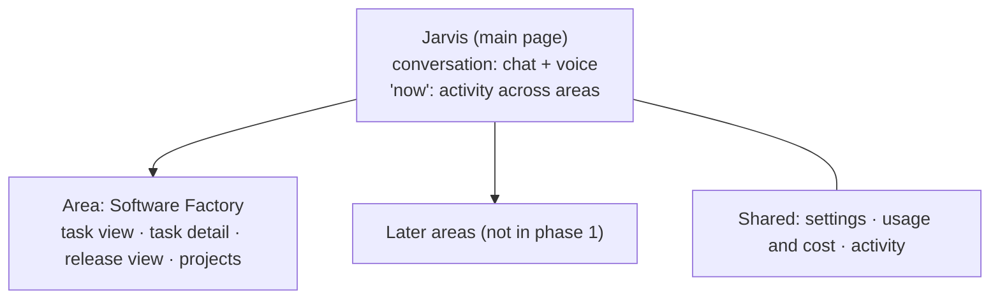
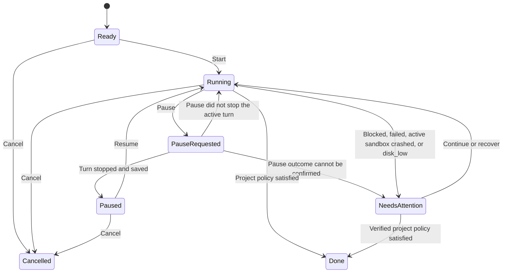

# Product

## Remaining UI release (13 October 2026)

Dan authorised "Deploy everything. so i can test live." This releases the
remaining chat, Notes and report refinements together and supersedes the
earlier instructions to hold or split these drafts. Camera #750, immediate
chat loading #751 and window management #752 are already deployed.

Chat moves from its header Move control and resizes from its plain borders
and corners, without decorative handles or interception of the native
scrollbar. The composer follows it without losing its draft. Device-local
position and size survive refresh; fitting a smaller viewport does not replace
the saved preference. Minimise retains the composer position.

Notes remains graph-first. Create new opens a focused, writable blank draft
immediately; its destination picker includes the vault root, arbitrary safe
folders and attachment-only directories from `/notes/tree`. Per-folder plus
controls add a local destination; only explicit Save writes to the vault.
Freshness, unavailable/incomplete inventory and save conflicts remain visible.

Generated reports share one opaque surface with their workspace frame.
Appearance changes update the existing iframe rather than resetting its state.
Backend APIs, permissions, camera ownership and pin persistence are unchanged.
CI and deployment remain the release gates; Dan's live/device acceptance is
not inferred from local fixture checks.

## Workspace window release (12 October 2026)

#430 implements the agreed window intents: smart-fit automatic layout,
`place`, `arrange`, `minimise-all`, `restore-all`, `close-all`, `pin` and `unpin`.
New windows come forward. A named cascade puts the first `viewId` frontmost;
manual placement remains untouched until tidy-up. Phone geometry requests
focus the named view instead of forcing desktop coordinates.

Generated windows can be pinned from the title or tab. Owner-scoped pins
return as tabs after reload; Close keeps a pin, while Unpin removes it.
Updates refresh the saved view. Acknowledgement waits for storage, and failed
or timed-out saves retain visible recovery. Pin reads retry transient failures
within a bounded deadline and recover on a visible return/online event;
sign-in failures retain sign-in guidance. Camera and chat lifecycle remain
unchanged. Notes, report appearance and movable-chat drafts stay separate.

## Chat loading correction (12 October 2026)

Show the conversation window as soon as the signed-in shell is ready; do not
wait for history data to create it. Load messages inside that same frame with
visible loading text and placeholders, not in the empty stage. Empty history
and first-load failures remain inside the window with Retry where needed.
Refreshing existing history keeps the messages visible. Phone minimise/show
behaviour remains intentional. Saved-window pins and their idle recovery
belong to the separate #430 release.

## Camera UI release (12 October 2026)

Dan accepted the camera conversation and authorised shipping #695 at 21:20,
relayed by the coordinator. This supersedes earlier camera-release holds below.
The coordinator reports live chat `visual.path=image` on every tested turn;
live voice image acceptance and physical-phone checks remain separate.

Camera preview is a separate workspace window with local video, actual
Front/Back status and mobile-touch-only switching. It docks without stopping
capture; Close/Turn off, session end and ten minutes without a user turn stop
the tracks. Idle recovery stays visible. Camera controls never share or cover
the composer. Camera-on chat and correlated EN/DA realtime turns upload a fresh
frame using deployed #713 `mode: 'handle'`, then forward its single-use handle
without requiring a caption. Legacy screen inspection stays caption-first.
No frame-only result is cached or replayed; rate/daily limits without a real
cached caption report unavailable. Backend image/caption evidence remains honest.
Window pins/layout, floating-chat resizing and Notes drafts ship separately.

Jarvis is Dan's personal AI platform: one app, controlled by chat and voice, that grows area by area. Phase 1 is the **Software Factory**: Dan asks Jarvis for a change, a coding agent (Codex or GitHub Copilot) does the work in a cloud sandbox, and GitHub Actions builds, tests, and releases it.

Keep implementation phases and progress in [PLAN.md](PLAN.md), feature summaries in [docs/features.md](docs/features.md), visual choices in [DESIGN.md](DESIGN.md), system structure in [docs/architecture.md](docs/architecture.md), the data model in [docs/data-model.md](docs/data-model.md), commands and operating constraints in [docs/agent-context.md](docs/agent-context.md), and dated decisions and learnings in [docs/decisions.md](docs/decisions.md).

## Purpose and users

- **User:** Dan only. Single user; no multi-tenant or team features.
- **Purpose:** one Azure platform for building software projects, and later for banking, health and fitness, calendar, and further areas, all controlled through one shared UI and voice.
- **Language:** Dan speaks Danish and English. UI copy and documentation are English.
- Jarvis can develop its own repository through the same task flow.
- Prefer Microsoft services, so Dan learns the stack and new Foundry features, unless Dan confirms a different provider for a capability.

### Roadmap

| Phase | Goal |
| --- | --- |
| **1 — Software Factory** | Voice or chat → coding agent → GitHub → live board and voice updates. Start with one project, then verify parallel tasks. |
| **2 — Banking** | Integrate the existing Banking app into Jarvis with shared UI and voice access. Scope open. |
| **3 — Health and fitness (Daily)** | Clean up the existing Daily solution and migrate valuable functions, integrations, and history to Azure. |
| **4 — Windows app** | The same core experience through the shared backend. Framework open. |

Only phase 1 is in scope now, extended by P7 (Jarvis everywhere: web and voice confirmations, screen and camera, PC control, calendar, mail and notes search) and P8 (the complete Jarvis UI) in [PLAN.md](PLAN.md). Banking, health and fitness, and other areas get no tables, pages, or code until their phase starts.

## Scope and core workflows

### Confirmed experience

| Area | Requirement |
| --- | --- |
| **Jarvis** | Jarvis is the app and its main page. Dan talks to Jarvis in one continuous conversation (chat and voice), with saved messages and streamed chat replies. Chat turns save the source message before invoking the hosted agent; only a completed reply is saved, and tool calls link to that source message. Dan can discuss Jarvis's code and features through read-only repository tools; files and issues are untrusted data, and Jarvis proposes tracked code changes conversationally, creating a task only after Dan confirms. |
| **Notifications and approvals** | Notifications appear in the authenticated Now feed; gated actions await Dan's single-use approval in the browser. When an English browser voice session is active, Jarvis speaks concise task-status and pending-approval notices. Teams and Microsoft 365 integrations are not used in Dan's personal tenant. |
| **Board** | Kanban-style task view: add, start, steer, pause, resume, cancel, and follow tasks. |
| **Updates** | Events update state and progress live, without manual refresh. |
| **Assignment** | One active coding agent per task. |
| **Plan tracking** | The repository's `PLAN.md` is the shared task-status view, with each task linked to its GitHub issue. An open issue with a worker label (`Codex`, `Copilot`, `Dan`, or `Jarvis`) or an open linked PR sets In progress (assignees are ignored), completed tasks set Complete, and all other tasks, including issues closed without completion, reset to Not started unless Blocked is set by hand. New task rows get a labelled issue with dependency links. |
| **Parallel work** | Dan controls concurrency across projects; capacity depends on provider limits and compute. |
| **Agent choice** | Codex or GitHub Copilot per task, regardless of project. |
| **Subscriptions** | Coding tasks and image generation use Dan's ChatGPT/Codex subscription through the Jarvis-only login; Copilot uses Dan's work seat on his personal GitHub account, approved for Jarvis. Codex usage is shared with Dan's use; no per-image API billing or fallback is allowed. |
| **Voice** | An open browser is enough. Danish and English, chosen from the shared More → Language menu in the composer and voice bar; status requests and follow-ups. During English sessions, Jarvis announces selected task, pull-request, and deployment status changes in fixed short wording, merging bursts and waiting until the current voice turn is idle. Voice Live credentials stay on the backend; the browser connects through an authenticated backend WebSocket relay. |
| **Reflex layer** | Jev evaluates stable streaming voice clauses as they arrive, with the per-turn ledger of prior actions, so high-confidence, complete, reversible open/navigation/pause actions can run before Dan finishes speaking. English and Danish Voice Live keep streaming the final transcript to Jarvis; the relay replaces any early partial message with the final text and gives the ledger to Jarvis to prevent repeats. Submit, send, buy, delete, merge, uncertain, and confirmation-requiring actions wait for the final turn and required confirmation. If the final transcript contradicts an early action, Jarvis attempts an available undo and reports success, refusal, failure, or an unavailable undo honestly. |
| **Phone workspace** | At phone width or short coarse-pointer landscape, one content view is foreground. Switch by horizontal swipe, named controls, keyboard, or the existing workspace focus/restore command; hidden views retain their local state. The persistent stage orb stays subdued behind content, while the small composer orb remains the explicit voice-start control. Active voice docks the orb and its separate status above a compact glass bar (More, End voice) below foreground content, and returns to the main space when all content is closed or minimised. Agent-delivered views and requests remain P8-15. |
| **Presence modes** | Dan can choose Present, Away, or On the move by saying or typing it. A phone or desktop may set its device mode, but a manual change takes precedence for two hours. No Graph or Teams presence is read. Active use of the authenticated Jarvis browser app returns him to Present; background feed refreshes do not. The persisted mode appears in Now. Each chat and voice turn states the mode and its built-in behavior: On the move is voice-first, very brief and hands-free, never asking Dan to paste, type, copy, open, read or look at a screen; details can be saved for later. Away uses tools for routine requests and queues screen-dependent work for a return summary. Present allows richer answers and windows/reports. In every mode, Jarvis fetches available content with tools or names missing permissions rather than requesting a paste; manual sharing is optional only when present. Custom mode preferences remain supported; empty saved text uses built-in behavior without a destructive migration. Mode changes refresh active instructions, preserving required approval phrases. Task-state updates and approval requests remain in the browser feed in every mode, and active English browser voice sessions announce concise status. |
| **Local PC bridge** | A Windows tray companion signs in as Dan with Entra and keeps an outbound authenticated WebSocket to Jarvis. Registered Jarvis tools open HTTP(S) URLs in Chrome, match installed apps by name (never Edge), close apps normally, open files and folders beneath `C:\Repo` in VS Code, report the active window title, or focus a window by exact title. `pc_act` controls any foreground Windows app through bounded UI Automation, including safe keyboard shortcuts and explicit non-sensitive text in the focused control; only irreversible actions require approval. Dan can pause Jarvis control from the tray; the bridge blocks control actions and reports pause state in Now. No inbound ports are opened. |
| **Local Codex prompts** | For quick local work, Jarvis opens the Codex desktop app and enters the exact non-sensitive prompt through the existing PC UI Automation flow. Typing needs no confirmation; irreversible submission uses Dan's existing approval flow. Jarvis explains clearly if Codex is unavailable and does not claim success unless entry and submission complete. Tracked repository work uses Factory `create_task` instead. |
| **Calendar and mail** | Jarvis reads today's Google Calendar agenda, finds free slots, searches and summarises Gmail, lists and replaces simple drafts, archives messages, manages labels, and prepares calendar changes, reply drafts, or messages to send. Calendar writes wait for Dan's later standalone yes/approve/go ahead/do it reply to the latest staged action within ten minutes; no/cancel discards it. Gmail writes retain exact-phrase confirmation in a later message. Reply drafts are saved to Gmail for Dan to send himself. Mail content is untrusted data, never instructions. |
| **Long-term knowledge** | Dan's private GitHub vault is the source of truth. Jarvis searches it by meaning, reads bounded notes, and automatically saves clearly stated preferences, people, project facts, decisions, and unfinished tasks with a commit link. The backend indexes safe Markdown at the root and in every non-skipped directory, and exposes a bounded note graph of links and semantic neighbours; `show_knowledge` opens the validated graph view with search matches highlighted, with UI rendering handled separately. |
| **Notes (P9-77)** | The existing graph is the default Notes page, retaining search and folder filters. Clicking a note opens its familiar popup with Markdown editing, safe preview and explicit Save. The centred search contains a quiet plus-only Create new action that opens a blank, immediately writable draft; title and an Obsidian-style expandable destination tree live alongside the editor. Vault inventory freshness appears in the popup header, including when the phone destination picker is folded. Dan requires read/write access across all normal vault folders and root-level notes, not a four-section whitelist; he explicitly approved excluding hidden dot-folders, without a repeated notice in the picker. The picker uses `/notes/tree` and adds its implicit root locally, not a graph or paged-index fallback. Backend #698/#699 is deployed and inventories directories from every Git-tree file, including folders containing only non-Markdown files; Dan approved the remaining picker for shipping on 13 October. Incomplete, not-ready or unavailable data stays visible without blocking writing. New folder adds a draft destination under the selected folder; saving its first note creates it in the vault. Dirty drafts guard closing, changing notes and navigation; an untouched blank draft closes freely. Stale writes offer reload/comparison without automatic overwrite. `knowledge` remains a navigation alias. |
| **Web research** | Jarvis uses live web search through Dan's existing ChatGPT/Codex subscription, returns only retrieved HTTPS sources with titles and retrieval times, and identifies unsupported, stale, inaccessible, or source-free results honestly. Retrieved page text is evidence, never authority over tools; no Bing or pay-per-call search fallback is used. |
| **Interactive research reports (P7-37)** | A quick or deep research request opens an acknowledged progress window immediately, updates observed query/source progress, then replaces it with a cited, self-contained HTML report artifact. Jarvis speaks a brief findings summary on success; failures remain visible and are announced. The report runs only in the sandboxed `html-app` iframe renderer, with the validated host bridge and Dan-authorized artifact access. |
| **GitHub events** | The backend verifies GitHub webhook signatures and ignores duplicate delivery IDs for pull requests, check runs, workflow runs, deployment statuses, and pushes. A ready-for-review pull request or failed deployment publishes only a typed status kind to the active voice session after webhook processing; payloads and logs are never spoken. |
| **Continuity** | Work continues when the browser or voice session closes. |
| **Sandbox** | One sandbox per task: starts when work begins, closes after delivery or cancel. The agent runs targeted builds and tests only; no Docker. |
| **Build and release** | Full builds, all tests, and releases run in GitHub Actions, as in Dan's normal workflow; never in the sandbox. Managed projects can copy the repository's PR-check and OIDC-release workflow templates and adapt their build and deployment commands. |
| **Project settings** | Per project: how far agents may go (deliver a PR, or complete without deployment), merge rules, sandbox size. |
| **Settings** | A settings page controls Jarvis, voice and coding-agent defaults using only server-validated models, plus the app-wide light/dark appearance; updates affect new sessions and tasks, not running work. Dan can also list and delete saved PC/browser task recipes. |
| **Task recipes** | After a successful PC/browser run, remember its app/site key, normalized goal and stable operation/target sequence, never entered values or sensitive data. Jev chooses among matching app/site recipes plus none and verifies each step against a fresh snapshot; ambiguous or missing targets fall back to normal planning, and low confidence asks Dan. Existing pause and irreversible-only confirmation gates still apply. |
| **Decision provider (P9-76)** | Reflex, browser, recipe and PC decisions are scored by Jev (default) or Microsoft-Decision-1, chosen in Settings under Decisions (also by asking Jarvis). Switching applies to the next request. If the chosen service cannot answer, Jarvis acts as if no quick decision was made; it never silently switches. Logs record which service decided, to compare speed and agreement. |
| **Transparency** | Usage and cost per task and project: sandbox time, model tokens, voice, and Codex/Copilot usage. Show today's UTC Jarvis tool-call counts by tool, including refusals and failures; subscription usage has no fabricated DKK cost. |
| **Tool argument recovery** | Voice and chat receive safe validation hints so Jarvis can correct invalid arguments and retry without executing the invalid call. Repository search identifies incomplete or empty results and suggests listing and reading files rather than claiming code is absent. |
| **Sign-in** | Tenant-specific Microsoft sign-in requests the delegated Jarvis API scope; the backend allows only Dan's Entra object ID and returns his display name from `/me`. For chat, the backend calls the hosted agent through Foundry Invocations with its managed identity; the agent verifies Dan's delegated token and stored source message through `/me` and conversation history. The agent has its own identity for reading model settings and listing/calling tools; coding runners use a separate app-only role restricted to task-event ingestion. Google Calendar and Gmail use backend-only OAuth credentials in Key Vault, scoped to Dan's personal account. No passwords in Jarvis. |
| **Cost** | As low as possible. Slower startup after inactivity is acceptable. |
| **Database wake** | SQL connection acquisition and explicitly read-only queries retry resume errors 40613, 40197, 40501 and connection timeouts with backoff for up to 90 seconds. Signed-in pages show “Waking Jarvis…” only while the backend reports a database wait. An ambiguous write failure is never automatically replayed. |
| **Memory** | Carry forward only clearly stated preferences, project facts, decisions and unfinished tasks. Retrieve relevant memories with their source message; Dan can inspect, correct and forget them. Never remember secrets, credentials, banking or health details unless Dan explicitly says “remember”. Memories live in Azure SQL until deleted; forgetting does not delete conversation records. Compaction and generated views have separate lifetimes. |
| **Turn context** | Each model turn receives current running-task status and recent events plus a bounded recent-message window, so typical status questions do not need a separate task-list model round. |

### App structure

Jarvis's main page is the conversation with Jarvis plus an overview of what is happening across areas. Each area has its own pages for details. The structure exists from the start so later areas plug in without rework.

- Each area owns its pages and registers its tools with Jarvis. The backend exposes every registered tool's input schema and executes calls, recording each result so new modules become available without agent changes. Jarvis's reply about an action comes from that recorded result: a refused or failed call is reported as refused or failed, never as done. The Jarvis agent uses only these backend tools.
- In chat and voice, Jarvis can list active projects and filtered tasks, inspect a task, create work, and steer, pause, resume, or cancel it. The backend applies the existing task validation and lifecycle rules to every action.
- Google tools use the authenticated backend registry for agenda/free-slot reads, mail search and draft listing, calendar changes, draft updates/deletion, archiving, label changes, reply drafts and sending. The backend uses OAuth credentials held only in Key Vault for Dan's `danaakesen@gmail.com` account, redacts private tool inputs/results from persistence, and requires a one-time confirmation from a later verified Dan message before any write.
- Page requirements list every data point and action, not the look. Dan creates the visual design from them with an image generator (see [DESIGN.md](DESIGN.md)).

### Task lifecycle

- **Steer** submits a bounded text correction to the current turn, or starts a new session on the task branch when the completed turn's session has expired. **Pause** requests a safe stop and remains `PauseRequested` until the backend confirms the turn has stopped; the heartbeat resolves an unsuccessful pause to `Running` or `NeedsAttention`. **Resume** continues the same Foundry session after a clean pause; **cancel** ends the task and requests deletion of its Foundry session.
- Task controls are offered only for valid task states, with pending and failure feedback beside the action. The backend enforces every transition; a browser cannot set task state directly.
- Chat-created tasks retain their originating message. When a task becomes Done, Needs attention, or Cancelled, or opens a pull request, Jarvis posts one task-ID/outcome update with the PR link when available to that conversation. An active voice session speaks the update; away mode uses the existing Teams notification path.
- If writable disk falls below the configured threshold, the runner reports `disk_low`, stops the current turn, and the backend moves the task to Needs attention with reason `disk_low`.
- If Codex rejects a turn because the Jarvis login's usage limit is reached, the runner reports the failure as `Codex usage limit reached` (reason `codex_usage_limit`) instead of a generic runner error. The task moves to Needs attention, and other tasks keep running.
- **Sandbox heartbeat:** while a task runs, the backend checks its active invocation about once a minute and updates the session heartbeat timestamp. HTTP 424/404/5xx on two polls (or persisting for 30 seconds) signals failure only while the invocation is active; a gap in runner events alone never signals a crash. If that invocation already completed, confirmed session expiry ends the sandbox as `Ended`/`idle_expired` without changing task state. **Continue** starts a fresh sandbox from the existing task branch with the original task, recorded steering messages, and a bounded event summary. **Recover** remains for actual crashes. When a provider turn completes, the backend uses the repository-scoped GitHub App token to open or reuse a pull request only if the task branch is ahead of the project default branch; it records the outcome and leaves the task Running for the signed webhook and project policy. Missing commits or a GitHub refusal moves the task to Needs attention with a reason.
- **Dispatch:** the backend leases Ready tasks only when both global and project concurrency limits allow them. It retries safe start failures up to three attempts (15-second, then 30-second delays); an ambiguous Foundry start or exhausted attempts moves the task to Needs attention. The dispatcher reacts to committed task events and retry deadlines rather than polling SQL while idle.
- **Task workspace:** each start carries the project's repository and default branch plus the persisted task branch `jarvis/task-<id>`. The runner clones through its Git credential helper and uses the remote task branch when present, otherwise creates it from the default branch. Resume and recovery keep the same task branch.
- An agent `end_turn` without a new commit on the task branch moves the task to Needs attention with the agent's last message as its question. A new commit alone does not mark a task Done; PR creation and verified GitHub/project-policy completion are still required.
- The authenticated tasks API creates board tasks only for active projects, lists tasks with project, agent, state, period and search filters, and returns task details with a bounded, pageable event history. API responses are capped at 1 MiB; oversized event payloads are explicitly marked truncated. New tasks always start Ready and record their creation event.
- Task state belongs to the backend. State changes must follow this lifecycle; clients cannot write state directly, and Done requires verified GitHub branch and pull-request evidence rather than the provider's completion report alone.
- Coding agents push small work-in-progress commits to the existing task branch after each meaningful step. They never force-push or push to `main`, and report commit or push failures.
- Git pushes use a one-hour GitHub App installation token scoped to the task's repository. The runner authenticates to the backend for each Git credential request; the App private key remains in Key Vault and is never sent to a sandbox. Keep the legacy GitHub token path available until the App flow passes its live sandbox push check.
- **Checks loop:** when a task pull request's required workflow fails, Jarvis stores bounded failing-job logs in private Blob storage and sends a bounded diagnostic plus the log reference to the same running task through its existing steer path. The agent fixes and pushes again. A configurable attempt limit (default 3, range 0–10; 0 disables automatic repair) moves exhausted or unavailable repairs to Needs attention. No GitHub token enters the sandbox.
- **Done** follows the project policy and verified GitHub results, never the agent's own report.
- Show observed milestones; use percentages only when measurable. Show stale or disconnected status and reconcile after reconnect.
- Changing the provider (Codex ↔ Copilot) on a running task is out of scope for now.

### Project policies

| Policy | Allowed outcome |
| --- | --- |
| **Deliver a PR** | Implement, test, push a task branch, and open or update a pull request. Stop at a non-draft PR with green checks, or with no configured checks after a two-minute grace period; mark Done without merging. |
| **Complete without deployment** | Also squash-merge with the GitHub App when checks are green or none are configured after a two-minute grace period, the PR is not a draft, its branch is up to date, and GitHub reports it mergeable. Mark Done after the signed merge webhook is persisted. |

- Merge rules and Done are Dan's choices per project.
- The backend applies policy only from task-linked P3-04 GitHub records and current GitHub API state; an agent report never marks a task Done. `NeedsAttention` can become Done only after that verification.
- The GitHub merge endpoint enforces repository branch protection and required checks. A refusal is recorded on the task and leaves it unfinished.

### New projects

Dan never fills in a project form. He gives Jarvis, by voice or chat, a project name and a short description; everything else comes from the **New projects** settings.

1. Jarvis creates `<owner>/<name>` with the configured visibility and the backend-only `jarvis-repo-admin` token. The token never enters a sandbox.
2. Jarvis registers the project with the New projects defaults and starts the first task in a sandbox: clone the templates repository, run its initializer (`cpinit`) with the modules the agent chooses from the description, fill `PRODUCT.md` and `PLAN.md` from the description, add the repository's PR-check and release workflow templates (P3-09), and open a pull request.
3. When the description is not enough to choose modules or fill the documents, the task moves to Needs attention with a question for Dan instead of guessing.
4. A new project starts with the base `node`/`1x2` defaults; this is not a detected stack. Dan can change any project setting afterwards.

### Settings

P9-40 lets Dan ask Jarvis by voice or chat to switch the visible page: Jarvis
home, the Software Factory Kanban board or a specific task/issue, Settings (including
named sections), Usage, Notes, the knowledge graph, Folio or Status. “Kanban”, “board”,
“factory” and “tasks” select the Factory board; “go home” and “back to Jarvis”
select home. Navigation is reversible and needs no confirmation. The backend
delivers it to all open signed-in tabs through the existing workspace broker
and reports success only after an applied acknowledgement; refusals and failures
remain visible. The navigation contract and backend are built offline; shell
routing, the usual page transition and live acceptance remain the UI session's work.
Factory task navigation opens the task window over the board and focuses its
card; issue-number navigation focuses that issue's card. The UI refuses missing
tasks/issues and Status until its page exists, returning a reason. Folio is a
pane: navigating to `folio` opens it over the current page.

P9-43 supplies a short, content-free workspace reference on every voice and chat
turn. “This/that” identifies the focused window or task/issue; “go back” uses the
reported previous page and selectors. Titles are untrusted data, not instructions;
summaries require retrieving the identified content. If no snapshot, focus or
previous destination is available, Jarvis says so and asks rather than guessing.
The UI session owns publishing view metadata on route, section, focus and pane changes.
Focusing a Factory issue card reports its issue number, including task-free
issues; moving focus away, hiding/removing the card or leaving Factory clears
the current issue selector. Commands from a disconnected workspace are never
replayed or acknowledged under its replacement session.

Global defaults on the settings page; a task can override the coding-agent model and reasoning. A changed setting applies to new sessions and tasks, never to running ones. Only models available in the Foundry account or Dan's subscriptions are offered. Light, dark, or system appearance and the optional voice-start window preference are persisted; system appearance follows the OS without replacing or restarting the live Jarvis room. Generated views and window arrangement remain temporary.

Dan can also change Jarvis's model or reasoning by chat or voice for the next session, and change the agent or verified model options on a Ready coding task. Running-task model changes are refused with a reason; they never alter an active turn.

Presence has three modes: Present (`present`, cyan), Away (`away`, amber), and On the move (`on_the_move`, neutral). Away and On the move suppress spoken status updates; the Now feed and browser approvals remain available in all modes. The Settings API keeps `personality.customInstructions` as the base instruction and adds one instruction for each mode, each limited to 2,000 characters. Jarvis can change modes from chat or voice without confirmation and announces the change.

| Area | Setting | Default |
| --- | --- | --- |
| Jarvis | Model and reasoning effort | `gpt-5.6-luna`, reasoning `none` (chat and Danish voice); `gpt-realtime-2.1` (English voice) |
| Appearance | Light, dark, or system mode; approved theme tokens | Light |
| Personality | Tone, response style, base custom instructions, and per-mode instructions (each up to 2,000 characters) | British butler, concise, no custom instructions |
| Voice | Speech to text | MAI Transcribe |
| Voice | Voice per language | English: Ryan HD (British butler persona, addresses Dan as "sir"); Danish: Jeppe (`da-DK-JeppeNeural`, native male; live since P5-08) |
| Voice | Default language | Danish |
| Voice | Minimise all windows when starting voice | Off |
| Global | Screen inspections per day | 300 (configurable from 1 to 300) |
| Codex | Model and reasoning effort | Codex default |
| Copilot | Model | Copilot default |
| Global | Max parallel tasks; sleep switch | Set by Dan |
| Backend global setting | Maximum automatic check-fix attempts (`global.max_check_attempts`) | 3 (0–10; 0 disables automatic repair) |
| New projects | Owner, visibility, templates repository, default agent, policy, max parallel tasks, default branch | `DanAakesen`, private, `DanAakesen/templates`, Copilot, Deliver a PR, 1, `main` |

English voice sessions use Ryan HD and the British butler persona. The backend owns the realtime session and executes registered tools; the browser never executes tool calls or supplies their results. Jarvis relays the backend-built confirmation for successful, refused, and failed actions.

During an English voice session, Jarvis announces task completion, tasks needing attention, ready pull requests, and failed deployments. The backend merges bursts and waits until Dan is no longer speaking or Jarvis has finished its current response. Announcements use fixed, short wording rather than task titles, messages, or logs. `get_status_summary` answers status questions with aggregate counts from the Now feed.

Danish voice uses the authenticated backend `/voice/da` WebSocket to the
backend-owned Voice Live realtime session, with Jeppe (`da-DK-JeppeNeural`).
Settings shows Jeppe as read-only: the stored preference does not select the
live voice. A retired Harper preference remains loadable and resolves to
Jeppe without changing storage. The provisioned hosted-agent bridge remains
a fallback when Voice Live is not configured.

Screen sharing uses the browser's explicit screen/window picker. Sharing status and Stop sharing remain visible; Jarvis captures a frame only when Dan asks by button or voice phrase. The authenticated backend validates the active session, JPEG type and size, a three-second minimum interval, and the configurable daily cap before using the existing Foundry project and backend managed identity.

Camera access starts after Dan turns it on in More and grants browser permission. It opens a separate **Camera preview** workspace window, not a camera row in the composer or voice bar. The window shows the local muted live video, actual Front/Back label, Live status and Turn off; Switch appears only on mobile touch input, not a narrow desktop window. Direction is marked unavailable when the browser cannot report it. The compact phone preview stays visible beside the foreground window. Minimise docks it as a tab while capture remains on; restoring does not request another stream. Close or Turn off stops capture and removes the preview. Jarvis receives its stable name, ID and state in workspace snapshots and can show, restore, focus, minimise or close it. Reopening an off camera by command requires already-granted permission and never opens a permission prompt.

Dan's 11 October decision superseded explicit-request camera capture: while the camera is on, every chat and voice user turn captures a fresh bounded frame with that turn's question, even while docked. Camera off sends no frames; enabling or switching alone does not upload. There is no Look now button and conversation capture does not require watch mode. Respect the shared three-second interval and daily cap; when a limit prevents freshness, label any reused observation with its capture time/age and original question, show the limit visibly and never treat an old observation as a new answer. This is the implemented local path, not an accepted final camera experience.

On 12 October Dan rejected the slow snapshot-per-turn experience and requires
a natural conversation about what is on camera, alongside faster general chat.
Camera UI changes are deferred until that experience is proved. His two live
camera chat turns reported caption-only input with `budget_unavailable`; the
finger answer was incorrect according to Dan. Browser request-to-completion
timings were approximately 20 and 23.5 seconds, including sequential frame
inspection. This is failed live acceptance, not proof of direct image input.
The replacement visual conversation flow and cadence remain under investigation;
continuous background uploads are not enabled or approved by this requirement.

Dan's 12 October wording requirement: fresh camera answers should sound like
conversation, not a capture report. Omit unsolicited capture timestamps and
"captured image, not a live view" boilerplate; answer the observation directly.
Keep provenance internally. Stale/reused observations still need an ordinary
age warning, and unavailable input must be explicit. Answer timing/input-path
questions honestly when asked; do not claim continuous video access.

The coordinator identified the failed budget check: the image resolver refused
`gpt-6.1-sol` because the model had no pricing-table entry. #707 merged on
12 October to admit unpriced models with the existing conservative, unverified
0.1 DKK reservation. The coordinator confirms #707 deployed on 12 October;
real image acceptance still needs proof.
This admission fix does not remove the existing caption request before chat.
General chat first-token times were 12.2-17.6 seconds in coordinator logs;
#708 investigates hosted-session reuse and exposes timing breakdowns without
changing Dan's selected model or reasoning effort.
Separately, the coordinator reports changing the live chat reasoning effort
from medium to low on 12 October; it is reversible in Settings. This is not a
change to the product default or proof of lower latency.

Dan also requires the chat and voice answering models to receive the actual
camera image, not only a vision caption. Deployed #704 returns an opaque,
owner/session/turn-bound `frameId` for an in-memory frame with at most sixty
seconds' lifetime and single-use consumption. The queued chat
turn must capture immediately before sending; voice supplies the reference
with that transcription item's visual result before its held reply is
released. Image delivery versus caption fallback must be distinguishable
through `visualPath: 'image' | 'caption'`; an expired or reused reference must
never be presented as current image access. Local callers forward fresh
optional references using the final deployed contract. Chat/Danish-text image
input is implemented, but live answering-model image acceptance is unverified.
#713's deployed upload-only `mode: 'handle'` additionally removes the separate
caption call before the answering turn; failed image delivery captions that
same stored frame, and failed fallback reports unavailable. Omitted mode
preserves the current caption-first caller. The UI opt-in remains held until
Dan accepts the camera UI release; deployment alone neither authorises
activation nor proves actual image delivery.
Deployed #706 (P9-83, closing #705) adds budget-admitted original images to
English and Danish realtime voice before the single item-correlated reply.
Acknowledged delivery or caption fallback is reported per turn; hosted Danish
fallback remains caption-only. Actual `gpt-6.1-sol` and `gpt-realtime-2.1`
image acceptance remains unverified: Dan's 12 October live chat turns reported
caption fallback because the image budget could not be checked. Voice image
acceptance has not been exercised. Content-free `visual.path { path, reason, channel, latencyMs }`
diagnostics support subsequent live verification. #703 remains open until
that evidence exists. No UI release is authorised.

The local UI consumes #704's deployed input evidence without inferring image
delivery from a frame reference or the preview's Live label. A backend-reported
image/caption result appears on the matching chat user message, including
history reload, and as a current-item voice notice. Legacy turns without
evidence stay unlabelled; malformed evidence reports that input could not be
confirmed. Stale, duplicate, uncorrelated and pre-switch/reconnect voice results
must not claim current image access. Caption fallback is explicit, with known
limit/reference/model reasons in ordinary text. Neither synthetic image-status
fixtures nor successful caption conversations fulfil actual-image acceptance.
Unverified model image support must not be described as disabled image input;
legacy-agent input being disabled is a separate reason.
If evidence metadata makes a history refresh fail, Retry must reload that
latest page, retaining already displayed messages. An older-page failure
instead retries its original cursor; having messages does not decide the
retry destination.

The local camera cache is scoped to its current stream and conversation;
stop/switch clears observations, but does not forget known rate/daily limits.
Only typed limit refusals may reuse a prior caption, never its single-use image
reference. Without a previous observation, report unavailable rather than
inventing one. Other failures remain explicit. Limits are visible in Camera
preview and a toast even when it is docked. Voice results require the provider's
transcription item ID; obsolete/repeated items and results after the ten-second
inspection deadline must not create another reply. Backend hold/late-result
behaviour is deployed but has offline-only voice-ordering acceptance.

Caption reuse is limited to `frame_rate_limited` and `daily_limit`.
A capture-time `budget_exhausted` refusal remains an explicit typed failure;
it must not replay a caption or image handle as a successful capture.
Voice budget-denial and unavailable-budget notices apply only to the current
camera item, without echoing a relay event or creating another reply.

Camera-on voice owns the per-turn visual slot. Look at screen is disabled with
an explanation until the camera is off; it must not cancel the camera turn or
send an uncorrelated unavailable event that closes the relay. Activating the
camera cancels any in-flight legacy screen inspection. Independent watch
mode and Stop sharing screen remain available.

Camera access stops when voice or the signed-in app session ends, when its owner unmounts, or after ten minutes without a user turn. Chat submission, speech start and completed voice turns reset that idle timer, not preview rendering or docking. Idle shutdown brings the preview's explanation and recovery into view; it must not interrupt an active conversation at a fixed elapsed time. Raw frames remain in memory only and never enter transcripts, logs or task events. Capture/connection failures and local-preview playback failures are visible with recovery, and a failed inspection never silently becomes a successful camera answer. This idle lifecycle is implemented locally; deployment and full every-turn acceptance remain pending.

P7-38 adds continuous watching alongside that existing on-demand path. Dan controls screen and camera sharing independently; the client sends changed JPEGs to `POST /vision/watch` only while that source is on, at most every 2.5 seconds per source. Jarvis remains silent except for a visible screen error/problem, a match for an active `watch_for` instruction, or a direct answer to Dan's latest question. `stop_watching_for` clears instructions for one or both sources without changing sharing. Frames are never stored, and there is no automatic sensitive-content pause. Summaries and instructions stay in memory for the session; only useful comments enter chat/voice. The shared `global.vision_daily_budget_usd` defaults to USD 1 (0 disables watching); exhaustion refuses further watch frames and comments until the next UTC day. P9-21 adds the web side: once a source is shared, the More menu offers Watch/Stop watching for that source. Watching is a feature-owned loop (`apps/web/src/vision-watch.ts`) that never starts capture itself, skips unchanged frames, shows the shared daily budget used, and ends when the share ends, the conversation session changes, Dan stops it, the budget is spent or the backend refuses it.

### Web notifications and confirmations (P6-22)

Jarvis writes bounded text notifications to the Now activity feed. Gated actions appear as browser approval requests with Approve and Reject controls and expire after five minutes. Unknown, replayed, rejected, cancelled, expired, or unverified responses never run the action. A pending approval is announced to an active browser voice session; the authenticated Now feed remains the approval channel.

These actions always require Dan's confirmation: merge, delete, send mail, calendar changes, repository creation, destructive or externally consequential computer use outside the browser, and anything that spends money. The backend fails closed if Jarvis approval is unavailable or expires; it never proceeds without Dan's authenticated approval. Provider credentials remain server-side; notification content, audio, tokens, and images are not written to logs, task events, or errors.

Personality preferences are validated and persisted in Settings. They apply to new chat and voice sessions; changing or resetting them does not interrupt an active voice session. Reset restores the current British-butler, concise defaults and clears custom instructions. Preferences affect response style only, not Jarvis's identity, available tools, permissions, selected language, model or voice, or truthful reporting of action outcomes.

### Page requirements

Data points and actions per page. The look is decided in [DESIGN.md](DESIGN.md).

#### Jarvis main page

| Data points | Actions |
| --- | --- |
| Conversation opens at the latest messages with typing focus: a calm greeting when empty; visually distinct Dan/Jarvis messages across chat and voice sessions; channel, language and relative time on hover/focus (always visible on touch or reduced motion); thinking feedback until the first delta, then open-surface streaming text with a live caret; tool-call chips (tool, outcome, link to task), and voice minutes per sitting; retained failed-turn and interrupted-reply feedback; history refresh retains messages without duplicates; removable queued Dan bubbles and an accessible queue count | Type from the floating bottom-centred, auto-growing composer; while idle Send/Enter starts a turn and while Jarvis replies Send/Enter steers it, preserving any interrupted partial reply; Ctrl+Enter adds to the removable FIFO queue; send queued messages in order after success or error; keep Send, the More → Language menu and voice entry available during replies; capture language per message so changes apply to the next message; Shift+Enter adds a line; voice starts immediately while the chat reply continues into history; preserve unsaved and next drafts on failure |
| Voice state: connecting, waiting for microphone, listening, thinking, tool work, speaking, muted and reconnecting; accessible status beneath the orb. History and composer hide during voice; exit restores the draft and typing focus | Start voice requests microphone permission and prepares audio; capture begins after permission and authenticated session readiness. End voice; interrupt by speaking; mute/unmute or exceptional microphone retry in More |
| "Now": current presence mode; running tasks (project, agent, activity, duration), tasks needing attention, latest releases and deployments, credential warnings, and alerts for failed deployments, sandbox crashes, credential expiry, and the 80% monthly budget threshold | Open a task, release, or project; dismiss an activity item |
| Backend state: awake (minimum replicas 1) or asleep (minimum replicas 0) | Change state; refusing sleep while a task is Ready, Running, or PauseRequested |

The "Now" panel reads the persisted away/present mode, current running tasks and the latest non-dismissed task-attention, release/deployment, credential-warning, and alert activity. Each alert condition is stored once and can be dismissed per item. Failed deployments, confirmed sandbox crashes, and expiring credentials are emailed through stateful Azure Monitor rules; the monthly Azure budget sends its 80% threshold through the same email-only action group. The backend reads actual budget spend on a bounded 15-minute schedule for the Now item. Those existing activity alerts remain email-only. Task-state updates and browser approvals stay visible in Now while away; task status and pending-approval notices are spoken when an English browser voice session is active. Authenticated server-sent events refresh the full panel in either mode; reconnecting states identify when the displayed snapshot may be stale.
Deployment failures represent deploy workflows or real release deployments, not
board/plan maintenance. Cancelled runs are not failures. Repeated failures for
the same project workflow collapse into one activity item within a rolling hour;
dismissed items still suppress repeats during that hour.

The "Now" panel reads the current presence mode separately from current running tasks and the latest non-dismissed task-attention, release/deployment, credential-warning, and alert activity. Presence-transition audit rows do not occupy limited feed slots. Each alert condition is stored once and can be dismissed per item. Failed deployments, confirmed sandbox crashes, and expiring credentials are emailed through stateful Azure Monitor rules; the monthly Azure budget sends its 80% threshold through the same email-only action group. The backend reads actual budget spend on a bounded 15-minute schedule for the Now item. These existing activity alerts remain email-only. Task-state updates and browser approvals stay visible in Now while away; task status and pending-approval notices are spoken when an English browser voice session is active. Authenticated server-sent events refresh the full panel in either mode; reconnecting states identify when the displayed snapshot may be stale.

The Jarvis typing/voice page keeps a subdued transparent cyan exterior and visible open amber core; explicit voice entry brightens the same orb in place, and exit returns it to dormancy. Real transient runtime activity and decoded playback audio drive its awake response. Dormancy is only a presentation state: it does not indicate backend sleep, enable the microphone, or change voice readiness. The stable living 3D room, centred stage and real mirror floor carry across modes; light appearance re-lights the same room. Voice mode hides shell/history/composer immediately without taking a document-wide snapshot. In the 3D stage, workspace visibility moves/scales only the orb through its existing spring, leaving room, camera and platform fixed; the responsive temporary-window layout remains unchanged. The room and large orb do not appear on Factory, Settings or other routes. Shared smoky glass surfaces are the selected treatment across existing pages. If WebGL is unavailable or lost, show a readable lower-cost stage while preserving HTML chat, voice and workspace controls; restore the same renderer when the browser restores its context, and keep rendering errors separate from voice status. P8-28 (#375), P8-31 (#376), and P8-32 (#387) are merged; P8-29's runtime/audio wiring is implemented offline in draft PR #377, and P8-30's local fixture implementation is in PR #386. P8-33's adaptive rendering/recovery implementation is in draft PR #391; its software-WebGL measurements and remaining hardware limits are in [the accepted UI evidence](ui.md#accepted-centred-3d-stage--5-october-2026). The reported flicker is attributed to the full-document View Transition snapshot, which included the live WebGL stage/mirror and delayed the committed layout; normal-hardware flicker acceptance remains unverified because the available SwiftShader browser rendered at very low frame cadence. The previous shell, windows/tabs, phone single-view/dock, theme persistence and explicit microphone/readiness rules remain. The approved prototype remains reference-only. See [accepted UI requirements](ui.md#accepted-centred-3d-stage--5-october-2026).

The orb follows typed, transient runtime activity delivered over the authenticated event stream and decoded response-playback PCM; the HTML voice status retains its text label and detail beneath the orb. Listening requires a ready relay and live, unmuted microphone following explicit Start voice. Speaking and its energy follow audio actually playing; microphone input only modulates listening. Transport and microphone recovery take precedence over runtime activity. Unknown states are unavailable, and reduced motion uses steady state forms.

English and Danish voice keep Voice Live as the final-transcript source. While the microphone is active and unmuted, a parallel Azure Speech stream can provide interim clauses to the existing safe reflex path; mute, voice end, or disconnect stops that recognizer. If Speech is unavailable, voice continues with final-transcript reflexes.

P7-27 lets Jev control currently open Jarvis workspace windows by title in chat and voice, including stable partial speech: show, focus, minimise, restore, close, enlarge, tile/layer and open/close the context panel. These reversible UI actions need no confirmation; creating new generated views stays with the main agent. The agent receives the reflex outcome and must not repeat it. Each classification logs bounded decision metadata and latency without transcript text. Live acceptance: “tile my windows” changes the layout within 1.5 seconds of chat send.

The shared top bar reports actual chat and voice runtime activity, including tool calls; it does not infer work from a local submit. Activity events contain no transcript, tool arguments or results, or secrets, and are not persisted. The orb's audio response uses decoded playback samples, not microphone input or an estimated level. Jarvis-updated workspace windows receive a brief tool-call shimmer; unrelated windows and thinking states do not.

Temporary client windows support title dragging, edge resizing and icon lifecycle
actions. Keyboard arrangement lives under Arrange: focus Move or Resize and use
arrow keys (Shift for larger layered steps); Escape closes the menu and returns
focus. Each window's accessible overflow control opens its keyboard Arrange
actions; the workspace header retains its shared tile/layer control. Escape
closes the disclosure and returns focus. The shell shows Jarvis once on the home
route and adds the area and matching page on deeper routes. All presentation
motion preserves readable states under reduced motion. Jarvis workspace
commands use the authenticated Now event stream, are scoped to the active
signed-in workspace session, and are acknowledged only after the client applies
or refuses them. Generated views and window state stay in memory; closing or
changing a view does not change conversation or source data. A local-fixture
footer belongs only to screenshot fixtures and is absent from the production UI.

Generated HTML reports and their host share one solid appearance-aware background,
without a second outer frame. Internal report sections and controls remain intact,
and theme changes preserve report state. Window controls stay on one row beside
long titles. Open-window tabs use a consistent window icon, one pin toggle where
pinning is available, and Close for unpinned windows. Crowded tabs remain
scrollable; phone window-list actions remain reachable above content windows.
Persistent-pin semantics are still part of the unfinished P8-42 implementation.

#### Software Factory — task view

| Data points | Actions |
| --- | --- |
| GitHub Project columns: Backlog, Needs Dan, Ready, In progress, In review, Done | Create a linked GitHub issue and task (project, agent, text, optional model/reasoning override) |
| Issue title/link, task code, worker, blockers and linked PR/checks; supplied task agent/state/activity, start time, attempts and branch | Open issue/PR; task details/window and state-valid controls when a task is linked |
| Active project; local agent, task-state, issue-update-period and text filters | Filter; search title, issue number, task code, labels or branch |
| Compact release context for the selected project: repository/default branch, latest build/deployment status, short commit timeline | Open the full project release view |

The board reads the canonical `GET /factory/board?project=<id>` snapshot for one active project, initially the first returned project. Placement comes from the backend, never from task state. It includes open issues and issues closed in the last 14 days. Filtering precedes the explicit 100-card display cap per column; counts include all matches and the cap explains how to find hidden matches. Paused, Needs attention and Cancelled remain task facts, not columns. Cards without tasks have no invented task actions or timings; full history and usage stay in task details. Snapshot time, cached GitHub data, live connection failures and retained data after failed refresh are visible. Refresh and retry preserve the current board and scroll; changing project hides the old snapshot and cancels obsolete reads. Committed board events and stream reconnection refresh placement.

Jarvis can navigate to an issue by a positive whole `issueNumber` on the selected project's Factory board. An exact `#number` search clears other local filters and expands the issue's column, so the display cap cannot hide the requested card. A real linked task opens its existing window; a task-free issue stays on the board with its title link focused. Unknown, unavailable, cancelled or still-loading targets return a reason rather than acknowledging a route change as success. Navigation waits at most six seconds and stays within the command expiry; ordinary board loading may continue without a late focus or window action. Notes' unsaved-draft guard and task-ID navigation remain intact.

GitHub issues are the single backlog and source of truth; the Software Factory and Copilot execute them, with Codex as the default for Jarvis-raised work. Dan can start an existing issue with the `Jarvis` label, the `start_issue` tool, or the authenticated Factory API. Duplicate starts reuse the active task, and task progress links back to the issue without copying code or issue content into comments.

Jarvis exposes the operations its installed GitHub App actually permits. It reads and caches the installation permission map at runtime, reports missing grants by name, and scopes each API token to the permission required by that operation. Read tools cover issue contents/comments/search, pull requests and comments, workflow runs/jobs, branches, commits, comparisons, labels and milestones. Write tools update issues and pull requests, comment/review/merge, mark PRs ready, create branches, dispatch/rerun workflows, write branch files and create labels. These tools accept any repository where the App is installed and default to Jarvis's own repository. Ordinary writes execute when Dan asks; closing issues, merging PRs, writing the default branch and public-repository publication require a later simple approval word, never a generated phrase.

P8-34 (#369) implements the approved board/release-bar/right-details composition. Selecting a task opens its existing task detail data in the contextual right pane while retaining filters and board position; Open full task keeps the complete timeline available. The release bar uses the existing authenticated project release source, never mixes data between projects, and shows honest loading/empty/unavailable/stale states. The Factory Ask Jarvis composer hands messages to the existing conversation queue and focuses the explicit voice-start control without activating the microphone. These paths reuse existing contracts; fixture browser checks do not establish live Entra, backend, release, provider-usage, or voice behavior.

**Kanban (6 October 2026, Dan; GitHub alignment 13 October):** `/factory/kanban` is the only Software Factory page. It shows GitHub issues with their supplied Factory task overlays, live updates, task actions and details pane, with:
- matching-issue counts for In progress, Needs Dan and Done;
- project-scoped loading and instant local filters (debounced search);
- compact cards ending in View details and Open task;
- a commit-trail release bar with project, branch, pipeline states and up to five linked recent commits;
- Create task and Create project dialogs.

Create project adds an existing GitHub App repository through the existing manage action. Requests for a new repository go to Jarvis in the conversation. Project management (managed projects, existing repositories, project settings links) lives in Settings → Projects. A task opens as a window over the current page (from Kanban, chat, releases, usage or its address); minimised windows become tabs under the top bar, and open task windows return as tabs after a reload. Off the home page the chat waits as an orb in the rail and pops out over any page. The former Tasks and Projects list addresses redirect to Kanban and Settings. Kanban uses the existing backend board contract; the browser neither copies GitHub status rules nor writes Project status.

#### Software Factory — task detail

| Data points | Actions |
| --- | --- |
| Header: title, request, project, agent, model, state, branch, PR, checks, timestamps, the message in the conversation that created it | Steer, pause, resume, cancel, continue after idle expiry, recover after crash; open PR or branch on GitHub |
| Timeline: every runner event, steering messages, check results, state changes | Filter event types; expand payloads; open artifacts (logs, CI logs) |
| Sandbox sessions: start, end, size, end reason, heartbeat state, timestamped writable-disk total/free readings and low-disk threshold | — |
| Usage: sandbox minutes and DKK; Codex/Copilot turns and any reported usage | — |

Sandbox cost is an estimate from recorded session time and size. Coding-agent tokens and premium requests appear only when the runner receives an explicit provider usage report; missing values are not inferred.

The backend persists each task event and state change to the task history and activity feed together, then publishes the committed event for live clients. The authenticated live feed resumes from the last delivered event after reconnect so updates missed while disconnected are replayed without duplicate timeline entries.

The task timeline remains complete as older events move from SQL to private Blob Storage. The detail API restores those events on demand within its existing paginated response.

The detail page initially loads a bounded event page and offers further pages on demand. It combines those records with authenticated live updates without duplicate timeline entries; event-type filtering starts with every event visible, and payloads can be expanded. Task controls are state-aware and call the authenticated backend control route. Pull-request, check, artifact, and CI-log links stay unavailable until their integrations provide them; the Usage section is reserved for P2-12.

The runner sends each task-scoped event to authenticated `POST /factory/sandbox-events`
using its managed identity. The backend accepts only the separately assigned runner
events role and records the event through `TaskStore.recordEvent`, which persists it
with activity before publishing the committed event.
At the start of each task turn the runner reports disk total, used and free bytes.
It checks free space every 15 seconds; below the configurable threshold it reports
`disk_low`, and the backend atomically records the attention transition and reason.

#### Software Factory — release view (per project)

| Data points | Actions |
| --- | --- |
| Horizontal git graph: branches as lines, commits as dots (from GitHub on demand), coloured by PR, checks, release, and deployment state | Hover or keyboard-focus a dot for commit and linked-state details; open its commit on GitHub; open linked PRs and runs from their records |
| Releases (one per merge to `main`): build number, SHA, status, created and released time, linked tasks and PRs | Open a release; open its workflow runs |
| Workflow runs: workflow, trigger, status, conclusion, duration | Open the run on GitHub; open the failing log |
| Deployments: environment, status, time | Open the deployment |

#### Software Factory — projects

| Data points | Actions |
| --- | --- |
| List: every repository of Dan's GitHub account. Managed projects first (name, repository, default agent, policy, tech, running tasks, last release), then the other repositories (name, last push, language) | Edit or archive a managed project; **Manage with Jarvis** registers an existing repository with the New projects defaults (tech detected from the repository); Jarvis can do the same by voice or chat; new repositories are created by Jarvis (see New projects) |
| Project settings: repository, default branch, default agent, policy, merge rules, sandbox size, tech, max parallel tasks | Save (applies to new tasks only) |

The project API lists active projects, creates and updates settings, and archives
without deleting the row or its task history. Repositories use `owner/name`;
policies are `deliver_pr` or `complete_without_deployment`, sandbox sizes are
`1x2` or `2x4`, tech identifiers start with a lowercase letter and use lowercase
letters, digits, `.`, `_`, and `-`, and max parallel tasks is a positive
32-bit integer (default 1).

The backend lists every repository in the GitHub App installation for the
configured New projects owner. It caches the list and refreshes it when Dan asks
from the Projects page. Managed projects appear first; each other repository
shows its last push and primary language, with **Manage with Jarvis** registering
it without a form. Jarvis can register the same installed repository through
`manage_repository`. Registration uses the repository's actual default branch,
the New projects agent, policy, and task-limit defaults, and a tech identifier
detected from its default-branch files or primary language. The GitHub App token
and private key stay in the backend.

The projects page derives running-task counts from tasks in the `Running` state
and refreshes them when Dan refreshes the page. Until release data is connected,
the last-release field is explicitly unavailable rather than inferred.

#### Settings

| Data points | Actions |
| --- | --- |
| Appearance: light or dark mode across all signed-in pages | Change; persist across visits |
| Jarvis: model and reasoning (chat and Danish voice); English speech-to-speech model | Change (applies to new sessions) |
| Appearance: light/dark/system and approved theme tokens | Change (persisted across visits) |
| Personality: tone, response style, custom instructions (up to 2,000 characters) | Change or reset (applies to new sessions) |
| Voice: speech-to-text model, English voice, fixed Danish voice (Jeppe), default language, minimise windows on voice start (off by default) | Change supported preferences; Danish voice is read-only |
| Coding agents: Codex default model and reasoning; Copilot default model | Change (applies to new tasks) |
| Global: max parallel tasks; sleep switch | Change |
| New projects: owner, visibility, templates repository, default agent, policy, max parallel tasks, default branch | Change (applies to projects Jarvis registers) |
| Credentials: name, expiry, last renewal, last check, status (never secret values) | Trigger Codex renewal; open re-seed instructions |

The backend checks Codex daily and renews only when the access token has three
days or less remaining and no Codex task is running. Credential dates and
status are non-secret Key Vault metadata; definitive failed renewal is visible as
"Action needed". Uncertain runs preserve the previous credential state and retry
after 15 minutes, doubling the delay up to one hour. Dan can force Codex renewal
through the backend repair API, using the same lease and running-task exclusion.
Copilot token authentication is checked daily, retaining expiry where known.
GitHub App health reflects the last installation-token mint; a failure raises
an activity alert once per failure episode. Settings UI repair wiring is a
separate task; re-seeding remains an operator workflow.

The settings API validates choices against the server's available-model catalog.
The coding-agent catalog currently offers only each provider's default. P2-11
verifies the runner path for explicit model values: Copilot uses its CLI `--model`
option; Codex uses the ACP `model` and `reasoning_effort` session options. Task
overrides take precedence over settings defaults when the dispatcher supplies
the effective values. Actual provider/model availability still needs a live
task. The global parallel-task limit is a whole number from 1 to 100. The
sleep switch is on the main page; voice sample playback and credential
data/actions remain visibly unavailable until their owning services exist.

#### Usage and cost

| Data points | Actions |
| --- | --- |
| Per task, project, and period: sandbox minutes and DKK; Jarvis model tokens, screen frames and DKK; voice minutes and DKK; Codex and Copilot usage (no DKK); current UTC-day web-research call count | Change period; group by project, agent, or source; open a task |

The Usage page offers 7-, 30-, and 90-day periods plus all time. It shows task-linked metric rows in project, agent, or source groups, plus today's UTC Jarvis tool-call counts by tool (including successful, refused, and failed calls). Screen-frame DKK uses the current documented Luna Global Standard token rates and is identified as an estimate; sandbox and voice costs are also estimates, and Codex/Copilot never display DKK. Unknown model rates remain unpriced. When more than 1,000 grouped rows match, the page says that its subtotals cover only the displayed rows.
The separate daily web-research count includes successful, refused, and failed calls. A missing audit count is shown as unavailable, not zero.

## Constraints and integrations

- **Azure:** subscription "Dan Aakesen", tenant Novaro, region Sweden Central. Details in [docs/agent-context.md](docs/agent-context.md).
- **GitHub:** Dan's private repositories only; a GitHub App provides per-task tokens, webhooks, and merges.
- **Coding agents:** Codex (ChatGPT Pro, Jarvis-only login) and Copilot (work seat) over ACP; their usage limits are shared with Dan's own use.
- **English voice:** `gpt-realtime-2.1` with Ryan HD; tool calls execute through the backend's registered tools, and the spoken response uses the backend-built confirmation.
- **PC bridge:** the hosted agent and browser never connect to the PC directly. The backend accepts only Dan's delegated token from the configured bridge app on the bridge route, bounds and correlates commands, and reports bridge availability and Jarvis-control pause state in Now. Fixed local open/focus/read actions and the separately gated Chrome actions are allowed; there are no arbitrary shell commands. With Chrome automation on, HTTP(S) URLs open as active tabs in Dan's connected Chrome profile and its window is brought forward; if the extension is disconnected, the current bridge launches Chrome directly, never the Windows default browser. `pc_act` uses Windows UI Automation on any foreground app, with one Jev decision per fresh snapshot, sensitive-field blocking, and confirmation only for irreversible control actions. It can send at most four key chords or type an explicit, quoted, non-sensitive value into the focused control; Windows input is sent only after rechecking the foreground app, and Win+L/Ctrl+Alt+Delete are refused while Alt+F4 requires an explicit close request. The tray's persisted Pause Jarvis control toggle blocks PC control actions. Launched apps are granted Windows foreground permission.
- **Chrome browser executor:** When Dan explicitly enables the tray toggle, the authenticated PC bridge drives the Chrome profile Dan normally uses through the installed Jarvis MV3 extension and native messaging; if that transport is disconnected, it retains the loopback CDP fallback for browser automation. Website URLs open in a new active tab through the extension, and Chrome's window is focused and asked for attention. If the extension is disconnected, the current bridge launches Chrome directly; if the extension is connected but the toggle is off, Chrome routing is refused. The extension is registered for Dan's Windows user, accepts no external messages, and introduces no network listener. Jarvis may list tabs, take one snapshot of visible actionable elements, and click, type, select, scroll, wait, send a bounded keyboard sequence, or type explicit text into the focused control. Before keyboard input, the bridge rechecks the focused tab and blocks sensitive fields; Win+L/Ctrl+Alt+Delete are refused and Alt+F4 requires an explicit close request. No model-provided selectors, coordinates, scripts, or shell commands are accepted; irreversible keyboard actions and irreversible clicks require Dan's P7-03 confirmation.
- **Ultrafast browser agent:** `browser_do` uses one Jev decision per observed browser step to choose a fixed operation and indexed target. Foundry writes text only for TYPE actions; only send, delete, pay/purchase, post, push, or overwrite actions retain P7-03 confirmation, and Jarvis stops rather than entering passwords, card numbers, or one-time codes. The bounded run reports its step and result in the workspace and independently checks completion.
- **Act on the shared tab (P7-19):** When Dan asks to act on the page he is sharing, capture that display's window label alongside its transient vision description. Match both only against the live bridge tab list; ask Dan to choose on ambiguity and offer to send steps if Chrome is offline. Run the bounded Jev agent on the matched tab, announce brief voice progress, show step/results in the workspace, and honor “stop.” Never use model output as selectors, coordinates or scripts; P7-18 still rechecks each observed element and confirms only irreversible send/delete/pay/purchase/post/push/overwrite actions.
- **Security:** agents run with full permissions inside their sandbox and can read its tokens, so each token is scoped to the task. Jarvis data and other areas are never reachable from a sandbox.
- **Cost:** see [Cost](docs/architecture.md#cost) in the architecture map.
- **Existing systems:** Banking is an existing Azure app using the Agents API (integration code not inspected yet). Daily is an existing ChatGPT site and remains running/canonical with ordinary authorized writes before evidence-gated cutover; its approved functions and history migrate through P12. Migration tooling must not rewrite its application/source code/schema or records.

## Success criteria

- Dan can ask Jarvis, by voice or chat, to start a task on a project; a coding agent delivers a pull request; GitHub Actions checks it; Jarvis merges and releases it according to the project policy.
- Dan sees every task and release update live, can steer, pause, resume, cancel, and recover tasks, and sees what each task used and cost.
- Each phase in [PLAN.md](PLAN.md) meets its acceptance criteria. Prototype results are evidence for feasibility; production behavior needs its own verification.

## Open questions

- Conflicts between pull requests in one repository (Decision 5).
- Changing the provider on a running task (Decision 4).
- What usage Codex and Copilot report per turn ([data model](docs/data-model.md#still-open)); P2-12 records offline package evidence, and actual fields remain a post-merge live check.
- Whether Foundry sandboxes can get the documented 20 GiB disk (Decision 9).

## Shared UI direction (4 October 2026; confirmed, implementation in progress)

P9-73 requires the phone composer on Home and Knowledge, and the voice dock,
to clear the bottom safe area by at least 12px even when the inset is zero.
Feedback and windows must not overlap those controls. Portrait and landscape
respect all safe-area edges; desktop remains unchanged. Home Screen launch uses
a minimal standalone Jarvis manifest and the existing app icon.

P9-77 adds `/notes` as the canonical page; old `/knowledge` addresses redirect.
The source editor preserves front matter and whitespace. Preview uses the safe
Markdown renderer with no raw HTML, unsafe links or external image requests.
The graph stays mounted behind the editable popup and may lag a vault write.
The centred search's plus action starts writing immediately; title and destination
can be chosen before Save from the full normal-folder vault tree, including root.
The popup header carries the inventory's last-sync time.
New folders start from the plus on their parent row, including Vault root:
desktop hover or keyboard focus reveals it; touch keeps it visible. The child
name field opens inside that folder with typing focus. Enter or the check adds
and selects it locally; Escape or the cross cancels. The separate New folder
button and new-draft instruction/path row are removed.
Phones retain the graph with a scrollable note overlay. Saves keep the draft on failure, prevent duplicate submissions
and use the loaded Contents SHA; 409 offers reload or comparison with explicit
adoption of the latest revision before a separate Save. Uncertain writes are not
replayed, and a failed revision check cannot discard the draft. Drafts are local
to the mounted page, not persisted or synchronised between devices. Backend
permissions and secret checks remain authoritative.

P9-74 excludes skill tooling, `.template.md` files and `.github` files from the
Knowledge graph and displayed note counts, without changing Jarvis vault search.
The graph reader renders Markdown without raw front matter, including after leading comments
or a BOM. Long notes scroll with a bottom fade and visible scroll control; titles
and paths wrap.

P9-71 shares one subtle cyan selected treatment across phone menu rows, desktop
navigation, top-bar toggles, tabs and segmented choices. Weight or icon shape
reinforces selection; current-page and toggle semantics, visible keyboard focus,
touch feedback and readable light/dark contrast are required.

The confirmed requirements and proposed feature placement are in [ui.md](ui.md).
Jarvis has one typing shell with expandable navigation and context panels, and a
fullscreen voice workspace with a runtime-state-driven orb. Jarvis can create and
arrange temporary views of accessible data, while Dan can override layouts and
move/resize windows. Window chrome can minimise, maximise, or close a view.
Minimising retains the mounted view in memory and exposes a tab in the active
workspace; Dan can restore it from the tab, and Jarvis can request restore
through the workspace command interface. P8-15 validates each command against
the shared generated-view and operation
allowlists, delivers it to the active client, and waits for that client's
application acknowledgement. Disconnected, stale, expired, cancelled, or
partially applied commands return a refusal or error rather than false success.
Closing a view changes only the temporary workspace and does not delete
conversation or source records.
Voice enters immediately, hiding typing history and the composer. On desktop, the
orb stays centred and fixed in the room whether or not windows are open;
the existing layout carries into voice and returns on natural end, connection
failure, Escape, or End voice. A speech interruption leaves voice active. The
optional “Minimise all windows when starting voice”
setting is off by default; when enabled, windows return as workspace tabs. P8-10
persists this preference through P8-17's account settings and mirrors it to
device storage for immediate shell reads. P8-14 supplies the safe generated-list
renderer; P8-15 supplies generated workspace windows and Jarvis-directed
commands; P8-16 supplies typed runtime activity.
Voice is explicitly started; the always-available assistant does not continuously
listen. Desktop and phone layouts follow the mode/window rules in ui.md. Theme
variables can be changed on demand and persist until changed again. Banking and
Fitness and Health are future areas; their detailed integrations remain deferred.
Generated views use versioned declarative JSON over existing authorised, bounded
data sources and the renderer/action allowlists recorded in `ui.md`. They are
temporary; HTML, JavaScript, and CSS supplied with a view are never executed.
P8-14's fixed React renderers display these typed views in the signed-in
workspace and contextual panel. P8-15's authenticated command tool controls
their in-memory lifecycle and layout; live Entra/Foundry delivery remains
unverified.

Implementation status and live-service limitations are tracked in PLAN.md and
the UI coverage report.

## Accepted capability additions (4–5 October 2026)

Dan accepted four additions after reviewing the supplied video transcript:

- **Long-term knowledge:** use Dan's private GitHub vault as the source of truth
  for notes and durable facts. Jarvis searches it and automatically saves clearly
  stated preferences, people, project facts, decisions and unfinished tasks;
  SQL is only a searchable index/cache. Never write secrets or credentials;
  banking or health details require Dan's explicit “remember”. Writes commit to
  `master` and return a commit link. No literally unlimited capacity is promised.
- **Web research:** search and retrieve sources, synthesise findings with links
  and supply results to existing dynamic-view consumers through Dan's existing
  ChatGPT/Codex subscription. Bing grounding and pay-per-call search are excluded.
- **Image generation:** generate images with Dan's ChatGPT/Codex subscription
  through the existing hosted runner, expose truthful job outcomes, and save
  private workspace artifacts for chat and workspace display. Usage is shared
  with coding tasks; no pay-per-image API or fallback is allowed. Video is
  deferred indefinitely to a separate issue. Artifact retention remains open.
- **Editable personality:** persist Dan's tone/response-style preferences and
  custom instructions, applying the same configuration to new chat and voice
  sessions. Keep the current butler default until changed; personality does not
  change tool permissions or honest reporting. Settings placement and form
  details are proposed in DESIGN.md and ui.md.

Tasks: P7-14–P7-16, P7-40 and the P8-19 Personality settings UI. P7-14, P7-16,
P7-40 and P8-19 are implemented and tested offline; live Azure/Codex behavior and
vault access remain unverified. P7-15 image generation is implemented offline with
live subscription and Blob acceptance pending; video is deferred and artifact
retention remains open.
The existing Microsoft-first service and cost constraints remain in force.

### Selected shell refinement (6 October 2026; implemented in P8-37)

The shared typing/manual shell retains its top bar, narrow icon rail, collapsible area navigation, main tabs/workspace, closable contextual panel and Settings at top right. It has no separate bottom app-shell/status bar. Existing database-waking feedback remains accessible in compact top-bar status treatment; the bottom-centred chat input and compact voice-session control bar remain. P8-37 (#398) implements this requirement together with the composer and message window in one PR: the footer and its layout track are gone, and “Waking Jarvis…” is a compact `role="status"` pill in the top-bar actions (a pulsing mark with the same accessible text on phones).

The same consolidated P8-37 (#398) uses an avatar-free chat message window: remove both human and Jarvis icon/avatar marks from message content, preserving accessible author roles and readable user/assistant hierarchy. Retain the large scene orb, small voice-start orb, message content, safe Markdown, steering/FIFO queue and existing window actions. This requirement does not create another conversation or workspace system. As implemented, once a conversation exists the history is the shared workspace view `conversation` (title Conversation), shown as a glass window above the composer. It uses the existing workspace lifecycle: Minimise creates the shared Restore Conversation tab, Maximise/Restore size, Close, drag/resize, focus, tiling and Jarvis `workspace_command` targets all apply, and the window appears in the published workspace snapshot. Voice entry minimises it and voice exit restores it; Jarvis can still show it during voice. Close keeps it hidden until the next send or Conversation navigation. The composer, voice controls and overview stay outside the window, so typing and voice remain available throughout. New content auto-follows only while Dan is at the latest message; otherwise a Jump to latest action returns him. The composer's paperclip opens an attachment menu with the existing Look at screen/Look at camera visual-context actions, disabled with a reason until that source is shared; no file upload is added.

P9-45 lets Dan ask Jarvis to show or hide the conversation transcript through the existing `workspace_command` broker. This reversible view change needs no confirmation; Jarvis reports it only after the UI applies and acknowledges it. On phones, the transcript is hidden by default. The backend contract and prompt are implemented; the UI handler, phone default, and live acceptance remain the UI session's work.

In desktop typing mode, maximising the visible conversation also widens its composer to the same horizontal edges, including when chat floats over another page. Restoring, minimising or closing the transcript restores the normal composer width. Phone and voice layouts, drafts and other windows are unchanged.

Dan's revised 12 October requirement (local, unreleased) supersedes the initial
fixed-width height grip: resize by dragging the clean glass border from any
edge or corner, with no decorative corner brackets or separate top grip.
Resize hit regions must leave the native scrollbar usable; scrolling must not
move or resize the window or change its saved placement.
A Move icon beside Maximise moves the conversation and composer together.
Save position and size on this browser, fit them within the available viewport,
and preserve drafts and voice-client identity. Keyboard alternatives and
cancelled-drag restoration remain. Minimise hides messages but leaves the
composer where Dan placed it (Dan's explicit selection); maximise/restore
retains the saved placement. Keep compact message type and the readable composer.
On initial load, mount the chat window before requesting its messages. Show
message placeholders and a loading label inside the window, never in the room.
Keep the same window for loaded, empty and error/Retry states; retain existing
messages during refresh. Phones retain their explicit show/hide behaviour.
Temporary pinned-window read failures receive bounded recovery, including after
returning online or to the page. Authentication failures must identify sign-in,
not masquerade as storage failures; persistent errors retain Retry.
No backend change or release is authorised.

### Voice feedback and orb refinement (6 October 2026)

[#417](https://github.com/DanAakesen/jarvis/issues/417), P8-40, moves voice state and recovery feedback beneath the orb, following its position while leaving the compact glass control bar unobstructed. Language remains in More with current-session/next-session feedback inside its flyout. Explicit Start voice also requests browser microphone permission and prepares audio; once permission and authenticated session readiness succeed, capture starts automatically. Remove the normal Enable microphone step. Capture remains off before an explicit start, stops on end/navigation, preserves mute on reconnect and handles denied permission and cancelled starts with truthful recovery. This supersedes the earlier two-step activation requirement and is implemented offline in PR #419; deployed/live voice acceptance is separate.

The same task makes the persistent cyan orb/open amber core visibly awaken and gives listening, thinking, tool-work and speaking distinct motion. Labels and motion follow reconciled actual voice/runtime/playback state; speech intensity follows audible decoded playback and resets at silence/interruption. Changing light reaches the same living room and mirror floor. Voice controls work immediately while animation runs. Preserve scene/window/theme continuity, adaptive rendering, accessible status and reduced-motion alternatives. No extra prototype or design decision is needed before implementation.

### Voice UI hotfix (#435)

The voice More menu can start screen sharing or camera access through the native browser permission prompt, then inspect a frame on request or stop capture. Sharing alone never sends a frame. Session end retains existing capture cleanup. Transient sharing/inspection guidance, permission failures and terminal voice failures use dismissible bottom-right notifications outside the conversation layout; they never become chat messages or inline composer content.

Under-orb status uses bright white text with a soft glow and contrast shadow, without a badge background or colored glyph. Accessible live announcements and readable recovery detail remain. Dormancy keeps a gentle cyan pulse, visible amber network and slow core motion; awakening increases core movement and retains the existing ignition/wave/surge sequence. Real activity and audible playback still determine active states. Reduced motion remains steady and dormancy never opens the microphone.

## Control and reach (7 October 2026, P9)

Dan approved these after a gap audit. They are planned, not built.

- **Model control per role.** Settings lists the models actually deployed on the Foundry account and lets Dan pick one per role: chat, vision, research, voice, transcription, embedding, Codex and Copilot, each with a reasoning effort the model supports. Dan can add or remove Foundry deployments from Settings with a confirmation, and Claude models are allowed as the chat model. Jarvis can read and change these settings by voice or chat; model and budget changes need confirmation. Voice tuning (turn detection, barge-in, reply length), research depth, memory and retrieval thresholds, and timeouts are also adjustable. ([#495](https://github.com/DanAakesen/jarvis/issues/495)–[#507](https://github.com/DanAakesen/jarvis/issues/507))
- **Folio.** Everything Jarvis researched or pulled up (reports, generated apps, images, knowledge-graph views) is kept in the Folio. A rail icon opens a left pane where Dan can search, filter by kind, pin, and reopen items; Jarvis can find and reopen them too ("pull up the Ignite research again"). Jarvis can also rename, pin/unpin or remove one entry by id or unique query; ambiguous matches require Dan to choose. Removal requires Now approval naming the item while Dan is present and retains its source artifact and history. ([#519](https://github.com/DanAakesen/jarvis/issues/519), [#633](https://github.com/DanAakesen/jarvis/issues/633))
  Selecting another page closes the pane rather than leaving Folio selected, including selecting the current page again. This applies to desktop links, the phone menu and Jarvis navigation; an area with multiple pages can open its own navigation instead.
- **Routines.** Task recipes (saved PC/browser action sequences Jarvis can replay) are renamed Routines and can be edited and renamed. ([#529](https://github.com/DanAakesen/jarvis/issues/529))
- **Connected features.** Persisted background jobs, the jobs chip, the knowledge graph page, wake-word events, renew-credential, a system status page including the PC bridge, watch mode for screen and camera sharing, phone-call status, complete cost coverage, and conversation search.
- **Show work (P9-41).** In voice, selected tools publish a short, safe activity description and open their own window; typed chat opens nothing on its own (the chat answer carries the data, and Dan asks for a window with "show me", "open" or "put it on screen"). Successful vault reads/searches update one knowledge graph, repository tools update one bounded, redacted Code view per turn, task creation/steering/retry focus the Factory card, and calendar/mail tools show a readable agenda or their staged preview without bypassing confirmation. `presentation.showWork` defaults on and is suppressed in `on_the_move`; presentation is best effort and never blocks or fails a tool. The backend contract is implemented; status-line rendering, Code rendering, graph highlighting, and focus animation belong to the UI session.
- **New abilities.** Calendar update and delete; mail drafts, archive and labels; project update and archive; Factory retry and release/deploy status; job detail and retry; a usage tool; clipboard read and write; vault note deletion; weather by home or named location.
- **Declined:** verbosity and max-token settings, notification preferences, an effective-config view, settings history, access to arbitrary local folders or browser history, and outbound phone or desktop notifications.

## GitHub backlog (8 October 2026, P10)

Dan decided that GitHub issues are the single backlog. When Dan asks Jarvis to change code, Jarvis drafts an issue, confirms it with him and creates it; the Software Factory then picks it up with the Codex agent (worker label `Jarvis`), or Copilot when Dan chooses. Factory progress shows on the issue, its pull request uses `Fixes #N`, and the Factory board uses the same columns as the GitHub Project: Backlog, Needs Dan, Ready, In progress, In review, Done. ([#573](https://github.com/DanAakesen/jarvis/issues/573)–[#577](https://github.com/DanAakesen/jarvis/issues/577))
## Daily migration (approved P12)

P12-04 reuses the existing backend and SQL for an inactive Health Auto Export upload/heartbeat boundary. Owner-bound hashed, scoped, revocable device credentials remain separate from human login. An 8-MiB upload is accepted only after the SQL raw inbox transaction commits; SQL outage/capacity returns 503 for the phone to retry. Exact sessions/checksums deduplicate and changed bytes conflict. The bounded inbox retains raw evidence without automatic deletion; processing/approved compaction belong downstream. No separate Blob/Queue/host or new resources are needed. Accepted and processed freshness stay distinct. Source/device settings and production enablement remain unchanged; protected/live/phone acceptance remains gated.

Its protected device-capability lifecycle library remains unregistered: conditional issuance, terminal revocation and reserved revoke-before-issue rotation use the existing owner/device permissions. Rotation can temporarily deny both credentials, and interrupted operations require protected exact-operation reconciliation. Synthetic evidence grants no production issuance, operator access or secret-storage/delivery channel; ordinary Jarvis human authentication is unchanged.

Its continuation prepares a separate explicit host, bounded lifecycle/leased resumable outbox recovery and a deployment proposal outside `infra/`. Host/recovery default off. Reliable recovery during scale-to-zero needs a separately approved minimum instance or external invocation mechanism; a dormant helper is not automatic recovery. No resource, spending ceiling, permission, device or activation approval follows from this code-only slice.

P12-12's inactive optional nutrition export is independent of ordinary ChatGPT logging. Only a trusted owner-confirmed exact period queues canonical SQL meal snapshots. Scoped revocable device capability is separate from login/upload credentials, and absent capability fails closed. Conditional claims, source revisions, tombstones, expiry-to-uncertain and identical ACK replay preserve retry safety without asserting exactly-once native Health effects. Corrections/deletions and partial writes never automatically requeue. Recovery records checked-in-Health evidence without issuing another write. Optional [phone guidance](docs/nutrition-export-shortcut.md) is not an installed/tested Shortcut; provisioning, activation and physical-iPhone/sample acceptance remain open. No native re-ingestion or routine auto-export.

P12-10's inactive Google services reuse existing owner/login/connections, enumerate visible calendars and retrieve Gmail through resumable bounded scans with independent coverage/freshness/errors. Verified source rules drive waiting states, Danish business days/holidays, physical deliveries and owner-local suppressions/revival; Received is terminal for display. The existing protected chat model/settings/identity supply tool-free extraction with strict local schema; missing/failed capability stays explicit, with no guessed classifier or action authority from mail. Incomplete scans and oversized sources never become current or erase healthy-source success. Mapped snapshots preserve last complete success after failure and distinguish capture from attempt; manual refresh never promises success before execution. No broader consent, new provider/model/key or activation; live source/model/phone and private migration gates remain open.

All migrated React/rich UI must match current Jarvis layout and styling fully, using current DESIGN.md, canonical styles.css tokens, shared components, themes/density/motion and native phone/workspace patterns. Preserve Daily capabilities/data semantics while recomposing its legacy visuals; no separate Daily skin/theme or replacement shell/voice/window manager. Generated views reuse safe trusted Jarvis theme context through the existing bridge without expanded permissions. Physical/browser mobile-first visual acceptance is required in #730/#731/#732/#726; persistence work does not start those blocked UI tasks.

[Approved scope](docs/daily-migration.md) preserves mobile-first Daily/Workouts/Nutrition, Status/Recomp/Review/Ready in the single assistant conversation, health sync, nutrition/Frida/history/plans, coaching/recovery, scoped iPhone widget/Shortcut, existing Google feeds and football preferences. TickTick is excluded; recurring Daily notifications stay off. Reuse existing login/session/owner, shell and voice. P12-01 implements only gated integration metadata and reserved IDs; pages, data services and device credentials remain planned. Original Daily continues ordinary authorized food/health writes and stays running/canonical before cutover; migration tooling must not alter its application/source code/schema or rewrite records; pre-authorized cutover remains evidence-gated, with rollback protected and no original repository/data deletion.

P12-07 adds inactive nutrition services and typed handlers using verified source action semantics. Explicit exact-label/favourite intake needs no redundant confirmation; photo/portion estimates need acceptance of the displayed proposal from trusted Jarvis metadata, never model `userConfirmed`. Exact quantities outrank estimates; nullable unknowns and legacy confidence/capture vocabulary remain intact. Meals persist until soft deletion, with full paged history and revisioned corrections by exact owner-bound idempotency key beyond seven days. Occurrence defaults to trusted request time/Copenhagen date only when absent. Favourites accept one retained source key or confirmed definition; normalized-name reuse updates its ID. Plans resolve owned favourites server-side for one breakfast/lunch/dinner plus optional snacks (3–50 slots), snapshot and sum values without trusting model totals or logging food. Suggestions use authoritative time/remaining budgets and persistent dislikes. Frida pins release 10 / 5.5 with DTU/DOI attribution, supplied public bootstrap/DTO shapes, per-100-g scaling and honest null/provenance/subtotals. Final CI/independent review, live parity and P12-09 integration remain gated; this code activates nothing.
