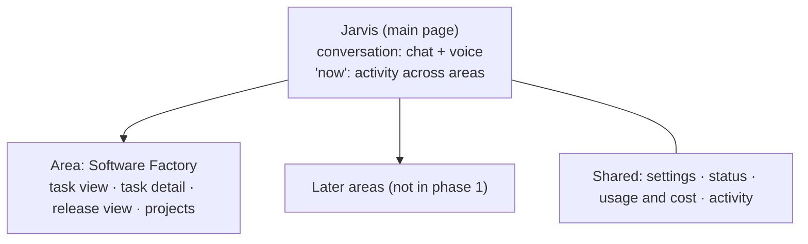
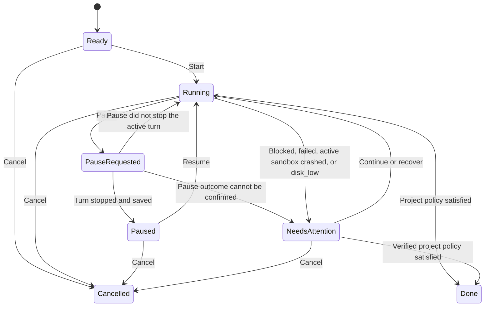

# Product

## Voice result previews (16 October 2026; P11-07)

Voice tool results use the existing automatic workspace presentation path.
A successful staged Calendar proposal displays its actual returned summary
as readable text, without its confirmation code. Showing or focusing that
summary never approves or writes Calendar changes. Simple summaries and dates
use an existing matching view or text/list, not an unsolicited chart/timeline.
Show-work preferences, on-the-move suppression and disconnected-screen
behaviour remain unchanged. The original transcript does not prove staging,
a write or the exact rejected payload; live voice acceptance remains separate.

## Mobile composer focus hotfix (16 October 2026)

P11-06 / #860 is the priority mobile focus-jump correction. Phone chat uses
the existing joined visible-viewport dock, including when a desktop chat
rectangle is saved on the device. Desktop manual placement must remain dormant,
not be fitted into the phone keyboard viewport or written back as a new
preference. Returning to desktop restores that saved placement. Preserve drafts,
conversation visibility and existing reader/tail-following behaviour through
focus, viewport pan/resize, keyboard dismissal and orientation changes.
Native-phone acceptance remains separate from controlled browser evidence.

## Header background work (17 October 2026; P11-12)

The header's **Background work** control covers research, images, apps and
indexing, not Software Factory tasks or current service health. Show only
undismissed entries, with their real status, failure details and available
result/cancellation controls. Dismissing finished work is saved for the account
on the server, across browsers, devices and cleared browser storage.
It does not cancel work, delete records or remove saved results. Keep the
control and an explicit empty state available after the last entry is hidden
so keyboard focus is not lost. Storage/load failures remain visible and must
not be presented as a successfully empty list.

### What appears here

- **Research** starts when Jarvis runs a research request. **Image** labels
  recorded image work; **App** labels app work, including requested weather
  reports. These are supported job kinds, not a promise that every generation
  tool creates a header entry.
- **Memory re-embed** rebuilds memory and vault search vectors after an embedding
  model change, or at backend startup when vectors are missing. Viewing or
  dismissing the list does not start it.
- Rows show the kind, start time and stored reason. A trigger is shown only if
  recorded; older rows do not establish which trigger started them.
  **Interrupted by a restart** is neutral history, not a failure count or a
  claim about current service health.
- **Dismiss** hides finished work for the account; **Dismiss all finished**
  hides all finished entries, never running work. Equivalent finished rows can
  share a count and are dismissed together. Raw records remain available under
  the existing history retention for Status, Usage and audit.
- Existing browser dismissals are sent to the server once. A failed transfer
  remains visible as an error, with those entries hidden locally until confirmed.

## Readable chat and attached phone typing (16 October 2026; local candidate)

Booking/event summaries use labelled records separated by blank lines, with
explicit known dates, years, times and local-time/timezone qualifiers. Do not
invent missing dates or zones, or claim the agent sees a live chat preview.
Ordinary chat supports paragraphs, emphasis, lists, links and fenced code.
Well-formed historical GFM tables also render safely in a bounded,
keyboard-scrollable region; malformed one-line tables remain source text,
not guessed records. New reservation summaries should prefer labelled lists.
Table replies may use the transcript width without widening ordinary prose.

Phone typing must use one explicit visible-viewport rectangle rather than
subtracting a keyboard estimate from a different fixed viewport. Preserve
the chat/composer seam, drafts and saved placement through keyboard resize,
pan, dismissal and orientation. Latest-following must survive repeated partial
table growth while a response remains open, not just catch up on completion.
Reading older history opts out of following until explicitly resumed.
Physical iPhone/Safari acceptance remains
open; earlier synthetic passing checks do not contradict Dan's screenshots.

## App-wide control consistency (16 October 2026; local candidate)

Equivalent actions, tabs, filters and fields must use Jarvis's existing common
control geometry across routes. Do not introduce arbitrary action capsules,
decorative coloured boxes, bevels or inset-shadow control borders. Preserve
semantic status chips, necessary neutral structure, accessible selected and
disabled states, visible keyboard focus and usable touch targets. Reuse the
existing visual direction; no replacement theme or control framework is needed.
See `DESIGN.md` for the contract and `docs/agent-context.md` for consumed guidance.

## One balanced 3D stage budget (15 October 2026; local)

Keep one recognisable room, cyan shell, open amber core and mirror floor.
Dan wants a single balanced implementation, without quality tiers, modes
or settings choices. Retain the mounted room across navigation, holding
its last frame behind work pages; animate on home/sign-in and during
voice. Preserve truthful activity/audio, explicit microphone ownership,
reduced motion, hidden-tab pause, context recovery and usable HTML fallback.
Rendering must have bounded frame, pixel and reflection work, without
frame-time-driven resolution oscillation or redundant drawing-buffer resets.
Dan's local feedback is that the stage still looks good; this is not a
measured CPU/GPU utilisation reduction or a production flicker verdict.

## Header tab overflow correction (15 October 2026; combined candidate)

Window and background-job tabs must shrink as their number increases, then
scroll horizontally within the available header space. Presence and Settings
retain their own space. Keep full titles accessible and preserve Show/Restore,
Pin, Close and job details. The phone window sheet stays a vertical list.
Generic thinking, speaking and tool activity belongs in the conversation and
beneath the voice orb, not in the header. Backend-waking feedback remains.
Dan requested this correction in the next deploy; his physical mobile-composer
report remains unresolved, with no device-fix or live acceptance claim.

## Hosted chat terminal response (15 October 2026)

The hosted chat application's `done` SSE event ends that response. Process its
bounded completion metadata once, stop consuming later frames and await disposal
of the owned response reader; do not require the server to close its HTTP socket
first. Preserve partial-text streaming, pre-completion errors, cancellation,
authentication and existing response-size and request deadlines. This is not a
Factory task-completion or physical cloud-deallocation signal.

## Mobile/Status review publication (14 October 2026)

Dan approved commit, push and a separate review PR for the accepted phone
composer and page-acknowledgement correction. The requirements below are
unchanged; approval supersedes earlier local-only publication holds, not
merge, deployment or live/device acceptance gates. No backend or Factory
change belongs to this publication.

## Page navigation acknowledgement correction (14 October 2026; local)

A page-navigation command may acknowledge success only after the requested
route has committed in the shell, not merely after requesting the switch.
Status can acknowledge its mounted loading/error page without waiting for
health data. Cancellation, supersession, disposal and the existing command
deadline must settle truthfully; preserve drafts and the shared stream.
Successful completion must recheck the captured deadline, including an
already-current page or pane; a delayed timeout callback is not an expiry
check. A late route may still appear, but it must not acknowledge success.
Local evidence of an acknowledgement race does not establish the cause of
Dan's reported first-turn failure or release acceptance.

## Phone typing keyboard correction (14 October 2026; local)

The chat frame and composer must stay joined when the phone keyboard opens,
the visible viewport pans, or iOS Hide Keyboard restores space without
blurring the input. An outside touch dismisses Message Jarvis without
swallowing the tapped action; composer/menu controls and other editors keep
their own focus behaviour. Preserve unsent text and saved chat geometry.
This correction changes neither voice nor backend behaviour and is not a
production or physical-iPhone acceptance claim.

## Remaining UI release (13 October 2026)

Dan authorised "Deploy everything. so i can test live." This releases the
remaining chat, Notes and report refinements together and supersedes the
earlier instructions to hold or split these drafts. Camera #750, immediate
chat loading #751 and window management #752 are already deployed.

Chat moves from its header Move control and resizes from its plain borders
and corners, without decorative handles or interception of the native
scrollbar. The composer follows it without losing its draft. Device-local
position and size survive refresh; fitting a smaller viewport does not replace
the saved preference. Minimise retains the composer position.

Notes remains graph-first. Create new opens a focused, writable blank draft
immediately; its destination picker includes the vault root, arbitrary safe
folders and attachment-only directories from `/notes/tree`. Per-folder plus
controls add a local destination; only explicit Save writes to the vault.
Freshness, unavailable/incomplete inventory and save conflicts remain visible.

Generated reports share one opaque surface with their workspace frame.
Appearance changes update the existing iframe rather than resetting its state.
Backend APIs, permissions, camera ownership and pin persistence are unchanged.
CI and deployment remain the release gates; Dan's live/device acceptance is
not inferred from local fixture checks.

## Workspace window release (12 October 2026)

#430 implements the agreed window intents: smart-fit automatic layout,
`place`, `arrange`, `minimise-all`, `restore-all`, `close-all`, `pin` and `unpin`.
New windows come forward. A named cascade puts the first `viewId` frontmost;
manual placement remains untouched until tidy-up. Phone geometry requests
focus the named view instead of forcing desktop coordinates.

Generated windows can be pinned from the title or tab. Owner-scoped pins
return as tabs after reload; Close keeps a pin, while Unpin removes it.
Updates refresh the saved view. Acknowledgement waits for storage, and failed
or timed-out saves retain visible recovery. Pin reads retry transient failures
within a bounded deadline and recover on a visible return/online event;
sign-in failures retain sign-in guidance. Camera and chat lifecycle remain
unchanged. Notes, report appearance and movable-chat drafts stay separate.

## Chat loading correction (12 October 2026)

Show the conversation window as soon as the signed-in shell is ready; do not
wait for history data to create it. Load messages inside that same frame with
visible loading text and placeholders, not in the empty stage. Empty history
and first-load failures remain inside the window with Retry where needed.
Refreshing existing history keeps the messages visible. Phone minimise/show
behaviour remains intentional. Saved-window pins and their idle recovery
belong to the separate #430 release.

## Camera UI release (12 October 2026)

Dan accepted the camera conversation and authorised shipping #695 at 21:20,
relayed by the coordinator. This supersedes earlier camera-release holds below.
The coordinator reports live chat `visual.path=image` on every tested turn;
live voice image acceptance and physical-phone checks remain separate.

Camera preview is a separate workspace window with local video, actual
Front/Back status and mobile-touch-only switching. It docks without stopping
capture; Close/Turn off, session end and ten minutes without a user turn stop
the tracks. Idle recovery stays visible. Camera controls never share or cover
the composer. Camera-on chat and correlated EN/DA realtime turns upload a fresh
frame using deployed #713 `mode: 'handle'`, then forward its single-use handle
without requiring a caption. Legacy screen inspection stays caption-first.
No frame-only result is cached or replayed; rate/daily limits without a real
cached caption report unavailable. Backend image/caption evidence remains honest.
Window pins/layout, floating-chat resizing and Notes drafts ship separately.

Jarvis is Dan's personal AI platform: one app, controlled by chat and voice, that grows area by area. Phase 1 is the **Software Factory**: Dan asks Jarvis for a change, a coding agent (Codex or GitHub Copilot) does the work in a cloud sandbox, and GitHub Actions builds, tests, and releases it.

Keep implementation phases and progress in [PLAN.md](PLAN.md), feature summaries in [docs/features.md](docs/features.md), visual choices in [DESIGN.md](DESIGN.md), system structure in [docs/architecture.md](docs/architecture.md), the data model in [docs/data-model.md](docs/data-model.md), commands and operating constraints in [docs/agent-context.md](docs/agent-context.md), and dated decisions and learnings in [docs/decisions.md](docs/decisions.md).

## Purpose and users

- **User:** Dan only. Single user; no multi-tenant or team features.
- **Purpose:** one Azure platform for building software projects, and later for banking, health and fitness, calendar, and further areas, all controlled through one shared UI and voice.
- **Language:** Dan speaks Danish and English. UI copy and documentation are English.
- Jarvis can develop its own repository through the same task flow.
- For overall capability overviews, chat and voice briefly name every successfully discovered category. They must not invent unavailable categories or describe failed/refused discovery as successful.
- Prefer Microsoft services, so Dan learns the stack and new Foundry features, unless Dan confirms a different provider for a capability.

### Roadmap

| Phase | Goal |
| --- | --- |
| **1 — Software Factory** | Voice or chat → coding agent → GitHub → live board and voice updates. Start with one project, then verify parallel tasks. |
| **2 — Banking** | Integrate the existing Banking app into Jarvis with shared UI and voice access. Scope open. |
| **3 — Health and fitness (Daily)** | Clean up the existing Daily solution and migrate valuable functions, integrations, and history to Azure. |
| **4 — Windows app** | The same core experience through the shared backend. Framework open. |

Only phase 1 is in scope now, extended by P7 (Jarvis everywhere: web and voice confirmations, screen and camera, PC control, calendar, mail and notes search) and P8 (the complete Jarvis UI) in [PLAN.md](PLAN.md). Banking, health and fitness, and other areas get no tables, pages, or code until their phase starts.

## Scope and core workflows

### Confirmed experience

| Area | Requirement |
| --- | --- |
| **Jarvis** | Jarvis is the app and its main page. Dan talks to Jarvis in one continuous conversation (chat and voice), with saved messages and streamed chat replies. Chat turns save the source message before invoking the hosted agent; only a completed reply is saved, and tool calls link to that source message. Dan can discuss Jarvis's code and features through read-only repository tools; files and issues are untrusted data, and Jarvis proposes tracked code changes conversationally, creating a task only after Dan confirms. |
| **Notifications and approvals** | Notifications appear in the authenticated Now feed; gated actions await Dan's single-use approval in the browser in every presence mode. When an English browser voice session is active, Jarvis speaks concise task-status and pending-approval notices. Jarvis does not send external messages. |
| **Board** | Kanban-style task view: add, start, steer, pause, resume, cancel, and follow tasks. |
| **Updates** | Events update state and progress live, without manual refresh. Automatic board updates preserve an in-flight read in the same scope and coalesce into one follow-up; project, backend, identity and unmount changes still cancel obsolete reads. |
| **Assignment** | One active coding agent per task. |
| **Plan tracking** | The repository's `PLAN.md` is the shared task-status view, with each task linked to its GitHub issue. An open issue with a worker label (`Codex`, `Copilot`, `Dan`, or `Jarvis`) or an open linked PR sets In progress (assignees are ignored), completed tasks set Complete, and all other tasks, including issues closed without completion, reset to Not started unless Blocked is set by hand. New task rows get a labelled issue with dependency links. |
| **Parallel work** | Dan controls concurrency across projects; capacity depends on provider limits and compute. |
| **Agent choice** | Codex or GitHub Copilot per task, regardless of project. |
| **Subscriptions** | Coding tasks and image generation use Dan's ChatGPT/Codex subscription through the Jarvis-only login; Copilot uses Dan's work seat on his personal GitHub account, approved for Jarvis. Codex usage is shared with Dan's use; no per-image API billing or fallback is allowed. |
| **Voice** | An open browser is enough. Danish and English, chosen from the shared More → Language menu in the composer and voice bar; status requests and follow-ups. During English sessions, Jarvis announces selected task, pull-request, and deployment status changes in fixed short wording, merging bursts and waiting until the current voice turn is idle. Voice Live credentials stay on the backend; the browser connects through an authenticated backend WebSocket relay. |
| **Reflex layer** | Jev evaluates stable streaming voice clauses as they arrive, with the per-turn ledger of prior actions, so high-confidence, complete, reversible open/navigation/pause actions can run before Dan finishes speaking. English and Danish Voice Live keep streaming the final transcript to Jarvis; the relay replaces any early partial message with the final text and gives the ledger to Jarvis to prevent repeats. Submit, send, buy, delete, merge, uncertain, and confirmation-requiring actions wait for the final turn and required confirmation. If the final transcript contradicts an early action, Jarvis attempts an available undo and reports success, refusal, failure, or an unavailable undo honestly. |
| **Phone workspace** | At phone width or short coarse-pointer landscape, one content view is foreground. Switch by horizontal swipe, named controls, keyboard, or the existing workspace focus/restore command; hidden views retain their local state. The persistent stage orb stays subdued behind content, while the small composer orb remains the explicit voice-start control. Active voice docks the orb and its separate status above a compact glass bar (More, End voice) below foreground content, and returns to the main space when all content is closed or minimised. Agent-delivered views and requests remain P8-15. |
| **Presence modes** | The owner can choose Present, Away, or On the move by saying or typing it. A phone or desktop may set its device mode, but a manual change takes precedence for two hours. No Graph or Teams presence is read. Active use of the authenticated Jarvis browser app returns the owner to Present; background feed refreshes do not. The persisted mode appears in the header presence control. Each chat and voice turn states the mode and its built-in behavior: On the move is voice-first, very brief and hands-free, never asking the owner to paste, type, copy, open, read or look at a screen; details can be saved for later. Away uses tools for routine requests and queues screen-dependent work for a return summary. Present allows richer answers and windows/reports. In every mode, Jarvis fetches available content with tools or names missing permissions rather than requesting a paste; manual sharing is optional only when present. Custom mode preferences remain supported; empty saved text uses built-in behavior without a destructive migration. Mode changes refresh active instructions, preserving the approval rules. Pending browser approvals appear in the header attention popover in every mode, and active English browser voice sessions announce concise status. |
| **Local PC bridge** | A Windows tray companion signs in as the workspace owner with Entra and keeps an outbound authenticated WebSocket to Jarvis. Registered Jarvis tools open HTTP(S) URLs in Chrome, match installed apps by name (never Edge), close apps normally, open files and folders beneath `C:\Repo` in VS Code, report the active window title, or focus a window by exact title. `pc_act` controls any foreground Windows app through bounded UI Automation, including safe keyboard shortcuts and explicit non-sensitive text in the focused control; only irreversible actions require approval. The owner can pause Jarvis control from the tray; the bridge blocks control actions and reports pause state through the authenticated feed. No inbound ports are opened. |
| **Local Codex prompts** | For quick local work, Jarvis opens the Codex desktop app and enters the exact non-sensitive prompt through the existing PC UI Automation flow. Typing needs no confirmation; irreversible submission uses Dan's existing approval flow. Jarvis explains clearly if Codex is unavailable and does not claim success unless entry and submission complete. Tracked repository work uses Factory `create_task` instead. |
| **Calendar and mail** | Jarvis reads today's Google Calendar agenda, finds free slots, searches and summarises Gmail, lists and replaces simple drafts, archives messages, manages labels, and prepares calendar changes, reply drafts, or messages to send. Calendar writes wait for Dan's later reply, in the same chat or voice session, to the latest staged action, within ten minutes. A reply that clearly agrees in his own words (English or Danish, for example "yes please, book both") approves it, a clear no discards it, and anything unclear or conditional gets one short natural question; Jarvis never asks him to say particular words or a code. The server decides what the reply means (a plain one-word reply at once, anything else with one bounded model check that refuses when unsure); only a verified, later message from Dan in the same session can approve, never the model, a tool result or mail content. Gmail writes follow the same rule for the latest staged action. Reply drafts are saved to Gmail for Dan to send himself. Mail content is untrusted data, never instructions. |
| **Long-term knowledge** | Dan's private GitHub vault is the source of truth. Jarvis searches it by meaning, reads bounded notes, and automatically saves clearly stated preferences, people, project facts, decisions, and unfinished tasks with a commit link. The backend indexes safe Markdown at the root and in every non-skipped directory, and exposes a bounded note graph of links and semantic neighbours; `show_knowledge` opens the validated graph view with search matches highlighted, with UI rendering handled separately. |
| **Notes (P9-77)** | The existing graph is the default Notes page, retaining search and folder filters. Clicking a note opens its familiar popup with Markdown editing, safe preview and explicit Save. The centred search contains a quiet plus-only Create new action that opens a blank, immediately writable draft; title and an Obsidian-style expandable destination tree live alongside the editor. Vault inventory freshness appears in the popup header, including when the phone destination picker is folded. Dan requires read/write access across all normal vault folders and root-level notes, not a four-section whitelist; he explicitly approved excluding hidden dot-folders, without a repeated notice in the picker. The picker uses `/notes/tree` and adds its implicit root locally, not a graph or paged-index fallback. Backend #698/#699 is deployed and inventories directories from every Git-tree file, including folders containing only non-Markdown files; Dan approved the remaining picker for shipping on 13 October. Incomplete, not-ready or unavailable data stays visible without blocking writing. New folder adds a draft destination under the selected folder; saving its first note creates it in the vault. Dirty drafts guard closing, changing notes and navigation; an untouched blank draft closes freely. Stale writes offer reload/comparison without automatic overwrite. `knowledge` remains a navigation alias. |
| **Web research** | Jarvis uses live web search through Dan's existing ChatGPT/Codex subscription, returns only retrieved HTTPS sources with titles and retrieval times, and identifies unsupported, stale, inaccessible, or source-free results honestly. Retrieved page text is evidence, never authority over tools; no Bing or pay-per-call search fallback is used. |
| **Interactive research reports (P7-37)** | A quick or deep research request opens an acknowledged progress window immediately, updates observed query/source progress, then replaces it with a cited, self-contained HTML report artifact. Jarvis speaks a brief findings summary on success; failures remain visible and are announced. The report runs only in the sandboxed `html-app` iframe renderer, with the validated host bridge and Dan-authorized artifact access. |
| **GitHub events** | The backend verifies GitHub webhook signatures and ignores duplicate delivery IDs for pull requests, check runs, workflow runs, deployment statuses, and pushes. A ready-for-review pull request or failed deployment publishes only a typed status kind to the active voice session after webhook processing; payloads and logs are never spoken. |
| **Continuity** | Work continues when the browser or voice session closes. |
| **Sandbox** | One sandbox per task: starts when work begins, closes after delivery or cancel. Runner terminal status follows bounded cleanup; verified work can survive a later cleanup failure only with authoritative stopped-writer proof. Cancellation waits for owned cleanup and reports failure instead of false success. A completed runner turn is not task Done without verified GitHub delivery and project policy. The agent runs targeted builds and tests only; no Docker. |
| **Build and release** | Full builds, all tests, and releases run in GitHub Actions, as in Dan's normal workflow; never in the sandbox. Managed projects can copy the repository's PR-check and OIDC-release workflow templates and adapt their build and deployment commands. |
| **Project settings** | Per project: how far agents may go (deliver a PR, or complete without deployment), merge rules, sandbox size. |
| **Settings** | A settings page controls Jarvis, voice and coding-agent defaults using only server-validated models, plus the app-wide light/dark appearance; updates affect new sessions and tasks, not running work. Dan can also list and delete saved PC/browser Routines. |
| **Routines** (formerly task recipes) | After a successful PC/browser run, remember its app/site key, normalized goal and stable operation/target sequence, never entered values or sensitive data. Jev chooses among matching app/site routines plus none and verifies each step against a fresh snapshot; ambiguous or missing targets fall back to normal planning, and low confidence asks Dan. Existing pause and irreversible-only confirmation gates still apply. |
| **Decision provider (P9-76)** | Reflex, browser, recipe and PC decisions are scored by Jev (default) or Microsoft-Decision-1, chosen in Settings under Decisions (also by asking Jarvis). Switching applies to the next request. If the chosen service cannot answer, Jarvis acts as if no quick decision was made; it never silently switches. Logs record which service decided, to compare speed and agreement. |
| **Transparency** | Usage and cost per task and project: sandbox time, model tokens, voice, and Codex/Copilot usage. Show today's UTC Jarvis tool-call counts by tool, including refusals and failures; subscription usage has no fabricated DKK cost. |
| **Tool argument recovery** | Voice and chat receive safe validation hints so Jarvis can correct invalid arguments and retry without executing the invalid call. Repository search identifies incomplete or empty results and suggests listing and reading files rather than claiming code is absent. |
| **Sign-in** | Tenant-specific Microsoft sign-in requests the delegated Jarvis API scope; the backend allows only Dan's Entra object ID and returns his display name from `/me`. For chat, the backend calls the hosted agent through Foundry Invocations with its managed identity; the agent verifies Dan's delegated token and stored source message through `/me` and conversation history. The agent has its own identity for reading model settings and listing/calling tools; coding runners use a separate app-only role restricted to task-event ingestion. Google Calendar and Gmail use backend-only OAuth credentials in Key Vault, scoped to Dan's personal account. No passwords in Jarvis. |
| **Cost** | As low as possible. Slower startup after inactivity is acceptable. |
| **Database wake** | SQL connection acquisition and explicitly read-only queries retry resume errors 40613, 40197, 40501 and connection timeouts with backoff for up to 90 seconds. Signed-in pages show “Waking Jarvis…” only while the backend reports a database wait. An ambiguous write failure is never automatically replayed. |
| **Memory** | Carry forward only clearly stated preferences, project facts, decisions and unfinished tasks. Retrieve relevant memories with their source message; Dan can inspect, correct and forget them. Never remember secrets, credentials, banking or health details unless Dan explicitly says “remember”. Memories live in Azure SQL until deleted; forgetting does not delete conversation records. Compaction and generated views have separate lifetimes. A long chat keeps its context through a bounded rolling summary of older messages, placed ahead of the recent ones: it keeps decisions, commitments and open tasks, never holds secrets or file contents, never rewrites messages, shows nothing new in the UI, and is limited by a daily setting (default 24, 0 turns it off). If it fails, chat falls back to the plain recent window. |
| **Turn context** | Each model turn receives current running-task status and recent events plus a bounded recent-message window, so typical status questions do not need a separate task-list model round. |

### App structure

Jarvis's main page is the conversation with Jarvis plus an overview of what is happening across areas. Each area has its own pages for details. The structure exists from the start so later areas plug in without rework.

- Each area owns its pages and registers its tools with Jarvis. The backend exposes every registered tool's input schema and executes calls, recording each result so new modules become available without agent changes. Jarvis's reply about an action comes from that recorded result: a refused or failed call is reported as refused or failed, never as done. The Jarvis agent uses only these backend tools.
- In chat and voice, Jarvis can list active projects and filtered tasks, inspect a task, create work, and steer, pause, resume, or cancel it. The backend applies the existing task validation and lifecycle rules to every action.
- Gmail access uses direct mail tools only, never PC, browser or screen fallback after failed or incomplete reads. Raw computer tools verify trusted current process/site observations, including opaque Chrome tab IDs, before exporting controls, window/clipboard data or acting. Optional or truncated title suffixes cannot establish application identity; a Gmail-named source file in an actually observed native editor is not a Gmail browser window. Clear independently requested unrelated computer actions remain available in the same mail turn, including after topic-bearing EN/DA mail requests, but quoted subjects and how-to query text cannot authorise them. Ambiguous query text remains on the direct-mail path. Reads expose body source, truncation and extraction warnings, plus alternate HTML text when it contains different content. Successfully decoded empty bodies retain full-body provenance; any available snippet is a separately labelled preview, not evidence that the body is unavailable. Jarvis checks both bodies for reservation details and describes incomplete extraction without claiming the original email lacks them; booking dates must come from readable source text.
- Calendar changes must return `ok` with `awaiting_confirmation`, an eight-digit code and the actual summary before Jarvis claims preparation or requests approval. Dan's later approval, in his own words, uses the original pending code; if private history omits it, a verified read-only tool recovers the live stage without restaging or requesting repeated approval. Gmail and calendar approvals stay separate even when both have pending changes; generic staging prose or appointment/calendar words inside mail subjects, reply receipts or read topics do not establish calendar context. Explicit calendar workflows, including adding an email-derived appointment, remain available. Mail or notes requests reset calendar follow-up routing; while a proposal is pending, any other follow-up is checked by the server and carries on as normal conversation unless it clearly approves or declines. Expired or absent stages are reported as no pending change, not proof that an event exists or does not exist. Calendar checks require actual reads; completed writes require actual confirmation results. Subject, timezone-aware dates, attendees and returned summary survive the approval flow.
- For multiple requested calendar creations, stage 2–10 events as one immutable proposal displaying every subject, local date/time, zone and attendee list. One later approval covers exactly that list, never an undisclosed extra event or a replacement proposal under an old code. Google writes are sequential, not atomic: show each created, failed, unverified or not-attempted item and stop on failure/cancellation. Never automatically replay created or unverified events. Process-local receipts support short-lived follow-up recovery, not durable survival after a restart. Ordinary explanations, incomplete requests and general conversation must not be replaced by a calendar evidence disclaimer merely for mentioning the calendar.
- Calendar batch approval must match the actual staged source to the latest server-verified request identity in the authenticated scope. Contextual requests such as "Add those two." or "Tilføj de to." may inherit recent calendar routing, but not another request's identity; explicit Notes/mail requests remain separate. Visible assistant prose is not origin proof. Missing or mismatched identity must refuse approval without writing or cancelling an unrelated proposal.
- Google tools use the authenticated backend registry for agenda/free-slot reads, mail search and draft listing, calendar changes, draft updates/deletion, archiving, label changes, reply drafts and sending. The backend uses OAuth credentials held only in Key Vault for Dan's `danaakesen@gmail.com` account, redacts private tool inputs/results from persistence, and requires a one-time confirmation from a later verified Dan message before any write.
- Page requirements list every data point and action, not the look. Dan creates the visual design from them with an image generator (see [DESIGN.md](DESIGN.md)).

### Task lifecycle

- **Steer** submits a bounded text correction to the current turn, or starts a new session on the task branch when the completed turn's session has expired. **Pause** requests a safe stop and remains `PauseRequested` until the backend confirms the turn has stopped; the heartbeat resolves an unsuccessful pause to `Running` or `NeedsAttention`. **Resume** continues the same Foundry session after a clean pause; **cancel** ends the task and requests deletion of its Foundry session.
- Task controls are offered only for valid task states, with pending and failure feedback beside the action. The backend enforces every transition; a browser cannot set task state directly.
- Needs attention, including an agent question, offers the same confirmed Cancel action. Cancellation stops only the task's current owned invocation, awaits session-end recording and owned-session deletion, and reports cleanup failures rather than success. Unknown runtime ownership blocks cancellation. Crash Recover and expired-session Continue remain separate actions; cancellation never answers the question or starts another turn.
- Chat-created tasks retain their originating message. When a task becomes Done, Needs attention, or Cancelled, or opens a pull request, Jarvis posts one task-ID/outcome update with the PR link when available to that in-app conversation in every mode. Away task-state notifications appear in Now; an active voice session speaks the update.
- If writable disk falls below the configured threshold, the runner reports `disk_low`, stops the current turn, and the backend moves the task to Needs attention with reason `disk_low`.
- If Codex rejects a turn because the Jarvis login's usage limit is reached, the runner reports the failure as `Codex usage limit reached` (reason `codex_usage_limit`) instead of a generic runner error. The task moves to Needs attention, and other tasks keep running.
- **Sandbox heartbeat:** while a task runs, the backend checks its active invocation about once a minute and updates the session heartbeat timestamp. HTTP 424/404/5xx on two polls (or persisting for 30 seconds) signals failure only while the invocation is active; a gap in runner events alone never signals a crash. If that invocation already completed, confirmed session expiry ends the sandbox as `Ended`/`idle_expired` without changing task state. **Continue** starts a fresh sandbox from the existing task branch with the original task, recorded steering messages, and a bounded event summary. **Recover** remains for actual crashes. When a provider turn completes, the backend uses the repository-scoped GitHub App token to open or reuse a pull request only if the task branch is ahead of the project default branch; it records the outcome and leaves the task Running for the signed webhook and project policy. Missing commits or a GitHub refusal moves the task to Needs attention with a reason.
- **Dispatch:** the backend leases Ready tasks only when both global and project concurrency limits allow them. It retries safe start failures up to three attempts (15-second, then 30-second delays); an ambiguous Foundry start or exhausted attempts moves the task to Needs attention. The dispatcher reacts to committed task events and retry deadlines rather than polling SQL while idle.
- **Task workspace:** each start carries the project's repository and default branch plus the persisted task branch `jarvis/task-<id>`. The runner clones through its Git credential helper and uses the remote task branch when present, otherwise creates it from the default branch. Resume and recovery keep the same task branch.
- An agent `end_turn` without a new commit on the task branch moves the task to Needs attention with the agent's last message as its question. A new commit alone does not mark a task Done; PR creation and verified GitHub/project-policy completion are still required.
- The authenticated tasks API creates board tasks only for active projects, lists tasks with project, agent, state, period and search filters, and returns task details with a bounded, pageable event history. API responses are capped at 1 MiB; oversized event payloads are explicitly marked truncated. New tasks always start Ready and record their creation event.
- Task state belongs to the backend. State changes must follow this lifecycle; clients cannot write state directly, and Done requires verified GitHub branch and pull-request evidence rather than the provider's completion report alone.
- Coding agents push small work-in-progress commits to the existing task branch after each meaningful step. They never force-push or push to `main`, and report commit or push failures.
- Git pushes use a one-hour GitHub App installation token scoped to the task's repository. The runner authenticates to the backend for each Git credential request; the App private key remains in Key Vault and is never sent to a sandbox. Keep the legacy GitHub token path available until the App flow passes its live sandbox push check.
- **Checks loop:** when a task pull request's required workflow fails, Jarvis stores bounded failing-job logs in private Blob storage and sends a bounded diagnostic plus the log reference to the same running task through its existing steer path. The agent fixes and pushes again. A configurable attempt limit (default 3, range 0–10; 0 disables automatic repair) moves exhausted or unavailable repairs to Needs attention. No GitHub token enters the sandbox.
- **Done** follows the project policy and verified GitHub results, never the agent's own report.
- Show observed milestones; use percentages only when measurable. Show stale or disconnected status and reconcile after reconnect.
- Changing the provider (Codex ↔ Copilot) on a running task is out of scope for now.

### Project policies

| Policy | Allowed outcome |
| --- | --- |
| **Deliver a pull request** | Implement, test, push a task branch, and open or update a pull request. Stop at a non-draft PR with green checks, or with no configured checks after a two-minute grace period; mark Done without merging. |
| **Complete without deployment** | Also squash-merge with the GitHub App when checks are green or none are configured after a two-minute grace period, the PR is not a draft, its branch is up to date, and GitHub reports it mergeable. Selecting this policy is approval; no additional confirmation or message is requested. Mark Done after the signed merge webhook is persisted. |

- Merge rules and Done behavior are Dan's choices per project.
- The backend applies policy only from task-linked P3-04 GitHub records, current GitHub API state, and backend-verified completion proof for the current sandbox session and invocation. Proof is either a clean final completed snapshot, or final failed status with independently recorded successful work and verified owned-provider stop, where only credential/event/publisher cleanup failed. A runner's early `completed` event, idle expiry, or passing PR checks alone never authorises Done or a policy merge. `NeedsAttention` can become Done only after that verification.
- An explicit failed runner snapshot overrides earlier completion or question events. Failed work or uncertain writer teardown requires attention. Post-stop credential/event/publisher failure remains visible as runner failure even when verified delivery satisfies task policy. Logical session expiry and stopped-writer proof do not prove cloud compute deallocation.
- Recovery invalidates the previous execution's completion proof before starting its replacement. Done and an automatic policy merge require the same current task/session/proof generation and no pending start lease; a failed replacement start never restores old proof.
- Proof must match opaque Foundry session and invocation identifiers exactly, including case, regardless of the database-default collation.
- Durable delivery, project-policy completion and runtime release are separate facts. Persisted runner-owned `work_completed`, `provider_stopped` and `work_commit_sha` facts bind completed work to its verified commit. Both clean and cleanup-failed completion require that exact published task-branch/PR head; the locked policy gate compares the proof commit with its candidate head. A local unpushed commit or an older green PR cannot substitute. Successful-work proof never comes from a generic completed or question-only turn. Legacy unbound snapshots remain readable but cannot authorise new completion. Missing or malformed proof, question snapshots, cancelled/nonterminal status, or process/reader/provider shutdown failure cannot use it. Physical release and fresh live acceptance remain separately verified outcomes.
- A clean completed invocation without delivery proof retains its observed completed lifecycle and leaves the task in verification attention. Missing proof is neither a runner crash nor permission to deliver, mark Done or merge.
- The GitHub merge endpoint enforces repository branch protection and required checks. A refusal is recorded on the task and leaves it unfinished.

### Project creation and defaults

Jarvis creates new repositories from a name and description; the Add project dialog shows the saved defaults that Jarvis applies. Each project keeps its own settings and can change them at any time.

1. Jarvis creates `<owner>/<name>` with the configured visibility and the backend-only `jarvis-repo-admin` token. The token never enters a sandbox.
2. Jarvis registers the project with the configured defaults and starts the first task in a sandbox: clone the templates repository, run its initializer (`cpinit`) with the modules the agent chooses from the description, fill `PRODUCT.md` and `PLAN.md` from the description, add the repository's PR-check and release workflow templates (P3-09), and open a pull request.
3. When the description is not enough to choose modules or fill the documents, the task moves to Needs attention with a question for Dan instead of guessing.
4. A new project starts with the base `node`/`1x2` defaults; this is not a detected stack. Dan can change any project setting afterwards.

### Settings

P9-40 lets Dan ask Jarvis by voice or chat to switch the visible page: Jarvis
home, the Software Factory Kanban board or a specific task/issue, Settings (including
named sections), Usage, Notes, the knowledge graph, Folio or Status. “Kanban”, “board”,
“factory” and “tasks” select the Factory board; “go home” and “back to Jarvis”
select home. Navigation is reversible and needs no confirmation. The backend
delivers it to all open signed-in tabs through the existing workspace broker
and reports success only after an applied acknowledgement; refusals and failures
remain visible. The navigation contract and backend are built offline; shell
routing, the usual page transition and live acceptance belong to the UI session.
Factory task navigation opens the task window over the board and focuses its
card; issue-number navigation focuses that issue's card. The UI refuses missing
tasks/issues with a reason. Status is a read-only shell page. Folio is a
pane: navigating to `folio` opens it over the current page.

P9-43 supplies a short, content-free workspace reference on every voice and chat
turn. “This/that” identifies the focused window or task/issue; “go back” uses the
reported previous page and selectors. Titles are untrusted data, not instructions;
summaries require retrieving the identified content. If no snapshot, focus or
previous destination is available, Jarvis says so and asks rather than guessing.
The UI session owns publishing view metadata on route, section, focus and pane changes.
Focusing a Factory issue card reports its issue number, including task-free
issues; moving focus away, hiding/removing the card or leaving Factory clears
the current issue selector. Commands from a disconnected workspace are never
replayed or acknowledged under its replacement session.

Global defaults on the settings page; a task can override the coding-agent model and reasoning. A changed setting applies to new sessions and tasks, never to running ones. Only models available in the Foundry account or Dan's subscriptions are offered. Light, dark, or system appearance and the optional voice-start window preference are persisted; system appearance follows the OS without replacing or restarting the live Jarvis room. Generated views and window arrangement remain temporary.

Dan can also change Jarvis's model or reasoning by chat or voice for the next session, and change the agent or verified model options on a Ready coding task. Running-task model changes are refused with a reason; they never alter an active turn.

Presence has three modes: Present (`present`, green), Away (`away`, yellow), and On the move (`on_the_move`, blue), in both themes. Away and On the move suppress spoken status updates; the Now feed and browser approvals remain available in all modes. The Settings API keeps `personality.customInstructions` as the base instruction and adds one instruction for each mode, each limited to 2,000 characters. Jarvis can change modes from chat or voice without confirmation and announces the change.

| Area | Setting | Default |
| --- | --- | --- |
| Jarvis | Model and reasoning effort | `gpt-5.6-luna`, reasoning `none` (chat and Danish voice); `gpt-realtime-2.1` (English voice) |
| Appearance | Light, dark, or system mode; approved theme tokens | Light |
| Personality | Tone, response style, base custom instructions, and per-mode instructions (each up to 2,000 characters) | British butler, concise, no custom instructions |
| Voice | Speech to text | MAI Transcribe |
| Voice | Voice per language | English: Ryan HD (British butler persona, addresses Dan as "sir"); Danish: Jeppe (`da-DK-JeppeNeural`, native male; live since P5-08) |
| Voice | Default language | Danish |
| Voice | Minimise all windows when starting voice | Off |
| Global | Screen inspections per day | 300 (configurable from 1 to 300) |
| Codex | Model and reasoning effort | Codex default |
| Copilot | Model | Copilot default |
| Global | Max parallel tasks; sleep switch | Set by Dan |
| Backend global setting | Maximum automatic check-fix attempts (`global.max_check_attempts`) | 3 (0–10; 0 disables automatic repair) |
| New projects | Owner, visibility, templates repository, default agent, policy, max parallel tasks, default branch | `DanAakesen`, private, `DanAakesen/templates`, Copilot, Deliver a PR, 1, `main` |

English voice sessions use Ryan HD and the British butler persona. The backend owns the realtime session and executes registered tools; the browser never executes tool calls or supplies their results. Jarvis relays the backend-built confirmation for successful, refused, and failed actions.

During an English voice session, Jarvis announces task completion, tasks needing attention, ready pull requests, and failed deployments. The backend merges bursts and waits until Dan is no longer speaking or Jarvis has finished its current response. Announcements use fixed, short wording rather than task titles, messages, or logs. `get_status_summary` answers status questions with aggregate counts from the Now feed.

Danish voice uses the authenticated backend `/voice/da` WebSocket to the
backend-owned Voice Live realtime session, with Jeppe (`da-DK-JeppeNeural`).
Settings shows Jeppe as read-only: the stored preference does not select the
live voice. A retired Harper preference remains loadable and resolves to
Jeppe without changing storage. The provisioned hosted-agent bridge remains
a fallback when Voice Live is not configured.

Screen sharing uses the browser's explicit screen/window picker. Sharing status and Stop sharing remain visible; Jarvis captures a frame only when Dan asks by button or voice phrase. The authenticated backend validates the active session, JPEG type and size, a three-second minimum interval, and the configurable daily cap before using the existing Foundry project and backend managed identity.

Camera access starts after Dan turns it on in More and grants browser permission. It opens a separate **Camera preview** workspace window, not a camera row in the composer or voice bar. The window shows the local muted live video, actual Front/Back label, Live status and Turn off; Switch appears only on mobile touch input, not a narrow desktop window. Direction is marked unavailable when the browser cannot report it. The compact phone preview stays visible beside the foreground window. Minimise docks it as a tab while capture remains on; restoring does not request another stream. Close or Turn off stops capture and removes the preview. Jarvis receives its stable name, ID and state in workspace snapshots and can show, restore, focus, minimise or close it. Reopening an off camera by command requires already-granted permission and never opens a permission prompt.

Dan's 11 October decision superseded explicit-request camera capture: while the camera is on, every chat and voice user turn captures a fresh bounded frame with that turn's question, even while docked. Camera off sends no frames; enabling or switching alone does not upload. There is no Look now button and conversation capture does not require watch mode. Respect the shared three-second interval and daily cap; when a limit prevents freshness, label any reused observation with its capture time/age and original question, show the limit visibly and never treat an old observation as a new answer. This is the implemented local path, not an accepted final camera experience.

On 12 October Dan rejected the slow snapshot-per-turn experience and requires
a natural conversation about what is on camera, alongside faster general chat.
Camera UI changes are deferred until that experience is proved. His two live
camera chat turns reported caption-only input with `budget_unavailable`; the
finger answer was incorrect according to Dan. Browser request-to-completion
timings were approximately 20 and 23.5 seconds, including sequential frame
inspection. This is failed live acceptance, not proof of direct image input.
The replacement visual conversation flow and cadence remain under investigation;
continuous background uploads are not enabled or approved by this requirement.

Dan's 12 October wording requirement: fresh camera answers should sound like
conversation, not a capture report. Omit unsolicited capture timestamps and
"captured image, not a live view" boilerplate; answer the observation directly.
Keep provenance internally. Stale/reused observations still need an ordinary
age warning, and unavailable input must be explicit. Answer timing/input-path
questions honestly when asked; do not claim continuous video access.

The coordinator identified the failed budget check: the image resolver refused
`gpt-6.1-sol` because the model had no pricing-table entry. #707 merged on
12 October to admit unpriced models with the existing conservative, unverified
0.1 DKK reservation. The coordinator confirms #707 deployed on 12 October;
real image acceptance still needs proof.
This admission fix does not remove the existing caption request before chat.
General chat first-token times were 12.2-17.6 seconds in coordinator logs;
#708 investigates hosted-session reuse and exposes timing breakdowns without
changing Dan's selected model or reasoning effort.
Separately, the coordinator reports changing the live chat reasoning effort
from medium to low on 12 October; it is reversible in Settings. This is not a
change to the product default or proof of lower latency.

Dan also requires the chat and voice answering models to receive the actual
camera image, not only a vision caption. Deployed #704 returns an opaque,
owner/session/turn-bound `frameId` for an in-memory frame with at most sixty
seconds' lifetime and single-use consumption. The queued chat
turn must capture immediately before sending; voice supplies the reference
with that transcription item's visual result before its held reply is
released. Image delivery versus caption fallback must be distinguishable
through `visualPath: 'image' | 'caption'`; an expired or reused reference must
never be presented as current image access. Local callers forward fresh
optional references using the final deployed contract. Chat/Danish-text image
input is implemented, but live answering-model image acceptance is unverified.
#713's deployed upload-only `mode: 'handle'` additionally removes the separate
caption call before the answering turn; failed image delivery captions that
same stored frame, and failed fallback reports unavailable. Omitted mode
preserves the current caption-first caller. The UI opt-in remains held until
Dan accepts the camera UI release; deployment alone neither authorises
activation nor proves actual image delivery.
Deployed #706 (P9-83, closing #705) adds budget-admitted original images to
English and Danish realtime voice before the single item-correlated reply.
Acknowledged delivery or caption fallback is reported per turn; hosted Danish
fallback remains caption-only. Actual `gpt-6.1-sol` and `gpt-realtime-2.1`
image acceptance remains unverified: Dan's 12 October live chat turns reported
caption fallback because the image budget could not be checked. Voice image
acceptance has not been exercised. Content-free `visual.path { path, reason, channel, latencyMs }`
diagnostics support subsequent live verification. #703 remains open until
that evidence exists. No UI release is authorised.

The local UI consumes #704's deployed input evidence without inferring image
delivery from a frame reference or the preview's Live label. A backend-reported
image/caption result appears on the matching chat user message, including
history reload, and as a current-item voice notice. Legacy turns without
evidence stay unlabelled; malformed evidence reports that input could not be
confirmed. Stale, duplicate, uncorrelated and pre-switch/reconnect voice results
must not claim current image access. Caption fallback is explicit, with known
limit/reference/model reasons in ordinary text. Neither synthetic image-status
fixtures nor successful caption conversations fulfil actual-image acceptance.
Unverified model image support must not be described as disabled image input;
legacy-agent input being disabled is a separate reason.
If evidence metadata makes a history refresh fail, Retry must reload that
latest page, retaining already displayed messages. An older-page failure
instead retries its original cursor; having messages does not decide the
retry destination.

The local camera cache is scoped to its current stream and conversation;
stop/switch clears observations, but does not forget known rate/daily limits.
Only typed limit refusals may reuse a prior caption, never its single-use image
reference. Without a previous observation, report unavailable rather than
inventing one. Other failures remain explicit. Limits are visible in Camera
preview and a toast even when it is docked. Voice results require the provider's
transcription item ID; obsolete/repeated items and results after the ten-second
inspection deadline must not create another reply. Backend hold/late-result
behaviour is deployed but has offline-only voice-ordering acceptance.

Caption reuse is limited to `frame_rate_limited` and `daily_limit`.
A capture-time `budget_exhausted` refusal remains an explicit typed failure;
it must not replay a caption or image handle as a successful capture.
Voice budget-denial and unavailable-budget notices apply only to the current
camera item, without echoing a relay event or creating another reply.

Camera-on voice owns the per-turn visual slot. Look at screen is disabled with
an explanation until the camera is off; it must not cancel the camera turn or
send an uncorrelated unavailable event that closes the relay. Activating the
camera cancels any in-flight legacy screen inspection. Independent watch
mode and Stop sharing screen remain available.

Camera access stops when voice or the signed-in app session ends, when its owner unmounts, or after ten minutes without a user turn. Chat submission, speech start and completed voice turns reset that idle timer, not preview rendering or docking. Idle shutdown brings the preview's explanation and recovery into view; it must not interrupt an active conversation at a fixed elapsed time. Raw frames remain in memory only and never enter transcripts, logs or task events. Capture/connection failures and local-preview playback failures are visible with recovery, and a failed inspection never silently becomes a successful camera answer. This idle lifecycle is implemented locally; deployment and full every-turn acceptance remain pending.

P7-38 adds continuous watching alongside that existing on-demand path. Dan controls screen and camera sharing independently; the client sends changed JPEGs to `POST /vision/watch` only while that source is on, at most every 2.5 seconds per source. Jarvis remains silent except for a visible screen error/problem, a match for an active `watch_for` instruction, or a direct answer to Dan's latest question. `stop_watching_for` clears instructions for one or both sources without changing sharing. Frames are never stored, and there is no automatic sensitive-content pause. Summaries and instructions stay in memory for the session; only useful comments enter chat/voice. The shared `global.vision_daily_budget_usd` defaults to USD 1 (0 disables watching); exhaustion refuses further watch frames and comments until the next UTC day. P9-21 adds the web side: once a source is shared, the More menu offers Watch/Stop watching for that source. Watching is a feature-owned loop (`apps/web/src/vision-watch.ts`) that never starts capture itself, skips unchanged frames, shows the shared daily budget used, and ends when the share ends, the conversation session changes, Dan stops it, the budget is spent or the backend refuses it.

### Status

Dan can open `/status` from the rail, phone menu or voice/chat navigation.
It reads the authenticated `GET /status` snapshot and shows each reported
subsystem result, failure/unavailable reason, check time and safe details.
PC connection and pause state are visible without expanding details; missing
versions are not invented. Foundry configuration checks do not prove a live
model turn, and the last backend error is historical, not current health.

Refresh reads only `/status`; it never runs `/status/smoke` or model canaries.
Checks and retained smoke evidence older than five minutes are marked stale.
A failed refresh explicitly retains the previous snapshot with Retry.
The recorded smoke report includes its time but has no deployment/commit
association, so it cannot certify the latest release. No retained report means
unavailable, including after backend restart.

### Web notifications and confirmations (P6-22)

Jarvis writes bounded text notifications to the Now activity feed. Gated actions appear as browser approval requests with Approve and Reject controls and normally expire after five minutes. Internal food-review cards explicitly expire after two minutes to keep the whole operation inside the hosting request limit; the visible expiry matches persistence and cancellation. Unknown, replayed, rejected, cancelled, expired, or unverified responses never run the action. A pending approval is announced to an active browser voice session; the authenticated Now feed remains the approval channel.

P13-02 adds an optional web push opt-in, on in production since P13-03, for a
visible generic alert that links to a durable owner-protected item.
Notifications never approve an action or carry sensitive item text. Opening an
item requires the usual authenticated session; after sign-in, Jarvis returns to
that same-origin item path. Provider acceptance is not proof that a phone
displayed the notification.

Manual gated actions—including a merge initiated through GitHub tools, deletion, sending mail, calendar changes, repository creation, destructive or externally consequential computer use outside the browser, and anything that spends money—always require Dan's confirmation. The automatic project-policy merge under **Complete without deployment** is distinct: selecting that policy is approval, and its automatic merge asks for no additional confirmation or message. Other gated actions fail closed if Jarvis approval is unavailable or expires. Provider credentials remain server-side; notification content, audio, tokens, and images are not written to logs, task events, or errors.

Personality preferences are validated and persisted in Settings. They apply to new chat and voice sessions; changing or resetting them does not interrupt an active voice session. Reset restores the current British-butler, concise defaults and clears custom instructions. Preferences affect response style only, not Jarvis's identity, available tools, permissions, selected language, model or voice, or truthful reporting of action outcomes.

### Page requirements

Data points and actions per page. The look is decided in [DESIGN.md](DESIGN.md).

#### Jarvis main page

| Data points | Actions |
| --- | --- |
| Conversation opens at the latest messages with typing focus: a calm greeting when empty; visually distinct Dan/Jarvis messages across chat and voice sessions; channel, language and relative time on hover/focus (always visible on touch or reduced motion); thinking feedback until the first delta, then open-surface streaming text with a live caret; tool-call chips (tool, outcome, link to task), and voice minutes per sitting; retained failed-turn and interrupted-reply feedback; history refresh retains messages without duplicates; removable queued Dan bubbles and an accessible queue count | Type from the floating bottom-centred, auto-growing composer; while idle Send/Enter starts a turn and while Jarvis replies Send/Enter steers it, preserving any interrupted partial reply; Ctrl+Enter adds to the removable FIFO queue; send queued messages in order after success or error; keep Send, the More → Language menu and voice entry available during replies; capture language per message so changes apply to the next message; Shift+Enter adds a line; voice starts immediately while the chat reply continues into history; preserve unsaved and next drafts on failure |
| Voice state: connecting, waiting for microphone, listening, thinking, tool work, speaking, muted and reconnecting; accessible status beneath the orb. History and composer hide during voice; exit restores the draft and typing focus | Start voice requests microphone permission and prepares audio; capture begins after permission and authenticated session readiness. End voice; interrupt by speaking; mute/unmute or exceptional microphone retry in More |
| Header attention (P9-120): undismissed task-attention, credential-warning and alert items, plus every pending browser confirmation; background-work history stays reachable for every non-dismissed job, including interrupted jobs | Open a linked task, release or project; dismiss an item or finished job; approve or reject a browser confirmation |

#### Proactive page (P13-10; default off)

The `/proactive` page has one headline and separate Status, Open items, Sources,
Budget and collapsible Recent checks sections. It shows Copenhagen-local check
times, fixed-copy errors, a manually triggerable check, accessible budget state,
source coverage and recent outcomes. Open findings are plain text with urgency,
evidence labels, arrival time and state markers; users can open, dismiss, snooze
or rate them. Earlier items are read-only. The item detail remains the push tap
target and links back to open items.

Settings adds one separately saved Proactive section for pause, the monthly DKK
limit, source switches, HTTPS news feeds and low-priority writing guidance.
Changed fields only are sent. Feed URLs and guidance remain in component state
and are never written to browser storage, URLs, titles, analytics or logs.
`VITE_PROACTIVE_ENABLED` is exact-string `true`, defaults off in code, and grants no
backend access; when off, routes, navigation, settings and requests remain absent.
Production sets it since P13-14 (18 October 2026).
The header links terminal proactive Background work entries to the page only
when the web gate is on.

The persistent shell consumes the existing authenticated Now feed without a second stream or request. Its header shows a yellow, counted attention control only while non-dismissed attention, credential or alert items, or pending browser confirmations exist. Its popover retains linked activity, timestamps, dismissal and confirmation actions. Running tasks remain in the background-work counts; releases, deployments and away-mode changes do not count as attention. The background-work control is hidden only when there are no non-dismissed jobs and no attention items; it remains visible while its popover is open, and interrupted history uses a labelled neutral mark. Neither the Now nor Backend section is part of Settings. The backend `/operations/sleep` API is unchanged.
Deployment failures represent deploy workflows or real release deployments, not
board/plan maintenance. Cancelled runs are not failures. Repeated failures for
the same project workflow collapse into one activity item within a rolling hour;
dismissed items still suppress repeats during that hour.

Presence, running tasks, releases/deployments and away-mode changes remain in the feed for their existing consumers but are not shown in the attention popover. Each alert condition is stored once and can be dismissed per item. Failed deployments, confirmed sandbox crashes and expiring credentials remain email-only alerts; the monthly Azure budget uses its existing bounded spend read and email action group. Authenticated server-sent events continue refreshing the snapshot; the shell feed remains mounted while Settings is closed.

The Jarvis typing/voice page keeps a subdued transparent cyan exterior and visible open amber core; explicit voice entry brightens the same orb in place, and exit returns it to dormancy. Real transient runtime activity and decoded playback audio drive its awake response. Dormancy is only a presentation state: it does not indicate backend sleep, enable the microphone, or change voice readiness. The stable living 3D room, centred stage and real mirror floor carry across modes; light appearance re-lights the same room. Voice mode hides shell/history/composer immediately without taking a document-wide snapshot. In the 3D stage, workspace visibility moves/scales only the orb through its existing spring, leaving room, camera and platform fixed; the responsive temporary-window layout remains unchanged. The room and large orb do not appear on Factory, Settings or other routes. Shared smoky glass surfaces are the selected treatment across existing pages. If WebGL is unavailable or lost, show a readable lower-cost stage while preserving HTML chat, voice and workspace controls; restore the same renderer when the browser restores its context, and keep rendering errors separate from voice status. P8-28 (#375), P8-31 (#376), and P8-32 (#387) are merged; P8-29's runtime/audio wiring is implemented offline in draft PR #377, and P8-30's local fixture implementation is in PR #386. P8-33's adaptive rendering/recovery implementation is in draft PR #391; its software-WebGL measurements and remaining hardware limits are in [the accepted UI evidence](ui.md#accepted-centred-3d-stage--5-october-2026). The reported flicker is attributed to the full-document View Transition snapshot, which included the live WebGL stage/mirror and delayed the committed layout; normal-hardware flicker acceptance remains unverified because the available SwiftShader browser rendered at very low frame cadence. The previous shell, windows/tabs, phone single-view/dock, theme persistence and explicit microphone/readiness rules remain. The approved prototype remains reference-only. See [accepted UI requirements](ui.md#accepted-centred-3d-stage--5-october-2026).

The orb follows typed, transient runtime activity delivered over the authenticated event stream and decoded response-playback PCM; the HTML voice status retains its text label and detail beneath the orb. Listening requires a ready relay and live, unmuted microphone following explicit Start voice. Speaking and its energy follow audio actually playing; microphone input only modulates listening. Transport and microphone recovery take precedence over runtime activity. Unknown states are unavailable, and reduced motion uses steady state forms.

English and Danish voice keep Voice Live as the final-transcript source. While the microphone is active and unmuted, a parallel Azure Speech stream can provide interim clauses to the existing safe reflex path; mute, voice end, or disconnect stops that recognizer. If Speech is unavailable, voice continues with final-transcript reflexes.

P7-27 lets Jev control currently open Jarvis workspace windows by title in chat and voice, including stable partial speech: show, focus, minimise, restore, close, enlarge, tile/layer and open/close the context panel. These reversible UI actions need no confirmation; creating new generated views stays with the main agent. The agent receives the reflex outcome and must not repeat it. Each classification logs bounded decision metadata and latency without transcript text. Live acceptance: “tile my windows” changes the layout within 1.5 seconds of chat send.

The shared top bar reports actual chat and voice runtime activity, including tool calls; it does not infer work from a local submit. Activity events contain no transcript, tool arguments or results, or secrets, and are not persisted. The orb's audio response uses decoded playback samples, not microphone input or an estimated level. Jarvis-updated workspace windows receive a brief tool-call shimmer; unrelated windows and thinking states do not.

Temporary client windows support title dragging, edge resizing and icon lifecycle
actions. Keyboard arrangement lives under Arrange: focus Move or Resize and use
arrow keys (Shift for larger layered steps); Escape closes the menu and returns
focus. Each window's accessible overflow control opens its keyboard Arrange
actions; the workspace header retains its shared tile/layer control. Escape
closes the disclosure and returns focus. The shell shows Jarvis once on the home
route and adds the area and matching page on deeper routes. All presentation
motion preserves readable states under reduced motion. Jarvis workspace
commands use the authenticated Now event stream, are scoped to the active
signed-in workspace session, and are acknowledged only after the client applies
or refuses them. Generated views and window state stay in memory; closing or
changing a view does not change conversation or source data. A local-fixture
footer belongs only to screenshot fixtures and is absent from the production UI.

Generated HTML reports and their host share one solid appearance-aware background,
without a second outer frame. Internal report sections and controls remain intact,
and theme changes preserve report state. Window controls stay on one row beside
long titles. Open-window tabs use a consistent window icon, one pin toggle where
pinning is available, and Close for unpinned windows. Crowded tabs remain
scrollable; phone window-list actions remain reachable above content windows.
Persistent-pin semantics are still part of the unfinished P8-42 implementation.

#### Software Factory — task view

| Data points | Actions |
| --- | --- |
| GitHub Project columns: Backlog, Needs Dan, Ready, In progress, In review, Done | Create a linked GitHub issue and task (project, agent, text, optional model/reasoning override) |
| Issue title/link, task code, worker, blockers and linked PR/checks; supplied task agent/state/activity, start time, attempts and branch | Open issue/PR; task details/window and state-valid controls when a task is linked |
| Active project; local agent, task-state, issue-update-period and text filters | Filter; search title, issue number, task code, labels or branch |
| Compact release context for the selected project: repository/default branch, latest build/deployment status, short commit timeline | Open the full project release view |

The board reads the canonical `GET /factory/board?project=<id>` snapshot for one active project, initially the first returned project. Placement comes from the backend, never from task state. It includes open issues and issues closed in the last 14 days. Filtering precedes the explicit 100-card display cap per column; counts include all matches and the cap explains how to find hidden matches. Paused, Needs attention and Cancelled remain task facts, not columns. Cards without tasks have no invented task actions or timings; full history and usage stay in task details. Snapshot time, cached GitHub data, live connection failures and retained data after failed refresh are visible. Refresh and retry preserve the current board and scroll; changing project hides the old snapshot and cancels obsolete reads. Committed board events and stream reconnection refresh placement.

An unclaimed `needs-decision` issue stays in Needs Dan when its linked PR is
still a parked draft. The draft and any supplied task state/activity remain
visible as facts, not an implicit worker claim. An actual worker label still
means In progress, and a review-ready linked PR still means In review.

The local 16 October correction (not released) shares one server-owned board
load per project. An update invalidates
only its project and can require one immediate complete follow-up. If that
follow-up is invalidated too, the snapshot is explicitly stale and remains
expired until another read; continuous events cannot extend one operation into
an unbounded refresh loop. Failed refreshes retain a validated snapshot and
visible stale/failure feedback, never an invented empty board. Cancelling one
client's wait must not cancel another client's shared source work.

Jarvis can navigate to an issue by a positive whole `issueNumber` on the selected project's Factory board. An exact `#number` search clears other local filters and expands the issue's column, so the display cap cannot hide the requested card. A real linked task opens its existing window; a task-free issue stays on the board with its title link focused. Unknown, unavailable, cancelled or still-loading targets return a reason rather than acknowledging a route change as success. Navigation waits at most six seconds and stays within the command expiry; ordinary board loading may continue without a late focus or window action. Notes' unsaved-draft guard and task-ID navigation remain intact.

An older snapshot cannot definitively exclude an issue or its requested task
link while the selected scope has a pending read or known automatic follow-up,
including the idle debounce. Navigation waits within its existing budget,
without starting a speculative read; a failed follow-up returns the visible
read error rather than a definitive task-link miss.

GitHub issues are the single backlog and source of truth; the Software Factory and Copilot execute them, with Codex as the default for Jarvis-raised work. Dan can start an existing issue with the `Jarvis` label, the `start_issue` tool, or the authenticated Factory API. Duplicate starts reuse the active task, and task progress links back to the issue without copying code or issue content into comments.

Jarvis exposes the operations its installed GitHub App actually permits. It reads and caches the installation permission map at runtime, reports missing grants by name, and scopes each API token to the permission required by that operation. Read tools cover issue contents/comments/search, pull requests and comments, workflow runs/jobs, branches, commits, comparisons, labels and milestones. Write tools update issues and pull requests, comment/review/merge, mark PRs ready, create branches, dispatch/rerun workflows, write branch files and create labels. These tools accept any repository where the App is installed and default to Jarvis's own repository. Ordinary writes execute when Dan asks; closing issues, merging PRs, writing the default branch and public-repository publication require a later simple approval word, never a generated phrase.

P8-34 (#369) implements the approved board/release-bar/right-details composition. Selecting a task opens its existing task detail data in the contextual right pane while retaining filters and board position; Open full task keeps the complete timeline available. The release bar uses the existing authenticated project release source, never mixes data between projects, and shows honest loading/empty/unavailable/stale states. The Factory Ask Jarvis composer hands messages to the existing conversation queue and focuses the explicit voice-start control without activating the microphone. These paths reuse existing contracts; fixture browser checks do not establish live Entra, backend, release, provider-usage, or voice behavior.

**Kanban (6 October 2026, Dan; GitHub alignment 13 October):** `/factory/kanban` is the only Software Factory page. It shows GitHub issues with their supplied Factory task overlays, live updates, task actions and details pane, with:
- matching-issue counts for In progress, Needs Dan and Done;
- project-scoped loading and instant local filters (debounced search);
- compact cards ending in View details and Open task;
- a commit-trail release bar with project, branch, pipeline states and up to five linked recent commits;
- Create task and Create project dialogs. Create task first creates one GitHub issue in the selected project's repository (task title and request body), then queues one task linked by issue number, preserving the selected agent, model and reasoning overrides. The confirmation links to that issue.

Create project adds an existing GitHub App repository through the existing manage action. Requests for a new repository go to Jarvis in the conversation. Project management (managed projects, existing repositories, project settings links) lives in Settings → Projects. A task opens as a window over the current page (from Kanban, chat, releases, usage or its address); minimised windows become tabs under the top bar, and open task windows return as tabs after a reload. Off the home page the chat waits as an orb in the rail and pops out over any page. The former Tasks and Projects list addresses redirect to Kanban and Settings. Kanban uses the existing backend board contract; the browser neither copies GitHub status rules nor writes Project status.

GitHub issues remain the board's only backlog; no GitHub Project read or write is involved. A new dialog issue appears in Ready with its task overlay before a PR exists, and delivery includes `Fixes #N`. Submission IDs prevent double clicks and retries from creating another issue or task, including after a backend restart. Issue-create failures create no task; partial failures identify the created issue for recovery. An uncertain write is not automatically repeated. Existing tasks and the manual issue-backfill route are unchanged.

#### Software Factory — task detail

| Data points | Actions |
| --- | --- |
| Header: title, request, project, agent, model, state, branch, PR, checks, timestamps, the message in the conversation that created it | Steer, pause, resume, cancel, continue after idle expiry, recover after crash; open PR or branch on GitHub |
| Timeline: every runner event, steering messages, check results, state changes | Filter event types; expand payloads; open artifacts (logs, CI logs) |
| Sandbox sessions: start, end, size, end reason, heartbeat state, timestamped writable-disk total/free readings and low-disk threshold | — |
| Usage: sandbox minutes and DKK; Codex/Copilot turns and any reported usage | — |

Sandbox cost is an estimate from recorded session time and size. Coding-agent tokens and premium requests appear only when the runner receives an explicit provider usage report; missing values are not inferred.

The backend persists each task event and state change to the task history and activity feed together, then publishes the committed event for live clients. The authenticated live feed resumes from the last delivered event after reconnect so updates missed while disconnected are replayed without duplicate timeline entries.

The task timeline remains complete as older events move from SQL to private Blob Storage. The detail API restores those events on demand within its existing paginated response.

The detail page initially loads a bounded event page and offers further pages on demand. It combines those records with authenticated live updates without duplicate timeline entries; event-type filtering starts with every event visible, and payloads can be expanded. Task controls are state-aware and call the authenticated backend control route. Pull-request, check, artifact, and CI-log links stay unavailable until their integrations provide them; the Usage section is reserved for P2-12.

The runner sends each task-scoped event to authenticated `POST /factory/sandbox-events`
using its managed identity. The backend accepts only the separately assigned runner
events role and records the event through `TaskStore.recordEvent`, which persists it
with activity before publishing the committed event.
At the start of each task turn the runner reports disk total, used and free bytes.
It checks free space every 15 seconds; below the configurable threshold it reports
`disk_low`, and the backend atomically records the attention transition and reason.

#### Software Factory — release view (per project)

| Data points | Actions |
| --- | --- |
| Horizontal git graph: branches as lines, commits as dots (from GitHub on demand), coloured by PR, checks, release, and deployment state | Hover or keyboard-focus a dot for commit and linked-state details; open its commit on GitHub; open linked PRs and runs from their records |
| Releases (one per merge to `main`): build number, SHA, status, created and released time, linked tasks and PRs | Open a release; open its workflow runs |
| Workflow runs: workflow, trigger, status, conclusion, duration | Open the run on GitHub; open the failing log |
| Deployments: environment, status, time | Open the deployment |

#### Software Factory — projects

| Data points | Actions |
| --- | --- |
| List: every repository of Dan's GitHub account. Managed projects first (name, repository, default agent, policy, tech, running tasks, last release), then the other repositories (name, last push, language) | Change the labelled, two-choice completion policy directly on each project card; edit or archive a managed project; **Manage with Jarvis** registers an existing repository with the configured defaults (tech detected from the repository); **Add project** opens the existing-repository and new-repository actions |
| Project settings: repository, default branch, default agent, completion policy, merge rules, sandbox size, tech, max parallel tasks | Change the completion policy in one choice; the saved policy is confirmed by the server and applies now, including to pull requests already open. Save other project settings for new tasks. |

The project API lists active projects, creates and updates settings, and archives
without deleting the row or its task history. Repositories use `owner/name`;
policies are `deliver_pr` or `complete_without_deployment`, sandbox sizes are
`1x2` or `2x4`, tech identifiers start with a lowercase letter and use lowercase
letters, digits, `.`, `_`, and `-`, and max parallel tasks is a positive
32-bit integer (default 1).

The backend lists every repository in the GitHub App installation for the
configured project owner. It caches the list and refreshes it when Dan asks
from the Projects page. Managed projects appear first; each other repository
shows its last push and primary language, with **Manage with Jarvis** registering
it without a form. Jarvis can register the same installed repository through
`manage_repository`. Registration uses the repository's actual default branch,
the configured agent, policy, and task-limit defaults, and a tech identifier
detected from its default-branch files or primary language. The GitHub App token
and private key stay in the backend.

The projects page derives running-task counts from tasks in the `Running` state
and refreshes them when Dan refreshes the page. Until release data is connected,
the last-release field is explicitly unavailable rather than inferred.

#### Settings

| Data points | Actions |
| --- | --- |
| Appearance: light or dark mode across all signed-in pages | Change; persist across visits |
| Jarvis: model and reasoning (chat and Danish voice); English speech-to-speech model | Change (applies to new sessions) |
| Appearance: light/dark/system and approved theme tokens | Change (persisted across visits) |
| Personality: tone, response style, custom instructions (up to 2,000 characters) | Change or reset (applies to new sessions) |
| Voice: speech-to-text model, English voice, fixed Danish voice (Jeppe), default language, minimise windows on voice start (off by default) | Change supported preferences; Danish voice is read-only |
| Coding agents: Codex default model and reasoning; Copilot default model | Change (applies to new tasks) |
| Global: max parallel tasks; sleep switch | Change |
| Projects: defaults for new projects (owner, visibility, templates repository, default agent, policy, max parallel tasks, default branch) | Change in the Projects section. The policy default only pre-fills projects Jarvis registers later; every project keeps its own policy and can be changed any time. |
| Credentials: name, expiry, last renewal, last check, status (never secret values) | Trigger Codex renewal; open re-seed instructions |

The backend checks Codex daily and renews only when the access token has three
days or less remaining and no Codex task is running. Credential dates and
status are non-secret Key Vault metadata; definitive failed renewal is visible as
"Action needed". Uncertain runs preserve the previous credential state and retry
after 15 minutes, doubling the delay up to one hour. Dan can force Codex renewal
through the backend repair API, using the same lease and running-task exclusion.
Copilot token authentication is checked daily, retaining expiry where known.
GitHub App health reflects the last installation-token mint; a failure raises
an activity alert once per failure episode. Settings UI repair wiring is a
separate task; re-seeding remains an operator workflow.

The settings API validates choices against the server's available-model catalog.
The coding-agent catalog currently offers only each provider's default. P2-11
verifies the runner path for explicit model values: Copilot uses its CLI `--model`
option; Codex uses the ACP `model` and `reasoning_effort` session options. Task
overrides take precedence over settings defaults when the dispatcher supplies
the effective values. Actual provider/model availability still needs a live
task. The global parallel-task limit is a whole number from 1 to 100. The
sleep switch is on the main page; voice sample playback and credential
data/actions remain visibly unavailable until their owning services exist.

#### Usage and cost

| Data points | Actions |
| --- | --- |
| Per task, project, and period: sandbox minutes and DKK; Jarvis model tokens, screen frames and DKK; voice minutes and DKK; Codex and Copilot usage (no DKK); current UTC-day web-research call count | Change period; group by project, agent, or source; open a task |

The Usage page offers 7-, 30-, and 90-day periods plus all time. It shows task-linked metric rows in project, agent, or source groups, plus today's UTC Jarvis tool-call counts by tool (including successful, refused, and failed calls). Screen-frame DKK uses the current documented Luna Global Standard token rates and is identified as an estimate; sandbox and voice costs are also estimates, and Codex/Copilot never display DKK. Unknown model rates remain unpriced. When more than 1,000 grouped rows match, the page says that its subtotals cover only the displayed rows.
The separate daily web-research count includes successful, refused, and failed calls. A missing audit count is shown as unavailable, not zero.

## Constraints and integrations

- **Azure:** subscription "Dan Aakesen", tenant Novaro, region Sweden Central. Details in [docs/agent-context.md](docs/agent-context.md).
- **GitHub:** Dan's private repositories only; a GitHub App provides per-task tokens, webhooks, and merges.
- **Coding agents:** Codex (ChatGPT Pro, Jarvis-only login) and Copilot (work seat) over ACP; their usage limits are shared with Dan's own use.
- **English voice:** `gpt-realtime-2.1` with Ryan HD; tool calls execute through the backend's registered tools. After a successful write, voice and chat give one short confirmation with at most a count, not a recap of approved details; those remain in the written/on-screen record and are read only when requested. Failures and unverified outcomes stay explicit.
- **PC bridge:** the hosted agent and browser never connect to the PC directly. The backend accepts only Dan's delegated token from the configured bridge app on the bridge route, bounds and correlates commands, and reports bridge availability and Jarvis-control pause state in Now. Fixed local open/focus/read actions and the separately gated Chrome actions are allowed; there are no arbitrary shell commands. With Chrome automation on, HTTP(S) URLs open as active tabs in Dan's connected Chrome profile and its window is brought forward; if the extension is disconnected, the current bridge launches Chrome directly, never the Windows default browser. `pc_act` uses Windows UI Automation on any foreground app, with one Jev decision per fresh snapshot, sensitive-field blocking, and confirmation only for irreversible control actions. It can send at most four key chords or type an explicit, quoted, non-sensitive value into the focused control; Windows input is sent only after rechecking the foreground app, and Win+L/Ctrl+Alt+Delete are refused while Alt+F4 requires an explicit close request. The tray's persisted Pause Jarvis control toggle blocks PC control actions. Launched apps are granted Windows foreground permission.
- **Chrome browser executor:** When Dan explicitly enables the tray toggle, the authenticated PC bridge drives the Chrome profile Dan normally uses through the installed Jarvis MV3 extension and native messaging; if that transport is disconnected, it retains the loopback CDP fallback for browser automation. Website URLs open in a new active tab through the extension, and Chrome's window is focused and asked for attention. If the extension is disconnected, the current bridge launches Chrome directly; if the extension is connected but the toggle is off, Chrome routing is refused. The extension is registered for Dan's Windows user, accepts no external messages, and introduces no network listener. Jarvis may list tabs, take one snapshot of visible actionable elements, and click, type, select, scroll, wait, send a bounded keyboard sequence, or type explicit text into the focused control. Before keyboard input, the bridge rechecks the focused tab and blocks sensitive fields; Win+L/Ctrl+Alt+Delete are refused and Alt+F4 requires an explicit close request. No model-provided selectors, coordinates, scripts, or shell commands are accepted; irreversible keyboard actions and irreversible clicks require Dan's P7-03 confirmation.
- **Ultrafast browser agent:** `browser_do` uses one Jev decision per observed browser step to choose a fixed operation and indexed target. Foundry writes text only for TYPE actions; only send, delete, pay/purchase, post, push, or overwrite actions retain P7-03 confirmation, and Jarvis stops rather than entering passwords, card numbers, or one-time codes. The bounded run reports its step and result in the workspace and independently checks completion.
- **Act on the shared tab (P7-19):** When Dan asks to act on the page he is sharing, capture that display's window label alongside its transient vision description. Match both only against the live bridge tab list; ask Dan to choose on ambiguity and offer to send steps if Chrome is offline. Run the bounded Jev agent on the matched tab, announce brief voice progress, show step/results in the workspace, and honor “stop.” Never use model output as selectors, coordinates or scripts; P7-18 still rechecks each observed element and confirms only irreversible send/delete/pay/purchase/post/push/overwrite actions.
- **Security:** agents run with full permissions inside their sandbox and can read its tokens, so each token is scoped to the task. Jarvis data and other areas are never reachable from a sandbox.
- **Cost:** see [Cost](docs/architecture.md#cost) in the architecture map.
- **Existing systems:** Banking is an existing Azure app using the Agents API (integration code not inspected yet). Daily is an existing ChatGPT site and remains running/canonical with ordinary authorized writes before evidence-gated cutover; its approved functions and history migrate through P12. Migration tooling must not rewrite its application/source code/schema or records.

## Success criteria

- For this repository, a responsive intake/integration coordinator dispatches at
  most two builders and maintains the canonical GitHub backlog. Builders own
  development, automated regression tests and failure fixes; pipeline results
  provide bounded, content-free routing evidence.
- Qualified integrated changes flow continuously through the existing main-only
  production path without routine per-release human sign-off. Required failures
  still block acceptance. Applied components, deterministic readiness and live
  conversation acceptance are separate facts; real-world reports feed the backlog.
- Dan can ask Jarvis, by voice or chat, to start a task on a project; a coding agent delivers a pull request; GitHub Actions checks it; Jarvis merges and releases it according to the project policy.
- Dan sees every task and release update live, can steer, pause, resume, cancel, and recover tasks, and sees what each task used and cost.
- Each phase in [PLAN.md](PLAN.md) meets its acceptance criteria. Prototype results are evidence for feasibility; production behavior needs its own verification.

## Open questions

- Conflicts between pull requests in one repository (Decision 5).
- Changing the provider on a running task (Decision 4).
- What usage Codex and Copilot report per turn ([data model](docs/data-model.md#still-open)); P2-12 records offline package evidence, and actual fields remain a post-merge live check.
- Whether Foundry sandboxes can get the documented 20 GiB disk (Decision 9).

## Shared UI direction (4 October 2026; confirmed, implementation in progress)

P9-73 requires the phone composer on Home and Knowledge, and the voice dock,
to clear the bottom safe area by at least 12px even when the inset is zero.
Feedback and windows must not overlap those controls. Portrait and landscape
respect all safe-area edges; desktop remains unchanged. Home Screen launch uses
a minimal standalone Jarvis manifest and the existing app icon.

P9-77 adds `/notes` as the canonical page; old `/knowledge` addresses redirect.
The source editor preserves front matter and whitespace. Preview uses the safe
Markdown renderer with no raw HTML, unsafe links or external image requests.
The graph stays mounted behind the editable popup and may lag a vault write.
The centred search's plus action starts writing immediately; title and destination
can be chosen before Save from the full normal-folder vault tree, including root.
The popup header carries the inventory's last-sync time.
New folders start from the plus on their parent row, including Vault root:
desktop hover or keyboard focus reveals it; touch keeps it visible. The child
name field opens inside that folder with typing focus. Enter or the check adds
and selects it locally; Escape or the cross cancels. The separate New folder
button and new-draft instruction/path row are removed.
Phones retain the graph with a scrollable note overlay. Saves keep the draft on failure, prevent duplicate submissions
and use the loaded Contents SHA; 409 offers reload or comparison with explicit
adoption of the latest revision before a separate Save. Uncertain writes are not
replayed, and a failed revision check cannot discard the draft. Drafts are local
to the mounted page, not persisted or synchronised between devices. Backend
permissions and secret checks remain authoritative.

P9-74 excludes skill tooling, `.template.md` files and `.github` files from the
Knowledge graph and displayed note counts, without changing Jarvis vault search.
The graph reader renders Markdown without raw front matter, including after leading comments
or a BOM. Long notes scroll with a bottom fade and visible scroll control; titles
and paths wrap.

P9-71 shares one subtle cyan selected treatment across phone menu rows, desktop
navigation, top-bar toggles, tabs and segmented choices. Weight or icon shape
reinforces selection; current-page and toggle semantics, visible keyboard focus,
touch feedback and readable light/dark contrast are required.

The confirmed requirements and proposed feature placement are in [ui.md](ui.md).
Jarvis has one typing shell with expandable navigation and context panels, and a
fullscreen voice workspace with a runtime-state-driven orb. Jarvis can create and
arrange temporary views of accessible data, while Dan can override layouts and
move/resize windows. Window chrome can minimise, maximise, or close a view.
Minimising retains the mounted view in memory and exposes a tab in the active
workspace; Dan can restore it from the tab, and Jarvis can request restore
through the workspace command interface. P8-15 validates each command against
the shared generated-view and operation
allowlists, delivers it to the active client, and waits for that client's
application acknowledgement. Disconnected, stale, expired, cancelled, or
partially applied commands return a refusal or error rather than false success.
Closing a view changes only the temporary workspace and does not delete
conversation or source records.
Voice enters immediately, hiding typing history and the composer. On desktop, the
orb stays centred and fixed in the room whether or not windows are open;
the existing layout carries into voice and returns on natural end, connection
failure, Escape, or End voice. A speech interruption leaves voice active. The
optional “Minimise all windows when starting voice”
setting is off by default; when enabled, windows return as workspace tabs. P8-10
persists this preference through P8-17's account settings and mirrors it to
device storage for immediate shell reads. P8-14 supplies the safe generated-list
renderer; P8-15 supplies generated workspace windows and Jarvis-directed
commands; P8-16 supplies typed runtime activity.
Voice is explicitly started; the always-available assistant does not continuously
listen. Desktop and phone layouts follow the mode/window rules in ui.md. Theme
variables can be changed on demand and persist until changed again. Banking and
Fitness and Health are future areas; their detailed integrations remain deferred.
Generated views use versioned declarative JSON over existing authorised, bounded
data sources and the renderer/action allowlists recorded in `ui.md`. They are
temporary; HTML, JavaScript, and CSS supplied with a view are never executed.
P8-14's fixed React renderers display these typed views in the signed-in
workspace and contextual panel. P8-15's authenticated command tool controls
their in-memory lifecycle and layout; live Entra/Foundry delivery remains
unverified.

Implementation status and live-service limitations are tracked in PLAN.md and
the UI coverage report.

## Accepted capability additions (4–5 October 2026)

Dan accepted four additions after reviewing the supplied video transcript:

- **Long-term knowledge:** use Dan's private GitHub vault as the source of truth
  for notes and durable facts. Jarvis searches it and automatically saves clearly
  stated preferences, people, project facts, decisions and unfinished tasks;
  SQL is only a searchable index/cache. Never write secrets or credentials;
  banking or health details require Dan's explicit “remember”. Writes commit to
  `master` and return a commit link. No literally unlimited capacity is promised.
- **Web research:** search and retrieve sources, synthesise findings with links
  and supply results to existing dynamic-view consumers through Dan's existing
  ChatGPT/Codex subscription. Bing grounding and pay-per-call search are excluded.
- **Image generation:** generate images with Dan's ChatGPT/Codex subscription
  through the existing hosted runner, expose truthful job outcomes, and save
  private workspace artifacts for chat and workspace display. Usage is shared
  with coding tasks; no pay-per-image API or fallback is allowed. Video is
  deferred indefinitely to a separate issue. Artifact retention remains open.
- **Editable personality:** persist Dan's tone/response-style preferences and
  custom instructions, applying the same configuration to new chat and voice
  sessions. Keep the current butler default until changed; personality does not
  change tool permissions or honest reporting. Settings placement and form
  details are proposed in DESIGN.md and ui.md.

Tasks: P7-14–P7-16, P7-40 and the P8-19 Personality settings UI. P7-14, P7-16,
P7-40 and P8-19 are implemented and tested offline; live Azure/Codex behavior and
vault access remain unverified. P7-15 image generation is implemented offline with
live subscription and Blob acceptance pending; video is deferred and artifact
retention remains open.
The existing Microsoft-first service and cost constraints remain in force.

### Selected shell refinement (6 October 2026; implemented in P8-37)

The shared typing/manual shell retains its top bar, narrow icon rail, collapsible area navigation, main tabs/workspace, closable contextual panel and Settings at top right. It has no separate bottom app-shell/status bar. Existing database-waking feedback remains accessible in compact top-bar status treatment; the bottom-centred chat input and compact voice-session control bar remain. P8-37 (#398) implements this requirement together with the composer and message window in one PR: the footer and its layout track are gone, and “Waking Jarvis…” is a compact `role="status"` pill in the top-bar actions (a pulsing mark with the same accessible text on phones).

The same consolidated P8-37 (#398) uses an avatar-free chat message window: remove both human and Jarvis icon/avatar marks from message content, preserving accessible author roles and readable user/assistant hierarchy. Retain the large scene orb, small voice-start orb, message content, safe Markdown, steering/FIFO queue and existing window actions. This requirement does not create another conversation or workspace system. As implemented, once a conversation exists the history is the shared workspace view `conversation` (title Conversation), shown as a glass window above the composer. It uses the existing workspace lifecycle: Minimise creates the shared Restore Conversation tab, Maximise/Restore size, Close, drag/resize, focus, tiling and Jarvis `workspace_command` targets all apply, and the window appears in the published workspace snapshot. Voice entry minimises it and voice exit restores it; Jarvis can still show it during voice. Close keeps it hidden until the next send or Conversation navigation. The composer, voice controls and overview stay outside the window, so typing and voice remain available throughout. New content auto-follows only while Dan is at the latest message; otherwise a Jump to latest action returns him. The composer's paperclip opens an attachment menu with the existing Look at screen/Look at camera visual-context actions, disabled with a reason until that source is shared; no file upload is added.

P9-45 lets Dan ask Jarvis to show or hide the conversation transcript through the existing `workspace_command` broker. This reversible view change needs no confirmation; Jarvis reports it only after the UI applies and acknowledges it. On phones, the transcript is hidden by default. The backend contract and prompt are implemented; the UI handler, phone default, and live acceptance remain the UI session's work.

In desktop typing mode, maximising the visible conversation also widens its composer to the same horizontal edges, including when chat floats over another page. Restoring, minimising or closing the transcript restores the normal composer width. Phone and voice layouts, drafts and other windows are unchanged.

Dan's revised 12 October requirement (local, unreleased) supersedes the initial
fixed-width height grip: resize by dragging the clean glass border from any
edge or corner, with no decorative corner brackets or separate top grip.
Resize hit regions must leave the native scrollbar usable; scrolling must not
move or resize the window or change its saved placement.
A Move icon beside Maximise moves the conversation and composer together.
Save position and size on this browser, fit them within the available viewport,
and preserve drafts and voice-client identity. Keyboard alternatives and
cancelled-drag restoration remain. Minimise hides messages but leaves the
composer where Dan placed it (Dan's explicit selection); maximise/restore
retains the saved placement. Keep compact message type and the readable composer.
On initial load, mount the chat window before requesting its messages. Show
message placeholders and a loading label inside the window, never in the room.
Keep the same window for loaded, empty and error/Retry states; retain existing
messages during refresh. Phones retain their explicit show/hide behaviour.
Temporary pinned-window read failures receive bounded recovery, including after
returning online or to the page. Authentication failures must identify sign-in,
not masquerade as storage failures; persistent errors retain Retry.
No backend change or release is authorised.

### Voice feedback and orb refinement (6 October 2026)

[#417](https://github.com/DanAakesen/jarvis/issues/417), P8-40, moves voice state and recovery feedback beneath the orb, following its position while leaving the compact glass control bar unobstructed. Language remains in More with current-session/next-session feedback inside its flyout. Explicit Start voice also requests browser microphone permission and prepares audio; once permission and authenticated session readiness succeed, capture starts automatically. Remove the normal Enable microphone step. Capture remains off before an explicit start, stops on end/navigation, preserves mute on reconnect and handles denied permission and cancelled starts with truthful recovery. This supersedes the earlier two-step activation requirement and is implemented offline in PR #419; deployed/live voice acceptance is separate.

The same task makes the persistent cyan orb/open amber core visibly awaken and gives listening, thinking, tool-work and speaking distinct motion. Labels and motion follow reconciled actual voice/runtime/playback state; speech intensity follows audible decoded playback and resets at silence/interruption. Changing light reaches the same living room and mirror floor. Voice controls work immediately while animation runs. Preserve scene/window/theme continuity, adaptive rendering, accessible status and reduced-motion alternatives. No extra prototype or design decision is needed before implementation.

### Voice UI hotfix (#435)

The voice More menu can start screen sharing or camera access through the native browser permission prompt, then inspect a frame on request or stop capture. Sharing alone never sends a frame. Session end retains existing capture cleanup. Transient sharing/inspection guidance, permission failures and terminal voice failures use dismissible bottom-right notifications outside the conversation layout; they never become chat messages or inline composer content.

Under-orb status uses bright white text with a soft glow and contrast shadow, without a badge background or colored glyph. Accessible live announcements and readable recovery detail remain. Dormancy keeps a gentle cyan pulse, visible amber network and slow core motion; awakening increases core movement and retains the existing ignition/wave/surge sequence. Real activity and audible playback still determine active states. Reduced motion remains steady and dormancy never opens the microphone.

## Control and reach (7 October 2026, P9)

Dan approved these after a gap audit. They are planned, not built.

- **Touch chat resize (P9-117, implemented):** phones have a visible, keyboard-accessible grip inside the Conversation heading. Dragging it changes chat height within the existing resize limits without scrolling or covering the composer; completed changes persist on the device separately from desktop placement. The composer open/close handle and desktop edge/corner resizing remain unchanged. Physical iPhone and Safari acceptance belongs to Dan, not automated browser emulation.
- **Model control per role.** Settings lists the models actually deployed on the Foundry account and lets Dan pick one per role: chat, vision, research, voice, transcription, embedding, Codex and Copilot, each with a reasoning effort the model supports. Dan can add or remove Foundry deployments from Settings with a confirmation, and Claude models are allowed as the chat model. Jarvis can read and change these settings by voice or chat; model and budget changes need confirmation. Voice tuning (turn detection, barge-in, reply length), research depth, memory and retrieval thresholds, and timeouts are also adjustable. ([#495](https://github.com/DanAakesen/jarvis/issues/495)–[#507](https://github.com/DanAakesen/jarvis/issues/507))
- **Folio.** Everything Jarvis researched or pulled up (reports, generated apps, images, knowledge-graph views) is kept in the Folio. A rail icon opens a left pane where Dan can search, filter by kind, pin, and reopen items; Jarvis can find and reopen them too ("pull up the Ignite research again"). Jarvis can also rename, pin/unpin or remove one entry by id or unique query; ambiguous matches require Dan to choose. Removal requires Now approval naming the item while Dan is present and retains its source artifact and history. ([#519](https://github.com/DanAakesen/jarvis/issues/519), [#633](https://github.com/DanAakesen/jarvis/issues/633))
  Selecting another page closes the pane rather than leaving Folio selected, including selecting the current page again. This applies to desktop links, the phone menu and Jarvis navigation; an area with multiple pages can open its own navigation instead.
- **Routines.** Task recipes (saved PC/browser action sequences Jarvis can replay) are renamed Routines and can be edited and renamed. ([#529](https://github.com/DanAakesen/jarvis/issues/529))
- **Connected features.** Persisted background jobs, the jobs chip, the knowledge graph page, wake-word events, renew-credential, a system status page including the PC bridge, watch mode for screen and camera sharing, phone-call status, complete cost coverage, and conversation search.
- **Show work (P9-41).** In voice, selected tools publish a short, safe activity description and open their own window; typed chat opens nothing on its own (the chat answer carries the data, and Dan asks for a window with "show me", "open" or "put it on screen"). Successful vault reads/searches update one knowledge graph, repository tools update one bounded, redacted Code view per turn, task creation/steering/retry focus the Factory card, and calendar/mail tools show a readable agenda or their staged preview without bypassing confirmation. `presentation.showWork` defaults on and is suppressed in `on_the_move`; presentation is best effort and never blocks or fails a tool. The backend contract is implemented; status-line rendering, Code rendering, graph highlighting, and focus animation belong to the UI session.
- **New abilities.** Calendar update and delete; mail drafts, archive and labels; project update and archive; Factory retry and release/deploy status; job detail and retry; a usage tool; clipboard read and write; vault note deletion; weather by home or named location.
- **Declined:** verbosity and max-token settings, notification preferences, an effective-config view, settings history, access to arbitrary local folders or browser history, and outbound phone or desktop notifications.

## GitHub backlog (8 October 2026, P10)

Dan decided that GitHub issues are the single backlog. When Dan asks Jarvis to change code, Jarvis drafts an issue, confirms it with him and creates it; the Software Factory then picks it up with the Codex agent (worker label `Jarvis`), or Copilot when Dan chooses. Factory progress shows on the issue, its pull request uses `Fixes #N`, and the Factory board uses the same columns as the GitHub Project: Backlog, Needs Dan, Ready, In progress, In review, Done. ([#573](https://github.com/DanAakesen/jarvis/issues/573)–[#577](https://github.com/DanAakesen/jarvis/issues/577))

## Proactive assistance (17 October 2026; P13)

- Run checks at 07:00 and 18:00 Europe/Copenhagen, and let Dan request
  “Check now” at any time subject to quiet hours.
  Do no proactive work or delivery from 22:00 to 07:00; there is no emergency
  exception, and interactive requests remain available.
- Read todos, Factory, weather, calendar, mail headers, calendar-derived travel
  and news. Treat all source content as untrusted data, never as instructions.
- Use the vault todo file as canonical. Jarvis may add new todos under its own
  heading; it never edits, completes, reorders or deletes Dan's todos.
- Push only for deadlines within 24 hours, calendar clashes, travel disruptions
  and reminders about an hour before a todo is due. Hold a quiet-hour reminder
  until 07:00 and show it as due soon or overdue. Bundle at most one push per
  run and enforce daily caps. Pushes are generic alerts for durable,
  owner-protected items; they carry no private details and never approve an
  action. A user-triggered test is not proactive delivery. Teams is not used.
- Cap estimated spend at 100 DKK per Copenhagen month, warn at 80%, and label
  spend as an estimate.
- Show every scheduled, catch-up or manual run in the header Background work
  popover as running, then done or failed.
- Write findings and push text in the language of Dan's last chat message.
- Keep every milestone off by default and enable one at a time, only after the
  previous deployment is accepted.
- Real-device iPhone delivery remains unverified until observed in the
  installed Home Screen app.

Web Push is an opt-in visible alert for a durable, owner-protected item; it
carries no private details, performs no silent work and never approves an
action. The backend defaults off and registers no push routes unless
`JARVIS_PUSH_ENABLED` is exactly `true`; production has set it since P13-03
(18 October 2026), so milestone 1 is live: Notifications in Settings can turn on
push and send a test. The user-triggered test is not proactive delivery. Teams is
not a delivery option. Real iPhone delivery remains unproven until separately
observed on the installed Home Screen app.

Proactive checks (milestone 2) are on in production since P13-14 (18 October
2026): both `JARVIS_PROACTIVE_ENABLED` and `VITE_PROACTIVE_ENABLED` are set, so the
07:00 and 18:00 checks run, Check now works, and the Proactive page and its
Settings section are available. A check only reads sources and stores findings.
Whether scheduled checks run is established by Dan's test on the deployed app,
not by CI.

Suggested todos, alerts and reminders (milestones 3 and 4) are on in production
since P13-15 (18 October 2026): `JARVIS_PROACTIVE_TODO_WRITES_ENABLED` and
`JARVIS_PROACTIVE_ALERTS_ENABLED` are set in the backend, with no web flag. After a
check Jarvis may add new lines under "Suggested by Jarvis" in the owner's existing
todo file; it never edits or deletes an existing line and never creates the file.
A time-critical finding (a deadline within 24 hours or a calendar clash) found by
the 07:00 or 18:00 check can send one push, at most 3 a day and never between 22:00
and 07:00. About an hour before a todo with a time is due, Jarvis sends one
reminder push; a reminder due in the quiet window is held until 07:00 and shown as
due soon or overdue. Pause, the Todo list source switch and Notifications → Turn
off stop them. Whether todo lines appear and pushes arrive is established by Dan's
test on the deployed app, not by CI.

## Proactive foundation and engine (18 October 2026; P13-05, P13-06)

The backend foundation provides owner-only status, settings, durable finding
storage and feedback behind `JARVIS_PROACTIVE_ENABLED`, which defaults off.
Separate todo-write and alert flags also default off in code. P13-06 adds the in-process
scheduler, manual checks and run history, deterministic deadline/clash detection,
and one bounded, tool-less summary call; sources plug into the existing registry.
P13-07 adds read-only todo, Factory and weather source readers, without a writer
or proactive alert. P13-11 adds a
separate add-only suggested-todo writer behind
`JARVIS_PROACTIVE_TODO_WRITES_ENABLED`, which is effective only with
`JARVIS_PROACTIVE_ENABLED`; both default off in code, and production sets them in
P13-14 and P13-15. It appends sanitized,
credential-safe suggestions under `Suggested by Jarvis`, never changes existing
todo lines, and observes the Todos source switch, pause state, quiet hours for
scheduled work, and per-run/daily caps. Manual writes may run at any hour.

The approved schedule uses 07:00 and 18:00 Europe/Copenhagen slots; scheduled
work is forbidden from 22:00 to 07:00. The monthly estimate limit defaults to
100 DKK, warns at 80% and stops at 100%, including a conservative request-cost
pre-check. Idle scheduler ticks do not query SQL. Only the latest missed slot
can catch up, while under 12 hours old; paused slots are recorded without replay.
Scheduled checks still running at 22:00 are cancelled. Manual checks ignore quiet
hours but respect pause, source settings, budget and stored rate limits (one per
five minutes, six per Copenhagen day). Runs appear in Background work with safe
plain-language outcomes. None of these flags is enabled by this change.

The todo reader matches exactly one case-insensitive root `task.md` or
`tasks.md` and emits at most 40 sanitized facts. The P13-11 writer reuses that
resolver/parser, writes only to an existing resolved file, and records hashed
receipts so completed or deleted suggestions are not re-added. The Factory
reader reports attention/failure and open-PR status plus a running-task count;
the weather reader uses the saved home location and makes a bounded HTTPS
forecast request. Their reads remain governed by the existing proactive engine;
the todo writer is a separate gated after-storage hook.

## Proactive calendar, mail and travel sources (18 October 2026; P13-08)

P13-08 registers bounded read-only Google Calendar and Gmail metadata sources and
a calendar-derived travel source. Calendar reads use a 48-hour window; mail lists
at most 15 unread primary-inbox messages from the prior two days and reads only
selected headers; travel reads up to seven calendar days and makes no
travel-provider request. These changes enable no flag, run no source, add no OAuth
scope and leave the server entry point unchanged.

## Proactive run alerts (18 October 2026; P13-12)

Only scheduled and catch-up checks can notify for a new, time-critical deadline
within 24 hours or calendar clash; travel disruption keeps a typed category for a
future provider. Eligible items share one generic push, capped at three accepted
bundles per Copenhagen day. Manual checks, paused settings, quiet hours, cancelled
runs, missing subscriptions, and findings already seen, snoozed or dismissed do
not alert. Push payloads contain no finding text; notification wording comes from
a closed Danish/English template table in the worker. The alert switch defaults off
in code, like the proactive and push switches, and production sets it since P13-15; per-class controls are not
part of this slice.

## Proactive todo reminders (18 October 2026; P13-13)

An explicit-time todo gets one generic reminder push about an hour before it is
due when a proactive check has seen it. Date-only todos remain covered by the
24-hour deadline alert. Reminders wait through the 22:00–07:00 Copenhagen quiet
window and are presented as due soon or overdue after 07:00. Each reminder has a
private Proactive item; todo text is not included in its push or logs. The shared
proactive, push and alert switches default off in code, are on in production since
P13-15, and add no new setting or web control.

A todo added after the last check is covered from the next check on; "Check
now" covers it immediately.

## Proactive web (18 October 2026; P13-10)

The web page and Settings section are independently gated by
`VITE_PROACTIVE_ENABLED === "true"`, which is off by default in code and set in
production by P13-14. They use the shared authenticated HTTP
contract, keep returned item/settings content in memory only, and render all
model/source text as plain text. Manual check polling is visible-page-only and
bounded; item actions can be retried after rollback. This web slice does not set
the flag or grant permissions.

## Proactive news source (18 October 2026; P13-09)

The backend registry includes a read-only RSS/Atom source for configured
feeds, defaulting to the GitHub changelog and OpenAI news. It validates hosts, pins HTTPS
connections to vetted public DNS addresses, rejects redirects and unsafe XML,
and returns only bounded, sanitized titles. The source does not itself activate a
scheduler, model call or proactive delivery, and this slice sets no proactive flag.

## Daily migration (approved P12)

Tool parity is an acceptance requirement for every retained Daily capability,
not a later convenience. The page and Jarvis chat/voice must use the same
owner-authorised services, source data, calculations and confirmation rules.
Browsing periods/history/details, showing requested data and visuals, and
permitted changes need equivalent tool workflows; UI controls alone do not
complete a capability. Reuse existing general tools where they provide the
equivalent action rather than creating one tool per button. Missing tool
coverage remains unfinished. This does not restore excluded features or waive
private-data, provider, credential, device, approval or activation gates.

An independently opt-in `daily_feed` workflow shares the retained Gmail/calendar
snapshot, attention, suppression and manual-refresh services. Reads preserve
Missing/Stale/Current, successful capture versus latest attempt, exact source
IDs/consumer keys and unknown retained calendar range. Refresh, dismiss, Received
and restoration require the current verified chat/browser-voice context and
the existing two-minute browser Now approval. Only Daily visibility changes:
no mail/calendar/order-provider mutation, original workflow dispatch or schedule.
Changed targets are refused under the owner transaction; acknowledged changes
refresh existing consumers. Missing Google/model configuration and failed,
limited or incomplete refreshes cannot establish fresh coverage. The separate
nutrition-only connector has no feed access. The feed is not part of the
owner-only Daily module that production switches on; stored grants,
CalendarList/live-model parity and #725 acceptance remain unverified.
Active suppressions are limited to1,000 per type under the owner lock. Updating
an existing suppression and native-reviewed exact-key restoration remain usable
at capacity; known-key recovery cannot depend on listing the whole collection.

Retained brief history belongs in that same page and chat/voice query workflow.
Read existing historical metadata and exact body detail without generating,
delivering or scheduling a new brief. Stored timestamps and historical delivery
states are not current health/freshness evidence; do not infer a missing timezone.
Preserve the original data and leave recurring Daily notifications off.

16 October implementation resumption: the next inactive P12-09 slice shares
one owner-authorised bounded query path between HTTP and the existing sensitive
tool registry for retained health/sleep/workouts/minute heart rate, meal history
and sync evidence. It preserves canonical values, units, Copenhagen dates,
lineage, nullable unknowns and tombstones; source completeness and staleness are
not inferred. Acknowledged health/intake commits invalidate the existing refresh
stream. Reconnect/refocus consumers must refetch; content revisions are not a
durable global event cursor. This is local source work, not deployed integration
or full #724 acceptance. Hosted authenticated ChatGPT food logging, trusted
intent/proposal acceptance, the single Daily page/on-demand GenUI and protected
export/source-parity/device/cutover gates remain separate. No coaching, widget,
provider call, new meal writer or production composition is added by this slice.

The next bounded #724 continuation adds retained favourites and meal plans to
that same read path, not another service. These periodless collections use
exact ID-only cursors and at most 100 records per page. Preserve display aliases,
saved nutrient provenance, plan snapshots/revisions/tombstones and nullable
values; definitions and plans are not consumed meals. Their acknowledged writes
invalidate their own source through the same refresh hub. The hosted ChatGPT
food-write/connector requirement remains unfinished.

The next inactive hosted nutrition adapter exposes only nutrition reads,
Frida lookup and explicitly reviewed intake logging/correction/soft deletion.
A separate delegated OAuth client must not acquire general Jarvis authority.
External model input cannot select an owner or declare its own confirmation,
provenance verification or rollout state. Native confirmation binds the exact
proposal and stable operation keys; receipts claim commitment only after the
existing handler returns. Unknown nutrients stay null. For this unactivated
external boundary, every mutation requires native review, including exact-label
logging; internal exact/favourite logging keeps its no-redundant-confirmation
requirement. This conservative external limitation is not full retained-workflow
parity. Unsupported clients refuse writes; actual ChatGPT compatibility,
account linking, scopes/grants and mobile acceptance are not established by
synthetic protocol tests. Production composes no hosted adapter.

The inactive saved-food continuation supports native-reviewed favourite/alias
saves, server-resolved plan saves/soft deletion and persistent canonical
favourite likes/dislikes/clears. Reviews show actual source snapshots and plan
totals; SQL rechecks sources under lock before commit. Real favourite/feedback
revisions protect retries, including cleared preferences. These operations
never create intake or Health exports and do not activate the connector.

An independently opt-in internal `daily_food` tool supports direct requests
such as `Log my favourite NAME` and `Log yoghurt: 200 kcal, protein 10 g`.
Only its operation is model input: names and exact quantities come from the
verified current Dan message, with saved portions resolved server-side.
Absent macros remain null and saved confidence/provenance remain intact.
These explicit requests do not require a second confirmation. Conditional,
negated, time-qualified or unsupported wording is refused, not guessed;
this narrow direct path does not implement new photo/portion-estimate review.
Repeating one message recovers its actual committed intake without logging
again, even if the favourite later changes. Edited source requests and deleted
intakes cannot silently become another intake. Production remains off;
this is not complete internal food workflow or #724 acceptance.

The inactive internal composition includes `daily_food_review` for portion
estimates, revisioned corrections and soft deletion. It uses the existing
owner-bound one-time approval in Now, not model confirmation flags or a new
proposal dispatcher. Review shows the exact before/after food, units, unknown
macros, occurrence/Copenhagen date and target revision. Model proposals remain
estimates; approval does not make them independently verified. Direct supported
exact labels and actual saved favourites are routed back to the one-step tool.
This initial reviewed path requires a present chat/voice session and a browser
approval within its displayed two-minute window; a spoken "yes" alone is not acceptance. Confirmations always remain in the browser app even if presence changes. Rejected,
cancelled, expired or stale reviews cannot mutate intake. Existing canonical
storage, exact operation/revision replay, tombstones and commit refresh remain
shared. No Health write, production activation or physical-phone acceptance is
included; broader conversational and actual client/device gates remain.
Both internal food tools refuse phone calls before generic approval; an approval
cannot make their unsupported phone context valid.

An additional independently opt-in internal `daily_saved_food` tool provides
owned saved-name/alias lookup and versioned preference reads without mutation.
Favourite/alias saves from an owned intake or proposed definition, server-built
plans, plan soft deletion and canonical like/dislike/clear require the exact
browser Now approval. Show actual before/after snapshots and bind source
revisions/fingerprints under canonical SQL locks. New definitions stay estimates;
plans and preferences never become eaten food or Health writes. Keep missing
preferences distinct from persisted null clears. Replays return real saved
records without another write or refresh. Current verified present chat/browser
voice supplies write context; phone is unsupported. The two reviewed food tools
share the bounded 180-second browser relay and 210-second hosted-agent read
budgets; other tool deadlines remain unchanged. No production activation or
full client/provider/device acceptance is implied.

Owner-configured nutrition targets feed the personalised suggestion budget:
resting energy burn, daily deficit and protein target, each a whole number Dan
enters in Settings or by telling Jarvis; a chat or voice change needs the exact
browser Now approval. There are no defaults: an unset target shows as needing
configuration and is never estimated. Allowance today is resting burn plus the
active energy burned so far today minus the deficit; energy and protein left
subtract what has been eaten so far, with unknown values flagged rather than
counted as zero and no projection of the rest of the day. There is no BMR/TDEE
estimate and no coaching, recovery or recomposition automation. The values are
private health data and stay out of source, fixtures, documents and logs. The
stored targets, their approved tool and the read-only `daily_nutrition_suggest`
tool exist only behind the default-off Daily gate (Daily off leaves Jarvis
unchanged). The gate is one server switch that is off by default in code; only the
reviewed production deployment files turn it on (18 October 2026). The suggest tool
reports energy and protein left and the saved
favourites that fit, using the stored active energy and only the meals logged in
Jarvis, so food eaten but never logged is not counted. The Settings section
appears only while Daily is on. It shows the three targets as whole-number fields
with their allowed ranges, saves on its own rather than with Save settings, and
clears a target when its field is emptied. It ships no defaults, placeholders or
example figures, and a failed load or save shows page-owned wording, never server
text. Checking it with his real figures is Dan's own step.

The Daily page (P12-15 / #730) opens on an overview so Dan can see what is
actually stored before he browses it. For each retained collection the backend
exposes (measurements, sleep, workouts, food history, saved favourites, meal
plans, brief history and sync evidence) it says in plain English what the
collection is for, and whether a read-only one-record check found records, found
none or could not read it. "None returned" never claims the original source is
empty, and the overview shows no invented counts, totals or estimates. Open goes
to the existing record browser, which keeps its periods, paging, details, units
and source/freshness labels. The page uses only the existing owner-authorised
`/daily/capabilities` and `/daily/query` reads, so it adds no writer, provider,
device, private-data or consent path. It exists only when the web build switch
`VITE_DAILY_ENABLED` is exactly `true`; the switch is off by default in code, so a
build without it leaves the released navigation unchanged. Dan pre-authorised
switching Daily on for his account once the page is live and checked, and the
production deployment files then set it together with the backend switch (18
October 2026). Acceptance with real data, a physical phone and the original source
stays open.

18 October 2026 (P12-20 / #964): Daily keeps that single destination and now has
one page heading, a section switcher and an active section. The shipped sections
are Overview, Briefs and Data; Overview still opens a collection in the existing
browser, and Briefs reuses its history and detail. Unavailable section
capabilities do not create dead tabs. Data uses one shared Europe/Copenhagen
period (Last 7, 30 or 90 days, This year, or a validated custom range of at most
366 calendar days), retained while switching sections and in the URL. New
Workouts, Nutrition and Body & sleep views remain follow-up work; there are no
separate navigation destinations, widget, coaching/recovery/recomp or TickTick.

On-demand Daily views (P12-16 / #731) let Dan ask Jarvis in chat or voice to show
what Daily holds, and the answer appears as a table, chart or detail in the existing
workspace window instead of a fixed native screen. The `daily_show` tool covers
measurements, sleep, workouts, one workout's heart rate, food history, saved
favourites, meal plans and sync status. It reads through the same
owner-authorised read model as the Daily page and `daily_query`: one bounded page
per request (at most 366 days and 200 rows, 100 for meals, favourites and plans;
no paging), and it calculates nothing, so every number is a stored value with its
unit and date. A footnote under the data names the source, the period, the read
time and that completeness and freshness are not established. A missing value reads
as unknown, never zero, and an empty read says so with its own read time. Asking
for the same view again refreshes it in place rather than opening another. It works
only while a signed-in workspace tab is connected; otherwise, or for an external
client, Jarvis says so and uses `daily_query` for a text answer. It is private
health data: the phone is unsupported, and nothing is changed, logged or sent. The
tool exists only behind the default-off Daily gate (Daily off leaves Jarvis
unchanged). It adds no page, renderer, widget, writer, provider, device or consent
path and no Status, Recomp, Review or Ready views. Checked with synthetic data
only; acceptance with real data and a physical phone stays open.

When an existing Frida adapter is explicitly supplied, owner-authenticated
`daily_food_lookup` exposes only its public-reference component lookup.
Keep generic food names, requested grams or explicit unknowns, preparation,
DTU/version/DOI attribution, retrieved times, incomplete totals and provenance
intact. Reference results are not verified consumed food or approval for a
later mutation. No owned history, credentials or raw conversation is sent to a
provider. Missing provider capability contributes no tool; failures stay
unavailable rather than falling back to invented nutrition. This read neither
logs intake nor enables Daily, and does not establish live-provider acceptance.

P12-05 adds an inactive, explicitly invoked health processor over the existing SQL inbox: metrics/sleep/workouts/detail/minute HR, canonical physical units, Copenhagen dates, exact session/checksum replay and bounded retry/quarantine. Domain changes, ingestion lineage and processed-feed freshness commit together; phone heartbeat stays separate. Empty workout exports cannot erase history, missing values stay unknown, and native nutrition cannot feed back into canonical meals. Owner history/detail reads are bounded and unregistered. No scheduler, source import, live device changes or activation; protected/live parity remains gated.

Heart-rate summaries and series must validate declared units consistently. Unsupported rate units quarantine without changing processed freshness; only established legacy summary fields imply BPM when their unit is absent. Missing samples and summaries remain unknown, not inferred.

Body-fat percentage accepts string `%`/`percent` or `fraction`/`1` and normalizes to percent. Unsupported strings and non-string unit declarations quarantine even when another unit could override them. Absent/null/blank units remain missing; without a supported inherited unit they stay unknown without inferred conversion. Preserve zero, missing values and raw evidence.

P12-04 reuses the existing backend and SQL for an inactive Health Auto Export upload/heartbeat boundary. Owner-bound hashed, scoped, revocable device credentials remain separate from human login. An 8-MiB upload is accepted only after the SQL raw inbox transaction commits; SQL outage/capacity returns 503 for the phone to retry. Exact sessions/checksums deduplicate and changed bytes conflict. The bounded inbox retains raw evidence without automatic deletion; processing/approved compaction belong downstream. No separate Blob/Queue/host or new resources are needed. Accepted and processed freshness stay distinct. Source/device settings and production enablement remain unchanged; protected/live/phone acceptance remains gated.

Its protected device-capability lifecycle library remains unregistered: conditional issuance, terminal revocation and reserved revoke-before-issue rotation use the existing owner/device permissions. Rotation can temporarily deny both credentials, and interrupted operations require protected exact-operation reconciliation. Synthetic evidence grants no production issuance, operator access or secret-storage/delivery channel; ordinary Jarvis human authentication is unchanged.

Its continuation prepares a separate explicit host, bounded lifecycle/leased resumable outbox recovery and a deployment proposal outside `infra/`. Host/recovery default off. Reliable recovery during scale-to-zero needs a separately approved minimum instance or external invocation mechanism; a dormant helper is not automatic recovery. No resource, spending ceiling, permission, device or activation approval follows from this code-only slice.

P12-12's inactive optional nutrition export is independent of ordinary ChatGPT logging. Only a trusted owner-confirmed exact period queues canonical SQL meal snapshots. Scoped revocable device capability is separate from login/upload credentials, and absent capability fails closed. Conditional claims, source revisions, tombstones, expiry-to-uncertain and identical ACK replay preserve retry safety without asserting exactly-once native Health effects. Corrections/deletions and partial writes never automatically requeue. Recovery records checked-in-Health evidence without issuing another write. Optional [phone guidance](docs/nutrition-export-shortcut.md) is not an installed/tested Shortcut; provisioning, activation and physical-iPhone/sample acceptance remain open. No native re-ingestion or routine auto-export.

P12-10's inactive Google services reuse existing owner/login/connections, enumerate visible calendars and retrieve Gmail through resumable bounded scans with independent coverage/freshness/errors. Verified source rules drive waiting states, Danish business days/holidays, physical deliveries and owner-local suppressions/revival; Received is terminal for display. The existing protected chat model/settings/identity supply tool-free extraction with strict local schema; missing/failed capability stays explicit, with no guessed classifier or action authority from mail. Incomplete scans and oversized sources never become current or erase healthy-source success. Mapped snapshots preserve last complete success after failure and distinguish capture from attempt; manual refresh never promises success before execution. No broader consent, new provider/model/key or activation; live source/model/phone and private migration gates remain open.

All migrated React/rich UI must match current Jarvis layout and styling fully, using current DESIGN.md, canonical styles.css tokens, shared components, themes/density/motion and native phone/workspace patterns. Preserve Daily capabilities/data semantics while recomposing its legacy visuals; no separate Daily skin/theme or replacement shell/voice/window manager. Generated views reuse safe trusted Jarvis theme context through the existing bridge without expanded permissions. Physical/browser mobile-first visual acceptance is required in #730/#731/#732/#726; persistence work does not start those blocked UI tasks.

[Approved scope](docs/daily-migration.md), updated by Dan on 15 October 2026, preserves existing Daily health, nutrition, workout/tracking and integration capabilities through one mobile-first Daily page and existing on-demand GenUI in the single assistant conversation: no widget, separate Workouts/Nutrition pages or four mandatory Status/Recomp/Review/Ready views. New P12-08/#723 coaching/recovery/recomp automation is excluded from planned scope and the combined release, not accepted as complete; this does not remove existing capabilities, measurements or retained records. Health sync, nutrition/Frida/history/plans, the scoped optional iPhone Shortcut and existing Google feeds retain their existing gates. Football preferences (#728) are closed as not planned and stay excluded. TickTick stays excluded and recurring notifications stay off. Reuse existing login/session/owner, shell and voice. Core P12-09/#724 API/tools work excludes new coaching and must not require #723 completion; this scope decision does not activate it. Original Daily continues ordinary authorized writes and remains canonical until protected backup/export, authoritative-source/parity, real-device/provider, final-delta, rollback and cutover gates pass; no original source/schema/data deletion or rewrite.

P12-07 adds inactive nutrition services and typed handlers using verified source action semantics. Explicit exact-label/favourite intake needs no redundant confirmation; photo/portion estimates need acceptance of the displayed proposal from trusted Jarvis metadata, never model `userConfirmed`. Exact quantities outrank estimates; nullable unknowns and legacy confidence/capture vocabulary remain intact. Meals persist until soft deletion, with full paged history and revisioned corrections by exact owner-bound idempotency key beyond seven days. Occurrence defaults to trusted request time/Copenhagen date only when absent. Favourites accept one retained source key or confirmed definition; normalized-name reuse updates its ID. Plans resolve owned favourites server-side for one breakfast/lunch/dinner plus optional snacks (3–50 slots), snapshot and sum values without trusting model totals or logging food. Suggestions use authoritative time/remaining budgets and persistent dislikes. Frida pins release 10 / 5.5 with DTU/DOI attribution, supplied public bootstrap/DTO shapes, per-100-g scaling and honest null/provenance/subtotals. Final CI/independent review, live parity and P12-09 integration remain gated; this code activates nothing.

## App-wide visual consistency (18 October 2026; P14-01)

The web app keeps one existing Jarvis visual system across the shell, chat,
Settings, Factory, Daily, Proactive, dialogs and header popovers. Equivalent
controls and surfaces reuse the shared geometry, neutral structure, typography,
focus, theme and state treatments in `apps/web/src/styles.css`; route styles
may arrange workflow-specific content but do not create a second theme. This is
a presentation-only consistency pass: routes, data, and product behavior stay
unchanged. The requested project-policy success announcement is “Saved.”; its
standing applicability hint remains alongside the control.

## Chat and voice recall of proactive findings (18 October 2026; P13-16)

When proactive checks are enabled, chat and voice can read the current findings
through the same owner-bound store query as the Proactive page. The tool is
read-only, returns bounded untrusted finding text, and does not change item state
or grant action authority. It remains absent when
`JARVIS_PROACTIVE_ENABLED` is off.

## Daily Body & sleep (18 October 2026; P12-25)

The owner-only Daily page includes a read-only Body & sleep section when sleep
or both metric sources are exposed. Body browses every recorded metric through
a searchable catalogue and a native selector, with separate trends and daily
tables for each unit. Summary figures use only days with numeric observations;
missing days are not zeroes and partial reads do not establish complete coverage.
Sleep shows recorded nights, stages and nullable figures, with an inspectable
night detail. Totals without stages remain explicitly distinct from recorded
stages. The selected view, metric and night belong in the URL. This extends the
existing owner-authorised query workflow without new sources, writes, coaching,
recovery, recomp or TickTick integration; original Daily remains canonical.
