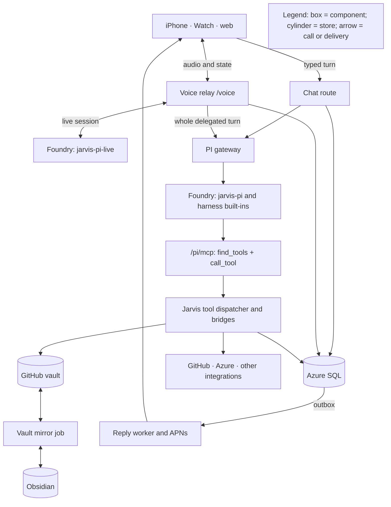
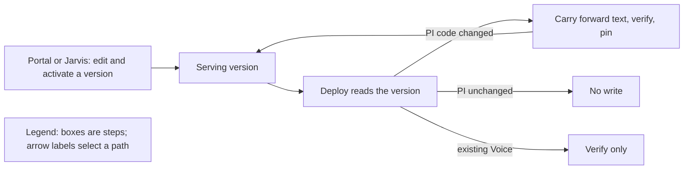
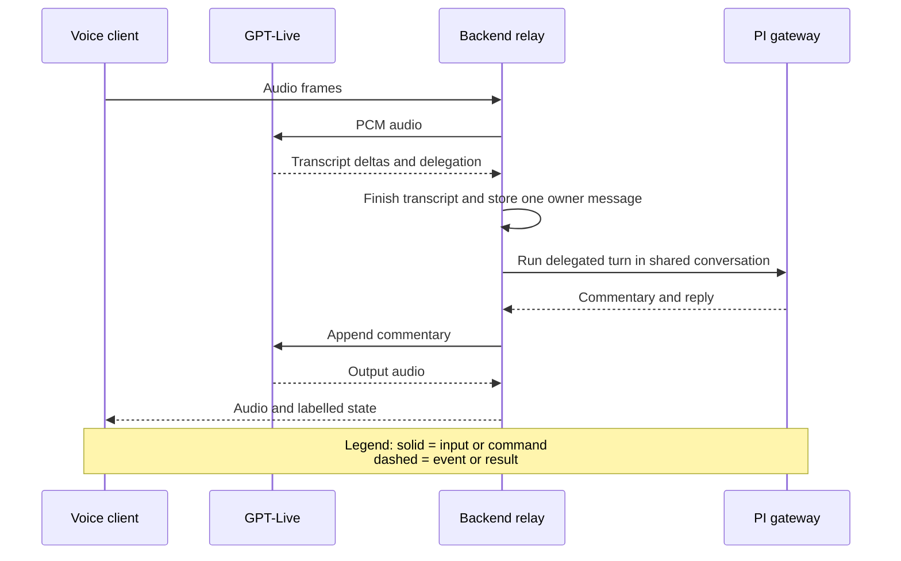
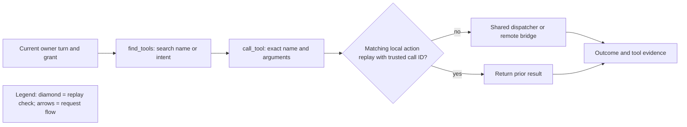
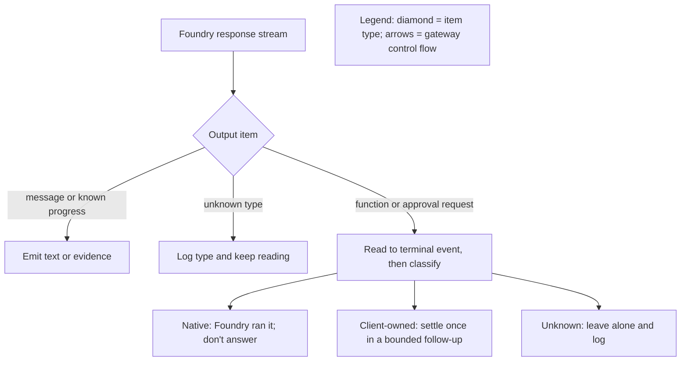
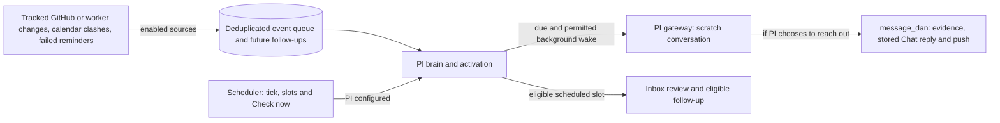
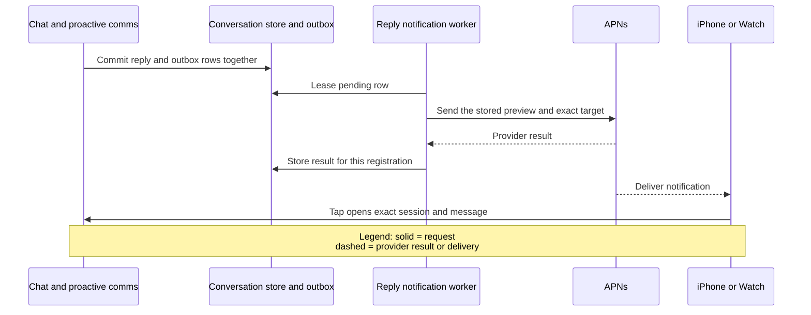
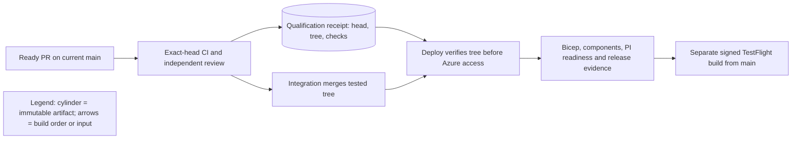

# Jarvis architecture

System map from code and workflows, not a production readback. See [PLAN.md](../PLAN.md) for release status, [PRODUCT.md](../PRODUCT.md) for requirements and the [operator manual](agent-context.md) for commands.

## Stack overview

| Component | Where it lives | Responsibility |
| --- | --- | --- |
| iPhone and Apple Watch | [apps/ios](../apps/ios), SwiftUI and the shared `JarvisCore` package | Chat, Voice, local capture and native notifications. Watch has its own Chat and Voice views; dictation sends recorded audio to Azure Speech through the backend. The Speech SDK uses its Node WebSocket transport so its upgrade carries the bearer header. |
| Web | [apps/web](../apps/web), React, TypeScript, Vite | Browser UI, Entra sign-in, Chat and Voice. |
| Backend | [apps/backend](../apps/backend), Node 22, TypeScript, Fastify | Auth, Chat, `/voice`, tools and their receipts, PI gateway, scheduled jobs and push. Shared schemas and failure copy live in [packages/contracts](../packages/contracts). |
| Database | [Azure SQL schema and migrations](../db/README.md) | Chat history, owner settings, Personal Memory, Vault index, PI runs and situation, proactive queue, APNs registrations and delivery outboxes. Runs forward migrations before listening; preserve existing migration checksums and matching down batches. |
| Vault and mirror | [Vault API](../apps/backend/src/vault), [mirror job](../apps/vault-mirror/README.md) | Markdown notes and their tasks live in the GitHub vault. The mirror reconciles GitHub and Obsidian, with a Blob-backed base and a separate status record; the backend reads the status, not the mirror's working directory. |
| `jarvis-pi` | [agents/pi](../agents/pi), managed Copilot harness in Azure Foundry | Foreground reasoning and tool use; background wakes use the same agent in scratch conversations. |
| `jarvis-pi-live` | [Voice definition](../agents/pi/voice-definition.json), GPT-Live in Azure Foundry | Listens and speaks. It does not run Jarvis tools; native client delegation sends work to the relay, which calls PI. |
| Tool dispatcher | [PI MCP door](../apps/backend/src/pi/mcp.ts), [core routes](../apps/backend/src/core/index.ts) | Turn-scoped discovery and execution. GitHub (`gh_`) and Azure (`az_`) are backend bridges; the managed harness runs its own built-ins. |
| Proactive and push | [PI brain](../apps/backend/src/pi/brain), [scheduler](../apps/backend/src/proactive), [push](../apps/backend/src/push) | Ingest signals, wake PI, and durably send owner-visible outcomes via APNs. Not every event should wake the brain or send a push. |
| Software Factory | [Backend Factory](../apps/backend/src/factory), [runner](../runner), [PC bridge](../pc-bridge) | Durable coding work, GitHub status and worker events. PC actions run through the separately authenticated bridge, not in the Foundry session. |

**Legend:** Boxes are clients, services or jobs; cylinders are stores. Arrows show calls or data delivery; two heads mean traffic goes both ways.

## The two Foundry agents

| Ownership | `jarvis-pi` | `jarvis-pi-live` |
| --- | --- | --- |
| Foundry owns after bootstrap | Live instruction text | Live instructions, output voice, greeting and `store` |
| The repository owns | `gpt-6.1-terra`, harness, tools, MCP connection and skills in [definition.json](../agents/pi/definition.json) | `gpt-live-1`, the `live` sub-protocol, client delegation and 24 kHz PCM contract |
| Deploy after bootstrap | Reads the serving version. For code-owned drift, carries forward its live instruction text, verifies the new version and pins it. No write when the code-owned definition matches. | Verifies the serving technical contract and model deployment; drift fails Deploy. Does not rewrite an existing voice agent. |

Chat and Voice use `manage_foundry_agent`. Edits copy the serving definition to a new version. Activation pins a version and reads the selector back. If verification fails, PI reports the last known write and reads back before retrying. Model roles and ARM deployments use settings and deployment tools. A PI deployment deletion requires owner confirmation. [Foundry agent API](https://learn.microsoft.com/en-us/rest/api/microsoft-foundry/aiproject)

The seed files apply when the agents are created, not as later portal text updates. Preserve the entire **KEEP THIS BLOCK** in the main agent's live instructions; it contains the turn-reference contract. Do not paste the voice text into `jarvis-pi`. Avoid changing Active while Deploy provisions: it rechecks the serving version before writing and pinning.

**Legend:** Boxes are lifecycle steps; arrow labels show when a branch is taken. The pin selects the version that serves; with no pin the provisioning script reads latest. Portal save/activation behaviour and the current serving versions were not checked live. See [provision_pi_agent.py](../.github/scripts/provision_pi_agent.py).

## Chat and Voice

- **One owner conversation for foreground PI.** Chat and delegated Voice share the persisted PI conversation (`dbo.pi_conversation`) and the gateway's FIFO claim; each turn gets its own tool grant. Waiting counts against the turn deadline (180 seconds by default; 90 for the Voice leg). Warm-up skips a busy turn. On a Foundry 404 before any reply text, the gateway tries to drop the provider binding so the next turn can create a conversation. It does not replay the failed turn or delete saved Chat history. Proactive wakes use separate conversations.
- **Chat.** The server stores the owner message, adds [agent context](agent-context.md#agent-context) and streams text, tool activity and the terminal result. An iPhone reconnect can discover and follow an active turn or reconcile its committed reply without resending. App history, Foundry history and [diagnostic logs](reference/logs.md) are separate records.
- **Voice.** GPT-Live can handle talk itself. When it delegates, the relay joins the full input transcript, waits for 1.5 seconds of quiet (at most 3 seconds), stores the request once and starts PI once. It does not cut the transcript at the delegation offset. It passes spoken commentary back to GPT-Live. Backchannels do not cancel PI; a new delegation can supersede it, and ending or timing out the session stops it. Voice is audio-only: camera and screen input are not supported by this backend.
- **Watch Voice.** The paired iPhone relays audio. Reply audio can travel while its caption awaits acknowledgement. The Watch requests echo cancellation for speaker calls and reports playback completion to the iPhone. The stored turn proves neither speaker delivery nor audio continuity.
- **Parity is a contract, not identical presentation.** Both channels see the same PI tool effects and failure meaning. The [replay tests](../apps/backend/src/voice/chat-voice-parity.test.ts) exercise the real routes, gateway and door against stubs. Their [report helper](../apps/backend/src/voice/parity-report.testkit.ts) documents intended presentation differences. Native audio and device rendering are separate acceptance.

**Legend:** Columns are owners of work. Solid arrows send input or start work; dashed arrows carry events or results. The diagram is the delegated path, not direct talk.

## Tools, retries and failure copy

**Legend:** Boxes are steps or records; the diamond is a request-identity check, not an approval screen. Each completed door call also emits a safe ledger event.

1. PI passes the **current** turn reference to `find_tools` and `call_tool`. Use an exact name returned by search; `otherMatches` are callable. Prefer aliases over new MCP entry points. GitHub and Azure bridges load on named searches with a bounded wait; the first search can ask PI to try again.
2. The door calls the normal `/tools/:name` route for Jarvis tools using the owner message bound to this turn. GitHub file reads carry the embedded source text and its resource URI. A download receipt alone points PI to `repo_read` for line ranges on the project's default branch. Read results above 24,000 serialized characters get a bounded preview, except `list_capabilities`; paging/status fields and receipts stay intact. Do not truncate action results.
3. **Replay ledger.** Within a live turn, a known local action with the same trusted `_meta` call ID, tool and arguments may reuse the earlier successful or uncertain result. This also covers a duplicate arriving while the first attempt runs. A different call ID is a separate request. Missing or reused-for-different-work IDs disable replay recognition; JSON-RPC IDs are not used. Reads, unclassified calls and remote bridge calls are not replay-suppressed here. `pi.mcp_tool` records the evidence; do not treat the in-memory ledger as durable exactly-once delivery.
4. **Unknown outcome is not failure to act.** If a write might already have run, say so (`outcomeUnknown`), preserve its receipts and verify before retry. A rejected or output-free rate-limited round can retry within its deadline. If a known response stream breaks, Foundry must report it cancelled with no output before the gateway replays it. A later failed round can still return recorded receipts.
5. **Plain copy.** [`failureCopy`](../packages/contracts) gives Chat and Voice the same failure meaning in writing and speech. Separate “nothing happened”, “might have happened”, and a confirmed tool outcome. A refused tool or a missing final answer is not evidence that prior work failed. See the [generated tool conformance table](tool-conformance.md).

Azure MCP uses exact leaf filtering from the pinned 3.0.0 image. Subscription and resource-group inventory, Container Apps listing, scoped storage/blob operations, Monitor metrics/resource-health reads, and workbook management are exposed. Group resource inventory must be repeated per resource group. Raw workspace/resource KQL tools and web tests are excluded; the backend's dedicated `read_backend_logs` tool remains the sanitized diagnostic path. Azure MCP 3.0.0 exposes only Container Apps listing, not get/scale/revision control. Jarvis Storage Queue operations are separate PI tools backed by the backend identity and the existing account's queue service; peek is non-consuming, receive temporarily hides messages, and deletion uses owner confirmation. The queue SDK disables retries for non-idempotent send/receive operations.

**Legend:** The diamond selects how the gateway handles stream items; arrows are control flow. Foundry executes native built-ins. The backend does not run a harness shell command or sub-agent.

**Limits.** Large retained conversations can hit the shared model quota across tool rounds. Foundry controls context compaction. Session policy can deny an MCP name *before* `/pi/mcp` sees it; compare `pi.stream_failed` and `pi.mcp_tool`. Live provider replay IDs remain unverified. `get_settings` with the `location` area returns the coarse iPhone observation and timestamp when available. An unsynced permission is unknown until iOS reports it.

Apple Maps requests use the signed-in iPhone workspace connection. MapKit searches and routes on the phone. The native card and local spoken estimate use a temporary result. For nearby searches the iPhone checks business matches and distance before returning the match count and checked radius to PI. Place details and coordinates stay on the phone. Conversation history holds the lookup request and handle so the owner can request a fresh estimate. [Apple Maps terms, Attachment 6](https://developer.apple.com/support/terms/apple-developer-program-license-agreement/).

## Memory and Vault Knowledge

| Store or context | Rule |
| --- | --- |
| Session context | Recent conversation, turn receipts and situation. It helps with follow-ups; it is not a write to Memory or a Vault note. |
| Personal Memory | SQL through [`core/memory.ts`](../apps/backend/src/core/memory.ts) and its policy. Settings `/memory` returns Personal Memory, not notes. Automatic capture obeys the setting. An explicit owner request to remember can still save; acknowledge only after commit. Keep credentials out of model recall, embedding and storage. |
| Vault Knowledge | Markdown and tasks in the GitHub vault via Notes and `vault_*` tools. SQL keeps a rebuildable search/index projection, not a second note source of truth. Re-read the exact Vault revision before writes. |
| Vault mirror | Separate scheduled Container Apps job, with its own identity and base/status blobs. A successful job status is not proof a client has refreshed. Bicep defaults write-back to `dry-run`; do not infer the production setting from that default. |

### Vault note inventory and title repair

[#2031](https://github.com/DanAakesen/jarvis/pull/2031) adds [`dbo.vault_notes`](../db/migrations/0103_vault_note_metadata.sql), which indexes path, blob SHA, display title and content-update time separately from search chunks. Title-only notes still have inventory rows. Normal sync marks the inventory ready before a bounded title backfill (up to 32 legacy reads by most recent edit, with a separate 20-second deadline). Repair only updates the matching SHA and does not change the content date. A write or Vault push during sync schedules one fresh-tree pass. A Git commit can succeed even if indexing fails; sync is the repair path.

The owner Notes and Graph routes share the metadata title. `/notes/summaries` checks up to 50 exact paths for pins regardless of the current page or graph. Missing or stale metadata uses a readable filename; it does not require a Vault scan or embeddings. iPhone can show an account-bound warm snapshot, then revalidates with current newest-first directory pages without HTTP cache reuse. Deployed freshness and physical-device acceptance remain separate checks.

### Daily integration boundary (P12-01)

Health and workout tools use the SQL `daily` schema. The iPhone Today card, Chat and Voice use one Copenhagen-day meal ledger and nutrition calculation. It selects one eligible daily active-energy reading, not the sum of the iPhone and exporter totals. iPhone Health sync and ingestion/Shortcuts are separate from Watch display. iPhone Gym can record lifts in the Vault; `gym_lifts` reads both sources. See the [data model](reference/data-model.md) and [Health module](../apps/backend/src/health/README.md).

The Home brief sends short per-request references to the model, then resolves citations back to the original source references before returning them to the client.

## Proactive wake and Inbox review

- The brain combines events, watches and scheduled sweeps. It uses source switches, dedupe, spacing, quiet hours, a daily allowance and a separate background spend ledger. The model chooses what matters. Durable state and evidence prevent stale references, duplicate follow-ups and messages based on data the owner has disabled. Exact timed reminders have their own delivery path and do not depend on the background switch.
- Missing switch state means **Off**. The owner controls it in Settings. `/pi/brain`, `/pi/status` and `/proactive/status` read state without starting a model. A successful wake is not evidence of a delivered message.
- PI owns the 07:00 and 18:00 Copenhagen slots and Check now. At the daily turn cap, pending events wait until Copenhagen midnight. An event-covered slot can run its Inbox review once even at the cap, without a second PI wake. No brain configured means no slots claimed.
- Background Calendar reads the next 48 hours; Travel queries its own days 3–7 window. Continuations keep the original Google query. Each background window reads at most two pages and 50 returned events.

## Reply push and reminders

**Legend:** Solid arrows send commands or requests; dashed arrows are provider outcomes or delivery. Provider acceptance does not prove the notification was displayed.

The normal reply sender is [`reply-notifications.ts`](../apps/backend/src/push/reply-notifications.ts), not an inline callback. One stored preview per reply and per-registration delivery evidence keep retries honest. A tap is a `jarvis.reply` target, not an approval or a `jarvis.proactive` item. Watch may defer the tap while busy and retains the exact target across refresh. Explicit reminders use their own occurrence outbox and terminal evidence; see [migration 0102](../db/migrations/0102_owner_reminder_delivery_outbox.sql).

## Deployment and qualification

**Legend:** Solid arrows are required inputs or ordering; the cylinder is an immutable CI artifact. TestFlight is a separate manual workflow, not a Deploy job.

- [Bicep](../infra/README.md) owns Azure SQL, Key Vault, Storage, ACR, Container Apps, Foundry and Static Web Apps. A Container Apps image runs the backend; managed identity gives it scoped Azure access. The mirror is a separate job. Client sign-in is Entra; keys and server credentials do not go to clients.
- [CI](../.github/workflows/ci.yml) qualifies the ready PR, not whatever later happens to be on the branch. [Deploy](../.github/workflows/deploy.yml) selects affected components, verifies the merged Git tree equals the qualified tree, and retains [deployment evidence](../.github/scripts/release_state.py). A no-op or superseded run is not fresh provider acceptance. An unchanged tree need not rerun a component; changed inputs need matching evidence.
- Backend readiness includes PI provisioning/readback and the exact applied revision, not a live conversation test. [TestFlight](../.github/workflows/ios-testflight.yml) signs and uploads the dispatch SHA and reads back Apple processing and internal beta state. A normal release uses `main` after Deploy is green. A receipt is not device acceptance.

### Coding sandbox

Factory runtime sandboxes are not this repository's development environment. Credentials belong to the runner, its managed identity and protected secret storage. See the [runner](../runner/README.md) and [infra map](../infra/README.md) for those boundaries.

### Cost

The PI foreground ledger separates input, cached input and output; background reserves and reconciles its own allowance. These controls do not authorise spending. Development is local; no live or paid measurement without approval of the exact command. See [cost and safety](agent-context.md#cost-and-safety).

## Invariants to keep

- **P0: same tools in Chat and Voice.** One foreground PI conversation and dispatcher; do not add a second provider or path to mask failure.
- **Model decides; code proves facts.** No new approval or confirmation gates for PI except delete. That product rule does not remove sign-in, owner identity, data provenance or safe delivery checks. An accepted request or APNs send is not proof of the final outcome.
- **Unknown outcomes stay unknown.** Use actual receipts and require a readback before recommending a retry of a potentially committed action.
- **Qualify the exact tree.** Merge through a PR with independent review and green checks for its current head on current `main`; the PR author may merge after those checks. See [merge and release](agent-context.md#merge-and-release).
