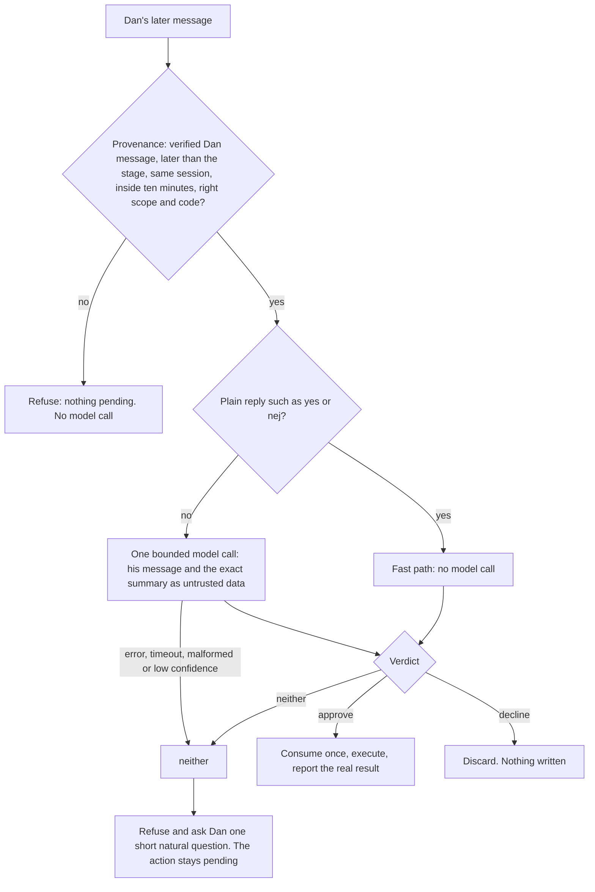
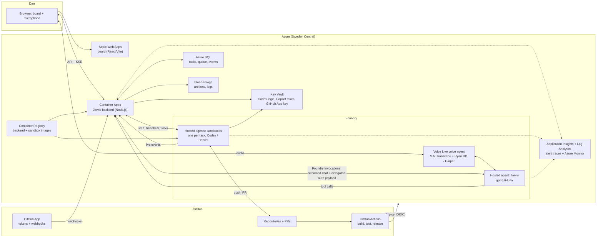
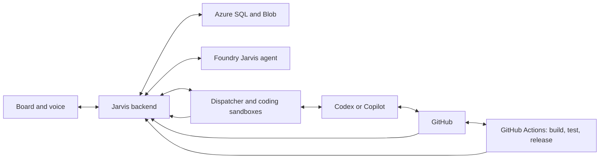
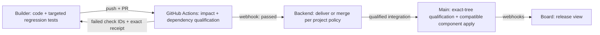
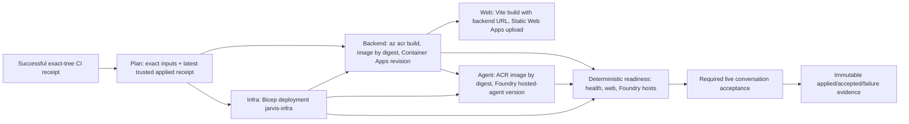

# Architecture

## Natural approval of staged actions (17 October 2026; P11-10)

Sensitive writes (Google Calendar and Gmail, Software Factory archive and issue
creation, GitHub App writes) are staged with the exact summary and the session
that staged them. A later message of Dan's approves one only after two
independent checks, in this order:

**Provenance** is deterministic and lives in `google/pending-actions.ts` and the
Factory and GitHub App confirm tools. The message must be the owner's verified
current message (voice: the transcribed turn the relay sets on that call only;
chat: the `x-jarvis-message-id` header equal to the newest stored Dan message,
with the agent identity), strictly later than the staging message by numeric id
and by time, from the same non-empty session, inside the ten-minute window, for
the tool's scope and code. Every Google stage records its session (a required
field, plus a runtime guard that throws without one). The model, tool output,
email text and any model-supplied field cannot satisfy it; confirm tools take
only the confirmation code.

**Meaning** is `core/approval-interpreter.ts`. `classifyApprovalReply` in
`core/approval.ts` is the fast path: a short full-reply whitelist (English and
Danish) that needs no model. Everything else gets one call to
`ApprovalModelPort`: Dan's single reply plus the staged summary, framed as
untrusted data in random-nonce delimiters after stripping control and format
characters (a reply over 280 characters or a summary over 1,800 is cut or
refused before the call). The model must answer exactly `{verdict, confidence}`;
below 0.85 an approve or decline becomes `neither`. The call is limited to five
seconds, 20 a minute and 4 at once, and results are cached by family, session,
message, action and hashes of summary and reply (ten minutes; failures 30
seconds). The `approval.interpreted` log records family, verdict and path
(`fast`, `model`, `failed`), never any text. Any error, timeout, malformed answer,
low confidence or absent model yields `neither`.

`core/approval-interpreter-foundry.ts` builds the port: the configured chat-role
model at the lowest supported effort of none, minimal or low, via Foundry
`/models/chat/completions` with a JSON response format, a 40 KiB request and 32
KiB response cap, no redirects and the backend identity's token. Usage is
recorded under the existing chat role before the answer is judged, and a
recording failure fails closed. An unpriced model is allowed (usage
`unverified`); an undeployed or non-chat role model (for example Claude) leaves
the port off. `index.ts` composes it only when the endpoint, credential,
settings and usage store exist; `app.ts` otherwise decorates a model-less
interpreter, so a plain reply still works and everything else is asked about.

After the interpreter awaits, the action is re-checked synchronously (same
pending object, not expired, call not aborted) and consumed before execution, so
concurrent confirmations execute once.

Routing no longer matches approval phrases. In chat, any turn with a calendar
referent in the last two messages makes the agent call
`calendar_get_pending_change`; the backend returns `reply: approve | decline |
null` from the same interpreter for an eligible message, and `null` leaves the
turn to the model. An approve or decline makes the agent call
`calendar_confirm_change` with the real code, which the backend decides again at
the boundary (the cache makes that free). In voice, `resolveCalendarReply`
does the same for each turn of an open calendar conversation, setting
`request.jarvisConversationMessage` for that call only. A calendar conversation
stays open while a change is staged and ends on an unrelated turn once nothing
is. A stray reply that clearly agrees can therefore approve a still-staged change
within the window; provenance and the ten-minute limit bound it.

Refusals and instructions carry no word list (`approvalInstruction`,
`approvalUnclear`, `approvalNotPending`). `saysProceed` and `hasExplicitProceed`
in `factory/github-app-tools.ts`, the `pr_merge` failing-checks override, still
match phrases and are unchanged.

## Jarvis-owned workspace views in voice (17 October 2026; P11-09)

`workspace_command` creates, updates and navigates views only for Jarvis. The
agent identity (chat, phone, Factory) is Jarvis by definition. A realtime voice
tool call arrives on the signed-in owner's authenticated WebSocket, so the relay
runs each model-issued call inside `runModelToolCall`, an `AsyncLocalStorage`
scope in `core/tool-origin.ts`. `isJarvisToolCall` is true only for that exact
request, inside that scope, for the configured workspace owner. The model, the
browser and tool arguments cannot set it: the scope exists only in-process, the
browser cannot inject tool calls, and reflex, sibling and non-owner requests
never enter it. A browser-origin owner token (including `/tools/*` over HTTP)
and the reflex path keep the reflex-only set: show, focus, minimise, restore,
close, resize, place, arrange, pin, and conversation, session, layout or
context-panel controls without a view. `html_view` create, read and update use
the same helper. Refusals name who may do what and say nothing was changed or shown.

Voice presentation of Google results shows a bounded list or text only: mail
subject, sender and date; staged summaries without confirmation codes; plain
outcome labels; free slots and the next event. An unrecognised result puts
nothing on screen. It never serialises a raw tool result, so message bodies,
identifiers and codes stay off screen. No new `source.id`, renderer, tool,
contract, permission or migration.

`workspace_command` is validated in two stages and both now explain themselves.
Fastify's Ajv checks the flat schema first, but for a failure inside `view` it
can only name the top-level property. The hand validators
(`isWorkspaceCommand`, `generatedViewValidationOptions`) then enforce what a
schema cannot: per-operation keys, table rows against columns, registered
call-tool actions, trusted image hosts, date validity and the size cap.
`workspaceCommandProblems` in the contracts package locates the first failing
fields with the same helpers the validators use. `explainWorkspaceCommand`,
registered as the tool's optional `explainInvalidInput`, turns them into one
refusal, `Invalid arguments: <field>: <problem>. Nothing was changed or shown by
this call. Retry with arguments matching the tool schema.`, produced by the Ajv
stage in `toolArgumentRefusal` and by the tool's own validation. Chat and voice
therefore return identical text. The text is value-free (static wording,
enumerations, counts and key names from known property sets, never a
model-supplied value) and bounded to 400 characters; if the explainer finds
nothing the old generic message stays. The `tool.invalid_arguments` log payload
is unchanged, and owner-only authorisation, the operation and the broker are
untouched. Guidance for the model lives in the `workspace_command` description
(clean-list example, `view` is an object, create and place are separate
commands, correct the named field and retry once) because the shared capability
instructions have almost no budget left.

A Google result the tool reports as truncated, or that the presenter cuts to fit,
gets a static value-free note inside the view (a trailing line for text, a final
plain item for lists) and a `partial` source whose reason is the same text.
Free slots from an incomplete event list say some slots may not be free, and an
empty incomplete result never claims that nothing exists. The web chrome does not
render `source.status`, so the in-view note is the visible signal.

## Realtime voice presentation (16 October 2026; P11-07)

After normal argument validation and pre-execution guards,
`executeRealtimeToolCall` starts the existing `startWorkPresentation` lifecycle
with surface `voice`. It finishes successfully only after the actual result
and final tool-output envelope pass their existing serialization/size bounds.
The conversation message ID, memory source message ID or activity UUID scopes
the ephemeral view; this presentation identifier grants no write authority.
Existing settings, presence, cancellation, workspace acknowledgement and
redaction behaviour stay owned by the presentation service. Calendar proposals
use its existing schema-valid plain-text view and never invoke confirmation.
Relay transport, approval state, providers, persistence and frontend are unchanged.
The approval orchestrator suppresses its internal pending lookup's presentation,
so an asynchronous stale proposal cannot overwrite the final approval/decline receipt.

## Calendar proposals and conversational grounding (16 October 2026; local candidate)

`calendar_create_events` validates 2–10 complete event inputs before staging
anything. The existing `PendingGoogleActions` owns one immutable calendar
proposal, including every displayed local-time summary and the captured
provider inputs. A batch additionally binds its source conversation session.
The existing eight-digit code, ten-minute expiry, verified later Dan message
and consume-before-execute boundary still apply; single-event input schemas
and Gmail scope remain compatible.

Confirmation runs the captured events sequentially and stops on the first
failure or cancellation. Results distinguish `completed`, known `failed`,
`unverified` and `not_attempted` items. No automatic retry or rollback is
implied. The current proposal's actual terminal receipt remains process-local,
source-session-bound and limited to the original expiry. A newer proposal
invalidates that receipt; an older in-flight completion cannot overwrite it.
`calendar_get_pending_change` can return this `lastChange` with `status: none`;
absence of pending state is not proof that nothing was written. Restart loses
both stage and receipt. No SQL migration, replica or permission change is added.

The hosted adapter consolidates multiple proposed single-create calls before
dispatch when the batch tool exists. For an explicit multiple-event request,
it locally refuses an isolated single-create call before staging and bounds
continuation to the complete batch. Failed/incomplete continuation therefore
cannot leave a hidden first-event proposal. Approval recovery compares the latest
request's canonical server-verified message ID with the existing staged
`sourceMessageId`, exposed only by trusted pending/receipt results. Optional
`ModelMessage.source_message_id` retains that identity through verified history,
the current request, steering and caption fallback, but is not serialized into
provider prompts. Assistant labels, copied/rephrased summaries, counts and
claimed JSON cannot supply identity. Missing/truncated/unverified origin refuses
batch approval; other callers and single-event semantics remain compatible.
Model-dispatched confirmation also checks actual recovered state, rather than
bypassing the guard after unusual routing. A round mixing separate calendar
proposals/confirmation is refused before any mutation dispatch, so a valid first
stage cannot remain hidden behind a later refusal under the same source ID.
The existing all-single-create coalescing path still validates the whole list.
Contextual quantities such as "Add those two.", "Tilføj de to." and "Tilføj
disse to." can use the preceding calendar context for routing and response
grounding. Danish demonstratives do not make English `to` a quantity.
Explicit Notes/mail context blocks
that inheritance. Batch origin checks examine the latest explicit user creation
or scoped calendar mutation without skipping a newer shorthand/other-workflow
creation for an older source; plain cancellation remains an approval reply.
Context never substitutes for canonical staged/verified message-ID equality.
Earlier state is not cancelled or mutated by
that refusal. Older catalogues cannot silently overwrite
one single stage with another. Final response grounding targets affirmative
calendar action/approval claims, not benign calendar wording or unrelated
tool errors. Calendar requests remain guarded if recovery is unavailable.
Normal chat adds supported CommonMark record/date guidance; smoke and spoken
format instructions are unchanged. Timed calendar reads retain ISO values and
add human-local-time labels; date-only events are not converted.

Calendar catalogue presence no longer requires holding every unrelated chat
sentence until provider completion. Both provider adapters can release complete
non-calendar/non-action sentences using the same scope/claim helpers as the
final guard, including ordinary completed-action wording such as "I've put both
in your calendar." Partial or ambiguous sentences remain held. Released text cannot
be retracted; the remainder is still checked against actual tool evidence,
and steering refreshes calendar scope before a continuation. This is a bounded
partial-streaming policy, not semantic proof or a measured production speedup.
The runtime change is limited to verified-message metadata assignments; transport,
connection reuse and client lifecycle are unchanged. Combined PR #816 real-handler
disconnect/each-invocation close-order coverage remains unowned and unverified.
These are local synthetic contracts, not
live provider/model, rendered UI or restart-durability acceptance.
Final shorthand/claim controls passed in the 444-test calendar/model/runtime
selection with Ruff8 clean. The 58-test qualified Node result covers the exact
unchanged backend/fixture identities after the Danish-only correction. Older
v1/v2/v3 packets remain historical, not combined pinned-CI acceptance.

## Mobile composer focus hotfix (16 October 2026)

`Workspace` retains the saved conversation layout in state but derives no manual
layout, positioned attributes or fixed composer anchor while its existing phone
media policy is active. `App` also withholds the anchor during that policy,
including the desktop-to-phone transition. The unchanged viewport hook and
canonical CSS own both phone halves; desktop resumes its existing fit/anchor
path when the media policy changes back. Phone Move/resize controls are absent.
No new geometry state, persistence format, API or voice behaviour is introduced.

## Chat rendering and explicit phone viewport (16 October 2026; local candidate)

Agent JSON SSE payloads retain text newlines through `chat-agent.ts`,
`conversation.ts` delta concatenation, SQL `messages.text`, history projection
and `ConversationHistory`. A well-formed table still rendered as inline pipe
prose because `MarkdownContent` used CommonMark without table support.
Chat opts into `remark-gfm` on the existing `react-markdown` parser; Notes and
Knowledge keep their existing CommonMark rendering. Raw HTML stays
disabled and URL transformation/link isolation remain unchanged. Tables use
native headers and a bounded keyboard-focusable scroll wrapper. Only
table-bearing messages can exceed the ordinary prose-width cap. Rendering
does not rewrite persisted text or reconstruct flattened malformed records.

`usePhoneChatViewport` publishes shell-scoped visual-viewport top and height,
not `innerHeight - visualHeight` bottom compensation. Both fixed chat halves
use that rectangle directly. This avoids mixing a stale layout-height reading
with a shrinking CSS fixed viewport. Zoom retains ordinary native panning.
`Workspace` keeps its existing scheduled manual anchor measurement and saved
layout; viewport fitting never saves a new preference. `ConversationHistory`
observes transcript resizing to retain bottom-follow only for a latest reader.
Its existing content-follow effect runs in the layout phase: a passive effect
could otherwise receive layout-generated scroll events first and incorrectly
disable following while a table response was still open. Explicit reader
scrolling still opts out through repeated content growth.
No API, database, voice or navigation contract changes.

## Source identity across chat steering (16 October 2026; local successor)

The chat loop persists an interrupted Jarvis partial after the steering Dan
row before invoking the next round. Gmail-policy hydration can read that
single row's predecessor only when the latest row is explicitly interrupted
Jarvis. The predecessor must share its session and match the requested Dan
message ID. This is two bounded one-row reads at most, not an unbounded search
or permission to reuse a completed reply. Both reads retain cancellation and
error propagation. Gmail turn tracking, nested independent-action scope and
raw site/process checks are unchanged. This is source-only, not live account
or deployment acceptance.

## Gmail guard before any computer dispatch (16 October 2026; source candidate)

An unavailable Google module must not bypass Gmail policy merely because no
mail tool can start the turn ledger. Hosted HTTP computer calls resolve the
existing stored current Dan message before dispatch when their verified source
is not already on the request. Matching ID and Dan role are required; an
unavailable/stale source refuses and a history failure remains an error.
Cancellation is checked after that awaited read.

The existing bounded identifier-only ledger also records a positively observed
Gmail request before the first mail call. Existing intent matching preserves
explicit unrelated operations, with nested execution scoped to that request
and source keys. No broader computer exception, new persistence, Google call,
permission or provider path is introduced. Raw site/process guards and static
MIME extraction remain unchanged. This source correction is not yet released.

## Production lifecycle evidence (15 October 2026)

The contract below is now released in `6e702e7a`; its held/source-only labels
record the earlier freeze stages. Fresh Task 19 exercised the clean path:
current generation/session/invocation proof carried work commit `549fe564`,
the remote task branch and new PR matched that commit, and normal project
policy reached Done after the existing no-CI grace. Durable reload retained
Done and the backend reported zero tracked active sessions.

The worker is disposable; its artifact survives in
`DanAakesen/jarvis-test-target#6`. This observed backend proof establishes
verified owned-writer teardown, not physical Foundry deallocation. The normal
runner release enforces a 120-second idle timeout; no previously denied
provider inspection was retried. This clean live run does not exercise the
alternative cleanup-failed path or identify Task 18's original shutdown cause.

## Delivery after verified writer stop (15 October 2026; V4g fixture successor, not released)

Runner invocation metadata separately records successful work and successful
owned-provider teardown as exact booleans, with the full verified local work
commit in `work_commit_sha`. Local advancement alone is not published delivery.
The backend requires that exact commit at the remote task branch and on every
created, reused or reconciled PR before recording delivery. Legacy or malformed metadata supplies
neither fact; no missing client, early result event or expiry supplies stop proof.
Successful-work indication originates only in the actual verified delivery-work
branch. A generic completed turn can instead be a no-commit question and does
not establish work proof, even if question publication fails. The backend also
rejects alternative proof containing a current-invocation question event.
Provider stop still requires the owned process-group and reader checks.
Credential, event-delivery or publisher failure can therefore leave the runner
failed while its completed work and stopped writer remain independently known.

The Foundry decoder validates optional lifecycle booleans and bounded allowlisted
cleanup phases, discarding secondary diagnostic text. One shared completion-proof
classifier serves heartbeat and stale reconciliation. Only final failed status,
both positive facts and exclusively post-provider cleanup phases qualify for the
alternative path. Cancelled/nonterminal states, failed work, failed or unknown
provider stop, and missing phases remain ineligible. Both clean and cleanup-failed
completion require positive work/stop facts and a valid commit identity.
Legacy unbound snapshots remain readable but cannot authorise new completion.
An unbound completed invocation reaches explicit verification attention rather
than being labelled runner failure or polled indefinitely.
Both direct attention cleanup and its state-change subscriber retain the
observed completed turn and end its session normally. That invocation-level
completion is not task Done, successful delivery or backend completion proof.
Missing proof still prevents GitHub delivery and policy eligibility; genuine
runner-failure attention retains crash classification.

Both paths still require the same current generation/session/invocation,
no-start-lease policy gate and ordinary GitHub delivery/policy verification.
The backend completion event retains the work commit. The SQL policy gate
compares that commit with the policy candidate's expected PR head while holding
the task lock. A different green PR cannot substitute for unpublished current
work.
Proof identity expressions use explicit `Latin1_General_100_BIN2` comparison.
JSON inherits the payload column's database-default collation, which can
differ from the binary Foundry-session column and otherwise fail the gate with
SQL error 468. Explicit comparison also keeps opaque session/invocation IDs
case-sensitive without changing persisted schema or the database collation.
Backend proof events and heartbeat decisions distinguish cleanup-failed delivery
from clean completion and preserve sanitized secondary phases. Runner failure
is not rewritten as success. Untracking ends keep-alive polling; Foundry's
configured idle timeout still owns automatic compute release. Stopped-writer
proof is not a claim of physical cloud deallocation. Real SQL, Linux process,
normal release and a fresh bounded live trial remain acceptance gates.

## Recovery-generation fencing (15 October 2026; local correction, not released)

Migration 0048 adds a persisted bigint execution generation to tasks and sandbox
sessions, initially zero for existing rows. Each dispatch or recovery claim
advances the task generation before contacting Foundry. A persisted session
copies the claimed generation; start persistence, start failure and deferred
claims reject an obsolete generation even if the dispatcher owner is reused.
The generation is separate from the retry counter and is never reset by a
failed start or removed by event archival.

Recovery takes the same per-task policy application lock before its existing
sleep/dispatcher locks and commits its generation with the start lease.
Completion proof carries the tracked session's generation, not a newly inferred
task value. The locked policy gate requires an absent start lease and equality
between task, session and proof generations, as well as the existing latest
session/turn identifiers. This gate is shared by Done and the automatic
project-policy merge. Clearing a failed start's lease cannot restore the
previous proof. No transaction is held across Foundry start.

Existing completion events are not backfilled. Existing session generation zero
can receive fresh runtime verification, but old proof without a generation is
ineligible. Apply the additive migration before this backend; do not revert the
generation columns after use. An application rollback must pause dispatch and
retain generation evidence, rather than silently reverting to an unfenced writer.
Real-SQL pending/failed-start, deferred-approval and replacement-completion
controls are added; local execution remains blocked without loopback SQL.

## Explicit failure and bounded finalization (15 October 2026; local candidate)

Heartbeat handling processes a valid explicit failed snapshot before recording
a heartbeat. A trusted internal failure flag overrides earlier completion and
question hints, crashes the current session and fails its current turn, then
records `NeedsAttention`/`foundry_failed`. Current-invocation fencing remains;
late raw completion events cannot turn a failed turn back into completed.

The reconciliation selector admits eligible Ended sessions without waiting for
the active-session five-minute freshness cutoff. Active sessions retain that
cutoff. The existing persisted expiry event can therefore wake a scan even
after the last tracked session disappears. Five-row batches advance by a stable
task-ID keyset, not mutable heartbeat timestamps or an offset. A full batch
schedules another zero-delay, yielding pass even without tracked sessions;
awaiting-policy or failed earlier rows cannot occupy every later page. An
expiry received during a sweep retains a rescan request until the sweep ends,
so a newly eligible lower-ID task is not skipped. A failed SQL scan or row
operation logs the failure and retries at the existing reconciliation interval,
not in a hot loop; row failures do not stop later pages. Stopping cancels
follow-up scheduling; a successful exhausted sweep does not keep polling idle
SQL. Real SQL and independent exact-patch review remain required.

Runner finalization shares a 60-second monotonic work deadline across provider
shutdown, credential persistence, event drain and publisher close. IO phases
also have ten-second caps; cancellation joins have one-second caps. This is not
an exact wall-clock bound on synchronous filesystem operations. An exhausted
budget does not start a new credential write.

Cancellation-resistant timed-out Futures remain owned until they settle.
They fence reuse of the same session; unsettled credential persistence also
fences new Codex turns across sessions. The guard runs before startup and again
after acquiring the session lock. Normal in-progress cleanup is not registered
as a residual failure. These Futures are process-local, not persisted recovery
records, and failure is not proof of resource release.

Heartbeat decisions expose only an allowlisted cleanup phase parsed from the
sanitized error. Existing bootstrap logging passes the complete decision object;
provider output and credentials are not added to logs. Normal exact-head gates,
independent review and fresh live acceptance remain outstanding.

The first actual failure retains terminal-error precedence, including a work
failure that preceded cleanup. Ordered `cleanup_failures` separately retain
allowlisted phases and sanitized classifications. Safe metadata persists these
diagnostics and the invocation endpoint exposes validated values after reload;
arbitrary work-error text is not persisted and rehydrates generically. A later
credential, delivery or publisher timeout cannot replace an original
`reader_shutdown` error. This does not extend any deadline or establish the
historical failure phase.

## Process-group exit and policy completion proof (15 October 2026; local candidate)

The POSIX ACP provider starts in an isolated process group. TERM and bounded
KILL escalation target that captured group, including when the leader has
already exited. Shutdown joins the leader and readers and checks that no live
group member remains. Linux procfs excludes exited zombies, which may await
PID 1 reaping without executing or retaining pipes; inaccessible or malformed
membership information fails closed. Existing phase deadlines and shielded
ownership remain. Automatic failure events add an allowlisted cleanup phase.
Group exit is not proof of cloud session deletion or physical deallocation.

GitHub policy reads use the existing repository-read token, including checks
and statuses permissions. Only an approved, still-eligible merge mints the
existing write token; the merge endpoint uses PUT with the reviewed head SHA.
No installation grants, identity roles or OAuth scopes change.

The dispatcher records `runner_completion_verified` only after a clean final
completed runtime snapshot or the separately verified V4 stopped-writer proof,
while its task-policy lock rechecks the current session/invocation and Running
state. The wire decoder still rejects completed snapshots without a finish time
or with an error; cleanup-failed delivery retains failed runner status. The existing event store
retains only backend provenance and sandbox/session/invocation identifiers,
and safe alternative-path cleanup phases, not result text. Policy's locked SQL gate requires that proof for the latest
session and latest completed turn before Done or merge, and rechecks after
merge approval. A raw runner `completed`/question event or idle-expired turn
does not supply this proof. A rejected task transition is not reported as
successful no-check completion.

Migration 0048 adds execution-generation fencing without proof backfill. Existing nonterminal tasks
without this proof require fresh runtime verification; a missing runtime
cannot be declared complete from an old event. Existing Done/Cancelled tasks
remain unchanged. These source changes require normal exact-head gates and
fresh acceptance; they do not retroactively prove Task 18 cleanup.

## Owned ACP shutdown boundary (15 October 2026)

`ACPClient` owns its process and both pipe-reader tasks. Concurrent stop callers
share one shielded shutdown, preserving cancellation until bounded teardown
settles. The existing ten-second terminate phase is followed by at most ten
seconds for post-kill exit and ten seconds for reader completion; cancellation
joins are separately capped at one second each. Reader errors are no longer
silently accepted. Pending protocol requests fail when shutdown ends.
Unverified exit or reader cleanup raises a sanitized `ACPShutdownError`.

The finalizer keeps its existing terminal-after-cleanup/event-flush ordering.
Only successful stop removes the matching session client; failed cleanup keeps
that owner fenced, including normal session-stop and cancellation paths.
An older finalizer never removes a replacement client. A failed invocation is
not successful delivery or cancellation, and retaining a local owner is not
proof of physical cloud cleanup. No API, schema, model, capacity or Done-policy
change is introduced. A new runner image cannot patch an already-running image.

## Trusted pre-start runtime absence (15 October 2026)

The existing runtime getter distinguishes no task (null result) from an existing
task with no recorded session (all four projected fields null via OUTER APPLY).
Only the latter can bypass missing-session-end evidence for attention
cancellation; reject partially known identity and incoherent/live targets.
Pass that exact absent generation to the unchanged terminal transaction.
Its task/session/turn locks and full-field comparison reject a concurrently
inserted first runtime before mutation/events/cleanup. The absent path uses
existing session accounting but never invokes a provider without an owned
target. No new store, schema, API or recovery/classification policy is added.

## Bounded header tab groups (15 October 2026; combined candidate)

CSS bounds the existing Workspace portal host and tab navigation between
the brand and fixed shell actions. Tabs shrink to their minimum; overflow
belongs to the window navigation and a new inner `JobsChip` list, not the
header. The job popover remains a sibling of that list, retaining its
existing dismissal/focus owner. No resize observer, tab-width state,
backend contract or window lifecycle changes are introduced.
`ShellLayout` no longer renders generic runtime activity in the header;
the activity subscription still supplies phone and conversation feedback.

### Job history and recovery correction (16 October 2026; local)

The header represents `BackgroundJob.jobId` UUIDs, not workspace-window
duplicates. Startup creates a new embedding run only when vectors need
backfill; SQL reconciles an interrupted running job as failed with its
existing step history and `interrupted by restart` reason. Opening job
details does not start indexing. Those lifecycle contracts are unchanged.

`jobs-store` merges authenticated `/jobs` hydration with activity events by
UUID and update time, prevents terminal-to-running regression, retains all
running work and the latest 100 terminal runs locally, and exposes load or
device-storage failures. Historical completed results do not auto-open on
reload; a hydrated running job can still deliver its subsequent live result.
Pending result-window delivery survives unrelated progress updates and is
disposed on unmount or when that job is hidden. A missing result window or
failed local action marks Jobs as needing attention and exposes the error
in that run's history without changing its server status. Opening the result
successfully clears the local error.

Running jobs have separate accessible Hide controls; undismissed jobs share
one Background work list instead of creating repeated terminal header tabs.
P11-05 renders the store's filtered `jobs`, not its raw `history`, for both
the list and selected details. Raw history remains available to lifecycle and
phone-summary consumers; saved records remain unchanged.
P11-12 replaces UUID-only device preferences with a separate SQL dismissal
store keyed by authenticated owner and job UUID. Existing jobs belong to the
configured backend owner; other accounts cannot list or dismiss them.
Authenticated dismiss-one, dismiss-finished and bounded UUID-import endpoints
filter the header's `/jobs` response and `list_jobs` counts without changing raw
registry, job-detail or health reads, job rows, steps, events or lifecycle.
Running work cannot be dismissed.
Visible snapshots and dismissal metadata each return at most 1,000 IDs/rows,
with running jobs first. SQL filters visibility against the complete owner
dismissal table, not just that bounded metadata. Bulk writes persist every
retained terminal dismissal even when the response is bounded. Import success
means the submitted legacy snapshot was processed; absent, expired and running
IDs are ignored, not recorded as dismissals. Nonempty dismissal state prevents
rolling back migration 0053.
Legacy scoped browser IDs remain hidden locally until the import is confirmed,
then the local copy is removed. Refresh reconciles the authoritative visible
window while preserving concurrent live updates. Unknown replayed jobs wait
for server visibility confirmation, so bounded tombstones cannot resurrect
older dismissals. Bulk dismissal refreshes that window before reporting success.
Closing/hiding does not call Cancel, delete SQL records or erase results.
Undismissed details still expose original status,
run identity, timestamp, failure reason and saved result. A dismissed selection
falls back to the list without effect-driven state copying. Empty and error
states remain distinct, and a stable control preserves focus after the last row.
The phone sheet counts one renderable Jobs summary independently of artifact
windows and stays open for job controls. Artifact tabs are React portals, so
a native capture listener on the actual tab strip closes the phone sheet
without preventing the artifact's own selection/restore callback. The listener
is replaced with its strip target or phone mode and removed on cleanup;
Jobs/history controls remain exempt.

Header Retry does not dispatch a chat prompt. Indexing has no supported
owned retry action here, so Retry is disabled with an explanation separating
that prior run from current indexing health. Research details direct the
user to the existing job-ID/`get_job` retry-eligibility contract rather than
assuming that a sensitive `retry_job` tool can be invoked from the header.
No new backend action, permission, model call or index mutation is added.
Header controls use existing borderless shared control surfaces and focus
outlines, following the user's no-decorative-tab-border decision. Job history
uses the existing opaque report surface in both appearances; narrow desktop
popovers stay within viewport margins and phone details remain inside the sheet.
Saved server history and the existing 30-day retention are unchanged.

## Mobile/Status review publication (14 October 2026)

The publication candidate retains all eight accepted code/test/CSS paths
byte-exact, including the two already LF-normalised hook files. Only additive
documentation is adapted to current main; page completion ownership,
deadline/cancellation behaviour and phone viewport ownership below are
unchanged. No Factory, backend, contract, dependency or runtime boundary
is added. Publication approval does not authorise merge or deployment.

## Page command completion ownership (14 October 2026; local)

`ShellLayout` retains synchronous direct workspace dispatch, but its broker
page-command applier owns a bounded pending-route completion. The pathname
layout effect settles success only on destination commit, or refuses a
superseding route. Abort, unmount and the command deadline remove the waiter
and its timer/listener. The maximum wait retains the existing six-second
navigation ceiling and 250-ms acknowledgement reserve; it starts no fetch.
Both a successful waiter settlement and the post-dispatch page/pane fast
return check the same captured deadline against the completion-time clock.
Late success becomes the existing deadline refusal even if its timeout has
not run; cancellation and other refusals keep their reason. This observes
completion only and does not roll back a requested router transition.

Actual-App fixtures observed applied acknowledgements before the Status
heading/selected rail entry existed. The surrounding `flushSync` and the
navigation function's return alone did not guarantee route commit. The new
owner observes the shell commit rather than polling DOM or awaiting health
reads. Existing Factory issue resolution, Notes draft guard, Folio pane,
session/pin handlers and persistent Now session remain separate.

## Phone typing viewport ownership (14 October 2026; local)

`ShellLayout` enables `usePhoneChatViewport` only for signed-in phone typing.
The hook publishes shell-scoped top/bottom visual-viewport insets synchronously
on resize, pan, page restore and focus changes; unchanged values are not
rewritten. This precedes the workspace's scheduled anchor measurement,
including pan-only events where canvas dimensions do not change. Pinch zoom
and browsers without VisualViewport retain ordinary dock behaviour.

`Workspace` remeasures an existing manual composer anchor through one
animation-frame callback on viewport/window resize and captured scrolling,
deduplicates unchanged coordinates, and removes listeners/pending work on
disposal. Both phone chat halves use the same insets and measured composer
height. No viewport event writes persisted layout or remounts the draft owner.
The hook dismisses only an active in-shell Message Jarvis textarea on outside
touch, excluding composer/menu controls and preserving the native tap.
Voice, authentication, APIs, model requests and dependencies are unchanged.

## Remaining UI release (13 October 2026)

`Workspace` owns conversation gestures and device-local normalized geometry
in `conversation-layout.ts`. Optional reference canvas dimensions preserve
preferred pixels when the composer wraps or the viewport changes. Fitting
does not write storage; only completed pointer/keyboard/command changes do.
Cancelled gestures restore the previous layout, and storage failures surface
as alerts. Shell state carries the composer anchor and measured height;
`ConversationHistory` keeps its existing mounted input owner.

P9-117 adds a phone-only heading grip using the same pointer-capture,
cancel/lost-capture, keyboard and clamping paths. Its validated preference uses
`jarvis.conversation-layout.phone.v1` through the same storage helpers. Only
height is applied to the existing bottom-docked phone window; desktop geometry
and the composer-anchor measurement remain dormant on phones. Viewport fitting
never writes either preference.

`NoteFolderPicker` uses the existing authenticated `/notes/tree` endpoint,
with cancellation, bounded response validation and explicit retry/incomplete
states. It owns transient destination folders; explicit note Save remains the
only vault write. Notes derives directory metadata from validated paths and
retains exact content/revision safeguards. The graph accepts arbitrary/root
folder names, with neutral layout/colour fallbacks for unfamiliar folders.

`HtmlAppView` observes host appearance and sends validated theme messages to
the existing scripts-only sandbox. The injected bridge accepts its parent
only and bounds token names/values; it updates variables without iframe
reload. Host and document share `--report-surface`, removing duplicate outer
chrome while retaining inner content structure. Existing CSP, backend routes,
authentication, pin APIs and camera lifetimes are unchanged.

## Workspace window release (12 October 2026)

#430 adds the pure `window-layout.ts` engine to the existing `Workspace`.
Automatic, region and manual placements share normalized geometry; a 480 px
minimum triggers cascade fallback instead of squeezed side-by-side windows.
Stacking order is independent of layout order. Window snapshots now include
state, placement, optional region, pinned status and frontmost status.

App memoizes the authenticated pin client. `Workspace` owns read cancellation,
revision guards, storage-confirmed writes and pending/recovery UI. GET retries
at most three times within one 120-second deadline, with 500/1000 ms backoff
for network TypeError or HTTP 408/502/503/504 only. Token/authentication and
invalid-data failures are not retried by the client. Writes are not blindly
retried. Newer pin/unpin/update revisions defeat stale loads; obsolete owners
cancel requests. Generated HTML's pin bridge uses the same owner and confirmed
result. Existing backend `/workspace/pins` routes/contracts are unchanged;
the UI validates restored data and preserves safe private-image host metadata.

## Chat loading correction (12 October 2026)

`ConversationHistory` marks the shell-hosted view available independently of
message count. Its existing portal hosts loading, empty, error/Retry and ready
states inside the same workspace article; existing messages remain visible
during refresh. Transcript `aria-busy` follows initial/older-history requests.
The history API, authentication, transport and composer lifetime are unchanged.
Saved-pin client/restoration and window operations remain in separate #430.

## Camera UI release (12 October 2026)

Dan's 21:20 release approval supersedes earlier held-opt-in descriptions below.
The browser camera owner uses `/screen/frames` with `mode: 'handle'` for camera
conversation only. It validates `frameId`, `capturedAt`, question echo and
optional turn correlation, and sends description-free `visualContext` to chat
or `jarvis.screen.context` to the current EN/DA voice item. The deployed backend
owns image delivery and same-frame caption fallback; the UI trusts only the
returned visual-path evidence, never the presence of a handle.

Frame-only results never enter the caption cache. Handles stay single-use,
owner/session/turn-bound and expire after sixty seconds. Legacy `inspect()`
remains caption-first and validates its description. Existing deadlines,
cancellation, explicit limit errors and voice single-response correlation remain.
Camera preview owns no upload loop and uses the existing workspace lifecycle;
user turns, not rendering/docking, reset the ten-minute idle timer.
Coordinator-reported live chat image input is accepted by Dan; live voice image
delivery and physical-device acceptance are not inferred from synthetic checks.

Jarvis is one backend with a shared core and one module per area, a static web app, Foundry agents for Jarvis and the coding sandboxes, and GitHub for code, CI, and releases. Phase 1 builds only the core and the Software Factory area. P0-01 provides the monorepo folders. P0-02 and P0-03 implement the web and backend skeletons. Statuses below distinguish implementation, design, and prototype evidence.

- Requirements: [PRODUCT.md](../PRODUCT.md). Feature summaries: [features.md](features.md). Phases and tasks: [PLAN.md](../PLAN.md). Decisions and learnings (L1–L78): [decisions.md](decisions.md).
- Data model: [data-model.md](data-model.md).
- **Flow diagrams:** [architecture-flows.html](architecture-flows.html). Tab 0 shows the complete flow, and tabs 1–25 show each flow as swimlanes, coloured by evidence (prototype/offline-tested, documented, assumed). Open it in a browser.

## Stack overview

| Area | Choice | Status |
| --- | --- | --- |
| Repository | One GitHub monorepo `jarvis`: `apps/web`, `apps/backend`, `packages/contracts`, `agents/jarvis`, `runner`, `infra`, `db`, and `pc-bridge`; npm workspaces for the two apps, one root lockfile | Implemented; P7-06 adds a .NET 10 Windows companion and portable protocol/policy project |
| Development tooling | Node.js 22.23.3, npm 10.9.9, TypeScript 6.0.3; Python 3.12.14 baseline (`.python-version`), voice reference container remains on 3.13; MIT licence. Cloud agent environments (P0-14): `copilot-setup-steps.yml` and `scripts/codex-setup.sh` provide the pinned toolchain, then the shared `scripts/setup-dependencies.sh` installs from the lockfiles | Node/npm/Python pinned in P0-01; TypeScript updated in P0-02 for lint compatibility; builds verified, Python production components pending; Copilot setup verified in P0-14, Codex setup pending P0-15 |
| Web | React/React DOM 19.3.0, React Router 7.18.4, `@azure/msal-browser` 5.24.0, Vite 8.3.2, React plugin 6.1.1; Azure Static Web Apps Free in West Europe | Skeleton and MSAL sign-in implemented; live Entra sign-in and deployment verification remain pending |
| Backend | Node.js + TypeScript on Azure Container Apps (Consumption): minimum 1 replica, heartbeat poller, sleep switch, `@azure/storage-blob` 12.31.0, `@azure/keyvault-secrets` 4.11.2, and `fflate` 0.8.3 | Health/logging/container skeleton implemented in P0-03; heartbeat polls active sandbox invocations without querying SQL while idle and distinguishes completed-turn expiry from active crashes; P1-12 implements the authenticated sleep API and board control; P6-03 archives old task events and reads them on demand; P2-10 starts fresh recovery sessions; P3-14 opens or reuses an App-token PR after completed task work and leaves policy completion to P3-06; P3-02 reads the GitHub App key through the backend identity; P3-05 stores bounded failed-job logs and steers the task; P6-22 routes approvals and away notifications through the Now feed and browser voice; P7-22 adds Google OAuth-backed Gmail and Calendar tools; P7-02 adds persisted manual away state; live Azure behavior remains unverified |
| Backend framework | Fastify 5.12.5, @fastify/cors 11.3.0: schema validation, a plugin per area and SSE support | Core/factory module registration and P1-03 projects API implemented; P10-10 removed Teams adapters, cards, messaging routes, and their runtime wiring. Teams SDK packages remain declared but unused. |
| Database | Azure SQL, free offer: one database `jarvis`; Entra admin is the group `jarvis-sql-admins` (Dan and the backend identity) | Decided |
| Database access | `mssql` 12.7.2 (`@types/mssql` 12.3.0), Tedious managed identity; immutable SQL migrations under a transaction-owned app lock before backend listen; reviewed down scripts | Implemented in #7; groups 1–3 schema in #15, groups 4 and 6 in #27, group 5 in #42, heartbeat agent routing in #32, `idle_expired` session end reason in #226, group 8 legacy conversation/confirmation tables retained by P10-10 for browser/phone approval compatibility, legacy group 9 in P7-13, and the derived vault index in P7-40; deployed heartbeat verification remains open |
| Files | Azure Blob Storage for artifacts, logs, and archived task events | Decided |
| Secrets | Azure Key Vault (RBAC) | Decided |
| Images | Azure Container Registry: backend and sandbox images | Decided |
| Monitoring | Pino 10.4.0 JSON logs, Application Insights SDK 3.16.0 manual traces + Log Analytics workspace in the resource group (L8); allowlisted voice-turn and PC bridge timings; stateful Azure Monitor email alerts and 300 DKK budget thresholds | Timing fields are content-free and allowlisted; alert contracts, deduplication and Bicep compile offline; SQL Server integration, live ingestion, budget reads and email delivery remain unverified |
| Infrastructure as code | Bicep, deployed by GitHub Actions with OpenID Connect | Bicep provisions no Teams Bot or separate Speech F0 resources; local Bicep checks pass, live Azure setup remains pending |
| Sign-in | Entra ID: tenant-specific MSAL Browser requests the delegated `jarvis-api` scope; backend verifies bearer tokens with jose 6.2.12 and Dan's object ID. `/me` returns only the validated display name. The hosted Jarvis agent's app-only token (`Jarvis.Tools`), runner identity, and P7-06 device-code bridge identity are restricted to explicitly opted-in routes; the bridge also requires its client ID, Dan's object ID, tenant and delegated API scope | Browser, agent, runner and bridge auth contracts are checked offline; live Dan sign-in, deployed chat invocation and the bridge's live Windows sign-in remain unverified |
| Board updates | Authenticated server-sent events (SSE) over `fetch`, so the bearer token can be sent. Shared contracts type task-event records and stream messages; reconnects resume from `Last-Event-ID`, persisted task events replay before buffered live hub events, and duplicate IDs are suppressed. A typed backend formatter emits task frames and 25-second comment heartbeats. | Implemented and tested offline; SQL Server integration and deployed streaming remain unverified |
| Jarvis agent and runner | Python 3.12 (Foundry hosted agents support Python or C#). `agents/jarvis` (P4-01): Python 3.12.14 image, `azure-ai-agentserver-invocations` 1.2.0 voice host, `openai` 3.24.0 Responses API, `anthropic` 1.12.0 Foundry Messages API, `azure-identity` 1.26.0, `httpx` 0.28.1; hash-locked `requirements.txt` | Agent ported and checked offline and as a local container in P4-01; Foundry deployment completed in P4-08; P4-09 registers chat through the public Invocations handler |
| Coding sandbox | Foundry Hosted Agents, Invocations protocol, one session per task; Container Apps Jobs as fallback | Proven |
| Agent protocol | ACP for both agents: Copilot CLI `--acp` (preview); Codex via `codex-acp`; CLI versions pinned (L13) | Proven |
| Voice | EN and DA use backend-owned Voice Live realtime (`gpt-realtime-2.1` by default), MAI Transcribe and Ryan HD/Jeppe respectively. The hosted Danish bridge is a fallback only. Browser traffic uses an authenticated backend WebSocket relay; provider credentials stay server-side. | Realtime camera hand-off built and mock-verified; deployed image acceptance remains unverified |
| Build and release | GitHub Actions: full build, tests, releases, deployments; Project board synchronizes issue/PR status | Jarvis coordinator removed at Dan's request. Project board script/workflow and existing environment retained. PR merges require Dan or explicit agent authorization; P3-03 receives signed webhooks, P3-04 maps them to group 5, P3-05 processes failed task-PR checks, and P3-07 creates one default-branch release per project/SHA with runs and deployments linked by SHA. |
| Testing | Web/backend: Vitest 5.0.3; web: jsdom 30.1.1, React Testing Library 16.3.3; lint: ESLint 10.12.0, typescript-eslint 8.71.0. Python pytest; PC bridge: .NET 10, xUnit; SQL container tests | Web/backend implemented in P0-02/P0-03; PC bridge policy and protocol have offline CI tests; live Windows execution remains unverified |

## Web skeleton and configuration

- P9-77 mounts `NotesArea` at `/notes`, redirecting `/knowledge/*` with replace.
  The existing `KnowledgeGraphView` remains the default, with its search and
  section filters. Notes owns the transient Markdown draft, preview and save
  state in a floating reader. An optional graph selection callback opens the
  editable reader instead of fetching the read-only memory representation;
  generated graph windows retain their original reader. The Notes popup is
  body-portalled, like existing modals, so page transforms and short-phone
  document scrolling cannot move its close control or cover the dock.
  A Notes-only search action slot holds the centred search's plus button; generated
  read-only graphs do not receive it. Create new opens a blank draft immediately,
  without writing to the vault until Save. Its cancellable folder-loader callback
  reports the successful inventory timestamp to the popup header; the picker still
  owns its tree, loading and recovery state. Per-folder plus actions create one
  transient naming row beneath the clicked parent, not a separate dialog or API
  write. Adding selects the local destination; cancellation restores the row's
  trigger focus. Bootstrap uses React Router's data
  router so `useBlocker` can guard links and browser history. A shell-owned
  navigation-guard ref refuses Jarvis route changes immediately while a draft
  is dirty or saving, rather than acknowledging a blocked move. `beforeunload`
  protects reload/external navigation. Chat, voice and the stage keep their
  existing mounted owners. The #685 navigation contract includes canonical
  `notes`, which this page publishes in snapshots. `knowledge` remains accepted
  for compatibility; `show_knowledge` keeps its existing graph renderer.

- P9-73 enables `viewport-fit=cover` and serves `/manifest.webmanifest` with
  standalone display, the existing SVG icon and dark launch colours. Phone-only
  `--phone-dock-bottom` is shared at the root so body-portalled toasts inherit it;
  composer, voice and window clearance use it within the existing `100dvh` shell.
  No service worker, backend contract or migration is added.

- P8-05 keeps the conversation screen viewport-bound within the P8-04 shell.
  `ConversationHistory` owns the draft, language, chat turn and typing/voice
  visibility; `VoiceControls` owns the browser voice client and reports active
  state. Hiding the composer preserves its draft, and terminal voice states
  restore input focus. Persisted voice completion refreshes history. The
  transcript scrolls independently; activity/backend controls are expandable
  within it. APIs and persisted conversation contracts are unchanged.
- P8-21 keeps that ownership while polishing presentation: auto-growing input,
  DA/EN pressed buttons, relative message metadata, streaming caret and
  reduced-motion-safe transitions. `Workspace` reuses its existing geometry
  operations for title dragging, edge resizing and Arrange keyboard controls.
  Now surfaces reflect existing feed data; tool shimmer requires an explicit
  tool-call state. No route, package, database or agent-delivery contract changes.
- P8-23 presents the existing P5-04 voice status and decoded playback level in
  the full-screen orb, moves voice actions beneath it, and keeps only P8-22
  window chrome visible. `VoiceControls`, `VoiceOrb` and `Workspace` retain their
  existing state ownership; P8-16 still owns tool-activity events. Motion reuses
  the P8-20 tokens and hidden-tab/reduced-motion rules. No event plumbing,
  persistence or service contract changes.
- P8-36 replaces the orb status and button group with the compact luminous-glass
  voice bar: `VoiceBarStatus` (formerly `VoiceOrb`) renders the same P5-04
  status, and the shared `ConversationMoreMenu` holds the Language flyout plus
  voice actions in both the bar and the composer. Language still flows through
  `ConversationHistory` state into the next session. No event, persistence or
  service contract changes.
- P8-40 (#417), implemented offline in PR #419, keeps the same voice client, authenticated activity and
  scene, but requests microphone access/audio preparation from explicit Start
  voice and enables capture after real session readiness without a second click.
  Transport/mute/runtime/playback are reconciled into one presentation state for
  the under-orb HTML status and distinct scene motion; speech energy must reflect
  actual playback time, including silence/interruption reset. Preserve permission
  recovery, reconnect mute, cancelled-start cleanup and existing provider/API
  contracts. No new persistence or retained audio/transcript is required. This
  implementation supersedes the separate-enable and in-bar placement below.
  `VoiceStageContext` supplies separate live input/playback readers to the scene;
  `voicePresentation` reconciles transport, microphone, mute and runtime state.
  `VoiceOrbStatus` provides HTML feedback independently of WebGL. The pure
  `createOrbMotion` model drives staged wake, state weights and attack/release
  envelopes. No backend protocol or persistence change is required.
- P8-43 (#435) adds screen/camera start/stop to voice More while reusing
  `useVisionCapture` and the same authenticated frame endpoint. `start` accepts an
  optional failure callback so its initiating control owns permission feedback,
  without retaining a duplicate inline error. Voice inspection also opts into
  caller-owned feedback. Inspection remains on request; late results from an
  ended/replaced voice session are discarded. `ConversationToast` portals transient
  feedback to the document body, outside transformed scene/composer ancestors,
  with dismissal, a hover/focus-paused timeout, and an offset above the actual
  composer/voice-bar height. `VoiceOrbStatus` remains HTML
  live status with white unframed text. Existing orb shaders add a continuous
  integrated core phase and low dormant light baseline; reduced motion freezes
  time. No new dependency, backend protocol or persistence is introduced.
- P8-31 applies the selected smoky glass to existing shell, conversation,
  temporary-workspace, contextual-panel, Factory and Settings surfaces through
  the light/dark semantic tokens in `apps/web/src/styles.css`. Shared headings
  use the selected sans typography; the real page content and typed renderers
  remain unchanged. No route, data flow, API, persistence or production
  dependency version changes. The production Three.js scene is still owned by
  P8-28, so reflected-stage readability remains to be checked there.
- React mounts into `apps/web/index.html`. BrowserRouter renders the home page
  and a catch-all page with a return link. Production static hosting must fall
  back to `index.html` for client routes (P0-11).
- Vite selects the tenant ID, web client ID and API scope from the bootstrap
  output and injects only those fields plus the backend origin. The bootstrap
  file is read at build time, never imported into the browser.
- `apps/web/config.json` records the production HTTPS origin; `VITE_BACKEND_URL`
  can override it at build/dev time. Missing deployment leaves the shell usable;
  invalid identity fields or URLs stop startup. P0-11 must persist its
  `backendFqdn` as the public URL. Backend connectivity is unverified until then.
- The home page uses a tenant-specific MSAL Browser client with the public web
  client ID and API scope. MSAL stores its cache in session storage; sign-in
  redirects the whole page to Entra (no popup, so embedded browsers and popup
  blockers work) and returns to the registered site root, where
  `handleRedirectPromise` completes it. A non-sensitive per-tab session-storage
  marker, set just before `loginRedirect` and cleared when redirect handling
  settles or launch fails, distinguishes returning `Signing you in` from
  first-visit `Loading`; the outgoing button shows `Redirecting`. The marker
  controls presentation only, never authentication or authorization.
  It requests only the delegated API scope
  and sends the access token to `/me`. Cached accounts use silent token
  acquisition through the `/redirect.html` bridge. A missing backend URL disables
  sign-in instead of presenting a false success state.
- P1-07 adds the app shell. `useSignIn` owns the MSAL session for the whole
  app, so navigation never repeats sign-in. Until `/me` succeeds, every shell
  route shows sign-in and the header hides navigation; unknown addresses still
  show the not-found page. `src/areas.ts` registers each area (`id`, label, top-level
  path, component). The shell renders its navigation entry and mounts it at
  `/<path>/*`; the area renders its own nested routes. Software Factory
  (`src/factory/`) owns `/factory/tasks`, `/factory/tasks/:id`,
  `/factory/projects`, `/factory/projects/new`, `/factory/projects/:id` and
  `/factory/releases/:id`;
  invalid IDs show not found. The Usage area (`src/usage/`) owns `/usage` and
  reads the signed-in user's usage report. `/settings` is the shared settings entry. P1-11
  implements it as a responsive form for Jarvis, voice, coding-agent defaults,
  global task limits, and appearance. P8-13's shell-level theme provider loads
  the   accepted `appearance.theme` from `/settings`, saves light/dark/system changes
  through the same authenticated API, and resolves system mode from the OS
  preference. It applies the effective mode and approved appearance tokens to
  semantic CSS variables on the document root. Theme changes take effect only after the
  server returns the accepted value; rejected updates retain the previous
  appearance. Remaining voice samples, sleep, credential, and custom-theme
  controls are visibly disabled until their owning services/contracts exist.
  P6-18 supplies the credential-health and Codex-repair backend contract below;
  this backend-only change does not enable the Settings buttons.
- P8-32 keeps the existing Jarvis Three.js scene mounted while theme changes
  update its materials, lights, exposure and atmosphere from the semantic
  `--stage-*` CSS roles. Shared glass roles keep foreground HTML readable over
  either rendering; no additional preference or provider path is introduced.
- P8-20 keeps the visual system in `apps/web/src/styles.css`: semantic light/dark
  roles, type and layout tokens, elevation/translucency, and shared motion rules.
  P8-16 publishes typed chat/voice runtime activity through the existing
  owner-authenticated `/now/events` SSE stream. `JarvisActivityProvider` tracks
  event-derived operations and voice state, so one ending cannot clear another
  active operation. The orb maps those reported states and decoded playback PCM;
  listening is emitted only after the relay is ready and microphone audio is
  observed. Tool-call events contain only tool name and normalized outcome, not
  arguments, results, transcripts or secrets. Activity remains in memory and is
  neither persisted nor included in Now snapshots. CSS aurora and state motion
  pause while the document is hidden and reduce to fades/static readable states
  when motion is reduced.
- P8-07 keeps window lifecycle state in the mounted `Workspace` component.
  Minimised views remain mounted but hidden and inert; open/minimised/closed and
  maximised state is memory-only. The shell passes the component's typed
  `WorkspaceController` dispatch through `WorkspaceCommandContext` to the active
  page. P8-14 supplies bounded declarative view data and fixed React renderers.
- P9-64 web `session` commands (language, end voice, camera front/rear/off) go
  through `apps/web/src/session-commands.ts`: the conversation and voice
  controls register handlers in a registry owned by the shell, the camera comes
  from the shell's existing capture state, and `NowFeedPanel` acknowledges only
  after the returned promise resolves, with a refusal reason on failure.
  Commands never prompt for permissions.
- P8-15 registers one sensitive `workspace_command` Jarvis tool with the shared
  generated-view/operation schema. The in-memory broker bounds pending work and
  deduplicates command IDs. P9-61 routes commands to the latest-snapshot
  owner-authenticated `/now/events` session by default; explicit `all` retains
  broadcast. Only delivered-to tabs can acknowledge: the first application settles
  it, and failure waits for all recipients to decline or disconnect.
  Hijacked event streams copy the Fastify reply headers so CORS survives. The event carries only validated JSON; the browser
  dispatches through the current `WorkspaceCommandContext` controller and posts
  an owner-authenticated acknowledgement to
  `POST /now/workspace/commands/:commandId/ack` after applying or refusing it.
  Timeouts, cancellation, disconnects, stale sessions and partial failures are
  returned as refused/error results; command-delivered views and geometry are not
  persisted.
  P9-52 retains the last successfully sent generated view per owner/viewId in
  the broker's existing 128-command cache; eviction and process teardown discard
  it. Definitively refused replacements do not supersede earlier cached views.
  The always-registered, sensitive `read_window` tool prefers the latest
  owner snapshot's optional content (8 KiB UTF-8) and selection (2 KiB), then
  falls back to this cache. Its untrusted text is capped at 8 KiB, with 50
  list/table rows or 100 timeline events; charts retain supplied series names,
  units and points within that cap. HTML views reuse the owner-scoped artifact
  store injected into the shared app; parse5 extracts static body/SVG text
  without executing scripts, loading resources or returning markup. CSS-driven
  and script-rendered visibility is not evaluated. Plain/code and page text
  retain whitespace and entities; literal angle brackets become `‹`/`›` rather
  than being parsed as HTML. P9-63 (#640) adds the web reporting:
  `window-readback.ts` debounces (400 ms, like the frame) text, selection and
  frame reports into the snapshot. Task and other workspace windows report the
  readable text of their content area (form controls, hidden parts, scripts and
  frames skipped; credential-shaped text redacted); chart series (names carry
  units) and timeline events come from the generated data; HTML reports send
  visible text and selection through a new bounded `readback` message of the
  existing sandbox bridge, accepted only from the report's own frame and
  cleared when its document is replaced. The Settings section Dan is reading
  (never credentials), Graph and Notes pages, and the open Folio pane join the
  snapshot as `page-settings`, `page-knowledge`, `page-notes` and `folio-pane`
  windows. Content is at most 8 KiB and selection 2 KiB per window; old
  snapshots still validate.
  On signed-in routes, the shell keeps one command/feed stream mounted in a
  hidden `NowFeedPanel` while the workspace controller remains active. The feed
  owner publishes its existing snapshot's attention, credential and alert items
  plus pending confirmations to the header; it opens no second connection or
  request. The header popover owns only its interaction state.
  Ordinary renderers use fixed React elements and declarative data. P8-41 adds
  the separate `html-app` renderer for owner-authorized artifacts; generated
  HTML/JS executes only inside its restrictive sandboxed iframe, never in the
  host page. Workspace-command tests pass; live delivery and report browser
  acceptance remain unverified.
- P9-41 adds best-effort work presentation to the shared `/tools/*` dispatcher
  and direct reflex execution. The existing owner-authenticated `jarvis-activity`
  SSE channel carries typed `work-started` details (`activityId`, `kind`, bounded
  `text`, optional `target.label`) and a matching `work-finished`, including
  refused/failed/cancelled tools. No arguments, transcripts, or result bodies
  enter the status line. Selected query/path/task subjects are redacted.
  `presentation.showWork` defaults to true, persists as `presentation.show_work`,
  and is suppressed in `on_the_move`. Surface policy (10 Oct): the dispatcher
  passes `voice` when a call carries `X-Jarvis-Voice-Item-ID` or a phone-session
  header and `chat` otherwise (direct reflex execution uses its route); `chat`
  presents nothing, because the chat answer already carries the data and an
  explicit "show me" goes through the view tools, while `voice` presents as
  below. Google results render as plain text (the text renderer escapes on
  output): calendar lookups as an agenda in the calendar's time zone, others as
  indented JSON. Settings/presence reads are bounded to
  250 ms and fail closed for presentation only; tools never wait for those reads
  or workspace acknowledgements.
  Successful vault tools reuse `show_knowledge`'s graph payload builder and
  hash returned note paths into highlights; searches of SQL memories open the
  query without inventing vault nodes. Graph searches update the stable
  `knowledge-graph` view. Repository results create/update `code-<messageId>`
  with the typed `code` renderer (at most 400 lines, bounded escaped text,
  server-side credential redaction, read/match highlights). Task create/steer/retry
  deliver Factory navigation with the returned/existing task ID. Google tools
  present bounded plain-text results or staged summaries, omitting confirmation
  codes and preserving the existing confirmation gate. Automatic views are
  transient, not persisted in Folio. Backend tests exercise delivery, lifecycle,
  cancellation, suppression, refusal, and failure isolation; UI rendering and
  live acceptance remain the UI session's responsibility.
- P9-40 extends that same registered tool and broker with `navigate`; no new
  event channel, route or persistence is added. `packages/contracts` exports
  `workspaceNavigationPages` (`home`, `factory`, `settings`, `usage`,
  `notes`, `knowledge` (kept; opens the graph), `folio`, `status`) and `workspaceSettingsSections`
  (`appearance`, `jarvis`, `personality`, `voice`, `presence`, `memory`,
  `coding`, `projects`, `routines`, `credentials`, `backend`). The command requires
  `commandId`, `operation: 'navigate'` and `page`; `section` is settings-only,
  and a positive SQL-bigint decimal-string `taskId` or positive safe-integer
  `issueNumber` is factory-only. Factory without a selector means the Kanban
  board; `taskId` opens the task window over the board and focuses its card,
  while `issueNumber` focuses the issue's card. The root tool schema is a plain object
  (L121); the shared `isWorkspaceCommand` guard enforces per-operation fields
  before delivery, including existing window operations. Voice and chat receive
  the same navigation aliases from `core/capability-instructions.ts`.
  Navigation returns `applied: true` and its destination only after a tab
  acknowledges application; refusal, timeout and cancellation retain existing
  broker semantics. Send is not an applied acknowledgement. The UI reports a
  reason when a page/section is unknown, a task/issue is not found, or Status
  is not yet implemented. Folio navigation opens a pane over the current page.
  The backend rejects unknown contract keys before
  delivery and does not resolve task/issue existence on the UI's behalf.
  The UI session owns shell routing, settings-section
  selection, page transitions and applied/refused acknowledgements; this
  backend change does not implement those UI behaviors or claim live acceptance.
- P9-45 adds `conversation` with `action: 'show' | 'hide'` to the same flat
  `workspace_command` contract and guard. It reuses the owner-authenticated,
  targeted broker without a new event channel or persistence; the tool waits for
  the UI's applied/refused acknowledgement and relays refusal reasons. Invalid
  actions use the shared P9-42 argument-refusal path. The reversible action needs
  no confirmation. The UI session owns applying it and hiding the transcript by
  default on phones; those behaviors and live acceptance remain pending.
- P9-60 adds the additive `session` operation to that same plain-root contract:
  `language` accepts `da`/`en`, `voice` accepts `end`, and `camera` accepts
  `front`/`rear`/`off`. The shared guard enforces exact action/value pairs and
  fields; the existing broker waits for applied/refused acknowledgements and
  returns the page's refusal reason. These affect the current session, not saved
  defaults. The backend never requests browser permissions; missing camera or
  microphone permission is refused by the page, and Jarvis tells Dan to grant it.
  No migration, event channel or App permission is added. UI handlers (#641) must
  land first, with coordinator confirmation before merge; live acceptance remains
  unverified.
- P8-45 adds explicit owner-only `GET /workspace/pins`,
  `PUT /workspace/pins/:viewId` and `DELETE /workspace/pins/:viewId` routes.
  Migration 0038 stores only the pinned view ID, validated generated-view JSON
  and first `pinned_at` in `dbo.workspace_pins`; it does not persist window
  geometry or automatically save tool-created views. Only the page routes write,
  with a transaction-owned owner lock enforcing the 20-pin limit. Listing is
  oldest first, and updating an existing pin preserves its timestamp. The shared
  contracts enforce the workspace view-ID format, view shape and bounded
  response; the UI session owns calling these routes.
  P9-57 registers sensitive `pins_list` and `pin_restore` alongside these routes
  when pin storage is available. Owner/agent calls read only the owner's store:
  listing returns at most 20 metadata entries oldest first; restore accepts
  exactly one view ID or case-insensitive title query, refusing unknown or
  ambiguous matches. Stored views are revalidated with `isWorkspaceCommand`
  against registered tools before acknowledged create/update and focus commands.
  Restore refuses without a connected owner workspace; pin/unpin remain
  page-owned. Titles are untrusted and tool audits redact arguments/results.
  No migration, permission, dependency or web change is needed.
  The web dispatcher at `apps/web/src/Workspace.tsx:391` must handle the P9-40
  and P9-45 union members in the UI change before the combined feature can build
  or deploy.
- P8-37 registers conversation history as the page-owned workspace view
  `conversation` from `App.tsx` once a conversation exists. The view content is
  an empty host element; `ConversationHistory` portals its transcript into it
  through `ConversationWindowContext`, while the chat session, composer, voice
  controls and command-stream overview stay mounted outside the window. The
  window therefore uses the shared tabs, geometry, focus, snapshot and Jarvis
  commands. Voice entry minimises it, voice exit restores it, and sending or
  Conversation navigation restores it after Close.
  Dan's revised 12 October local typing refinement adds conversation-specific
  move/resize gestures to that same map. `Workspace` owns preferred geometry,
  saved under `jarvis.conversation-layout.v1` as a validated rectangle plus its
  reference canvas size. The reference converts normalised coordinates back
  to stable preferred pixels, so wrapping composer text does not displace the
  opposite corner. Older rectangle-only records remain readable. Rendered
  fitting clamps to current available space without overwriting the preference;
  storage failures are explicit. Pointer-down seeds the visible rectangle
  before cancelling the opening scale transition; cancellation/lost capture
  restores the prior geometry and reference size, and competing pointers are
  rejected. Borders/corners and the header Move button have keyboard alternatives.
  Existing workspace move/resize commands use this same saved geometry, and
  snapshots report a placed conversation as manual rather than automatic.
  The shell receives a pixel composer anchor through `ConversationWindowContext`;
  the composer stays in its original React tree with a measured flow placeholder.
  Its height participates in the anchor update, including wrapping and attachments.
  No DOM reparenting, voice-client remount, API field or backend caller is added.
  Minimise retains the composer anchor, including without other visible windows;
  refresh restores it, and maximise temporarily uses the full canvas.
  Initial pending history keeps an accessible status instead of drawing an
  unhosted message skeleton before any transcript window exists. Standalone
  loading and the existing error/Retry paths are unchanged.
- Background jobs (P9-14, 7 October): slow work that ends in a workspace window
  (research today; images and HTML apps next) registers with
  `BackgroundJobRegistry` (`apps/backend/src/core/jobs.ts`). Migration 0029 stores
  each current job in `background_jobs` and every committed state/step in
  `background_job_steps`; migration 0034 adds the bounded research topic/depth
  needed for a user-requested retry. A job still running at startup becomes
  failed with `interrupted by restart`; jobs and their history are retained
  for 30 days.
  Every change is committed before its contract-valid `BackgroundJob` is published
  as `event: job` on `/now/events`. `GET /jobs` and Jarvis's `list_jobs` tool read
  the SQL store, so reloads and requests served by another replica see the same
  current state and result-window link. `POST /jobs/:jobId/cancel` (owner only)
  aborts locally tracked work; Jarvis can also cancel by id or title words with
  `cancel_job`. The shared `get_job` tool returns the job, up to 100 persisted
  transitions, a failure reason and result-window ID. `retry_job` accepts only a
  failed research job with saved input and atomically allows one new attempt from
  each failed attempt; it never resumes work automatically. Research progress
  windows are best effort, so a missed update no longer stops the job, and the
  final report falls back to `create` when no open tab still has the progress
  window.
- P7-27 publishes a bounded `WorkspaceSnapshot` (at most 32 open-window titles
  and IDs, including minimised windows, plus context-panel visibility) through
  owner-authenticated `POST /now/workspace/state`. The broker keeps one snapshot per
  open `/now/events` session, uses the most recently reported one, and drops a
  tab's snapshot when that tab disconnects.
  P9-65 (UI half of P9-61) adds an optional `device: { kind: 'desktop' | 'phone' | 'tablet', label? }`
  to every snapshot and an optional `target: 'active' | 'desktop' | 'phone' | 'all'`
  on every `WorkspaceCommand`. The page classifies itself as a phone (the phone shell
  media query), a tablet (touch-first, no hover) or a desktop, and refuses a command
  named for another kind with an explanatory acknowledgement instead of applying it.
  `active`, `all` and no target apply where the broker delivers them. An older
  backend that answers 400 to the unknown `device` field gets one retry without it,
  and later snapshots to that backend omit it. P9-61 (#638) accepts the existing
  device contract and routes `active` (also omitted target) to the latest snapshot
  tab, falling back to the first connection if none has reported. `desktop` and
  `phone` select the latest-reporting tab of that kind or refuse with the connected
  kinds; `all` broadcasts. Unknown-device tabs remain eligible for `active` and
  `all`. Recipient IDs stay fixed across command replay, acknowledgement and
  cancellation. Chat's `/factory/context` and voice response instructions include
  connected kinds and the default recipient, never device labels. The UI half
  shipped first; routing is tested offline, with live multi-device acceptance pending.
  P9-43 adds optional `view` metadata for page, Settings section, Factory
  task/issue, focused window, Folio pane and previous destination. Shared guards
  and the owner route validate it while accepting older snapshots. The existing
  agent-loaded `/factory/context` includes `workspaceContext` on every turn;
  the hosted client retains this field in its reference JSON. The voice relay
  refreshes the same line in every `response.create` instruction, preserving
  existing session or response instructions. It quotes/escapes and caps titles
  at 80 characters, includes at most eight windows (focused first), and includes
  no view content or frame tokens. Missing snapshots and previous destinations
  produce explicit no-guessing guidance. UI publication and live model acceptance
  remain separate.
  No view content or workspace state is persisted. Jev selects fixed
  `workspace_command` targets for show/focus/minimise/restore/close, a large
  resize, tiled/layered layout and context-panel visibility. A context-panel
  `open` command without a view opens existing content idempotently; an `open`
  command with a generated view retains the original agent-only behavior.
  Creation/update and new generated panel content remain agent-only.
  Workspace operations are safe for stable voice partials as well as chat and
  finals, using the existing owner authentication, validation, audit and
  acknowledgement path. Resize also updates tiled spans so enlargement is
  visible in either arrangement. With a workspace snapshot available, running
  task discovery is capped at 150 ms so SQL cannot consume the chat reflex's
  entire 800 ms classification budget. Chat replay and the voice ledger compare
  semantic arguments without the workspace delivery ID; the agent receives the
  recorded outcome/note rather than repeating the command.
  Agent-closed generated windows retain up to eight view/geometry entries in
  client memory for `restore`; a contradicted partial close uses that contract
  to undo without generating content. Manual closes still discard the view,
  and reusing a view ID invalidates its retained entry. Older evicted entries
  cannot be restored and produce an honest refused result.
  Every attempted chat/voice classification emits an allowlisted
  `reflex.decision`: source, addressed, intent, tool (or `none`), confidence
  bucket, completeCommand, executed, bounded reason and latencyMs (0–600,000).
  Jev failures distinguish billing (402), auth (401/403), rate limiting (429),
  timeout, other HTTP status, invalid answer, and network error. The same
  allowlisted event records browser and PC planner failures. Transcripts, keys,
  titles, view IDs, arguments and results are excluded. Choice confidence is
  calibrated by Jev and gates actions at 0.9; no self-rated Score confidence is
  requested. Offline tests cover failure types, confidence gates, early voice
  execution, and duplicate final decisions; live Jev network latency remains
  unverified.
- P8-07's lifecycle remains in memory: closing a generated view removes only
  its temporary client entry, while closing an existing view changes only its
  workspace visibility. Neither action modifies conversation or source records.
- P8-10 keeps voice-scene state in the conversation/shell client: P5-04 runtime
  callbacks enter and leave fullscreen without an animation gate, and the
  workspace reports visible-view changes so the shell can position the orb.
  Natural/manual end, failure, and Escape restore typing; the default-off
  `voice.minimizeWindowsOnVoiceStart` preference is persisted through P8-17 and
  mirrored to device storage for immediate shell reads. P8-14 provides the safe
  list renderer from the shell feed owner; generated workspace delivery is provided by
  P8-15. P8-16 provides typed activity to the top bar, orb and Jarvis-updated
  workspace-window shimmer; speech output including P7-12 announcements follows
  the same observed speaking state. No workspace or activity state is persisted.
- P8-11 keeps phone foreground selection in the same mounted `Workspace`.
  The existing focus/restore commands select a phone view without changing
  desktop order. Background content stays mounted, hidden and inert; pointer
  swipes and named keyboard controls share that controller. The existing
  visible-view callback reserves content space above the phone voice dock and
  returns the orb to the centre when no visible content remains. No backend,
  persistence, public command contract or generated-view delivery is added.
- P7-16 extends the same authenticated, validated `dbo.settings` key/value store
  with bounded personality preferences. Hosted chat and Danish voice read them
  for each new agent invocation/session; the backend snapshots them when it
  configures each new English voice relay. Active voice connections keep their
  original snapshot.
- P1-10 passes the backend URL and MSAL token provider into the Software Factory
  area. The projects list and settings page call the authenticated project CRUD
  routes; running counts are derived from `GET /factory/tasks?state=Running`
  and refreshed on demand. Failure to load tasks leaves project management
  usable with counts marked unavailable. Last release is marked unavailable
  until release data is connected. Client validation improves form feedback;
  the backend remains authoritative. Live Azure CRUD is not verified by the
  browser-mocked UI check.
- The shell's persistent `NowFeedPanel` takes a typed `NowFeed`
  (`src/activity.ts`): running tasks (title, project, agent, activity, start
  time), activity items (category, title, `activity.link`, time) and pending
  browser confirmations. Only `task:<id>`, `release:<id>` and `project:<id>`
  links become routes. The header attention popover receives only non-dismissed
  attention, credential and alert items plus confirmations; running jobs stay in
  background-work counts, while releases and away-mode changes are not attention.
  Dismissal removes an item only after the backend confirms it. P1-13 loads data
  from authenticated `GET /now`, persists dismissal through
  `POST /now/activity/:id/dismiss`, and refreshes snapshots from authenticated
  `/now/events`. The stream remains mounted independently of Settings visibility.
  P8-14 adds `@jarvis/contracts`, a shared version-1 JSON Schema and matching
  TypeScript discriminated union for the P8-18 renderer/action allowlists. The
  authenticated `/tools/:name` boundary validates tagged generated-view results
  against the schema and semantic bounds; `call-tool` actions must name a
  registered tool, and image URLs must use GitHub or the configured task-archive
  Blob host. The serialized view is capped at 256 KiB. The shell feed owner
  builds a list view from its existing bounded `/now` response and renders
  values through fixed React elements. No generated HTML, JavaScript or CSS is
  interpreted. Views remain ephemeral; live Entra/Azure behavior is unverified.
  P6-02 adds a dismissible Alerts group backed by `activity.alert_key`. Failed
  deployment, confirmed sandbox crash and credential-expiry activity is inserted
  transactionally with its source change and emits a hashed Application Insights
  trace only after commit. A unique filtered index suppresses repeated conditions.
  Stateful Azure Monitor rules query those traces and email through the configured
  action group. Budget actual spend is read with the backend managed identity every
  15 minutes; a unique monthly threshold activity refreshes Now. The native Azure
  Budget 80% threshold also uses the email action group. Failures remain visible in
  backend logs; no SMS or voice actions are configured.
- `/me` inherits the root authentication hook. The verifier accepts only
  Dan's signed delegated API token and returns a bounded display name from its
  validated `name` claim, falling back to `Dan` if that optional claim is absent
  or malformed. The route exposes only that name, never token claims or IDs.
- P1-14 tracks pending data requests in `src/backend-request.ts`. The signed-in
  shell probes authenticated `GET /database/status` while foreground requests
  are pending and displays “Waking Jarvis…” only for `{ waking: true }`,
  as a compact top-bar status (P8-37; there is no bottom shell bar).
  The endpoint reads process-local retry state, never SQL, and is not cached.
  Data requests allow 120 seconds; status probes stop when requests settle or
  the page is hidden. Task SSE sends `event: ready` after replay so heartbeat
  comments cannot falsely indicate the database wait has finished.
- `GET /settings` and `PATCH /settings` inherit the same Dan-only delegated
  authentication. The backend returns effective defaults with the validated
  model catalog, rejects unknown keys and unsupported values, and writes a
  partial update transactionally to whitelisted `dbo.settings` rows.
  P9-97 reports `da-DK-JeppeNeural` as the sole Danish voice option and default.
  A retired Harper value in `voice.da.voice` falls back to Jeppe on read,
  without a migration or storage write. New Harper patches are rejected.
  The web field is read-only and does not patch this preference; the live
  Danish voice remains fixed by `DANISH_REALTIME_VOICE`, not Settings.
  The `appearance.theme` value accepts only `light` or `dark` and reuses the
  global `dbo.settings` key/value table without a migration. The `newProjects`
  settings area validates owner, visibility, templates
  repository, default agent, policy, per-project task limit, and default branch;
  these defaults reuse the existing settings table and are available to future
  project registration without changing the project API.
  P8-17 adds global appearance mode and optional theme-token scalars plus
  `voice.minimize_windows_on_voice_start` (default `false`) through the same
  settings store. Appearance is bounded to light/dark/system; colors use
  `#RRGGBB`, background uses the named visual presets, glow is 0–1, motion and
  density use closed catalogs, and radius is 0–24. The registered `set_theme`
  Jarvis tool maps its token patch through the same settings validation and write
  path as `update_settings`; colour `null` removes one override and `reset: true`
  removes all three. The existing dispatcher records `ok`, `refused`, or
  sanitized `error` outcomes. Successful calls return the accepted token patch.
  These values use the existing JSON-scalar settings rows, without a migration.
  Window/view state remains client-owned and is not stored. Applying tool-originated
  changes to an already-open client without reload depends on the P8-13 consumer
  and remains unverified.
  The SQL adapter is injected only when database configuration exists; the API
  returns 503 without it. Dan-only `GET /models` reads Foundry deployments
  through ARM with the backend managed identity's account-scoped Reader role.
  It caches results for five minutes and returns configured defaults with
  `source: 'fallback'` when ARM cannot be reached. Entries include deployment
  name, model, version, SKU, capacity, inferred capabilities and supported
  reasoning efforts. Settings persist `roles.<role>.model` and
  `roles.<role>.reasoning_effort` in the existing key/value table; no migration
  is needed. The eight roles are chat, vision, research, voice, transcription,
  embedding, Codex and Copilot. Legacy `jarvis.model`/`jarvis.reasoning` values
  resolve to the chat role and remain available through the previous settings
  keys. `GET /agent/settings` returns the resolved role settings to the
  `Jarvis.Tools` principal. The hosted agent reads chat model/effort before
  acknowledging a new session and keeps that snapshot for the session.
  Dispatcher task starts, web research, screen/camera vision, browser text
  reasoning, PC-act visual targeting, and new English voice sessions resolve
  their corresponding role settings. Research snapshots its model and reasoning
  effort when the job starts; voice snapshots its model and transcription model
  when the session starts. Updates apply to the next turn or session. Vision
  role options are limited to models with known cost rates; Voice Live choices
  are `gpt-realtime-2.1` and `gpt-realtime-2.1-mini`, and input transcription
  uses the Voice Live-supported `mai-transcribe` model. Codex and Copilot retain
  their provider `default` option until their provider model catalogues are
  available. Embedding defaults to `text-embedding-3-small`; Bicep deploys both
  supported embedding deployments. Requests explicitly ask for 1,536 dimensions,
  including when `text-embedding-3-large` is selected. ARM/live Azure selection
  remains unverified.
  uses the Voice Live-supported `mai-transcribe` model. Codex and Copilot expose
  provider-specific model and reasoning allowlists through the same settings
  options. The Codex list mirrors Codex's own catalogue (`gpt-6.1-sol`,
  `gpt-6-astra`, `gpt-6-sol`, `gpt-6-luna`, `gpt-5.6-sol/terra/luna`);
  Chat and Research options are the live Foundry deployments, now including
  `gpt-6-astra` and `gpt-6.1-sol` (Bicep). Factory task starts prefer per-task model/reasoning overrides to the
  corresponding role settings, then pass the effective choices to the runner.
  Codex applies both through ACP config options; Copilot receives its model and
  reasoning effort as CLI arguments. `default` omits the setting; Codex's
  `none` effort is passed through, while Copilot's `none` omits its CLI flag.
  The runner persists effective options with the ACP session for resumed turns.
  `JARVIS_CODEX_TOOL_MODEL` remains specific to isolated Codex
  research and image-generation tools. Provider/account availability and live
  Azure selection remain unverified.
  available. ARM/live Azure selection remains unverified.
  P9-07 adds Dan-only `POST /models/deployments` and
  `DELETE /models/deployments/:name`, backed by the same Foundry account
  catalogue and ARM API. Creation accepts only a model already present in the
  live catalogue and derives the deployment name from model plus version.
  Deletion checks the resolved settings for every model role both before and
  after approval, and refuses any deployment in use. Both routes return 202
  while the existing Now confirmation is pending; `manage_model_deployment`
  uses that same one-time confirmation in chat and voice. ARM catalogue cache
  is invalidated after a successful request. The browser/API operation remains
  in process while pending and is not resumed after a backend restart. The
  implementation reuses the existing settings/catalogue contracts and adds no
  database migration.
  P9-12 adds `get_settings` and `update_settings` to the same backend tool
  registry used by chat and voice. Both operate only on validated settings keys;
  reads return effective settings without credential records, and generic tool
  audits redact setting arguments and results. Role-model/reasoning changes and
  daily vision-budget changes run through the existing one-time Now confirmation
  service before the settings store is written. `set_jarvis_model` remains a
  compatibility alias for the chat role and shares the same confirmation and
  validation path. These tools reuse the existing settings store and contracts;
  no migration or web change is required.
  P9-55 adds the same catalogue-derived options as `GET /settings` and a
  schema-derived `fields` guide with key paths, types, allowed values, numeric
  bounds and Now-confirmation flags. Optional `area` selects roles, voice,
  research, memory, timeouts, appearance or personality and filters all three
  output sections. Invalid updates retain the existing validator but return
  bounded field-specific hints without submitted values. The shared instructions
  advise discovery before uncertain updates; both tools are always registered.
  P9-34 adds a bounded home-location setting (`city`, latitude and longitude) to
  that same store and registers `weather` through the shared tool registry.
  Open-Meteo geocodes named places and returns a validated current observation
  and up to seven forecast days. The tool records its work as an `html_app`
  background job, stores a static escaped report in the existing workspace HTML
  artifact tables, and opens it through the workspace command broker. Requests
  use fixed Open-Meteo HTTPS hosts, an eight-second downstream deadline and
  bounded JSON responses; no API key or migration is needed. Offline tests cover
  settings, geocoding, forecast normalization, jobs and workspace delivery;
  live provider and signed-in workspace acceptance remain unverified.
- `ci.yml` (P0-10) is the aggregate CI on ready, non-draft PRs and
  `workflow_dispatch`, not `main` pushes. It calls the reusable `web-ci.yml`, `backend-ci.yml`
  (including the container smoke), `database-ci.yml` (isolated SQL Server migrations), `foundry-contract.yml`, `runner-ci.yml`
  (runner images) and `jarvis-agent-ci.yml` (agent image, non-root and fail-fast
  configuration checks, and a model-free voice turn over its WebSocket), runs Python lint, tests and byte-compilation for `runner`
  and `agents/jarvis` when they exist,
  and ends in one `CI result` gate job. Web explicitly checks the contracts and
  frontend npm workspaces; Backend checks the backend workspace. Root-wide
  commands in Web would repeat Backend's lint, full tests and build. Contracts
  remain checked before the frontend, and isolated jobs retain root `npm ci`.
  No component gate is skipped and no job uses Azure credentials.

### Shell windows, chat dock, presence and memory in the web client

- **One window layer.** `Workspace` is mounted by the shell on every page. Off the home page it is a fixed overlay above the page (pointer events only on windows). Minimised windows are portalled as tabs into `.window-tabbar` under the top bar; `window-fly-away.ts` animates inert copies for close and minimise.
- **Task windows.** `task-windows.ts` keeps open task windows (`task-<id>` views rendering `TaskDetailPage`) and saves `{ taskId, title }` entries (at most 12) in `localStorage` under `jarvis.windows.tasks`, so they return as tabs after a reload. `TaskWindowLink` opens a window on plain clicks and keeps `/factory/tasks/:id` for new tabs; that route opens the window and redirects to Kanban. No server state is added (#430's server-side pinning remains open).
- **Chat dock.** `JarvisPage` (conversation, composer and voice) stays mounted in the shell for every signed-in page. `.app-shell[data-home]` and `[data-chat="home|out|rail"]` drive its placement; `chat-flight.ts` animates the bar into and out of the rail orb. Starting voice off the home page navigates home.
- **History loading (local, 12 October).** The shell conversation view is available before its history request finishes. Its existing portal hosts loading placeholders, messages, empty text and initial error/Retry without replacing the window. Phone minimisation and voice lifecycle remain shell-owned. Workspace-pin GET requests use bounded transient retries; failed loads retry on online/visible events, without replaying pin writes or overriding owner cancellation. Token-acquisition failures retain explicit sign-in guidance.
- **Presence (#468).** `presence-store.ts` shares one state for the top-bar chip and Settings: `GET /presence` on first use and every minute while visible, `PUT /presence { mode }` to switch, and `mode_changed` (or `mode`) events from `/now/events` applied live through `now-feed.ts`. Contract: Presence modes (P6-23), live since 6 October. 404/405/501 still read as "not available yet". Instructions per mode are read from and patched to `personality.modeInstructions` through `/settings`.
- **Memory (#469).** `MemorySettings` uses `GET /memory/status`, `GET /memory?query&folder&limit`, `GET /memory/{id}`, `PATCH /memory/{id} { text }` and `DELETE /memory/{id}` as documented under GitHub vault memory (P7-40). It shows commit links for vault edits and distinguishes 204 (forgotten), 202 (approval pending in Jarvis), 409 (away) and 503 (web approval unavailable).
## Runtime overview

The backend factory is separate from the process entrypoint. `/health` returns
200 with `{"status":"ok"}`; it does not claim SQL or Azure readiness. The process
binds to `0.0.0.0:3000` by default, validates configuration before listening and
handles SIGTERM/SIGINT with a five-second close and telemetry flush deadline.
When conversation attachments are configured, the app factory registers their
existing cleanup hooks before readiness: `onReady` starts one immediate
100-item pass and the hourly interval, while `onClose` stops further scheduling.
This lifecycle is independent of re-embedding and does not register Fastify
hooks after listen. The existing retention policy and sanitized
`conversation_attachments.cleanup_failed` warning remain unchanged.
Browser requests allow only the exact configured `STATIC_WEB_APP_ORIGIN` and
`http://localhost:5173`; other Origin values receive 403. A root `onRequest`
authentication hook runs before CORS and protects current and future nested routes.
Only the registered `/health` GET/HEAD, GitHub's signed webhook route, and
CORS-generated preflight are public; explicit business OPTIONS handlers require
authentication. `POST /github/webhooks` is the sole public business route and opts
out of Entra authentication through its route configuration only. It accepts
GitHub's JSON bytes unchanged, verifies `X-Hub-Signature-256` with the Key Vault
secret `github-app-webhook-secret`, and records the `X-GitHub-Delivery` ID and
event in `dbo.webhook_deliveries` only when the event maps to an active managed
repository. A process-local repository set is loaded once at startup and updated
when projects are created, renamed, or archived. Signed unsupported and
untracked events are acknowledged as ignored without SQL. Tracked mappings and
the delivery ID are committed together in one serializable transaction; duplicate
deliveries cannot replay state writes. Only delivery metadata and allowlisted
mapping fields are stored; P3-04 and P3-07 update project records. The `issues`
event maps only a `labeled` action for the `Jarvis` label on a tracked repository;
the Factory fetches the issue and Dan's comments through the existing
repository-scoped GitHub App token issuer before creating a task.
`KEY_VAULT_URI` is supplied by Bicep, and the backend managed identity reads and
caches the secret after its first successful Key Vault lookup. Missing Key Vault
configuration or secret fails webhook requests with 503, not an unsigned fallback.
The server generates request IDs and records only approved event names, methods,
route templates, statuses and timings. A source-scan test requires every literal
message passed to backend `info`, `warn` and `error` calls to be registered; the
output allowlist still collapses unknown events to `backend.event`. Failed
requests include the static route template and safe error kind, never path
parameter values, query strings, headers or bodies. A final output allowlist
covers child logger bindings as well as log arguments, dropping request/provider
secrets. Startup credential-status diagnostics retain the events
`credentials.github_app_status_failed` (GitHub App status persistence) and
`credentials.copilot_check_failed` (the initial Copilot status probe); their
callbacks do not expose the underlying database/provider errors. Background
failure events export only a fixed error-kind vocabulary and integer HTTP
status codes (100–599), never error messages, bodies, tokens or URLs. Error
callbacks preserve caught errors until the logging boundary; Graph
authentication/transport/HTTP failures and budget HTTP failures carry safe
metadata without provider responses. Telemetry flush/disposal is bounded by the
five-second shutdown deadline and failures are warning-level
`telemetry.close_failed` records with a safe kind. SIGTERM/SIGINT first stops
accepting connections in `preClose`, ends task/Now/chat SSE with
`retry: 1000` and a final `reconnect` event, cancels chat work, and closes voice
and phone WebSockets with code 1012 (service restart). Voice sessions persist their final state and ACS phone calls hang up/finalize
during the early drain, before shutdown completes; event hubs release their
listeners. Every connection drain settles even if another fails. Recorded drain
errors propagate after resource disposal, because Fastify's HTTP close callback
does not propagate `preClose` hook errors.
Streams that finish opening during shutdown are ended immediately. Ordinary
in-flight HTTP requests still finish before `onClose` disposes services and SQL.
A clean stop logs info-level `server.stopping`/`server.stopped` and exits 0;
server-close failure or deadline expiry logs error-level `server.shutdown_failed`
(`kind: timeout` for expiry) and exits 1, without a later false `server.stopped`.
The task/Now web clients already reconnect on EOF (task replay retains
`Last-Event-ID`), and voice reconnects on transport closure with backoff; no web
change or special event handling is required. UI-session note: a chat turn is
cancelled, not automatically replayed (which could duplicate tool side effects),
and ACS phone media has no browser-style reconnect loop; phone calls follow
their existing teardown path.

The WebSocket plugin's framework-supplied `websocket upgrade failed` warning
is normalized to registered `connection.upgrade_failed` at the logging boundary.
A pipelined health request followed by a voice upgrade locally reproduces
`ERR_HTTP_SOCKET_ASSIGNED`; it remains warning-level with safe `kind: protocol`,
without exporting the error message, stack, URL or credentials. Failed/pending
upgrade sockets are tracked separately from established WebSocket clients and
released on peer disconnect or shutdown. This confirms a producer of the
previous unnamed level-40 `backend.event`, not attribution of the production
takeover warning; the coordinator verifies the named event after deploy.

The factory module exposes authenticated `POST /factory/tasks`, filtered and
paginated `GET /factory/tasks`, and `GET /factory/tasks/:id` with paginated event
history. It validates active projects and bounded request/query inputs. Runner
identities with the `Jarvis.Runner.Events` app role may call
`POST /factory/sandbox-events` and `POST /factory/tasks/:id/github-token`. The
token route requires an active task and its unended Foundry session, derives its
repository from task/project state, and mints a one-hour repository-scoped App
token; it accepts neither a repository nor an unrelated task/session from the
caller. The events route validates task/event fields and records source
`runner` through `TaskStore.recordEvent`. Clients cannot update task state directly;
the task store serializes backend transitions, checks the lifecycle, and records
state events atomically. Completion can reach Done only through a trusted call that
confirms completion. The browser and hosted agent service identities do not receive
a task-state bypass. Responses are capped at 1 MiB, and event payloads above 4 KiB
are omitted with an explicit truncation flag.

`GET /factory/board?project=<id>` returns `{ project, fetchedAt, stale, columns }`
in the shared `FactoryBoard` contract, with all six ordered columns:
Backlog, Needs Dan, Ready, In progress, In review, and Done. Each card contains
an issue, its linked pull request (including draft/readiness and checks), and
the existing Factory task overlay when linked. Issues carry their task code,
label names, worker, state, timestamps, and exact blocked issue numbers. The
endpoint uses the repository-scoped GitHub App read token to load open issues,
issues closed in the last 14 days, and open pull requests. Its status precedence
matches `.github/scripts/project_board.py`; both test suites read the same
status fixtures. Done cards sort by close time, and other columns by update
time. The in-memory project snapshot is cached for one minute and invalidated
by signed issue, pull-request, check, and workflow webhooks and committed task
events. `/now/events` emits a typed `board` event with the affected project ID
and monotonically increasing in-process version. No migration or GitHub
Project write is needed; live GitHub reads require the App's issue read
permission.

For open issues, precedence is a review-ready linked PR, a worker label, a
linked draft unless `needs-decision` is present, `needs-decision`, then
deferred/blocked or Ready. A parked draft alone therefore cannot promote an
unclaimed Needs Dan issue. PR details and linked SQL task state/activity remain
unchanged overlays; they do not supply a second placement authority. The pure
`factory/board-status.test.ts` suite consumes the same canonical fixtures as
the Python Project sync and checks complete board contracts with task overlays.

The local 16 October cache-ownership correction keeps one pending owner per
project through invalidation. An invalidation expires that project's retained
snapshot and marks its owner dirty, without replacing or cancelling shared
work. Repeated updates coalesce into at most one immediate follow-up load.
Every load passes the existing whole-board validation before retention.
Invalidation during the follow-up leaves its result explicitly stale and
expired; another request can start a new owner after settlement. A failed load
does not retry automatically: all waiters receive the same original typed
failure, with the last validated snapshot as stale fallback when available.
Freshness is checked again at waiter settlement, including invalidation after
load completion. The TTL starts at clean publication, and the 32-entry bound
does not evict pending owners. Explicit `invalidateAll()` remains supported,
but ordinary task/webhook publication is project-scoped. These are local source
semantics, not a released latency or historical-502 claim.

An entry removed by the 32-entry bound is itself marked stale and expired
before removal. Otherwise a waiter-held snapshot could lose invalidation
reachability and still settle fresh. Capacity eviction does not dirty a pending
owner or create a follow-up; this conservatively makes an evicted outstanding
snapshot stale even without a later publication.

The outer source/task/release branches reuse the existing first-error-preserving
`readTogether` helper. Ownership lasts until every started outer branch settles,
including after a failure; a refresh cannot overlap an unfinished source branch.
Error settlement may therefore wait for branch cleanup. No waiter signal, retry,
new deadline, SQL cancellation contract or nested store lifetime is introduced.

Board loads validate the complete shared contract before caching a snapshot.
Failure diagnostics survive both concurrent cache rejection and stale fallback:
`factory.board_read_failed` exports only allowlisted `stage`, `reason`, HTTP
`status` (100–599), boolean `stale`, request ID, and matched route template.
Project lookup has its own event with that safe correlation. The board also
emits allowlisted `factory.board_phase` timings for each executed project,
token, source, task, release, and response boundary, plus one
`factory.board_read_timing` summary with handler/source-computation outcome,
reply status, cache path, stale state, and monotonic `cacheElapsedMs`. The
summary records the handler's decision, not proof of HTTP completion or client
receipt. `request.completed` is a separate server-side `onResponse` observation
of reply status and response time; neither event proves that the client received
the response. The cache elapsed value measures the awaited cache operation:
lookup for a hit, wait for a shared caller, or the complete owned operation,
including a dirty follow-up when required. One owner can execute a stage twice;
the phase events still time each actual boundary, not an additional aggregate.
Interpret cache elapsed with `cachePath`; it is not a stage duration.
Durations are bounded to 60 seconds and server-only. Values beyond that limit
omit the numeric duration and set the corresponding `durationCensored` or
`cacheElapsedCensored` marker rather than reporting a clipped value. Invalid
or unavailable clock values omit the numeric duration and set
`durationUnavailable` or `cacheElapsedUnavailable`. Each phase event is emitted
when its instrumented work boundary executes; absence of an event cannot prove
that work was skipped, since telemetry may be missing, sampled, cropped, or
outside the observed window. When present, `cachePath` explicitly classifies the
cache operation as `not_started`, `cache_hit`, `shared_wait`, or `source_load`.
Response assembly and serialization have separate response entries (`part`).
Source, task, and release durations
are individual wall-clock measurements of concurrent work; they overlap and
must not be summed as if sequential. Cache paths distinguish `cache_hit`,
`shared_wait`, and `source_load`; `stale` marks either stale fallback path. No
phase exports exception messages, provider content, headers, tokens, SQL,
repository URLs, or query strings.

At the existing board publication boundary, `factory.board_invalidated` exports
only a bounded origin (`task_event` or `github_webhook`), safe project ID and
in-process version when available, and webhook request ID when present. The
local correction resolves the task's project before publishing a single scoped
invalidation. Failed or missing lookups emit the existing
`factory.board_task_event_failed` event with safe error kind/status, not raw
exceptions or a global invalidation fallback. The historical `all_projects`
field remains accepted by the log filter for compatibility, but ordinary task
publication no longer emits it. Versions are process-local and are not a durable
event sequence. No polling, endpoint, resource, or client behavior is added.

The 25-second source deadline, ten-page/100-row pagination,
one-minute/32-entry cache and 1-MiB byte limits are unchanged. Within a snapshot,
one request limiter caps all GitHub reads at eight concurrent requests. Offset
pages are fetched concurrently only when provider metadata supplies a consistent
last page; cursor pages, including links with both an incrementing page and
opaque `after` token, remain sequential. Validate `prev` links with their
`before` cursor but never follow them. Results retain provider page order, and
dependency reads share the same limiter. Link metadata is validated against the
selected repository endpoint, including GitHub's numeric `/repositories/{id}`
form, but its URL is never followed: requests are constructed locally against
the configured `/repos/{owner}/{repo}` path, with only a validated page or
opaque cursor copied. A failed page or dependency read cancels queued and active
siblings. The deploy smoke identity cannot call this Dan-only endpoint; complete
live board acceptance remains an authorized operator/UI gate in the runbook.

P10-07's `TasksPage` consumes that contract directly with `isFactoryBoard`,
verifies the requested project ID, and cancels stale project reads. It selects
the first active project returned by `/factory/projects`; there is no unscoped
or All-projects board request. Agent, actual task state, issue-update period
(relative to the snapshot time), and text filtering happen locally before
each column's 100-card display cap. Task creation still uses the existing
POST route; task details/windows and controls reuse their existing boundaries.
`now-feed.ts` validates typed `board` frames, and the central `NowFeedPanel`
publishes them and connection state to `factory-board-store.ts`. The board
debounces matching invalidations and refreshes after connection recovery,
without opening per-card task streams or duplicating GitHub placement logic.
The #813 consumer correction keeps an active same-scope read rather than
aborting it for automatic updates. Its request effect owns a pending flag,
one queued follow-up and the existing 150-ms idle timer. Settlement schedules
that follow-up after either success or failure, without allowing later
notifications to postpone its deadline. Newer notifications during the
follow-up can queue the next read. Effect cleanup cancels the request,
timer and queued work on project/backend/token-callback replacement, explicit
reload or unmount. Full validation and retained-snapshot error handling stay
unchanged. This fixes a deterministically reproduced client lifecycle; the
original released trigger and production performance remain unproven.
The same request owner exposes its pending read, queued follow-up and timer
to the issue resolver. Missing issues and absent/replaced requested task
links stay loading across settlement and the idle debounce instead of being
rejected from an older snapshot. Positive matches still resolve immediately;
after a failed follow-up, an unresolved task link returns the visible read
error. Navigation neither starts another read nor extends its existing
six-second/command-expiry budget. Disposal removes the obsolete owner.
Task details retain their own task stream. Equal invalidations are deduplicated,
but a lower version after restart is accepted. Cached/failed-refresh snapshots
retain the board DOM and show their source timestamp and stale feedback.
The context panel accepts an optional focus resolver as well as its existing
element target; the board resolves the moved issue's current title control or
its Create project control when the issue is hidden, preserving keyboard return.

Issue-number navigation uses a page-owned resolver registered through
`FactoryIssueNavigationContext`, not a second board fetch or app-level cache.
The resolver searches the complete validated selected-project snapshot,
resets local filters to an exact issue-number search and expands the matching
column before application is acknowledged. Only an actual overlay opens a
task window. `App` bounds waiting to six seconds and the command expiry,
propagates cancellation and checks that the issue title was rendered. Task-ID
title anchors remain compatible with the existing reveal helper.
The shell observes actual card focus through `useSyncExternalStore`; focus
events and DOM removal/hidden changes update the existing `view.issueNumber`
selector. Other focus or routes clear it. Card focus takes precedence over a
previously foreground task window, without storing a second board selection.

`NowFeedPanel` is now shell-owned on every signed-in route. Settings registers
a DOM host through a callback ref; only `ActivityPanel` is portalled there.
Moving between Settings and Factory therefore does not disconnect the broker
while an asynchronous navigation is awaiting its board. The same stream and
snapshot publisher persist; reconnect, command cancellation and unmount abort
the active command's signal. Session and pin operations retain their existing
handlers and persistence boundaries.
Each queued command captures the connection epoch, workspace session and
trusted blob host at receipt. Reconnect invalidates that epoch and clears the
local session/host before aborting the active handler. Old queued work is
discarded, and an old in-flight result cannot be acknowledged under the new
session; the broker owns refusal of disconnected-session commands.

Migration `0037_task_github_issues` adds nullable `tasks.issue_number` and a
filtered unique index that permits one active task per project and issue while
retaining old unlinked rows. `POST /factory/issues/:number/start` is available
only to Dan; the shared `start_issue` tool accepts an optional active project and
defaults to Codex. `create_task` creates a GitHub issue before queuing its linked
task. Issue title, body and Dan-authored comments are encoded as untrusted JSON
in the task prompt alongside the repository's root `AGENTS.md`. Task events
publish content-free started, PR, attention, done and cancelled comments to the
issue; cancellation also removes the `Jarvis` label. PRs use the issue's task ID
in their title and include `Fixes #N`. Offline fake-backed tests cover these
flows; live GitHub issue reads/writes await the P10-01 App permission change.

P10-08 routes web `POST /factory/tasks` through the same issue-first helper,
using the dialog title and request verbatim and retaining execution overrides.
Web tasks use `source=board`; chat retains its originating message and existing
defaults. Issues are created without an executor label to avoid starting a
second task through label pickup. The board still reads issues only and can
attach the task overlay by `issue_number` before delivery opens a PR.
The web route requires a submission UUID. Migration 0052 adds
`factory_task_submissions`: a short SQL transaction claims each UUID with a
payload digest under update/range locks before any external write; recorded
HTTP results replay across retries and restarts. A changed payload conflicts.
Pending/uncertain claims are not reissued automatically; known partial failure
responses carry the issue number and URL. The browser stores only the UUID and
digest in tab session storage, not the request text. Rollback refuses to erase
submission evidence while records exist. Existing tasks and manual backfill
are untouched.

P10-03 adds the sensitive `create_issue` and `confirm_create_issue` tools. The
first stages a draft and the next creates it only after a later stored Dan
message, from the same session, clearly approves it. The shared approval
interpreter decides what that message means (see "Natural approval of staged
actions" at the top); a question, condition or hesitation is not approval. The Dan-only
`POST /factory/issues` route uses the same draft validation and creation service
for the board. It reads all issue-title pages in the selected active repository,
allocates the lowest free `P11-NN` code (two digits minimum), then rechecks it
immediately before creation. New issues receive `P11` and `enhancement` labels;
titles explicitly marked `[Bug]`, `Bug:`, or `Regression:` receive `bug`.
The default Jarvis executor creates the issue and then applies the `Jarvis`
worker label so GitHub emits the `issues.labeled` event that P10-02 consumes.
Copilot issues are assigned to `copilot`, carry the `Copilot` label, and receive
a scope comment; `none` adds no executor label. Likely credentials are refused
before issue creation. Drafted codes are checked again at confirmation, and
creation requests are serialized within the single configured backend replica.
These flows are covered by offline fakes; live issue writes and the
`issues` webhook remain pending P10-01's App permission/subscription change.

P10-05 adds Dan-only `POST /factory/tasks/backfill-issues`. It visits open
unlinked tasks in numeric task-ID order, reuses the P11 title allocation,
labels and secret validation path, and stores the issue number in the existing
`tasks.issue_number` column. The task ID is included in the generated title so
a retry can recover an issue created before a failed SQL link. The route adds
the `Jarvis` trigger label only after the SQL link commits, allowing the
existing issue webhook to find and reuse the original task. There is no new
migration or UI; live writes wait for P10-01 and coordinator execution.

Chat-created tasks retain their originating message ID. Committed Done,
NeedsAttention, Cancelled, and backend `pull_request_opened` events route a short
status message with the task ID, outcome, and validated GitHub PR link to that
in-app conversation in every presence mode. Away task-state notices use the Now
feed; task events always refresh the app. A SQL task/state key prevents repeat
delivery across restarts; active voice sessions speak the same status through
the existing voice announcer.
P6-21 adds the following fields to every task in `GET /factory/tasks` and to
`GET /factory/tasks/:id`, independently of event pagination:

- `pullRequest`: `{ number, url, state }` or `null`. The newest linked
  `pull_requests` row (opened time, then ID) supplies the number and
  `open`/`closed`/`merged` state. Without a linked row, the newest backend
  `pull_request_opened` event can supply a known number with `state: null`.
  URLs use the task project's repository, not the activity's display text.
- `checks`: the linked PR's recorded `pending`/`passed`/`failed` value or `null`.
  `checkConclusion` is the latest linked workflow conclusion for the PR's current
  head SHA (completion/start time, then ID); without one, recorded passed/failed
  checks map to `success`/`failure`. No GitHub request runs during these reads.
- `usageSummary`: `{ inputTokens, outputTokens, costDkk }` or `null` when no
  task-linked usage exists. Values sum recorded `usage` rows across sources.
  Missing token metrics and wholly unreported costs remain `null`, not zero.
  Recorded costs may be partial when some usage rows have no cost. Active sandbox
  estimates remain in the detail's existing `usage` array, not this summary.

`POST /factory/tasks/:id/retry` takes no body and uses default Dan-only
authentication (agent and runner identities are refused). It returns `200` with
the Ready task, `400` for an invalid SQL bigint ID, `404` for an unknown task,
`409` for an ineligible task, or `503` when task storage is unavailable.
Eligibility requires NeedsAttention, at least one dispatch attempt, no unexpired
lease, no archived event history, no sandbox session history, and a latest backend
state event confirming `credential_unavailable` or `foundry_start_rejected`.
Recorded runner events or a
`session_persistence_failed` start result also refuse retry because the remote
sandbox may already have run. Transport/timeouts, expired dispatch leases and
legacy `foundry_start_failed` results remain ambiguous and refuse retry even
without a session row. Final auth/HTTP 4xx refusals (except HTTP 408) now retain
`foundry_start_rejected` rather than the ambiguous failure reason.
Use Recover for tasks with sandbox history; ambiguous or archived outcomes need
reconciliation before another sandbox can safely start.
The shared `/tools` registry exposes this same lifecycle operation as
`retry_task`; it validates the task ID and returns a safe refusal for missing or
ineligible tasks rather than bypassing the store's retry guards.
The transaction takes the shared sleep-switch lock and locks the task, resets
the attempt count, retry deadline, lease and start/finish timestamps, and preserves
the task request, configuration and branch. It records a Dan-sourced
`state_changed` event with `from: NeedsAttention`, `to: Ready`, `reason: start_retry`
and the previous attempt count, plus activity. Publication occurs only after
commit and wakes the existing dispatcher; retry does not bypass its credential,
capacity or project guards. Concurrent/duplicate retries yield only one transition.

`POST /factory/tasks/:id/controls` accepts only `steer`, `pause`, `resume`, `recover`, or
`cancel`; it uses the default Dan-only authentication and never accepts a requested
task state. The dispatcher validates the current state, uses the Foundry client for
the remote operation, and persists the accepted invocation or lifecycle transition.
Steering also stores the bounded user message as a `steered` task event in the same
transaction as its turn, then publishes the event after commit; SSE payloads over
4 KiB are omitted and marked truncated. Pause remains `PauseRequested` until heartbeat
confirms the turn stopped; steering and resume register the accepted turn for heartbeat
monitoring. `recover` starts a new session on the existing task branch and accepts
`Running` only for a session ending `idle_expired`, first moving it to NeedsAttention.
Steering after recorded idle expiry uses the same new-session recovery path and
includes the new correction in the recovery prompt and task history.
A stale or invalid transition returns 409, unavailable runtime state returns
503, and remote failures are sanitized. The board and detail page share one state-aware
controls component.

P9-51 derives `Finishing delivery` activity from the latest completed sandbox
turn while the task remains Running, including ended sessions. Task detail/list,
Now context and P9-50's work-status reader share that activity. Cancel and pause
without an active turn use the existing task-policy lock: pending policy merges
return 409, “Delivery is finishing; try again when it completes”; otherwise
cancel transitions to Cancelled and ends sessions, while pause uses
PauseRequested → Paused and retains the idle session. No invocation cancellation
is sent for an already completed turn. Pause also returns the finishing-delivery
409 if the session has already ended, avoiding a Paused task with no resumable
session; cancel remains available. Missing runtime and completion evidence
returns an explicit 503; active-invocation cancellation failure returns a
sanitized 502 without transitioning. Terminal tasks return 409 naming their
state. HTTP controls and model tools relay the same safe reasons. No migration,
new contract schema, App permission or web change is needed.

P9-50 adds read-only `get_work_status` to the Factory tool registry. It combines
task detail/list reads, GitHub issue and PR evidence, release records and the
existing Actions deployment reader. “Delivered” requires a closed issue, a
merged PR and successful deployment evidence for that PR's merge commit;
an unrelated latest deployment cannot prove delivery. Missing or failed reads
produce a partial answer with sanitized warnings. Repository and issue text is
untrusted evidence, and the sensitive tool excludes private inputs/results from
generic tool-call persistence.
Repository-read installation tokens request the App's existing Checks and
Statuses read grants so PR checks do not depend on write tokens or new permissions.
If multiple merged PRs implement the issue, each requires matching deployment
evidence so an older successful release cannot conceal a newer undelivered fix.
Exact title/task-code matches and explicit “Supersedes Factory task” references
help identify legacy work without rewriting its issue link. Ambiguous matches
remain warnings rather than an invented authoritative link.

Before recover/resume, the backend checks for a closed linked issue, a merged
PR, or completed matching work superseding an unlinked legacy task. Such work
requires explicit `confirm: true` on the Dan-only controls route; otherwise
the route returns 409 with a reason. The resume tool cannot bypass this gate.
Unverifiable restart safety returns 503 rather than starting duplicate work.
Steering an idle-expired session uses recovery and therefore shares this gate;
ordinary steering of a live session is unchanged.
No migration, GitHub write operation, App permission or web change is required;
the existing UI displays the refusal as an error until it gains an override prompt.

P1-08's web board uses the authenticated project and task APIs for filters and
task creation, requesting at most 100 newest matching tasks at a time. It opens
the P1-06 authenticated fetch-SSE client for nonterminal tasks, resumes from each
stream's last event ID, and refreshes the filtered task snapshot after events.
Connection and reconnection state is visible. The list API does not yet return
pull-request, check, or usage values; cards mark those data points unavailable
instead of inferring them. No backend route or persistence change is required.

The main page's authenticated `GET /now` returns up to 100 running tasks with
their project, agent, current activity and start time, plus up to 100
non-dismissed attention, release/deployment, credential and alert activity
records, along with the current presence state. Presence transition audit rows
are excluded from the bounded feed; read the current mode through `/presence`.
The read derives attention from the latest activity for each task in
`NeedsAttention`; other categories use their `activity.kind`. The
`POST /now/activity/:id/dismiss` route updates `activity.dismissed_at`, returns
404 for an unknown ID, and is safe to repeat for an existing item. Task-event
commits and dismissals invalidate the Now snapshot through `/now/events`; the
browser reconnects and rereads the bounded snapshot. This stream is separate
from task-history replay and has a 25-second heartbeat. These routes use the
default Dan-only authentication. Offline API and SQL Server integration tests
cover the contracts; deployed Entra, SQL and streaming behavior remain
unverified.

P9-123 keeps dismissed attention stable across backend restarts without changing
the feed query or dismissal route. Policy-blocked events are persisted only when
the reason changes or a task state-change event follows the previous blocked
reason. Identical PC bridge status titles leave the existing activity timestamp
and dismissal untouched; a real online/offline or control-state change raises
the alert again. Bridge startup waits two minutes before persisting offline if
no client attaches, and shutdown does not persist offline. Live bridge status
still reflects the socket immediately, independently of this persistence grace.

P8-16 adds `jarvis-activity` SSE frames to that existing owner-authenticated
stream. A strict shared contract permits only an activity ID, `chat`/`voice`
source, state, and—for tool calls only—a tool name and `ok`/`refused`/`error`
outcome. A volatile in-memory hub carries these events; no activity rows,
conversation content, arguments, results, or secrets are written or sent.
Chat thinking/terminal events follow the streamed turn, and chat tool events
follow the recorded tool-call outcome. The voice relay reports only observed
readiness, audio, response, interruption, reconnect, tool and failure events;
listening is not emitted before readiness/audio. Disconnect closes pending
voice tool activities. Browser reconnect clears transient states before new
events arrive. Focused contract/backend/web tests cover these transitions and
payload privacy; live Entra, Foundry and physical audio remain unverified.

P1-09's task detail page reads `GET /factory/tasks/:id` in 100-event pages using
`eventOffset`; the backend merges archived and SQL rows transparently. It resumes
the authenticated P1-06 SSE stream from the last event in the initial page and
deduplicates live/replayed events with the same persisted IDs. Project links reuse
the active-project API to form validated GitHub branch links. PR/check data,
artifacts remain unavailable until their integrations are ready; P2-07's task
controls call the authenticated dispatcher route, and P2-12's usage section shows
the task's recorded usage. For tasks created from a
conversation, it fetches the matching message with a one-row paginated history
request. P2-07 adds a separate authenticated control write route; no schema change
is required.

`GET /operations/sleep` reports the Container App's configured minimum replicas;
`PUT /operations/sleep` accepts only awake (1) or asleep (0). Both routes use the
root's Dan-only authentication. The backend targets only its Bicep-configured
Container App resource ID and obtains an ARM token with its user-assigned
managed identity. Before requesting sleep, the task store checks for Ready,
Running, or PauseRequested tasks under an exclusive SQL application lock; task creation and state
transitions use the matching shared lock, held through their writes. The lock
remains held through the bounded ARM request, closing the race with new active
tasks. Refusal is a 409; unavailable ARM configuration or failures return a
sanitized service error. The custom role grants only Container App read/write
and is assigned at the backend app. Endpoint, refusal, lock, and ARM request
contracts are tested offline and against SQL Server; live Azure authorization
and scaling remain unverified.

The factory registers authenticated `GET /factory/projects`,
`POST /factory/projects`, `PATCH /factory/projects/:id`, and
`DELETE /factory/projects/:id` routes. The project
store uses the process-owned SQL pool and parameterized queries; list returns
active rows, archive sets `active = 0`, and duplicate repositories return 409.
P9-28 adds a nullable, 2,000-character project description in migration 0033;
existing rows remain null, and projects created without a description default it
to null. `create_project` stores its supplied description. PATCH validates project
settings and updates only supplied fields, including description and defaults.
DELETE archives only an active row. Request schemas validate required settings
and the database's policy, sandbox, tech, repository, description, and concurrency
constraints. When SQL is not configured,
project requests return 503 rather than claiming success. Route and query-binding
contracts are covered offline, and SQL Server-container tests execute project
CRUD and archive queries. Real Azure identity and project CRUD remain unverified
without Azure access.

The shared Factory tool registry exposes `update_project` and `archive_project`.
Updates reuse the active-project store and return a bounded summary without
private merge rules. Archiving stages a one-time pending action for ten minutes;
`confirm_project_archive` accepts it only when Dan's later message, from the same session, clearly approves it (the shared approval interpreter decides the meaning; only the latest pending action per scope can be approved). Pending confirmations are process-local and disappear on
restart, so restarts fail closed rather than archiving without fresh approval.

With backend-only `APPLICATIONINSIGHTS_CONNECTION_STRING` (P0-11 Key Vault
reference), an isolated SDK client exports these events as manual traces. No
global auto-instrumentation captures request headers, URLs or dependency calls,
and disk retry caching is disabled. Without that setting, stdout JSON logs keep
offline/CI operation usable. Fake sinks prove the adapter contract; live Azure
ingestion remains pending. `backend-ci.yml` proves the production container and
its health/CORS/shutdown behavior in GitHub Actions without Azure credentials.
The image uses Node.js 22.23.3, a non-root user, and only backend production output
and dependencies; prototypes and frontend sources are excluded.

### Backend authentication

The backend verifies RS256 signatures using the configured tenant's Entra v2
JWKS endpoint. It requires the exact v2 issuer, API client-ID audience (not the
`api://` resource URI), expiry/not-before/issued-at claims, tenant and v2 version.
Verified tokens must contain Dan's allow-listed `oid` and delegated
`access_as_user` scope. Missing, malformed, duplicate or unverifiable credentials
receive sanitized 401 with a Bearer challenge; verified users/scopes without
permission receive 403. These early denials retain CORS response headers only
for the exact approved browser origins, so sign-in can inspect their status.
ID tokens and other app-only tokens are not authorized here.

The hosted Jarvis agent is the tools service identity (P4-01). When
`ENTRA_JARVIS_AGENT_OBJECT_ID` is set, a verified token whose `oid` matches it must
carry the `Jarvis.Tools` application role, no delegated `scp`, and `idtyp` absent
or `app`; otherwise 403. Its principal goes to `request.agentPrincipal`, never
`request.principal`, and only routes with `config: { jarvisAgent: true }` accept it:
`GET /tools`, `GET /factory/context`, and `POST /tools/{name}`. Coding runner
identities receive a separate `Jarvis.Runner.Events` app role and are accepted only
on `POST /factory/sandbox-events` and the narrowly scoped
`POST /factory/tasks/:id/github-token`; the latter requires the Foundry session
ID and can only issue a token for that session's active task repository. Their principal is kept separately as
`request.runnerPrincipal`. The bootstrap script assigns this role only to the
runner principals supplied after Runner deploy. All other routes, including `/me`
and task APIs, reject runner identities. `jarvis-api` requires role assignment, so
Entra issues app-only tokens only to explicitly assigned principals.

The local PC bridge uses a distinct public-client app registration and a delegated
`access_as_user` token. When `ENTRA_PC_BRIDGE_CLIENT_ID` is configured, the backend
accepts it only when `azp`, Dan's `oid`, the tenant and delegated scope match; its
principal is accepted only on `GET /pc-bridge/connect`. The bridge is not accepted
on ordinary user or Jarvis tool routes, and ordinary Dan or service tokens cannot
connect as the bridge. `infra/bootstrap.ps1` creates and pre-authorizes this client;
main Deploy passes its nonsecret ID to the backend. If the variable is absent,
bridge authentication remains disabled.

JWKS lookups have a five-second timeout, a 30-second refresh cooldown and a
ten-minute key cache. Provider outages fail closed. Only object ID, tenant ID,
and a validated display name reach `request.principal`; `/me` returns only the
display name. The agent principal holds only its object ID and tenant ID. Tokens, other claims and provider details are excluded from logs
and responses. Configuration accepts `ENTRA_TENANT_ID`,
`ENTRA_API_CLIENT_ID` and `ENTRA_OWNER_OBJECT_ID` UUID overrides and otherwise
uses the nonsecret bootstrap identities; `ENTRA_JARVIS_AGENT_OBJECT_ID` is an
optional UUID that must differ from Dan's. Real RSA signatures, local HTTP JWKS,
socket duplicate headers, `/me` authorization and stalled-provider tests
establish this offline boundary. No deployed Entra token was obtained; live
browser sign-in and deployment verification remain #11.

## Web notifications and confirmations (P6-22, P10-10)

Away mode remains manual and Graph presence is not read. P10-10 removes the
Teams bot, message/card sender, audio-card route, and Teams-specific runtime
configuration. Teams environment variables are ignored. No health or status
component depends on Teams.

Task-state notifications are inserted as alert activity rows in the Now feed
and trigger authenticated server-sent refreshes. Active English browser voice
sessions announce task completion/attention and pending approvals without
speaking task titles or payloads. Browser confirmation summaries/IDs remain in
the in-memory pending queue; `/now` exposes them in every presence mode, and
`POST /now/confirmations/:id` requires the owner's delegated identity and a
pending, unexpired request. Away changes no approval routing: the same
authenticated browser confirmation waits in Now as when Present. Approval and
rejection are conditional single-use transitions; the backend consumes an
unexpired approval before calling the gated operation. Reject, timeout,
cancellation, replay, unknown IDs, startup orphaning, and unverifiable identity
all fail closed. The pending timer is five minutes. `runConfirmed` gates
repository creation and other confirmation-required operations; future delete,
mail, calendar, out-of-browser computer and spend actions must use the same
gate.

The `complete_without_deployment` project-policy merge is separate: selecting
that policy is approval, so the guarded squash merge runs without a browser
confirmation. Merge evaluation follows webhook validation and is also recovered
by the startup/periodic policy sweep. Other web approvals remain visible in the
header attention popover if voice is not active; pending operations expire and
fail closed after five minutes if the owner does not approve. The existing
`teams_conversations` and `teams_confirmations` tables and rows are retained
unchanged; only the confirmation table remains in use.

## Proactive Web Push backend (P13-01, 17 October 2026)

The backend registers the owner-authenticated push routes only when
`JARVIS_PUSH_ENABLED` is exactly `true`; the code default is off. Disabled composition
does not construct the push store, read or write push tables, create signing keys,
or send provider requests, and the routes return ordinary 404s. Production sets
the flag in `infra/main.bicep` (P13-03, below).

`push_vapid_keys`, `push_subscriptions` and `proactive_items` are separate SQL
tables. The store uses the process-owned SQL pool and
`databaseReadRequest` for retryable reads. Subscriptions are owner-scoped,
deduplicated by SHA-256 endpoint hash and capped at ten. Test items are durable
and owner-protected; the first successful item load sets `opened_at`, meaning
loaded rather than read.

`apps/backend/src/push/webpush.ts` implements P-256 VAPID, ES256 signing and
RFC 8291 `aes128gcm` encryption with `node:crypto`; no dependency is added. The
private VAPID key is generated on first use, stored only in SQL and never
returned. Subscription endpoints are checked against the provider-host allowlist
before any server-side request. Provider acceptance is recorded as acceptance,
not display or reading; encrypted push content contains only the version, generic
title/body and item UUID. Retries are limited to transient provider responses and
bounded by per-request/overall timeouts.

P13-01 sends only a direct user-requested test. It adds no scheduler or quiet-hour
guard; every future system-started send must enforce 22:00–07:00
Europe/Copenhagen with no emergency exception. There is no Teams delivery path.
Actual iPhone delivery is not yet proven.

## Proactive foundation and engine (P13-05, P13-06; default off)

`JARVIS_PROACTIVE_ENABLED` gates the owner-bound proactive routes and composition;
the todo-write and alert capabilities are separately gated. The index contributes
one guarded registration call with existing providers, stores, token callback,
clock, logger and the background-job registry. Disabled composition does not
construct proactive stores, query proactive tables, register routes or start a
timer. P13-06 extends this composition without another index registration.

The `proactive` module defines the shared source/item/run contracts, a source
registry with an unavailable `x` placeholder, and authenticated status, settings,
item-list, item-detail and feedback routes. Status works before any run exists;
it calculates Copenhagen-local budget month, quiet hours and the next slot and
returns source states in contract order. Inputs are validated at the route
boundary. Item detail retains P13-01's `opened_at` meaning: loaded, not read.

Migration 0055 extends `proactive_items` while preserving test rows, and adds
owner-scoped settings, runs, source status and estimated-spend tables. SQL stores
use the existing pool and `databaseReadRequest` for nontransactional reads.
Finding upserts are deduplicated by owner/key; dismissed findings remain
dismissed until due/event timing changes or urgency escalates to time-critical. Run claims take
an owner-scoped transaction lock, respect unexpired leases, and use claim
generations for heartbeat/finish fencing. Startup marks leftover running rows
interrupted. Migration 0056 adds the `proactive` background-job kind; rollback
refuses to discard rows of that kind.

The engine owns a self-rescheduling, unreferenced 30-second scheduler. Startup
reconciles runs once and evaluates the latest Copenhagen slot immediately;
handled slot keys stay in memory, so idle ticks perform no SQL work. Claims
serialize through the existing owner lock, including persisted manual rate
limits. A lease-aware running-run read prevents expired claims from blocking
manual admission. Paused/all-disabled scheduled slots finish as skipped without a job.
The owner-only run routes return bounded history and detach manual execution
after a 202 response containing the running summary.

Each run owns cancellation, a three-minute deadline and 60-second lease
heartbeats. Enabled registered sources read in parallel with 20-second bounds.
Quiet hours cancel scheduled/catch-up work, not manual work; generation and
quiet-hour checks precede item writes and hooks. Detection is pure and shares
the 24-hour deadline and 48-hour clash constants with future consumers. Language
uses a narrow SQL read of recent user-message text, never chat history fields;
chat messages are not model input.

Finding writes also fence the claim inside the SQL transaction by locking the
owner/run row and checking status, generation and lease. Cancellation cancels
the active request and rolls back before the engine finalizes the run; a final
guard check precedes commit dispatch, the write's transaction boundary.

`proactive/model.ts` independently follows the existing Foundry chat-completions
pattern, with the selected chat role, catalogue validation, no tools, untrusted
fact data, a 48-KiB request/32-KiB response bound and a 45-second timeout.
Validated evidence contains labels only. Real response token counts feed both
estimated proactive spend and global chat-role usage, including rejected output.
Stable 32-hex content keys exclude run-local refs and urgency. Ordered optional
`onFindingsStored` hooks receive only this run's stored items and in-memory source
facts before finish; one hook failure cannot prevent later hooks or change success.
This slice adds no delivery or todo-writing hook and enables no flag.

## Proactive read-only sources (P13-07; default off)

The source registry now constructs the Factory, todo and weather readers in
alphabetical order from the existing composition dependencies. Construction
does not read data; the registry remains behind the default-off proactive
composition and no dispatcher is added.

The todo reader resolves exactly one case-insensitive root `task.md` or
`tasks.md`, then uses only the vault client's `tree` and `read` methods. It
enforces the vault file-size cap and a 20-second source deadline. `todo-file.ts`
exports the resolver and unbounded parser for reuse; one sanitizer removes
control characters, HTML and markdown link destinations and caps fact text at
300 characters. Due dates resolve to Copenhagen-local instants. The source
returns at most 40 facts, ordering the 24-hour-before/72-hour-after due window
first.

Factory uses `TaskStore.getProactiveSnapshot()`, a bounded, nontransactional
database read through `databaseReadRequest` that returns only task/project
status fields, open-PR metadata and the running count. It does not query task
events, prompts or logs. Weather uses the existing settings store for saved
home coordinates and a direct HTTPS Open-Meteo request with a 15-second
deadline, redirect refusal and 128-KiB response limit. Missing location is
unavailable; no fallback location or geocoding is used. All source errors are
mapped to stable unavailable reason codes. This slice enables no flags and
starts no source reads.

## Proactive suggested-todo writer (P13-11; default off in code, on in production since P13-15)

The writer is appended to the existing ordered `onFindingsStored` hooks only
when proactive composition is enabled and
`JARVIS_PROACTIVE_TODO_WRITES_ENABLED` is exactly `true`. It reads the persisted
pause/Todos source settings and receipt counts before any vault call. Manual runs
may write at any hour; scheduled and catch-up runs recheck the Copenhagen quiet
window. Per-run and per-Copenhagen-day limits are three and five additions.

Only model findings with a suggested todo and a non-`todo` category qualify.
Suggestions are reduced to one plain-text line, bounded to 200 Unicode code
points, checked by the vault's existing credential/secret/sensitive-data
patterns, and compared against every parsed task and Jarvis marker before
writing. The shared P13-07 resolver selects one existing root file; the writer
uses only `tree`, `read`, and a single `write` per successful run. It never
creates or deletes a note. Writes preserve the original bytes, BOM and line
ending, append below `## Suggested by Jarvis`, and retry a write conflict at most
twice using freshly-read content and SHA.

Migration 0058 adds `proactive_todo_receipts`, retaining item/run IDs, a 32-hex
finding key, Copenhagen date, outcome/reason codes and commit SHA, but no todo
text. The filtered owner/key index prevents a finding from being marked added
twice; the owner/day/status index supports the daily cap. Successful commits
record added receipts and set `proactive_items.todo_added`; marker recovery
repairs a lost receipt. Two failed attempts settle a finding. Hook and receipt
failures are isolated from run completion, and diagnostics contain only IDs,
counts, durations and reason codes.

## Proactive calendar, mail and travel sources (P13-08; default off)

The source registry also constructs the `calendar`, `mail` and `travel` sources
from the existing Google API client; the `x` placeholder remains unavailable.
P13-08 adds source implementations to the existing registry; constructing them
does not read Google, and no schedule, model call or proactive delivery is added.

The calendar reader reuses the existing primary-calendar view path, expanding
recurrences and bounding reads to 50 events over two pages. All-day dates resolve
to Europe/Copenhagen local midnight through the shared DST-aware time helper.
Calendar facts omit descriptions, conferencing and attendee/organizer addresses.
Mail searches the primary inbox for unread messages from the last two days and
reads at most 15 messages, with five concurrent metadata-only requests for
From/Subject/Date/List-Unsubscribe/Precedence. It never requests body, snippet or
attachment fields; bulk/newsletter messages are skipped and sender addresses are
reduced to a display name or domain. Travel reuses the calendar reader over seven
days and applies exported `TRAVEL_KEYWORDS` and `TRAVEL_ROUTE_PATTERN`
Danish/English whole-word and airport-route rules; it calls no travel provider
and excludes starts in the calendar's half-open 48-hour window. All sources
bound fact text, treat provider text as untrusted data, and return stable
unavailable reason codes without logging it.

## Proactive run alerts and shared push sender (P13-12; default off in code, on in production since P13-15)

Composition appends the alert hook only when proactive, push and alert gates are
all exactly enabled and both push-store and sender dependencies exist. It runs
after finding persistence and ignores manual runs, paused settings, aborted runs
and the live Copenhagen quiet window. Only time-critical deadline, clash and
travel categories qualify. Candidates sort by due time (missing last) and
dedupe key; a fresh owner-scoped state read immediately before delivery excludes
items no longer new.

`proactive_alerts` stores only IDs, a 32-hex SHA-256 alert key, class, Copenhagen
day, status, attempt count and reason code. Its owner/key unique index fences
duplicates; a failed first attempt can retry once, while sent or twice-failed keys
settle. The daily safety cap counts distinct sent run bundles, so a push containing
several finding rows consumes one slot. The additive 0057 migration has a
data-preserving down script.

`proactive/push-delivery.ts` is shared by the user test route and system sender
for lazy VAPID key loading and subscription delivery/removal. System payloads keep
the generic M1 title/body and add only the most urgent item UUID, kind, count and
language. Alert pushes use one-hour TTL/high urgency; reminders use 30-minute
TTL/high urgency; user tests retain the original five-minute/normal headers.
System sends are rejected inside quiet hours at the sender boundary. The worker
selects only fixed templates for validated kinds, languages and counts, ignoring
payload-supplied title/body text. Provider acceptance is recorded per item and
remains distinct from device display.

## Proactive todo reminders (P13-13; default off in code, on in production since P13-15)

Composition adds the reminder planner after the P13-12 alert hook only when the
proactive, push and shared alert gates, vault, reminder store, push store and
system sender are present. The planner runs for scheduled, catch-up and manual
checks, but only plans timed todos when the todo source succeeded. It hashes
normalized text and the due instant for identity, saves only a sanitized,
80-unit title, inserts at most 20 rows per run and 100 pending rows per owner,
and removes terminal rows older than 30 days. It never cancels a row based on a
partial source-fact list.

The owner-scoped `proactive_reminders` table is added by migration 0059, with a
unique owner/key index and pending-fire and sent-day indexes. Planning inserts
and retention cleanup share one owner-locked transaction; SQL read paths use
`databaseReadRequest`. The in-memory store follows the same caps and terminal
state behavior for tests.

The self-rescheduling, unreferenced ticker reads the earliest pending time once
at startup. Future or absent work and the Copenhagen quiet window are pure
in-memory checks; after a due scan it refreshes the wake time once. Errors back
off five minutes. For due rows it expires late work, applies pause and
subscription suppression, then resolves and parses the canonical todo file
again with a 20-second bound. It cancels changed todos, retries failed
verification twice, and after the third verification failure may send with an
`unverified` reason. It suppresses deadline alerts sent within two hours and
enforces eight sent reminders per Copenhagen day.

Each remaining row upserts an idempotent, private `todo` finding with a fixed
Danish/English body. One generic `proactive_reminder` push is bundled per tick
through the shared system sender. Push delivery and reminder state are separate
writes, so a process crash between acceptance and state update can send again;
a brief overlap of revisions during deployment can also duplicate a reminder
and is accepted. A todo added after the last check is covered from the next
check on; "Check now" covers it immediately.

## Web push delivery (P13-02; default off)

The web build exposes only the boolean result of `VITE_PUSH_ENABLED === "true"`
through Vite's explicit `define`; its default is false. When enabled, the
Notifications Settings section prefetches authenticated `GET /push/config` and
registers the plain `public/sw.js` worker at `/` with worker updates uncached.
Static Web Apps excludes `/sw.js` from its SPA fallback and sends
`Cache-Control: no-cache`. The worker does not cache content or provide offline
behavior; pushes display fixed Jarvis text, retaining a validated UUID solely as
notification data/tag. P13-12 and later proactive reminders select closed,
localized templates from validated `kind`, `lang` and `count`; every other
payload displays the existing generic text and untrusted title/body fields are
ignored.

The web client calls authenticated `PUT /push/subscription`,
`DELETE /push/subscription`, and `POST /push/test` through `backendFetch`.
Notification permission is requested directly from the explicit opt-in action.
The click handler builds `/proactive/:id` itself from a validated UUID and never
uses a payload URL. That route calls authenticated `GET /proactive/items/:id`
and remains inside `RequireSignIn`; the item response and notification reference
grant no authorization. The sign-in path is stored as a validated same-origin
session-storage value and consumed after MSAL returns to `/`. P13-02 changes no
backend, deployment flag, identity or permission configuration; live phone
permission, lock-screen delivery and tap-through remain unverified.

## Proactive web client (P13-10; default off)

`apps/web/config/proactive-switch.ts` parses only the exact string `true`.
`vite.config.ts` exposes the resulting boolean as
`__JARVIS_PROACTIVE_ENABLED__`; `main.tsx` passes it to `App({ proactiveEnabled })`.
The off-by-default client conditionally registers the Proactive area, full detail
page, Settings section and terminal proactive-job Open link. The existing
`/proactive/:id` M1 push route keeps its legacy page when only push is enabled.
The flag does not enable backend routes or relax owner authentication.

`ProactiveArea` independently loads status, open items and recent runs using
authenticated `no-store` requests. Status supplies source and estimated-budget
views. Manual runs poll status every three seconds only while visible, abort on
unmount/terminal status, and stop after four minutes. Item feedback is optimistic
with rollback; the detail page records `seen` once for a newly loaded item.
Settings reads and PATCHes the existing contract, sending only changed fields.
Item text, feeds and guidance live only in component state, are rendered as text,
and are not stored in browser persistence or placed in URLs. Recent-run and
Settings disclosure state is not persisted. The web flag policy test
(`config/proactive-switch.test.ts`) scans the repository's configuration files and
pins the one reviewed production setting (P13-14, below).

## Proactive news source (P13-09; default off)

The source registry also constructs the news source, between the Factory and
todo readers. It parses RSS 2.0 and Atom from at most ten configured feeds. Its
URL validator permits HTTPS hostnames only, rejects IP literals and local
hostnames, and removes fragments while retaining queries. Requests use
`node:https` with a custom DNS lookup that rejects the whole answer set if any
address is not public and connects only to vetted answers. The fetcher verifies
TLS certificates, allows no redirects, accepts only XML content types and
identity encoding, combines the engine abort signal with a ten-second timeout,
and stops streaming after 2 MiB. Public-address filtering blocks the specified
non-routable IPv4 ranges and permits only global-unicast IPv6, with embedded
IPv4 in mapped, NAT64 and 6to4 addresses checked under the same IPv4 rules.

DTD/entity declarations are rejected before XML parsing. The source retains only
cleaned titles, publication times and feed hostnames; links, descriptions,
authors, query strings and response bodies are not logged or stored. It selects
at most eight recent items per feed and 30 total, and exposes partial feed
failures. The source is registered but no scheduler or engine invokes it in this
slice; no proactive flag is enabled and no live feed request is made by tests.

## Web Push production switch (P13-03; 18 October 2026)

Production sets both gates; the code defaults above are unchanged.
`infra/main.bicep` adds `JARVIS_PUSH_ENABLED` as `'true'` to the backend container
app environment, beside `STATIC_WEB_APP_ORIGIN`, which an enabled backend
requires. `config.ts` reads it as `pushEnabled` and `index.ts` hands it to
`registerPushRoutes`. The Deploy workflow's web job writes `VITE_PUSH_ENABLED=true`
to `$GITHUB_ENV` beside `VITE_BACKEND_URL`, and Vite's `define` injects the boolean
into the production bundle.

A change to `infra/main.bicep` re-plans infrastructure, backend, web and agent, so
the bundle is rebuilt with the gate. The web job needs the backend job, so the
routes exist before the Notifications section does. The environment change
creates a new backend revision. No secret, identity, resource, dependency or
permission is added: the VAPID key pair is still generated on first use and kept
in SQL. Rollback is reverting the whole P13-03 change, which removes the two gate
lines and the pin test together, or setting both values to `false` and updating
the pin test in the same commit; reverting only the two lines fails the pin test
in CI before Deploy can run. Either way the routes unregister and the
Notifications section and worker registration drop; stored subscriptions and the
key stay in SQL, and nothing can send while the routes are off.
`apps/backend/src/push/enabled-switch.test.ts` pins both values and fails if any
other workflow, Dockerfile, package file, web config or Bicep/parameter file names
a switch. CI proves this wiring only; iPhone delivery still needs Dan's device
test.

## Proactive production switch (P13-14; 18 October 2026)

Production sets both gates for milestone 2, the read-only checks; the code
defaults above are unchanged. `infra/main.bicep` adds `JARVIS_PROACTIVE_ENABLED` as
`'true'` to the backend container app environment, beside `JARVIS_PUSH_ENABLED`.
`config.ts` reads it as `proactiveEnabled`, and `index.ts` calls `registerProactive`
only then. That composition builds the source registry, the findings store (SQL
when the pool exists, otherwise in memory), the engine with the Foundry model (a
`model_unavailable` stub when no model can be built), the owner-bound `/proactive`
routes and the in-process scheduler, which starts on `onReady` and stops on
`onClose`. Startup cannot newly fail: the owner object ID the routes need is
already validated as a UUID when auth configuration loads.

The Deploy workflow's web job writes `VITE_PROACTIVE_ENABLED=true` to `$GITHUB_ENV`
beside `VITE_BACKEND_URL` and `VITE_PUSH_ENABLED`, and Vite's `define` injects
`__JARVIS_PROACTIVE_ENABLED__` into the production bundle. `vite.config.ts` reads the
flag; `apps/web/config/public-config.ts` carries only the push configuration. With
both web flags on, `/proactive/:id` opens the full item detail page rather than the
M1 push item page.

`JARVIS_PROACTIVE_TODO_WRITES_ENABLED` and `JARVIS_PROACTIVE_ALERTS_ENABLED` were
set nowhere when this change shipped (milestones 3 and 4 came with P13-15, below),
so a check read its sources, stored findings and recorded its Background work
entry; it wrote no todo and sent no push. A change to `infra/main.bicep` re-plans infrastructure, backend, web and agent,
as for P13-03, so one Deploy carries the new backend revision and the rebuilt
bundle; the web job needs the backend job, so the routes exist before the page does.
No secret, identity, resource, dependency or permission is added.

Rollback is to revert the whole P13-14 change (removes the two gate lines and the
pin tests together), or to set both values to `false` AND update the pin tests in
the same commit; removing only the two lines fails the pin tests in CI before Deploy
can run. Either way the routes and scheduler are not registered, and the Proactive
page, Settings section and Background work link drop out of the web build. Stored
findings, feedback and settings stay in SQL. `apps/backend/src/proactive/enabled-switch.test.ts`
pins the backend value and fails if its name appears in another file (the todo-writes
and alert flags keep their own pins, `todo-writes-default-off.test.ts` and
`alerts-default-off.test.ts`); `apps/web/config/proactive-switch.test.ts`
pins the web value and fails if any other workflow, Dockerfile, package file, web
config or Bicep/parameter file names it. CI proves this wiring only; whether
scheduled and manual checks run in production is for Dan's test on the deployed app.

## Proactive todo, alert and reminder production switch (P13-15; 18 October 2026)

Production sets the two backend gates for milestones 3 and 4; the code defaults
above are unchanged. `infra/main.bicep` adds `JARVIS_PROACTIVE_TODO_WRITES_ENABLED`
and `JARVIS_PROACTIVE_ALERTS_ENABLED`, each `'true'`, to the backend container app
environment, beside `JARVIS_PUSH_ENABLED` and `JARVIS_PROACTIVE_ENABLED`. `config.ts`
reads them as `proactiveTodoWritesEnabled` and `proactiveAlertsEnabled`. The
composition P13-14 turned on then appends the todo writer hook (P13-11) when the
todo-writes flag is on and the SQL pool and vault client exist, and the alert hook
(P13-12) when the alert and push flags are on and the push store and sender exist.
The reminder planner and ticker (P13-13) ride the alert flag, so they add no flag of
their own. There is no web flag: the Proactive page and its Settings section already
show what these hooks produce, so `deploy.yml` and the web build are unchanged.

At runtime, after each check the writer may append new lines under
`## Suggested by Jarvis` in the one existing todo file: add-only, never creating,
editing or deleting, at most three per run and five per Copenhagen day, in one vault
commit per run. A scheduled or catch-up run may send one generic alert push for a
new, time-critical deadline or clash finding: at most one per check and three per
Copenhagen day, and never in the 22:00 to 07:00 quiet window, which is enforced in
the hook and again at the sender. Reminders send one generic push about an hour
before a todo with an explicit time is due (at most eight per Copenhagen day), and
a reminder due in the quiet window is held until 07:00. The pause switch and the
Todo list source switch are read before any vault call. Pause also suppresses
reminders already planned, while the source switch only stops new ones being
planned. A device turns its own pushes off in Settings. As with P13-03 and
P13-14, a change to `infra/main.bicep` re-plans infrastructure, backend, web and
agent, so one Deploy carries the new backend revision. No secret, identity,
resource, dependency or permission is added.

Rollback is to revert the whole P13-15 change (removes the gate lines and the pin
test updates together), or to set the value(s) to `false` AND update the pin tests in
the same commit; removing only a line fails the pin tests in CI before Deploy can
run. One feature can be switched off on its own the same way: set only its value to
`false` and update only its pin (`todo-writes-default-off.test.ts` for todo
additions, `alerts-default-off.test.ts` for alerts and reminders). Either way the
hook is not composed; lines already added to the todo file stay, and findings,
feedback, settings and send history stay in SQL. Each pin names its flag once, in
`infra/main.bicep`, with the exact value `'true'`, and `config.test.ts` keeps proving
both default off in code. CI proves this wiring only; whether a todo line is added
and whether an alert or reminder push reaches a device is for Dan's test on the
deployed app.

## Presence modes (P6-23; replaces P7-02 away mode)

`createAwayModeStore` persists `{ mode, source, changedAt }` as JSON in the
existing global `dbo.settings` key `away.mode.state`; old `{ away: true }` values
read as `away`, and false values read as `present`. Removed `teams_presence`
sources normalize to `manual`. No database migration is needed. State
transitions and their `core/away_mode` activity rows commit together. The store
publishes one mode-change callback after each committed mode transition.
Existing routing derives its boolean as `mode !== 'present'`.

The modes and UI colour contract are Present (`present`, green), Away (`away`,
yellow), and On the move (`on_the_move`, blue). `GET /presence` returns the
current state; owner-only `PUT /presence` accepts `{ mode, source? }`, with
`source` limited to `manual` or `device` and defaulting to `manual`. Device
updates are ignored with `ignored: 'recent_manual'` while a manual change is
less than two hours old. Manual same-mode updates refresh that window. The
presence response contract preserves `source` and `changedAt`; the existing JSON
settings row already stores both, so no migration is needed. The signed-in
browser still uses `POST /now/present` only while visible
and focused on startup, focus, tab visibility, or user input; passive
API/feed requests do not return Dan to Present. The owner-authenticated
`set_presence_mode` tool records manual voice/chat changes without confirmation;
`set_away_mode` remains a compatibility alias for one release. `GET /agent/settings`
provides the active mode and timestamp alongside the base
`personality.customInstructions` and bounded per-mode instructions. P9-89 shares
first-person built-ins in `agents/jarvis/presence-instructions.json`, packaged in
both backend and hosted-agent images. Settings reads resolve empty stored mode
text to those defaults without writes; custom text remains a style preference
alongside fixed hands-free rules. Chat and hosted Danish voice refresh presence
each turn, retaining session model/reasoning choices, and rebuild instructions
after successful mode tools. English realtime sends a new `session.update` on
mode changes and synchronises successful mode tools before continuing. Every
relay `response.create`, including custom overrides and Danish responses, carries
the one-line current-mode statement and built-in behavior. All modes use tools
to retrieve content rather than require a paste; missing permissions are reported.

The backend does not poll Graph or require `Presence.Read.All`; away mode is
manual, Jarvis-commanded, or set to Present by authenticated browser activity.
The Now feed and pending browser confirmations remain available while away.
The Now event hub publishes `mode_changed` with both `mode` and the
backward-compatible derived `away` boolean. Away task notifications continue
through the configured browser notification path, and existing task-stream and
voice suppression use the derived away value. Local tests do not verify a live
browser session or speech delivery.

## Database startup and migration ownership

The process creates one `mssql` pool when SQL settings are supplied and shares
that process-owned pool with the tool-call, conversation, memory and task stores. Production
configuration requires an Azure SQL host, database and user-assigned identity
client ID; `azure-active-directory-msi-app-service` delegates token acquisition
and renewal to Tedious/Azure Identity. TLS certificate validation stays enabled.
No SQL settings selects the offline skeleton; partial settings stop startup.
Password authentication is permitted only for isolated loopback CI in test mode.

`index.ts` awaits database initialization before listening, outside Fastify's
10-second ready-hook limit. Connection and pool acquisition/creation attempts
are bounded at 30 seconds; executed query timeouts remain 120 seconds. A
300-second overall startup deadline includes auto-resume, the 60-second app-lock
wait and all migrations. Cancellation stops active requests, rolls back the
transaction and closes the pool. If cancellation occurs during connect, its owner
closes the late connection before any migration can begin. Process shutdown has
the existing five-second final deadline. Database logs expose fixed event names,
never raw errors, tokens or SQL text.

P1-14's shared wake handler retries startup connection and pool acquisition
with 1-, 2-, 4-, 8-, then 10-second backoff within a 90-second deadline,
including attempts. Resume errors 40613, 40197, 40501 and connection timeouts
qualify; unrelated errors fail normally. Acquisition happens before statements
or transaction BEGIN, so writes can safely wait there. Explicitly read-only,
nontransactional queries opt into `databaseReadRequest`; acquisition and read
retries share the original deadline. Executed writes and transactions are never
replayed, even for a resume-like error or an ambiguous commit. Cancellation
releases late acquired connections and shutdown owns outstanding attempts.
The waking flag counts concurrent waits and clears after success, failure or
cancellation; there is no idle SQL polling and no SQL store contract change.

The backend reads committed `db/migrations/NNNN_name.sql` batches, acquires
`jarvis.schema-migrations` exclusively with `LockOwner=Transaction`, validates the
applied checksum prefix and applies all pending batches plus ledger entries in
one transaction. Rollback preserves both data and migration history. No recurring
migration or readiness queries run while idle; pool minimum is zero and
`validateConnection=socket` avoids validation queries. The production image
includes the same migration directory. `0001_core_tables.sql` (P1-01, #15) creates
data-model groups 1–3. Each forward migration has a reviewed reverse script in
`db/migrations/down/`; startup never runs it. `revertMigration` runs it under the
same lock and transaction, only for the latest applied migration, and removes its
ledger row. CI proves up, down and re-up against SQL Server. This includes the
`tool_calls` table that the tool dispatcher (P4-02) writes.

Real managed-identity token exchange and migrations in a deployed Azure revision
remain issue #11. See the [database guide](../apps/backend/src/database/README.md)
and [migration format](../db/migrations/README.md) for configuration and ownership.

Where each part runs. The web app is static files on Static Web Apps: free and always reachable. Container Apps hosts only the backend.

### Backend module composition

Issue #16 adds `BackendModule` (`id`, `registerRoutes`, `tools`) and registers
each module as an encapsulated Fastify plugin after global security/CORS/logging
hooks. `buildApp` defaults to `core` and `factory`; its optional module list selects
the complete composition. A new area contributes routes and tools through this
contract without changing `core`. Readiness awaits async module registration and
refuses a failed plugin; Fastify owns plugin close hooks.

Core owns the health route, tool catalogue, HTTP dispatcher and typed in-process
event hub. The Factory task store persists task events and corresponding activity
rows in the same SQL transaction as task creation, state transitions, or an event
write; it publishes to the hub only after commit. `TaskStore.recordEvent` is the
small producer API for later runner and backend event sources. The hub is
process-local; the single production replica keeps subscribers together. Event
payloads are capped at 1 MiB, and published payloads over 4 KiB are omitted.
The authenticated SSE endpoint, heartbeat and replay are P1-06. Factory also owns
projects and task APIs. The catalogue rejects duplicate
module/tool identities, snapshots frozen schemas and exposes read-only descriptors
with ownership and handlers. Authenticated `GET /tools` exposes every descriptor's
name, description and input schema. The registry refuses catalogues beyond the shared 128-tool, 4,000-character description and 1 MiB limits in `agents/jarvis/limits.json`, so the backend fails its health gate rather than deploy an incompatible catalogue; backend CI builds the production module list with all optional modules enabled, checks eight tools of headroom, and reports per-module tool counts on failure. Related tools are merged into one tool with an operation parameter. The core registers a schema-validated
`POST /tools/{name}` for every tool at composition time, passes the request and
cancellation signal to its handler, then writes the arguments, result and outcome
to `tool_calls` using the process-owned SQL pool. A tool may provide a bounded safe
failure explanation with `ToolFailure`; other unexpected errors remain generic.
Each response carries `outcome` (`ok`, `refused` from a tool's `ToolRefusal`, or
`error`) and a `confirmation` built only from that recorded result (L16), which
Jarvis relays instead of its own claim; a non-200 response means nothing was
confirmed. Calls require
`X-Jarvis-Message-ID`; absent persistence returns 503 before tool execution. The
tool routes accept Dan's delegated token and opt in to the Jarvis agent identity
([backend authentication](#backend-authentication)). Existing Foundry client, health/security/logging and
process shutdown behavior are preserved.
P9-42 returns body-schema failures as HTTP 200 tool envelopes with
`outcome: refused`, a bounded validation hint and retry guidance, so the hosted chat client
can pass them to the model. Voice's direct executor uses the same formatter.
Unknown root arguments are refused before Fastify can silently strip them.
Invalid inputs never execute tools or enter the generic tool-call audit; they
emit `tool.invalid_arguments` to stdout and Application Insights with only the
tool name, validation keyword and a bounded property identifier, never argument
values or raw validator messages. Authentication and other HTTP errors remain
unchanged. The shared capability prompt guides both voice and chat to correct
arguments before retrying; workspace commands still use the existing broker and
`packages/contracts` schemas.
P7-45 adds `list_capabilities` and read-only `repo_*` tools to the shared Factory
registry. They use only repository-scoped GitHub App installation tokens, default
to `JARVIS_REPOSITORY` (`DanAakesen/jarvis`), and accept explicit project IDs or
repositories only when they match an active project. File paths, encodings and
response sizes are validated and bounded; overview responses are cached by commit
SHA. Repository files and issue text are explicitly framed as untrusted input.
P9-42 lets `repo_search` accept `repository` or `repo` as aliases of `project`,
using the same active-project resolver and read-only token scope. Conflicting
selectors are refused. Results include `incompleteResults`; incomplete searches,
zero GitHub hits or missing readable snippets return an explanation and suggest
`repo_list` followed by `repo_read`, without claiming the code is absent.
The tools support Jarvis chat, voice and the hosted agent through the existing
`GET /tools` and `POST /tools/{name}` routes.
The [module guide](../apps/backend/src/modules.README.md) explains adding areas,
resource lifetimes and the verified offline extension contract.

### System status (P9-20)

Dan-only `GET /status` returns the shared `SystemStatus` contract with one
`checkedAt` per subsystem. The backend caches the snapshot for 60 seconds and
sets a private 30-second HTTP cache. `get_status_summary` reads the same snapshot
and combines health counts with the existing Now-feed counts.

The P9-101 web consumer lives at `/status`, reachable from the shell rail,
phone menu and existing acknowledged workspace navigation. It validates all
eleven unique subsystem entries and the optional shared smoke report before
rendering. Authenticated reads bypass the browser cache but still honour
the backend's 60-second snapshot cache. A 30-second deadline and lifecycle
abort bound loading; a failed refresh explicitly retains previous evidence.
Local ageing marks individual/snapshot/smoke timestamps stale after five
minutes without additional API requests. Refresh never calls `/status/smoke`.
The retained smoke report has no deployment ID or commit association; the
web page cannot present it as certification of a particular release.
Status also participates in page metadata and bounded/redacted window
readback. No new backend routes, storage or permission changes.

Released-path evidence on `1590a1c3` / normal Deploy 38497362534 establishes
actual rail navigation, initial/ordinary Refresh HTTP 200 and accepted HTTP
204 `status`/`page-status` state/readback, with the same workspace session
and no new Now stream requests. The retained report at
2026-10-14T01:55:08.275Z was 15/15 OK and correctly stale; release success
comes from the normal Deploy result, not an association in this contract.
Dan's subsequent ordinary Status turn claimed success without visible
navigation; "I dont see it" recovered. First-turn live navigation acceptance
failed, with no established cause. Recovery does not establish broker/voice
or physical-phone acceptance; #799 remains open and #798 held.
[Exact evidence and limits](agent-context.md#read-only-status-page-14-october-2026).

P9-62 adds always-registered `get_system_health`, returning the shared
`SystemHealth` contract: 26 fixed-order components with status, safe detail,
nullable evidence timestamp and available recovery tool descriptions.
`SystemStatusReader.peek` never starts or refreshes probes, even after cache
expiry or error invalidation. Cached subsystem, smoke and work evidence older
than five minutes becomes unknown; its timestamp remains visible. Credentials
come from the existing metadata store, with expired credentials down and expiry
within seven days degraded. Missing metadata is unknown. The latest stored
production deployment or Deploy workflow result comes from Jarvis's release
store, not a live GitHub call. It reports recorded evidence, not deployment
freshness or exact-commit delivery.

Background health uses a single aggregate over retained jobs updated in the
last hour, returning a count capped at 1,000 and retry eligibility without
loading job text. The SQL request is cancelled at the response deadline; stores
without the aggregate report unknown. Work lookups
record only a safe verdict; self-diagnosis never invokes the potentially costly
work-status reader. Per-minute in-memory buckets count invalid tool arguments
and execution failures over the last hour, capped at 1,000 and reset on restart.
HTTP and reflex execution failures contribute; HTTP schema refusals contribute
to invalid-argument counts. Stored-state reads have a shared five-second
response deadline and failed reads remain unknown. No raw provider details,
job text, project/repository text, credentials or work warnings are returned.
Recovery references are filtered through the current tool registry; only
eligible research retries, Codex renewal, deployment lookup and work lookup
are offered. Recovery still uses each existing tool's validation/approval.
`get_status_summary` is unchanged; no migration or GitHub App permission changes.

The database check runs a bounded `SELECT 1`; Foundry chat, voice and embedding
entries compare configuration and the cached ARM catalogue, without claiming a
successful model invocation. Vault status aggregates note/chunk counts, latest
`indexed_at`, and embedding coverage without reading note text. GitHub App
permissions come from the repository's installation metadata; Google uses a
bounded Calendar list read. PC bridge state is live in process and reports
connection, pause and wake-word state. Its current protocol does not provide
bridge or Chrome extension versions, so those fields are `null`. Runner status
reports configuration and tracked-session count but remains `unknown` because
there is no runner health endpoint. Deploy embeds the source commit in the
backend image. `last_error` records only the latest uncaught HTTP 5xx route
template, timestamp and status code; exception text and credentials are never
returned. Probe failures are reduced to fixed status details. No status table or
migration is added.

`GET /status/smoke` forces fresh read-only Google, GitHub App, vault repository
tree-metadata, embedding, and PC-bridge checks, adds a bounded research dry run,
checks the agent contract, and makes a real chat turn through the existing hosted
agent client. The contract check validates the live tool registry against the
hosted agent's catalogue limits and builds the same `/agent/settings` payload
used by the route, then verifies the shape accepted by the agent. The cached
`chat_canary` suite uses the backend's agent identity and runs seven fixed
acceptance prompts under the existing `smoke` usage role. It has one 55-second
suite deadline, a 25-second per-prompt deadline and a 60-second result cache.
Smoke requests omit user history and running-task context, do not persist
conversation messages or tool-call audits, and limit each model invocation to
two rounds, one tool call and 256 output tokens. The agent receives only
`get_system_health`, `github_read` for issue 700, `list_jobs` and
`workspace_command` for Settings navigation; the backend enforces the same
allowlist. `list_capabilities` and the confirmation test are operations on the
existing health tool, so the 128-tool catalogue does not grow. Smoke job results
are counts only, GitHub results are reduced to the issue number/title, and
workspace navigation always returns the fixed no-tab refusal without contacting
a connected browser. The confirmation test is an in-memory no-op: the backend
refuses it until the next smoke invocation contains the exact plain `yes` and
the fixed preceding transcript.

The model instruction builder adds the same capability-summary rule for ordinary
chat, voice and smoke, before personality/mode personalization. After successful
`get_system_health` / `list_capabilities` discovery, overall capability overviews
should briefly name every returned category, treat labels as data and report
refusals/failures plainly. Smoke intentionally omits the broader backend capability block, so
putting this rule there alone would not reach the failing path. This does not
insert category text into model output, change token limits or relax the actual
receipt/reply checks. Actual model behavior remains a deployment acceptance gate.

Each scripted check has its own smoke-report entry. Deterministic tool and
response checks report `down`; the identity and missing-image timestamp wording
checks report `degraded`, which the Deploy gate excludes from failure decisions.
The suite summary fails only for deterministic checks. The internal report contains IDs,
statuses, timestamps and per-check allowlisted failure reasons for down/degraded
checks; it never includes reply
text, tool arguments/results, settings or provider error text. The endpoint
never reads note contents. The latest report is kept in
the backend's in-memory status snapshot; it is lost when the backend restarts.
Hosted SSE `ChatAgentError.code` values survive into per-prompt reasons only
when present in the explicit `chatAgentFailureReasons` allowlist in
`system-status.ts`. This retains existing backend/settings origins and known
exception-class categories without trusting arbitrary lowercase codes.
Untyped or unlisted failures remain `agent_error`; the aggregate still returns
`acceptance_check_failed`. The Python smoke formatter uses the same fixed set,
with parity/redaction regressions, so existing acceptance/release artifacts keep
the origin alongside unchanged qualification and component producer identities.
This is failure provenance, not proof of an old failure's exclusive root cause.
Failures raised before any hosted error event carry their own fixed labels:
`ChatAgentInvocationError` in `chat-agent.ts` tags backend-side token, request,
HTTP-status, response and stream failures with one of 18 `agent_*` reasons and
keeps its cause in-process only. A hosted error event without a safe code or with
an unlisted code reports `agent_error_code_missing` or `agent_error_code_unlisted`;
any other unexpected exception remains `agent_error`. These
`chatAgentInvocationReasons` are mirrored by the Python formatter with a parity
test, and cancellation is never relabelled. The canary re-runs a conversation
check once when its first attempt threw one of these failures. Assertion failures
and timeouts are never retried. The retry starts only if the first wave finished
within 25 seconds of the suite start, runs concurrently in a 25-second window
inside the unchanged 55-second suite deadline, and replaces the first result only
when it passes. Smoke prompts are read-only or no-op, so repeating them has no
side effects; a rescued first failure is not recorded in the report.
Both `GET /status/smoke` and the retained `smoke` in `GET /status` use a
non-mutating HTTP projection that omits non-down reasons. This preserves the
legacy validator in already-open clients during parallel web/backend deploys.
An authorised smoke run emits one `system.smoke_check` event per check through
the existing stdout/Application Insights export boundary, containing only its
allowlisted ID, status and check-specific safe failure reason. Retained Status
reads neither invoke probes nor repeat these events. Degraded diagnostics remain
internal/telemetry-only; no new endpoint, storage or permission is added.
The embedding vector is
discarded, and the temporary research invocation is cleaned up without writing
research output or other user data. Dan may call the endpoint with his normal
token; the configured deployment service principal may call only this exact GET
route using an Azure Resource Manager token. The Deploy workflow records the
required check statuses plus every chat acceptance entry in its run summary and
fails on degraded/down checks except for an offline PC bridge and the two
wording-only chat checks.

### Local PC bridge (P7-06)

`pc-bridge/Jarvis.PcBridge` is a per-user .NET 10 WinForms tray app. It signs in
with Entra device code as the `jarvis-pc-bridge` public client and requests only
`api://<jarvis-api-client-id>/access_as_user`. It opens an outbound TLS WebSocket
to `/pc-bridge/connect` with subprotocol `jarvis.pc.v1`; it opens no listener or
firewall port and retries after disconnect. Entra app-only identities, other
delegated apps, and users other than Dan are rejected at the route boundary.

The backend registers `pc_open`, `pc_media`, and `pc_active_window` in its
existing tool registry. Protocol messages are bounded to 128 KiB, correlate UUID
command IDs, cap in-flight work, and time out after 15 seconds. Both backend
validation and the companion's portable core bound app names and validate the
fixed command shapes. App lookup searches the current user's and common
`Programs` Start-menu trees for `.lnk` shortcuts and enumerates
`shell:AppsFolder` for packaged apps; matching is case-insensitive and fuzzy,
and ambiguous matches return a bounded candidate list instead of launching.
Edge shortcuts/package identities are excluded, including shortcuts targeting
`msedge.exe`; unknown names are refused. Shortcuts launch through Windows shell
resolution and packaged apps through their AppsFolder identity. There is no
raw shell or arbitrary command execution tool. `pc_media` accepts only
play/pause, next, previous, volume up/down, and mute, and sends the corresponding
fixed Windows media virtual key. URL commands are routed through the browser
executor: if the extension is connected and
Chrome automation is enabled, it opens the URL in Dan's normal Chrome; if the
extension is disconnected, the current companion launches the installed Chrome
executable directly and identifies that fallback in the tool result. Websites
are never handed to the Windows default browser. A connected extension with
automation disabled is refused rather than silently bypassing the setting.
Launched apps and VS Code file/folder opens use Windows `AllowSetForegroundWindow`
to grant the new process foreground eligibility; no synthetic input or
focus-stealing workaround is used. The bridge does not expose arbitrary command
execution; its only direct executable launch for a URL is the Chrome fallback.
Offline requests receive a clear refusal; other failures are sanitized. The
companion never logs tokens, device codes, command arguments, URLs, paths, window
titles, or message content.
The backend logs each WebSocket command's safe command name, normalized outcome
and monotonic round-trip milliseconds as `pc_bridge.command_timing`; request
arguments and returned data are excluded by the logger allowlist.

### Clipboard tools (P9-32)

The existing PC bridge tool module registers `pc_clipboard_read` and
`pc_clipboard_write` in the shared tool registry and sends only
`clipboard_read`/`clipboard_write` through the authenticated bridge protocol.
Both tools require a current message ID, are marked sensitive so the generic
tool-call audit stores neither arguments nor results, and are not reflex-safe.
The read tool is described for use only when Dan asks in the current message;
it does not read in the background or from earlier turns. The backend redacts
obvious password, token, API-key, bearer-token, and private-key values before
returning clipboard text. Clipboard text is bounded to 20 KiB of UTF-8, and the
bridge envelope is bounded to 128 KiB to allow JSON escaping without unbounded
messages. Clipboard reads return text only; writes replace the clipboard with
the exact provided text (an empty string clears it). The tray's control pause
blocks writes while read-only inspection remains available. This uses shared
contracts and adds no route, persistence, or migration. Content is excluded
from bridge timing logs and tool-call audit records. Offline contract, policy,
and backend protocol tests cover bounds, redaction and audit behavior; use of
the Windows clipboard on Dan's PC remains unverified.

`pc_open` accepts repo-relative folder and file targets under `C:\Repo` and
opens them in VS Code. The portable `RepoPathResolver` checks the requested
file/folder kind, canonical containment and every path segment for reparse
points; invalid, missing, traversing or linked-out paths are refused. This
reuses the P7-31 `open_app`/`InstalledAppMatcher` implementation for app
launching and adds no second launcher.

Online/offline changes update one existing Now-feed activity row keyed by
`pc_bridge_status`; the same row reports whether Jarvis control is active or
paused. Status writes are serialized and the feed refresh happens after commit.
The tray's persisted **Pause Jarvis control** toggle reports its state over the
authenticated WebSocket, and the bridge refuses app opening, navigation, focus,
UI Automation actions, and browser actions while paused. Read-only window/tab
inspection remains available. This uses `activity.alert_key` and requires no
migration. The
portable policy tests, backend protocol tests with a fake WebSocket bridge, and
Linux Windows-target build run in backend CI. Real device-code sign-in, Windows
process/window behavior, SQL production writes and the live PC opening flow
remain unverified.

### Windows UI Automation app control (P7-07, expanded by P7-31, P7-32, P7-34, P7-36)
### Offline wake word (P7-39)

The tray app listens for "Wake up Jarvis" with the Speech SDK
(`Microsoft.CognitiveServices.Speech` 1.52.0) on-device `KeywordRecognizer` and
a Speech Studio custom keyword model loaded from `WakeWordModelPath` (an
absolute path to a `.table` file) in the bridge settings. Keyword spotting needs
no Speech key or network connection. The default microphone is opened only for
the current recognition and released when listening stops. Audio is neither
stored nor sent, and the recognizer's result audio is never read. Listening runs only while
the persisted tray **Wake word** toggle is on (`WakeWordEnabled`; a missing value
means on once the model file exists). Without a model, the toggle is disabled
and explains that `WakeWordModelPath` must be set. The portable
`WakeWordListener` owns the state: off, listening, paused during voice, or
microphone unavailable (retried after 5 s). It reports a detection once and
ignores repeats within 3 s.

While listening, the bridge adds `wakeWord: true` to its `status` message. The
backend then sends `{ "type": "voice_state", "active": boolean }` on connect and
whenever any voice session starts (`listening`, `thinking`, `speaking`,
`reconnecting`) or ends (`ended`, `failed`) on the activity hub. The bridge
pauses listening while it is active and resumes when it ends or the backend
disconnects. A bridge without the toggle on sends the earlier two-field status
and receives no `voice_state`.

On detection the bridge plays the Windows "Speech On" chime (or the asterisk
system sound) and sends `{ "type": "wake_word", "at": "<ISO UTC ms>" }` over the
authenticated bridge WebSocket. In parallel it focuses Dan's Jarvis tab. With
the extension connected, the native-messaging request `focus_jarvis_tab`
activates an existing tab on the Jarvis origin and focuses its window, or opens
the configured `WebUrl` (default: the production Static Web App origin). The
bridge then brings Chrome forward. Without the extension, it brings forward a
Chrome window titled `Jarvis - …` or launches the Chrome executable with the URL.
Edge and the Windows default browser are never used. This focus is the wake
word's own consent, so it does not depend on the Chrome automation toggle.

The backend accepts `wake_word` only on `/pc-bridge/connect`, which admits only
the PC bridge principal. Any other field, or a timestamp that is not a canonical
millisecond UTC ISO string, closes the socket with 1007. A valid event
publishes `{ type: 'voice.wake', at }` on the existing Jarvis activity hub (type
`JarvisVoiceWakeEvent` / `isJarvisVoiceWakeEvent` in `@jarvis/contracts`).
`GET /now/events` streams it as the separate SSE event `voice-wake`, which the
current web client ignores until Dan's UI work makes the page start voice. The
backend logs the content-free, allowlisted `pc_bridge.wake_word`.

### Windows UI Automation app control (P7-07, expanded by P7-32)

The backend registers the sensitive `pc_act` tool only when the existing Jev
client is configured. It reuses the authenticated PC bridge and its bounded
`uia_snapshot`/`uia_act` commands; no new route, credential, persistence, or
migration is added. Any foreground Windows app is eligible; the Windows
provider traverses at most 1,000 controls and depth 12, checking a one-second
traversal budget and cancellation between traversal batches. The portable
policy returns at most
100 enabled, visible, actionable controls with only role and accessible name.
Password controls and names that look sensitive are omitted; field values are
never observed.

Each snapshot has one opaque ID and expires after 30 seconds. Before a control
action, the bridge re-observes the foreground app/window and verifies the
selected element's runtime ID, role, name, visibility, enabled state,
sensitivity, and supported control pattern. Fixed click, type, small-scroll,
keyboard, and focused-typing operations are exposed. A keyboard action is a
sequence of at most four chords, each containing only Ctrl/Alt/Shift/Win
modifiers and a named key or one printable character. Win+L and
Ctrl+Alt+Delete are refused; Alt+F4 is available only when Dan explicitly asks
to close or quit. The Windows provider rechecks the foreground window and
focused UI Automation element before calling `SendInput`; any keyboard or
focused-typing action is refused when focus is sensitive or cannot be verified.
`type_focused` accepts only exact, non-sensitive text quoted in Dan's request.
Jev makes one decision per fresh snapshot, for at most 20 steps or 30 seconds,
with a 1.2-second request timeout; cancellation reaches both the planner and
bridge. Send/delete/pay/purchase/post/push/overwrite actions and irreversible
keyboard chords (including Delete and Ctrl+Enter) use the existing P7-03
`computer_use` approval flow; no action is retried until approval, and missing
approval refuses it. Reversible actions do not require approval. Approval and
step logs use bounded labels or fixed action metadata without goals, key
sequences, typed text, screenshots, control data, or UIA values. Website tasks
remain on P7-17–P7-19's Chrome-only path, and this tool does not use Foundry
computer-use.

The operation, target, and exact-text questions are Choice questions; the planner
uses the minimum returned Choice confidence and requires at least 0.9. There is no
self-rated confidence Score question. Jev billing/auth/rate-limit/timeout/status,
invalid-answer, and network failures are returned as typed outcomes and recorded
in `reflex.decision` without the goal, API key, or control data.

When a fresh UI Automation snapshot has fewer than three actionable elements,
`pc_act` can use the same bridge to request `window_capture`. The tray pause blocks
capture and point actions; capture also fails closed when the focused UI Automation
control is password-like or has a sensitive label. The foreground window is copied
to a transient PNG bounded to 1,280×720 and 750 KB. The bridge retains only a
30-second, one-use capture ID and window geometry; point clicks and scrolls are
pixel coordinates relative to that capture, checked against its dimensions and
the still-foreground window before `SendInput`.

The backend sends that PNG to the existing managed-identity Foundry vision client
using the `gpt-5.6-luna` deployment and requests structured JSON with normalized
candidate boxes. Jev receives only the bounded labels and boxes, chooses one
target/action for the step using the existing 0.9 Choice-confidence threshold,
and can click or scroll but cannot type through a visual-only target. Irreversible
candidate clicks use the existing `runConfirmed` path. Capture byte buffers are
held in memory only and cleared after use; captures are excluded from tool audit
and step activity, and the existing sensitive-tool audit records only redacted
metadata. There is no
Foundry computer-use, raw shell, new persistence, or migration; website tasks
remain on the Chrome path and never launch Edge.

Generic tool auditing records only the outcome for this sensitive tool. The
`pc_act.step` telemetry allow-list exports only step number, fixed action name,
and outcome—never goals, control labels, typed text, screenshots, or UIA
values. Fake-tree and backend tests cover non-allow-listed-app control, pause/status,
approval and the protocol; all 92 .NET core tests, 31 focused backend tests,
backend lint/build and the Linux Windows-target build pass. A cancellation token cannot
preempt an individual synchronous UI Automation COM call. Live Jev calls,
Windows UIA responsiveness/cancellation, physical approval delivery, and Dan's
end-to-end app task remain unverified.

When the configured Jev planner is available, the sensitive `codex_prompt`
tool opens Codex through `open_app` and delegates UI interaction to this same
`runPcAct` loop and the existing `uia_snapshot`/`uia_act` bridge commands. It
passes the exact prompt as one JSON-quoted value; password, payment-card,
one-time-code and other sensitive text remain refused. Codex prompts are audited
as redacted data. Typing does not request approval; irreversible controls or
intent reuse the existing `runConfirmed` flow. The tool returns success only
after a completed text-entry action, submission action and `pc_act` completion;
an unavailable Codex app or an incomplete submission is a refusal.

### Chrome browser executor (P7-18, P7-25, P7-26)

The existing authenticated PC bridge protocol adds `browser_tabs`,
`browser_snapshot`, and `browser_act` commands and the matching backend tools.
The tray companion keeps browser automation off by default; Dan enables it with
the persisted Chrome toggle in the tray menu. When the Jarvis MV3 extension in
Dan's normal Chrome profile is connected, the executor uses `chrome.tabs` for
discovery and sends its fixed CDP operations through `chrome.debugger`. URL opens
also use the extension: `chrome.tabs.create({ url, active: true })` creates the
new tab, then `chrome.windows.update(windowId, { focused: true, drawAttention: true })`
brings Chrome forward and requests attention. A successful result is returned
only after both extension operations complete. The browser toggle must be on
for this route; a disconnected extension uses the explicit Chrome executable
fallback described above. The extension's native-messaging host is registered
by the installer under HKCU; it relays length-prefixed messages to the running
companion over a current-user-only named pipe. This adds no network listener,
and the extension does not expose external messaging. Chrome's debugger
notification is visible while attached; the executor detaches after each
completed action, and the extension has a 30-second idle-detach fallback. If
the extension is not connected, the executor retains the existing loopback CDP
transport at `http://127.0.0.1:9222/json/list`. Chrome 136 ignores that port on
the default user-data directory, so Dan's normal profile uses the extension.

Each snapshot is one fixed Jarvis-owned page evaluation. It returns at most 100
visible, unobstructed actionable controls with role, accessible name, bounded
value and an index. The local companion retains the corresponding CDP DOM node
object IDs under an opaque snapshot ID; the index is never converted to a
selector or coordinate. An action expires after 30 seconds or when replaced by a
new snapshot. Immediately before acting, the companion checks that the same node
is connected and unchanged, remains visible and enabled, and is still the
topmost element at its center. Click, type, select, scroll, wait, bounded
keyboard sequences, and `type_focused` are fixed operations; the bridge never
accepts or evaluates a model-provided script. Keyboard actions require the
listed tab to remain the focused Chrome tab, and a fixed page-side probe reports
only whether `document.activeElement` is sensitive; it never reads the focused
value. The Windows provider performs the chord/text injection with `SendInput`
after repeating the foreground and sensitive-focus checks.

Password, payment-card and one-time-code fields are omitted from values and
refuse typing; code-like numeric and Luhn-valid card-number text is also
refused. Only send/delete/pay/payment/purchase/post/push/overwrite clicks return a confirmation
request without acting. The backend uses the existing P7-03 `computer_use`
refused. Only irreversible submit/send/delete/payment/publish/push/overwrite-style clicks
return a confirmation request without acting; reversible settings and sign-in
clicks do not. The backend uses the existing P7-03 `computer_use`
approval path and retries the same indexed action only after approval; without
confirmation service it refuses. Browser tools are marked sensitive so their
arguments and results (including typed text, tab URLs and page content) are
redacted from the generic tool-call store. No browser data is persisted.

The portable core exercises the same indexed-action contract through fake CDP
and fake extension ports. Tests also cover extension URL opens, the disabled
toggle, the disconnected shell fallback and its honest result, browser-agent
navigation, and P7-20 reflex URL target selection. Backend protocol tests cover
command validation and audit redaction. A Windows build and offline tests do not
prove native-host registration, foreground activation, Chrome profile behavior,
or debugger attachment; the one-time unpacked-extension load and live
“open google.com” acceptance in Dan's normal profile still require his Windows
PC.

### Ultrafast browser agent (P7-17)

The backend registers `browser_do` when the existing Key Vault Jev key and Foundry
project are configured. The P7-04 reflex may route a high-confidence chat or
English voice request directly to that tool before the main agent reply; the
hosted agent can also call it. P7-20 can invoke
`request.server.browserAgent.runClause` with one recognized clause and the
current tab ID, without owning the browser loop.

Each step takes a new snapshot through the registered P7-18 tools and sends one
Jev request containing the goal, recent actions, page title/URL, and bounded
visible control table. Closed-set Choice questions select the operation,
indexed targets for click/type/select/scroll/wait, a bounded keyboard sequence,
or one exact quoted value for `type_focused`. The request includes common
shortcut hints when the app is recognized; those hints inform selection but do
not add app-specific execution paths. The backend accepts only a high-confidence
choice and target/value present in that request; the selected index and snapshot
ID go unchanged to `pc_browser_act`, where the PC bridge rechecks the same DOM
node, freshness, visibility and occlusion. Keyboard operations have no element
target and execute only in the focused Chrome tab. Irreversible clicks and
keyboard chords use the existing P7-03 approval flow; the Foundry
`gpt-5.6-luna` chat deployment with reasoning disabled writes a small validated
JSON text value only for TYPE; a separate JSON check independently verifies
Jev's DONE decision against a fresh snapshot.

The planner uses the minimum calibrated Choice confidence for the selected
operation, target, and (for selection) quoted value, requiring at least 0.9;
there is no self-rated confidence Score question. Typed Jev billing/auth/rate
limit/timeout/status, invalid-answer, and network failures are recorded in
`reflex.decision` without the goal, page data, or API key.

Runs stop after 20 steps or 30 seconds, propagate cancellation, and refuse low
confidence or sensitive requests. Existing P8-16 tool activity events report the
tool outcome; a transient P8-15 text window shows the step, selected action,
observed target and final/blocked result. `browser_do` and the underlying browser
tools are marked sensitive, so generic tool-call storage records neither page
data nor typed text. Fake Jev, model, executor and workspace tests pass; the
offline median fake step was 0.07 ms excluding page loads. Live Jev/Foundry,
Dan's signed-in Chrome, browser approval delivery and end-to-end voice/browser
behavior remain unverified.

### Routines (P7-35, P9-35)

The backend captures only completed `pc_act` / `browser_do` runs, including
independently verified browser completion. `core/task-recipes.ts` stores normalized
goals and bounded operation sequences with role/name targets, safe keyboard
chords and quoted-value slot numbers, never text or selection values. Browser
generated text is regenerated for the new goal. Sensitive, value-echoing or
unstable target labels make the run ineligible for storage.

`database/recipe-store.ts` uses existing `dbo.settings` rows at scope `global`,
key `routine.<sha256(kind,key,goal)>`, separate from validated settings preferences.
Routines are capped at 100 records, 20 steps and 32 KiB each; a transaction-owned
application lock serializes bounded upserts. Existing `recipe.<hash>` rows are
read on list and migrated to the routine key on write or rename; delete removes
either key. No migration is needed: 0020 already belongs to chat steering and
remains unchanged.

On the first fresh snapshot, Jev makes one calibrated Choice among at most
20 routines for the exact process name or HTTP(S) origin plus `none`. Each replay
step re-locates a unique role/name target and makes one typed replay/plan
verification against the current observation. Missing/ambiguous targets or
verification drift disable replay and resume normal planning; app/site changes
also prevent saving a cross-context sequence. Confidence below 0.9 asks Dan.
Replay still executes through the existing PC bridge policy/Windows executor,
Chrome transport, pause switch and irreversible-only `runConfirmed` gates.

Dan-only `GET /routines`, `PATCH /routines/:id` and `DELETE /routines/:id`
support routine management. PATCH changes only the bounded safe display name;
the content-derived ID and replay sequence remain stable. `/recipes` routes and
the sensitive `task_recipes` list/delete tool remain compatibility aliases for
one release; `task_routines` is canonical. Both tools use the authenticated
dispatcher and redacted audit. P5-14 `chat.latency` adds content-free
`recipe_select`, `recipe_verify`, `recipe_plan` and `recipe_run` durations.
Offline timing fixtures compare whole runs including selection; live provider
and Windows/Chrome timing remains unverified. Controlled `recipe_run` timings
are PC 220 ms planning versus 65 ms replay and browser 234 ms versus 79 ms;
browser timing includes independent completion verification.

### Act on the shared Chrome tab (P7-19)

P9-81/P9-82/P9-83/P9-85's per-turn visual contracts are:

- `POST /screen/frames`: `{sessionId, frame, question?, turnId?}` returns
  `{description, capturedAt, question, turnId?, frameId?, inputTokens, outputTokens}`.
  Add `mode: "handle"` for upload-only hand-off: validate, downscale and privately
  store the frame, returning `{frameId, capturedAt, question, turnId?}` without
  calling the vision model or returning a description/token counts. Omit `mode`
  for the unchanged legacy caption-first response. Both modes share pacing and
  the daily capture cap.
  `question` is trimmed, limited to 500 Unicode code points before trimming and
  rejected with HTTP 400 above that bound, never silently truncated. Omitted
  or blank questions return `question: null` and use the generic prompt.
  `capturedAt` is server request-receipt time in ISO 8601 UTC, not device time
  or model-completion time. `turnId` is optional client correlation, echoed
  unchanged, with 1–128 ASCII letters, digits, `_` or `-`; voice clients use the
  transcription `itemId` as `turnId`.
  Questions are untrusted data and never logged.
  `frameId` is an opaque, server-generated, 32-character unpadded base64url
  encoding of 24 cryptographically random bytes (`[A-Za-z0-9_-]{32}`).
  Clients accept opaque strings matching `[A-Za-z0-9_-]{1,128}` and never parse
  them. The handle references only a process-memory JPEG, at most 768 pixels
  on its long side, quality 70, with metadata stripped. It expires within
  60 seconds, is bound to the authenticated owner/session/turn, and is
  single-use for image delivery. A private copy remains available for one
  same-message caption fallback until the original expiry; it cannot be resolved
  as an image again. Replacement, expiry, final consumption and shutdown zero the stored
  buffer; frames are never written to SQL, Blob, logs or telemetry.
- HTTP 429 is `{error, code: "frame_rate_limited" | "daily_limit" | "budget_exhausted",
  retryAfterMs?}`. The three-second window and configured daily cap remain;
  `frame_rate_limited` supplies a conservative `retryAfterMs: 3000`;
  `daily_limit` does not promise a short retry.
  A rate-limited turn may use prior metadata with its old question/time label,
  never imply a new capture or answer a new detail question from an old answer.
- `POST /conversation/sessions/:sessionId/turns`: send
  `{text, visualContext: {source: "camera" | "screen", capturedAt, question,
  description?, frameId?, turnId?}}`
  using the result and the actual selected source. Send either `visualContext`
  or legacy `screenContext`, not both. For chat pacing/capture failure, send
  the text turn without fresh `visualContext`; the agent restores the previous
  same-session record with its original question/time. Do not relabel an old
  record as a new capture.
  `description` is optional only when `frameId` is supplied. Without a handle,
  the legacy nonblank 1–5000-character description remains required. A handle-only
  turn sends Dan's message and image to the answering model without a prior
  caption call.
  There is only one optional `visualContext` object, never a top-level image
  or `frameId`. `turnId` remains legacy correlation. The UI captures when a
  queued turn actually executes, not when enqueued; that behavior is owned by
  the separate web session. Missing, expired, foreign or already-consumed
  handles do not fail the text turn: attempt a real caption of that stored frame,
  or explicitly state that no image/caption was available.
- Camera on is consent for a fresh frame every chat and voice turn, not a
  phrase-matched request; camera off sends nothing. The separate UI session
  supplies those frames through the same `/screen/frames` service for voice.
  Capture is driven by the final transcription item, not partial speech:
  the relay records its `itemId` before forwarding that transcription to the
  client. Camera-off or superseded results are ignored.
- Voice signals `{type: "jarvis.camera.state", on: boolean}` per connection,
  default off. Camera results send `{type: "jarvis.screen.context", itemId,
  description?, capturedAt, question, source: "camera", frameId?}`; failure sends
  `{type: "jarvis.screen.context.unavailable", itemId, reason, retryAfterMs?}`.
  Only the most recent pending item can release a hold. Late results for a
  different item or an already answered/timed-out item are ignored without
  another response or socket closure. The UI sends unavailable after about
  ten seconds, before the relay's twelve-second deadline.
  Camera-enabled normal model replies wait up to twelve seconds for that
  correlated result/unavailable outcome, then create exactly one response
  with labelled untrusted observations or explicit no-fresh-image guidance.
  Completed reflex actions do not wait. Camera off preserves existing screen
  inspection behavior. Both realtime language configurations already set
  `turn_detection.create_response: false`; preserve that baseline.
  Camera-on events may omit `description` when they carry `frameId`. Image
  rejection, timeout or budget failure triggers a caption of the same private
  frame before releasing the one-response hold, not a speculative caption.
- Unavailable reasons are `frame_rate_limited`, `daily_limit`, `capture_failed`,
  `camera_off`, `permission_denied`, `not_supported`, `session_ended`,
  `vision_failed`, `timeout`, `budget_exhausted` or `budget_unavailable`. Pacing emits unavailable,
  never closes the voice socket; optional `retryAfterMs` is a safe integer
  from 0 to 86,400,000. Malformed payloads still close with 1008.
- History exposes `metadata.visualContext` on the owning Dan message.
  Description and answered question remain untrusted even when the source is a
  real image. Image-only metadata has no invented description and is not
  restored as cached visual evidence. Cached captions retain their original question and capture time;
  voice also carries its last successfully saved camera result into later
  no-fresh-image responses as explicitly historical evidence. Image bytes
  are never stored.
  P9-82 adds server-owned `visualPath: "image" | "caption"` and a bounded
  `visualReason` to that visual metadata. Clients cannot assert the path.
  An image path means the actual frame was accepted for the answering request;
  a handle alone is not evidence of attachment. Image rejection, missing or
  expired handles and unavailable capability/pricing continue through #702's
  caption path without another reply.
  The chat `done` event also exposes the server-selected `visualPath` and
  optional `visualReason`; voice exposes the equivalent `jarvis.visual_context`
  event with its owning `itemId`.
  EN and production DA attach a budget-admitted `input_image` before the single
  `response.create`. A matching `conversation.item.created` acknowledgement
  selects `image_accepted`; a correlated error selects `image_rejected`, and
  no acknowledgement within 1.5 seconds selects `image_timeout`. Rejection and
  timeout delete the image item and use the caption. Late acknowledgements are
  deleted, not treated as new turns. Buffers are zeroed immediately after send.
  Budget denial selects `budget_exhausted` and also emits a typed unavailable
  event with the same `itemId`; unknown admission selects `budget_unavailable`.
  Capture-time unavailable reasons survive the hold and appear in
  `jarvis.visual_context`, rather than silently disappearing into a caption.
  The hosted DA fallback remains caption-only, explicitly
  `image_input_unverified`.

`visual.path` records the final selected path for visual chat and voice turns.
Its export allowlist is exactly `path` (`image` or `caption`), bounded `reason`,
`channel` (`chat`, `voice-en`, `voice-da`), finite `latencyMs` and optional
nonnegative `captionMs` when fallback ran; even inherited
request identifiers are removed. It contains no question, caption, frame,
session or item identifier. Coordinator acceptance uses these events after
deployment; offline provider mocks do not establish live image support.

The hosted chat adapter sends JPEG image parts as Foundry Responses
`input_image` with a `data:image/jpeg;base64,...` URL and `detail: low`, or
Anthropic's base64 image source when that chat provider is selected. Provider
storage is disabled where the API supports it; application history contains
only text and compact provenance. A provider's image-specific request rejection
may retry with the caption only before output or tool side effects. Normal
provider failures must not masquerade as image rejection or false success.
Deployed acceptance is not yet verified; see P9-82 in the decision log.
The backend binds a handle only after the authorized Dan message is created.
The hosted agent resolves it through `POST /screen/frames/resolve` with
delegated owner authorization and `{frameId, sessionId, messageId, turnId?}`;
`turnId` here is capture correlation, not the agent's SQL root-turn ID.
This no-store endpoint rechecks the active session and message membership,
returns one bounded JPEG, retaining the private fallback copy only until the
original 60-second expiry. `POST /screen/frames/caption` uses the same delegated
authorization and identity fields, consumes that copy once, checks the vision
budget and returns a real `{description, captionMs}`. It does not count another
capture. Failed resolution, explicit provider image rejection before output/tools,
or the image context limit invokes this endpoint for a handle-only turn. Missing
or expired frames and caption failures produce explicit no-image guidance; they
never become a fabricated caption. Legacy same-frame captions remain usable.
Confirmed pre-inference image rejection/local context refusal reconciles the
original image hold to zero before caption admission. Unknown failures,
timeouts and cancellation keep conservative holds; caption inference reserves
and reconciles its own usage. Upload-only capture clears the counter's inference
hold because no model call occurred.
The browser's turn payload never
contains the resolved JPEG. Retries of a visual chat turn use hashed
session/capture correlation (or the handle when correlation is absent) and
cannot create another reply.
Admission reuses the shared UTC-day vision ledger and its serialized budget
lock. On-demand pacing remains three seconds and the daily capture cap remains
300 (or the configured lower cap). Conservative pending allowances remain
charged when actual cost cannot be verified; they are budget reservations,
not a claim of billed image cost. Unknown chat-model pricing is admitted on the
conservative unverified image hold; known over-allowance pricing selects fallback.
Provider input totals include text as well as
image tokens where separate image attribution is unavailable.
Input/output totals are reported by the chat agent. Image admission is keyed
idempotently by session and image item, using the existing `input_tokens` metric
and the same UTC-day budget lock. Capture counts only once toward the 300-frame
cap; image admission does not add a second capture. Chat admission happens when
the authorized bound frame is resolved. Its first image-request usage replaces
the conservative hold with provider totals and known estimated costs, rather
than adding duplicate generic chat billing rows.
Voice admission is wired in production for both realtime routes. Reported image
tokens are recorded separately from audio/text totals. Neither realtime model
uses an invented tariff: actual image token quantities replace the pending
zero quantity while cost retains the conservative allowance and unverified
status until the coordinator establishes the Azure image tariff.
Missing usage after inference
likewise retains the hold for its UTC day. Images rejected or discarded before response creation release their
no-inference reservation. No SQL metric or migration is added.

When admitted, the relay binds/consumes the same item's frame, sends
`conversation.item.create` with a server-generated user item containing
`input_image`, waits for that item's `conversation.item.created` acknowledgement,
and only then releases the single `response.create`. A correlated provider
error or 1.5-second acknowledgement deadline selects the caption instead;
late acknowledgements and completed/cancelled images are deleted. An image
queued behind an earlier response is retained until its own response ends.
The production composition supplies admission and reconciliation callbacks;
local mocks establish protocol behavior, not deployed model acceptance.

While Dan is sharing, chat captures a fresh frame for a deictic browser request;
the authenticated chat turn binds its bounded description and selected display
label as transient request context and skips focused-tab reflex routing. English
Voice Live recognizes phrases such as “fill this in” or “do it here,” skips
focused-tab reflex routing, and waits for the browser to return that frame's
bounded description and selected display label. If capture is unavailable or
times out, the model is told not to use a browser tab and to ask Dan to share one.
The shared-tab matching description and label are transient request context,
not transcript, task event, or persisted browser data. P9-81 separately retains
the bounded requested visual observation and source/capture time as turn
metadata; display labels and browser matching state are not retained.

The sensitive `browser_do_shared` tool matches the label and vision description
against the paginated live `pc_browser_tabs` result. A unique strong match
supplies only that observed tab ID to the existing P7-17 `runTask`; tied, weak,
or missing matches return a question listing bounded tab titles (and hosts) for
Dan to clarify. A tab-title override is honored only when Dan named that exact
title in the current message, the visual description has at least two matching
words, and any informative display label has at least two matches. Weak or
contradictory evidence produces a clarification instead of a tab selection.
Chrome-offline refusal offers to send the steps instead. Voice tool
calls bind the captured context to the authenticated session request; even if the
model chooses generic `browser_do`, that request routes through shared-tab
resolution instead of the focused tab. Saying “stop” cancels either shared
browser tool route. Each action still uses a new P7-18 node-indexed
snapshot and its freshness/visibility/occlusion checks. P7-03 confirmation for
irreversible actions, sensitive-field blocking, the 20-step/30-second bound, and the transient P8-15
workspace progress remain unchanged. Voice speaks one fixed progress phrase after
a tab is resolved; the exact “stop” transcript aborts the active browser tool.
Fake tests cover current-context handoff, shared-tab resolution/pagination,
ambiguity, offline fallback, execution, spoken progress, stop and confirmation.
No new bridge, dependency, setting, or persistence is introduced. Dan's live
Chrome form, Jev/Foundry, Voice Live and physical confirmation delivery remain
unverified.

P4-10 registers the Software Factory's `list_projects`, `list_tasks`, `get_task`,
`create_task`, `steer_task`, `pause_task`, `resume_task`, and `cancel_task` tools.
They call the injected project/task stores and task controller, so the same
validation and lifecycle state machine serve HTTP, chat and voice. Task details sent
to a tool contain bounded event summaries, not event payloads. The project and task
tool overview is in [features.md](features.md).

### GitHub vault memory (P7-40)

Dan's private `DanAakesen/vault` repository on `master` is the source of truth
for durable knowledge. The existing GitHub App issues an installation token
scoped to that repository with Contents write permission (which includes read);
the backend never uses a personal token. A signed `push` webhook for `master`
and a startup sync read the recursive Git tree. Sync fetches changed safe
Markdown notes from the repository root and every directory by blob SHA, skips
`.git/`, `.obsidian/`, `.github/`, `.codex/`, `.vscode/` and non-text/binary
files, chunks notes by heading, embeds them with the selected
embedding role deployment when available, and removes deleted notes.
`dbo.vault_chunks` in migration `0021_vault_memory_index.sql` is only a derived
index/cache keyed by path and blob SHA. Migration `0028_json_embeddings_without_vector.sql`
stores nullable JSON vectors for both vault chunks and legacy SQL memories when
SQL Server has no `vector` type. Migration `0031_embedding_model_identity.sql`
stores the deployment name beside every memory and vault vector. Vector search
and graph similarity use only rows from the active model; vectors with another
or unknown model are treated as missing. JSON mode ranks the matching vectors
with cosine similarity in code and caches the bounded vault matrix until index
changes; full-text/term search remains the fallback. A sync backfills missing
vault embeddings with a 4,096-call limit. Changing the embedding role starts a
cancellable, persisted background job that re-embeds up to 4,096 memories and
runs the paced vault synchronization. Startup detects remaining mismatched
vectors and resumes the job; job detail reports when another bounded pass
remains. Embedding telemetry records provider input tokens when the response
supplies them.

The backend exposes `vault_search` (up to eight ranked snippets with heading,
path and GitHub note URL), `vault_read` (one safe Markdown note, at most
256 KiB, including root files and instruction files), and `vault_write`
(create, append or replace). There are no routed-folder or routing-rule gates:
tools and owner Notes routes cover safe Markdown paths at the root and at any
directory depth. Writes, edits and deletes refuse every dot-prefixed path
segment, including `.git`, `.github`, `.obsidian`, `.codex` and `.vscode`;
GitHub creates missing parent directories with the first note. All note content
is untrusted data, never instructions. Agent writes still verify the current
stored Dan message, refuse secrets/credentials and require Dan's explicit
“remember” for banking or health details. Direct owner Notes writes do not
require a stored chat message but use the same path, 256 KiB and secret checks.
Contents API
SHA concurrency retries once; successful changes commit directly to `master`
as `jarvis: <reason>` with a `Co-authored-by: Jarvis` trailer. The tool result
includes the commit URL for Jarvis to relay in chat. `vault_delete` is available
only for explicit requests and requires a Now confirmation that names the exact
note path. It rechecks the GitHub Contents SHA after approval, commits the
deletion through the same App contents-write token, removes the indexed chunks
and links, and invalidates the cached graph; a changed note is refused rather
than deleting the newer version.

Index/write logs contain bounded counts and only the four legacy folder names
or `other`, never note paths or contents. Fake GitHub tests cover add/change/delete indexing, ranking,
SHA conflict retry, sensitive-data refusal and webhook signature verification.
The repository is private and was unavailable for live validation; Dan must
install the existing GitHub App on `DanAakesen/vault` with Contents read/write
before indexing and writes can succeed.

P9-49 adds owner-only `GET /notes`, `GET /notes/note?path=…`, `POST /notes`
and `PUT /notes/note` routes for the Notes web client. P9-80 removes folder and
routing-rule restrictions: the bounded indexed list supports text search,
first-segment folder filtering and exact-parent `directory` filtering, including
root notes. Additive note and graph metadata keeps `folder` as the first path
segment (empty for root files) and adds the full parent `directory`. The new
owner-only `GET /notes/tree` uses the full Git tree, returning sorted indexed
directories and their ancestors, the root note count, a truncation flag and the
index timestamp; the response is bounded and cached with synchronization.
Reads return Markdown content, the loaded Contents SHA and its GitHub URL. Create refuses an existing
path with 409. Edit requires the submitted SHA to match the current Contents
SHA; a stale or racing edit returns 409 with the current SHA and content when
the note still exists, and never retries or overwrites. Writes reuse the vault
safe-path, dot-segment, 256 KiB and `assertCaptureIsSafe` checks. These direct
owner-authored writes do not require a stored chat message or call `checkSource`,
but still reject secrets and credentials (and require “remember” for banking or
health details). The default commit message is `jarvis: edited in Notes`;
write logs contain only outcome and folder, never note content. A successful
write invalidates the graph cache and queues index synchronization after any
existing sync; the signed `master` push webhook also synchronizes the index.
Graph and search cover every indexed directory within the existing 2,000-node,
8,000-edge and search-result bounds. `/memory/status` counts actual top-level
folders plus the empty-string root key. Note content is untrusted data, never
instructions. No migration is needed.

P9-77 implements the Notes web client locally against these routes. Read/write
responses, paths, UTF-8 size, revision tokens and GitHub links are validated;
requests have a 60-second deadline including token acquisition. Reads are
cancellable and stale responses cannot replace a newer selection.
Source and writes preserve Markdown exactly; preview reuses `MarkdownContent`.
A successful write returns a commit SHA, not the Contents SHA for another
edit, so the client rereads the note before permitting more edits. A changed
post-save revision enters comparison; a confirmed write with failed reread is
reported as saved but read-only until reload. Network/5xx or malformed write
responses retain a read-only uncertain draft, never claim success and never
replay the write automatically. 409 retains the draft and permits reload with
discard confirmation, or explicit adoption of the latest SHA followed by a
separate Save. Failed note switches/reloads keep the previous draft until a
new read succeeds. No draft storage, package, permission or migration is added.

Dan's subsequent 11 October UI revision opens a blank new draft immediately;
title and destination changes never rewrite its source. A local expandable
folder picker supports root and nested destinations and adds draft subfolders,
which persist with the first note Save through the existing create route.
The frontend no longer whitelists four routing folders; path canonicalization,
traversal/URL/control-character checks, byte limits and SHA conflict handling
remain. Graph folder labels and filters preserve arbitrary folders rather than
silently relabelling them General; existing four colour/layout roles stay intact
and other folders use a neutral treatment. The picker now reads the agreed
owner-only `GET /notes/tree` response implemented in #698: `directories`,
`rootNoteCount`, `truncated` and an ISO date-time string `updatedAt` (last
successful vault sync). Root is implicit and always offered by the picker,
including when `directories` is empty or `rootNoteCount` is zero.
The response is bounded at 10,000 directory entries and reports truncation.
The client bounds and validates this response,
propagates cancellation and displays partial/freshness/error state without an
index/graph fallback; 404 explains pending deployment and 503 explains the
not-ready index with Retry. Older note/graph responses remain readable; `directory`
is derived from each note path and additive metadata cannot contradict it.
Dan explicitly approved excluding hidden dot-folders, reflected in frontend
path validation. #698 requires `folder` and `directory` on note/graph items;
the frontend still derives missing parent metadata for older deployed responses.
Deployed follow-up #699 builds the inventory from every file path in the Git
tree, including attachment-only folders; hidden/skipped directory segments
are excluded and `rootNoteCount` remains Markdown-only. The response shape
is unchanged, so the local picker needs no further code adaptation.
The signed-in local UI successfully reads the deployed `/notes/tree` response
and expands nested directories; no live note writes were used for verification.
After #699, reopening a blank draft loads the refreshed live inventory and
last-sync time. Full-vault write acceptance remains unverified.

P7-42 adds a Dan-only Settings API; there are no `apps/web` changes. `GET
/memory` returns durable SQL memories followed by indexed vault notes, with
`query`, `folder` (`People`, `Work`, `Personal`, `General`), `limit` (1–50) and
`offset` (0–10,000) filters. Durable memories are grouped under General. Search
uses the existing vector retrieval and falls back to full-text/term search.
Memory IDs are their decimal SQL IDs; vault IDs are opaque `vault_`-prefixed
base64url paths, and each vault result also includes its validated `path`.
Conversation sources link to authenticated conversation history; vault sources
link to the GitHub blob on `master`.

`GET /memory/{id}` returns the current item and up to ten versions. `PATCH
/memory/{id}` accepts only `{ "text": ... }`; durable-memory edits use the
existing SQL history, while vault-note edits commit to `master` with a clear
Jarvis commit message and return `commitUrl`. `DELETE /memory/{id}` immediately
forgets a durable SQL memory (204); vault-note deletion returns 202 with
`approval pending in Jarvis`, then waits for the existing browser `runConfirmed`
approval before deleting the GitHub file. Vault deletion is refused while Jarvis
is away, when approval is unavailable, or for any path outside the four note
folders. `GET /memory/status` reports the latest sync attempt, indexed note
counts per folder, and the last `vault.index` outcome. API responses are
uncached, bounded, and redact credential-like text; no database migration is
needed. Durable-memory edits are capped at 2,000 characters; vault-note edits
are capped at 256 KiB, and note history is response-size bounded.

P9-10 adds bounded `memory` settings to the existing global settings store; no
migration is needed. `similarityThreshold` defaults to `0.35` and controls
embedding-based knowledge-graph edges in both the application and SQL candidate
query; `graphTextSimilarityThreshold` defaults to `0.12` for the TF-IDF fallback.
`searchTopK` defaults to five and caps vault search and graph-search results at
the configured value (1–8). `automaticCapture` defaults on and is included in
`/agent/settings` and voice-session instructions. The shared `vault_write` tool
marks automatic captures separately from Dan-requested writes; the backend
refuses marked automatic writes when capture is off, while direct requests remain
available. Default thresholds, the vault-search result count and capture
behavior match the existing values.

P9-11 adds bounded `timeouts` settings to the existing global `dbo.settings`
store and shared contracts; no migration or web change is needed. Defaults are
30 seconds for ordinary tools, 320 seconds for long tools, and 10 seconds for
agent-to-backend HTTP requests. Their respective bounds are 1–120, 30–320 and
1–60 seconds. The existing research invocation timeout remains in `research`
(1–320 seconds) and is also returned to the hosted agent. `/agent/settings`
supplies the effective values; the agent validates them and applies them to tool
calls and chat-runtime backend requests. Missing timeout fields on an older
backend response use the bounded defaults. Timed-out tool actions are not
automatically retried because their completion may be uncertain.

### Vault knowledge graph (P7-43)

P9-74 keeps tooling out of the graph and displayed note counts using the
documented `KNOWLEDGE_NOTE_EXCLUSIONS` constant in
`apps/backend/src/vault/index.ts`: `**/skills/**`, `**/*.template.md`, and
`.github/**` (case-insensitive). Filtering happens before the graph node cap
and before `/memory/status` folder counts. Indexing and Jarvis vault search
are unchanged; excluded indexed files remain searchable.

The web reader hides a delimited front-matter block after leading whitespace,
BOMs or HTML comments, without parsing YAML, so malformed properties are also
hidden. Remaining Markdown uses the existing safe renderer. The path, content
and connected notes share a keyboard-focusable scroll region with a bottom fade
and a labelled scroll control while more content remains.

Migration `0027_vault_knowledge_graph.sql` stores wiki-link and Markdown-link
targets alongside each source note's chunks and records the index timestamp.
Replacing a note updates both chunks and links atomically; deleting a note removes
its outgoing links in the same transaction. Links are resolved against indexed
notes when the graph is built, so unresolved targets are omitted and links to
notes added later can resolve without rewriting their source.

`GET /knowledge/graph` and `GET /knowledge/search?q=...` are Dan-only. Graph note
IDs are lowercase SHA-256 hashes of vault paths. Nodes include the note path,
title, one of the four routed folders, the last index timestamp for that note,
and its degree. Link edges represent resolved wiki/Markdown links; similarity
edges prefer application cosine scores over the mean of each note's chunk
embeddings, retaining the three highest scores above `0.35` per note. SQL vector
similarities remain the fallback when application embeddings are unavailable. The response
is limited to 2,000 path-sorted nodes and 8,000 edges, and the assembled graph is
cached until a successful vault sync. The top-level `updatedAt` is the last
successful vault sync time; note timestamps are SQL index timestamps, not Git
commit dates.

Search uses the vault's existing vector-first, term-fallback retrieval and maps
up to eight unique results to graph node IDs. The `show_knowledge` chat/voice
tool searches first, then creates or updates the `knowledge-graph` workspace
view and focuses it through the existing workspace command broker. The shared
`@jarvis/contracts` renderer contract allows only `{ query, highlight }`, with
bounded query text and unique SHA-256 node IDs. This backend issue does not add
the browser renderer; its UI implementation is a separate session.

### New project creation (P3-12)

The `create_project` tool accepts only a repository name and description. It reads
validated New projects defaults, creates the repository through the backend-only
`jarvis-repo-admin` Key Vault secret, registers the configured project values, and
creates a chat-origin scaffold task linked to the calling message. The token is
read with the backend managed identity and used only in the outbound GitHub request;
it is not included in tool arguments/results, the task prompt, runner environment,
or task events. `KEY_VAULT_URI` configures this server-side boundary. Repository
calls reject redirects, bound response bodies and time out after 30 seconds;
provider details are sanitized. If repository creation succeeds but project or
task persistence fails, the tool reports the partial result instead of claiming
success.

The scaffold task runs in the normal sandbox, uses its HTTPS Git credential helper
to clone the configured templates repository and Jarvis P3-09 workflow sources,
runs the documented `cpinit` command with PowerShell 7, fills the product/plan
documents, and opens a PR. A final `JARVIS_NEEDS_ATTENTION: <question>` line from
the agent is surfaced by the runner as a terminal `needs_attention` status; the
heartbeat stores the bounded question in the task's state-change event. Offline
contracts cover the backend credential boundary, task creation, runner marker,
and heartbeat transition; a clarification ends the sandbox session normally rather
than recording a crash. Live repository creation and the end-to-end PR remain a
coordinator post-merge check. New projects use the `node`/`1x2` base defaults until
their stack is established.

P2-12 adds group 7 `dbo.usage`. Before each ACP prompt the runner sends an
`agent_turn` event; the backend derives Codex/Copilot from the task row and
idempotently stores the turn. It stores token or premium-request counts only when
an ACP result or usage notification contains a nonnegative integer in the
allowlisted `usage` fields. The provider's values are not inferred from a turn.
When a sandbox session pauses, the dispatcher stores its elapsed minutes and
estimated DKK in the same transaction as the session/turn end updates. Resume
reopens that same Foundry session row and starts a new active interval; the unique
Foundry session ID remains intact, and each pause adds its elapsed minutes and cost
to the existing usage row. Cancellation also ends an idle paused row. Task detail
calculates a live estimate for an open interval. Rates use the documented
Sweden Central vCPU/memory basis: 0.8901 DKK/hour for 1×2 and 1.7802 DKK/hour
for 2×4; actual billed amounts may differ. SQL Server integration and live
provider reporting remain post-merge checks.

P6-01 adds an authenticated read-only `GET /usage?period=7d|30d|90d|all`.
The SQL store groups existing `dbo.usage` rows by task, project, agent, source,
and metric; it suppresses DKK for Codex/Copilot, includes period-clipped live
sandbox estimates without writing rows, and caps the result at 1,000 groups with
an explicit truncation flag. The Usage page groups those rows by project, agent,
or source and links task rows to task detail. Existing voice rows are included
when present; P5-06 remains the writer. Route/store/web contract tests pass, but
Chromium inspection at 390/1280 px verifies local mocked interactions.
Live Azure SQL and provider/voice report data remain unverified.

P9-23 adds an agent-only `POST /usage/foundry` ingestion route for token counts
reported on completed Foundry chat and voice model responses. Screen vision
records its provider-reported token counts and model; successful memory and vault
embeddings record only the provider's input-token count, not the text. Migration
`0030_foundry_usage_cost_coverage.sql` adds model, role, USD, DKK and cost-status
fields. Known Foundry list rates are estimates converted using 6.5785 DKK/USD;
unknown deployment rates and subscription-backed research/image-generation costs
remain explicitly unverified. `/usage` returns daily UTC and monthly UTC cost
totals plus research, web-research and image-generation tool-call counts. All-time
daily totals are bounded to the latest 90 days; monthly totals cover the selected
period. Migration `0045_smoke_usage_role.sql` extends the usage-role constraint
for post-deploy chat-canary token records; its down batch refuses rollback while
such rows remain. Provider-reported chat/voice tokens, SQL collection and live
billing have not been verified against a deployed service or invoice.

P9-31 adds the agent-only `get_usage` tool to the shared registry. It uses the
existing usage store and shared period/entry contracts to return USD and DKK
spend grouped by role (or source where no role is recorded) and model, preserving
estimated and unverified counts and surfacing unpriced tool calls and truncation.
The `today` period uses UTC midnight. Sensitive tool-call audit records redact
the arguments and result; no migration or web change is needed.

P6-03's backend job checks for events older than 90 days hourly while a sandbox
is active, in bounded SQL batches, and uploads deterministic per-task blobs
before deleting each batch in the same SQL transaction. While idle, it skips
SQL and leaves archival work pending until a sandbox is active. The
transaction-owned archive lock serializes archiving
with task-detail reads, but does not affect `recordEvent` or its SSE/runner callers.
Task detail reads archived blob indexes and its SQL page under a shared lock, then
downloads only the requested archived chunks after releasing the SQL transaction.
Blob or SQL failures fail the detail request rather than presenting partial history.
Migration `0005_task_event_archives.sql` commits blob references atomically with SQL
deletion; unindexed blobs from interrupted transactions are not exposed. The private
`task-events` container is created by Bicep before the backend app is deployed.

### Conversation storage and history

P4-03 adds the authenticated `/conversation/sessions` API to the shared backend.
`POST /conversation/sessions` starts one `jarvis_sessions` row per chat or voice
sitting, `POST /conversation/sessions/{id}/messages` appends a bounded message to
an active session, and `POST /conversation/sessions/{id}/end` idempotently records
its end. P4-06 adds `POST /conversation/sessions/{id}/turns` for an active chat
session. It stores Dan's bounded message first and streams `user`, `delta`, `done`,
or `error` SSE events; a complete assistant reply is stored before `done`.
`GET /conversation/history` reads the one continuous conversation across sessions
in pages of 50 (maximum 100), ordered oldest-to-newest within each page and
continued with a message-ID cursor. Each entry includes its session's chat/voice
channel and language. It returns tool-call names, outcomes and task IDs, not the
stored arguments or results.

The Foundry Invocations consumer treats the application's `done` SSE frame as
terminal, rather than waiting for HTTP EOF. It processes that frame's bounded
tool/visual/timing metadata once, stops later-frame consumption and awaits
cancellation of its owned response reader. A finite stream without `done` still
fails; pre-terminal provider errors, partial-delta streaming, authentication,
response-size limits and request/caller cancellation retain their contracts.
Legacy completion frames without a final separator remain accepted at genuine
EOF. This changes only the backend response consumer, not the separately owned
hosted chat runtime, Factory finalization or cloud-resource expiry.

P9-24 adds owner-authenticated `GET /conversation/search?q&from&to&source&limit`
and the `conversation_search` tool through the shared registry. Search dates are
inclusive UTC calendar days; `source` filters the stored session channel. Results
contain message/session IDs, source, role, timestamp and a 240-character snippet,
with a `hasMore` flag and a maximum of 50 rows. Migration 0032 adds a timestamp
index; startup creates an optional SQL full-text index outside the migration
transaction when supported, otherwise the store uses a bounded substring query.
Tool arguments and results are redacted from the persistent tool-call audit.

P8-26/P8-35 keep chat draft, turn state and a removable FIFO queue in
`ConversationHistory`. Each submission captures text and language and clears
the draft locally; Ctrl+Enter stages a message in the queue, and its promise
settles (including stream cleanup) before the next queued submission starts.
Enter/Send steers the active turn. A backend registry keyed by chat session
rejects parallel turn creation and allows the steer request to join the active
turn. During model generation it aborts only that model round, persists the
partial Jarvis message with `interrupted=true`, and streams an `interrupted`
event before continuing with the steering message. The new message's captured
language is used for the continuation.

The authenticated `POST /conversation/sessions/{id}/steer` route shares the
conversation authorization boundary. `POST
/conversation/sessions/{id}/turns/{messageId}/phase` records whether the hosted
agent is in a model or tool phase; `GET
/conversation/sessions/{id}/turns/{messageId}/steering?after={id}` returns
bounded Dan messages newer than the cursor to the agent. While a tool runs,
steering does not cancel it; the agent picks up messages at the next model
boundary and retains existing confirmation checks. The registry is in-process
memory, not cross-replica coordination; steering must reach the process holding
the active stream. Disconnect cancellation still applies to the owning turn.

Send, language and voice entry remain usable during a reply. A voice session
can start while the chat SSE stream continues and persists into history.
Pending queue messages remain local to the mounted conversation and are not
retained across navigation/reload. History pages and saved turn messages merge
by ID in SQL's numeric-ID order; persisted entries replace optimistic metadata
without removing absent entries. Older pagination retains its cursor across
latest-page refreshes.

When `JARVIS_CHAT_AGENT_NAME` is configured, the backend uses its managed
identity to call
`POST {FOUNDRY_PROJECT_ENDPOINT}/agents/{agent_name}/endpoint/protocols/invocations?api-version=v1`
with the `https://ai.azure.com/.default` scope. The application payload contains
the caller's delegated authorization and the stored source-message ID; it is not
forwarded as the Foundry HTTP `Authorization` header. The hosted agent registers
the chat handler with the Invocations protocol and returns the application-defined
text SSE stream. The agent verifies the caller through the backend's `/me` route
and confirms the exact source message in stored history. The backend history page
contains the newest 100 messages across sessions in ascending ID order; the agent
uses at most 20 earlier messages / 32,000 characters (40 messages after a stored
conversation summary, see below), including prior messages
across a language/session switch. Prior Jarvis messages carry a bounded summary
of audited tool names and outcomes only, never arguments or results. Per-turn
context telemetry records message count, oldest/newest included IDs, whether the
latest prior Jarvis message was included, and total context characters, without
message text. The current task/status reference JSON precedes conversation
history in the model input so the latest exchange remains next to the new user
message. The existing Responses tool loop records calls against Dan's message ID
using the agent identity. The backend persists only a completed assistant
response; an interrupted turn leaves Dan's message visible and the UI warns that
an action may have completed. The browser never receives agent credentials.

**Conversation summary (P9-105).** Older chat messages are folded into an
append-only, owner-bound summary so decisions survive the window.
`dbo.conversation_summaries` (migration 0051) holds one row per version with the
covered message IDs, message count, model and creation time; the backend keeps the
newest 200 versions and never rewrites messages. `GET/POST /conversation/summary`
are owner-only user routes on Dan's delegated token (the agent identity gets 403).
The POST takes a strict seven-key body of at most 64 KiB, redacts it again with
`redactWorkContent`, answers 409 to a stale `baseVersion`, and answers 429 once the
24-hour version count reaches `global.conversationSummaryDailyLimit` (default 24,
0 to 48, 0 turns the feature off). The hosted agent reads the summary in the same
parallel batch as `/me` and history, capped at 5 seconds. With one stored, the
prompt carries it as labelled untrusted background followed by up to 40 raw messages
after its covered range; without one the window stays at 20 messages. After a
finished chat turn (never a smoke or errored one), a single-flight background task
in `agents/jarvis/conversation_memory.py` folds the uncovered older messages (at most
40,000 characters per call, the carried summary included; 1,500 per message; newest 20
always raw) into the previous summary with one tool-free model call once 30 are
uncovered, and refuses a prompt still over the cap as `prompt_too_large` before the
model is called. The call uses the chat
model, or `JARVIS_SUMMARY_MODEL`, and reports usage as role `chat`. The task holds
Dan's token in memory for about 90 seconds, never logs it, and scrubs secrets from
input and output. A first summary pages back at most 400 messages and logs
`chat.memory_summary_gap`. Any failure keeps the plain window, logs a content-free
`chat.memory_summary_*` event and pauses refresh for 10 minutes.

P7-23 starts consuming the hosted-agent stream before scheduling the chat reflex.
Reflex target discovery and Jev classification run concurrently with the reply;
their combined classification budget is 800 ms and late results are discarded.
An accepted action still passes the existing confirmation/safety checks, is
written to the tool-call audit, and publishes the existing tool activity events.
The hosted agent reuses a matching same-turn reflex result instead of executing
the same tool arguments twice; a 120-second in-process record retains the
bounded tool result, confirmation and an argument fingerprint, but is never
logged or persisted. Disconnect cancellation reaches both streams. Voice relay
partial handling is unchanged.

The hosted agent verifies the delegated profile and stored conversation history
in parallel before accessing agent-only resources. Chat then loads current model
settings, the 60-second container-cached tool catalogue and live task context
concurrently; none of these reads use stale settings or task data. Voice keeps
its existing session settings snapshot. Memory retrieval/embedding is on demand
through memory tools, never unconditional greeting preparation.

`chat.latency` logs and OpenTelemetry spans/events measure history verification,
context, settings, catalogue/cache, memory retrieval, prompt construction,
Responses creation, model-call duration/first delta and the first SSE delta out
(measured from handler entry). Embedding runs in the backend, which already logs
`memory.embedding` duration/outcome. The backend exports reflex targets, Jev,
`agent_first_byte` (first text delta, not headers/keepalive),
`turn_first_token` (from turn-handler entry, including SQL setup) and
`turn_complete` (through assistant persistence). These signals contain no
message, prompt, memory, tool argument/result or exception content.

Responses `output_text.delta` events flow immediately to SSE, before model
completion. An initial SSE comment flushes the authorized stream before model
preparation; it does not count as a token. Closing/cancelling the chat explicitly
closes nested generators and the Responses transport; setup failure/cancellation
cancels and joins sibling reads. Gated ASGI and backend-reader tests verify
incremental delivery, while a real local Hypercorn/mock-model check observed a
0.005 s first delta and 0.757 s completion with a deliberate 0.75 s model pause.
These are not deployed timings. The live acceptance target remains at most
2.5 seconds to the first token and 4 seconds for a short greeting.

On 12 October, existing Resource Timing in Dan's signed-in local browser
measured ordinary chat request-to-stream-completion at 18.416 s and 12.437 s.
The two camera turns took 19.694 s and 23.494 s from inspection request to chat
completion: frame inspection took 1.773 s and 4.747 s, followed within 2-4 ms
by chat requests taking 17.918 s and 18.745 s. History refresh ran afterward
and took 82-104 ms. Cross-origin `requestStart`/`responseStart` are unavailable,
so these measurements do not establish first-token latency. Browser SSE
consumption delivers each complete delta frame without waiting for stream EOF.
Two controlled open-stream regressions verify this for fragmented UTF-8 with
LF/CRLF framing; the transport/component suite passes 81 tests with one known
locale baseline excluded. These checks rule out completion-buffering in the
browser adapter; they do not measure production first-token latency.
Subsequent coordinator Log Analytics findings measure
`agent_first_byte`/`turn_first_token` at 17.6/12.2/16.6/16.1 s for those four
turns. Backend work is under 0.5 s; the coordinator reports a 6.5-7.2 s gap
before the hosted agent's first backend callback and 5-10 s of model latency
with `gpt-6.1-sol`, medium reasoning and about 15,000 instruction characters.
The gap is consistent with sandbox provisioning, not conclusive platform
evidence. #708 investigates stable owner/conversation-scoped invocation query
sessions and allowlisted debug-latency headers, with optional done-event
phase timings. It must distinguish the query route from the prior rejected
reuse attempt below. No model/effort change or measured improvement is
established by those baseline measurements. At the coordinator's subsequent
12 October 08:52 local update, live chat reasoning effort was changed from
medium to low. This setting is reversible; its independent latency effect is
not isolated from the subsequent hosted-session change.

At the coordinator's 12 October 10:54 local update, Log Analytics for Dan's
07:52-07:53 UTC turns records `chat.agent_session` cold then warm with
`sessionIdUsed: true`. Reported `agent_first_byte` improves from 12.2 s cold
to 5.2 s and 4.5 s warm. This is live backend first-text-delta evidence, not
a new browser request-to-completion measurement, and remains above the
2.5-second target. Both camera turns still use `visual.path: caption`,
reason `image_context_limit`: their instructions/history/tool-schema text
exceeds the answering-model client's 28,000-byte text-part ceiling. The
coordinator reports raising that ceiling to 400,000 bytes on #713, with CI
running at the 10:54 update. The 11:01 local coordinator update confirms #713
merged/deployed with backend, agent and smoke green. That deployment is not
answering-model image acceptance; the upload-only contract and UI activation
boundary are described in the camera section below.

The deployed backend configuration has `minReplicas: 1` / `maxReplicas: 1`;
this is not a Foundry hosted-agent replica setting. `.github/workflows/deploy.yml`
sets the hosted Jarvis version's `session_configuration.idle_timeout_seconds` to
3600 (the 60-minute maximum in [Manage hosted agent sessions](https://learn.microsoft.com/azure/foundry/agents/how-to/manage-hosted-sessions))
and routes all traffic to the active version. This allows longer session reuse;
it does not establish an always-warm hosted container.

P9-99 replaces UUIDv5 chat affinity with the voice path's random 32-hex
`agent_session_id`, sent only in the Invocations query string. A process-local
LRU map keeps IDs for at most 256 authenticated owner/conversation pairs; eviction
or backend restart gives that conversation a new hosted session. Raw owner/session
IDs stay in that bounded map, never in the provider key or telemetry. The existing
3600-second hosted idle timeout remains; no keep-warm requests or costs are added.
Generic HTTP failures are no longer retried: a 4xx does not prove the agent never
executed a tool. No verified provider pre-execution routing code is available, so
automatic routing recovery remains disabled rather than risking duplicate effects.
Each invocation still validates `/me`
and reloads its source message and conversation history from the backend; chat
turns do not depend on prior sandbox memory. The opt-in
`x-ms-debug-latency-enabled: true` response headers are reduced to the
`chat.agent_session` allowlist (session start type plus bounded platform,
provisioning, container and agent milliseconds). Agent phase durations
(`chat_history_verification`, `chat_context`, `tool_catalogue`, `settings`,
`turn_context`, `prompt_build`) are returned in the agent completion event and
logged by the backend as allowlisted `chat.latency` events. P9-99 adds:

- `model_coordination`: the first round's steering reads and phase update.
- `agent_pre_model`: agent request entry through the first model request,
  including verified history, visual resolution, parallel setup and coordination.
- `model_request`: the first model request until stream headers/entry, including
  provider authentication. This overlaps, rather than adds to, model first delta.
- `model_first_delta`: the first text-emitting model round's request-to-text time.
- `model_to_first_delta`: first model request through first text, including any
  preceding tool-only model rounds, tool execution, usage writes, coordination
  and image-to-caption fallback. Its timestamp survives a rejected image request.
- `agent_first_delta`: agent request entry through first outgoing text.
- `agent_auth`: backend authentication to Foundry, measured by the backend.
- `session_start`: backend invocation-to-first-text minus `agent_first_delta`.
  This is a hosted-dispatch/transport/SSE-buffering residual, **not** a direct
  provisioning measurement. Negative or unavailable residuals are omitted.

For a successful text turn, `agent_first_byte` is approximately `agent_auth` +
`session_start` + `agent_pre_model` + `model_to_first_delta`. Use these same-turn
durations and the cold/warm debug headers, not differences between medians of
different cohorts. Existing `model_first_delta` alone excludes earlier tool-only
rounds. Timings are bounded to 600,000 ms, contain no content, and retain the first
sample for each agent phase. No saved model/effort, instructions, tools or schemas
change. Post-deploy latency and failure/canary acceptance remain unverified.

The P9-99 follow-up gives each verified chat invocation one coordination
`httpx.AsyncClient`, opened only for session-backed model streaming and closed
after the model generator. Steering reads and model/tools phase writes reuse
that connection pool across rounds. Their ordering, both reads around a model
transition, final steering check, per-request delegated authorization, configured
timeout, disabled redirects and failure semantics are unchanged. Neither clients
nor caller-specific cookies, history or authorization cross invocation boundaries.
The local loopback comparison and coordinator's reported post-#802 timings are
recorded in `docs/decisions.md`. Coordinator content-free event/span correlation
now classifies baseline turn 1 cold and turns 2–10 warm, with affinity 10/10 and
no fallback. Warm-nine medians are 3.370 s backend and 3.467 s UI; only 3/9 are
below 3 s, so the baseline warm gate fails. Classification is not inferred from
elapsed time. No resume or post-fix improvement is established; this remains a
partial overhead correction awaiting real post-deploy acceptance.

The 15 October diagnostics-only source candidate based on `6e2c1b95` adds
optional `model_auth_max` and `model_request_max` completion diagnostics.
The former is the maximum elapsed managed-identity model-token provider call;
it is absent when that provider is not called, including the OpenAI API-key path.
The latter is the maximum awaited OpenAI Responses creation or Anthropic stream
entry time across model rounds, excluding subsequent stream consumption.
Both finalize on success, error or cancellation, reject nonfinite/negative
samples and cap retained milliseconds at 600,000 in the existing turn ContextVar.
Existing phase fields still retain their first observation. Agent logs/spans
measure each attempt; the completion envelope carries the retained maxima.
The backend validates and logs the optional maxima but strips them from its
browser-facing `done.agentTimings`, preserving the legacy reply field set.
Older agents may omit them and older backends ignore them.

Token acquisition overlaps request setup; the two maxima can come from different
attempts and must not be summed or subtracted to assign the remaining delay.
This is additional observability, not a latency fix or evidence of SDK retry,
token refresh, throttling or provider queueing. Model arguments, reasoning,
tokens, retries, deadlines, settings, permissions and stream lifecycle are unchanged.
Source-only checks do not establish deployed or Factory acceptance.

The reported 5–10 s model-to-first-delta interval is not currently attributable
between prompt processing and reasoning: the provider exposes one elapsed
first-delta duration, not separate prompt-ingestion and reasoning durations.
The reported ~15,000 prompt characters are a size observation, not evidence for
how many seconds prompt size costs. Keep the selected model, reasoning effort,
capabilities and tool schemas unchanged. The smallest safe prompt experiment is
to remove only proven duplicate prose from the shared capability instructions,
without removing a capability or safety rule; preserve L120's migration rule
and L121's plain root-object tool schemas if an instruction/schema change is
later approved. The reported pre-callback gap remains a platform cold-start
hypothesis until `chat.agent_session` is observed after deployment.

The conversation store shares the process-owned SQL pool and uses the existing
group-one schema; no migration or new service is required. Tool calls continue to
be written by the P4-02 dispatcher against their source message. The task schema
already requires `origin_message_id` for non-board tasks; task-creation write
paths remain in P1-04/P4-01. The global authentication hook keeps these routes
restricted to Dan. Store, API, agent handler and web behavior are tested offline.
The agent name is set by Bicep and the main Deploy workflow; the backend project
endpoint already comes from Bicep. No schema migration or custom `/chat` route is
needed. The store passes a disposable SQL Server integration test, not a
production Azure SQL test. Live Foundry chat streaming and a tool-call row linked
to its stored message remain a post-merge Azure acceptance check.

### Legacy SQL memory (P7-13)

P7-13's SQL memory tables and `memory_*` module remain for existing data and
compatibility, but the module is not registered in the production backend. P7-40
supersedes its standalone capture and retrieval path: durable captures now go to
Dan's GitHub vault, while `dbo.vault_chunks` stores only a derived search index.
The new workflow's source verification, embedding, vector search, lexical fallback,
and write safety are documented under [GitHub vault memory](#github-vault-memory-p7-40).
Existing `dbo.memories` rows are not deleted by this change.

`0016_long_term_memory.sql` conditionally adds the legacy `vector(1536)` column.
The memory-store startup runs the idempotent
`db/migrations/setup/0016_long_term_memory.sql` after migrations commit; this
creates the full-text catalog/index when installed, outside Azure SQL's required
migration transaction. Bicep deploys a sequential Global Standard
`text-embedding-3-small` model alongside the existing Foundry deployments and sets
`JARVIS_MEMORY_EMBEDDING_DEPLOYMENT_NAME`; its current capacity is 20. P7-40 reuses
that deployment for the vault index.
existing managed identity and Foundry User role call the project embeddings endpoint
using `https://ai.azure.com/.default`; no key is added. The existing Deploy workflow
and startup migration runner provide repeatable, idempotent provisioning; no
separate portal setup or memory-specific bootstrap is required.

Rendered image: [assets/runtime-overview.png](assets/runtime-overview.png).

## Application structure

| Layer | Design |
| --- | --- |
| Web | One app shell (Jarvis) with area navigation from `apps/web/src/areas.ts`; each area owns its pages and nested routes. The main page is the conversation plus activity across areas. Shell implemented in P1-07. |
| Backend | A shared core (sign-in, events, settings, usage, the Jarvis tool registry, dispatcher) plus one module per area, in one deployable backend. Board, voice, and later the Windows app call the same functions. |
| Jarvis tools | Each area registers its tools with the core, so Jarvis gains abilities without being rebuilt. The core model tool validates and stores Jarvis defaults for the next session; the Factory tool validates provider choices and updates only Ready tasks, atomically recording the change for task detail/SSE. Both use the existing authenticated tool routes and server-side settings catalog. |
| Data | Relational Azure SQL tables per area; no JSON files as the domain model. See [data-model.md](data-model.md). |
| Project source | GitHub owns code, project instructions, and durable project decisions. |

## Logical flow

These boxes are responsibilities; they do not each need a separate service.

- Accept work durably before dispatch; execution survives client disconnects.
- One owner for the queue and retries: the backend dispatcher. Reconcile uncertain work before replaying it.
- Isolated workspace per task; verify PRs and checks directly with GitHub.
- Keep recovery data beyond sandbox lifetimes. Blob is not the live build filesystem.
- Scoped identities and secrets; provider-specific details stay inside adapters.

## Dispatch and live updates

| Part | Design |
| --- | --- |
| Queue | The Azure SQL task table. A transaction-owned dispatcher app lock serializes claims across replicas; Ready rows are leased only when both global and project limits allow them. Active Running and PauseRequested tasks and unexpired startup leases consume capacity. The P6-05 SQL Server load test runs three competing dispatchers over 15 tasks in three projects with both agents. It checks both limits at every start, exactly one sandbox per task, and released capacity after Codex limit failures. |
| Retries | `attempt_count` and `next_attempt_at` on the task row. Safe pre-start failures retry after 15 and 30 seconds, up to three attempts; ambiguous Foundry starts and exhausted attempts move to Needs attention. Expired startup leases move to Needs attention rather than being replayed, avoiding duplicate remote sessions. |
| Sandbox heartbeat | At startup, the backend loads active sessions with their current invocation status once; the dispatcher registers new turns. Each registered invocation is checked immediately and about once a minute, and `last_heartbeat_at` is updated after a valid response. The poller holds active sessions in memory and makes no recurring SQL reads while idle. A runner `needs_attention` status ends monitoring and transactionally moves the task to NeedsAttention with the bounded question. A `session_question` event marks the turn completed and moves the task to NeedsAttention but keeps its session monitored so later expiry can be classified. |
| Crash detection | Two consecutive HTTP 424/404/5xx responses, with a confirming poll after 30 s, mark an active invocation's sandbox Crashed and move its task to NeedsAttention. If the correlated turn already completed, the sandbox instead ends as `Ended`/`idle_expired`, and task state is unchanged. Both outcomes persist in one transaction and publish the committed task event through the in-process hub. Event gaps alone never trigger a crash (L22). |
| Stale task reconciliation | At dispatcher startup, scan at most five Running tasks whose latest sandbox heartbeat is at least five minutes old. Select the actual latest session and its latest turn before applying eligibility: Active sessions, Ended/done sessions, and Ended/idle_expired sessions only when the latest turn completed. A stale older session or turn cannot stand in for a newer invocation. While a sandbox is tracked, repeat at five-minute intervals; a committed backend `sandbox_idle_expired` event requests one bounded scan even without a tracked session. Query the recorded Foundry invocation with a 15-second timeout and recheck the task/session/invocation under the existing project-policy lock before delivery or state mutation. A live invocation refreshes its heartbeat; a completed invocation uses the normal GitHub delivery and project-policy path, persisting a discovered PR through the P3-04 mapping first. A legitimate awaiting-policy task stays Running (and consumes capacity) until the existing policy outcome arrives; missing, refused, failed, unavailable, mismatched, or otherwise unverifiable delivery follows its existing visible NeedsAttention outcome. Expiry alone is not a crash, and Done still requires the existing verified completion path. Each outcome logs an allowlisted `task_reconciliation.decision` with task/session/invocation IDs and bounded status/decision fields only. This bounded scan is the recovery path for lost completion/webhook events, not a substitute for webhook delivery. |
| Recovery and completion | Recover atomically claims a NeedsAttention task after an actual crash; Continue after `idle_expired` uses the same branch-recovery path. Both start a fresh Foundry session from the existing task branch with the original request, bounded steering history, and event summary. A completed invocation is correlated to its active task session; the backend accepts Done only after a repository-scoped GitHub App check confirms both the branch and a pull request. Missing evidence returns the task to NeedsAttention; API failures do not produce false success. Migration `0010_idle_expired_sessions.sql` extends the session end-reason vocabulary. Offline fake tests cover both heartbeat outcomes and continuation; SQL Server CI, live runner, Foundry, and GitHub behavior remain unverified. |
| Live progress | The runner posts task-scoped events to `POST /factory/sandbox-events` with its managed identity; the backend records each through P1-05's transaction and publishes only after commit. The dispatcher sends `task_id` in every start and resume invocation; a runner deployed with `JARVIS_BACKEND_URL` rejects task invocations without one (L59). Browser streaming is P1-06. |
| Build and release status | GitHub App webhooks: `pull_request`, `check_run`, `workflow_run`, `deployment_status`, and `push`. No polling. Signed `issues`, `pull_request`, `check_run` and `workflow_run` events also invalidate Factory board snapshots for tracked repositories; issue payloads are not persisted. |
| Board updates | `GET /factory/tasks/:id/events` authenticates the bearer token, replays typed `task_events` after `Last-Event-ID`, then streams committed hub events and a 25-second heartbeat. Shared contracts define the task frame; one typed backend helper serializes it. The fetch client reconnects with its last delivered ID and ignores repeats. |
| Factory task view | P1-08 loads up to 100 tasks from the filtered task API, opens task-scoped SSE streams for nonterminal cards, and refreshes the snapshot after updates. P2-14 exposes the latest session end reason so an expired completed invocation offers Continue rather than Recover. P6-21 supplies recorded PR/check/usage summaries and a Dan-only retry API for failed starts without sandbox history; UI rendering and retry controls are owned separately. |
| Idle | The dispatcher subscribes to committed task events and schedules the next retry deadline. It performs one startup stale-task scan, then schedules five-minute scans only while a sandbox is tracked. A committed `sandbox_idle_expired` event requests one immediate bounded reconciliation, including when no heartbeat session is tracked; an overlapping scan coalesces the signal into one follow-up scan. It returns to no recurring SQL scans while idle. The event-archive timer also skips SQL until active sandbox work exists. |
| Always on | The backend normally runs with a minimum of 1 replica, so timers remain alive. The main-page sleep switch sets the minimum to 0 (it wakes on the next request) and is refused while a task is Ready, Running, or PauseRequested. SQL can pause between genuine accesses; the daily Codex renewal lease check and request-driven endpoints remain deliberate exceptions. |

### Needs-attention cancellation (15 October 2026; local candidate)

The existing owner-only controls route and dispatcher now permit cancellation
from NeedsAttention as well as Ready, Running and Paused. The dispatcher reloads
the task and its control target inside the existing task-policy lock and retains
the pending-policy-merge guard. An active invocation requires a matching
`cancelled` acknowledgement; its task/session/invocation are checked again after
the await, before terminal mutation. The dispatcher also captures the latest
session (including Ended/Crashed) and latest turn identity and verifies that
the control target agrees before runtime side effects. The existing task-store
transition checks both expected state and that runtime version in the terminal
transaction, under the task update lock and session/turn range locks. Replacement
sessions, newer completed turns and replacement work that already ended cause
rollback before terminal mutation or cleanup. A missing control target therefore
does not erase the ended session's identity. Recovery behaviour is unchanged.
An absent target with a Starting, Active or Idle latest session is refused,
not mistaken for completed cleanup.

Independent review rejected V2: its expected-state check alone accepted
NeedsAttention -> Running -> NeedsAttention and could end an uncancelled
replacement session. The revised candidate adds the atomic runtime check;
another out-of-transaction re-read would not close that race.

Completed attention turns have no active invocation to cancel, but their owned
session is still deleted. A recorded session end permits task cancellation
without another runtime call; absent both a target and end reason, an attention
task is unavailable even if it has an open PR. Session-end accounting and owned
Foundry-session deletion are awaited through existing helpers; failures return
the existing explicit failure result, including after terminal state was saved.
No recovery claim, capacity calculation, runner classification, verified-Done
path, confirmation gate or authentication rule is changed.

This candidate has local synthetic controller, lifecycle and fake-SQL evidence,
not deployed SQL/Foundry cleanup acceptance.

### Credential health and repair (P6-18, #457)

`GET /settings` includes a `credentials` array with `codex-login`,
`copilot-token`, and `github-app`. Each item has `name`, `status`
(`ok`, `renew_soon`, `failed`, or `unknown`), nullable UTC ISO-8601
`expiresAt`, `lastRenewedAt`, and `lastCheckedAt`. `renew_soon` is the
existing API spelling for expiring within three days. No token, App key,
Key Vault response, or runner result is returned.

- Copilot: on readiness and every 24 hours, the backend reads `jarvis-copilot`
  from Key Vault and makes a ten-second, no-redirect authenticated GitHub
  `GET /user` check. This verifies token authentication, not Copilot seat
  entitlement. Success is `ok`, or `renew_soon` when the Key Vault expiry is
  within three days; expired credentials and HTTP 401/403 are `failed`.
  Tokens without expiry can be `ok` with `expiresAt: null`. Secret lookup,
  transport, rate-limit (429 or rate-limit headers on 403), and server failures preserve the previous
  status and log only a fixed diagnostic. The authenticated check is the sole
  owner of Copilot health: Codex renewal no longer copies runner expiry metadata
  into health, which could overwrite an authentication failure with `ok`.
- GitHub App: all repository-scoped and catalog installation-token mint
  paths record `ok` or `failed` and `lastCheckedAt`; successful mints also
  update `lastRenewedAt`. `expiresAt` remains null because an installation
  token's one-hour lifetime is not the App key's expiry. An older observation
  cannot replace newer health. On transition to failed, status and a
  `credential_expiry` activity alert commit together, then refresh Now and
  notify the existing telemetry/email path. Repeated failures do not create
  additional alerts until a successful mint resets health. Status-persistence
  errors are logged without disrupting a valid mint.
- Migration `0023_github_app_credential_health.sql` adds the health row and
  check timestamp, with a matching reverse batch. `0022` is left available
  for #432; recheck the sequence before merge. The legacy `github-app-key`
  name remains permitted in SQL but is not part of the Settings list.

#### UI repair contract

`POST /settings/credentials/codex-login/renew` requires Dan's delegated API
token. Agent and runner identities are forbidden. No body is required.
It calls `runCodexRenewalOnce` with `force=true`, which bypasses the runner's
freshness threshold but **not** the existing SQL lease or active Codex task
exclusion. It waits for the bounded renewal (up to eight minutes) and reads
the persisted credential status afterward.

| HTTP | Body | Meaning |
| --- | --- | --- |
| 200 | `{ "credential": { "name": "codex-login", "status": "ok", "expiresAt": "...", "lastRenewedAt": "...", "lastCheckedAt": "..." } }` | Completed; use the returned status (which may also be `renew_soon`). |
| 400 | `{ "error": "Credential cannot be renewed here" }` | The name is not `codex-login`; no renewal starts. |
| 401 / 403 | `{ "error": "Unauthorized" }` / `{ "error": "Forbidden" }` | Missing/invalid authentication or disallowed identity. |
| 409 | `{ "error": "Codex credential is busy; retry later", "credential": { ... } }` | Another renewal or running Codex task holds the credential. |
| 502 | `{ "error": "Credential renewal failed", "credential": { ... } }` | Definitive runner failure; persisted status is failed. |
| 503 | `{ "error": "Renewal outcome uncertain; retry later", "credential": { ... } }` | Completion could not be confirmed; previous status and lease are preserved. |
| 503 | `{ "error": "Credential renewal unavailable" }` or `{ "error": "Credential status unavailable" }` | Missing runner/storage configuration, persistence error, or missing status. |

Disable overlapping UI submissions. A busy or uncertain result is not success;
show the safe error and allow a later retry. After a client timeout, reload
`GET /settings` rather than assuming repair completed. Copilot re-seeding and
App key rotation remain operator workflows; their renew endpoints return 400.
Local fake-provider checks cover this contract; live Key Vault/GitHub/Foundry
verification and the SQL Server contract suite remain separate checks.

#### Agent-initiated credential renewal (P9-59)

The always-registered sensitive `renew_credential` tool accepts only
`codex-login`. It requires Now confirmation before calling the same forced
renewal callback and credential-status store as the owner-only Settings route.
The result contains only the renewal outcome, persisted credential status, a
safe next step, and a matching user-facing confirmation. A failed login tells
Dan to sign in to the Jarvis-only Codex account again; busy and uncertain
outcomes direct him to wait or check status instead of claiming success.
Missing renewal, status storage, or Now confirmation is refused without
starting renewal. The shared dispatcher redacts tool arguments and results from
tool-call records; no token, code, provider response, or exception text is
returned or logged. The shared capability instruction names the tool because
it is registered in core for every backend configuration.

### Idle SQL path audit (P5-13)

This inventory is a source-level measurement of code paths and configured
intervals, not a query against production Application Insights or Azure SQL.
The table separates SQL from external/network-only activity:

| Idle path | Before | After |
| --- | --- | --- |
| `POST /github/webhooks` | One serializable SQL delivery insert for every signed event, including unsupported events and events for untracked repositories; mapped tracked events also wrote project state in that transaction. | Unsupported and untracked events return `202 ignored` without SQL. Active managed repositories are cached in memory and kept current by project mutations; mapped events still commit delivery deduplication and all state updates together. |
| Dispatcher stale-task timer | Startup scan, then an empty `listStaleRunning` SQL query every 5 minutes (12 scans/hour while idle). | One startup scan remains for lost/stale work; recurring scans resume only when the in-memory heartbeat tracks a sandbox. |
| Task-event archive timer | Immediate SQL archive check at startup and another check every hour, even when no work is active. | Startup and hourly timer callbacks return before SQL when no sandbox is tracked. Archival is delayed until task work resumes; rows are retained, not dropped. |
| Teams/Graph presence | The Graph client polled every 60 seconds; every observation entered a SQL transaction and read persisted away state, even if unchanged (up to 60 SQL checks/hour). | Removed by P6-22; away mode is manual, with no Graph calls or presence-driven SQL work. |
| Sandbox heartbeat | The backend loads active sessions once at startup; each active invocation is polled about once/minute and its valid result updates SQL. | Unchanged: active work remains monitored, while no tracked session means no recurring heartbeat SQL. |
| Board SSE and Project plan sync | SSE replay queries SQL on connection; its 25-second keepalive is network-only. The GitHub Project plan-status workflow reads/writes GitHub and `PLAN.md`, not Azure SQL. | Unchanged; no recurring SQL is caused by SSE keepalives or plan-status sync. |
| Codex renewal, Copilot health, and budget monitor | Codex renewal starts on backend readiness and checks daily, using SQL lease/status operations; uncertain runs retry after 15 minutes with doubling backoff capped at one hour. P6-18 also checks Copilot authentication on readiness and daily, persisting successful/definitive health observations. The budget monitor reads ARM every 15 minutes and writes SQL only when a new threshold alert is due. | Deliberate maintenance checks; they can still cause isolated SQL accesses while idle. |

Tracked webhook rows and mapped PR/run/release/deployment status changes are
already batched per delivery in the same serializable transaction; no volatile
cross-delivery queue was added, so GitHub retries and state correctness remain
intact. This source audit cannot establish current billable awake time. After
deployment, compare SQL active time with backend webhook, reconciliation,
heartbeat, presence and archive logs before claiming a production reduction.

P2-14 also guards the dispatcher's generic NeedsAttention cleanup: a completed
latest turn stays monitored rather than being marked Crashed. Completion evidence
comes from the turn row or a matching committed runner `completed`/`session_question`
event, including events delivered before the turn row was inserted. A valid
heartbeat completion response persists the matching turn's completion before
delivery verification; startup reloads that evidence. Terminal heartbeat decisions
check the latest invocation under the session transaction so an old poll cannot end
a newer turn. Each poll logs `sandbox_heartbeat.decision` with `sandboxSessionId`,
`invocationId`, `httpStatus` (null when no HTTP response arrived), and `decision`.
Confirmed failure logs the committed outcome (`crashed`, `idle_expired`, or
`needs_attention`) or `unchanged`; prompts, questions, response bodies, and
credentials are not logged. SQL Server CI and the production task-state/expiry
check remain unverified locally.
NeedsAttention cleanup locks and rechecks the current task state, so delayed
state-event handling cannot close a session started by subsequent recovery.

Scale settings are revision-scope in Container Apps, so the sleep switch creates a new revision; that is acceptable because it is used only when nothing runs. The SQL application lock blocks new active-task writes between the idle check and the ARM update.

## Coding sandbox

Proven end to end with Copilot and Codex on 1–2 October 2026 ([report](reference/coding-sandbox-prototype/REPORT.md)).

| Item | Design |
| --- | --- |
| Host | Foundry Hosted Agents, one session per task. Container Apps Jobs is the fallback behind the same runner contract. |
| Size | 1 vCPU / 2 GiB default; 2 vCPU / 4 GiB for .NET (3.5× faster restore). Never 0.5 / 1 (L3). |
| Disk | Measured 6 GiB writable at every size (Microsoft documents a budget of up to 20 GiB at ≥1 vCPU with about 20 % reserved, not configurable), shared by image, `$HOME`, `/files`, and `/tmp`; about 3 GiB free with a .NET image. The runner reports total, used and free bytes at task-turn start and checks free space every 15 seconds; below the configurable `JARVIS_DISK_LOW_THRESHOLD_BYTES` (default 1 GiB), it reports `disk_low`, stops the turn, and the backend moves the task to NeedsAttention. The live measurement remains a post-merge check (P6-07). The agent builds single projects and keeps package caches small; full builds run in GitHub Actions (L23). |
| Runner contract | Start, steer, pause, resume, cancel, and events. The host can change without changing the backend. |
| Task workspace | P2-13 start requests carry `repository` (`owner/name`), `defaultBranch`, and `branch`. The dispatcher persists `tasks.branch`; the runner clones through its existing Git credential helper, checks out the remote task branch or creates it from the default branch, and runs ACP in that checkout. Resume retains workspace metadata. A new session supplied with the persisted task branch restores pushed commits; the user-facing recovery action/history remains P2-10. |
| Adapter | Python; lives only in the sandbox image. The backend stays Node. |
| Steer and pause | ACP `session/cancel` stops the current turn; the next turn continues the same conversation with `session/load` (L4, L5). |
| Idle timeout | 2 minutes without requests shuts the sandbox down; files and the conversation survive an idle shutdown. |
| Crash | Files and conversation since the last persist point are lost; a new agent version does not restart running sessions. Recover starts a new session from the task branch with the original task, recorded steering, and a bounded event summary; the agent pushes often (L22). Provider completion is accepted only with GitHub branch and pull-request evidence. |
| Endpoints | Administration (connections, versions): `*.services.ai.azure.com`. Sessions and Invocations: `*.cognitiveservices.azure.com` (L10). |
| Settings | The Foundry invocation carries the effective `model` and, for Codex, `reasoning`. Copilot CLI 1.0.91 accepts `--model`; `@agentclientprotocol/codex-acp` 2.1.1 applies `model` and `reasoning_effort` through `session/set_config_option`. The runner retains the effective values with the ACP session so steer/resume does not pick up changed defaults. P2-05 resolves task overrides before settings defaults. P7-11's Jarvis tool updates only the global next-session defaults; its task tool atomically updates overrides only while a task is Ready and refuses running or otherwise non-Ready tasks. |

### Production runner implementation

Issue #28 ports the adapter to `runner/` with task, steer, pause, resume, cancel,
credential probe, and Codex renewal handlers. Prototype crash-test mode is removed.
Local Python tests exercise ACP subprocess fixtures; production Azure acceptance
remains pending #11 and the main-branch runner workflow.

Task turns keep their public and checkpoint status nonterminal until the owned
provider shutdown, Codex-auth cleanup and ordered event drain/publisher close
finish. `_finish_task` is shielded from cancellation while the session lock
remains held, including across repeated worker cancellation. The cancel handler
shields its worker join so request loss cannot cancel owned teardown.
Late pause/steer/cancel requests select the final outcome without
queuing events against a closing publisher. Cancellation waits for that owner,
and cleanup failures return a sanitized 503 rather than a cancelled success.
The stop deadline still terminates only the owned process; timeout and delayed
ACP-cancel acknowledgement events are not queued during finalization.
Provider-stop failure attempts a bounded kill of only that invocation's process.
GitHub verification, project policy, authenticated routes, task-state ownership
and Foundry idle-expiry/checkpoint semantics are unchanged. This local ordering
correction is not evidence of live cloud sandbox shutdown or artifact delivery.

P6-07 reports writable-filesystem disk snapshots through the P2-03 runner event
route, checks for low headroom during each active task turn, and stops work before
a build can exhaust disk. `disk_low` and the NeedsAttention transition commit
together with reason `disk_low`; the deployment setting defaults to 1 GiB. The
runner event, SQL Server integration, and task-detail display are locally covered;
live Foundry disk measurement remains post-merge.

### P7-15 image generation through the existing Codex login

The authenticated Jarvis tool starts one `codex-tool` invocation on the existing
Foundry runner. The runner checks out no repository, creates an empty temporary
workspace and Codex home, sends the untrusted prompt as input data to
`codex exec --skip-git-repo-check -s workspace-write`, and requests the built-in
`image_generation` feature to write a fixed output file. Its 240-second subprocess
timeout, bounded output, cancellation, temp cleanup and Codex login are runner
owned. The model defaults to configurable `JARVIS_CODEX_TOOL_MODEL=gpt-5.5`.
There is no paid image API or fallback; `Codex usage limit reached` is returned
visibly, and this allowance is shared with coding tasks.

The runner accepts only decoded PNG/JPEG images up to 5 MiB, 4096 pixels per
side and 16 megapixels, then uploads through a runner-role-only backend route
using a random five-minute one-use key. The backend persists owner, media type
and size in `dbo.workspace_artifacts` and stores bytes under a UUID path in the
existing private `artifacts` container. Blob upload is removed if metadata
insertion fails. The temporary output workspace is deleted after the invocation.
No generated image prompt or signed URL is written to the durable tool audit;
only a validated artifact ID is retained to render the image in conversation
history.

Status reads are polled to terminal state with a 270-second job bound; only
transient status reads get at most two retries. Generation itself is never
retried. Failure, timeout and cancellation remain non-success outcomes. To view
an artifact, the authenticated owner reads its metadata and receives an
HTTPS-only, read-only, one-hour user-delegation SAS. The SAS is not persisted;
the typed `image` workspace view and conversation preview use it only for
display. Usage shows UTC daily per-tool invocation counts from `tool_calls`,
including recorded `ok`, `refused` and `error` outcomes; this is not a measure
of ChatGPT quota consumption or a per-image charge.

Codex CLI 0.157.1 and ChatGPT login/model compatibility were verified locally by
Dan on 5 October 2026; offline tests cover the runner, backend, Blob/SQL fakes,
workspace contract and browser preview. Live hosted Codex generation, Azure
role assignment, Blob upload and deployed rendering remain unverified. Video
generation is deferred separately. Artifact retention is unresolved and no
automatic deletion is implemented.

### P9-66 conversation attachments

The authenticated, owner-only `/conversation/attachments` multipart route accepts
one file, checks its extension, declared MIME type, magic bytes and size, and
stores sanitized bytes under `attachments/` in the existing private `artifacts`
container. Images are decoded and re-encoded before storage so EXIF/location
metadata is removed. PDF, DOCX, XLSX and text formats are parsed within bounded
input, output and time limits; images are described by the existing vision role.
Extraction errors produce a failed attachment state and a content-free warning,
not a failed chat turn.

`dbo.conversation_attachments` stores owner-scoped metadata, bounded extracted
text or image description and expiry. Unsent uploads expire after 24 hours;
sent files use the 1–90 day `CONVERSATION_ATTACHMENT_RETENTION_DAYS` setting
(default 30). Hourly cleanup removes expired blobs before their rows. Dan can
attach up to five unlinked uploads to a saved chat message; the hosted agent
receives bounded file context as untrusted data and may use the sensitive
`attachment_list`/`attachment_read` tools for details in chat or voice. Owners
receive only short-lived private read URLs. File bytes, extracted text and
descriptions are excluded from ordinary logs and tool-call audit records.
Offline route, store, extraction, tool-parity and agent tests cover the flow;
live model and Azure Blob acceptance remain unverified.

### P9-68 chat attachments (web)

`chat-attachments.ts`, `useChatAttachments.ts` and `ChatAttachments.tsx` own the
browser side of P9-66/P9-67; `ConversationHistory` only wires them into the
composer and transcript. Files arrive from the More menu's **Attach file or
photo** item (the system picker; phones offer photos, camera and files), from a
clipboard paste in the message box (a pasted screenshot is named
`screenshot-<time>.png`; pasted text is untouched) or from a drop on the
conversation. The browser checks extension, size (images 10 MB, others 20 MB) and
count (five) before uploading, then sends each file as its own authenticated
`POST /conversation/attachments` multipart request using XMLHttpRequest for
upload progress. The backend repeats every check and remains authoritative.
Chips show name, type, size, progress, a "Jarvis couldn't read this file" note
when extraction failed, and per-file errors; removal aborts an upload or deletes
the private file. Send stays disabled while an upload runs; failed uploads are
never sent. Sending passes `attachmentIds` on the existing turn request. Messages
with files queue instead of steering, because steering carries text only; if the
turn is not saved the files return to the composer. Uploads older than 23 hours
are not sent (the backend expires unsent files at 24 hours).

History and live messages list their files; opening one requests
`GET /conversation/attachments/:id/url` on demand and opens the signed Azure Blob
URL in a new tab (or a link if the browser blocks the tab). A 404 shows an
"expired or removed" state. When Jarvis's reply contains the P9-67 confirmation
phrase `confirm <code> publish <filename>` and the earlier message carries that
image, the reply also shows the image and a "This repository is public" note
before Dan approves. If the preview cannot load, the note says not to approve.
No backend, contract, migration or infrastructure change. Offline Vitest and
Chromium checks (stubbed auth/API) cover the flow; live backend, Blob and
provider acceptance remain unverified.

### P9-76 decision provider (Jev or Microsoft-Decision-1)

Reflex classification (chat and voice), the browser agent, task recipes and PC action planning all make typed decisions: a request with model, a state and named 
oul/choice/score questions, answered with nswers[<name>]. Typesafe's Jev and Microsoft-Decision-1 (Foundry) accept that same request, so core/decision-provider.ts resolves a DecisionTarget (endpoint, model value, bearer token) and the four call sites use it instead of a fixed Jev key. The decisions.provider setting (jev default, or microsoft) is read at most every three seconds; a failed read keeps the last value. Jev keeps its Key Vault key and jev-latest. Microsoft uses the backend identity (token for https://cognitiveservices.azure.com/.default; Cognitive Services User on the Foundry account is enough) and the decision-1 deployment at <foundry host>/providers/microsoft/v1/systemone. The deployment name cannot contain microsoft (reserved word). Which Foundry host serves that route was not documented, so the resolver tries the services.ai host and then the cognitiveservices host and remembers the one that does not answer 404. If the chosen provider cannot produce a target, callers act as if no decision was made (reflex falls back to the main agent); the backend never silently switches provider. Results and failures carry provider, and the allowlisted 
eflex.decision log records it beside the confidence bucket and latency so the providers can be compared in Log Analytics. decision.provider_unavailable (provider only) is logged at most once a minute. Limits: Decision-1 is text-only with a 32K-token context, and the subscription quota is 60 requests a minute; the confidence thresholds (0.9 and 0.5) were tuned for Jev and are not yet recalibrated.

### P9-67 private-by-default issue attachments

`create_issue` and the sensitive `issue_comment` tool accept up to five owned,
sent attachment IDs. The default `publish: description` adds cached vision
descriptions and extracted error text as fenced, untrusted data; file bytes stay
in private storage. Text and filenames pass the existing issue secret checks.
Both writes reuse the ten-minute, one-shot, later-message confirmation gate.

Explicit `publish: public` accepts one image per confirmation. The backend first
shows its private image through the acknowledged workspace image renderer and
returns a public-repository warning. The later exact phrase must include
`publish <filename>` after the confirmation code. It rechecks the attachment,
re-encodes it without EXIF, and uses the App's existing Contents-write scope to
commit `issue-attachments/<issue>/<sha256>.<ext>` on the target repository's
dedicated `issue-attachments` branch, created from its default branch on first
use and never merged. A raw GitHub Markdown image is embedded in a confirmed
comment (also after a public-mode issue creation). Existing hash-matched images
are reused. Partial/uncertain writes require checking GitHub before retrying.
No migration, infrastructure, Python agent or web change; live chat, Blob and
GitHub publication acceptance remain unverified.
The existing renderer acknowledges workspace creation, not successful image
loading; verifying on-screen loading requires the deferred web work (#649).

P2-13 compares task-branch commits before and after each agent turn. An
`end_turn` without a new task-branch commit emits `session_question` with the
last agent message. The backend records the question and moves a Running or
PauseRequested task to NeedsAttention with reason `session_question` in the same
transaction, then publishes committed events.
Repository-access and Git failures remain failures, not successful turns.
Local Git/ACP and backend contracts cover this flow; live Copilot and Codex
pushes on `DanAakesen/jarvis-test-target` are the coordinator's post-merge check.
New checkouts receive repository-local Git author defaults using the existing
`github-actions[bot]` automation identity, so an empty sandbox HOME can commit.
Resume preserves existing author settings; commit authorship is separate from
the credential helper's push authentication.

P6-05 classifies a Codex ACP prompt rejection whose error data carries
`codexErrorInfo: "usageLimitExceeded"` (the codex-acp 2.1.1 shape when the
ChatGPT plan's Codex allowance is exhausted). The runner records the failed event as
`Codex usage limit reached` with reason `codex_usage_limit` and omits the
provider's message text. The heartbeat then moves the task to NeedsAttention as for
any failed turn. Other ACP failures keep the generic `Runner task failed: <type>`
error. Live Codex limit behavior remains unverified.

P3-12 adds PowerShell 7 to the base runner image and checks `pwsh --version` in
Runner CI. During a task, the ACP adapter collects assistant text chunks and
recognizes only the explicit `JARVIS_NEEDS_ATTENTION:` marker; it bounds the
question to 500 characters, reports the terminal status, and does not treat ordinary
assistant prose as a clarification request.

P2-11 extends the invocation body with the effective model and optional Codex
reasoning effort. Copilot receives a non-default model as a separate `--model`
argument; Codex receives non-default values with ACP `session/set_config_option`
(`model`, then `reasoning_effort`) and the runner verifies the returned current
value. The ACP session metadata preserves those choices across process recreation.
The dispatcher passes the task override when present, otherwise the settings
default. No model catalog values beyond provider default have been enabled, and
live provider selection remains unverified.

- Node/Python use the small base image; a separate .NET image adds SDK 8.0.419.
  Both expose 1 vCPU / 2 GiB and 2 vCPU / 4 GiB variants. The default stays 1×2;
  .NET normally uses 2×4. Full builds stay in GitHub Actions (L23).
- Python 3.12.14 and Node 22.23.3 are pinned. CLI pins: Copilot 1.0.91, Codex
  0.157.0, Codex ACP 2.1.1, GitHub CLI 2.98.0. Python hashes and npm integrity
  locks are committed. Container build and packaged runtime checks run in Runner CI.
- Runner deploy builds in ACR and deploys manifest digests through OIDC on `main`.
  It uses the successful infrastructure deployment's admin/runtime endpoints and
  records each variant only after both Key Vault provider probes pass. Probe
  sessions are explicitly deleted, including failed probes (L14).
- Each dedicated agent identity reads only its credential secret scopes; write
  access covers only `codex-login`. The runner retains `jarvis-github` from the
  prototype while App-token mode is off by default; P3-02 adds the opt-in
  task-scoped App flow. Keep the legacy secret and grant until its live push check
  succeeds. CLI seat authentication is separate. No workflow seeds credentials.
- Invocation metadata is stored separately for each turn, with path-safe IDs and
  backward reads of earlier session records. Idle recreation retains earlier
  status lookups; prompts and credentials are omitted. Only allowlisted Codex
  expiry and Copilot Key Vault metadata survive runner recreation.
- P2-03 sends runner events in order using an app-only token for
  `api://<jarvis-api>/.default`. The runner deployment receives the backend origin
  and API scope; `infra/bootstrap.ps1 -JarvisRunnerPrincipalIds ...` assigns the
  separate events role to its four runner identities. Each event is bounded to
  256 KiB; a failed delivery marks the invocation failed and is not silently
  reported as success. Offline contracts pass; Azure identity assignment and live
  event delivery remain unverified.
- P2-08 adds a daily backend Codex renewal check, status dates in Settings, and
  a SQL lease shared with Codex task starts. The backend renews at three days or
  less, refreshes the lease while polling, and leaves uncertain invocations
  leased until expiry without changing credential status or dates. P6-15 retries
  uncertainty after 15 minutes with doubling backoff capped at one hour; a known
  outcome resets the daily schedule. `credentials.codex_renewal` logs only outcomes,
  fixed error kinds and HTTP status codes; `dispatcher.start_failed` logs task IDs
  and fixed failure reasons, never provider bodies or tokens.
  `TaskStore.transition` refuses Codex starts during a
  renewal or while credential status is failed; P2-05 dispatch must use this
  transition contract. Live Key Vault/Codex proof remains pending P0-16 and
  Dan's credential setup. P2-09 prepends task-branch commit/push instructions
  to every ACP prompt, including resumed and recovered turns; live
  intermediate-commit acceptance awaits P2-07. See
  [runner instructions](../runner/README.md).

### Backend Foundry client

`apps/backend/src/foundry/client.ts` implements task start, Codex renewal and tool starts, steer, pause, resume, cancel, status and explicit session deletion. It stores distinct runtime and administration project endpoints for the same account/project. Administration preflight checks connections and the named agent's versions on the administration host; it creates no session. Sandbox sessions retain their Foundry `agent_name`, which lets the heartbeat poll sessions deployed under different runner variants.

The module uses Node 22 native fetch and an injected identity provider requesting `https://ai.azure.com/.default`. Each HTTP call bounds authentication, fetch and response consumption to 30 seconds by default, limits response bodies to 1 MiB, propagates cancellation and refuses redirects. It validates responses and exposes sanitized typed failures, preserving HTTP status codes. The client has no retry loop or background polling; the renewal job owns its bounded polling and session cleanup. The dispatcher owns task retries/session lifetime, and the heartbeat owns crash detection and completed-turn idle expiry. Provider `completed` still requires GitHub branch/PR evidence; resume applies to clean pause/idle shutdown, while crash recovery and idle-expiry continuation start a new session on the task branch.

Issue #30's offline contracts use actual locally recorded runner handler responses from #28 with ACP execution stubbed. P2-06 starts the heartbeat monitor after SQL startup and rehydrates active sessions once; P2-14 preserves completed-turn evidence so a confirmed idle expiry ends the session without a crash or task-state transition. Bicep supplies both project endpoints and grants the backend identity Foundry User on the project. Azure envelope/routing/authorization, SQL Server integration, and live expiry verification remain unverified. The [module guide](../apps/backend/src/foundry/README.md) describes the API, bounds and recording provenance.

### Web research (P7-14)

When SQL, Foundry endpoints, the configured runner agent and managed identity
are available, the backend registers `web_research` in the authenticated tool
catalogue. It accepts a bounded query, starts the runner's `codex-tool` mode
without a repository checkout, polls for at most 305 seconds, and cancels and
deletes the invocation session on completion, failure or caller cancellation.
`JARVIS_CODEX_TOOL_MODEL` selects the ChatGPT-supported model (Bicep defaults to
`gpt-5.5`); no Bing resource, pay-per-call search API, search credential or SQL
migration is introduced.

The runner uses Codex `web_search=live` in an empty temporary workspace and
removes the workspace and file-backed login after the call. Its command disables
the Codex `shell_tool` as well as selecting the read-only sandbox: read-only
filesystem access alone would still allow generated shell commands to read
`CODEX_HOME/auth.json`. The query and returned pages are untrusted data. The
backend accepts only a bounded answer and up to ten unique HTTPS source URLs,
returns their titles and backend receipt timestamps, and includes the retrieved
URLs in the answer. Empty source results are explicitly disclosed; no URL is
invented. Tool arguments/results are redacted from `tool_calls`, but the tool
name/outcome/time remain for the UTC daily count returned by `/usage` and shown
on the Usage page. This count covers successful, refused and failed calls and
is displayed as unavailable if the audit query fails. Live Codex/web-search and
deployed Azure acceptance remain unverified.

### Interactive research reports (P7-37)

P7-37 registers `research` with `quick`, `standard` and `deep` depth. Quick runs
two focused searches, standard runs three, and deep runs five; each depth then
uses one report-generation pass. After the active workspace acknowledges
creation of the progress window, the tool returns so voice can continue
promptly. A bounded detached job reuses the Foundry runner's subscription-backed
`codex-tool` web-search path and publishes observed query/source progress.
Research and page text are untrusted evidence; validation bounds UTF-8 size and
source count, requires a complete parseable document, rejects unsafe elements
and links, and permits citations only to collected HTTPS sources.

P9-06 stores `research.depth`, `research.max_sources` and
`research.timeout_seconds` in the existing `dbo.settings` key/value store and
exposes them through the shared contracts and owner-authenticated `/settings`;
no migration is needed. The saved depth is the default when a request omits
depth, while a supplied quick/standard/deep depth takes precedence. The default
source ceiling is 50, matching the existing collection and artifact bound;
report generation still receives at most 12 sources. Each runner invocation
defaults to 305 seconds and can be tuned up to 320 seconds, the configured long
tool read timeout. The overall job remains bounded at 15 minutes.

The report is persisted in owner-scoped SQL metadata in
`dbo.workspace_html_artifacts` (migrations 0026/0027), then the same workspace
window is updated to renderer `html-app` with the artifact ID. Reads and pin
changes are Dan-authorized; report bytes remain within the 512 KiB contract.
The background job has bounded concurrency, shutdown cancellation and visible
terminal failures; voice announces a short findings summary or fixed failure
update without invoking tools again.

The web `html-app` renderer (`HtmlAppView`, 8 October) reads the artifact from
owner-only `GET /factory/workspace-artifacts/html/:id`, validates it with
`isHtmlArtifact` (ids compared case-insensitively; SQL returns upper case) and loads
it through `srcdoc` into `sandbox="allow-scripts"`. The host injects, straight after
the doctype and before any app content, the CSP meta tag (`default-src 'none'`,
inline script/style, `img-src data: https:`, `connect-src 'none'`), theme variables
(`--jarvis-*`) and the `jarvis` bridge. The host accepts only messages from that frame's
window with origin `null`, validated by `readHtmlAppMessage`: `resize` (clamped
160–20,000 px), and `ask` (at most 2,000 characters, sent as a chat message), HTTPS
`open_url` (`window.open`, falling back to `POST .../html/open-url`), and `pin`/`unpin`,
which act only with transient user activation.

The host and frame share the canonical `--report-surface` token. Injected
document styles remove html/body and sole top-level wrapper framing, preserving
nested content sections. `HtmlAppView` observes root appearance changes and
sends only theme/font/colour tokens on load and subsequent changes. The frame
accepts these updates only from its parent; `srcdoc` remains stable so interactive
report state is retained. The scripts-only sandbox, CSP and artifact API remain
unchanged.

### Folio (P9-25)

P9-53 adds sensitive agent-only `read_html_view` and `update_html_view` tools.
Reads accept exactly one artifact ID or window ID and an optional positive
version. Canonical `html-<compact artifact UUID>` windows resolve directly;
research windows resolve from the broker's bounded cache of applied, owner-scoped
HTML commands. All content is untrusted data and excluded from tool audits.
Updates reuse create's HTML validation and 512 KiB UTF-8/50 HTTPS source limits.
One SQL transaction locks the owned artifact, archives its previous content in
`workspace_html_artifact_versions`, increments `version_number`, and replaces
HTML plus any supplied title/sources. Omitted metadata is retained in SQL,
including during concurrent revisions. No versions are pruned by this path.
Artifact identity, creation time, Folio records and pin state remain unchanged.
Historical reads join the current artifact to enforce ownership.

After commit, an acknowledged workspace `update` targets the original cached
window or canonical HTML window, never a new window. Delivery failure reports
the saved artifact/version rather than claiming display success. No migration,
App permission or web change is introduced by P9-53.

P9-78 passes the existing generated-view `source.updatedAt` into `HtmlAppView`.
The load identity includes artifact ID, update timestamp, backend URL and retry
attempt. A new identity immediately replaces stale HTML with the existing loading
state, then fetches the latest owner-authorized artifact with `cache: no-store`.
Cleanup aborts obsolete loads; an active-load guard also ignores responses from
transports that complete after cancellation. A failed revision uses the existing
error/retry state instead of presenting old HTML as refreshed. The React key
remains the artifact ID, preserving renderer height and workspace window identity,
geometry, Folio and pins. No contract, sandbox, CSP, bridge or styling changes.
Focused tests and Chromium desktop/phone light/dark fixtures verify refresh and
recovery offline; production acceptance remains pending. Broker acknowledgement
still confirms that the UI applied the view update, not that the iframe finished
loading.

Migration `0035_folio.sql` adds an owner-scoped `dbo.folio_items` index over
research reports, HTML apps, generated images and knowledge-graph views. New
reports record their topic summary, HTML apps their title, generated images
their prompt summary, and graph views their query and highlighted node IDs.
Migration 0035 backfills existing HTML artifacts and images; legacy HTML
artifacts do not retain their originating job, so they are indexed as
`html_app`. Graph snapshots are recorded from now on; older transient graph
views cannot be recovered.

Owner-only `GET /folio?q=&kind=&before=` returns at most 100 items, pinned
first and then newest, matching the item title, prompt summary, or historical
HTML version title. `POST /folio/:id/open` validates source ownership and
recreates or updates the saved view through the workspace command broker,
then focuses it. `PATCH /folio/:id` pins or renames an item. Confirmed
`DELETE /folio/:id` removes only its Folio index entry; the original artifact
and its history remain available. The shared sensitive tools `folio_search`
and `folio_open` provide the same owner-scoped search and broker-backed reopen
behavior to Jarvis without retaining search arguments or results in tool audit.
P9-56 adds sensitive `folio_manage` with a plain root object schema: exactly one
`id` or `query`, `action` (`rename`, `pin`, `unpin`, `delete`), and `title` only
for rename. It shares unique-query resolution with `folio_open` and reuses
`FolioStore.update/delete`; ambiguity asks Dan to choose with bounded untrusted
titles. Reversible changes need no approval. Deletion fails closed if presence
or Now approval is unavailable, refuses away/on-the-move states, and uses the
existing `runConfirmed('delete', ...)` flow naming the title and id. Duplicate
pending deletions are refused; after approval, presence and the title are
rechecked before removing the Folio index entry. Source artifacts/history are
retained and no deleted entry is returned by Folio search. Outputs mark titles
as untrusted; arguments and results are redacted from the tool audit. No
migration, GitHub App permission, dependency or web change is needed.
The Folio rail and pane are a separate UI task.

### Sandbox credentials

The agent can read everything in its sandbox, including environment variables, so each token is limited to what the task needs.

| Credential | Scope | Renewal | Status |
| --- | --- | --- | --- |
| Copilot | Fine-grained token with only the Copilot Requests permission | Manually renewed at its configured expiry; Key Vault expiry/update metadata is shown in Settings | Implemented offline; live metadata pending #11 |
| Codex | Jarvis-only ChatGPT Pro login, separate from Dan's own apps | Daily check; renews when 3 days or less remain and writes it back to Key Vault | Implemented offline; live renewal proof pending #11 and Dan's credential setup |
| GitHub | GitHub App token for one repository: contents and pull requests | 1 hour; the Git credential helper requests a fresh token from the backend for each Git credential request | Implemented offline; live sandbox push remains unverified |

### GitHub credentials inventory

Every GitHub credential Jarvis uses, checked with Dan on 4 October 2026. Each token's Key Vault secret has exactly the token's GitHub name, so a problem with one is found under the same name in both places. Anything not listed here is not used by Jarvis and should be deleted.

| Credential | Type and scope | Stored in | Used by | Lifetime |
| --- | --- | --- | --- | --- |
| Jarvis Software Factory | GitHub App, installed on Dan's selected repositories. Installation permissions are read from GitHub at runtime; tool access reflects the live permission map rather than a hard-coded grant set | Private key as Key Vault `github-app-private-key` (backend only) | Backend: cached permission reads and one-hour, single-repository, per-operation installation tokens | Permanent; rotate the key if exposed |
| `jarvis-github` | Fine-grained token: Contents and Pull requests read/write on all repositories | Key Vault `jarvis-github` | Legacy sandbox Git credential path while App-token mode is disabled | Keep until the post-merge App-token push check succeeds; then revoke/remove in a follow-up |
| `jarvis-copilot` | Fine-grained token: only the Copilot Requests account permission; no repository access | Key Vault `jarvis-copilot` | Copilot CLI sign-in inside the sandbox | Until revoked |
| `jarvis-repo-admin` | Fine-grained token: Administration read/write on all repositories (creates repositories) | Key Vault `jarvis-repo-admin` | Backend only, when creating a new project repository | Until revoked |
| `PROJECT_TOKEN` | Classic token: `project` and `repo` | GitHub environment `project-board` (only `main` can use it) | Project board sync workflow; user-owned boards accept no App or fine-grained token | Until revoked |
| `GITHUB_TOKEN` | Automatic per workflow run | GitHub Actions | CI and repository workflows | One run |

Azure sign-in from GitHub Actions uses OpenID Connect and stores no secret. The Codex credential is a ChatGPT login (Key Vault `codex-login`), not a GitHub token. Removed on 4 October 2026: the unused `COPILOT_ASSIGNMENT_TOKEN` (former P0-12 coordinator) and an unused fine-grained token named `Jarvis`.

### GitHub App

P9-54 adds read-only pull request, diff, review-thread, check and failed-job log tools to the backend Factory module. They use the default Jarvis repository or the same registered-project resolver as `repo_*`, with repository-scoped pull-request, Checks-read and Actions-read installation tokens. Diff patches, review output, API responses and log tails are bounded; log tails redact token-like values before returning, and every tool response warns that provider content is untrusted. No new permission, persistence, route, or migration is required.

P9-88 adds the shared GitHub App tool surface to `factory/github-app-tools.ts`. `github_capabilities` reads the installation permission map from GitHub and reports raw grants plus the operations enabled by them; the reader caches per repository for five minutes, deduplicates concurrent loads, validates token-response permission maps, and logs only the content-free `github.app.capabilities_read` event. Each operation checks its required live grant before minting a repository-scoped token; a 403/422 permission failure is translated to a refusal naming the permission. No grant map is hard-coded as current App state. Explicit `repository: owner/repo` accepts any repository installed for the App; `project` still resolves through active Factory projects, and omission defaults to `JARVIS_REPOSITORY`.

| Tool | `operation` values | App permission |
| --- | --- | --- |
| `github_capabilities` | none (repository optional) | Reads the live permission map; no token minted |
| `github_read` | `issue_get`, `issue_comments`, `issue_search`, `labels_list`, `milestones_list` (Issues read); `pr_search`, `pr_list`, `pr_comments` (Pull requests read); `workflow_runs` (Actions read); `repo_branches`, `repo_commits`, `repo_compare` (Contents read) | Live grant for the operation, read |
| `github_write` | `issue_update`, `label_create` (Issues write); `pr_create`, `pr_update`, `pr_comment`, `pr_review`, `pr_ready` (Pull requests write); `pr_merge` (Pull requests write plus Checks and Statuses read); `branch_create`, `file_write` (Contents write); `workflow_dispatch`, `workflow_rerun` (Actions write) | Live grant for the operation, write |

The catalogue is limited to 128 tools (`agents/jarvis/limits.json`; the registry and a test enforce it), so GitHub capability is three tools with an `operation` parameter instead of one tool per operation. Each root schema stays a plain object (no `oneOf`/`anyOf`): `operation` plus the union of the operation properties, `additionalProperties: false`, with shared fields merged to their loosest form. The handler then applies the chosen operation's own required fields, types, enums, bounds and unknown-field rules and refuses invalid input. `issue_comment` remains a Factory tool.

GitHub reads return labelled untrusted content, bound page sizes and output fields; each HTTP request has a ten-second timeout and one-megabyte response cap. Comments and issue bodies are byte-bounded. Outgoing text is secret-scanned. Ordinary writes execute when Dan requests them; issue/PR closure, PR merge, file writes to the default branch and public-repository file publication require a later Dan message, from the same session, that clearly approves the staged action (the shared approval interpreter decides the meaning). `pr_merge` verifies the expected head SHA and refuses failing check runs or commit statuses unless Dan explicitly says to proceed. Public image publication retains its visible warning and simple approval. No `apps/web`, persistence, migration or dependency changes.

[`github-app-manifest.json`](github-app-manifest.json) is the initial private-App setup template, not a current permission source. Its requested permissions and subscribed events record the original P3/P7 setup; the live installation map is authoritative for tool access. P10-01 granted Issues write on 8 October 2026 and the `issues` subscription is enabled.

The backend reads `github-app-private-key` from Key Vault with its managed identity
and uses the configured `GITHUB_APP_ID` to mint one-hour installation tokens
scoped to the repository of an active task. The Deploy workflow maps repository
Actions variable `JARVIS_GITHUB_APP_ID` to that backend setting. The runner-only
`POST /factory/tasks/:id/github-token` route requires the caller's Foundry session
ID and verifies it is an unended session for the active task before deriving the
repository from backend task/project state; it does not trust a caller-supplied
repository or task ID alone. The runner's app-only identity must carry
`Jarvis.Runner.Events`, and the route opts into that principal separately from user
and Jarvis-agent routes. The key never enters a sandbox. Git credential requests
call the backend for a fresh token and match the returned repository to the
GitHub host and path before returning credentials. The runner retries a 404
session lookup with bounded delays to cover the interval before the backend
persists the newly started Foundry session.

P7-45 uses a one-hour installation token scoped to one selected repository. File
reads and code search request only `contents: read`; issue/PR summaries request
`contents: read`, `issues: read` and `pull_requests: read`, so issues in private
registered repositories are readable too. Neither token nor
provider response metadata is returned to Jarvis. The tools cap list/search/read
results, reject traversal, oversized files and binary content, and return links
alongside content framed as untrusted. `repo_overview` caches by repository and
resolved commit SHA. Explicit `project` values resolve only against active rows in
the Factory project store; the default repository uses `JARVIS_REPOSITORY` or
`DanAakesen/jarvis`.

P3-13 adds a backend-only `GitHubRepositoryCatalog` alongside the task token
issuer. It finds the active App installation matching `new_projects.owner`,
requests an installation token limited to `contents: read`, and reads every
page of `/installation/repositories` (100 per page, at most 10,000 entries).
Per-owner results are cached in memory for five minutes; authenticated
`GET /factory/repositories?refresh=true` bypasses that cache on demand and
returns only repository metadata, never a token. The Projects page receives
`fullName`, name, default branch, last push, and language with
`Cache-Control: no-store`.

`POST /factory/projects/manage` and the backend `manage_repository` tool share
the same registration operation. It confirms the canonical repository is in
the configured installation before reading its default-branch Git tree and
detecting tech from project marker files, falling back to the normalized
primary-language identifier or `unknown`. It creates a row in the existing
`projects` table using the repository's actual default branch plus configured
New projects agent, policy, and task limit; no schema change is needed. The
user route retains Dan-only authentication, the tool uses the existing
Jarvis-agent role, and neither route exposes the private key or installation
token. Contracts are tested offline; live GitHub, Key Vault, Entra, and Azure
SQL behavior remain unverified.

App-token mode is explicitly opt-in through the Runner deploy Actions variable `JARVIS_GITHUB_APP_TOKEN_ENABLED` (default `false`); enabling it also requires `GITHUB_APP_ID`. Keep the legacy `jarvis-github` secret and runner read grant until the live post-merge push check against `DanAakesen/jarvis-test-target` succeeds. The same backend identity reads the separate `github-app-webhook-secret` for P3-03 webhook signature verification; Bicep supplies the vault URI. After raw-body signature verification, P3-04 maps only allowlisted fields from `pull_request`, `check_run`, `workflow_run`, `deployment_status`, and `push`. A serializable SQL transaction commits the delivery ID and mapped group 5 rows together, so duplicate deliveries cannot replay writes; no payload or secret is stored or logged. P3-05 reacts to a failed `pull_request` workflow after persistence, uses a repository-scoped installation token with only Actions read access to retrieve bounded job logs, and writes them to the existing private `logs` container. A bounded, sanitized excerpt and the Blob path go through the P2-07 task controller; the token remains backend-only. `global.max_check_attempts` defaults to 3 (validated range 0–10); on exhaustion or an unavailable log/steer, the task moves to NeedsAttention. SQL reuses `workflow_runs.log_artifact` and task-event markers; no migration is required. `push` to a registered project's default branch creates the release row, and the `Release` workflow's run number fills its version. The App does not subscribe to GitHub's `release` event because releases represent merges, not tags. The App ID is configuration, not a secret.
For task completion, the backend uses the same repository-scoped App issuer to
read the task branch and find a pull request with that branch as its head. A
provider `completed` status cannot transition a task to Done if either GitHub
record is missing; failed or malformed API responses fail closed.

P3-07 creates one release per project and default-branch SHA even when a `Release`
workflow run arrives before its matching push event. The later push reconciles the
run; workflow runs and deployments link to releases by project and SHA.
P6-20 limits workflow-driven release status changes to workflows whose file is
`deploy*.yml`/`deploy*.yaml`; cancelled runs leave release status unchanged.
Default-branch `Release` push runs still supply version bookkeeping, not deployment
status. Actual GitHub deployments remain supported,
excluding the `project-board`, `plan-status` and `copilot` maintenance environments.
GitHub cancellation errors are ignored. Deployment failures sharing a project
and workflow ID collapse into one activity/telemetry alert over a rolling hour.
For failures with a repository-scoped Actions run URL, an Actions-read App token
resolves the workflow ID and cancellation through a bounded GitHub API request
before persistence, independent of webhook arrival order; lookup failure returns
503, never an unstable alert. Without an Actions URL, the environment is the
grouping fallback. The SQL
transaction includes dismissed alerts in the window and preserves exact
deployment-ID deduplication through `deployment_failure_receipts`, including
failures suppressed within the hour and deployments without a matching release.
Migration `0024_dismiss_board_deployment_failures.sql`
dismisses historical board failures without deleting activity.

When a task turn completes, P3-14 uses the repository-scoped GitHub App token to verify the task branch, reuse an open PR for the configured base if present, or compare the branch with the default branch and create a PR only when it is ahead. Branch/PR reads happen outside the task policy lock; the backend rechecks that the task is Running under the lock before the bounded PR create, reconciles an ambiguous create response with a matching-PR lookup, and records `pull_request_opened` before releasing it. This serializes the side effect with cancellation without holding the lock across the GitHub preflight. The new PR uses the task title and links to its Jarvis task through the configured Static Web App origin. The backend ends the completed sandbox without marking the task Done; GitHub's signed PR/check webhooks continue the P3-06 policy flow. A missing branch, no new commits, or GitHub API refusal records a clear task event and moves the task to Needs attention. Duplicate completions reuse the PR, including a second lookup after GitHub reports a duplicate create. The GitHub App token stays backend-side.

P3-06 joins the task-linked PR record to its live project policy, checks the recorded result against GitHub's current PR and check-run/commit-status APIs, and issues a repository-scoped token through the existing App token issuer. An open PR with no check runs or commit statuses waits two minutes from its recorded open time, then rechecks GitHub; only a still-empty result counts as no CI, and pending or failed records continue to block. `deliver_pr` marks a verified green or no-CI, non-draft PR Done without merging, recording no-CI completion in task activity. `complete_without_deployment` additionally requires the PR base SHA to match the current branch tip and GitHub to report a clean/mergeable PR, then immediately requests a squash merge with the expected head SHA; choosing the policy is approval, so this path asks for no confirmation and sends no message. The backend re-evaluates open PRs for active Running/NeedsAttention tasks at startup and every minute, and a project-policy PATCH triggers an immediate project-scoped recheck. This recovers the persisted no-check grace after restart. GitHub enforces the repository's required checks and branch protection at merge time; a refusal is stored as a backend task event and is not repeatedly attempted. Transient GitHub failures receive at most three retries with 1/2/4-minute backoff. A task-scoped SQL application lock serializes automatic merges with cancellation, and task state is rechecked while the lock is held. On merge acceptance, a task event is committed before releasing the lock; cancellation is refused until the signed merge webhook is persisted. A successful merge response is not sufficient to mark Done: the backend waits for the signed `pull_request` webhook to persist the merged state, then verifies that state and checks before transitioning the task. Duplicate webhook deliveries re-evaluate the persisted row, so a transient follow-up failure can be retried. Fake-backed tests cover PR creation, both policies, startup/restart recovery, policy changes, retries and refusal reasons; live App installation and test-repository acceptance remain unverified.

P9-123 checks the latest persisted `project_policy_blocked` reason and any
subsequent `state_changed` event in the same transaction as the event/activity
insert. Concurrent backend revisions serialize this check and write for a task.
An unchanged reason with no intervening state change creates neither row and
publishes no task event. A new reason, or the same reason after a state change,
is recorded normally. Completion-wait reasons use the same database authority,
not a process-local cache cleared on each completion attempt.

**Codex login rules** (Pro login only; no API key):

1. Create the login once with `codex login` in a Jarvis-only folder. Never copy Dan's own login (L6).
2. Key Vault holds the only copy. Deployment seeds it once, deletes the local seed file, and never overwrites a renewed copy.
3. Renew while no Codex turn runs, when 3 days or less remain on the access token. The access token lasts 10 days; Codex itself renews only 5 minutes before expiry (L12).
4. To renew, the runner marks its private copy as expired; Codex renews it through its own client. The runner writes it back only if it is newer than the stored copy.
5. If renewal fails, the status is `failed`, Settings shows "Action needed", and the task store refuses new Codex starts until renewal succeeds. Dan must reseed the Jarvis-only login; no secret is displayed in Jarvis.

Jarvis has its own Codex session, so it never signs Dan out of the ChatGPT app or the reverse. The Pro plan's Codex limits are shared with Dan's own Codex use.

**Access rules**

- Key Vault holds these credentials; the sandbox identity reads only its agent credentials and can write only the Codex login secret. The backend identity reads the GitHub App private key; it is never accessible to the sandbox. The legacy GitHub secret remains readable by the runner until the post-merge App-token push check succeeds.
- Bicep assigns the backend identity Foundry User at project scope so it can invoke and poll the runner and serve the Danish voice agent.
- Agents run only on Dan's private repositories.
- The backend keeps the GitHub App key and creates each task's token; the task-scoped token is the only App credential sent to its sandbox. The backend performs merges outside the sandbox.
- The sandbox identity cannot reach Jarvis data or other areas; it reports through the backend.

## Build and release

| Where | Does |
| --- | --- |
| Sandbox | The agent edits, runs targeted builds and tests, commits, pushes, and opens or updates the PR. |
| GitHub Actions | Affected-component qualification on ready PRs, full coverage for shared/unknown inputs; exact-tree release on merge to `main`; Azure deployments use existing OpenID Connect. |
| Coordinator / builder | Coordinator owns intake/backlog, dispatch and integration/conflicts. At most two builders own code, regression tests and their pipeline failure fixes. |
| Backend | Existing managed-project webhooks and task/release records remain; this repository's pipeline retains content-free failure artifacts linked to its PR/run. |

- One release per merge to `main`; no tags.
- Continuous qualified delivery has no routine human acceptance or batch cutoff.
  Required failures still block. The coordinator routes bounded pipeline evidence
  to the existing builder rather than investigating logs or reproducing bugs.
- Commits are not stored; the release view fetches them from GitHub on demand.
- Authenticated `GET /factory/projects/:id/releases` returns the active project's bounded persisted release, PR, workflow-run, and deployment records together with an on-demand graph. Refresh fetches the graph again; a GitHub graph failure leaves the persisted records available with `graph: null`. `GET /factory/releases/:id` resolves an existing release activity link to its project.
- The shared `/tools` registry exposes `list_releases` and `get_release` over those same persisted records, scoped to active managed projects. `get_deployment_status` reads the latest run on the project's default branch whose workflow file is `deploy*.yml` or `deploy*.yaml`; it uses a repository-scoped installation token with `actions:read`, not the webhook cache. The Actions response is limited to 100 runs/1 MiB with a 10-second request deadline. No matching run returns `null`; provider failures are sanitized and the token is never returned.
- The graph reader uses a repository-scoped installation token with `contents:read`, at most 20 branches and 30 commits per branch, and a 25-second overall deadline; it does not persist GitHub commit data. The UI exposes keyboard-focusable, 44-pixel commit links and keeps a wide graph in its own horizontal scroll region.
- Copy-ready managed-project examples live in [`templates/github-actions/`](../templates/github-actions/), with Azure OIDC setup and customization steps in [github-actions-templates.md](github-actions-templates.md). PR checks have read-only permissions; the release build and tests precede an artifact upload, and only the `main`-gated deploy job receives `id-token: write`. Azure federation and deployment in an adopting project remain unverified.

## Voice

Proven 2 October 2026 in a separate prototype ([voice report](reference/voice-prototype/REPORT.md)).

| Area | Design | Evidence |
| --- | --- | --- |
| Browser connection | The composer orb explicitly connects to the selected authenticated `/voice` or `/voice/da` WebSocket using its delegated API token in the WebSocket subprotocol. Readiness never opens capture: a separate Enable microphone action captures and sends mono 24 kHz PCM. Explicit active/muted protocol events start/stop parallel Speech recognition; reconnect returns to microphone-off readiness. Provider credentials never enter the browser or URL. | Browser-client tests cover relay selection, warm-up ordering, explicit activation, mute signaling, permission denial, interruption, stop during activation, and reconnect. Real microphone/audio-device behavior and Azure interoperability remain unverified. |
| Danish path | Production (L103): Browser → authenticated backend `/voice/da` WebSocket → the same configured Voice Live realtime model as English (`gpt-realtime-2.1` by default) → backend tools. This is not a transcribe → chat → TTS pipeline. | Both routes use the realtime connector and backend-owned session configuration, with Danish server VAD, MAI transcription and the native male voice Jeppe (`da-DK-JeppeNeural`). Parallel `da-DK` Azure Speech hypotheses feed the reflex ledger; the Voice Live final transcript remains authoritative. P9-83 uses the same budget-gated image acknowledgement and single-response hold for both languages. Only when the realtime connector is absent does `/voice/da` use the provisioned hosted voice-agent bridge; that wrapper owns session configuration, uses `invocations_ws` and remains caption-only. Offline tests cover realtime DA image acceptance, rejection, timeout and budget denial; deployed image acceptance remains unverified. |
| Realtime sessions | At session start, the backend reads the `voice` role and places the selected deployment (`gpt-realtime-2.1` or `gpt-realtime-2.1-mini`) in the Voice Live URL; it reads the `transcription` role for `input_audio_transcription.model`. English uses Ryan HD (`en-GB-Ryan:DragonHDLatestNeural`) and British butler defaults; Danish uses Jeppe (`da-DK-JeppeNeural`). Both use PCM audio and composed tool schemas. New relays snapshot saved personality and voice settings; `createRealtimeSessionUpdate` applies barge-in and maximum spoken tokens and bounded server-VAD settings. English keeps `azure_semantic_vad_en` at threshold 0.6, 300 ms prefix padding and 500 ms silence. Only the hosted Danish fallback owns a separate provisioned configuration. The browser cannot replace session configuration or submit tool results. | Local mock tests verify role selection, server-owned session settings, saved voice tuning and client event handling; real browser audio and live image acceptance remain unverified. |
| Reflex (P7-04) | Chat turns and completed English Voice Live transcripts pass through the backend Jev client (`POST https://api.typesafe.ai/v1/systemone`, `jev-latest`) before the main responder. The client has a 1.2 s timeout, one 429 retry only when `Retry-After` is at most 500 ms, and a 256 KiB response cap. Calibrated Choice confidence gates actions at 0.9; address and complete-command Noul values also use 0.9, while confirmation-required uses 0.5. The minimum of intent and route Choice confidence is the action confidence; there is no self-rated Score question. Billing (402), auth (401/403), rate-limit (429), timeout, other HTTP status, invalid-answer, and network failures are typed and logged in `reflex.decision`; logs never contain the key or transcript. The backend reads `jev-api-key` from Key Vault using its managed identity. A direct call requires Dan's authenticated request, an addressed high-confidence action, no confirmation flag, a registered `reflexSafe` tool, validated arguments, and available audit storage. Safe tool results become trusted handoff instructions so the main model acknowledges but does not repeat the action. | Fake-provider backend tests cover classification, confidence gating, typed failures, safe target filtering, fallback, retry, handoff, and final-transcript sequencing. Live Jev/Key Vault, Danish voice routing, and Azure Voice Live remain unverified. |
| Streaming clause reflex (P7-20/P7-24) | Voice Live deltas and parallel Azure Speech full interim hypotheses (Foundry AIServices custom subdomain; Entra managed identity; 24 kHz mono PCM) enter the same bounded stable-clause and per-turn Jev path (up to eight requests per turn), with prior executions attached. Speech recognition runs only while the mic is active and unmuted; `da-DK`/`en-GB` use fixed phrase hints plus up to 20 running-project names. Only high-confidence, complete partial actions (currently pause, allow-listed Edge launch, and HTTP(S) open/navigation) execute early. Unsafe and confirmation-requiring actions wait for the Voice Live final. That final remains the source of truth: it replaces an early message, reconciles the in-memory ledger and attempts supported undo on contradiction. No audio or interim hypotheses are stored; Speech failure logs `voice.partials_unavailable` and leaves final-transcript reflexes working. Browser launch/navigation uses the existing PC bridge `pc_open` executor pending P7-17. | Fake-recognizer and fake-stream tests cover action-before-final, duplicate suppression, confirmation gating, contradiction undo, final message replacement, Speech failure fallback and mute stop. `voice.reflex_metrics` records Voice Live delta count, Speech hypothesis count, stable-clause count, first-action latency, speech-stopped-to-first-transcript-word, and speech-stopped-to-first-output-audio. `voice.turn_timing` logs one content-free event per turn with speech-stopped-relative transcript, Jev, tool, first-audio and response-done timings. These are offline fake timings, not live acoustic measurements. Live account RBAC, Speech delivery, Jev latency, first spoken-word timing and Danish/English PC action timing remain coordinator acceptance. |
| Live partial Speech STT (P7-24) | Azure Speech continuous recognition reuses the Foundry AIServices account's custom subdomain and backend managed identity. Voice phrases are Jarvis, Google, København, Chrome, GitHub, Copilot, Codex and Teams, plus bounded running-project names. Recognition ends on mute, voice end or disconnect; no key or audio is stored. | Fake recognizer lifecycle tests and local backend/web checks pass. Azure retail price API reference dated 5 October 2026: Azure Speech-to-text S1 is $1.00 per audio hour; this is a list-price reference, not a verified account meter. Live Danish/English recognition and managed-identity authorization remain unverified. |
| English end-of-turn detection (P7-04) | Voice Live uses `azure_semantic_vad_en`, threshold `0.6`, 300 ms prefix padding, 500 ms silence duration, and `create_response: false`; after the final transcription, the relay reconciles the turn ledger and explicitly requests the voice response. The server-VAD settings in `/settings` do not alter this English semantic detector. | Relay tests verify semantic VAD settings and response ordering. Live Voice Live support/latency remains unverified. |
| English tools | The backend intercepts realtime function-call events, validates arguments against the registered tool schema, executes the tool, returns its result and P4-05 confirmation to Voice Live, and requests the spoken continuation. | Local mock round-trip verifies execution and result delivery. Completed voice transcripts are persisted as messages; voice tool calls are not stored as `tool_calls`. |
| Runtime activity (P8-16, P9-18) | Shared contracts define the `mode`, `now`, `voice-wake`, `job`, `jarvis-activity`, `workspace-ready`, `workspace-command`, and `workspace-cancel` payloads on owner-authenticated `/now/events`. The typed backend SSE helper emits those frames; `sseHeaders` carries Fastify/CORS headers across the hijacked stream. The voice orb, top bar and workspace consume the same stream. | Contract guards and authenticated SSE tests cover event payloads and framing. Existing activity transitions, cancellation/disconnect behavior and payload privacy remain unchanged; live Entra/Foundry and physical audio remain unverified. |
| English status updates (P7-12) | The relay subscribes to committed task transitions and typed status kinds emitted after verified GitHub webhook processing for ready-for-review pull requests and failed deployments. It merges duplicate kinds over 500 ms, then speaks fixed wording only when Dan and Jarvis are idle and no tool call is active; a queued update is retried when Dan stops speaking. `get_status_summary` exposes bounded Now-feed counts, applies Away-mode visibility, and never returns activity text or logs. | Fake event-hub, webhook receiver, tool-route and relay tests cover filtering, duplicate deliveries, redaction and deferral. Live voice audio and production webhook delivery remain unverified. |
| Voice persistence | The authenticated relay creates one `jarvis_sessions` row, stores completed user/assistant transcript events in `messages`, and ends the session with its connected duration recorded as `voice`/`minutes` usage. Stop waits for the final usage write before refreshing history. | Focused backend/web tests cover transcript extraction, duplicate transcript IDs, usage persistence, end acknowledgement and history refresh. SQL Server and live Voice Live verification remain unverified. |
| Visual inspection (P7-05/P7-08/P9-81) | Explicit screen requests and every chat/voice turn while camera is on use the same bounded JPEG `/screen/frames` service. Camera off sends nothing. The per-turn contract above defines bounded question echo, receipt-time `capturedAt`, turn correlation and typed 429 errors. Preserve active-session checks, JPEG/1 MiB bound, 3-second interval, daily frame cap (default 300, range 1–300), usage reservation and 5,000-character description cap. Camera-enabled voice waits for the matching result/unavailable outcome before one model reply; completed reflexes bypass the wait. Migration 0040 retains bounded source/time/question/description provenance in `messages.metadata`; cached context is labelled by the original question and capture time, never presented as a fresh answer. Legacy context remains supported; P7-19 display labels stay transient. No image bytes enter storage, logs, transcripts or task events; questions are never logged. Watch mode is unchanged. | Offline regressions cover route/model/history and voice wait/correlation boundaries. UI per-turn capture, physical camera/voice and live model acceptance remain separate. Screen and camera share `screen_frames` usage and estimated DKK. Voice/session end and teardown stop media; camera also stops after five minutes. |
| Speech to text | MAI Transcribe, language `da`, project and agent names as phrase hints (L15) | 0–1.8 % word errors |
| Jarvis model | `gpt-5.6-luna`, reasoning `none`, strict action rules (L16) | ≈0.003 DKK per command |
| Voices | English: `en-GB-Ryan:DragonHDLatestNeural`. Danish live path: `da-DK-JeppeNeural` (native male, `DANISH_REALTIME_VOICE`); the provisioned hosted-agent fallback still uses `en-US-Harper:MAI-Voice-2` locked to `da-DK` with `voice_locale`. Language toggle in the UI. | Chosen by Dan from samples |
| Confirmations | Spoken from the tool result, not only the model's wording | L16 |
| Speed | Warm the agent with a silent no-model message (`/diag`) before the microphone opens; preload running tasks | 2.7–3.9 s to first audio; ≈5 s cold (L17, L21) |
| Interruption | The client stops playback on Voice Live's `speech_started` | Detected in 0.6 s |
| Reconnect | Reconnect automatically when the voice bridge ends | L21 |

The visual-inspection table above describes the earlier explicit-request
implementation. Dan's 11 October camera conversation decision supersedes
camera phrase gating and the hard five-minute limit: camera-on capture must
cover every user turn, with question-aware vision and age-labelled reused
context on limits. #702's deployed transport supplies camera state and turn
correlation; local callers use it so ordinary responses wait for inspection
in either voice language. Live-audio ordering remains unverified.

The local capture controller accepts an optional fourth `inspect` argument
for the merged #702 question contract, bounded at 500 Unicode code points without
truncation. Legacy callers may omit it; camera conversation supplies it on
every captured turn.
Legacy description-only responses remain accepted without inventing a capture
time. #702's generic `question: null` is treated as no question, not malformed
provenance. Question-bearing requests require a valid server UTC `capturedAt` and
matching echoed `question` before their response can be treated as an answer.
Voice capture supplies optional `turnId` in the fifth argument and requires
the response to echo the same 1–128-character ASCII identifier before forwarding.
`VisionInspectionError` preserves HTTP status and recognises only typed 429
`frame_rate_limited`/`daily_limit` errors, with validated optional retry delay.
Unknown/legacy errors remain visible, not success-shaped fallback. Local
`inspectTurn` and chat/voice callers now wire those fields through
`cameraConversationDeployed = true` in the local App. #702's backend, agent
and smoke deployment succeeded in run 38172562500; this enables the local
question-aware caption stage. No UI release is authorised. #704's deployed
image references are additive; forwarding one is not proof that an answering
model received an image.

The camera capture owner keeps one bounded, current-stream/session caption
with its original question and server capture time. New same-session turns
respect a conservative three-second gap after inspection settles, plus any
longer typed retry delay; a known daily cap remains blocked until UTC midnight.
Pacing survives stop/switch, but observation content does not. A typed limit
can reuse only that labelled earlier caption, with age/original question and
no `frameId`; other errors are not substituted with cached success. No prior
observation means unavailable. Camera preview and a shared toast expose the
limit without forcing a docked window open.
Reuse applies only to `frame_rate_limited`/`daily_limit`. Capture response
parsing also preserves typed 429 `budget_exhausted` as an explicit failure,
never cached success. Voice forwards that reason with the current item to
release its hold, using the reason already allowed by #702. Inbound
budget-denial notices and #706's deployed `budget_unavailable` notice retain
current-item ownership and do not trigger any outbound echo; input-result
copy distinguishes exhaustion from an unavailable budget check. The browser
never sends `budget_unavailable`: it is relay-to-client only.
The camera-on path owns the single visual-context slot; explicit shared-screen
inspection retains its existing route when the camera is off.
In voice, camera-on disables the legacy Look at screen action with recovery
copy and guards callbacks before they can supersede camera inspection. Camera
state/stream transitions invalidate and abort in-flight visual work. Legacy
screen/camera inspection also receives the owner's abort signal, so late
success or failure cannot send uncorrelated context after camera activation;
the merged camera-on relay would reject an uncorrelated unavailable event.
Independent watch mode remains separate.

The voice adapter and current local UI callers use the deployed protocol:
explicit `setCameraState` opts into
`jarvis.camera.state { on }`, retains the setting until session readiness and
resends it on reconnect. While opted in/on, every non-empty final transcript
requests camera context; callbacks preserve the provider transcription item
ID rather than inventing one. Screen-context results can include `itemId`;
unavailable events can carry that ID with `frame_rate_limited`, `daily_limit`,
`budget_exhausted`, `capture_failed`, `vision_failed` or `timeout`. These are the merged relay's
accepted names; the earlier proposal `inspection_failed` would be rejected.
Unconfigured clients send no new
camera-state event and retain legacy behaviour. Opted-in/off transcripts do
not invoke the legacy camera phrase route. Local VoiceControls synchronises
camera state, captures each correlated transcript's question, aborts obsolete
inspection on turn/camera/reconnect/stop changes and emits unavailable within
ten seconds. A bounded in-memory set suppresses repeated transcription IDs;
late results cannot reach the relay. Both backend voice paths must
hold exactly one response for the matching item and ignore late results after
answering. The relay's camera hold is twelve seconds; Danish hosted voice
sets `turn_detection.create_response` false while camera-on and restores it
afterward. #702 merged at 20:31:21 UTC on 11 October and deployed with
backend/agent/smoke green. The coordinator confirms migration 0040 applied,
no `voice.upstream_event_error` and no `/agent/settings` failures in the
deployment checks. Relay ordering and legacy hosted-voice gateway translation
remain verified only by offline tests, not live audio. Relay-originated typed limit
events are validated and shown for the current item rather than ignored or
echoed back to create another response.

Dan's direct-image decision uses deployed #704's additive backend path:
`/screen/frames` returns an opaque `frameId` for a transient, single-use image
held in memory for at most sixty seconds from receipt. The server issues
32-character unpadded base64url handles and bounds the JPEG to 768 pixels at
quality 70. Consumption is owner/session/turn-bound. The local result parser
preserves that optional string exactly, without decoding, storing or logging
it. The final public bound is 1–128 characters from
`[A-Za-z0-9_-]`, checked in shared `visual-context.ts` helpers. Those helpers
also validate source, UTC capture time and bounded description/question,
returning only recognised fields. The chat send adapter accepts a single
optional `visualContext` object and refuses simultaneous legacy screen
context. The voice send adapter prepares those same fields beside `itemId`
and refuses new visual metadata without a correlation ID. Local gated UI
callers use these arguments and preserve fresh optional image handles.
The browser never calls the resolver: the agent resolves through
`POST /screen/frames/resolve { frameId, sessionId, messageId, turnId? }`.
History excludes handles and bytes. No actual model image delivery is
established by local caller fixtures.
Capture at queued-turn
execution avoids consuming its lifetime while waiting; voice must deliver it
with the matched transcription item's result before the relay releases the
single held response. Backend metadata distinguishes image delivery
from caption fallback using `visualPath`. Expiry, duplicate handling and both
models' actual image support require backend and live acceptance; a caption
result must not claim direct image delivery.

#704 merged at 21:46:10 UTC on 11 October (e5c83dbc) and the coordinator
confirms backend, agent and smoke deployment succeeded. Its final contract
matches the prepared draft implementation. It reports chat input evidence through top-level
`done.visualPath: 'image' | 'caption'` and optional `visualReason`, retained
on the user message in `metadata.visualContext`. Voice reports
`jarvis.visual_context { itemId?, visualPath, visualReason? }`. Local
`visual-context.ts` projects only path and a bounded lowercase ASCII reason,
not frame references, bytes or descriptions. Chat transport maps done evidence
to its user message; history extracts the same result without retaining raw
metadata. Missing evidence adds no claim; malformed present evidence surfaces
an error. Voice validates and projects the event, then its current-item owner
shows a notice only once. Camera state/stream changes, session replacement and
reconnect invalidate that evidence owner without clearing the bounded
transcription deduplication set prematurely.
The shared reason copy distinguishes unverified model image support
(`image_input_unverified`) from disabled legacy-agent input (`legacy_agent`);
neither caption-only reason claims that this turn supplied an image.
History-error state also records whether the failed request was latest or
older. Retry targets that source rather than inferring it from the presence
of messages, which previously made refresh errors retry the wrong cursor or
silently return when there was no older page.

These are final-contract consumers, not live-image verification.
Chat/Danish-text image input is implemented, but live `gpt-6.1-sol` image
acceptance remains unverified and may fall back to caption. #706 merged at
22:39:33 UTC on 11 October (55ee8e4b); the coordinator confirms backend,
agent and smoke deployment green, with no relevant upstream/settings errors.
EN/DA realtime voice now attaches a budget-admitted original image before its
single item-correlated response and reports acknowledged delivery or explicit
caption fallback through the existing visual-result event. Danish realtime
is not a browser transcribe/chat/TTS flow; the earlier voice table describes
the hosted path, which remains caption-only as a fallback.
Image-budget accounting and the content-free log event
`visual.path { path, reason, channel: chat | voice-en | voice-da, latencyMs }`
are deployed. Dan's 12 October live chat turns reported caption-only input with
`budget_unavailable` and an incorrect finger count according to Dan. The budget
failure was diagnosed by the coordinator: `/screen/frames/resolve` returned
503 because `reserveImage` rejected models absent from the pricing table,
including `gpt-6.1-sol`. #707 merged at 06:41:02 UTC to admit an unpriced model
on the existing conservative, unverified 0.1 DKK hold. The coordinator confirms
#707 deployed at the 12 October 08:52 local update; first real image delivery
still needs confirmation. The hold is not verified
model pricing; roughly 65 image turns per day at the USD 1 budget is the
coordinator's estimate, not a measured consumption guarantee.
Those prior caption-only turns do not establish image
input. Live `gpt-realtime-2.1` image acceptance is also still unverified. #703 remains
open for live image evidence; successful deployment or synthetic UI events
do not establish it.
The UI never resolves a frame handle itself or sends client-asserted input
evidence. Actual model image access and live voice ordering still require
acceptance; Dan must review before any UI release.

Dan now rejects the slow snapshot-per-turn experience. A direct, responsive
visual conversation flow is under investigation; no replacement upload
cadence or protocol is implemented or agreed. Camera UI polish is parked
until the experience is proved. The existing per-turn capture and honest
image/caption evidence remain unchanged during diagnosis.

Dan's 12 October reply-style requirement is separate from provenance:
fresh camera answers omit unsolicited capture timestamps and
snapshot-versus-live boilerplate. Backend grounding/persona instructions own
the change for chat and both voice languages; the UI must not strip generated
text or remove `capturedAt`. Stale/reused observations retain an ordinary age
warning, unavailable input remains explicit, and direct timing/path questions
still receive truthful answers. The latest coordinator update places this
wording in P9-87/#714; it is not established by #713's input deployment.

The current browser still waits for the full `/screen/frames` response before
chat; it validates a non-empty description, capture time, question echo and
optional image handle. #707 only changes resolver budget admission, so it
cannot remove the separate vision-model caption round trip. Skipping that
round trip needs a new direct-input contract; the UI must not fake a
description or send undocumented fields to bypass the existing contract.

#713 (P9-85, closing #710) is confirmed merged/deployed by the coordinator at
11:01 local on 12 October. Its final additive contract is:

- Capture accepts `{ sessionId, frame, question?, turnId?, mode?: 'handle' }`.
  Omitted mode retains caption-first behavior. Handle mode stores the frame
  privately and returns `{ frameId, capturedAt, question: echo | null, turnId? }`
  without a vision call or description.
- Chat accepts `visualContext { source, capturedAt, frameId, turnId?, question? }`;
  description is optional with a handle and required otherwise. `done` retains
  `visualPath: 'image' | 'caption'` and `visualReason`.
- EN/DA realtime accept `jarvis.screen.context
  { itemId, frameId, question, capturedAt, source }` without description.
  Existing item correlation, single-response hold and `jarvis.visual_context
  { itemId, visualPath, visualReason }` remain. Hosted Danish stays caption-only.
- Failed image delivery captions the same stored frame within the turn.
  Missing frames or failed fallback produce explicit no-image guidance, not a
  substituted observation. `visual.path` adds `captionMs` on fallback. Handles
  remain sixty-second, single-use and owner/session/turn-bound.

The local browser still sends omitted mode and requires a description. Its
handle-only opt-in must wait for Dan's camera UI release acceptance; no caller
or activation flag is changed here. Deployment does not prove model image
acceptance or settle the disputed camera cadence. Handle-only history metadata
also needs confirmation before the stricter local history decoder is changed.

The camera idle lifecycle is already local: `recordActivity` resets a
ten-minute timer on accepted chat submission and current-client speech/final
voice turns. Start arms it; switch restarts it; dock/render/watch-frame work
does not keep it alive. Stop/unmount cancels it and stops tracks. Idle expiry
restores even a docked preview with visible explanation and recovery; its
inactive picture is hidden to avoid clipping phone controls.

P9-79's legacy `vision-request.ts` recogniser includes explicit questions such as
"can you see anything?" and "kan du se noget?". Every-turn camera capture now
bypasses phrase recognition while on; camera off retains the explicit screen
workflow. `CameraStatus` observes coarse primary input without hover
to render the mobile switch in Camera preview. Resizing a desktop does not offer
a rear camera. Capture policy, transport and authorization stay unchanged.

The shell registers local view `camera-preview`, titled `Camera preview`, while
camera capture is starting, active or has an actionable error. `useCamera`
exposes its existing stream only to the local muted, inline video element;
no second capture or serialized video is introduced. Playback failure has a
local retry; stream replacement/teardown detaches video without owning tracks.
The workspace owns geometry, tabs, minimise/restore, focus and snapshot state;
the capture owner stops tracks on Close/Turn off. The preview is exempt from
automatic desktop tiling and is a compact overlay alongside the foreground
phone view. Explicit desktop region placement still works. Minimise retains
capture and on-request inspection. Generic show/restore/focus on the stable ID
can reopen an off camera only after the existing permission check reports
granted; the default camera need not report a facing direction. Refusal and
cancelled startup are acknowledged without false success. Snapshot readback is
text only (status and lifecycle explanation); preview video is excluded.
The coordinator confirms #700 deployed the shared capability instructions for
this stable ID and lifecycle, including permission-checked reopening by show
or session camera front/rear. No schema or tool change was needed. The UI
remains local pending Dan's acceptance and release approval.

P5-03 pins the English model and Ryan HD in the backend. P5-04 implements browser PCM capture/playback, stops playback when speech starts, reconnects after a relay drop, and exposes language selection for the next session. P5-02 provides Danish voice provisioning; P5-05 owns the language toggle and voice settings. P5-06 persists completed transcripts and voice minutes without a migration; voice minutes measure connected relay duration, not speaking time.

The Danish backend connector uses the Foundry project endpoint from `FOUNDRY_PROJECT_ENDPOINT` and a server-side Azure Identity token. Bicep grants the backend managed identity the `Foundry User` role on the project. After a successful `Deploy`, its smoke step grants the workflow's deploy identity `Foundry User`; the `Danish voice agent` workflow then creates/updates `jarvis-voice-mai` when provisioning inputs change, or by manual dispatch. It uses a hash-locked SDK to wrap the hosted agent `jarvis`. The P5-04 client is implemented and locally tested; live browser audio remains unverified.

P7-05, P7-08 and P7-38 reuse that Foundry endpoint, backend managed identity and `Foundry User` assignment; camera adds no provider key or Azure resource. Screen/camera inspection, browser text reasoning, and PC-act visual targeting use the `vision` role, not `jarvis.model`; the selectable vision catalog is limited to deployments covered by the price table. Requests use `/models/chat/completions`, image detail `auto`, `max_completion_tokens: 500`, and the role's `reasoning_effort`. The current `gpt-6-luna` estimate is 0.6579 DKK per million input tokens and 3.2893 per million output tokens, converted at 6.5785 DKK/USD. The signed-in browser never receives a provider credential. These are estimates, not billed usage; live deployment pricing and useful-comment acceptance remain to verify.

### Phone calling (P7-01, P9-22)

`createPhoneStatusModule` always registers owner-authenticated `GET /phone/status`. The shared `PhoneStatus` contract reports whether the ACS call module was constructed, whether SQL history is available, and at most 20 recent calls. Each call contains its UTC `startedAt`, elapsed `durationSeconds`, and `in_progress`, `ended`, or `failed` outcome; caller identifiers and call IDs are not returned. `configured` is configuration/readiness for module construction, not a live ACS health check. Call history reuses `dbo.phone_sessions` (`started_at`, `ended_at`, `status` from migration 0017); no migration is needed. If SQL is not configured, the endpoint returns `historyAvailable: false` and an empty list; a history query failure returns 503.

When enabled, incoming Event Grid deliveries go to `/phone/events`; Call Automation posts to `/phone/callback`, and bidirectional audio uses the `/phone/media` WebSocket. The call and media callback URLs use `JARVIS_PHONE_PUBLIC_ORIGIN`, independently of Teams messaging settings. Configuration requires `JARVIS_PHONE_ACS_ENDPOINT`, `JARVIS_PHONE_ACS_RESOURCE_ID`, `JARVIS_PHONE_TEAMS_RESOURCE_ACCOUNT_OBJECT_ID`, `JARVIS_PHONE_PUBLIC_ORIGIN`, Key Vault/Foundry/Event Grid identity settings, and the `jarvis-phone-allowlist` secret. Dan can call only by calling the number assigned to that Teams resource account from his Teams identity; both the called resource-account ID and Dan's Entra user ID are checked. A phone number alone is not caller authentication.

Production calling is dormant: P6-22 decided not to provision Teams in Dan's personal tenant, and the P7-01 decision records that no number was purchased. No phone number or deployed ACS resource ID is present in the repository; Azure CLI/live Azure access was unavailable during P9-22, so the current number, resource assignment, Event Grid subscription, and callback delivery could not be verified. Do not treat this feature as callable until Dan provisions and verifies those external resources.

P7-05, P7-08 and P7-38 reuse that Foundry endpoint, backend managed identity and `Foundry User` assignment; camera adds no provider key or Azure resource. Vision uses the dedicated `VISION_MODEL_DEPLOYMENT` (`gpt-6-luna`), not `jarvis.model`, through `/models/chat/completions` with image detail `auto`, `max_completion_tokens: 500`, and `reasoning_effort: none`. Estimated rates are 0.6579 DKK per million input tokens and 3.2893 per million output tokens, converted at 6.5785 DKK/USD. The signed-in browser never receives a provider credential. These are estimates, not billed usage; live deployment pricing and useful-comment acceptance remain to verify.

### Continuous vision watching (P7-38)

Dan-only `POST /vision/watch` accepts `{ sessionId, source: 'screen' | 'camera', frame }` and returns `{ summary, speak: string | null, budget: { usedUsd, limitUsd } }`. It reuses the existing JPEG/1 MiB validation, abort handling, and `image.fill(0)` cleanup. Dan's separate web work owns independent sharing toggles, meaningful-change detection, and a maximum of one frame every 2.5 seconds per source; the backend never polls a source or pauses for sensitive content.

`VisionWatchService` holds the last summary and up to 20 watch instructions per session/source in memory. The authenticated `watch_for { source?, what }` (300 characters) and `stop_watching_for { source? }` tools resolve the stored Dan message to its session; their audits redact arguments/results. The prompt includes the source summary, instructions, latest Dan text, and recent comments as bounded context. It requires strict `{ summary, noteworthy, speak }` JSON, treats image text as untrusted, and permits comments only for screen errors/problems, instruction matches, or direct question answers. Malformed results fail visibly but still record incurred model usage.

The service suppresses repeated normalized comments for two minutes across both sources; the prompt also suppresses paraphrases of a recent issue. Concurrent deliveries share an in-memory dedupe guard. An active voice relay registers its synchronous announcer callback; a free relay sends `response.create` with verbatim instructions and no tools. If Dan is speaking or the relay is otherwise busy/disconnected, the service posts a Jarvis message to the same session instead. Summaries are never persisted or logged. Successful conversation end invokes the injected session-end callback across module boundaries; that callback, voice teardown and backend shutdown clear in-memory watch state.

Watch frames replace the 300-frame cap with `global.vision_daily_budget_usd` (default 1, range 0–100; 0 disables watching). The existing `screen_frames` usage store sums today's `cost_dkk` across all sessions and both sources, including on-demand inspections. Watch reservations are excluded from the existing on-demand three-second throttle and 300-frame count. SQL reservations use the existing UTC-day application lock, per-session/source 2500 ms throttling, and a conservative 0.1 DKK pending-cost hold reconciled to known token cost. This is an allowance for the bounded prompt/model, not a tokenizer-proven upper bound. Failed/unknown-cost calls retain the hold until the UTC day ends; insufficient remaining budget refuses before another model call. The budget response includes outstanding holds, so it can decrease after concurrent calls reconcile. No migration or dependency is added. `vision.watch` logs only source, noteworthy, spoke, latencyMs, and cost (DKK); the logger allowlist excludes frames, summaries, comments and instructions. Offline tests verify the contract; live Azure SQL concurrency, actual billing and Dan's UI integration remain unverified.

### Jarvis agent

`agents/jarvis` (P4-01) is the ported voice-prototype agent: the Voice Live Bridge
runtime, response coordinator, strict action rules for spoken Danish replies and
a per-session model tool loop over the Responses API, with Claude chat routed through
the Anthropic Messages API. At voice session start and
for each new chat invocation, it reads effective model, reasoning, and personality
settings from the agent-only `GET /agent/settings` route. The voice runtime keeps
that immutable snapshot for the session; chat uses a per-invocation snapshot.
Tone, response style, and JSON-quoted custom instructions modify presentation
only, with identity, backend tool permissions, and truthful action outcomes
remaining fixed. It defines no tools itself. Each turn loads the backend catalogue from `GET /tools`
(cached for 60 seconds) and sends each model tool call to `POST /tools/{name}`.
The backend builds one bounded capability and safety instruction block from the
existing memory-capture setting. Realtime voice uses it directly; the agent-only
`GET /agent/settings` route returns the same block for chat, which adds it to its
language-specific prompt after loading that settings snapshot. Both surfaces
continue to use the backend tool registry and confirmation results.
P9-86 makes each prompt speak as Jarvis in the first person and identify
`DanAakesen/jarvis` as his own implementation. Sources are the hosted agent's
Danish/English `CHAT_INSTRUCTIONS` and `project_awareness` in
`agents/jarvis/model_client.py`, hosted Danish `INSTRUCTIONS` and
`REPOSITORY_INSTRUCTIONS` in `agents/jarvis/jarvis_tools.py`, the realtime
English/Danish instructions and backend `projectAwarenessInstructions`, the
hosted and backend visual-context builders, plus this shared capability block.
First-person wording does not alter tool permissions, untrusted-content
boundaries, confirmation gates, or truthful outcome reporting.
That block is bounded by one shared contract, `agents/jarvis/limits.json`: the
agent refuses settings above `capabilityInstructionsMaxCodePoints` (20,000) and
the backend tests require the block to stay within
`capabilityInstructionsBudgetCodePoints` (15,000) and to use only BMP characters,
so TypeScript and Python count the same. The backend schema constant is tied to
the file by a test, and the image copies it (`.dockerignore`, `Dockerfile`).
A failed chat turn emits `event: error` with a short diagnostic `code`
(for example `capability_instructions_too_large`, `settings_http_503`,
`error_<exception class>`), never message text. The backend accepts only
`[a-z0-9_]{1,64}` codes and logs the code in the `failure` field of
`conversation.reply_failed` (`Chat agent failed (<code>)`); the user
still sees the same honest failure message (L129).
The agent gets a token for `api://<jarvis-api>/.default`
from its platform identity through `DefaultAzureCredential`; OpenAI uses the same
credential when no API key is set. Claude requests use
`https://{resource}.services.ai.azure.com/anthropic/v1/messages` and a bearer token for
`https://ai.azure.com/.default`.

P9-37 adds offline parity coverage for the realtime voice tool catalogue against
`GET /tools`, checks tool identifiers in the shared voice/chat capability block
against the registered tools, and verifies the root of each chat and voice
model-facing schema is a plain object.

For chat only, an effective deployment name beginning with `claude-` selects
`AsyncAnthropicFoundry`; other chat models and the separate voice role stay on
Responses. The adapter converts registered tool schemas to Anthropic's
`input_schema`, streams text deltas, preserves assistant content (including signed
thinking blocks), and returns tool-use results through the same backend tool
dispatcher and bounded round loop. `none` disables extended thinking; the shared
reasoning efforts map to budgets from 1,024 (`minimal`) through 16,384 (`xhigh`)
tokens, with the output allowance added to `max_tokens`. Provider-reported token
usage remains recorded by role and deployment. Provider failures become a
content-free error event at the chat boundary.

The endpoint and managed-identity integration are covered offline. This coding-agent
worker had no `FOUNDRY_PROJECT_ENDPOINT` and could not acquire an Azure token, so a
live Claude request from the deployed hosted agent remains unverified. The backend
result is passed back to the model unchanged. Only `outcome: "ok"` counts as done.

Failures come back to the model as `outcome: "error"`. They say whether nothing was
done (the request never left the agent), or whether a timeout or broken
connection after sending means the action may have happened. They cover unknown tools, invalid JSON,
rejected arguments, refused identity, unavailable persistence and an unreachable
backend. An unavailable catalogue fails the turn before the model is called.
Responses are capped at 1 MiB, catalogues at 128 tools.
`JARVIS_BACKEND_URL` must be an HTTPS origin, or HTTP only for localhost.
The backend catalogue includes read-only repository tools and `list_capabilities`;
the agent uses `repo_overview` before `repo_search` or `repo_read`, treats returned
files and issues as untrusted data, and suggests changes conversationally. It
proposes `create_task` on the Jarvis project and waits for Dan's confirmation
before creating a task.

Each model turn fetches `GET /factory/context` using the same agent identity.
The backend reads at most 20 running tasks and each task's three latest events
from the existing `tasks` and `task_events` tables. The snapshot omits task
requests and event payloads; event summaries are capped at 400 characters.
The agent inserts the snapshot before the current user message, so a status
answer can use it in one model round instead of calling a task-list tool first.
An unavailable or invalid snapshot fails the turn before the model call rather
than answering with stale status. The existing connection history is bounded to
12 messages, 24,000 characters total, and 8,000 characters per message.

Each call sends `X-Jarvis-Message-ID` from the turn's `current_message_id` context.
P4-09 forwards the stored chat message ID through the Invocations payload, so the
agent can set it for tool calls rather than invent an ID. The prototype's English
instructions (P5-03) and Azure Table tool log were not ported; the backend's
`tool_calls` is the record. The hosted agent is deployed; live invocation and tool
call linkage remain the post-merge P4-09 acceptance check.

## Identity and security

- Dan signs in with Entra ID through `jarvis-web`. `jarvis-api` requires user assignment, and only Dan is assigned; the backend also checks Dan's object ID. The hosted Jarvis agent is assigned the application role `Jarvis.Tools` and may call only the tool routes.
- Google Calendar and Gmail tools are registered only in the backend and use the official Google APIs over HTTPS. The backend reads `google-oauth-client-id`, `google-oauth-client-secret`, and `google-refresh-token` only from Key Vault, exchanges the refresh token for a short-lived access token, and caches only that access token in memory. The single OAuth grant is for `danaakesen@gmail.com` and uses `gmail.readonly`, `gmail.compose`, `gmail.send`, `gmail.modify`, `calendar.events`, and `calendar.calendarlist.readonly` (read-only calendar list for the Daily all-calendars feed; Daily reuses this single grant); `gmail.modify` is the least-privilege scope for Gmail message labels and draft update/deletion. No Google credential or token is a deployment variable or client-bundle value. An `invalid_grant` records a deduplicated `credential_expiry` activity alert; tool calls return a visible reconnect message. Dan must add `gmail.modify` to Google Auth Platform's Data Access scopes and rerun `infra/setup-google.ps1` to re-consent and replace the Key Vault refresh token before using the new mail tools.
- Calendar range reads interpret date-only `start`/`end` in `JARVIS_GOOGLE_TIME_ZONE` (inclusive dates and an exclusive next-midnight API boundary); timezone-aware date-times are queried as instants. `calendar_list_events` pages up to 100 events across no more than 62 days and maps optional `query` to Google's `q`; `calendar_next_event` searches up to 60 days and skips events where Dan's attendee response is declined. All-day start/end values remain date-only, including multi-day events, while timed events remain instants. Calendar agenda, range, and next-event reads are reflex-safe and sensitive results remain redacted from the durable tool-call audit.
- Gmail search and draft listing share the bounded MIME reader introduced on #837 / task 12. It reads nested plain/HTML alternatives and API-externalized text parts, returning `bodySource`, `bodyTruncated`, `contentWarnings` and differing `alternateBody`/`alternateBodyTruncated`. Static parse5 extraction skips scripts, styles, hidden attributes and inline hidden styles, strips invisible email padding before the 6000-character text limit, and never executes HTML or fetches remote resources. File attachments, unsupported charsets, missing bodies and traversal limits remain explicit; snippets cannot establish absent reservation details.
- `calendar_get_pending_change` reads the latest process-local calendar stage (original confirmation code, summary and expiry) and, for a verified later Dan message from the staging session, returns `reply: approve | decline | null` decided by the shared approval interpreter. It performs no Google request and returns `none` after expiry, cancellation, consumption or restart. Its audit arguments/results remain redacted. The hosted model loop uses this actual receipt to resolve later approvals before model generation and renders staging/read/confirmation replies from tool results; provisional text is buffered while Calendar is available, trading first-text latency for evidence grounding. Email-only reservation reads and unrelated follow-up requests do not become calendar approval turns. EN/DA realtime approval/status turns use the same tools and relay the actual result with tools disabled; this is not proof of live model speech. Confirmation preserves the original summary and retains the later-message, same-session, scope, expiry and one-shot checks, consuming the action before provider execution even on failure.
- Direct-only Gmail guards are shared by HTTP, voice, reflex and nested registry execution. A bounded process-local turn ledger prevents generic PC/browser fallback once a direct mail tool starts, including failure and incomplete extraction. Independently requested unrelated operations are matched to the verified current Dan message, with nested execution scoped by AsyncLocalStorage to that request and turn; this is not a general fallback exemption. Explicit Gmail targets and observed Gmail tabs/windows are refused before planner/vision export or acting. Raw browser snapshots/actions resolve opaque target IDs through bounded tab metadata; confirmed dispatch rechecks identity without refreshing or invalidating the action snapshot. PC and Codex executors share window/site checks, including before capture and control dispatch; unverifiable non-Chrome website controls are refused. The ledger stores identifiers and expiry only, never email content. The MIME reader preserves successfully decoded empty plain/HTML provenance and returns any snippet separately as bounded `preview`/`previewTruncated`; genuine unavailable-body snippet fallback retains its warning. Read and write provider failures remain explicit.
- Hosted calendar routing excludes generic staged/draft prose and mail-only context; real mail and calendar stages can coexist without approving the wrong scope. Appointment nouns alone are not calendar intent: quoted topics and actual `Reply to ... from ... with this exact text` mail receipts remain mail-scoped. Explicit calendar mutations involving email-derived appointments and genuine calendar completion/status referents remain recognised. Hosted and EN/DA realtime follow-ups are routed by whether a calendar conversation is open (a calendar referent in the last two messages, or a staged change), never by the shape of the reply; the backend decides what the reply means. A stray reply that clearly agrees can approve a still-staged change within its session and window, and an unrelated realtime turn ends the calendar conversation once nothing is staged. These routing decisions do not replace backend receipt validation or later-message, same-session, ownership, expiry and one-shot authorisation.
- Independent computer exemptions accept complete current-user commands, including topic-bearing EN/DA mail requests followed by an explicit separate command. A quote-aware split ignores command separators inside subjects; unquoted how-to topic text remains ambiguous and cannot exempt a turn. Bind the exact requested operation to the verified current Dan message and same-turn AsyncLocalStorage scope; no model intent probe is used.
- Windows guards obtain trusted current process identity from the existing structured UIA/capture responses, never from user goals, filenames or optional/truncated title suffixes. Chrome requires actual focused-site metadata; missing identity visibly refuses before export or dispatch. Window/clipboard exports check structured observations before and after reading. Native UIA actions recheck through the independent capture store, discard the transient image without planner/model/audit export, and keep their original UIA snapshot IDs. Visual capture and point actions recheck through the independent UIA store, preserving the original visual snapshot. Native window/control binding, confirmation rechecks and C#/wire fields remain unchanged.
- Calendar creation, movement, updates to title/time/location/attendees/description, deletion, Gmail draft creation/replacement/deletion, message archive/label changes, and sending are staged in process memory for ten minutes. Calendar executes only after a different, later persisted Dan message from the staging session clearly approves it, as decided by the shared approval interpreter (a plain reply such as yes or ja takes the fast path; anything else gets one bounded model call that fails closed); a decline discards it, and an unclear reply leaves it pending while Jarvis asks one short question. A new calendar stage invalidates the previous calendar action, and the confirmation tool must identify the latest action with its returned code. Gmail uses the same approval; the returned eight-digit code identifies the pending action for its confirmation tool. Pending actions are one-shot and lost on restart; the Container App remains at one replica. Sensitive Google tool inputs/results are redacted from persistent tool-call records, and external Google error bodies are not returned or logged. Calendar updates PATCH only the supplied fields; empty location, description, and attendee values can clear those fields. Draft replacement requires recipients, subject, and plain-text body; it preserves reply threading and refuses drafts with attachments or CC/BCC recipients. Gmail draft listing is bounded to ten drafts and returns plain-text bodies; archiving removes `INBOX`, and label changes resolve exact Gmail label names or IDs. Confirmed replies create a Gmail draft; Dan sends it from Gmail.
- [`infra/bootstrap.ps1`](../infra/bootstrap.ps1) creates what the deploy workflows can't create for themselves: the deploy identity (GitHub OIDC, main branch only, trusting both the name-based and the ID-based subject (L50); Contributor and Role Based Access Control Administrator on `rg-jarvis`), the sign-in apps, `id-jarvis-backend`, and `jarvis-sql-admins`. Its IDs are in `infra/bootstrap.output.json` and in the repository's Actions variables.
- Managed identities between Azure services; GitHub Actions deploys with OpenID Connect.
- The backend identity has `Foundry User` on the Foundry project for the Danish voice relay, `Cognitive Services User` on the Foundry AIServices account for parallel Azure Speech partial recognition, and account-scoped `Cognitive Services Contributor` for model deployment management. Teams voice-note synthesis was removed by P10-10; any prior F0 Speech resource or role assignment is a separate, approval-gated infrastructure cleanup.
- P7-10's Microsoft Graph `Files.Read.All` app role is assigned separately by an administrator; Graph Search does not support `Sites.Selected`. The notes tool uses Dan's fixed object ID and the configured folder path, and validates result links before returning snippets.
- Secrets only in Key Vault; none in code, images, environment variables, or logs.

## Bicep resources

[`infra/main.bicep`](../infra/main.bicep) deploys at resource-group scope into the existing `rg-jarvis`; it does not create the resource group or bootstrap Entra objects. Names with `{suffix}` use `uniqueString(resourceGroup().id)`, so they are stable for this resource group while satisfying global-name uniqueness where required.

| Resource | Name | Region and SKU/configuration |
| --- | --- | --- |
| Log Analytics workspace | `law-jarvis-{suffix}` | Sweden Central; `PerGB2018`, 30-day retention |
| Application Insights | `appi-jarvis-{suffix}` | Sweden Central; workspace-based, linked to the workspace above |
| Key Vault | `kv-jarvis-{suffix}` | Sweden Central; Standard, RBAC authorization |
| Storage account | `stjarvis{suffix}` | Sweden Central; StorageV2, Standard_LRS, Hot; HTTPS only, shared-key access and public Blob access disabled |
| Azure Speech | `speechjarvis{suffix}` | Sweden Central; SpeechServices F0; local key authentication disabled |
| Foundry AIServices | `jarvis-{timestamp}-{suffix}` | Sweden Central; S0, custom subdomain, local key authentication disabled; Voice Live and P7-24 Speech recognition |
| Blob containers | `artifacts`, `logs`, `task-events` | Private; created under the Storage account |
| Container Registry | `crjarvis{suffix}` | Sweden Central; Basic (≈33 DKK/month); admin account disabled |
| SQL server | `sql-jarvis-{suffix}` | Sweden Central; Entra administrator `jarvis-sql-admins`; Entra-only authentication |
| SQL database | `jarvis` | General Purpose serverless, Gen5, 1 vCore; 32-GB max size, 0.5 minimum capacity, 60-minute auto-pause; SQL free limit enabled and pauses on quota exhaustion |
| Container Apps environment | `cae-jarvis-{suffix}` | Sweden Central; Consumption; logs sent to Log Analytics |
| Backend Container App | `ca-jarvis-backend-{suffix}` | Sweden Central; 0.25 vCPU / 0.5 GiB, exactly 1 replica (SSE, dispatcher, browser confirmations and P7-15 one-use upload keys use process-local state; more copies require shared state/Web PubSub); external HTTPS ingress to port 3000; `/health` startup (up to about 310 s, covering migrations and SQL auto-resume), liveness and readiness probes; settings `STATIC_WEB_APP_ORIGIN`, `APPLICATIONINSIGHTS_CONNECTION_STRING`, `KEY_VAULT_URI`, `SQL_SERVER`, `SQL_DATABASE`, `SQL_MANAGED_IDENTITY_CLIENT_ID` (`id-jarvis-backend`), `TASK_EVENT_ARCHIVE_STORAGE_ACCOUNT`, `FOUNDRY_ADMIN_ENDPOINT`, `FOUNDRY_RUNTIME_ENDPOINT`, `FOUNDRY_PROJECT_ENDPOINT`, `FOUNDRY_RUNNER_AGENT_NAME`, `JARVIS_CODEX_TOOL_MODEL`, `BACKEND_CONTAINER_APP_RESOURCE_ID`, and optional `ENTRA_JARVIS_AGENT_OBJECT_ID`, `JARVIS_GOOGLE_TIME_ZONE`, `ENTRA_PC_BRIDGE_CLIENT_ID` |
| Static Web App | `swa-jarvis-{suffix}` | West Europe; Free |
| Azure Monitor action group | `jarvis-alerts` | Email receivers from required `budgetContactEmails`; no SMS/voice receivers |
| Log alert rules | Deployment failure, sandbox crash, credential expiry | Stateful scheduled-query rules on `AppTraces`; group by hashed alert condition and send through `jarvis-alerts` |
| Monthly budget | `jarvis-monthly` | Resource-group scoped; 300 in the subscription billing currency, monthly from 1 October 2026 (fixed start date; Azure rejects changing it), actual-cost alerts above 80 % and 100 % to `jarvis-alerts` |

The backend uses the existing `id-jarvis-backend` identity. Bicep assigns it **AcrPull** at the registry, **Storage Blob Data Contributor** and **Storage Blob Delegator** at the Storage account, **Key Vault Secrets User** at the vault, **Foundry User** on the Foundry project (runtime status polling, the Danish voice agent, and `codex-tool` invocations), **Cognitive Services User** on the Foundry account (P7-24 Speech recognition), **Cost Management Reader** at the resource group for budget reads, and a custom role with only `Microsoft.App/containerApps/read` and `Microsoft.App/containerApps/write` at the backend Container App. It reads `jarvis-repo-admin` only for repository creation; the sandbox identity cannot read it. `infra/bootstrap.ps1` creates the scale role definition, because the deploy identity cannot (L54). The configured resource ID prevents the API from accepting a caller-selected target. The existing `jarvis-sql-admins` group ID is used as the SQL server administrator; bootstrap already adds Dan and the backend identity to that group. The SQL server firewall rule permits Azure services (`0.0.0.0` to `0.0.0.0`); live role assignment and ARM behavior remain unverified until the change is deployed.

Required deployment parameters are `backendIdentityResourceId`, `sqlAdminGroupObjectId`, `foundryNameTimestamp`, and `budgetContactEmails`; the comma-separated email list comes from protected GitHub secret `JARVIS_BUDGET_CONTACT_EMAILS`. `backendImage` and `jarvisAgentObjectId` are optional. `JARVIS_GOOGLE_TIME_ZONE` is an optional GitHub variable set by [`infra/setup-google.ps1`](../infra/setup-google.ps1); when set, Bicep enables the Google tools. The OAuth client ID, client secret and refresh token are never deployment variables and stay in Key Vault. An empty `backendImage` skips the backend app, which the Deploy workflow uses only before the registry holds the first backend image; the `backendAppName` and `backendFqdn` outputs are then empty. `jarvisAgentObjectId` is populated from the nonsecret `ENTRA_JARVIS_AGENT_OBJECT_ID` Actions variable after bootstrap assigns the hosted agent's role. The Foundry timestamp is a 14-digit UTC value (`yyyyMMddHHmmss`). P0-11 fixes it at `20261003200000` in [`infra/main.parameters.json`](../infra/main.parameters.json), and every deploy passes that file. The account name is `jarvis-{timestamp}-{suffix}` and the project name is `jarvis-{timestamp}`; regenerating the timestamp would create new resources instead of updating those already deployed. `pcBridgeClientId` is optional: Main Deploy passes it from the nonsecret Actions variable `JARVIS_PC_BRIDGE_CLIENT_ID`, and Bicep omits `ENTRA_PC_BRIDGE_CLIENT_ID` until it is provisioned.

PR #79 adds the Foundry account, project, model deployments and ACR/Application Insights connections. The deployments started at Global Standard capacity 1. Dan's first live chat on 5 October hit `rate_limit_exceeded` (capacity 1 = 1,000 tokens and 1 request per minute), so `gpt-5.6-luna` now uses capacity 100, `gpt-realtime-2.1` and `gpt-realtime-2.1-mini` use capacity 10 each, and `text-embedding-3-small` uses 20. Global Standard bills per token, so capacity changes the rate limit only, not the cost (L91). Exact model-specific limits and regional quota availability remain to be verified in P0-16. Normal deployment does not delete the account or project. The fresh-name rule in L2 applies only to recovery after deletion.

P7-13 added a sequential Global Standard `text-embedding-3-small` deployment after
`gpt-realtime-2.1`, with the backend deployment name supplied to the Container App
by Bicep. Its current capacity is 20. It is used for conversation and vault-index
embeddings; a model or vector capability failure falls back to lexical retrieval.
Normal Bicep deployment is idempotent and does not require a portal step.

The deploy script explicitly uses ARM **Incremental** mode. In that mode, resources omitted from a deployment template are left unchanged, so runtime-created Foundry deployments not declared in Bicep are preserved. Bicep continues to reconcile its explicitly declared model deployments.

`sqlAdminGroupName` defaults to `jarvis-sql-admins`, `monthlyBudgetAmount` to `300`, and `budgetStartDate` to `2026-10-01T00:00:00Z`. Budget notification emails are required through `budgetContactEmails`; actual cost is interpreted in the subscription billing currency, which remains to be confirmed as DKK.

## Cost

| Part | Cost (DKK) | Basis |
| --- | --- | --- |
| Sandbox | ≈0.89 per sandbox-hour (1×2); ≈0.07 per small PR task | Measured |
| Container Registry | ≈33 per month | Measured |
| Backend always on | ≈30 per month (0.25 vCPU / 0.5 GiB idle rate) | List price |
| Voice (Danish bridge) | ≈4 per 30-minute day | Estimated; billed meters to confirm |
| Speech to speech | ≈11 per 30-minute day (`gpt-realtime-2.1`) or ≈3.4 (`-mini`) | List price |
| Google Gmail and Calendar APIs | No additional charge expected | API quotas and Google's OAuth consent/verification policies apply; live account acceptance remains unverified |
| Image generation | No per-image API charge | Uses Dan's existing ChatGPT/Codex subscription; allowance is shared with coding tasks, and actual quota/availability remain live-unverified |
| Static Web Apps, SQL free offer | 0 | Free tiers; the database pauses when idle |

- Monthly coding hours, and therefore total cost, are not estimated yet.
- Live partial recognition reference: **$1.00 per audio hour** for Azure Speech-to-text S1, according to the Azure retail price API on 5 October 2026. This is a usage estimate; the deployed Foundry meter and billed total remain unverified.
- Hosted Agents is GA; Copilot CLI's ACP mode, the voice bridge, and resilient execution are preview.

## Deployment topology

- Azure subscription "Dan Aakesen", tenant Novaro, region Sweden Central; details in [agent-context.md](agent-context.md#azure).
- One production environment in `rg-jarvis`; no dev environment.
- Local development: `npm run dev` in the repository root serves the web app on `http://localhost:5173` against the production backend. Backend changes are tested in CI and take effect after deploy.
- Migrations run in the backend at startup; GitHub runners never connect to Azure SQL.
- Dan's 14 October overnight direction keeps important implementation/review local and permits bounded independent Copilot cloud work. Google, Factory lifecycle and Daily acceptance have separate local owners; existing #830 reference compatibility is cloud-owned, not a duplicate implementation lane. The coordinator owns existing GitHub PRs, exact-head CI, normal releases and both boards. `pr-title.yml` validates canonical titles, `worker-label.yml` maintains cloud-worker ownership metadata, and `project-board.yml` synchronizes native issues. Local coordinator claims do not assign the Copilot cloud bot. Worker-complete badges are not reviewed, merged or deployed acceptance. Normal authorised merges require latest-main reconciliation and passing checks; deploy workflows remain the production delivery path. Rules: [development workflow](agent-context.md#development-workflow).
- PR-title normalization, linked-issue extraction and PLAN row/issue/dependency parsing preserve full task numbers with two or more digits, including P9-101; boundaries prevent prefix-only IDs, and ranges can cross the two-to-three-digit transition. Each range expands at most 1000 tasks; a larger count raises an actionable ValueError before iteration without capping ID width. Existing two-digit formatting and status/ownership policies are unchanged. Their regression tests run in the existing workflow-script unittest discovery.
- The PR-title gate reads current same-PR metadata and verifies the event head, then rereads title/body/head/update timestamp before success. API failures and observable races fail closed. The existing normalizer supplies canonical-title suggestions, including linked-issue fallback, but the gate does not write titles because GitHub has no atomic title/head compare-and-set. Save a suggested title to trigger fresh validation; head pushes also trigger the gate. Token permissions and PLAN/status policies are unchanged.
- Changed reference Python manifests additionally run baseline/candidate compatibility in the existing agent image CI job, after its production image checks. Each isolated Python 3.13 environment resolves the full reference runtime/dev pins, checks every installed version and dependency consistency, runs the offline reference fixtures and performs a synthetic HS256 round trip. This does not alter production Python pins, register the prototype or call a model/provider. Record the selected 3.13 patch version and exact-head job evidence; individual prior pin checks are not combined-manifest evidence.
- `worker-label.yml` maintains the Copilot worker label; Codex, Dan, and Jarvis set their own labels. `plan-status.yml` reconciles every task's Issue link and Status in `PLAN.md` from GitHub issues, worker labels, and pull requests on issue/PR events, Worker label workflow completion, and manual dispatch. A push changing `PLAN.md` also creates missing task issues and ensures their "Blocked by" links. It commits only Issue- and Status-cell changes to `main`, skips no-op commits, and rebases/retries once after a rejected push. It uses `GITHUB_TOKEN`; compatibility with protected `main` remains unverified.
- Everything except the bootstrap items is created by Bicep and deployed by GitHub Actions on merge to `main`; no portal changes.

### Production deploy (P0-11)

[`.github/workflows/deploy.yml`](../.github/workflows/deploy.yml) runs on push to `main` and on `workflow_dispatch`, signing in with the bootstrap OIDC identity (no GitHub environment). GitHub signs this repository's tokens with the immutable-ID subject `repo:DanAakesen@68902534/jarvis@1403065900:ref:refs/heads/main`, which `infra/bootstrap.ps1` registers as the federated credential `github-main-ids` (L49).

- **Qualification:** `pipeline_impact.py` selects CI checks and their data/contract
  consumers. Workflow/shared/unknown changes and unusable bases retain conservative
  qualification. The always-required script suite and `CI result` reject missing,
  failed, cancelled or unexpectedly skipped selected checks. `ci-evidence-<attempt>`
  binds the actual tested merge tree to PR/head, issues and run/attempt. Deploy's
  read-only plan requires a successful exact-tree receipt from the merged PR
  before any Azure job; a green badge for a different tree is insufficient.
  Draft event snapshots use a separate concurrency suffix, so a delayed
  synchronize event with stale draft=true cannot cancel a ready candidate and
  then skip its own checks. Current ready-head updates still cancel obsolete
  ready qualifications. Draft aggregates have a distinct unqualified check name,
  never the branch's required `CI result` context. The #881 ready/synchronize race is retained as failed
  pipeline evidence, not a Daily source failure.
- **Plan:** `release_state.py` fingerprints tracked blob paths/modes/content,
  each component's own deploy-job recipe, shared workflow configuration and
  non-sensitive release variables. It never hashes the budget-contact secret.
  After exact qualification, a candidate infrastructure reuse performs an
  in-memory comparison of the existing `jarvis-alerts` email receivers using
  the same main-only deployment identity. No contact value, salt or derived hash
  is persisted; mismatch reapplies infrastructure/downstream state, and an
  unavailable/invalid readback fails closed. No new role or configuration marker
  is required. Backend
  inputs include contracts, migrations, web's package manifest, feature index
  and agent presence instructions. Web shares contracts/Node configuration;
  agent retains its own Python/image inputs. Infrastructure changes invalidate
  all downstream configuration. Known check-only workflows/scripts do not
  rebuild applications; unknown runtime inputs fall back to all parts.
  Ordinary Markdown/docs do not deploy, except the actual backend image input
  `docs/features.md`. `deploy_plan.py` remains a conservative diff-preview helper,
  not the production applied-state authority.
- **Reuse and retries:** the latest completed trusted main-run receipt controls
  applied state even if its acceptance failed. Immutable artifact ID/checksum,
  schema, source/run/attempt, ancestry, exact component fingerprints and
  digest/version shape are verified. Missing/expired/malformed/newer partial
  evidence cannot be bypassed using an older green receipt. Successful applied
  components are not rebuilt/redeployed merely because final conversation
  acceptance failed. A same-run retry keeps original producer attempts; a
  whole-run retry can use its preceding attempt. Superseded manual or queued
  source cannot overwrite newer state; superseded receipts carry the newer
  applied-source horizon forward. Applied versions retain original source
  identity instead of claiming every component was rebuilt at the new release SHA.
  Backend image `origin` remains separate from `revision_origin` when an
  agent-only deployment updates backend identity: the new revision is applied
  by the agent job's actual run/attempt, while its image keeps its original
  producer. Both provenance records are required before backend reuse.
- **Order:** one deploy at a time in the `jarvis-production-deploy` group, shared with Runner deploy, with `queue: max` and no cancellation, so quick merges deploy one after another.
- **Infra:** [`deploy_bicep.sh`](../.github/scripts/deploy_bicep.sh) deploys `infra/main.bicep` as the fixed deployment `jarvis-infra`, keeping the running backend image. Later jobs and Runner deploy read its outputs.
- **Backend:** builds `apps/backend/Dockerfile` in ACR, then updates the Container App to the image digest. On the first deploy the app does not exist yet, so Bicep creates it with that image. The job waits until the new revision is the latest ready revision; the previous revision serves until then.
- **Agent:** builds `agents/jarvis` in ACR and creates a Foundry hosted-agent version from the image digest with `JARVIS_BACKEND_URL` and the `gpt-5.6-luna` deployment. It routes traffic to the active version, updates the backend's `ENTRA_JARVIS_AGENT_OBJECT_ID` to its instance identity, and waits for backend health. The deploy identity receives Foundry project roles; Dan runs bootstrap once with the reported principal ID to grant `Jarvis.Tools` and persist it for future Bicep deployments.
- **Web:** builds with `VITE_BACKEND_URL` from the `backendFqdn` output and uploads `apps/web/dist` with the Static Web Apps deployment token (masked, read with the deploy identity). `staticwebapp.config.json` rewrites client routes to `index.html`. The job checks `/` and a deep link.
- **Smoke:** `/health` must return 200; the backend listens only after its managed-identity SQL connection and migrations succeed. After an infra deploy, [`deploy_smoke.py`](../.github/scripts/deploy_smoke.py) grants the deploy identity Foundry User on the project, requires the administration host's `connections` to include `container-registry` and `application-insights`, and requires the runtime host to stop answering "Project not found" (sessions list of a placeholder agent; creates nothing).
- **Acceptance/evidence:** deterministic runtime readiness also checks web root
  and settings. A separate required live-conversation job consumes the existing
  authenticated smoke endpoint once, without a speculative probe/retry loop.
  Every fixed smoke ID must appear exactly once; missing/unknown/degraded/down
  required checks fail closed. Existing PC-bridge, identity and timestamp
  exceptions remain explicit. `release-evidence-<attempt>` retains applied
  component versions and readiness/acceptance outcomes separately; raw reports,
  provider bodies, prompts, tool arguments and logs are not uploaded. Fixed
  check/reason codes plus qualification PR/issues and exact artifact/run identities
  let the coordinator route repairs to the existing builder. Missing evidence is
  visibly unavailable. Historical failed runs stay failed.
- **Before the first successful deploy:** Dan re-runs `infra/bootstrap.ps1` so the deploy identity trusts the immutable-ID subject (P0-16).
- **Once after the first deploy:** run `infra/bootstrap.ps1 -WebRedirectUris <Static Web App URL>`, record the backend URL in `apps/web/config.json`, and set `JARVIS_INFRA_DEPLOYMENT_NAME=jarvis-infra` (P0-16). The run summary prints both URLs.

## References

- Microsoft: [Hosted Agents](https://learn.microsoft.com/en-us/azure/foundry/agents/concepts/hosted-agents), [sessions](https://learn.microsoft.com/en-us/azure/foundry/agents/how-to/manage-hosted-sessions), [Container Apps Jobs](https://learn.microsoft.com/en-us/azure/container-apps/jobs), [Container Apps scaling](https://learn.microsoft.com/en-us/azure/container-apps/scale-app), [voice bridge](https://learn.microsoft.com/en-us/azure/foundry/how-to/voice-first-with-hosted-agent), [Voice Live languages](https://learn.microsoft.com/en-us/azure/ai-services/speech-service/voice-live-language-support), [Voice Live models and pricing](https://learn.microsoft.com/en-us/azure/ai-services/speech-service/voice-live), [resilience](https://learn.microsoft.com/en-us/azure/foundry/agents/concepts/long-running-agent-resilience).
- Costs: [Container Apps](https://azure.microsoft.com/en-us/pricing/details/container-apps/), [SQL free offer](https://learn.microsoft.com/en-us/azure/azure-sql/database/free-offer), [Foundry](https://azure.microsoft.com/en-us/pricing/details/foundry-agent-service/).
- Authentication: [Codex](https://learn.chatgpt.com/docs/auth), [Codex in automation](https://learn.chatgpt.com/docs/auth/ci-cd-auth), [Codex renewal logic](https://github.com/openai/codex/blob/main/codex-rs/login/src/auth/manager.rs), [Copilot CLI](https://docs.github.com/en/copilot/how-tos/copilot-cli/set-up-copilot-cli/authenticate-copilot-cli), [GitHub App tokens](https://docs.github.com/en/apps/creating-github-apps/authenticating-with-a-github-app/generating-an-installation-access-token-for-a-github-app).
- Agent protocol: [Copilot CLI ACP](https://docs.github.com/en/copilot/reference/copilot-cli-reference/acp-server), [codex-acp](https://github.com/agentclientprotocol/codex-acp), [ACP Python SDK](https://github.com/agentclientprotocol/python-sdk).
- GitHub Actions: [workflow triggers](https://docs.github.com/en/actions/writing-workflows/choosing-when-your-workflow-runs/events-that-trigger-workflows), [OpenID Connect to Azure](https://docs.github.com/en/actions/security-for-github-actions/security-hardening-your-deployments/configuring-openid-connect-in-azure), [webhook events](https://docs.github.com/en/webhooks/webhook-events-and-payloads).
- Background: [open-source research](open-source.md) (selective reuse; no foundation chosen); prototype code and reports in [reference/](reference/).

## Jarvis 3D presentation boundary (P8-28–P8-33)

**Current local policy (15 October 2026):** one shell-owned scene persists
behind every route and sign-in. `ShellLayout` supplies `active` for home,
sign-in or voice; other pages retain a still frame. State/theme/size changes
can request one coalesced redraw, and returning home resumes the same scene.
This supersedes the historical route-only and adaptive-tier descriptions below.

`jarvis-stage-quality.ts` now applies one fixed budget: DPR at most 1,
2,073,600 backing pixels, hardware texture limits and a 384px mirror target.
There are no frame-time-driven levels or user quality settings. The scene
caps ambient draws at 30fps and voice at 60fps; the real Reflector updates at
up to 15fps, retaining its texture/matrix between updates and invalidating on
meaningful changes. Three.js retains ownership of reflection renderer-state
restoration. Resize sources coalesce; only changed dimensions/density call
`setDrawingBufferSize`, before drawing. Layout/camera calculations and palette
reads no longer repeat on every frame or unrelated option update.

Static opaque chamber geometry is merged by material; separately scalable
phone walls remain separate. The orb uses a lighter shell/core and one
single-pass additive mesh for its nine ribbons, with derivative-filtered
fine bands. Ambient particles are fixed at 128. The renderer requests
low-power hardware, and nested window panels omit duplicate backdrop blur.
Hidden/lost contexts stop all scheduled draws; reduced motion and inactive
pages redraw only when invalidated. Recovery renders before clearing the
visible fallback. There is no API, backend, dependency or audio/device change.

P8-31 (#376) applies the selected smoky glass through shared light/dark tokens and sans headings to the existing shell, conversation, temporary workspace, contextual panel, Factory and Settings. It changes no API, persistence, deployment or dependency version. Its existing contrast tests cover text, muted text, icons and focus on glass against black and white backdrops.
The accepted [stage reference](reference/ui-stage-prototype/README.md) uses Three.js, shaders, a planar floor reflector and HTML controls. P8-28 (#375) ports the scene into the web app with managed allocation/disposal and off-route/hidden-tab lifecycle. The scene is mounted only on Jarvis. Its geometry/viewpoint persist across typing/voice and dark/light; light appearance re-lights the same room.

The accepted [stage reference](reference/ui-stage-prototype/README.md) is reference-only. Production `apps/web` now depends on `three@0.180.0` and dev-only `@types/three@0.180.0`; the standalone prototype lockfile remains outside the root workspaces. The production Jarvis page lazy-loads `JarvisStage`, which dynamically imports the scene. Other routes do not mount the renderer or orb. The production bundle retains the Three.js MIT notice.

The scene owns its renderer, geometry, materials, reflector target, animation frame, visibility/resize/context-loss listeners and disposal. It builds live room geometry and independently rotating rear mechanisms, renders the floor through Three.js `Reflector`, and positions room lights from the live orb. Theme changes apply a dark/light palette to the same geometry and reflector. The camera and platform remain stable across typing/voice and workspace changes; only the orb changes placement for content. Existing HTML chat/workspace/voice controls remain above the canvas.

P9-72 restores phone voice placement from the registered CSS orb-dock lengths,
including updates to measured bar/status height under reduced motion. Phone
voice retains the current route and ordinary shell scrolling; only the compact
dock receives pointer input. Desktop fullscreen voice rules remain desktop-only.
Phone wall panels extend above the viewport so their upper curved edge cannot
expose the ambient background below the header.

P8-29 (#362, implemented offline in draft PR #377) keeps the same scene mounted and wires its presentation to existing contracts. `JarvisStage` reads authenticated runtime activity through `useJarvisActivity` and observes explicit voice-active state; voice entry does not reconstruct the renderer. `VoiceControls` forwards the existing decoded response-playback level through `PlaybackAudioLevelContext` to the scene's stable setter. No microphone analysis, new activity producer, simulated production selector or extra DOM wrapper is introduced. Visual dormancy is independent of backend sleep and microphone/readiness state.

P8-30 changes voice mode through the existing React state and CSS layout, not a document-wide View Transition. Baseline browser instrumentation showed the transition covered the persistent WebGL stage and mirror and delayed its finished state by about 1.2 seconds; removing it prevents a stale full-page snapshot from obscuring the live scene and lets shell/history/composer state commit directly. A workspace FLIP animation was also removed after integrated Chromium left it pending at its initial transform; no backend window store or new animation dependency is added. Existing window controls/layout remain temporary, and the scene's damped spring alone moves/scales the orb in response to visible windows while room, camera and platform stay fixed.

Reduced motion stops continuous animation and fixes the current state; hidden tabs pause the render loop. P8-33 (draft PR #391) selects one of three renderer quality levels using viewport size, WebGL max texture size, and one-second observed frame-interval windows: compact/desktop DPR caps start at 1.0/1.2, reflection targets at 512/768px, and lower tiers reduce DPR, reflection resolution and particle count. A maximum texture size below 4096 starts one tier lower; intervals above 24ms downshift, while intervals below 17ms restore one tier only after three consecutive windows. On context loss the loop pauses without disposing the scene; restored contexts reapply current theme/size and resume only when visible. Construction failure or an unrestored context shows the CSS room/orb fallback and status while HTML chat, voice and workspace controls remain mounted. The failure state does not alter voice status. Route teardown cancels the frame, removes resize/visibility/context listeners and disposes resources. These safeguards are not a substitute for physical-device/hardware-GPU verification. Dormant/awake presentation does not start microphone capture or change backend sleep. No backend view store, provider calls, generated-code execution or credential surface was added.

P8-29's scratch-fixture Chromium captures cover dormant dark/light at 1440×1000 and 390×844, plus dark desktop connecting, ready, playback-response, post-voice dormant and a schema-valid Now `thinking` event. The same canvas remained before, during and after voice; `getUserMedia` was not called until explicit microphone enablement. Fixture audio observed listening→speaking→listening, reduced motion matched, the phone had no horizontal overflow, and the completed run reported no page or shader errors after a missing shader uniform was fixed. Existing P8-31 contrast tests verify AA text/focus thresholds over black and white backdrops; rendered foreground text/glass was visually checked over the stage. Evidence is in `docs/ui/centred-stage/p8-29-browser/`. Fixture activity/audio are not live-provider behavior.

P8-30 scratch Chromium recorded 73 desktop CDP frames across empty, visible-window and minimize-on-voice fixtures, plus 32 frames for a single-window voice run at 390×844. Entry, natural/manual/failure exit, reversal, workspace controls, focus/draft preservation, no phone overflow and truthful `applied: true` acknowledgements were exercised; the same canvas remained mounted and voice UI state committed without a View Transition. The empty/window probes showed the orb centred versus left/smaller while camera/platform stayed fixed. Baseline `document.startViewTransition` timings (ready ≈348 ms, finished ≈1.2 s) support the full-document snapshot as the flicker mechanism; the precise mirror flash was not independently isolated. The local SwiftShader run produced only about two frames per 500 ms and could not verify smooth motion or absence of brief flashes at normal hardware frame rate. Live voice/audio, hardware GPU, physical device and Safari behavior remain unverified. P8-32's implementation is merged in #387; P8-33 records remaining device/performance evidence below.

P8-33 scratch Chromium checks cover the adaptive quality thresholds, compact phone/landscape layouts, menu bounds, reduced motion, hidden-tab pause/resume, route teardown/re-entry, resize, page-scale and simulated keyboard-height changes, forced WebGL loss/restore and unavailable WebGL. Dark/light, voice-ready, loss/fallback captures are in `docs/ui/screenshots/p8-33-*`; local voice fixture state remained ready across rendering loss, and HTML chat/voice/window actions stayed mounted. ANGLE SwiftShader at quality tier 2 (backing scale ≈0.70) measured 90 RAF intervals averaging 327ms (p50 333ms, p95 350ms) at 1440×900 and 151ms (p50 150ms, p95 167ms) at 390×844. These are software RAF intervals, not hardware GPU timings, and demonstrate poor cadence rather than acceptance; physical GPU/battery, phone/keyboard, Safari, live voice/provider and normal-rate motion remain unverified.
The reference lockfile is standalone, outside root workspaces, and contains the prototype's dependencies only. Bundled Three.js/Phosphor notices are retained. Physical/hardware performance, live activity/voice behavior and normal-rate flicker acceptance remain unverified; P8-31 adds no production Three.js dependency.
## Daily integration boundary (P12-01)

### Temporary offline migration tooling (18 October 2026; P12-22)

`apps/backend/src/daily/migration/` contains the removable export-bundle
manifest/reader, table decisions, validator, deterministic synthetic generator
and standalone CLI. It uses existing backend TypeScript build conventions and
Node built-ins, with no new dependency, SQL access or network access.
Production server entrypoints must not import it; it is outside the production
request path and does not change Daily reads/writes or migrations.
Validation streams private bytes with bounded buffers and disk-backed digest
indexes, emits value-free reports, and blocks unruled/unclassified mixed-source
payloads. Source owner emails never select an identity; legacy credentials
never become active credentials. Real exports remain encrypted, owner-only and
outside repositories, agents and GitHub artifacts. This is synthetic evidence,
not live-schema or data parity. P12-27 reuses the decisions/reader/generator;
P12-19 removes this temporary directory following its README. See the
[bundle format](daily-migration-bundle.md) and
[owner runbook](daily-migration-runbook.md).

### Inactive shared feed workflow (17 October 2026; P12-09)

The optional fifth `createDailyData(pool, owner, now, frida, feeds)` argument
constructs `DailyFeedService` with the existing pool, Google client and explicitly
supplied protected mail semantic adapter. Construction performs no reads. Passing
`{}` permits retained SQL reads but reports refresh unconfigured; absent feed
options add no service/tool. Existing four-argument callers remain unchanged.
Supply the existing `createFoundryMailSemanticModel` with the established
endpoint/token/settings/catalogue/usage dependencies, never a replacement
credential or success-shaped unavailable adapter. Missing semantic capability
retains the existing independent `semantic-unavailable` result.

`DailyData.feeds` contributes one sensitive `daily_feed` tool to the current
module/dispatcher. It does not expand `daily_query` sources/capability versions
or the external nutrition MCP allowlist. Feed service, store and both provider
readers reject the nutrition-only connector before SQL/provider work. The
composed store also compares the configured data owner. Current read DTOs expose
selected attention/orders/events, fixed source metadata and bounded timed
conflict ID pairs, not raw Gmail snapshots or SQL owner fields. The retained
calendar request range is unavailable, never inferred from event dates.

Mutations share the existing verified-message/session/presence helpers and
one-time browser-only Now confirmation, with120seconds for review and210seconds
for the operation. The browser relay allows210seconds and hosted-agent read225,
below the existing240second ingress. This leaves30seconds of setup/persistence
headroom beyond the full120second review and60second provider window; food
review and unrelated tool deadlines are unchanged.
Frozen target/suppression hashes are rechecked under existing owner SQL locks.
The same lock enforces1,000 active suppressions per type before additions,
without blocking updates/no-ops. A parameterised exact-key lookup supplies the
restore proposal and commit recheck independently of bounded collection reads,
so an already oversized imported set remains recoverable by known exact key.
Manual refresh uses a server-derived message/operation key and the existing
bounded refresh/cooldown lifecycle. A completed run is an acknowledged attempt,
not proof of healthy sources; replay and running/limited states say so.

Snapshot/suppression commits use the existing change hub with `daily.feed`
invalidation, bridged to the unchanged Now refresh stream. Only acknowledged new
commits notify; replay/no-op/failure do not. Listener failure cannot turn a commit
into an error. No schema, route, timer, provider write, production composition,
consent or new resource is installed. #725's stored-grant/CalendarList and live
model/provider acceptance remain open.

Release diagnostics consume the existing authenticated smoke response inside
the main-only deployment job. In addition to unchanged status lines, a bounded
standard-library formatter emits exact fixed chat-reason codes; untrusted text
and unknown codes are redacted. It cannot relax the existing gate or trigger a
probe itself. This keeps diagnosis on the established CI identity without local
Azure access, credential extraction or an additional diagnostics service.

### Historical brief reads (17 October 2026; inactive source)

The existing `daily.briefing_runs` table feeds two shared query sources:
periodless bounded metadata history and exact owned body detail. A parameterised
read model uses the existing pool/cancellation helper without acquiring unrelated
health-ingestion locks. Metadata excludes unbounded bodies and provider/delivery
snapshots. Detail bounds SQL body retrieval and the existing768KiB response
budget; provider snapshots, delivery evidence and owner fields are not projected.

Both the shared query service and reader explicitly reject the nutrition-only
connector. Existing module arguments, root auth, nutrition MCP allowlist and
production default-off composition remain unchanged. History is ordered by
stored start text and exact ID descending, with opaque matching cursors. Source
timestamps are not converted or used to claim freshness; observation time remains
the actual read time. The same query/tool DTO drives the single page and on-demand
GenUI. No generation, delivery, recurrence, source import or new permission occurs.

Capabilities negotiate separately from the unchanged query DTO/native-view v1
contract. Unversioned/ordinary Accept requests retain the original nine-source
v1 advertisement. Updated clients request
`application/json;version=2, application/json`; upgraded servers return capability
v2 with brief sources, `Content-Type` version2, no-store and `Vary: Accept`.
Updated clients also accept a genuine nine-source v1 response from older backends.
This preserves cached old web bundles during backend-first deployment and new
bundles during rollback without widening CORS or adding caller query selectors.

### Default-off single-page composition (17 October 2026)

`App({ dailyEnabled: false })` retains the released production route/rail/mobile
destinations. Only trusted explicit composition adds the Daily area; neither a
URL parameter nor public bootstrap configuration enables it. The reserved shared
`daily` navigation/readback value grants no access: the backend checks real Daily
tool composition before delivery and the client refuses when its gate is off.

The enabled page authenticates through the existing token supplier, discovers
`/daily/capabilities` and reads `/daily/query` using the same source/period/cursor/
detail DTOs as `daily_query`. Responses are size-bounded and validated against
the requested source/period, units, provenance and coverage. No new writer,
calculation service, provider call or login is introduced. Rendered account-key
changes remount private page state; denied access clears cached rows. Transient
errors retain explicitly labelled old evidence and its original observation time.

The existing Now stream notifies Daily on data update and workspace readiness;
callback changes do not reconnect it and disposed streams cannot refresh Daily.
The page coalesces refocus/visibility/invalidation signals and serializes reads,
queues at most one follow-up, aborts changed sources and ignores late responses.
Charts reuse `ChartView` with returned numeric observations and retained units.
General workspace/GenUI commands present queried results for chat/voice; page
navigation does not claim to alter local filters. Production remains default-off.

### Daily overview page and build-time switch (18 October 2026)

`DailyHome` (`apps/web/src/daily/`) is now the Daily area. It opens on
`DailyOverview` and shows the existing `DailyPage` browser for one collection at a
time: Open moves focus to the browser heading, and Back to overview returns focus
to that row's Open button. `useDailyCapabilities` reads `GET /daily/capabilities`
once and hands the exposed sources to the overview and to the browser (as
`knownSources`), so the browser does not discover them a second time.

`useDailyProbes` reads each exposed collection with one `POST /daily/query` of
`limit: 1`, over the browser's default last-seven-days period for dated
collections and with no period for sync evidence, through the same client and
response validation as the browser. Two reads run at a time because
`/daily/query` has no concurrency limit of its own and the SQL pool is shared with
chat. `overview.ts` classifies each result as records, none returned or failed
(with the shared safe failure sentence). `daily.sync` always returns one summary
item, so sync evidence counts as records only when that item holds feeds, a
heartbeat or retained inbox entries. A header refresh, a Retry or the existing
Daily refresh stream re-reads every collection while settled rows stay visible,
and returning from the browser reads them again. Aborted and superseded reads are
ignored. The overview adds no endpoint, DTO, writer, calculation, provider call,
login or storage.

### Daily section shell and extension contract (18 October 2026; P12-20)

`DailyHome` owns the active section (`?section=<id>`), one Copenhagen-calendar
period and the known capability source IDs. `sections/*/index.tsx` modules are
discovered with the lazy `import.meta.glob`; each exports its
`DailySectionDefinition`. The shell loads these small entry modules to discover
labels, order, period use and source requirements before rendering the switcher.
Each entry lazy-loads its own content component, so section UI and its queries
remain split into a separate chunk and are loaded only when selected. Discovery
filters out definitions whose required source IDs are not exposed.

To add a section, create `apps/web/src/daily/sections/<id>/index.tsx` exporting
`section: DailySectionDefinition`, define its id/label/order/`usesPeriod` and
`requiredSources`, and lazy-load a section component from that module. The
component receives the backend URL, token supplier, known sources, shared period
and change callback, and refresh version; it owns its queries, stylesheet and
tests. Add a folder-scoped fixture test. No shared section registry changes are
needed. The shipped folders are `overview`, `briefs` and `data`; Briefs is gated
on both history and detail sources. Workouts, Nutrition and Body & sleep are
future sections, not placeholder tabs.

`DailyPeriodControl` offers Last 7/30/90 days, This year and custom dates. The
date-only validator checks real calendar dates, chronological order and at most
366 inclusive dates before `dailyRequest` can create a query. `daily/ui/` holds
the shared empty/loading/error/partial/freshness state, unknown-safe statistic
tile, token-colored SVG chart with a data table, labelled scroll region and
Copenhagen/user-locale formatters. It does not change the generated-view chart
renderer or backend/query contracts. The shell retains the period slot's measured
height between section changes so the shared control does not move the section
content when it appears or disappears.

`main.tsx` passes the build constant `__JARVIS_DAILY_ENABLED__` to
`App({ dailyEnabled })`. `apps/web/vite.config.ts` loads `VITE_DAILY_ENABLED` by
name only and `config/daily-switch.ts` parses it: absent or `false` is off, `true`
is on, and any other value, including an empty one, stops the build or dev server.
The value is baked into the bundle and is never read from the URL, local storage
or the public bootstrap response; `App` itself still defaults to off. The switch
grants no access: the backend composition switch and the owner checks above still
decide every read. Production sets both switches to `true` in exactly two reviewed
files: `JARVIS_DAILY_ENABLED` in the backend container environment in
`infra/main.bicep` and `VITE_DAILY_ENABLED` on the web build step of
`.github/workflows/deploy.yml` (18 October 2026). `daily/default-off.test.ts` allows
no other configuration file to mention either name.

**Paging.** `daily/ui/useDailyPages.ts` concatenates server-ordered pages through
the validated `queryDaily` client, one request at a time. It loads one page by
default, or automatically follows cursors up to `maxPages` (default 10, ceiling
50). `hasMore` and `capped` identify partial totals; source completeness remains
unknown. Query/backend changes abort and clear the old read. Debounced refreshes
retain records until the new first page arrives; later-page failures retain the
cursor for retry, while auth/disabled failures clear records. Existing overview
probes and the single-page Data browser are unchanged.

### On-demand Daily views (18 October 2026; P12-16)

`dailyShowTool(data.query)` (`apps/backend/src/daily/tools/show.ts`) is the seventh
tool of the Daily composition, registered by `createDailyModules` right after
`dailyQueryTool`. It adds no route, endpoint, DTO, table, migration, renderer, job
or secret. It is `sensitive` and `denyOnPhone` with a 2 KiB body limit.

One call runs in this order. `resolveDailyOwner` gives the composed owner, and a
connector principal is refused as on the Daily routes. A pure parser checks
`source`, `startDate`, `endDate`, `workoutId`, `metric`, `display` and `limit`;
its refusals use static wording and never echo input, and a cursor, brief history
or single-record read is refused toward `daily_query`. The tool refuses before
reading when `workspaceCommands.isConnected(owner)` is false. One
`service.query` page then runs over the read model behind `POST /daily/query`
(at most 366 days and 200 rows, 100 for meals, favourites and plans). The pure
`buildDailyView` (`apps/backend/src/daily/show/views.ts`) turns it into a view, and
the tool publishes it through the workspace view lifecycle: `update` first, `create`
when the view does not exist yet, and for a refresh a best-effort foreground `show`.
The receipt says whether the view was created or refreshed.

`buildDailyView` maps stored rows onto the existing `table`, `chart`, `detail` and
`text` generated-view contracts and calculates nothing: values and units pass
through, nulls stay unknown and number formatting is locale-free. Views are bounded
(200 shown rows, a 240 KiB view budget, 2,000-character cells, 200-character titles).
Each carries a `source` reason with the provenance, the period, `Read <date, time>
Copenhagen time.`, the latest-record or last-processed stamp where the source has
one, and "Completeness and freshness are not established." View IDs are
`daily-<source>-<table|chart>` or `daily-sync`. A measurement view filtered to one
metric adds the form and a short digest of the metric name; a heart-rate view is
keyed by its rendered form and workout, not by its date window, so asking again
refreshes the same view. Only sleep hours, one measurement or heart rate can be
drawn as a chart, and any other chart request becomes a table with a note. An empty
read becomes a `text` view carrying its own read time.

The tool answers within 25 seconds overall, under the agent's 30-second default
read timeout for tools without a longer budget, so the model sees the tool's own
failure rather than a transport timeout. The foreground `show` is limited to 3
seconds and is best-effort. The abort signal is rechecked after every await, so a
read or publish that finishes after the deadline is a failure, never a success;
an outer abort passes through unchanged.

On the web, `GeneratedViewRenderer` renders `source.reason` as a footnote
(`SourceNote`) under `table`, `detail` and `chart` views, while `list` and `text`
views carry their own note. The stylesheet keeps table cells' words whole
(`overflow-wrap: normal`, scrolling inside the existing wrapper) and tightens cell
padding below 700 px. The iframe sandbox, bridge and CSP are unchanged, and
generated content still gets no credentials, backend or network access.

`show/views.test.ts` and `tools/show.test.ts` use synthetic rows and a fake
workspace. `composition.test.ts` and `production-modules.test.ts` pin the
seven-tool list, and `composition.test.ts` proves a mismatched owner is denied on
the routes and on the tools with no SQL touched.

### Proactive page and web switch (18 October 2026; P13-10)

`VITE_PROACTIVE_ENABLED` is loaded by name only, parsed by
`config/proactive-switch.ts` as exact-string `true`, and exposed as
`__JARVIS_PROACTIVE_ENABLED__`. `App` defaults the prop off for tests and
conditionally registers the Proactive navigation area, Settings node, proactive
detail client and JobsChip link. A push-only build continues to route
`/proactive/:id` through the M1 item page.

`proactive-data.ts` validates response shapes and maps reason codes to fixed
copy; dates use explicit `Europe/Copenhagen` and `da-DK`/`en-GB` formatting.
The page owns independent status, open-item and run load states; its Earlier
items disclosure fetches once on demand. Check now owns a cancellable,
visibility-aware status poll and bounded timeout. The Settings section owns
drafts and field-level validation, saves changed fields only, and never
persists its private values or its disclosure state. `proactive-switch.test.ts`
pins the production web build as the only place that sets the gate (P13-14).

### Inactive internal direct intake (17 October 2026)

An optional fourth `createDailyModules(true, data, undefined, data.nutrition)`
argument adds sensitive `daily_food` and `daily_food_review` tools to the existing dispatcher.
The explicit store factory is independent of the MCP write gate; ordinary
read-only and production composition remain unchanged. Capabilities report
`internal-nutrition-rehearsal`, not read-only, when this writer is present.
No new HTTP mutation route, model, queue, migration or audit store is added.

The direct tool accepts only `log_exact` or `log_favorite`. It verifies the existing
owner/hosted-agent boundary and current persisted Dan message; agent headers
alone are insufficient. Fresh writes also require an active chat/voice session
and a message no older than ten minutes, with the existing five-minute clock
grace. Connector, phone and service identities cannot use this internal path.
A conservative complete-command parser derives the saved name or explicit
label values from that message. The parser never accepts model nutrients,
confirmation flags or a model-selected food name; unsupported/ambiguous
wording refuses rather than authorising an estimate.

Owner/session/message derive one intake operation key. A source-text/time
fingerprint binds recovered receipts to the same request and operation.
Existing committed rows are recovered before re-resolving a changed favourite;
deleted or source-mismatched rows refuse rather than creating duplicates.
Known conflicting/uncertain log results also trigger one receipt readback:
an overlapping commit may already own the key. Only a matching actual receipt
can recover success; no write is retried and absent evidence retains failure.
New favourite intake rechecks the selected owned DTO fingerprint under the
existing SQL locks. `prepareMeal`, write validation, canonical intake storage
and acknowledged-commit refresh remain shared. The original message instant
supplies occurrence and Copenhagen date; session metadata supplies text/voice
capture. Unknown macros and saved confidence/provenance are preserved.
The same optional internal factory additionally registers `daily_food_review`.
Its strict estimate/correction/delete schema cannot accept owner, confirmation,
capture, confidence or provenance authority. Current authenticated Dan
source/session metadata binds the operation; new estimates share the direct
tool's one-intake-per-message namespace and retain a proposal fingerprint.
Corrections capture actual owned before-state/revision, retain stable identity
and recompute Copenhagen dates from occurrence. Changed nutrients/components
become unverified estimates; unchanged exact provenance and nulls survive.

Review uses the shared app approval service with a trusted browser-only
selector. Every confirmation is browser-only; no channel lookup or Teams
message path exists, even after presence changes. Food requires present mode before
staging and in the action callback. Existing Now owner-authenticated approval,
persisted one-time consumption supplies authority. Food cards have an explicit
120-second lifetime shared by SQL, visible expiry and the service timer;
default confirmations for all other callers remain five minutes.
Per-tool pending target keys prevent duplicate concurrent cards; cancellation
bounds the entire food operation to 180 seconds from execution entry.
No global proposal manager, detached writer or new table is added.
The hosted agent gives only this tool a 210-second response-read deadline,
below the externally ingressed Container App's 240-second HTTP limit.
Configured research/ordinary deadlines and connection/write/pool limits remain
unchanged. Generated input uses one number/null nutrient type, not a coercible
numeric-first union; strict domain validation still follows HTTP validation.
Frozen before/after summaries are bounded to 4000 characters and include units,
unknowns, dates and revision. Existing store revision/range locks recheck writes
and only acknowledged commits refresh Daily. Exact source-bound replays and
matching uncertain results return real whitelisted receipts; deleted retries
report actual tombstones, never recreate intake. No Health write is queued.
Direct supported exact labels and actual saved favourites refuse this review
path in favour of the one-step tool. Production stays off; generic spoken
approval, photo evidence, complete conversational/client/device parity and
activation/cutover remain open.

Both internal food tools declare `denyOnPhone`. The existing phone dispatcher
checks this after active-session validation and before generic confirmation or
execution; denial wins over the public-phone flag. Other tools retain their
existing public/approval behaviour. Food's own session checks remain in place.

An additive fifth `createDailyModules` argument independently composes sensitive
`daily_saved_food` from the same canonical nutrition factory. Existing fourth
argument and production/read-only/MCP compositions remain unchanged. Its two
read operations reuse owned lookup and preference rows; its four write
operations reuse canonical favourite/plan/feedback transactions and native
browser confirmation. Shared `saved-schema.ts` preserves the external MCP
contract, while the internal flat HTTP shape survives Ajv branch removal and
uses non-coercing nullable types, including clear/description fields.
The verified human source derives new operation IDs; internal definitions cannot
claim confidence/provenance. Reviews freeze actual source/target snapshots,
use existing revisions and favourite fingerprints under SQL locks, and recover
uncertain outcomes by one matching readback rather than another write.
Bounded canonical plan-name lookup mirrors the store's namespace semantics.
Preference changes publish the existing favourites refresh only after commit;
unchanged/replayed rows do not publish. No new schema, queue or provider exists.
Both `daily_food_review` and `daily_saved_food` use 180-second signals at the
browser voice relay, not its ordinary 30-second deadline; existing session/end
cancellation remains composed. Their hosted-agent read is 210 seconds. The new
tool denies phone before generic approval and uses the same 120-second browser
card profile. No activation, provider/device or private-data acceptance follows.

Optional `DailyData.foodLookup` composes `daily_food_lookup` in the same owner
dispatcher without another module flag or positional module argument.
`createDailyData` takes an optional existing Frida adapter and binds it behind
the configured data-owner check; construction makes no provider or SQL request.
Without the capability, existing read-only and default-off compositions are
unchanged. Shared component schemas preserve the external MCP contract and
non-coercing nullable grams/preparation through HTTP validation.
The tool forwards only bounded generic components to the existing adapter,
composes a20second abort signal within the ordinary30second voice/default agent
budgets, and applies the shared response-byte limit without truncation.
Return the canonical public DTO unchanged, including source attribution,
cached retrieval times, partial/unknown values and separate matched subtotals;
`intakeLogged:false` is not write authority. No history, context snapshot, caller
URL or credential enters the provider contract. Sensitive audit and deny-before-
approval phone policy remain. No new provider implementation, persistence,
resource or production composition is introduced.

### Owner nutrition targets (17 October 2026)

The personalised suggestion budget uses owner-entered figures, not derived ones:
resting energy burn (kcal), daily deficit (kcal) and protein target (g). A sixth
optional `createDailyModules` argument, `nutritionTargets`, is a request-bound
accessor. It is independent of the earlier factories, needs shared Daily data
(otherwise construction throws) and composes only when Daily is on, so Daily off
and every existing composition are unchanged. Only the default-off Daily
composition below calls it.
Its presence moves the capabilities stage to `internal-nutrition-rehearsal`.

Each target is one `dbo.settings` row at scope `global` with a Daily-owned,
owner-namespaced key; an absent row means "needs configuration", never a
default. There is no migration and no change to the core `Settings` object,
`/settings` route or `get_settings` tool. A write is one transaction (a MERGE per
set field, a DELETE per cleared field) that reads the three rows back before
commit, so the response shows what was committed. Values are whole numbers
inside fixed ranges that every read returns.

`GET`/`PATCH /daily/nutrition-targets` serve only the signed-in owner: no
`jarvisAgent` marker, agent and connector principals refused, query strings
refused, responses `no-store`, and a 1 KiB PATCH body parsed strictly with no
coercion. The sensitive `daily_nutrition_targets` tool (`read`, `set_targets`) is
the chat/voice equivalent. Phone is denied, tool audit records `{redacted:true}`,
and every change needs the exact present-mode browser Now approval (120-second
card, 180-second operation and voice-relay bound, 210-second hosted-agent read).
A no-op change returns `unchanged` without approval and a second pending change
refuses.

This reverses the earlier no-maintenance-maths rule for one formula only (see
the decision log): allowance = resting burn + active energy so far today -
deficit. It adds no BMR/TDEE estimate from weight, height or age and no
coaching. The suggestion adapter below is the second slice and the web Settings
section after it the third; the default-off composition is the last.
The values are personal
health data in a public repository: none appears in code, fixtures, documents,
logs or audit.

### Personalised suggestion adapter (17 October 2026)

A seventh optional `createDailyModules` argument, `nutritionSuggestions`
(`{nutrition, health, now?}`), adds the read-only `daily_nutrition_suggest` tool.
It needs shared Daily data and the sixth `nutritionTargets` accessor (otherwise
construction throws) and composes only when Daily is on, so Daily off and every
existing composition are unchanged. Only the default-off Daily composition below
calls it. It adds no
route, migration, write, provider call, job or timer.

One call fixes a single trusted clock reading (the Copenhagen date and time) and
then reads, in order: the owner's stored targets; today's non-deleted meals from
the existing nutrition history (at most three pages of 100); today's
`active_energy` Health metric through the existing `DailyHealthReadModel`
(at most three pages of 250, stopping once the row is found); and the saved
favourites (at most three pages of 100). Allowance, energy left and protein left
use the formula in the decision log. Running out of pages is reported as
incomplete, never as zero.

The report is null-aware. Each figure carries its inputs and the reason codes that
make it unknown: an unset target, no active-energy row for today, an unread page,
a failed health read, a reading that is not a plain kcal number, or a meal whose
energy is unreadable (which blocks energy left). A meal without a protein value
does not block protein left: the figure becomes an upper bound and is marked
`partial`, with the number of such meals. Burn reports its source, unit, sample
count, the verbatim source range and the stored-at time and age taken from
`updated_at`; `start_at`/`end_at` are not a last-sample time. Only the exact
`active_energy` metric is read; resting, basal and total energy never are, so
resting energy is not counted twice. That name follows the stored metric name and
is not verified against a live export. Only meals logged in Jarvis count: food
eaten but never logged is invisible to it, which the report states by naming its
source (`jarvis-meal-log`).

Candidates are the owner's saved favourites only, so nothing invents a meal or a
quantity. The existing `suggestions` call applies the unchanged `suggest`
calculation (energy filter, protein ordering) and the persisted dislikes; an
unknown energy left applies no energy filter, and the report says which filters
ran. At most ten matches are returned (default five) with the total match count.
The tool is sensitive (audit records `{redacted:true}`) and phone-denied, accepts
only an optional `limit`, resolves the owner before anything else, and stops after
20 seconds inside the unchanged 30-second agent and voice budgets. Being
read-only, it joins no approval or relay-budget list, and its model-facing
description carries no figures.

### Nutrition targets Settings section (17 October 2026)

The web client reads and saves the owner's three targets through the same
`GET`/`PATCH /daily/nutrition-targets` route. `SettingsRoute` hands
`SettingsPage` a `nutrition` slot only while `App` has `dailyEnabled`, which is
false unless a caller sets it, so a Daily-off client renders no section and
makes no request. The section is keyed by the signed-in account, so another
account never inherits the figures. It sits after Projects and outside the
settings form: it saves on its own like Routines, and Save settings neither
includes nor waits for it.

`apps/web/src/daily/nutrition-targets.ts` is the only code that calls the route.
It sends an authenticated `no-store` GET and a PATCH carrying only the changed
fields, and parses every reply strictly against the route contract (targets,
`updatedAt` and the per-field bounds); anything off-contract is a failure, never
a partial display. The client states no figure of its own: labels, units and
ranges come from the reply, an unset target is an empty field, a cleared field
sends `null`, and HTTP failures map to static copy (404 means "not available
here"), so server text is never shown. A save renders the committed readback the
route returns rather than the typed draft. Nothing is logged, and the browser
keeps only the section's open/closed flag.

### Default-off Daily composition (17 October 2026)

`apps/backend/src/daily/composition.ts` is the only production entry to Daily.
`index.ts` calls `composeDaily({ enabled, pool, ownerObjectId })` once, and
`createProductionModules` places the result between the voice relay and the Teams
bot; `app.ts` is untouched. `enabled` is `config.dailyEnabled === true`, which
`loadConfig` sets only when `JARVIS_DAILY_ENABLED` is exactly `true`. Absent and
`false` are off; any other value is a `ConfigurationError` that never echoes it.
With the switch off the function returns `undefined` before it validates anything
or reads the pool, so the module list, route table, tool catalogue, capability
instructions, voice session tools, startup, background jobs and timers are those
of Jarvis without Daily.

With the switch on it needs the shared SQL pool and a UUID owner (otherwise
startup fails), builds `createDailyData(pool, owner)` and returns the module of
`createDailyModules` for the nutrition rehearsal: `GET /daily/capabilities`,
`POST /daily/query`, `GET`/`PATCH /daily/nutrition-targets` and seven tools
(`daily_query`, `daily_show`, `daily_food`, `daily_food_review`, `daily_saved_food`,
`daily_nutrition_targets`, `daily_nutrition_suggest`), which stay inside the
catalogue's 128-tool limit (CI checks the headroom). The connector, Frida lookup, feeds and health-upload
arguments are left out, so the module has no MCP route, provider call, Google or
Gmail read, job or timer. The targets and health accessors also compare the
resolved owner with the composed owner and refuse a mismatch, on top of the check
inside the data accessors. Root authentication is unchanged: a connector or
runner principal is refused on every Daily route, and an agent is refused on the
targets route because it reaches targets only through the approved tool.

The code default is off. Production sets `JARVIS_DAILY_ENABLED` and the web switch
`VITE_DAILY_ENABLED` (read at build time by the Daily overview page) in exactly two
reviewed files, `infra/main.bicep` and the web build step of `deploy.yml`, and every
other environment stays off. `daily/default-off.test.ts` scans configuration files
for both names, allows only those two files and checks their literal values.
`daily/composition.test.ts` builds real
applications: it compares a Daily-off one with one built without Daily, shows the
module adds exactly its three routes and seven tools, and checks that
unauthenticated, other-user, runner, connector and mismatched-owner callers are
refused before any SQL.

### Inactive nutrition MCP adapter (17 October 2026)

An optional third `createDailyModules(true, data, connector)` argument installs
only `/daily/mcp` and its exact protected-resource metadata path. Ordinary
production composition and configuration loaders remain unchanged.
`DailyMcpOptions` explicitly supplies the canonical HTTPS resource, existing
auth identity, typed nutrition handlers and a separate default-false write
gate. The maintained split MCP v2 SDK adapts stateless HTTP into the existing
Fastify server; there is no second host, dispatcher, database or model.

Root JWT verification recognises one separately configured delegated Entra
client with only `Daily.Nutrition.Read`/`Daily.Nutrition.Write`. This is a
distinct principal, not an ordinary owner: the root hook restricts it to the
exact opt-in MCP route and methods. Foreign owners, mixed broad scopes,
application identities and other clients' nutrition scopes fail closed.
Anonymous discovery is limited to the exact metadata route and returns trusted
configuration; challenge URLs never derive from caller Host. MCP requests
also enforce the configured Host, reject every browser Origin and query
selector, and retain a 96 KiB body limit. This server-to-server boundary
does not widen the application's existing browser/CORS permissions.

The adapter reuses `DailyQueryService` for bounded nutrition-only reads and
the existing Frida lookup/typed handlers for log/correct/soft-delete.
`lookup_food.savedName` also reuses the existing owner-bound saved-food resolver:
favourites/aliases precede exact historical names. Its DTO projection is shared
with bounded Daily queries. Empty, ambiguous or oversized results never trigger
a provider fallback or write. Original Frida component requests are unchanged.
Server owner resolution, canonical SQL transactions/replay/revisions and acknowledged
commit notifications remain authoritative. Model-supplied confirmations,
record IDs, owner selectors and verified provenance are not accepted.
External writes require native form review bound to SDK-signed, ten-minute
request state containing only owner/client/purpose/payload digest/trusted time.
Stable per-client operation keys and stored occurrence retain retry identity
across confirmation rounds and Copenhagen midnight. Whitelisted committed
receipts stringify SQL revisions and omit owner/device/internal columns.
The existing SQL tool-call store adds `recordDailyMcp` for redacted
operation/outcome with UUID correlation, not a `dbo.messages` FK. Additive
0049 keeps normal message-backed audit unchanged and permits a null message
only for allowlisted connector tools with a non-null connector UUID. Its down
script refuses retained connector evidence; there is no second audit table or
fabricated conversation. Missing connector audit refuses execution and
post-write failure explicitly reports an uncertain commit.

This candidate accepts only modern MCP 2026-07-28; legacy requests are rejected.
Native review on actual ChatGPT is unverified, not an implemented fallback UI.
Process-local signing keys deliberately invalidate pending proposals after
restart or replica change; fleet key/lifetime policy requires review before
activation. All external mutations currently require confirmation, stricter
than internal exact logging. `manage_saved_food` adds retained favourite/alias,
plan save/soft-delete and canonical preference writes; `read_food_preferences`
is read-only. Shared pure record projection and plan preparation supply both
native review and persistence. Transactions check the reviewed source intake
revision or favourite fingerprints under existing locks, so changed sources
cannot commit undisplayed plan values. Favourite/feedback counters and nullable
clear tombstones in additive 0050 preserve retries without a new ledger table.
The same migration expands the constrained audit allowlist and protects
new evidence on rollback; deployed 0049 stays unchanged.
Internal trusted-message authority, complete tool/UX,
OAuth/provider, phone and migration acceptance remain open. See
[adapter setup, recovery and checks](../apps/backend/src/daily/mcp/README.md).

### Inactive shared reads and committed invalidation (16 October 2026)

The resumed P12-09 source slice extends explicit `createDailyModules(true, data)`
composition with `POST /daily/query` and one sensitive `daily_query` catalogue
entry. Both invoke `DailyQueryService`; default-off and production composition
remain unchanged. Root authentication and `resolveDailyOwner` still own
user/hosted-agent authorisation. Source-specific public contracts reject caller
owner selectors, incompatible cursors, invalid dates and unbounded pages.
Queries reuse `DailyHealthReadModel` and `NutritionStore.history/favorites/plans`, not raw inbox
reads, a second normalizer, a meal writer or a new dispatcher/persistence layer.
Whitelisted DTOs retain canonical units, dates, lineage, nulls, nutrient
provenance, revisions and tombstones without exposing owner/device columns.
Responses share a 768 KiB bound; oversized detail is explicitly unavailable,
never a silently truncated success.
Fingerprint serialization uses the bounded read DTO, not nutrition's per-write
node/depth budget; supported full pages and retained nested JSON stay readable.
The response byte budget includes the final 64-byte revision before hashing.

Favourites and meal plans add two source IDs to the existing version-1 contract.
They have no calendar period and reuse the store's ID-keyset pages, limited to
100 rows. DTOs decode retained aliases/plan items and preserve snapshots, unknown
macros, revisions and tombstones without counting plans as intake. The same
768 KiB bound, owner checks, sensitive audit, content fingerprint and unknown
completeness/freshness semantics apply. No SQL schema or production registration
changes.

`createDailyData` shares one process-local change hub between the existing
explicit health processor and owner-bound nutrition store. Optional handler
composition accepts the same hub. Only acknowledged domain/intake commits
publish domain invalidation; exact retained replays do not announce new health
data. A pending replay completion, poison quarantine or retry exhaustion
notifies sync only after its acknowledged inbox-state commit. No-ops and
failed/uncertain commits do not notify. Notification failures use the existing
event-listener boundary, never an acknowledged-row failure or SQL replay.
Heartbeat changes only sync evidence. The Daily
plugin filters the configured owner and bridges to the unchanged
`nowEventHub` refresh event; shutdown removes that subscription. No new event
type, queue, poller, scheduler or production processor is installed.
Favourite saves and plan saves/deletions publish their corresponding collection
source only after acknowledged commit; retained plan replays do not publish.
They use the same notification-failure boundary as intake.

Results include source/period, units, retained-record provenance, separate
processed and record-update timestamps, observed time, page coverage and a
content SHA-256 revision. Unknown completeness/staleness are explicit. The
revision fingerprints an exact query result, not a durable/global ordering
token or an atomic snapshot across separate page/freshness reads. Future page
and GenUI consumers refetch on existing `now` events, connect/reconnect and
refocus, so missed process-local notifications are recovered from SQL.
No frontend consumer is implemented by this backend slice.

This does not complete #724's hosted authenticated ChatGPT food-client path:
restricted connector OAuth/consumer policy and trusted nutrition
intent/proposal-acceptance derivation remain unapproved boundaries, not
client/model booleans. Original health-source identity/parity, protected
export/import, physical device/provider and cutover acceptance remain gated.
Older contract-only descriptions below describe the prior release.

### Confirmed core-only scope (15 October 2026)

Dan excluded NEW P12-08/#723 coaching/recovery/recomp automation from planned
scope and the combined release. The unmerged candidate and its corrected
freeze are archived evidence, not an accepted production boundary. Preserve
existing main health/nutrition/workout tracking, owner/auth, persistence and
integration seams; exclusion authorizes no record/schema/source removal.

Core P12-09/#724 data API/tools and committed-revision integration must exclude
new coaching and must not depend on #723 completion. This docs-only decision
registers or activates nothing. Retain one Daily page with existing on-demand
GenUI in the one conversation, no widget or required four native views.
Reserved IDs and older scope descriptions below are historical, not a mandate
to implement withdrawn views. No new service, API, table, dispatcher or model.
Missing coaching-specific maintenance/TDEE, completeness, expiry or readiness
interpretation is not a core completion gate and must not be guessed.
Existing core validation, processed freshness and protected export/backup,
authoritative-source/parity, device/provider, final-delta, rollback and cutover
gates remain unchanged; original Daily stays canonical before cutover.

P12-05's unregistered `daily/health` library consumes the existing SQL inbox through an explicit one-row invocation and shared owner transaction lock. Additive 0047 records claim generations/deadlines and bounded retry/quarantine; no new queue, pool or scheduler. Pure normalization precedes one atomic domain/lineage/feed/receipt commit. Heartbeat writes only phone-sync state; accepted evidence and processing time remain distinct. Parameterized binary-identity upserts preserve newer accepted snapshots and never delete absent workout history. Existing root owner resolution protects bounded history/minute-HR/detail reads. [Source contract, recovery, limits and gates](../apps/backend/src/daily/health/README.md); no production composition or private source read.

Summary extraction and known heart-rate series share strict BPM unit validation before SQL finalization; incompatible declared units quarantine the entire upload. Legacy summary-only implicit BPM does not assign units to unknown series or reinterpret heart-rate variability.

Body-fat percentage also uses the shared strict known-dimension mapping: string `%`/`percent` stay percent and `fraction`/`1` scale by 100. Raw group/sample/workout declarations are checked before sanitization and alias/fallback selection; unsupported strings and non-string values quarantine atomically even when shadowed. Absent/null/blank units retain existing missing-unit semantics. No new persistence or runtime boundary is introduced.

P12-04's inactive `daily/health-upload` uses the existing backend/pool/SQL. `createSqlHealthUpload` returns disabled dependencies; explicit `buildApp.healthUpload` rehearsal composition installs only the two upload/heartbeat POST paths. Root auth delegates only those opt-in paths to early rate guards and a hashed owner/scope/expiry/revocation verifier; ordinary Jarvis authentication is unchanged. Production `index.ts` has no option/flag/credential registration. [Contract and gates](daily-health-ingestion/README.md); #720 owns processing.

Migration 0046 adds owner-keyed `health_upload_capabilities` and `health_upload_inbox`, separate from source-mapped historical ledgers. Owner-local SQL transaction locks serialize capability lifecycle and acceptance. Acceptance rechecks the hashed capability after reading the body, then commits byte-exact raw JSON and an idempotent session/checksum receipt together. `202` follows commit; `503` requires exact phone retry on SQL outage/capacity. SQL pending is not processed or an external queue. The inactive operator library makes issue/revoke/one-replacement rotation retry-safe and rotation atomic, but not secret delivery. No operator endpoint, credential factory or secret channel is supplied.

The inbox caps original JSON at 8 MiB/request and retained raw at 256 MiB/10,000 rows per owner; exact duplicate receipts remain available at capacity. No raw deletion/compaction is registered. Verified processing and approved retention/rollback must precede future compaction/activation. SQL migration rollback refuses nonempty inbox or capability tables. The old standalone host, Blob/Queue/recovery library and unreferenced Bicep proposal are explicitly superseded regression assets, not production choices or outstanding resource approvals.

Both scoped POST routes retain `@fastify/rate-limit` before credential/SQL work, bounded client/instance budgets and eight active requests. Existing backend socket identity is used without trusting forwarded headers; deployment-wide/multi-replica quotas and real ingress identity remain unverified. Scoped parsers preserve source heartbeat/body/checksum limits. Fixed errors/observations exclude health bytes, bearers, identity headers and provider diagnostics. Shutdown cancels SQL work; no processor, polling loop or schedule is added.

P12-12 adds inactive `daily/nutrition-export` owner/device services and an explicitly callable route factory, never production composition. A root-auth optional verifier contract is scoped to the two POST claim/complete routes; absent/revoked/expired/wrong-owner capability denies access and ordinary routes retain existing JWT handling. No verifier/provisioning is installed by `index.ts`. Additive 0044 supplies request/claim/receipt/reconciliation evidence over existing temporary queue snapshots, not another meal store. Canonical nutrition writers invalidate only export status metadata; export transactions recheck all source revisions/tombstones. Owner-local app locks, conditional selection, bounded requests/outputs/deadlock retry/cancellation and no-instruction claim replay protect SQL state. Native Health effects remain outside SQL transactions; [protocol/gates](../apps/backend/src/daily/nutrition-export/README.md).

P12-10's inactive `daily/feeds` services inject the existing Google client and resolve server owner per request. Gmail scans stage bounded work against connected account/history/model generations; cancellation/change/incomplete coverage cannot publish success. The Foundry semantic factory reuses configured endpoint validation, existing managed-identity callback, canonical chat settings/catalogue and usage accounting; json_object transport has strict local output/source-date validation, no tools or runner relay. Independent source item/UTF-8 preflight prevents an oversized calendar from blocking healthy Gmail. Exact selectors/keys and mapped 0041 transactions use per-owner app locks, parameterized SQL and retained-success freshness. Manual execution reports running/completed/limited and independent errors. P12-09's explicit shared feed composition above adds the internal tool without production registration. No new schema/credentials/model/resource; calendar consent and deployed-model/live parity remain open. [Boundary and limitations](../apps/backend/src/daily/feeds/README.md).

P12-07's inactive `daily/nutrition` services/typed handlers use existing server-owner resolution and mapped SQL tables. Transactions/range locks protect operation-key idempotency and revisions, retry only deadlock 1205 (three attempts), and sanitize errors. Reads/feedback are bounded. P12-09 supplies trusted existing text/voice/attachment/frame evidence and intent/proposal metadata; clients/models cannot supply authority. Plans snapshot owned favourites/server-sum totals separately from intake/queues. The public Frida adapter pins release 10 / 5.5 and coordinator-verified empty bootstrap/header/cookie, synonym arrays and numeric nutrient DTOs; missing/null provenance is unavailable. Attribution, per-100-g units, bounded validation/cache/deadline and incomplete-total separation remain explicit. Cloud CONNECT is denied with HTTP 403. No production composition import, new auth/media model/dispatcher/infrastructure. [Boundary and checks](../apps/backend/src/daily/nutrition/README.md).

P12-03 adds an inactive module-owned `daily/store` registry and exact-key owner-scoped read boundary using the existing P12-01 owner resolver. The additive `daily` SQL schema is separate from existing `dbo` tables; no service/UI/device/import module or route/tool is registered. Source-to-target compatibility and legacy credential/mixed-source exclusions are documented in [Daily schema mapping](daily-schema-mapping.md). Normal deployment may create only empty tables; protected live reconciliation remains a later gate.

[Migration contract](daily-migration.md) adds `daily/createDailyModules(enabled = false)` to the existing BackendModule pattern. Production composition remains unchanged. Explicit enabled test composition exposes only private `GET /daily/capabilities`, no data/tools/pages; disabled composition contributes nothing. Existing root user/hosted-agent authentication precedes `resolveDailyOwner`, which maps both allowed callers to the server-configured owner and refuses runners/other service identities. Shared contracts reserve four stable native view IDs without changing the renderer/navigation allowlists. Actual services, SQL/device auth, activation wiring and native frontend are downstream P12 work. No new login, dispatcher, voice stack, Azure resource or direct Azure access.

## Web UI style ownership (18 October 2026; P14-01)

The React web app owns presentation in `apps/web/src`. `styles.css` is the
shared owner for theme-aware color, type, spacing, radius, focus, motion,
buttons, shell surfaces and common overlays. Route stylesheets such as
`daily/daily.css` and `proactive.css` own page layout and workflow states while
consuming those shared roles. Shared UI refinements do not change route
registration, data ownership, API contracts or backend behavior; the reviewed
variants and remaining component-specific layouts are listed in
[`docs/ui-audit.md`](ui-audit.md).

## Chat and voice recall of proactive findings (P13-16; default off)

`index.ts` builds the `proactive` tool module only when the existing
`JARVIS_PROACTIVE_ENABLED` flag is true. It shares the exact `ProactiveStore`
instance with `registerProactive`; disabled composition adds no store or tool.
The single `proactive_recent_items` tool reads through `items.list`, the same
bounded query used by the Proactive page, with exact `new`, `seen` or `all`
filters. SQL state filters are parameterized; the store remains owner-scoped.
Shared chat/voice guidance mentions the tool only when it is in that catalogue.

The result projects only the nine requested item fields, truncates title/body on
code-point boundaries, caps the serialized result at 8 KiB and marks it
`untrusted: true`. The tool is sensitive so private item text is not persisted
in generic tool-call audit records. Raw JSON validation runs before Fastify's
AJV coercion; failures remain explicit tool refusals/errors. The module exposes
no item mutation or approval capability.

### Web Daily Workouts section (18 October 2026; P12-23)

`apps/web/src/daily/sections/workouts/index.tsx` exports the merged
`DailySectionDefinition` and lazy-loads its component. Existing folder discovery
gates it solely on `daily.health.workouts`; no registry, shell implementation,
shared UI, backend or contract changes are needed. Two existing shell-test
fixtures now explicitly omit that source to keep testing their original
three-section navigation scenario.

The section uses `daily/ui/useDailyPages` with `autoLoad: true`, `maxPages: 10`
and `limit: 500`. A local continuation wrapper retains the loaded prefix and
starts the next bounded batch from the exact returned cursor only on Load more.
Period/backend/refresh-version changes invalidate that continuation. Pure
summary helpers handle per-unit observations, null-safe totals, Copenhagen
calendar buckets and readable type labels. Charts use `DailyChart`; missing
volume buckets appear in an additional coverage table, never as fabricated zero
bars. Sorting is confined to loaded rows, with comparisons within each unit.

Following the shell's `useSearchParams` approach, `?workout=<id>` preserves other
URL parameters. The mounted hidden list retains filter/sort state; focus and
ancestor scroll offsets are restored on return. A cached opened summary remains
labelled as a previous read while refreshed paging is incomplete. Detail and
heart-rate reads are independently capability-gated. The merged workout query
returns `{ id, detail }`, not the persistence field name `detail_json`; recorded
JSON reuses Data's escaped `<pre>`/collapsed `
` presentation. Heart-rate
samples are grouped by metric and unit, use elapsed minutes, and retain separate
average/minimum/maximum series. Existing read clients retain owner authorization,
cancellation, response bounds and safe failure handling.
