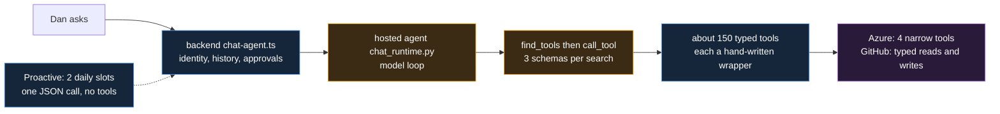

> **Historical record.** Git dates: 2026-11-15. Retained as evidence, not a current runbook. Original at `0ff1d1650`.

# 1. Why the current harness feels rigid, restricted, reactive and hardcoded

Part of the [Copilot-harness trial](README.md) (#1837). Every claim below is from the code at `main` (14 Nov 2026); paths are relative to the repository root.

## The short version

The loop is the smaller problem. The feel comes from **four layers around it**, and only one of them is the harness.

| Colour | Layer | Fixed by a different harness? |
| --- | --- | --- |
| Amber | Loop, tool discovery, memory window | **Yes** |
| Blue | Tool wrappers, approvals, regex guards, the proactive pipeline | **No.** These move with the tools, unless rewritten model-first |
| Purple | Which credentials Jarvis holds for Azure and GitHub | **No.** A credential and RBAC decision |

## What makes the Copilot app feel unrestricted

It is not the harness alone. It is three things together; Jarvis has none of them in full.

| Ingredient | Copilot app (on Dan's machine) | Jarvis today |
| --- | --- | --- |
| Identity | Dan's own `az login` and `gh` auth: broad | Managed identity with a few roles; GitHub App installation tokens issued per read (`apps/backend/src/factory/repository-tools.ts:300`) |
| Hands | Real shell, files, any CLI | Only registered tools; no shell, no `az`, no `gh` |
| Reach by search | Model sees all tools, or searches them natively | Two meta-tools; a tool must be found by keyword first |

## Evidence by feeling

### Restricted: "can't do that"

| # | Evidence | Where | Example |
| --- | --- | --- | --- |
| R1 | The model sees no tools, only `find_tools` and `call_tool`. A search returns 3 full schemas and 5 names. `call_tool` refuses anything not returned by a search. | `agents/jarvis/tool_lookup.py:22-23`, `:193` | "Check my CI" costs a search call first; a tool the keywords miss does not exist for that turn. |
| R2 | Azure reach is four narrow tools: `read_backend_logs`, `get_system_health`, `get_deployment_status`, `manage_model_deployment`. No ARM, CLI or generic query tool exists in the backend. | `apps/backend/src/operations/backend-logs.ts:229`, `core/system-health.ts:166`, `factory/tools.ts:1212`, `core/model-deployments.ts:290` | The log tool says it takes "No raw text, KQL, other apps or repair actions" (`backend-logs.ts:230-231`). Asked "why did cost jump yesterday?", Jarvis has no path to Cost Management or other resources. |
| R3 | GitHub reach is a list of typed wrappers: `repo_read`, `repo_search`, `pr_get`, `pr_diff`, `checks_list`, `ci_log`, `create_issue`, `issue_comment`, `start_issue` and similar. | `apps/backend/src/factory/repository-tools.ts:462`, `github-app-tools.ts` | `repo_read` returns "at most 400 lines and 40 KB". Branches, labels, workflow dispatch or releases have no path until someone writes a tool, schema and tests. |
| R4 | The model must ask what it may do: a `github_capabilities` tool reads the App's permission map. | `factory/github-app-tools.ts:1183` | A permission lookup is a tool call, not ambient knowledge. |
| R5 | About 730 hand-written refusals (`new ToolRefusal(...)`) across the backend. | `grep -rn "new ToolRefusal(" apps/backend/src` (excluding `*.test.ts`: 731 hits) | Each is a deliberate, tested "no". Together they are the texture of "restricted". |
| R6 | A regex guard decides whether a message "asks for computer access to mail" and refuses. | `apps/backend/src/core/gmail-access-policy.ts:8`, `:69-86` | Anchored English and Danish patterns with `then/and/derefter` separators. A rephrasing that dodges the grammar changes the outcome. |

### Rigid: tied down

| # | Evidence | Where | Example |
| --- | --- | --- | --- |
| G1 | All capability know-how is one up-front prompt with a hard budget: 20,000 code points (budget 15,000), 4,000-character tool descriptions, 1 MiB catalogue. | `agents/jarvis/limits.json`, `apps/backend/src/core/capability-instructions.ts:1-9` | Every new ability competes for the same 15,000 characters. |
| G2 | Tools teach by embedding examples in the description. `workspace_command` is one description of several thousand characters with inline JSON samples. | `apps/backend/src/core/workspace-commands.ts:476-478` | The model re-reads this text on every turn it uses the tool. |
| G3 | No provider session: every request sets `"store": False`; context is rebuilt from SQL each turn (up to 100 messages). | `agents/jarvis/model_client.py:1213`, `agents/jarvis/chat_runtime.py:223` | No plan file, no scratch files, no working state between turns. |
| G4 | Memory window is fixed: 20 raw messages, refresh after 10 more, 40-message window with summary, 1,500 characters per message, 6,000-character summary. | `agents/jarvis/conversation_memory.py:41-47` | A long thread is cut by constants, not by what matters. |
| G5 | The hosted agent's `cold`, `warm` or `resume` markers are container start latency telemetry, not a conversation session. | `apps/backend/src/core/chat-agent.ts:31`, `:264-274` | The inbox loop's "one long-lived session" (p0.md #1) has nothing to build on. |
| G6 | A separate "reflex" pipeline classifies intent, route and contradiction with confidence thresholds and a `reflexSafe` allow-list, and may act without the main model. | `apps/backend/src/core/reflex.ts` (755 lines), `core/tool-registry.ts:20-27` | Behaviour depends on classifier thresholds the model never sees. |

### Hardcoded

| # | Evidence | Where | Example |
| --- | --- | --- | --- |
| H1 | Approval "yes/no" is a phrase list plus anchored regex before any model sees it; the fallback model answers an enum `approve`, `decline`, `neither`. | `apps/backend/src/core/approval.ts:3-29`, `approval-interpreter.ts:9` | `'godkend'`, `'send den'`, `'kør'` are in the list; the product has been English-only since P15-124. |
| H2 | Finding scope (personal, work, travel) is decided by keyword regexes, English and Danish, after the model has already judged the finding. | `apps/backend/src/proactive/policy.ts:3-5` | A finding that mentions "family" and "invoice" matches both patterns, so scope becomes `unknown` (`policy.ts:16`). |
| H3 | Fixed enums: 12 sources, 9 categories, 3 urgencies. The model may use 7 categories and must return exactly one key. Any other key discards the whole run as `invalid_model_output`. | `proactive/types.ts:1-6`, `proactive/prompt.ts:13`, `proactive/model.ts:88` | P15-119 fixed a real run loss caused by this shape (output token cap). A new kind of insight has no category to live in. |
| H4 | Presence modes are three fixed strings. | `agents/jarvis/presence-instructions.json:2-4` | Intentional and cheap; listed so the line between kernel and hardcoding is visible. |
| H5 | Fixed kernel and precedence list for identity. | `agents/jarvis/identity-contract.json:4-11` | **Keep.** This is the truthfulness and security kernel the model-driven rule leaves deterministic. |

### Reactive

| # | Evidence | Where | Example |
| --- | --- | --- | --- |
| A1 | Proactive work runs at two daily slots, 07:00 and 18:00, with quiet hours 22:00-07:00. | `apps/backend/src/proactive/time.ts:87-90`, `:158`, `:166` | p0.md says "Quiet hours: none needed". Nothing can fire at 13:20 when a deadline appears. |
| A2 | The proactive model gets one request: at most 80 facts and 32 KiB of pre-read data, no tools ("You have no tools or authority"), `response_format: json_object`; a tool call is rejected. | `proactive/prompt.ts:25`, `:27-28`, `proactive/model.ts:214`, `:252` | It can summarise what a source adapter read. It cannot open the repo, query Azure or follow a thread. |
| A3 | Signals are 12 hand-written source adapters. No Azure cost, banking or location source. | `apps/backend/src/proactive/types.ts:1`, `proactive/sources/` | p0.md lists those signals; each needs a new adapter and enum entry. |
| A4 | Chat starts only from an owner message and loads history from SQL. Nothing resumes a thought. | `agents/jarvis/chat_runtime.py:313-351` | "Follow up until moved forward or binned" (p0.md #1) has no owner session to wake. |

## Size of the thing

| Item | Figure |
| --- | --- |
| Hosted chat agent | `chat_runtime.py` 1,177 lines, `model_client.py` 1,934, `jarvis_tools.py` 910, `conversation_memory.py` 612, `response_coordinator.py` 607 |
| Backend chat adapter | `chat-agent.ts` 486 lines; `core/` has 76 top-level files |
| Registered tools | About 150 named tools (grep of tool definitions; approximate) |
| Proactive pipeline | 6,316 lines under `apps/backend/src/proactive/` |

## What is not broken

Keep these whatever happens: fail-closed pending actions, content-free logging, per-message idempotency and receipts, the identity kernel, secret filtering, and "never send mail" (draft only, p0.md #2). These are the **deterministic-where-exact** parts the design rule protects.

## What this means for the target

| Finding group | In the [target design](03-target-architecture.md#target-design) |
| --- | --- |
| R1, G1, G2 (tool lookup, 15,000-character prompt, long descriptions) | Gone: MCP tools are listed at run time; know-how moves to skills |
| G3-G5 (no session, fixed memory window) | A long-lived conversation per purpose; the vault stays the record |
| G6, H1 (reflex classifier, approval regex) | Approvals through `require_approval`, decided by gateway policy |
| H2-H3, A1-A3 (keyword scope, fixed enums, two slots, no tools) | The agent decides, with a skill for proactive review and triggers instead of two fixed slots |
| R2 (four Azure tools) | Azure MCP with a read-only role: a credential decision, not a harness feature |
| R3-R6 (typed GitHub wrappers, about 730 refusals, Gmail regex guard) | The refusals that protect exact results move behind the Jarvis MCP server; the regex guards become gateway policy or approvals |
| H5, never-send-mail, receipts, secret filter | Stay deterministic in the gateway and the Jarvis MCP server |
