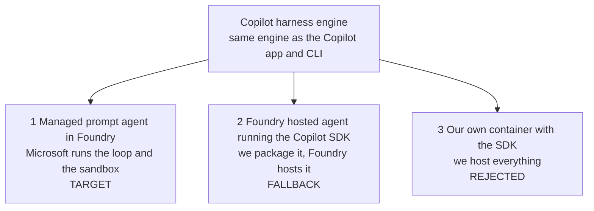
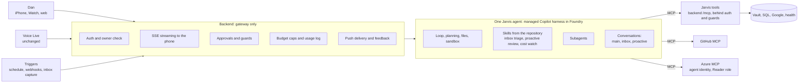
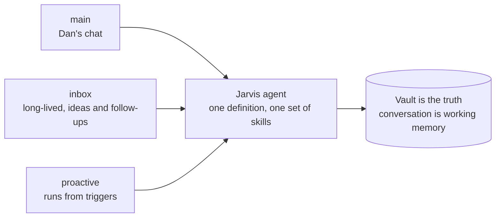
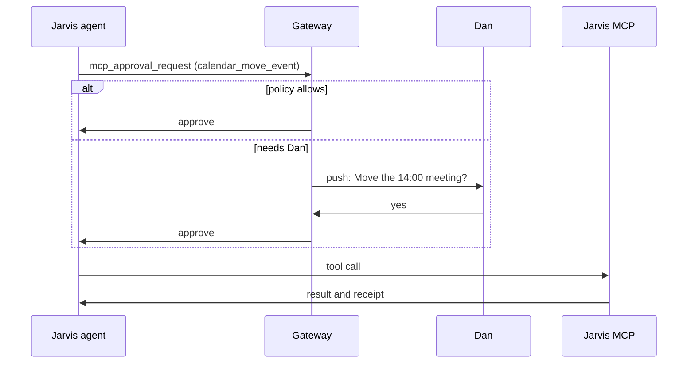
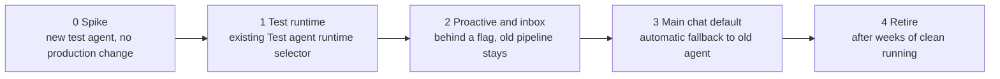

> **Historical record.** Git dates: 2026-11-15. Retained as evidence, not a current runbook. Original at `0ff1d1650`. Protected values omitted.

# 3. Target architecture: one Jarvis agent on the managed Copilot harness in Foundry

Part of the [Copilot-harness trial](README.md) (#1837). This replaces the earlier stepwise options A to D, which were wrong: they assumed the SDK in our own container. The target is one design.

**Sources.** Microsoft Foundry blog and Microsoft blog, 28 Oct 2026; Microsoft Learn pages on the Copilot harness, limits, MCP authentication, hosted agents and long-running resilience; Foundry pricing page. Learn and devblogs pages cannot be fetched from this environment, so they were read through search excerpts only. Anything not in an excerpt is marked **unknown** and goes to the [spike](04-recommendation.md).

## Three ways to use the same engine



| Route | Who runs the loop | Fits |
| --- | --- | --- |
| 1 Managed prompt agent (`harness: microsoft_copilot_preview`) | Foundry | Declarative: instructions, skills, MCP tools, subagents. No code of ours in the loop |
| 2 Hosted agent with the SDK inside | Us, on Foundry compute | Full control of protocol, streaming and voice, at the cost of owning code again |
| 3 Own container | Us | Nothing Foundry does not do better. Dropped |

## What the parked attempt was, and what is different

The 9 Nov parked attempt **was route 1, used as a model endpoint behind our own loop**. `ManagedPolicyClient` subclassed our client and called the same `complete_chat` loop (`docs/runtime-comparison-owner-test.md`). Built-in shell, files, web and subagents were switched off, no skills were installed, Jarvis tools were registered as function tools on an immutable agent version, and every turn started a fresh provider conversation seeded from our history.

| | Parked attempt (hybrid) | Target (full use) |
| --- | --- | --- |
| Agent loop | Ours (`chat_runtime.py`, `model_client.py`) | Foundry's |
| Tools | About 150 function tools, drift-checked against provider readback | MCP servers, listed at run time |
| Skills and subagents | Off | On, kept in the repository |
| Conversation | New conversation per turn, seeded from SQL | One long-lived conversation per purpose |
| Built-ins (files, shell, web) | Disabled | Used inside the managed sandbox |
| Proactive and inbox | Separate pipeline | Same agent |
| What it proved | A different label, no gain (`docs/decisions.md`, 9 Nov) | Untested |

Frictions found then, and what they mean now:

| Friction then | Evidence | Now |
| --- | --- | --- |
| Policy stuck to the agent version | `docs/copilot-runtime-recovery-2026-11-07.md` | Fixed with one structured input (`{{jarvis_policy}}`); keep for the dynamic part of instructions |
| HTTP 400 `model_bad_request_reasoning` on Terra | `docs/main-chat-harness-migration.md` | **Unexplained.** Retest first in the spike |
| No usage report per turn | `docs/managed-chat-adapter.md` | Unknown. Spike checks the response `usage` field |
| Images and direct voice rejected | `docs/managed-chat-adapter.md` | Still a gap |
| Tool list drift on immutable versions | `docs/runtime-comparison-owner-test.md` | Gone with MCP: tools are discovered, not baked in |

## Target design



| Part | Does | Stays deterministic |
| --- | --- | --- |
| Gateway (today's backend, much thinner) | Authenticates, relays the stream, applies approvals, enforces budgets, delivers push, logs usage | Yes. Exact results only |
| Jarvis agent | Decides everything else: what to look at, what to say, when to follow up, how to structure an idea | No. The model decides; quality grows with models |
| Jarvis MCP server | Exposes the existing tool registry. Each tool keeps its schema, refusals, receipts and secret filter | Yes |
| GitHub and Azure MCP | Reach without a wrapper per operation | Reach comes from the credential: read-only by default |
| Voice Live | Talks. Asks the agent for heavy work through the gateway and speaks the answer later | Unchanged |

## One agent, three conversations



A conversation is working memory, not the record. Anything that matters is written to the vault before the turn ends (the inbox decision of 14 Nov). Compaction in the managed harness is **unknown**; if a conversation grows too large, the gateway starts a new one seeded from a vault summary.

## What the model decides and what stays exact

| Model decides (free-form) | Exact, in the gateway or tools |
| --- | --- |
| Which tools, skills and subagents to use | Authentication, owner check, tool authorization |
| What a proactive finding is, and whether to interrupt | Never send mail; secret filter; receipts and idempotency |
| How to structure an inbox idea; when to nudge or bin it | Spend caps, daily outreach cap, push delivery |
| Tone, length, plan | Identity kernel (truthfulness and security) |

This removes the fixed 12 sources, 9 categories and keyword scope regexes of the proactive pipeline (`proactive/types.ts`, `proactive/policy.ts:3-5`) and the find-then-call tool lookup (`tool_lookup.py`).

## Approvals without regex

Foundry's MCP tool setting `require_approval` returns an `mcp_approval_request` in the stream, answered with an `mcp_approval_response` in the same conversation (Learn: Secure tools and data). The gateway answers it by policy, or asks Dan on the phone.



This replaces the phrase list and anchored regexes (`apps/backend/src/core/approval.ts:3-29`). Whether approval can be set per tool, not per server, is **unknown**.

## Honest limits

| Topic | Finding | Source or status |
| --- | --- | --- |
| Preview | Public preview, no SLA, "not recommended for production workloads" | Learn: harness page |
| Region | Sweden Central is supported | Learn: limits page |
| Models | Models with reasoning and tool calling available to prompt agents in the region. BYOM not supported. Terra is the Jarvis default and was used in the parked attempt, but one Terra request was rejected | Learn: limits page; `docs/main-chat-harness-migration.md` |
| Existing agents | The harness is fixed at creation; an existing agent cannot be switched. A new agent is needed | Learn: harness page |
| Conversations | A new conversation has separate history and a separate workspace | Learn: harness page |
| Skills | Created in the same Foundry project; treated as code, reviewed and versioned | Learn: harness page |
| MCP authentication | Project managed identity, user Entra token delegation, OAuth identity passthrough (consent link per user), key in a project connection, or none. Keys in a connection are readable by project members | Learn: MCP authentication |
| Network | Egress controls (preview) for the managed sandbox, via a policy attached to the agent. Audit mode first | Learn: harness page |
| Authoring | Portal, Azure Developer CLI or SDK; definitions can live in source control | Learn: harness page, blog |
| Streaming | The agent is invoked through the Responses API, which streams text; the parked adapter streamed deltas and cancelled by closing the stream | `docs/managed-chat-adapter.md`. Latency **unknown** |
| Mid-turn steering from the phone | **Unknown** for the managed agent. The SDK has it; the managed docs read here do not say | Spike |
| Per-turn identity into MCP calls | **Unknown.** Today every tool call carries the current message id (`X-Jarvis-Message-ID`); a managed MCP call may not | Spike. Biggest design risk |
| Compaction, conversation size | **Unknown** | Spike |
| Sandbox size and whether idle time is billed | **Unknown** | Spike, with the December bill |
| Hosted agents (route 2) | General availability of long-running resilience: work survives disconnects and restarts; stream replay | Blog 28 Oct |

### Per-user and per-turn authority

Jarvis has one owner. MCP calls therefore authenticate as the agent identity, which the backend already trusts (`ENTRA_JARVIS_AGENT_OBJECT_ID`). What is lost is proof that a write was requested by the current owner message. Options, in order of preference:

1. The gateway issues a short-lived turn token in the instructions input and the tool requires it as an argument.
2. Writes go through function tools, which return to the gateway for execution with full source authority, while reads and reach use MCP.
3. Writes require `require_approval`, so Dan's answer is the authority.

The spike decides which one works.

## Parity gaps against `chat_runtime.py`

| Capability today | Where | Target status |
| --- | --- | --- |
| Per-turn instructions (presence mode, context, proactive context) | `capability-instructions.ts`, `presence-instructions.json` | Structured input per turn (worked in the parked attempt) |
| Tool lookup, catalogue limits | `tool_lookup.py`, `limits.json` | Gone: MCP discovery |
| Rolling summary and 40-message window | `conversation_memory.py:41-47` | Replaced by the long-lived conversation. Compaction unknown |
| Spoken acknowledgment before tool work | `response_coordinator.py`, `model_client.py:1592` | Gateway keeps it; text before the first tool call is streamed |
| Images in chat | `model_client.py` | Rejected in the parked adapter. **Gap** |
| Voice completion | `voice_runtime.py` | Stays on Voice Live; heavy work through the agent |
| Duplicate and uncertain-write protection | `tool-calls.ts`, receipts | Stays in the Jarvis MCP server; the SDK retry problem is Foundry's to handle, so idempotency keys are mandatory |
| Reflex fast path (act without the main model) | `reflex.ts` (755 lines) | Optional. Can stay as a gateway shortcut or go |
| Usage and cost per round | `usage-store.ts` | Unknown whether the response reports usage. Gateway must log what it can |
| Streaming interruption | `chat-agent.ts` | Close the stream; steering unknown |

## Cost

### What billing is documented, and what is not

| Item | Documented | Source |
| --- | --- | --- |
| Managed harness runtime before 1 Dec 2026 | **Free** | Foundry blog, Microsoft blog |
| Managed harness sandbox compute and memory from 1 Dec | **[money omitted] per vCPU-hour ([money omitted]) and [money omitted] per GiB-hour ([money omitted])**, consumption-based | Same |
| Model tokens | Foundry Models, on the Azure bill, as before. Separately billed tools and connected services keep their own charges. **Not** GitHub Copilot credits | Same |
| Hosted agents (today's chat agent) | Billed on "underlying container compute consumed per hour" at the same unit rates | Foundry pricing page |
| Hosted agent session | A stateful, isolated sandbox. Files persist across turns and idle periods for up to 30 days. Idle timeout 2-240 minutes (default 15). After the timeout the platform **releases the compute** and saves state | Learn: Manage hosted agent sessions |
| Scale to zero | Reported in secondary coverage (Big Hat Group, April 2026); consistent with the measured bill below | Not an official statement here |
| Managed harness sandbox: size, idle timeout, whether idle time is billed, session charge | **Unknown.** The harness pages read do not say. Assumed like hosted agents (1 vCPU, 2 GiB) | Spike plus the December bill |

### Today's hosted-agent compute, measured

Cost Management (Hosted vCPU Usage plus Hosted Memory Usage), DKK per day, supplied by the coordinating session:

| Period | DKK per day | Use as baseline? |
| --- | --- | --- |
| 1-10 Nov | [money omitted] | **No.** Factory auto-testing and many workers, not normal use |
| 11 Nov | [money omitted] | Tail of testing |
| 12, 13, 14 Nov | [money omitted] | **Yes.** Real run-rate of today's chat agent: about [money omitted] per month |

Our agent is 1 vCPU, 2 GiB with a 120 s idle timeout (`.github/workflows/deploy.yml:312-320`), [money omitted] per session-hour. [money omitted] a day is therefore about 4-11 minutes of billed session time a day for about 6 turns a day, which matches release-on-idle. At Dan's profile (20 turns, 1 hour of chat, 10 minutes of voice) the line is about 7 / 10 / [money omitted] a month: the measured run-rate scaled by turns, and one unbroken hour of session as the high case.

### Total monthly bill: today versus target

Fixed by Dan: **GPT-6.1 Terra only**, **1 hour of chat a day**, **10 minutes of voice a day**. Low, expected and high are consistent (all low, or all high). Chat assumes 20 turns an hour, so 20 a day.

| DKK per month | Today | Target, same work as today | Target, full workload |
| --- | --- | --- | --- |
| Infrastructure (SQL, registry, container apps, storage, app service) | [amount omitted] | [amount omitted] | [amount omitted] |
| Voice, 10 min a day at [rate omitted] per min | [amount omitted] | [amount omitted] | [amount omitted] |
| Hosted agent compute (measured run-rate, scaled to the profile) | [amount omitted] | [amount omitted] (kept only as fallback) | [amount omitted] |
| Managed harness sandbox (assumed 1 vCPU, 2 GiB; free until 1 Dec) | [amount omitted] | [amount omitted] | [amount omitted] |
| Azure MCP server (small container, scales to zero) | [amount omitted] | [amount omitted] | [amount omitted] |
| Models on Foundry, Terra | [amount omitted] | [amount omitted] | [amount omitted] |
| **Total, expected** | [amount omitted] | [amount omitted] | [amount omitted] |
| Total, low | [amount omitted] | [amount omitted] | [amount omitted] |
| Total, high | [amount omitted] | [amount omitted] | [amount omitted] |
| Change from today, expected | [amount omitted] | [amount omitted] | [amount omitted] |

[Historical cost chart and its values omitted.]

| Models line, DKK per month (low / expected / high) | Today | Target |
| --- | --- | --- |
| Chat, 20 turns a day | [amount omitted] | [amount omitted] |
| Proactive, today's one-shot | [amount omitted] | [amount omitted] (light check per run) |
| Inbox, 10 turns a day (new) | none | [amount omitted] |
| Proactive with investigation: 120 light checks and 24 escalations (new) | none | [amount omitted] |
| Azure and GitHub tasks, 60 a month (new) | none | [amount omitted] |

| Basis | Status |
| --- | --- |
| Infrastructure [amount omitted], voice [money omitted]/min, Foundry Models spend about [money omitted] in 3 days | Measured (supplied by the coordinating session; not re-checked here) |
| Today's per-turn tokens (3 rounds of 10k context, 70% cached) | Derived from code limits, consistent with the measured total |
| Target per-turn bands: low 15k x 3 calls, 85% cached; expected 30k x 4, 75%; high 80k x 6, 50% | **Assumed.** Decided by what the managed harness re-sends per call, tool-description size and cache hit rate |
| Terra rates [money omitted] in, [money omitted] cached, [money omitted] out per 1M tokens | GitHub Docs list price, assumed equal on Azure |
| Sandbox size and billing while idle | **Unknown** |

How to read it:

| Point | Detail |
| --- | --- |
| Infrastructure plus voice is [amount omitted] of [money omitted] today | The model is a small part of the bill either way |
| Chat gets about 3 times more expensive in the expected case | A longer-lived, tool-rich context costs more than our lean find-then-call loop |
| The high band is context growth in a long conversation | [amount omitted] to [money omitted]. This is the number that the budget cap and the spike must pin down |
| The hosted agent line (about [amount omitted]) goes away, the sandbox line (about [amount omitted]) replaces it | Low cost either way if the sandbox is released when idle. If it stays up all month it is about [amount omitted], the one number the spike must rule out |
| Cheaper levers | Light proactive checks and the inbox on a lighter model than Terra (Luna is about 4.5 times cheaper); a new conversation when the context passes a threshold |

Cost control, all in the gateway: a monthly model budget with a hard stop (today's proactive budget pattern, `proactive/budget.ts`), a daily turn cap, a context-size threshold that starts a new conversation, and a deployment token-per-minute quota on a dedicated Terra deployment.

## Migration path, old path kept as the fallback



| Phase | What changes | Fallback |
| --- | --- | --- |
| 0 Spike | One new test agent in the existing project. Nothing in production | Delete the agent |
| 1 Test runtime | The approved **Test agent runtime** menu (Current or Copilot) points at the new full-use agent | Pick Current |
| 2 Proactive and inbox | Triggers go to the new agent; old pipeline kept | Flag back |
| 3 Main chat | Default flips. If the new agent errors or the budget is hit, the gateway routes the turn to the old hosted agent | Automatic |
| 4 Retire | Remove `chat_runtime.py`, `model_client.py`, `tool_lookup.py`, `conversation_memory.py`, `jarvis_tools.py` and the old proactive pipeline | None, by design. Only after Dan agrees |

Exit plan at any phase before 4: flip the flag; the old hosted agent is untouched and still deployed. Nothing is stored only in the new agent, because the vault and SQL stay the record.

## Risks

| Risk | Mitigation |
| --- | --- |
| Preview, no SLA; behaviour changes | Old path stays as automatic fallback until phase 4; pin the agent version |
| Per-turn authority is lost on MCP writes | Turn token, function tools for writes, or `require_approval` |
| Prompt injection from mail, web or repo text reaches a managed sandbox with Azure and GitHub reach | Reader role and read-only GitHub by default; writes only through Jarvis tools; egress controls in audit mode first |
| Cost drift in long conversations | Gateway caps; new conversation threshold |
| Voice latency if voice waits for the agent | Voice never waits: it speaks an acknowledgment, the agent answers later |
| Two stores of truth | Vault is the record; conversation is working memory |
| Terra rejection seen on 6 Nov | First spike test |

## Appendix: today's numbers and how to measure them

The usage store keeps one row pair per model round, with no turn id and no cached-token field, and Terra rows carry no price (`apps/backend/src/database/usage-store.ts:183-216`, `core/usage-pricing.ts:3-6`). Read-only queries that replace the derived numbers:

```sql
-- Per day: model rounds, average tokens per round, chat only (proactive runs excluded)
SELECT CAST(u.at AS date) AS day, u.model,
  COUNT(DISTINCT u.source_event_id) AS rounds,
  SUM(CASE WHEN u.metric = N'input_tokens'  THEN u.quantity END) AS input_tokens,
  SUM(CASE WHEN u.metric = N'output_tokens' THEN u.quantity END) AS output_tokens
FROM dbo.usage u
WHERE u.source = N'jarvis_model' AND u.role = N'chat' AND u.at >= '2026-11-12'
  AND NOT EXISTS (SELECT 1 FROM dbo.proactive_spend p
                  WHERE CONVERT(nvarchar(36), p.run_id) = u.source_event_id)
GROUP BY CAST(u.at AS date), u.model ORDER BY day;

-- Turns per day
SELECT CAST(at AS date) AS day, COUNT(*) AS owner_turns
FROM dbo.messages WHERE role = N'dan' AND at >= '2026-11-12'
GROUP BY CAST(at AS date) ORDER BY day;

-- Typical turn length: gap in minutes between consecutive owner messages inside a session
WITH m AS (
  SELECT jarvis_session_id, at,
    DATEDIFF(second, LAG(at) OVER (PARTITION BY jarvis_session_id ORDER BY at), at) AS gap_s
  FROM dbo.messages WHERE role = N'dan' AND at >= '2026-11-12')
SELECT DISTINCT COUNT(*) OVER () AS gaps, AVG(gap_s * 1.0) OVER () / 60.0 AS avg_gap_min,
  PERCENTILE_CONT(0.5) WITHIN GROUP (ORDER BY gap_s) OVER () / 60.0 AS median_gap_min
FROM m WHERE gap_s IS NOT NULL AND gap_s < 1800;

-- Proactive, measured
SELECT month_key, COUNT(*) AS runs, SUM(input_tokens) AS input_tokens,
  SUM(output_tokens) AS output_tokens, SUM(estimated_dkk) AS estimated_dkk
FROM dbo.proactive_spend GROUP BY month_key;
```

Rounds per turn = rounds / owner_turns; tokens per round = input_tokens / rounds. Cached share stays unknown until the model provider's cached-token count is stored; adding that metric is a product change and is not proposed here.
