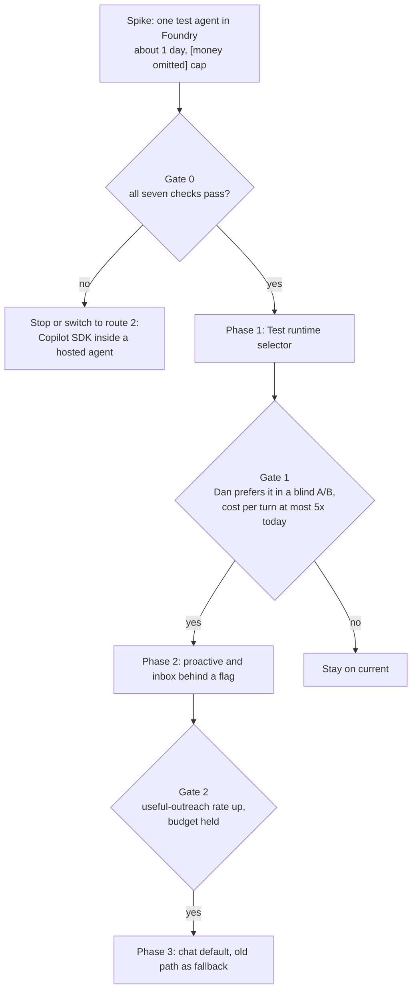
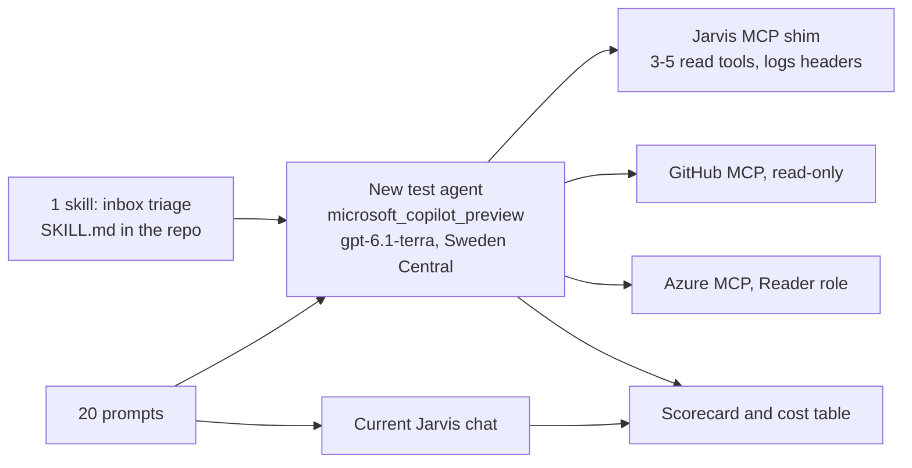

> **Historical record.** Git dates: 2026-11-15. Retained as evidence, not a current runbook. Original at `0ff1d1650`. Protected values omitted.

# 4. Recommendation and the smallest spike

Part of the [Copilot-harness trial](README.md) (#1837).

## Recommendation

**Move to one Jarvis agent on the managed Copilot harness in Foundry, in phases, with the current path kept as automatic fallback. Start with a spike that can prove or kill the design in a day.**

Not bits and pieces: the value is the whole package together. One agent with skills, subagents, MCP reach and a long-lived conversation serves chat, proactive and the inbox. The backend shrinks to a gateway.

| Why | Evidence |
| --- | --- |
| Most of the rigid feel is the loop, the tool lookup and the one-shot proactive pipeline, all of which the harness replaces | [Diagnosis](01-diagnosis.md) |
| The last attempt kept our loop and switched the rest off, so it could not show a gain | [Target](03-target-architecture.md#what-the-parked-attempt-was-and-what-is-different) |
| Reach, skills, subagents, files and long conversations are the p0.md priorities and are what the harness is for | [Gains](02-quality-gains.md) |
| No container of ours to run: Foundry runs the loop and sandbox, billed per sandbox hour from 1 Dec and free before | [Cost](03-target-architecture.md#cost) |
| Models improve under it without work from us | `docs/decisions.md`, 14 Nov |

What it costs: [comparison amounts omitted]. The high band is far higher if long conversations re-send large contexts, which the gateway caps. See the [comparison](03-target-architecture.md#total-monthly-bill-today-versus-target).

What could kill it, all unknown today: per-turn authority on MCP writes, whether Terra works, what a turn really costs, streaming latency, and whether the managed sandbox is released when idle, as hosted-agent sessions are (the measured run-rate of today's agent is only about [money omitted] a month).

## Gates

## The spike (filed as P15-158)

Purpose: answer the seven questions that decide the design, on a new test agent, with nothing in production touched.

| # | Question | How it is answered | Pass |
| --- | --- | --- | --- |
| 1 | Does Terra work in the harness? | Repeat the call that failed on 6 Nov, with and without reasoning effort | No 400 |
| 2 | What identity and headers reach an MCP tool call? | The shim logs what arrives (no bodies) | A stable owner-level identity; whether a per-turn value can be passed |
| 3 | Can approvals work? | One MCP tool with `require_approval`; answer the `mcp_approval_request` from a script | Round trip works, per tool if possible |
| 4 | What does a turn cost? | Tokens and cached tokens per response, deployment metrics, Azure cost the next day | Measured context per call, tool-description size, cache hit rate |
| 5 | Time to first token and streaming | 20 timed streamed turns against current chat | Within 1.5 times today's; text before the first tool call streams |
| 6 | Does one conversation last? | Resume after 24 hours; push past the context limit | Coherent, or a clear limit and compaction behaviour |
| 7 | Reach and quality | 20 prompts in 5 buckets (Azure, GitHub, investigation, inbox thread, plain chat), blind scored 1-5 by Dan | Copilot wins at least 12 of 20, and at least 8 of the 12 reach and investigation prompts |

| Limit | Value |
| --- | --- |
| Where | One new test agent in the existing Foundry project. The existing `jarvis` agent, backend and voice are untouched. Harness runtime is free before 1 Dec |
| Spend cap | [money omitted] on models: a dedicated Terra deployment with a low token-per-minute quota, an Azure budget alert at [money omitted] |
| Safety | Reader role only; read-only GitHub; no writes, no mail, no health or banking data in prompts. The MCP shim and skill live outside the product tree |
| Time | One day plus a day to read the cost the next morning |
| Output | `docs/harness-trial/spike-results.md`: the seven answers, scorecard, cost per turn, go or stop for Gate 0 |
| Exit | Delete the test agent, the deployment and the shim. Nothing else was created |

The spike also checks the **sandbox meter** (Hosted or harness vCPU and memory usage) the day after, to learn the sandbox size and whether idle time is billed. Harness runtime is free before 1 Dec, so the answer must also be checked on the December bill.

## What this analysis deliberately does not do

| Not done | Why |
| --- | --- |
| No product code, infra or settings changes | Requested scope |
| No measurement of the managed harness | Needs the spike. Every Copilot-side cost is an assumed band |
| No `docs/decisions.md` entry | Nothing is confirmed by Dan. Record one after Gate 0 |
| No page fetch of Learn or devblogs | Blocked from this environment; excerpts via search only |

## Questions only Dan can answer

| Question | Why it matters |
| --- | --- |
| Is the design in the [target diagram](03-target-architecture.md#target-design) what you want? | It replaces the earlier A to D ladder |
| Is a lighter model than Terra acceptable for light proactive checks and the inbox? | About 4.5 times cheaper on those lines |
| May the spike create a test agent and a Terra deployment in the Foundry project, with a [money omitted] cap? | It needs your Azure approval |
| Should quiet hours go (p0.md says none needed)? | They are hardcoded in `proactive/time.ts:87-90` |
