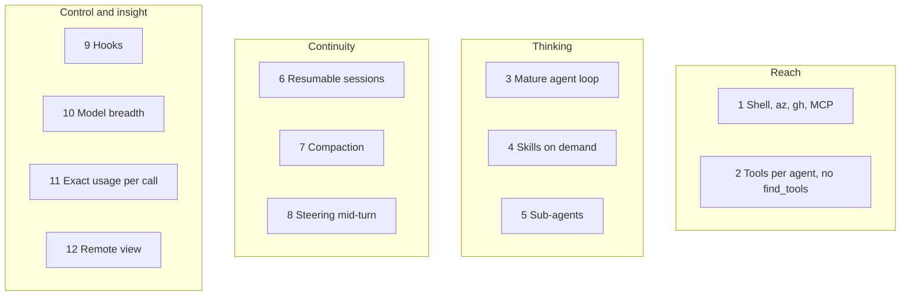

# 2. Quality-only gains of moving some or all of the brain to the Copilot harness

Part of the [Copilot-harness trial](README.md) (#1837). Maintenance savings are deliberately excluded: every row is about answer, action or session quality.

**Status checked 14 Nov 2026.** "Verified" means stated in current official documentation. "Untested" means nobody has run it against Jarvis, so it is a claim, not a result.

## What "the Copilot harness" means here

| Name | What it is | Used by Jarvis today? |
| --- | --- | --- |
| Copilot CLI | The agent runtime behind the Copilot app and `copilot` | Yes, inside Factory workers (`runner/app.py:1824`: `copilot --acp --stdio --allow-all`, token in Key Vault secret `jarvis-copilot`) |
| Copilot SDK | Same runtime, driven from your code over JSON-RPC. GA since 2 Jun 2026, six languages; being renamed Microsoft Copilot SDK, package names unchanged for now | No |
| Foundry "Microsoft Copilot harness" | The same engine, hosted and managed by Foundry as an agent definition | **Tried and parked 9 Nov 2026** (`docs/main-chat-harness-migration.md`) |

The parked attempt fought the managed agent definition (sticky policy, rejected request fields, unreported usage). The SDK route runs the engine **in your own process or worker** with your own system message and tools, so those particular frictions are not expected. Engine behaviour itself would be the same. Not yet proven.

## The gains

| # | Gain | What it fixes in Jarvis | Evidence (official docs) | Honest cons and unknowns |
| --- | --- | --- | --- | --- |
| 1 | **Shell, `az`, `gh` and MCP servers.** GitHub MCP is built in; Azure MCP Server offers `--read-only` and namespace filters. | R2, R3, A2: Azure and GitHub reach without a wrapper per operation. | SDK `docs/features/mcp.md` (built-in GitHub server via `githubMcpToolConfig`); Azure MCP in `microsoft/mcp` (the `Azure/azure-mcp` repo is archived). Verified. | **Reach comes from the credential, not the harness.** A shell plus untrusted email or web text is a prompt-injection path to real rights. Needs a read-only role, a tool allow-list and hooks. |
| 2 | **Tools scoped per session or per agent**, own tools exposed as SDK tools or MCP; no `find_tools` hop. | R1, G2: the model sees the tools it needs. | `docs/setup/multi-tenancy.md` (`availableTools`, `mode: "empty"`), `docs/features/custom-agents.md`. Verified. | About 150 tool schemas in context costs tokens and attention. A deferral option appears in `docs/features/context-management.md` (`defer: "never"`) but is not documented. Untested for 150 tools. |
| 3 | **A maintained agent loop**: parallel calls, planning, retries; documented as making no hidden planning or completion calls. | G6, H1: less of our own control code. | `docs/features/agent-loop.md`. Verified. | Opaque and coding-tuned by default. Behaviour can shift between CLI versions; pin and test. |
| 4 | **Skills**: `SKILL.md` folders loaded on demand, preloadable per agent. A skills folder can live in the vault, so Jarvis can write and refine its own. | G1: capability know-how stops competing for 15,000 characters. | `docs/features/skills.md`, `custom-agents.md` (per-agent skills). Verified. | Whether the model picks the right skill unprompted is untested. Skill providers are experimental. |
| 5 | **Sub-agents and fleet mode**: isolated contexts with their own prompt, tools and MCP servers. | A2, G3: inbox triage, repo review, Azure investigation as separate minds. | `docs/features/custom-agents.md`, `fleet-mode.md`. Verified. | Every sub-agent is more tokens. Fleet mode lists "limitations and open questions". |
| 6 | **Resumable sessions**: `sessionId`, `events.jsonl`, `plan.md`, `files/`, resume across restarts and containers. | G3, G5, A4: the long-lived inbox session. | `docs/features/session-persistence.md`. Verified. | State is files in `~/.copilot/session-state/` and needs persistent storage. No session locking. BYOK keys must be re-supplied on resume. A second store of truth next to the vault. |
| 7 | **Compaction**: infinite sessions (compact at 80%, block at 95% of context), manual `history.compact()`, `setCompactionConfig` to choose the summariser model and prompt. | G4: summary by the engine instead of fixed window constants. | `docs/features/session-persistence.md`, `troubleshooting/compatibility.md`. Verified. | Lossy. Summary quality for a personal assistant is unmeasured. Keep the vault as the truth. Compaction tokens are reported in `session.compaction_complete`, not in `assistant.usage`. |
| 8 | **Steering and queueing**: send a message mid-turn (`immediate`) or after it (`enqueue`). | Reactive turns: Dan can redirect a long job. | `docs/features/steering-and-queueing.md`. Verified. | Needs UI and protocol work in the backend and iOS app. |
| 9 | **Hooks**: pre and post tool use, permission requests, session start. Deterministic guards without prompt prose. | R5, R6, H1: replace regex guards with exact, tested checks. | `docs/features/hooks.md` (allow-lists, audit, secret redaction). Verified. | A hook is only as good as its rules; the model-driven rule applies to what it decides, not to what it may touch. |
| 10 | **Model breadth under one login and model-specific tool policies** maintained by GitHub (GPT, Claude, Gemini, Grok, MAI; `auto`). | Quality rises as models do, with no work from us. | `docs/auth/byok.md` (model identity picks editing tools); GitHub Docs "Models and pricing". Verified. | Model access depends on plan. New models can regress behaviour. |
| 11 | **Exact cost per call**: `assistant.usage`, `session.usage.getMetrics`, `sessionLimits.maxAiCredits`, OpenTelemetry spans. | Cost visibility; Jarvis's own meter prices only two models (`usage-pricing.ts:3-6`). | `docs/features/usage-and-billing.md`, `session-limits.md`. Verified. | Usage metrics and session limits are marked **experimental**. A limit is a soft cap checked after each model call; one response can overshoot. |
| 12 | **Remote view**: export a session to GitHub web and mobile (Mission Control). | Dan can watch what Jarvis did from the phone. | `docs/features/remote-sessions.md`. Verified. | Experimental raw RPC. Session history goes to GitHub. Export is read-only unless steering is also enabled. |

## What it does not give

| Not a gain | Why |
| --- | --- |
| Voice | Voice Live stays as it is. The SDK has no realtime voice. |
| Proactivity by itself | The harness is turn-driven too. Scheduling and triggers stay ours. It makes each proactive run able to *investigate*, not summarise. |
| Fewer guards | Approvals, never-send-mail, secret filter and identity kernel remain ours (see [diagnosis](01-diagnosis.md#what-is-not-broken)). |
| Better tools | A tool that refuses still refuses. Moving 150 tools behind MCP keeps their 730 refusals. |
| Free of cost | Copilot usage is metered in AI credits; see [options](03-options.md#cost-model). |

## Open unknowns, to be answered by experiment

| Unknown | Why it matters | How the first experiment answers it |
| --- | --- | --- |
| Time to first token and per-turn latency of CLI-backed turns | Chat must stay fast; no latency numbers are published | Timed runs in the local bench |
| Credits per realistic Jarvis task | Decides every cost line | `session.usage.getMetrics` per task |
| Dan's plan and allowance, and whether credits are shared with his coding use | "Free" holds only inside the allowance | Read the usage dashboard before the bench |
| Terms for a server using a personal subscription token | Factory already does this; volume and 24/7 use are different | Check GitHub terms; prefer BYOK or an organisation token if unclear |
| Quality of skills choice, sub-agent delegation and compaction on Dan's real data | The reason to switch at all | Scored A/B against current Jarvis |
| Memory and start-up cost of a runtime on a tiny container | Backend runs at 0.25 vCPU and 0.5 GiB (`infra/main.bicep:826-827`) | Keep the runtime in a separate on-demand worker |
| Data location: prompts go to GitHub and its model providers rather than Azure Sweden Central | Privacy posture changes | Decide per option; BYOK to Foundry keeps model traffic in Azure |

## Sources checked

| Source | Date or version |
| --- | --- |
| `github/copilot-sdk` repository docs (`docs/features/*`, `docs/setup/*`, `docs/auth/*`), commit `cf04579` | 13 Nov 2026 |
| GitHub changelog: Copilot SDK generally available | 2 Jun 2026 |
| GitHub Docs: Usage-based billing for individuals; Models and pricing for GitHub Copilot | Read 14 Nov 2026 |
| Microsoft Container Apps billing and pricing pages | Read 14 Nov 2026 |

Not reachable from this environment, so not verified: `aka.ms/copilot-harness/announce` (SDK to Microsoft Copilot SDK transition) and the Microsoft Learn Foundry harness page. The SDK README quotes the transition; the rest of this document does not depend on it.
