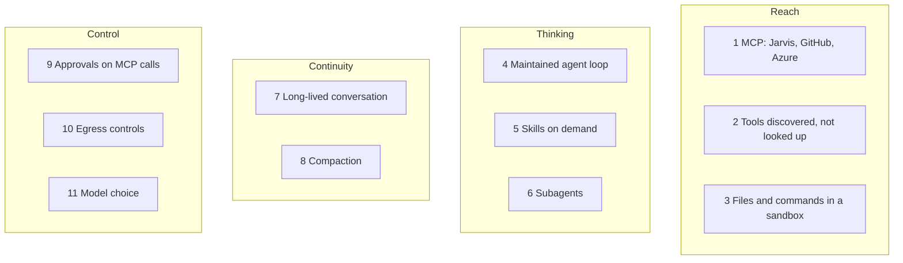

# 2. Quality gains of the Copilot harness

Part of the [Copilot-harness trial](README.md) (#1837). Quality only, no maintenance savings. Rewritten 15 Nov 2026: the first version assumed the SDK in our own container. The target is the **managed harness in Foundry**; the SDK stays as route 2 (a hosted agent running the SDK).

**Status.** "Documented" means stated in the Foundry blog, Microsoft blog or Learn pages as read through search excerpts (the pages cannot be fetched from this environment). "Unknown" means not found, so it is a question for the [spike](04-recommendation.md), not a claim. SDK rows come from the `github/copilot-sdk` docs at commit `cf04579` (13 Nov 2026).

## Which harness

| Route | Same engine | Features available |
| --- | --- | --- |
| 1 Managed prompt agent in Foundry (**target**) | Yes | What Foundry exposes: skills, MCP, subagents, files, commands, egress controls |
| 2 Hosted agent running the SDK (fallback) | Yes | Everything the SDK has, because we run it: hooks, steering, compaction control, session limits |
| 3 Own container | Yes | Rejected |

The Foundry blog describes the managed harness as: Microsoft runs the agent loop and sandbox; you bring instructions, skills, tools and model choice. It is the harness behind Copilot Code, Copilot Studio, the GitHub Copilot app, the CLI and VS Code (Microsoft blog, 28 Oct 2026).

## The gains

| # | Gain | Fixes in Jarvis | Managed Foundry harness (target) | SDK (route 2) | Honest cons and unknowns |
| --- | --- | --- | --- | --- | --- |
| 1 | **MCP tools**: our tool registry, GitHub and Azure as servers | R2, R3, A2 in the [diagnosis](01-diagnosis.md): reach without a wrapper per operation | **Documented.** MCP is one of four building blocks; auth by project identity, user token, OAuth passthrough or key | Documented, built-in GitHub server | Reach comes from the credential, not the harness. Injection via mail or web text into a tool-holding agent needs read-only roles and approvals. Per-turn identity into MCP calls is unknown |
| 2 | **Tools listed at run time**, no `find_tools` hop | R1, G1, G2 | Documented (MCP discovery). Large tool lists in context cost tokens: unknown | Documented | Tool-description size is an unmeasured cost driver |
| 3 | **Sandbox with files and commands** | A2: investigate instead of summarise | **Documented** ("multi-step tool, skill, file or command workflows"; return generated files) | Documented | Sandbox size and idle billing unknown |
| 4 | **A maintained agent loop**, tuned across models by GitHub | G6, H1: no loop of our own | **Documented** | Documented | Opaque; behaviour can change in preview |
| 5 | **Skills**: `SKILL.md` procedures loaded when needed, kept in the repository | G1: know-how stops competing for 15,000 characters | **Documented.** Created in the same Foundry project, treated as code, versioned | Documented | Whether the model picks the right skill unprompted is untested |
| 6 | **Subagents**: isolated contexts for research, triage, repo review | A2, G3 | **Documented** ("subagent delegation") | Documented | More tokens per task; limits unknown |
| 7 | **Long-lived conversation**: separate history and workspace per conversation | G3, G5, A4: the inbox loop | Documented (a new conversation has its own history and workspace). Size limits unknown | Documented (resume, `plan.md`, files) | The vault stays the record. Resume after days is untested |
| 8 | **Compaction** | G4: engine summary instead of our fixed 40-message window | **Unknown** | Documented (infinite sessions, `history.compact()`, choice of summariser) | If absent, the gateway starts a new conversation from a vault summary |
| 9 | **Approvals on MCP calls** (`require_approval`) | H1: replaces phrase list and regex | **Documented** (`mcp_approval_request` and `mcp_approval_response`). Per-tool granularity unknown | Hooks, richer | Deterministic gate, not model-driven, on purpose |
| 10 | **Network egress controls** for the sandbox | R5-R6: exact, auditable limits in place of prompt prose | **Documented (preview).** Audit mode first | Hooks and sandbox policy | Preview |
| 11 | **Model choice** inside Foundry, improving over time | Quality grows with models | **Documented**: models with reasoning and tool calling in the project region; BYOM not supported; Terra used in the parked attempt but one request was rejected | Wider, incl. BYOK | Terra rejection unexplained |
| 12 | **Steering mid-turn, hooks, session limits, remote view** | Reactive turns, cost control | **Not found** | Documented | Only route 2 has them for sure |

## What it does not give

| Not a gain | Why |
| --- | --- |
| Voice | Voice Live stays. The harness has no realtime voice |
| Proactivity by itself | Still turn-driven. The gateway schedules and triggers; the agent investigates instead of summarising |
| Fewer guards | Identity kernel, never-send-mail, secret filter, receipts and idempotency stay deterministic |
| Better tools | A tool that refuses still refuses. Moving 150 tools behind MCP keeps their roughly 730 refusals |
| A free run | Sandbox compute bills from 1 Dec; tokens bill on Foundry. See [cost](03-target-architecture.md#cost) |

## Open unknowns, answered by the spike

| Unknown | Why it matters |
| --- | --- |
| Terra in the harness | The default Jarvis model; rejected once on 6 Nov |
| Per-turn authority on MCP writes | Today's source-message guard |
| Tokens, cache hit rate and context re-sent per call | Decides cost |
| Time to first token, steering | Chat must stay fast |
| Conversation limits, compaction | Decides the inbox design |
| Sandbox size and idle billing | Decides the sandbox line |

## Sources

| Source | Date |
| --- | --- |
| Introducing the Microsoft Copilot harness in Foundry Agent Service, Microsoft Foundry Blog (excerpts) | 28 Oct 2026 |
| Introducing the Microsoft Copilot harness, The Official Microsoft Blog (excerpts) | 28 Oct 2026 |
| Microsoft Learn: Use the Microsoft Copilot harness with prompt agents; Foundry Agent Service limits, quotas and regions; Set up MCP server authentication; Hosted agents; Resilience for long-running hosted agents (excerpts) | Updated 14 Oct to 11 Nov 2026 |
| Azure pricing: Foundry Agent Service | Read 15 Nov 2026 |
| `github/copilot-sdk` docs, commit `cf04579` | 13 Nov 2026 |
| This repository: `docs/main-chat-harness-migration.md`, `managed-chat-adapter.md`, `runtime-comparison-owner-test.md` | 9 Nov 2026 |
