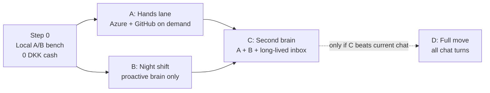
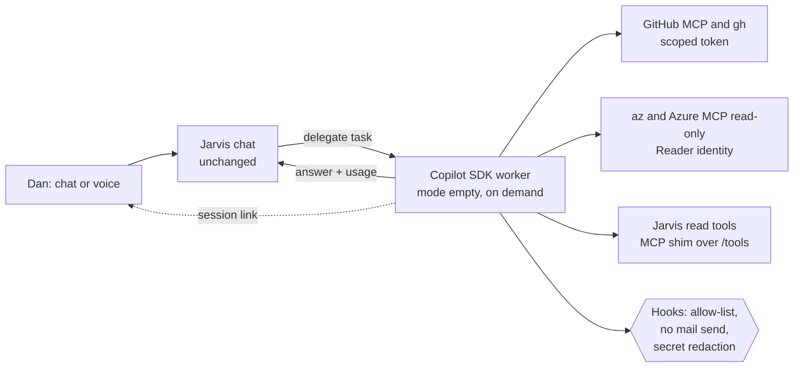
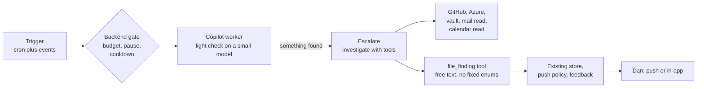
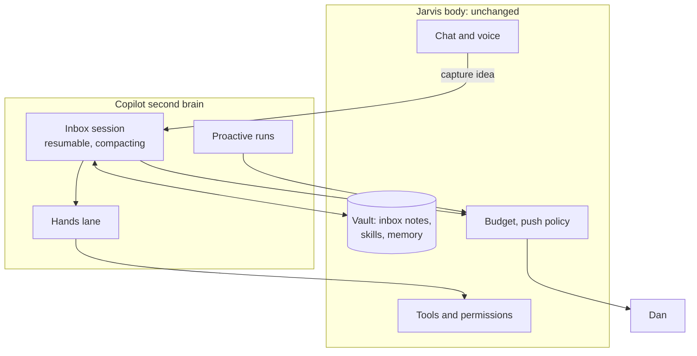
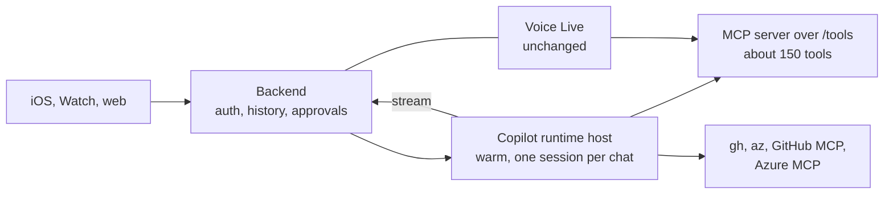

# 3. Options, from a capped trial to a full move

Part of the [Copilot-harness trial](README.md) (#1837). Voice Live stays as it is in every option (about 0.5 DKK per minute, measured).

## Ladder

## Cost model

Two currencies, kept apart on purpose.

| Currency | Meaning | Who pays | Cap |
| --- | --- | --- | --- |
| **Cash DKK** | New Azure spend: on-demand worker minutes, storage | Dan, on the Azure bill | Azure budget alert plus the per-option limits below |
| **AI credits** | Copilot usage; 1 credit = $0.01 = 0.0658 DKK. Free to Dan **only inside his plan's monthly allowance**; resets on the 1st, no carry-over | His Copilot plan | `sessionLimits.maxAiCredits` per session, an application counter per month, and a **$0 additional-usage budget with "Stop usage when budget limit is reached"** so nothing can ever bill |

Allowances (GitHub Docs, Usage-based billing for individuals): Pro 1,500 credits ($15), Pro+ 7,000 ($70), Max 20,000 ($200). **Dan's plan is unknown to this analysis.** The allowance is shared with his coding use in this app, so Jarvis spending it is a real cost even at 0 DKK.

**Alternative currency: BYOK.** The SDK can call Foundry models with the managed identity instead of Copilot credits (`docs/setup/azure-managed-identity.md`). Credits are then untouched and the cost is plain Azure tokens at about the same list price, shown on the Azure bill.

### Assumptions (all estimates, none measured on Jarvis)

| Item | Assumption |
| --- | --- |
| Prices | GitHub Docs "Models and pricing", per 1M tokens: GPT-5.6 Luna $0.20 in / $0.02 cached / $0.25 cache write / $1.20 out; GPT-6.1 Terra $1.00 / $0.05 / $1.25 / $5.00; Claude Sonnet 5.5 $2.00 / $0.10 / $2.50 / $10.00. FX 6.5785 DKK/USD (`usage-pricing.ts:1`) |
| Chat turn | 4 model calls, about 30k tokens of context each: 20k uncached, 90k cached, 10k cache write, 3k output |
| Agentic run (delegation, proactive escalation) | About 12 calls with growing context: 60k uncached, 400k cached, 20k cache write, 12k output |
| Light proactive check | 3 calls: 14k uncached, 70k cached, 6k cache write, 2k output |
| Prompt caching | 75-85% of input is cached after the first call. The Copilot runtime's real hit rate is **unmeasured** |
| Worker time | On-demand sandbox or job at 0.8901 DKK per hour (1 vCPU, 2 GiB; basis in `docs/architecture.md:5536`). Scales to zero when idle |
| Always-on host (option D) | 1 vCPU, 2 GiB: about 150 DKK/month at Container Apps idle rates, up to about 650 DKK at the sandbox rate |

| Model | Chat turn | Agentic run | Light check |
| --- | --- | --- | --- |
| GPT-5.6 Luna | 0.08 DKK, 1.2 cr | 0.26 DKK, 3.9 cr | 0.05 DKK, 0.8 cr |
| GPT-6.1 Terra | 0.34 DKK, 5.2 cr | 1.09 DKK, 16.5 cr | 0.23 DKK, 3.5 cr |
| Claude Sonnet 5.5 | 0.68 DKK, 10.4 cr | 2.17 DKK, 33 cr | 0.46 DKK, 7.0 cr |

Monthly chat cost at 30 days: 20 / 40 / 80 turns per day.

| Model | 20 turns/day | 40 turns/day | 80 turns/day |
| --- | --- | --- | --- |
| GPT-5.6 Luna | 47 DKK, 714 cr | 94 DKK, 1,428 cr | 188 DKK, 2,856 cr |
| GPT-6.1 Terra | 205 DKK, 3,120 cr | 410 DKK, 6,240 cr | 821 DKK, 12,480 cr |
| Claude Sonnet 5.5 | 410 DKK, 6,240 cr | 821 DKK, 12,480 cr | 1,642 DKK, 24,960 cr |

Today's chat share of the roughly 15 DKK/day Azure bill is **not measured here**; `get_usage` gives it. Measure before choosing D.

### Two cost-control findings found while reading the code

| Finding | Evidence | Action |
| --- | --- | --- |
| The proactive budget meter prices an unlisted model at "the highest known rate", which is GPT-5.6 Luna ($0.20 / $1.20). The default chat model is GPT-6.1 Terra ($1 / $5). If proactive runs on Terra, the 100 DKK meter reads about 5 times low. | `apps/backend/src/proactive/budget.ts:13-17`, `core/usage-pricing.ts:3-6`, `core/model-catalog.ts:270` | Confirm the selected proactive model and add its rate. Out of scope here. |
| The Azure budget alert defaults to 300 DKK while spend is about 15 DKK/day (about 450 DKK/month). | `infra/main.bicep:78`, no override in `infra/main.parameters.json` | Check the portal value. |

## Option A: Hands lane (unrestricted Azure and GitHub, on demand)

**Scope.** One new capability: Jarvis chat can hand a task to a Copilot worker that has real Azure and GitHub reach. Chat, voice, memory and proactive are untouched.

| Aspect | Detail |
| --- | --- |
| Copilot does | The loop, shell, `az`, `gh`, GitHub MCP, Azure MCP (read-only), skills for Dan's repos and Azure layout |
| Jarvis keeps | Chat, voice, memory, vault, approvals, every existing tool |
| New parts | A `delegate` tool, a worker image, a read-only Azure role, an MCP shim that exposes the read-only subset of the tool registry (the registry already tags `execution.defaultEffect: 'read'`) |
| Cash | About 9 DKK/month: 60 delegations at 8 minutes (7 DKK) plus storage and logs |
| Credits | About 990/month (65 DKK-eq) on Terra-class; **hard cap 1,500** (25 per task x 60 tasks) = 99 DKK-eq, 21% of Pro+, 100% of Pro |
| Hard caps | 25 credits per task, 60 tasks per month, $0 overage budget, worker time limit 15 minutes |
| Risks | Prompt injection from mail, web or repo text steering a shell with real rights; Reader role still reads secrets in some services; personal token on a server |
| Mitigations | Read-only Azure role (Reader, Log Analytics Reader, Cost Management Reader); `availableTools` allow-list; pre-tool-use hook blocks writes, `mail_send`, secret reads; GitHub App read tokens by default, write only through existing Jarvis tools |
| Exit plan | Remove the `delegate` tool and role assignments, delete the worker. No data to migrate: Jarvis tools, vault and SQL are untouched |

## Option B: Night shift (proactive brain only)

**Scope.** Replace the one-shot proactive JSON call with an investigating Copilot session. Delivery, push policy, dedupe and the 100 DKK budget stay in the backend.

| Aspect | Detail |
| --- | --- |
| Copilot does | Looks across signals, opens the repo, queries Azure, decides if it is worth interrupting. Writes findings as free text through one `file_finding` tool (title, body, optional link, urgency as words) |
| Jarvis keeps (deterministic, exact) | Budget reservation and hard stop, pause switch, per-day outreach cap, push delivery, de-duplication, feedback log, never-send-mail |
| Removed | Fixed 12 sources and 9 categories as a gate (A3, H3), keyword scope regexes (H2), the two-slot schedule and quiet hours (A1) |
| Cadence | Light check 4 times a day plus event triggers (webhook, calendar change); about 20% escalate |
| Cash | About 12 DKK/month: 11 worker hours plus storage |
| Credits | About 490/month (32 DKK-eq): 120 light checks on Luna-class (0.8 cr each) and 24 Terra-class escalations (16.5 cr each). **Hard cap 600** |
| Budget fit | 32 + 12 = about 44 DKK against the 100 DKK/month proactive budget; today's one-shot costs roughly 2-8 DKK/month (60 runs, 12k tokens in, 1.5k out, Luna to Terra) |
| Risks | Spam from a more capable but more talkative brain; injection via mail; findings quality unmeasured; cost drift if escalation rate rises |
| Mitigations | Daily outreach cap and cooldown in the gate; escalation counter; same thumbs-up/down feedback log decides what is kept |
| Exit plan | Feature flag back to the one-shot pipeline (kept in place during the trial). Delete the worker. Findings already stored stay valid |

## Option C: Second brain (A + B + long-lived inbox session)

**Scope.** Add one resumable Copilot session as the inbox-and-follow-up mind from p0.md #1 and #1836, next to chat. The vault remains the source of truth; the session reads and writes it.

| Aspect | Detail |
| --- | --- |
| Copilot does | Holds the inbox thread, files each idea as a note, decides when to nudge, spawns sub-agents for research or repo checks, resumes with the same `sessionId` after restarts |
| Jarvis keeps | The vault as truth (session state is disposable), approvals, push gate, chat and voice |
| Cash | About 27 DKK/month (26 worker hours) |
| Credits | About 3,350/month (220 DKK-eq, 48% of Pro+, 223% of Pro): A 990 + B 490 + 300 inbox turns at 5.2 + 10% for compaction and follow-ups. **Hard cap 3,600** |
| Risks | Two stores of truth (session files and vault); compaction losing detail; no session locking, so one writer only; credit draw exceeds Pro |
| Mitigations | Rule: anything that matters is written to the vault before the turn ends; single-writer lock in the backend; compaction summary is never trusted over the note |
| Exit plan | Stop resuming the session; notes already live in the vault. Disable triggers; delete the worker and the session folder |

## Option D: Full move (all chat turns on the Copilot harness)

**Scope.** The Copilot runtime becomes the chat brain for text. Backend tools are exposed over MCP; voice still uses Voice Live and calls tools as today.

| Aspect | Detail |
| --- | --- |
| Copilot does | Every chat turn, tool selection, skills, sub-agents, session and compaction |
| Jarvis keeps | Voice, tools, approvals, vault, SQL, identity kernel (as system message and hooks) |
| Cash | About 175-670 DKK/month: an always-warm host (150-650) plus about 20 for workers. Always-on is needed to avoid worker cold starts on every message |
| Credits | About 8,500/month on Terra-class at 40 turns/day (559 DKK-eq, 121% of Pro+); about 15,400 on Sonnet-class (1,010 DKK-eq, needs Max at $100). BYOK turns these into the same amounts of Azure cash |
| Risks | Everything in A-C plus chat latency, streaming and interruption parity, tool-description context cost, the parked Foundry attempt's lesson that parity work is large, and a model-credit pool that can run dry mid-month |
| Mitigations | Shadow-run chat turns in the bench first; keep the current path as automatic fallback when credits or the runtime are unavailable |
| Exit plan | Flip the chat route back to `chat_runtime.py`, which stays deployed. Costs nothing until then. This is only credible if the old path is **not** retired during the trial |

## Side by side

| | A Hands lane | B Night shift | C Second brain | D Full move |
| --- | --- | --- | --- | --- |
| Fixes | R1-R4 | A1-A3, H2-H3 | + G3-G5, p0.md inbox | + G1-G2 on every turn |
| Cash DKK/month | about 9 | about 12 | about 27 | about 175-670 |
| Credits/month | about 990 (cap 1,500) | about 490 (cap 600) | about 3,350 (cap 3,600) | about 8,500-15,400 |
| DKK-equivalent | 65 | 32 | 220 | 559-1,010 |
| Fits Pro (1,500) | at cap, all of it | yes | no | no |
| Fits Pro+ (7,000) | 14-21% | 7-9% | 48-51% | no (Max or BYOK) |
| Touches production chat | no | no (flag) | no | **yes** |
| Time to first signal | days | days | 1-2 weeks | weeks |
| Reversible in a day | yes | yes | yes | only if the old path stays |

Credits are estimates from assumed token profiles. They scale linearly with the real profile; the bench replaces the guess with measurements.
