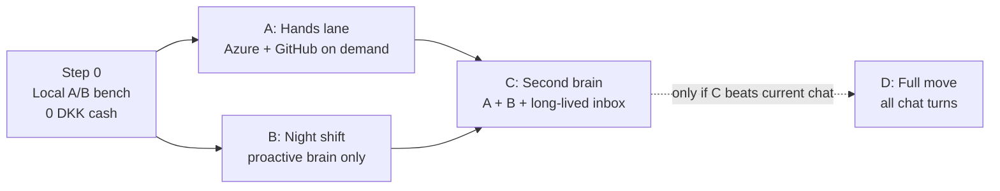
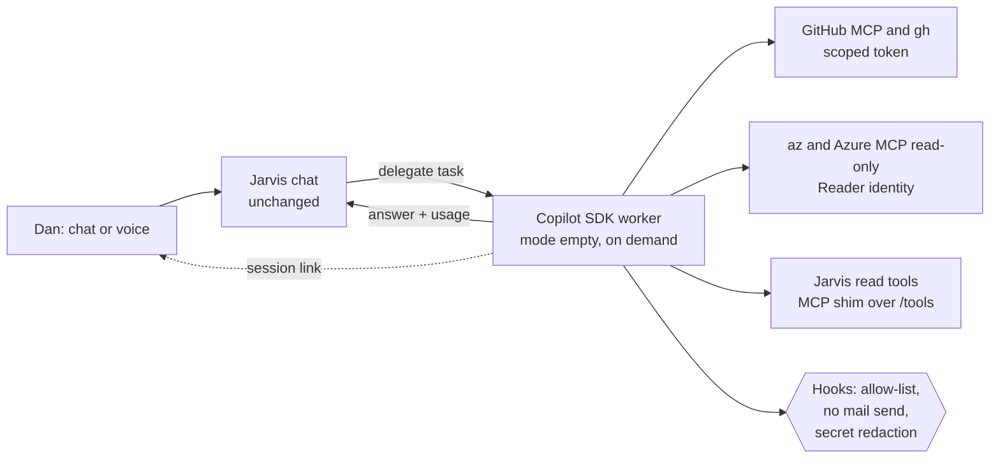
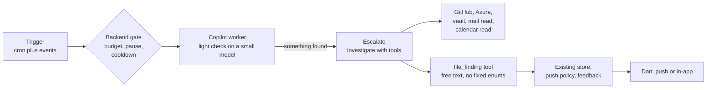
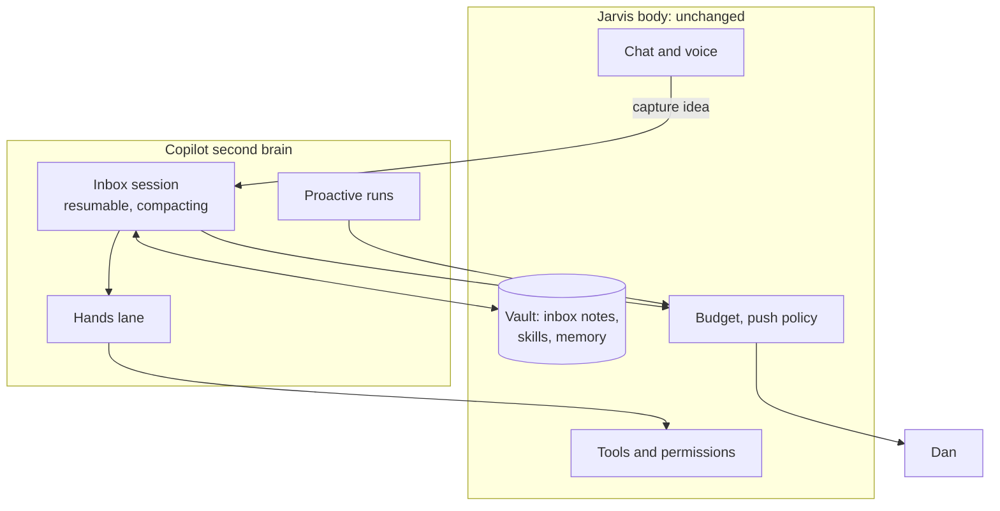
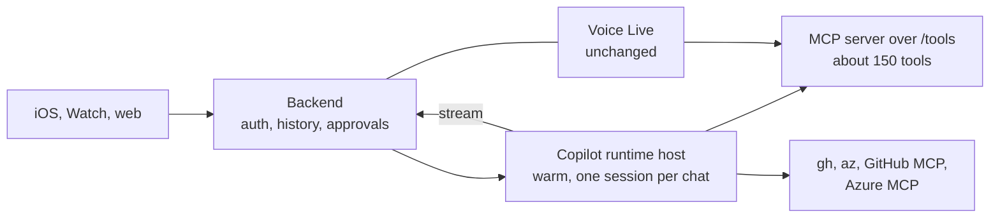

# 3. Options, from a capped trial to a full move

Part of the [Copilot-harness trial](README.md) (#1837). Voice Live stays as it is in every option (about 0.5 DKK per minute, measured).

## Ladder



## Cost model (re-baselined 15 Nov 2026)

**Correction.** The first version of this document priced a chat turn at 0.34 DKK (205 DKK/month at 20 turns a day on GPT-6.1 Terra). That was an assumed profile of 120k input tokens per turn and a guessed 20 turns a day. It came out about ten times above today's measured chat bill. This section replaces it.

### What is measured, derived and assumed

| Item | Status | Value | Source |
| --- | --- | --- | --- |
| Foundry Models spend, all chat plus proactive, on Terra, 12-14 Nov | **Measured** (Azure billing, supplied by the coordinating session; not re-checked here) | about 2.9 DKK in 3 days: 0.97 DKK/day, about 29 DKK/month | Owner session |
| Proactive share of that | Derived | about 0.13 DKK per run (12k in, 1.5k out at Terra list) x 2 slots x 3 days = about 0.8 DKK | `proactive/prompt.ts:27`, `proactive/types.ts`; replace with `dbo.proactive_spend` |
| Chat share of that | Derived | about 2.1 DKK in 3 days: **about 0.7 DKK/day, about 21 DKK/month, an upper bound** | 2.9 minus 0.8 |
| Chat turns per day today | Not measured; implied | about 6 | Chat cost / derived cost per turn below |
| Tokens per turn today | **Derived from code limits, not measured** | about 3 model rounds x 10k tokens of context, 70% cached, 500 out | Instructions are capped at 20,000 code points (`agents/jarvis/limits.json`); history window is 40 messages (`conversation_memory.py:41-43`); tools are looked up, not listed (`tool_lookup.py:22`) |
| Cached share today | **Not recorded anywhere** | assumed 70% | The usage store keeps input and output tokens only |
| Tokens, cache and turns for the **Copilot** loop | **Pure assumption** | Bands below | Replaced by the bench ([P15-158](04-recommendation.md#smallest-first-experiment-step-0-local-ab-bench-filed-as-p15-158)) |

### Why the usage store cannot give per-turn numbers

| Limit | Evidence |
| --- | --- |
| One pair of rows (`input_tokens`, `output_tokens`) per **model round**, keyed by a random UUID; no turn id | `agents/jarvis/model_client.py:1427-1441`, `apps/backend/src/database/usage-store.ts:183-216` |
| No cached-token metric exists | `db/migrations/0007_usage.sql` (`CK_usage_source_metric`), `0030_foundry_usage_cost_coverage.sql` |
| Terra has no price entry, so its rows carry `cost_dkk` NULL and `cost_status = 'unverified'`; `get_usage` shows tokens but no DKK | `apps/backend/src/core/usage-pricing.ts:3-6`, `usage-store.ts:188-189` |
| Proactive runs write the same table with the run id as event id, and also have their own ledger | `proactive/engine.ts:268`, `dbo.proactive_spend` (`database/proactive-store.ts:655-670`) |

This session has no database access, so the measured per-round tokens are **still open**. Read-only queries to close that gap are in the [appendix](#appendix-queries-that-replace-the-derived-numbers).

### Today, beside the Copilot bands (GPT-6.1 Terra at list price)

Terra list: $1.00 input, $0.05 cached, $5.00 output per 1M tokens (GitHub Docs "Models and pricing"). Azure's own Terra rate is not in the repository; assumed equal. FX 6.5785.

| Case | Context per call | Calls per turn | Cached | Output per call | DKK per turn | Credits per turn |
| --- | --- | --- | --- | --- | --- | --- |
| **Jarvis today** (derived, cross-checked against the measured total) | 10k | 3 | 70% | 500 | **0.12** | n/a |
| Copilot **low** | 15k | 3 | 85% | 400 | 0.10 | 1.5 |
| Copilot **expected** | 30k | 4 | 75% | 700 | 0.32 | 4.8 |
| Copilot **high** | 80k | 6 | 50% | 1,500 | 1.95 | 29.7 |

What each Copilot band means:

| Band | What would have to be true |
| --- | --- |
| Low | A lean session: small built-in prompt, tools deferred, high cache reuse |
| Expected | Built-in prompt plus skills metadata plus a modest tool list in context; a session that stays short because compaction runs early |
| High | Many tool schemas always in context and a long-lived session near the compaction threshold, with a cold or partial cache. This is the band my first numbers lived in |

**Ratio to today: about 0.8x (low), 2.8x (expected), 17x (high).** On GPT-5.6 Luna every number is about 4.5 times lower.

### Chat on Copilot beside today's measured chat bill

The ratio does not depend on the turn count, so apply it to today's measured chat spend.

| | Today (measured, upper bound) | Copilot low | Copilot expected | Copilot high |
| --- | --- | --- | --- | --- |
| Chat at today's volume (about 6 turns/day) | **about 21 DKK/month** | about 17 DKK-eq (270 credits) | about 57 DKK-eq (870 credits) | about 352 DKK-eq (5,350 credits) |
| Chat at 20 turns/day, Terra | about 70 DKK/month | about 58 | about 191 | about 1,173 |
| Chat at today's volume, on Luna instead of Terra | n/a | about 4 | about 13 | about 80 |

So the absurd figure is gone for the expected case: chat on the Copilot harness costs a few times today's chat bill, in the tens of DKK per month. The high band is the risk to watch, and it comes from context growth in a long-lived session, not from the model price.

### Total monthly bill: today versus each option

Fixed by Dan: **GPT-6.1 Terra only**, **1 hour of chat a day**, **10 minutes of voice a day**. Low, expected and high bands are consistent (all low, or all high). Spreadsheet version: [total-cost-comparison.csv](total-cost-comparison.csv).

| Assumption | Value | Status |
| --- | --- | --- |
| Chat turns per hour | **20** (one owner message about every 3 minutes of active chat), so 20 turns a day. Sensitivity: 10 and 30 below | Assumed. Turn length is not recorded; a query for it is in the [appendix](#appendix-queries-that-replace-the-derived-numbers) |
| Voice | 10 min x 30 days = 300 min at **0.35 / 0.5 / 0.7 DKK per min** = 105 / 150 / 210 DKK | Rate measured, band per coordinator |
| Infrastructure (SQL, container registry, container apps, storage, app service) | **366 DKK**, same in every column | Measured |
| Chat and proactive on Foundry today | Derived per-turn cost from the table above; proactive 60 runs a month at 0.07 / 0.13 / 0.35 DKK | Derived |
| Copilot credits | 1 credit = 0.0658 DKK. **Free only inside Dan's plan**; shown separately, never mixed into cash | Assumed bands |

**Cash on the Azure bill, DKK per month (expected, with low-high):**

| Line | Today | A Hands lane | B Night shift | C Second brain | D Full move |
| --- | --- | --- | --- | --- | --- |
| Infrastructure | 366 | 366 | 366 | 366 | 366 |
| Voice (10 min/day) | 150 (105-210) | 150 | 150 | 150 | 150 |
| Chat on Foundry | 69 (27-171) | 69 | 69 | 69 | moved |
| Proactive on Foundry | 8 (4-21) | 8 | replaced | replaced | moved |
| Worker time or host | none | 9 (5-15) | 12 (7-20) | 27 (15-45) | 201 (165-685) |
| **Total cash** | **593** (502-768) | **602** (507-783) | **597** (505-767) | **612** (513-792) | **717** (636-1,261) |
| Change from today | 0 | +9 | +4 | +19 | +124 |

**Copilot credit-equivalent, DKK per month (credits in brackets, expected):**

| Line | Today | A | B | C | D |
| --- | --- | --- | --- | --- | --- |
| Copilot credits | 0 | 76 (1,150) | 34 (510) | 226 (3,430) | 331 (5,030) |
| Low to high | 0 | 22-99 | 10-39 | 67-237 | 98-1,442 |
| Cap that holds | n/a | 1,500 credits | 600 | 3,600 | none set; D has no cap by design |

**Everything together, if credits were billed (BYOK or overage), DKK per month:**

| | Today | A | B | C | D |
| --- | --- | --- | --- | --- | --- |
| Expected | 593 | 678 | 631 | 838 | 1,048 |
| Low to high | 502-768 | 529-882 | 515-806 | 580-1,029 | 734-2,703 |
| Expected total, 1 block = 50 DKK | `████████████` | `██████████████` | `█████████████` | `█████████████████` | `█████████████████████` |

How to read it:

| Point | Detail |
| --- | --- |
| The bill is mostly not AI | Infrastructure plus voice is 516 of 593 DKK today (87%). Chat and proactive on Terra are about 77 |
| A, B and C add little cash | +4 to +19 DKK a month. Their cost is credits, which are free inside a plan, and are capped |
| D is the only option that moves the cash bill | +124 expected, from the always-on host. Its high band is the credit pool, not cash |
| Chat today at this profile is higher than measured spend | 20 turns a day derives to about 69 DKK. Measured spend (about 21 DKK for chat) implies only about 6 turns a day, so the real bill is lower until usage rises |

**Sensitivity of the chat line to turns per hour (expected band, Terra, DKK per month):**

| Turns per hour (= per day) | Today on Foundry | Copilot (credit-equivalent) |
| --- | --- | --- |
| 10 | 35 | 96 |
| 20 | 69 | 191 |
| 30 | 104 | 287 |

### Other assumptions (unmeasured)

| Item | Assumption |
| --- | --- |
| Agentic run (delegation, proactive escalation) | Low: 8 calls, 20k context, 85% cached. Expected: 12 calls, 40k, 75%. High: 20 calls, 90k, 50% |
| Light proactive check on Luna | Low 2 calls, 10k. Expected 3 calls, 14k. High 4 calls, 30k |
| Worker time | 0.8901 DKK per hour for 1 vCPU and 2 GiB (`docs/architecture.md:5536`); scales to zero when idle |
| Always-on host (option D) | 1 vCPU, 2 GiB: about 150 DKK/month at Container Apps idle rates, up to about 500-650 at active or sandbox rates. This is the largest cash item in D |

### Cost currencies

| Currency | Meaning | Cap |
| --- | --- | --- |
| **Cash DKK** | New Azure spend: worker minutes, host, storage | Azure budget alert and the per-option limits |
| **AI credits** | 1 credit = $0.01 = 0.0658 DKK. Free to Dan only inside his plan's monthly allowance (Pro 1,500, Pro+ 7,000, Max 20,000), shared with his coding use | `sessionLimits.maxAiCredits` per session (soft: checked after each model call), an application counter per month, and a $0 additional-usage budget with "Stop usage when budget limit is reached" |
| **BYOK** | The SDK calls Foundry with the managed identity instead of spending credits (`docs/setup/azure-managed-identity.md`); the same dollars land on the Azure bill | The existing Azure budget |

### Two cost-control findings found while reading the code

| Finding | Evidence | Action |
| --- | --- | --- |
| The proactive budget meter prices an unlisted model at "the highest known rate", GPT-5.6 Luna ($0.20 / $1.20). The default chat model is GPT-6.1 Terra ($1 / $5). If proactive runs on Terra, the 100 DKK meter reads about 5 times low. | `apps/backend/src/proactive/budget.ts:13-17`, `core/usage-pricing.ts:3-6`, `core/model-catalog.ts:270` | Confirm the proactive model and add Terra's rate. Out of scope here |
| The Azure budget alert defaults to 300 DKK while spend is about 15 DKK/day (about 450 DKK/month). | `infra/main.bicep:78`, no override in `infra/main.parameters.json` | Check the portal value |

### Appendix: queries that replace the derived numbers

Read-only, run against the production database. Chat rounds have a 36-character UUID event id; proactive rows use the run id (excluded by the join).

```sql
-- Per day: model rounds, average tokens per round, chat only (proactive runs excluded)
SELECT CAST(u.at AS date) AS day, u.model,
  COUNT(DISTINCT u.source_event_id) AS rounds,
  SUM(CASE WHEN u.metric = N'input_tokens'  THEN u.quantity END) AS input_tokens,
  SUM(CASE WHEN u.metric = N'output_tokens' THEN u.quantity END) AS output_tokens
FROM dbo.usage u
WHERE u.source = N'jarvis_model' AND u.role = N'chat' AND u.at >= '2026-11-12'
  AND NOT EXISTS (SELECT 1 FROM dbo.proactive_spend p
                  WHERE CONVERT(nvarchar(36), p.run_id) = u.source_event_id)
GROUP BY CAST(u.at AS date), u.model ORDER BY day;

-- Turns per day
SELECT CAST(at AS date) AS day, COUNT(*) AS owner_turns
FROM dbo.messages WHERE role = N'dan' AND at >= '2026-11-12'
GROUP BY CAST(at AS date) ORDER BY day;

-- Typical turn length: gap in minutes between consecutive owner messages inside a session
WITH m AS (
  SELECT jarvis_session_id, at,
    DATEDIFF(second, LAG(at) OVER (PARTITION BY jarvis_session_id ORDER BY at), at) AS gap_s
  FROM dbo.messages WHERE role = N'dan' AND at >= '2026-11-12')
SELECT DISTINCT COUNT(*) OVER () AS gaps, AVG(gap_s * 1.0) OVER () / 60.0 AS avg_gap_min,
  PERCENTILE_CONT(0.5) WITHIN GROUP (ORDER BY gap_s) OVER () / 60.0 AS median_gap_min
FROM m WHERE gap_s IS NOT NULL AND gap_s < 1800;

-- Proactive, measured
SELECT month_key, COUNT(*) AS runs, SUM(input_tokens) AS input_tokens,
  SUM(output_tokens) AS output_tokens, SUM(estimated_dkk) AS estimated_dkk
FROM dbo.proactive_spend GROUP BY month_key;
```

Rounds per turn = rounds / owner_turns; tokens per round = input_tokens / rounds. Cached share stays unknown until the model provider's cached-token count is stored; adding that metric is a product change and is not proposed here.


## Option A: Hands lane (unrestricted Azure and GitHub, on demand)

**Scope.** One new capability: Jarvis chat can hand a task to a Copilot worker that has real Azure and GitHub reach. Chat, voice, memory and proactive are untouched.



| Aspect | Detail |
| --- | --- |
| Copilot does | The loop, shell, `az`, `gh`, GitHub MCP, Azure MCP (read-only), skills for Dan's repos and Azure layout |
| Jarvis keeps | Chat, voice, memory, vault, approvals, every existing tool |
| New parts | A `delegate` tool, a worker image, a read-only Azure role, an MCP shim that exposes the read-only subset of the tool registry (the registry already tags `execution.defaultEffect: 'read'`) |
| Cash | About 9 DKK/month: 60 delegations at 8 minutes (7 DKK) plus storage and logs |
| Credits | Low 330, **expected 1,150** (76 DKK-eq), high 6,570 uncapped. **Hard cap 1,500** (25 per task x 60 tasks) = 99 DKK-eq, 21% of Pro+, 100% of Pro. Under the cap a high-band task is stopped, not billed |
| Hard caps | 25 credits per task, 60 tasks per month, $0 overage budget, worker time limit 15 minutes |
| Risks | Prompt injection from mail, web or repo text steering a shell with real rights; Reader role still reads secrets in some services; personal token on a server |
| Mitigations | Read-only Azure role (Reader, Log Analytics Reader, Cost Management Reader); `availableTools` allow-list; pre-tool-use hook blocks writes, `mail_send`, secret reads; GitHub App read tokens by default, write only through existing Jarvis tools |
| Exit plan | Remove the `delegate` tool and role assignments, delete the worker. No data to migrate: Jarvis tools, vault and SQL are untouched |

## Option B: Night shift (proactive brain only)

**Scope.** Replace the one-shot proactive JSON call with an investigating Copilot session. Delivery, push policy, dedupe and the 100 DKK budget stay in the backend.



| Aspect | Detail |
| --- | --- |
| Copilot does | Looks across signals, opens the repo, queries Azure, decides if it is worth interrupting. Writes findings as free text through one `file_finding` tool (title, body, optional link, urgency as words) |
| Jarvis keeps (deterministic, exact) | Budget reservation and hard stop, pause switch, per-day outreach cap, push delivery, de-duplication, feedback log, never-send-mail |
| Removed | Fixed 12 sources and 9 categories as a gate (A3, H3), keyword scope regexes (H2), the two-slot schedule and quiet hours (A1) |
| Cadence | Light check 4 times a day plus event triggers (webhook, calendar change); about 20% escalate |
| Cash | About 12 DKK/month: 11 worker hours plus storage |
| Credits | Low 150, **expected 510** (34 DKK-eq), high 2,830 uncapped: 120 light checks on Luna (0.4 cr each expected) and 24 Terra escalations (19 cr each expected). **Hard cap 600** |
| Budget fit | Expected 34 + 12 = about 46 DKK against the 100 DKK/month proactive budget. Today's one-shot is about 8 DKK/month on Terra (derived: 0.13 DKK per run, 2 runs a day; `dbo.proactive_spend` has the measured figure). About 5 times today, still under half the budget |
| Risks | Spam from a more capable but more talkative brain; injection via mail; findings quality unmeasured; cost drift if escalation rate rises |
| Mitigations | Daily outreach cap and cooldown in the gate; escalation counter; same thumbs-up/down feedback log decides what is kept |
| Exit plan | Feature flag back to the one-shot pipeline (kept in place during the trial). Delete the worker. Findings already stored stay valid |

## Option C: Second brain (A + B + long-lived inbox session)

**Scope.** Add one resumable Copilot session as the inbox-and-follow-up mind from p0.md #1 and #1836, next to chat. The vault remains the source of truth; the session reads and writes it.



| Aspect | Detail |
| --- | --- |
| Copilot does | Holds the inbox thread, files each idea as a note, decides when to nudge, spawns sub-agents for research or repo checks, resumes with the same `sessionId` after restarts |
| Jarvis keeps | The vault as truth (session state is disposable), approvals, push gate, chat and voice |
| Cash | About 27 DKK/month (26 worker hours) |
| Credits | Low 1,010 (67 DKK-eq), **expected 3,430** (226 DKK-eq, 49% of Pro+, 229% of Pro), high at the cap. Expected = A 1,150 + B 510 + 300 inbox turns at 4.8 (1,450) + 10% for compaction and follow-ups. **Hard cap 3,600** |
| Risks | Two stores of truth (session files and vault); compaction losing detail; no session locking, so one writer only; credit draw exceeds Pro |
| Mitigations | Rule: anything that matters is written to the vault before the turn ends; single-writer lock in the backend; compaction summary is never trusted over the note |
| Exit plan | Stop resuming the session; notes already live in the vault. Disable triggers; delete the worker and the session folder |

## Option D: Full move (all chat turns on the Copilot harness)

**Scope.** The Copilot runtime becomes the chat brain for text. Backend tools are exposed over MCP; voice still uses Voice Live and calls tools as today.



| Aspect | Detail |
| --- | --- |
| Copilot does | Every chat turn, tool selection, skills, sub-agents, session and compaction |
| Jarvis keeps | Voice, tools, approvals, vault, SQL, identity kernel (as system message and hooks) |
| Cash | About 175-670 DKK/month: an always-warm host (150-650) plus about 20 for workers. Always-on is needed to avoid worker cold starts on every message. **This host, not the tokens, is now the biggest cost of D** |
| Credits | At today's volume (about 6 turns/day, 180 a month), plus A and B: low 820 (54 DKK-eq), **expected 2,790** (184 DKK-eq, 40% of Pro+), high 8,190 (539 DKK-eq, above Pro+; A and B at their caps). At 20 turns/day: 1,500 / 5,030 / 21,900. BYOK turns these into the same amounts of Azure cash. **The chat part alone is 17 / 57 / 352 DKK-eq against about 21 DKK of measured Azure spend today** |
| Risks | Everything in A-C plus chat latency, streaming and interruption parity, tool-description context cost, the parked Foundry attempt's lesson that parity work is large, and a model-credit pool that can run dry mid-month |
| Mitigations | Shadow-run chat turns in the bench first; keep the current path as automatic fallback when credits or the runtime are unavailable |
| Exit plan | Flip the chat route back to `chat_runtime.py`, which stays deployed. Costs nothing until then. This is only credible if the old path is **not** retired during the trial |

## Side by side

Expected band unless stated; low to high in brackets. Credits free to Dan only inside his plan.

| | A Hands lane | B Night shift | C Second brain | D Full move (today's volume) |
| --- | --- | --- | --- | --- |
| Fixes | R1-R4 | A1-A3, H2-H3 | + G3-G5, p0.md inbox | + G1-G2 on every turn |
| Cash DKK/month | about 9 | about 12 | about 27 | about 175-670 (host) |
| Credits/month | 1,150 (330-1,500 cap) | 510 (150-600 cap) | 3,430 (1,010-3,600 cap) | 2,790 (820-8,190) |
| DKK-equivalent | 76 (22-99) | 34 (10-39) | 226 (67-237) | 184 (54-539) |
| Fits Pro (1,500) | expected yes, cap uses all | yes | no | no |
| Fits Pro+ (7,000) | 16%, cap 21% | 7%, cap 9% | 49%, cap 51% | 40%, high band no |
| Today's measured equivalent | none (new capability) | about 8 DKK/month proactive (derived) | n/a | about 21 DKK/month chat (measured upper bound) |
| Touches production chat | no | no (flag) | no | **yes** |
| Time to first signal | days | days | 1-2 weeks | weeks |
| Reversible in a day | yes | yes | yes | only if the old path stays |

Every Copilot-side figure rests on three unmeasured inputs: context re-sent per call, tool-description size, and cache hit rate. The bench measures all three and replaces the bands with one number per option.
