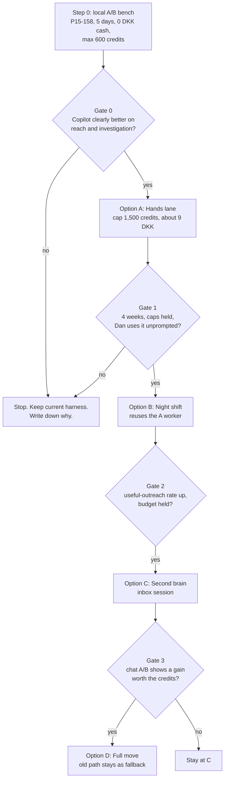
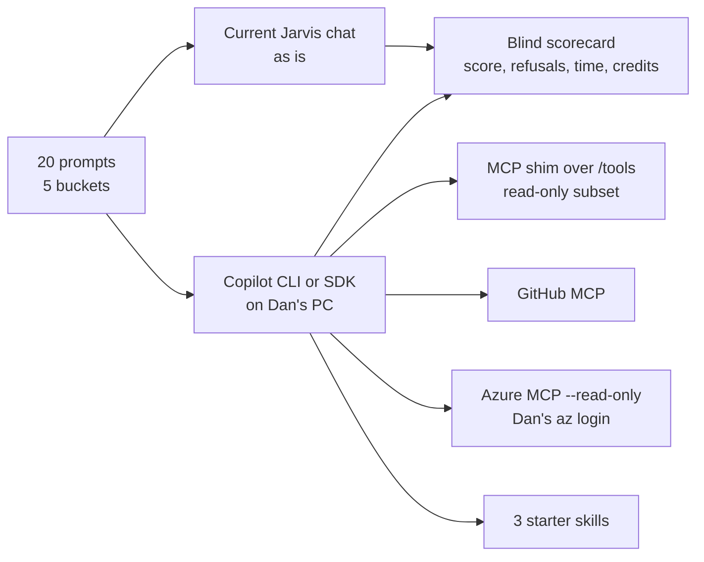

# 4. Recommendation and the smallest first experiment

Part of the [Copilot-harness trial](README.md) (#1837).

## Recommendation

**Do not replace the harness. Add the Copilot harness as a second brain, in gated steps, starting with a local bench that costs 0 DKK.**

| Why | Evidence |
| --- | --- |
| Most of the "hardcoded" feel sits in tools, guards and the proactive pipeline, which any harness would inherit | [Diagnosis](01-diagnosis.md): R3-R6, G6, H1-H3 |
| What a harness *does* fix (loop, skills, sessions, compaction, investigating instead of summarising) matches the two top priorities in p0.md: the long-lived inbox and a proactive Jarvis that can look things up | [Gains](02-quality-gains.md) 4-7 |
| "Unrestricted" is a credential decision. A hosted lane with a read-only Azure role and GitHub access delivers it far cheaper than moving chat | [Diagnosis](01-diagnosis.md#what-makes-the-copilot-app-feel-unrestricted) |
| A full move costs the most, touches the path Dan uses all day, and would consume more credits than Pro+ includes at assumed usage | [Option D](03-options.md#option-d-full-move-all-chat-turns-on-the-copilot-harness) |
| The Copilot engine improves with every model release with no work from Jarvis, which is the quality-grows-with-models rule from `docs/decisions.md` (14 Nov 2026) | [Gains](02-quality-gains.md) 10 |

To the doubt about the own harness: it is not the weakest link. Its loop, discovery and memory window are the parts a mature engine does better; its guards and receipts are the parts worth keeping.

## Path and gates

| Gate | Measure | Pass |
| --- | --- | --- |
| 0 | Blind A/B of 20 tasks scored by Dan; credits and wall time per task | Copilot wins at least 12 of 20 overall and at least 8 of the 12 Azure, GitHub and investigation tasks; median 25 credits or less per task; no guard breach |
| 1 | Four weeks of the Hands lane | Monthly credits at or under the cap; $0 overage; Dan used it unprompted at least 10 times; no write or secret read slipped past the hooks |
| 2 | Four weeks of the Night shift beside the old pipeline | Thumbs-up share at or above the old pipeline; at most the agreed pushes per day; proactive spend under 100 DKK/month including credit-equivalent |
| 3 | Shadow chat turns on the same prompts | Better score in a blind comparison, first-token latency within 1.5x, credits within the plan |

## Smallest first experiment: step 0, local A/B bench (filed as P15-158)

Purpose: measure harness quality and reach with real Jarvis tools and real data, before any Azure resource or product code exists.

| Item | Plan |
| --- | --- |
| Where | Dan's PC. No Azure resource, no deployment, no change to product code. The shim and skills live outside the product tree (a scratch folder or a branch) |
| Buckets (4 prompts each) | Azure (cost, logs, resources); GitHub (PRs, CI, issues, repo state); investigation (a proactive-style question across sources); inbox and follow-up (a multi-day thread with a resumed session); plain chat and memory |
| Scoring | Dan scores answers 1-5 blind (A/B order shuffled), plus counts of refusals, tool calls, wall time and credits (`session.usage.getMetrics`) |
| Cap | 600 credits in total (about 40 DKK-eq; 9% of Pro+), 40 per task via `sessionLimits.maxAiCredits`, 5 days |
| Preconditions | Dan reads his plan and allowance; sets an additional-usage budget of $0 with "Stop usage when budget limit is reached"; confirms the terms for server-side use of his token before any later hosting |
| Safety | Everything read-only. No mail send, no writes, no health or banking data in prompts. Prompts and results go to GitHub and its model providers |
| Cash | 0 DKK |
| Output | `docs/harness-trial/bench-results.md`: scorecard, credit table, latency table, go or stop for Gate 0 |
| Exit | Delete the scratch folder. Nothing else was created |

## What this analysis deliberately does not do

| Not done | Why |
| --- | --- |
| No product code, infra or settings changes | Requested scope |
| No credit or latency measurements | None are possible without running the bench; every figure is an assumption listed in [options](03-options.md#assumptions-all-estimates-none-measured-on-jarvis) |
| No decision entry in `docs/decisions.md` | Nothing is confirmed by Dan yet. Record one after Gate 0 |

## Questions only Dan can answer

| Question | Why it matters |
| --- | --- |
| Which Copilot plan, and what allowance is left in a normal month? | Option A at its cap equals all of Pro |
| Credits or BYOK on Foundry if credits run short? | BYOK shows the spend on the Azure bill instead |
| Is a personal subscription token on a server acceptable, or should a later hosted lane use an organisation token? | Factory does it today; volume and 24/7 use differ |
| Which data may go to GitHub's model providers? | Health, banking and mail bodies are the sensitive ones |
| Should quiet hours go (p0.md says none needed)? | They are hardcoded in `proactive/time.ts:87-90` and would limit Option B |
