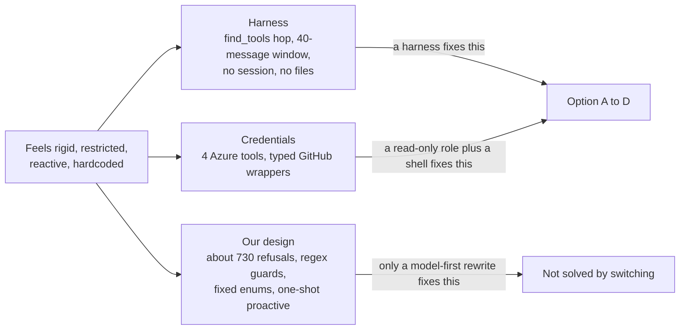

# Copilot-harness trial

Analysis for [#1837](https://github.com/DanAakesen/jarvis/issues/1837) (P15-146). Analysis and recommendation only; no product code changed. Checked 14 Nov 2026.

## Verdict

| | |
| --- | --- |
| **Recommendation** | Keep the current harness and Voice Live. Add the Copilot harness as a second brain, in gated steps, starting with a local bench: 0 DKK cash, 600 credits at most |
| **Why not replace it** | Most of the rigid feel lives in tools, guards and the proactive pipeline, which a new harness inherits. A full move costs about 560-1,010 DKK-equivalent per month at assumed use and exceeds Pro+ |
| **What a harness really adds** | Loop, skills, sub-agents, resumable sessions, compaction, hooks, MCP: the parts the inbox loop and a proactive Jarvis need |
| **Where "unrestricted" comes from** | Credentials and a shell, not the harness. Give a worker a read-only Azure role and GitHub access and the feeling follows |
| **Next step** | [P15-158 (#1851)](https://github.com/DanAakesen/jarvis/issues/1851): local A/B bench |

## Where the feel comes from

## Options at a glance

| | A Hands lane | B Night shift | C Second brain | D Full move |
| --- | --- | --- | --- | --- |
| What moves | Azure and GitHub tasks on demand | Proactive brain | A + B + long-lived inbox session | All chat turns |
| Cash DKK/month | about 9 | about 12 | about 27 | about 175-670 |
| Credits/month (cap) | 990 (1,500) | 490 (600) | 3,350 (3,600) | 8,500-15,400 |
| DKK-equivalent | 65 | 32 | 220 | 559-1,010 |
| Touches production chat | no | no | no | yes |
| Reversible in a day | yes | yes | yes | only if the old path stays |

Credits are free to Dan only inside his plan's allowance (Pro 1,500, Pro+ 7,000, Max 20,000). Set a $0 additional-usage budget so nothing can ever bill. All figures are estimates from assumed token profiles; the bench replaces them with measurements.

## Documents

| File | Contents |
| --- | --- |
| [01-diagnosis.md](01-diagnosis.md) | What makes the harness feel rigid, restricted, reactive and hardcoded, with file and line evidence |
| [02-quality-gains.md](02-quality-gains.md) | Quality-only gains, honest cons, unknowns, checked against current official docs |
| [03-options.md](03-options.md) | Options A to D with architecture diagrams, DKK per month, assumptions, risks and exit plans |
| [04-recommendation.md](04-recommendation.md) | Recommendation, gates, the smallest first experiment, open questions for Dan |
