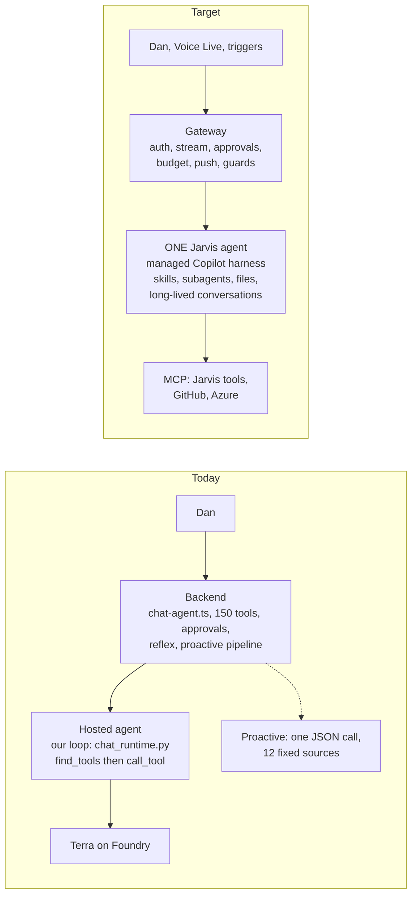

# Copilot-harness trial

Analysis for [#1837](https://github.com/DanAakesen/jarvis/issues/1837) (P15-146). Analysis only; no product code changed. Updated 15 Nov 2026 after Dan's feedback: the first version proposed the SDK in our own containers and a stepwise A to D ladder. Both were wrong and are removed.

## Verdict

**Replace the brain of the Jarvis agent with one managed Copilot-harness agent in the same Foundry project. One agent serves chat, proactive runs and the inbox, with skills, subagents, MCP reach and a long-lived conversation. The backend becomes a gateway. Build it beside the current path and test it; the current path is deleted once the owner is happy (no runtime fallback; see [the PI plan](../pi/plan.md)).**

> 15 Nov 2026: the owner decided on **no runtime fallback** and on standing watches. Files 03 and 04 still describe an automatic fallback and a four-phase path; [docs/pi/plan.md](../pi/plan.md) supersedes those parts (phases, rollback, deletion).

Smallest first step: a one-day spike on a new test agent in Foundry, capped at 30 DKK ([#1851](https://github.com/DanAakesen/jarvis/issues/1851), P15-158). Nothing in production changes.

## Today and target

## Why the last attempt told us nothing

| | Parked 9 Nov | Target |
| --- | --- | --- |
| Engine | Same managed Copilot harness | Same |
| Who ran the loop | **Our loop**, with the harness as a model endpoint | Foundry's |
| Tools, skills, subagents, files | About 150 function tools; the rest switched off | MCP, skills, subagents on |
| Conversation | New one every turn | Long-lived |
| Result | A label change, no gain | Untested |

## Cost: whole monthly bill, Terra, 1 h chat and 10 min voice a day

| DKK per month | Today | Target, same work | Target, full workload |
| --- | --- | --- | --- |
| Infrastructure (measured) | 366 | 366 | 366 |
| Voice (10 min a day) | 150 | 150 | 150 |
| Hosted agent compute (measured, scaled) | 10 | 0 | 0 |
| Managed sandbox (free until 1 Dec) | 0 | 60 | 60 |
| Azure MCP server | 0 | 5 | 5 |
| Models on Foundry | 77 | 198 | 407 |
| **Total, expected** | **603** | **779** | **988** |
| Low to high | 509-797 | 565-2,385 | 627-3,607 |

No container of ours is always on. Model tokens bill on Azure, not as GitHub Copilot credits. The high band is context growth in long conversations; the gateway caps it. Today's hosted-agent compute is taken from the measured run-rate since 12 Nov (0.05-0.15 DKK a day), not from the Factory test period. Whether the managed sandbox is released when idle is unknown; see [what billing is documented](03-target-architecture.md#what-billing-is-documented-and-what-is-not).

## What is unknown

| Unknown | Decided by |
| --- | --- |
| Terra works in the harness (one request was rejected on 6 Nov) | Spike 1 |
| Per-turn authority on MCP writes | Spike 2, 3 |
| Real tokens, cache hit rate and cost per turn | Spike 4 |
| Streaming latency, mid-turn steering | Spike 5 |
| Conversation limits and compaction | Spike 6 |
| Sandbox size and idle billing (hosted agents release compute on idle: documented; the managed sandbox: not) | Spike plus the December bill |

## Documents

| File | Contents |
| --- | --- |
| [01-diagnosis.md](01-diagnosis.md) | What makes the current harness feel rigid, restricted, reactive and hardcoded, with file and line evidence |
| [02-quality-gains.md](02-quality-gains.md) | Quality gains of the Copilot harness, what is documented for the managed Foundry version, honest cons |
| [03-target-architecture.md](03-target-architecture.md) | The single target: diagrams, limits, parity gaps, cost comparison, migration path, risks |
| [04-recommendation.md](04-recommendation.md) | Recommendation, gates, the seven-question spike |
| [spike-results.md](spike-results.md) | Spike outcome (#1851): not run for lack of Azure access, what is missing, Gate 0 hold |
| [spike/](spike/runbook.md) | Skill, MCP shim design, 20-prompt set and the runbook for the owner |
