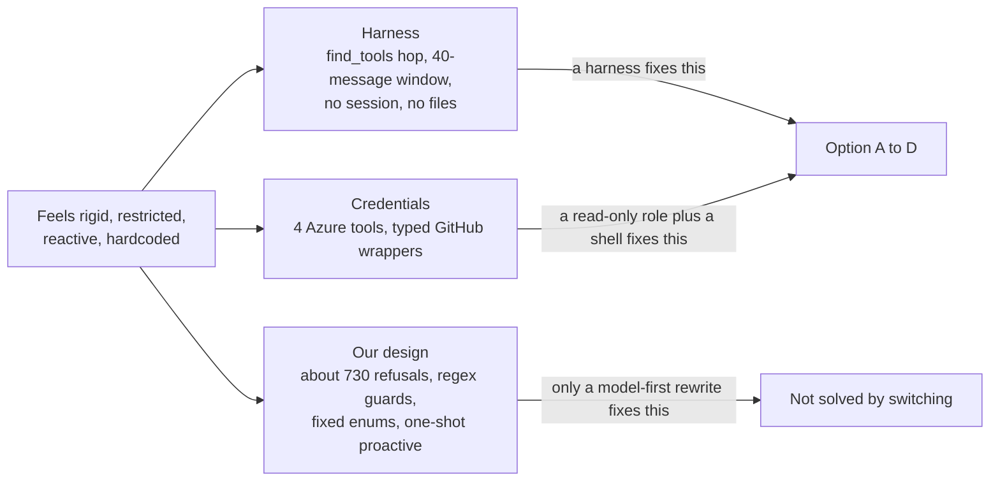

# Copilot-harness trial

Analysis for [#1837](https://github.com/DanAakesen/jarvis/issues/1837) (P15-146). Analysis and recommendation only; no product code changed. Checked 14 Nov 2026.

## Verdict

| | |
| --- | --- |
| **Recommendation** | Keep the current harness and Voice Live. Add the Copilot harness as a second brain, in gated steps, starting with a local bench: 0 DKK cash, 600 credits at most |
| **Why not replace it** | Most of the rigid feel lives in tools, guards and the proactive pipeline, which a new harness inherits. A full move is no longer a token-cost problem (chat on Copilot is about 57 DKK-equivalent a month expected, against about 21 DKK measured today), but it needs an always-on host (about 175-670 DKK), touches the chat path Dan uses all day, and has a high band of about 540 DKK-equivalent if sessions grow long |
| **What a harness really adds** | Loop, skills, sub-agents, resumable sessions, compaction, hooks, MCP: the parts the inbox loop and a proactive Jarvis need |
| **Where "unrestricted" comes from** | Credentials and a shell, not the harness. Give a worker a read-only Azure role and GitHub access and the feeling follows |
| **Next step** | [P15-158 (#1851)](https://github.com/DanAakesen/jarvis/issues/1851): local A/B bench |

## Where the feel comes from

## Options at a glance

| | A Hands lane | B Night shift | C Second brain | D Full move |
| --- | --- | --- | --- | --- |
| What moves | Azure and GitHub tasks on demand | Proactive brain | A + B + long-lived inbox session | All chat turns |
| Cash DKK/month | about 9 | about 12 | about 27 | about 175-670 |
| Credits/month, expected (cap or high) | 1,150 (1,500) | 510 (600) | 3,430 (3,600) | 2,790 (8,190) |
| DKK-equivalent, expected | 76 | 34 | 226 | 184 (high 539) |
| **Total monthly bill, expected** (cash plus credit-equivalent; Terra, 1 h chat and 10 min voice a day) | 678 | 631 | 838 | 1,048 |
| Cash on the Azure bill, expected | 602 | 597 | 612 | 717 |
| Touches production chat | no | no | no | yes |
| Reversible in a day | yes | yes | yes | only if the old path stays |

Credits are free to Dan only inside his plan's allowance (Pro 1,500, Pro+ 7,000, Max 20,000). Set a $0 additional-usage budget so nothing can ever bill.

**Cost basis, re-baselined 15 Nov.** The only measured number is today's Foundry Models spend: about 2.9 DKK in 3 days for chat and proactive together on Terra (about 21 DKK/month for chat, an upper bound). The first draft's 0.34 DKK per turn was an assumption and was about ten times too high. Copilot-side costs are now shown as low, expected and high bands beside today's figure; the three inputs that decide them (context per call, tool-description size, cache hit rate) are unmeasured until the bench runs. See [03-options.md](03-options.md#cost-model-re-baselined-15-nov-2026).

## Documents

| File | Contents |
| --- | --- |
| [01-diagnosis.md](01-diagnosis.md) | What makes the harness feel rigid, restricted, reactive and hardcoded, with file and line evidence |
| [02-quality-gains.md](02-quality-gains.md) | Quality-only gains, honest cons, unknowns, checked against current official docs |
| [total-cost-comparison.csv](total-cost-comparison.csv) | Total monthly bill, today versus A to D, low/expected/high, for a spreadsheet. Today: 593 DKK cash |
| [03-options.md](03-options.md) | Options A to D with architecture diagrams, DKK per month, assumptions, risks and exit plans |
| [04-recommendation.md](04-recommendation.md) | Recommendation, gates, the smallest first experiment, open questions for Dan |
