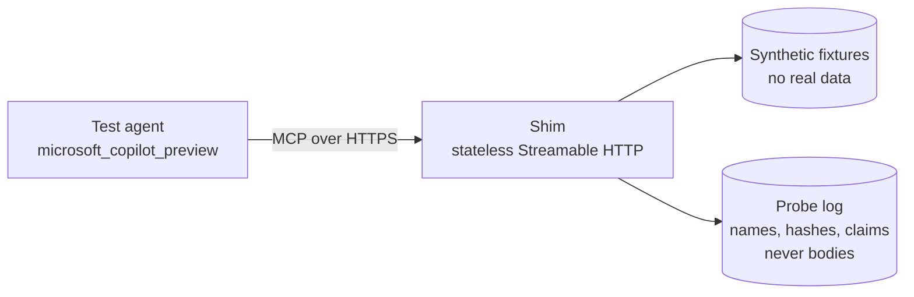

# MCP shim design (throwaway)

Spike #1851 (P15-158). Design only. Nothing is built or deployed: hosting needs an Azure resource or a tunnel the owner has not yet approved (see [runbook](runbook.md)). The shim lives outside the product tree and is deleted at exit.

## Purpose

Answer questions 2 and 3 without touching the real backend:

- **Q2** What identity and headers reach an MCP tool call, and can a per-turn value be passed?
- **Q3** Does `require_approval` round-trip, per tool or per server?

It also gives the investigation and inbox prompts something to call.

## Shape

- One small HTTP service speaking MCP Streamable HTTP in stateless mode, like `apps/backend/src/inbox/mcp.ts` (SDK `createMcpHandler`).
- Returns **synthetic fixtures only**. No call to the Jarvis backend, no vault, no SQL, no credential of ours. Real tools stay untouched, which keeps the "existing backend untouched" limit trivially true.
- Host: a scale-to-zero container app in its own throwaway resource group, or a dev tunnel from the owner's PC. Either way a shared-secret header protects it, and it is deleted at exit.

## Tools (five, four read-only)

| Tool | Kind | Returns | Used by |
| --- | --- | --- | --- |
| `whoami_probe` | read | The probe record for this call (below), so the model can quote what arrived | Q2 |
| `inbox_items` | read | 8 synthetic inbox items (id, title, age, status) | Inbox bucket |
| `inbox_item_read` | read | One synthetic item with a 3-5 message thread | Inbox bucket |
| `jarvis_status` | read | A fixed synthetic status snapshot (open tasks, last run, one deliberate inconsistency) | Investigation bucket |
| `approval_probe` | looks like a write, does nothing | `{"recorded": true}` and a log line. Never changes state | Q3 |

`approval_probe` is the only tool configured with `require_approval`; the other four are not. That tests per-tool granularity if Foundry allows an allow-list per approval setting, and otherwise falls back to a second server entry (same shim, second path, `/approve/mcp`) with the setting on.

## Probe record, per call

Logged as one JSON line. **Never a request body, never a tool result.**

| Field | Content |
| --- | --- |
| `at`, `route`, `tool`, `call_id` | Timing and which tool |
| `header_names` | Every header name received, sorted |
| `headers_allow` | Values of an allow-list only: `user-agent`, `x-request-id`, `traceparent`, `x-ms-*`, `x-forwarded-for` (last octet masked), any header starting `x-jarvis-` or `x-turn-` |
| `auth` | `none`, `shared-secret`, or `bearer`. For `bearer`: the JWT **claims only** (`iss`, `aud`, `tid`, `oid`, `appid`, `azp`, `idtyp`, `scp`, `roles`, `exp`) and a SHA-256 of the token. The token itself is never stored |
| `arg_keys` | Argument names and lengths, no values, except the value of `turn_ref` (below) |
| `meta_keys` | Keys of the MCP `_meta` object if present |

The shared secret and any bearer token are compared in constant time and then dropped.

## Q2 test matrix: how a per-turn value could reach the tool

Run each once on the agent and record whether the value arrives and where.

| # | Route | What to see in the log |
| --- | --- | --- |
| a | **Agent identity.** MCP tool auth set to the project managed identity. | `auth=bearer`, `oid` equals the agent's `instance_identity.principal_id` or the project identity; stable across turns |
| b | **User token delegation / OAuth passthrough**, only if the project offers it without consent UI work | `oid` is the signed-in owner, or the consent link appears |
| c | **Static header** on the MCP tool config (`x-turn-static: v1`) | Arrives, but is per agent version, not per turn |
| d | **Turn reference as an argument.** Instructions carry `turn_ref=<uuid>` per request (structured input); skill and tool description say "pass `turn_ref` to every call" | `arg_keys` shows `turn_ref` and its value equals the one sent in the request |
| e | **Per-request metadata** (Responses `metadata` or a per-request tool header override, if the API allows) | Whether any `x-` header or `_meta` key carries it |
| f | **Hostile case.** Same as d, but the prompt text tells the model to use a different `turn_ref` | The model may comply: this shows route d is advisory, not proof of authority |

Reading the result: only routes that arrive without the model's help (a, b, c, e) can prove authority. Route d works for correlation but a prompt-injected model can forge it, so it needs the gateway to check the value against the live turn. That decides which of the three options in [03-target-architecture.md](../03-target-architecture.md#per-user-and-per-turn-authority) is workable.

## Q3 test

1. Agent has `approval_probe` with `require_approval` on.
2. Prompt: "Call `approval_probe` with note=hello." Expect an `mcp_approval_request` item in the response stream and no log line yet.
3. A script answers with an `mcp_approval_response` (`approve: true`) in the **same conversation**. Expect the call and one log line.
4. Repeat with `approve: false`. Expect no log line and a sensible refusal message.
5. Repeat with the other four tools: record whether they ran without approval (per-tool granularity) or also asked (per-server).
6. Record the time between request and response, and whether the stream stays open or ends at the approval request.

## Safety

- Synthetic data only. No health, banking, mail or real inbox content.
- No write capability exists in the shim, so a prompt-injected model cannot cause one.
- Auth on the shim is mandatory; without a valid shared secret or bearer it returns 401 before any logging of arguments.
- Logs are kept on the shim host only and deleted with it. The numbers that matter are copied into `spike-results.md`.
- Egress controls on the test agent sandbox should be in audit mode first, as in the target architecture.
