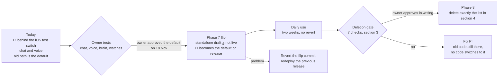

# PI cutover checklist and deletion inventory

Prepared for [#1887](https://github.com/DanAakesen/jarvis/issues/1887) (P15-176), 16 November 2026. **Phase 7's chat and voice default is approved, not live. Phase 8 is not approved.** The old chat harness, the old one-shot proactive pipeline and every Foundry resource stay in place; deletion needs separate written approval and the checks in section 3.

## 1. What the owner tests before the flip

| Area | How | What good looks like | Reference |
| --- | --- | --- | --- |
| Chat | Settings, General, "Engine test switch" to **PI engine**; use chat for a day | Quality at least as good as today; first text about 1.1 to 1.3 s warm, about 3.3 s cold; honest errors; approvals work | `docs/harness-trial/spike-results.md` (16 November measurements) |
| Voice | Same switch; start voice (first answer takes a few seconds), ask something that needs a tool, interrupt it, ask a follow-up | A short sentence from PI before a tool call, then a short spoken answer; the newest sentence wins; later turns about as fast as warm chat; chat and voice remember each other | PR #1908; `voice.pi_turn` and `voice.turn_timing` logs |
| Brain | Settings, "PI brain (test)" on | Messages worth reading, no storms, budget inside 100 DKK | `docs/agent-context.md`, "PI brain" |
| Watches | "Keep me updated on X"; list; stop | Looks and reports as asked, cost per watch shown, no storm | `docs/agent-context.md`, "PI standing watches" |
| Reach | After the owner provides `PI_GITHUB_TOKEN` (fine-grained token, see `docs/agent-context.md`) and runs `infra/setup-azure-mcp.ps1` | Reads and actions work on real questions; or PI says plainly it is not attached | `docs/agent-context.md`, "PI reach" |
| Cost | Settings status rows, `measure_pi` summary | A plain turn about 0.05 DKK, a tool turn about 0.17 DKK, month inside the cap | `docs/pi/plan.md` section 8 |

**Known limits:** Watch and web follow the server default. Once the flip is live, camera and screen sharing in web voice return `not_supported` on PI. The 07:00 and 18:00 proactive slots are unchanged; their replacement is still open (section 4.3, decision A).

## 2. The flip (phase 7) as one small, separate change

Standalone draft [#1910](https://github.com/DanAakesen/jarvis/pull/1910) contains the default flip. The owner approved this change on 18 November; it has not been merged or deployed.

| Change | Detail |
| --- | --- |
| Chat | The turn route treats a missing `engine` as PI for normal chat. `engine: "current"` selects the old path. Isolated runtime tests keep the runtime chosen for the session and reject explicit `pi` with HTTP 400 |
| Voice | `/voice` without an `engine` query uses PI. `/voice?engine=current` selects the old voice path |
| iPhone | `ChatEngineSelection.load()` defaults to PI. The chat and voice clients send the choice explicitly; a saved `current` remains selected |
| Watch and web | Neither sends an engine for chat or voice. They follow the server default, and PI web voice does not support camera or screen sharing |
| What stays | The old path, engine selector, PI Brain switch, proactive slots and every Foundry resource |

Verify the explicit Current engine choice on the updated iPhone build. Older iPhone builds omit `engine` for that choice and therefore follow the new server default.

Rollback: revert the flip commit and redeploy the previous release. There is no code that switches back at runtime.

## 3. Deletion gate (from `docs/pi/plan.md`, section 7)

| # | Check | State |
| --- | --- | --- |
| 1 | The owner says he is happy with PI in daily use (his word, recorded in `docs/decisions.md`) | Open |
| 2 | At least two weeks as the default, no revert, no unplanned outage | Open |
| 3 | Chat, voice, proactive, inbox and watches each verified live, not only in tests | Open |
| 4 | Latency, cost and quality at or better than the gate A targets on real use | Open |
| 5 | The owner has accepted the preview risk in writing (the harness is in public preview, no SLA; with no fallback code a Foundry outage is a PI outage), or the harness is generally available | Open |
| 6 | The last release with the old path is tagged and the rollback steps are written in `docs/agent-context.md` | Open: tag the release the flip merges from, then write the steps |
| 7 | This inventory is reviewed by a reference scan on the day of the deletion (section 5) | Scan done 16 November on `main`; repeat before deleting |

## 4. Deletion inventory for phase 8

Method and limits are in section 5. **Whole** means no remaining caller was found once the old path goes. **Split** means other kept code imports named symbols, so the file is reduced, not removed. Nothing below touches data: no table, migration, blob or vault note is deleted.

### 4.1 Move first (couplings that break the build if the folder simply goes)

| Coupling | Where | What to do |
| --- | --- | --- |
| The PI agent's persona is built from `agents/jarvis/identity-contract.json` | `.github/scripts/provision_pi_agent.py` (`instructions_text`) | Move the file next to the PI agent (`agents/pi/`) and point the provisioner at it |
| The backend reads three files from `agents/jarvis/` | `apps/backend/src/core/identity-composition.ts` (`identity-contract.json`), `core/presence-instructions.ts` (`presence-instructions.json`), a drift test against `limits.json` in `core/tool-registry.ts`; `apps/backend/Dockerfile` copies the first two; `.dockerignore` lists them | Move `identity-contract.json` and `presence-instructions.json` to the backend, update the Dockerfile and `.dockerignore`; drop `limits.json` and its drift test, or move the limits into TypeScript |
| A PI test reads the old Python adapter for the preview header | `apps/backend/src/pi/definition.test.ts` (`agents/jarvis/managed_copilot.py`); `pi/definition.ts` comment | Pin the header value in the test itself |
| The PI gateway uses shared helpers from the old chat module | `pi/gateway.ts` imports `parseEvents`, `FOUNDRY_AGENT_SCOPE` and the `ConversationAgent*` types from `core/chat-agent.ts`; `voice/pi-voice.ts` imports the types | Move those into a PI or shared module, then remove the hosted-agent invocation |
| The PI MCP server uses the old voice lookup | `pi/mcp.ts` imports `searchVoiceTools`, `shortenVoiceDescription` from `voice/voice-tools.ts` | Move both into `pi/` |
| The brain imports a retry constant | `pi/brain/runner.ts` imports `MAX_EVENT_ATTEMPTS` from `proactive/events/rules.ts` | Move it to the event queue module |
| Kept proactive hooks import a type from the slot engine | `proactive/alerts.ts`, `reminders.ts`, `todo-writer.ts`, `inbox/proactive-hook.ts` import `FindingsStoredContext` from `proactive/engine.ts` | See decision A below |

### 4.2 The old chat harness: Python agent (all of `agents/jarvis/`, after 4.1)

Whole: `chat_runtime.py`, `model_client.py`, `tool_lookup.py`, `conversation_memory.py`, `jarvis_tools.py`, `response_coordinator.py`, `voice_runtime.py`, `calendar_flow.py`, `state.py`, `main.py`, `model_contract.py`, `chat_telemetry.py`, `response_telemetry.py`, `stream_keepalive.py`, `visual_context.py`; the `managed_*` bridge: `managed_bindings.py`, `managed_copilot.py`, `managed_copilot_definition.py`, `managed_definition_fingerprint.py`, `managed_policy_client.py`, `managed_policy_compatibility.py`, `managed_policy_template.py`, `managed_provider_cause.py`, `managed_runtime_factory.py`; `Dockerfile`, `pyproject.toml`, `requirements*.in|txt`, `README.md`, `tests/` (3 files), `scripts/` (smoke test). `limits.json`, `presence-instructions.json` and `identity-contract.json` leave through 4.1.

### 4.3 The old chat harness and old proactive pipeline: backend

| File | Verdict | Boundary |
| --- | --- | --- |
| `core/chat-agent.ts` | Split | Remove the hosted-agent invocation and Foundry session helpers; keep what 4.1 moves |
| `core/managed-policy-compatibility.ts`, `core/managed-target-reader.ts`, `core/chat-canary.ts`, `core/managed-runtime-routes.ts`, `core/runtime-test-availability.ts`, `database/runtime-session-store.ts` | Whole | Callers are the old chat route and `index.ts` wiring only |
| `core/recoverable-chat.ts` | **Keep** | The chat turn route keeps every turn, PI and old, in `recoverableTurns` (`RecoverableChat`) for the recover and stop endpoints; the scan first marked it as old-path-only by mistake (review finding on #1909) |
| `core/runtime-session.ts` | Split | Also imported by `core/conversation-store.ts`, `database/conversation-store.ts`: remove the isolated runtime-test sessions and keep what the conversation store needs. Migration `0069_runtime_test_sessions.sql` stays; data stays |
| `core/conversation.ts` | Split | Keep the shared stream, steering and acknowledgment handling that PI uses. Remove the non-PI agent branch (`app.conversationAgent`), runtime-test sessions, managed routes and the old reflex classifier use; then the `engine` field and test switch go (section 4.5) |
| `core/capability-instructions.ts`, `core/capability-index.ts` | Split | `core/settings.ts`, `core/agent-contract.ts` and the old realtime path import them; remove the 15,000-character catalogue prompt once the old voice path and old chat are gone |
| `core/approval.ts`, `core/approval-interpreter*.ts` | **Keep** | Used by Google, Factory, inbox, vault, health, proactive and `core/pending-action.ts`. The plan's candidate (regex phrase approvals) is not deletable on current evidence; the old voice path's use (`classifyApprovalReply`) goes with it |
| `core/reflex.ts` | Split | `core/index.ts` imports `findChatReflexReplay`, `app.ts` the classifier type; the instant acknowledgment in PI comes from the model, so the classifier and its wiring go, helpers still used stay |
| `voice/voice-tools.ts` | Split | After 4.1 nothing remains but the old `find_tools`/`call_tool` allow-list and constants |
| `voice/realtime.ts`, `voice/tool-budget.ts`, `voice/relay.ts` | Split | Remove the lookup and discovery capability modes, the rung ladder, the reflex, calendar and food side paths, camera and screen handling that only the old engine uses. **Keep** the PI branch, `pi-voice.ts`, the relay transport, status announcements and session limits |
| `proactive/model.ts`, `proactive/prompt.ts` | Whole | One-shot model calls for the slot engine; no PI import (the brain's `../prompt.js` is `pi/prompt.ts`). Health modules have their own `model.ts` |
| `proactive/events/reasoner.ts`, `events/event-prompt.ts`, `events/pipeline.ts` (the old event pipeline: rules, batches, reasoner, push cap) and the reasoner branch of `events/wiring.ts` | Whole / split | `pipeline.ts` is the only caller of the reasoner and imports `FeedbackLine` from `event-prompt.ts`, and `wiring.ts` builds both the reasoner and the brain consumer, so they go together and `wiring.ts` keeps the queue and the brain consumer. Keep the queue, producers, dedupe, outreach store and channels; `JARVIS_PROACTIVE_EVENTS_ENABLED` (the old pipeline's switch) goes with them |
| `proactive/engine.ts`, `proactive/detect.ts`, `proactive/composition.ts`, `proactive/scheduler.ts` | **Decision A** | The 07:00 and 18:00 slot engine. `composition.ts` also wires the event queue and the brain, so it is split, not removed |
| `proactive/types.ts`, `proactive/policy.ts`, `proactive/events/rules.ts` | Split | Stores and `home/brief.ts` import the shared types; `database/proactive-store.ts` imports `findingAllowed`, `itemAllowed`; the closed source and category lists and keyword scope go only with decision A |
| `index.ts`, `app.ts`, `config.ts` | Split | Remove the old agent construction, canary, managed runtime and reflex wiring; config: the Foundry chat agent name, Copilot agent name, version, fingerprint and compatibility settings (`JARVIS_CHAT_AGENT_NAME`, `FOUNDRY_COPILOT_*`). **Keep** the model-backed approval interpreter wiring (`approval-interpreter-foundry.ts`, `approvalInterpreter` in `index.ts`): it runs on the Foundry chat-completions model and serves the kept tools' approvals (review finding on #1909). `JARVIS_PROACTIVE_EVENTS_ENABLED` belongs to the event pipeline decision, not to this list |

**Decision A (owner): what happens to the 07:00 and 18:00 proactive slots.** The slot engine produces the scheduled findings on the Proactive page and is the trigger of four kept features through `onFindingsStored`: the inbox nudge pass, daily audit and weekly review (`inbox/proactive-hook.ts`), todo writes (`todo-writer.ts`), reminder planning (`reminders.ts`) and alerts (`alerts.ts`). PI's brain wakes on events and watches, not on a daily schedule. Deleting the engine without a replacement removes those features. Options: (1) keep the slot engine and its hooks and delete only its model call (`model.ts`, `prompt.ts`), (2) give PI a scheduled wake (a watch or a timer producer) that does the same jobs and then delete the engine, (3) drop the features. Not decided; the inventory above leaves `engine.ts`, `detect.ts`, `composition.ts` and `scheduler.ts` out of the delete list until it is.

### 4.4 Tests of the deleted code

Every test file whose subject is in 4.2 or 4.3 "Whole"/"Split (removed part)" goes with it. Shared tests stay: `pi/*`, `voice/pi-voice.test.ts`, `voice/relay-pi.test.ts`, approval and proactive-store tests. Classify each test file on the day (not done here). Pipeline jobs that only guard deleted code: `jarvis-agent-ci.yml` (whole), the `jarvis-agent` component in `ci.yml` (lines around 45, 96 to 100, 140 to 154), `foundry-contract.yml` **after** checking no shared contract remains.

### 4.5 Clients

| Area | What goes |
| --- | --- |
| iOS | The test switch: `ChatEngine.swift`, `PiStatus.swift`, `PiBrainStatus.swift` (the brain switch goes only if the brain no longer needs an owner toggle), `JarvisChatEngineTestSection.swift`, its call site in `JarvisSettingsArea.swift`, the "PI test" pill, `ChatEngineSelection` uses in `JarvisChatModel`, `JarvisChatScreen`, `VoiceScreenModel`; the `engine` parameter of the chat and voice clients; the isolated runtime-test UI (`JarvisRuntimeTestSheet.swift`, `JarvisRuntimeTestFixtureTransport.swift`, `ChatRuntimeTest.swift`, the plus-menu entry, runtime-test strings and fixtures); `PiWarmThrottle` stays (chat still warms PI). `JarvisDesignSystemGuardTests` and localization tests are updated with them |
| Web | `RuntimeTestSelector.tsx|css`, `RuntimeTestConversation.tsx` and their use in `ConversationHistory.tsx`, `conversation-history.ts` |
| Watch | Nothing to delete; it follows the server default. Parked work is not touched |

### 4.6 Pipelines, scripts and infrastructure

| Item | Detail |
| --- | --- |
| `deploy.yml` | The `agent` job (image build for `jarvis-agent`, hosted agent version, patch) and its outputs, receipt fields and `needs`; the `managed-chat-comparison` job and its inputs `provision_managed_chat`, `refresh_managed_chat_definition`, `inspect_managed_chat`, `diagnose_managed_chat`. **Keep:** `pi-agent`, `measure_pi`, `probe_pi_wake`. `live_acceptance` (8 live chat checks against the old chat) is decided with the flip: rewrite for PI or delete |
| Scripts | `provision_managed_chat.py`, `provision_managed_chat_handoff.sh`, `managed_policy_canary.py`, `managed_chat_diagnostic_output.py`; the old agent branches in `pipeline_impact.py` (lines about 43, 68, 110); `agents/jarvis` in `python-ci.sh`, `copilot-setup-steps.yml` (requirements filters), `scripts/setup-dependencies.sh`, `.dockerignore` lines 12 to 14. **Keep:** `provision_pi_agent.py`, `probe_pi_wake.py`, `pi_smoke_report.py` and their tests |
| `infra/main.bicep` | Parameters `jarvisAgentObjectId`, `foundryCopilotAgentName`, `foundryCopilotAgentVersion`, `foundryCopilotDefinitionSha256`, `foundryCopilotPolicyCompatibility` and the app settings they feed (about lines 15 to 25 and 1004 to 1030), the `JARVIS_CHAT_AGENT_NAME` setting (line about 961), the hosted-agent identity. **Keep:** the Foundry account and project, the Terra deployment (`gpt61TerraChatDeployment`) and the other deployments, the registry (only the `jarvis-agent` image goes), the backend's role assignments (shared; remove one only if proven exclusive to the hosted agent) |
| Repository variable | `ENTRA_JARVIS_AGENT_OBJECT_ID` (feeds `jarvisAgentObjectId`) |
| Docs | `docs/main-chat-harness-migration.md`, `managed-chat-adapter.md`, `managed-chat-provisioning.md`, `managed-policy-client.md`, `runtime-comparison-owner-test.md`, `runtime-lifecycle-comparison.md`, `copilot-runtime-recovery-2026-11-07.md` (history stays in git); `README.md` row for `agents/jarvis`; `p0.md`, `TEMP-openai-migration-ledger.md` and the old-path passages of `docs/architecture.md`, `PLAN.md`, `DESIGN.md` updated so they describe only what remains |

### 4.7 Foundry and Azure resources (manual, not from the repository)

| Resource | Created by | Used by | Verdict |
| --- | --- | --- | --- |
| Hosted agent `jarvis` (name from `JARVIS_CHAT_AGENT_NAME`), all its versions | Deploy job `agent` | The old chat and old voice tool loop | **Delete** after the code is gone and the previous release is no longer a rollback target |
| Managed comparison agent **`jarvis-main-copilot-preview`** (the legacy Foundry agent) | `provision_managed_chat.py` (Deploy `managed-chat-comparison`) | Parked; read by the old runtime selector (`FOUNDRY_COPILOT_*`) | **Delete** with the managed bridge |
| Registry image `jarvis-agent` (all tags) | Deploy job `agent` | The hosted agent | **Delete** the image and its revisions only; the registry stays |
| Agent identity and role assignments exclusive to the hosted agent | Infra | The hosted agent | Delete only what is proven exclusive; **unverified** from the repository |
| Model deployments | Infra | Shared: PI uses Terra; others (voice, embeddings, vision, approval model) serve other features | **Keep all**. Whether any deployment is used only by the old agent cannot be proven from the repository: check the live usage metrics first |
| `jarvis-pi`, `jarvis-pi-mcp` and `jarvis-pi-*` connections, `jarvis-pi-probe` (throwaway) | `provision_pi_agent.py`, `probe_pi_wake.py` | PI | **Keep** |

Safest order for 4.7: confirm in the Foundry portal that nothing calls the old agents (their request counts are zero for a week), delete the agent versions, delete the registry image, then remove the infrastructure parameters in the next infrastructure deployment. Take a screenshot of the agent list before and after.

### 4.8 Order of deletion

1. Section 4.1 (moves) in one pull request that changes no behaviour.
2. Decision A, then the backend removals of 4.3 with the client removals of 4.5 in the same pull request, so the app never sends a field the server refuses.
3. Pipelines, scripts and infrastructure (4.6), then the manual steps (4.7).
4. Docs and the "what remains" rewrite.

Rollback for any step: `git revert` and redeploy the tagged last release that still has the old path (gate check 6).

## 5. Method, and what is not proven

Reference scan on `main` at the commit of this branch (16 November 2026): for every candidate file, the importers (`grep -rn "/<name>\.js'"` across `apps/backend/src`, then the named symbols), then `agents/jarvis` references repository-wide (`grep -rn "agents/jarvis"`), the Deploy workflow's jobs and inputs, `infra/main.bicep` parameters, the iOS and web sources for `engine`, `runtimeTest` and `TEST-ONLY`, and the PI code's own imports. It was read-only. **Not proven:** that no external script or dashboard calls the old chat route; test ownership per file; whether a model deployment is exclusive to the old agent; the live state of the Foundry project (agent list, identities); and web or iOS callers of old routes beyond the ones named. The scan must be repeated on the day of the deletion (gate check 7).

## 6. Approval record

The owner writes his approvals as comments on #1887. This table is filled in only from those comments.

| Approval | Date | Link |
| --- | --- | --- |
| Phase 7: PI is the approved default for chat and voice | 18 November 2026 | [Written approval on #1887](https://github.com/DanAakesen/jarvis/issues/1887#issuecomment-6981225174) |
| Preview risk accepted (gate check 5) | | |
| Decision A (the 07:00 and 18:00 slots) | | |
| Phase 8: delete exactly the list in section 4 | | |
