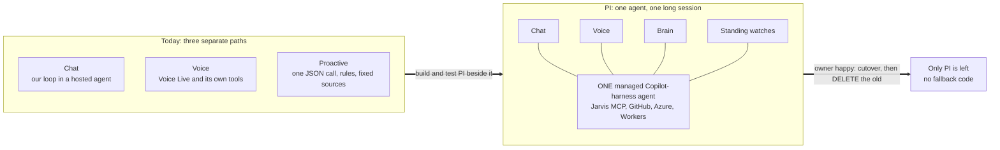
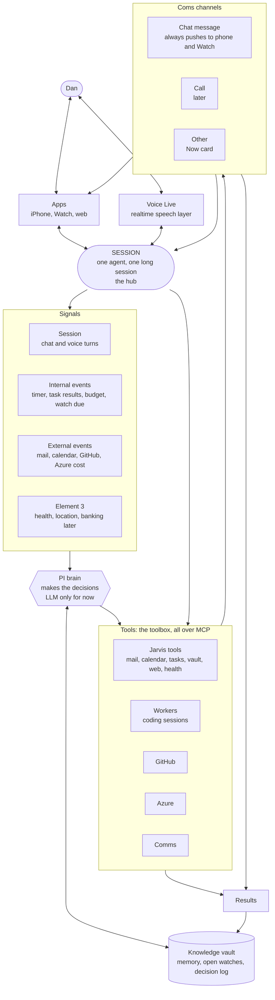
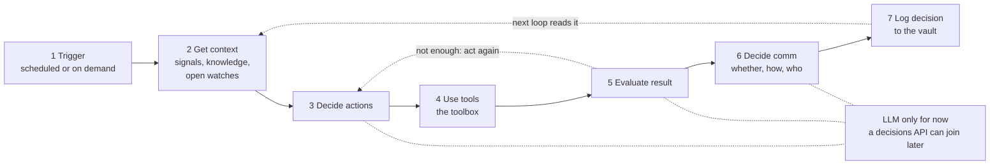
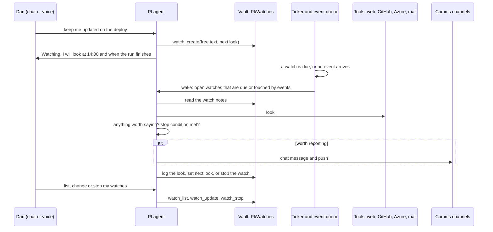
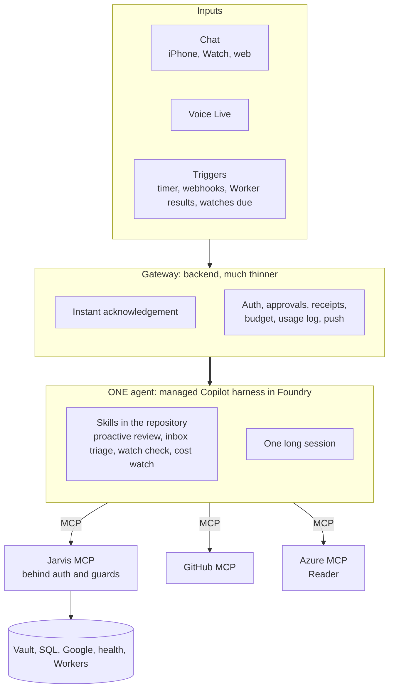
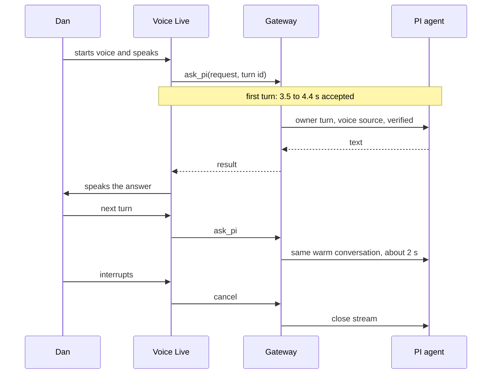
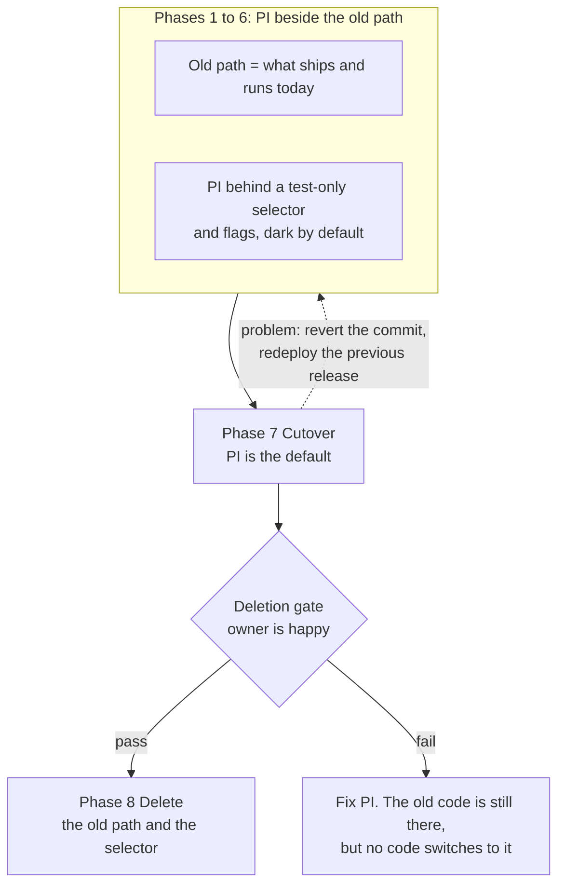
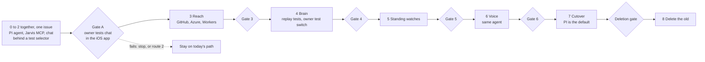

# PI plan: Proactive Intelligence, chat and voice on one managed Copilot-harness agent

Plan for [#1872](https://github.com/DanAakesen/jarvis/issues/1872) (P15-164). Planning only; no product code changed. Written 15 Nov 2026, revised the same day for two owner decisions (no runtime fallback; standing watches). Builds on the [Copilot-harness trial](../harness-trial/README.md) (#1837), the [spike](../harness-trial/spike-results.md) (#1851), the [Loose Ends design](../inbox-loop/design.md) and the [event-driven proactive path](../proactive-events/design.md) (#1858). Architecture source: the owner's [drawing](pi-architecture-drawing.png).

Owner, 15 Nov 2026: "I'm interacting with the harness and agent loop via the chat and voice. So if we keep that out, I'm not sure I will get the full benefit and the full user experience. So I think we need to do a full plan combined of four and one. And also that five seconds start. I think there must be something we can do to optimize that." And: "this is what a mature harness will do and this is why I've been trying to explain to you the reasons to change to Copilot Harness because building this ourself is quite a task."

**Update 16 Nov 2026 (#1886):** phases 3 to 5 are merged and deployed. First live smoke through the gateway: warm first text 1.1 to 1.3 s, cold 3.3 s, about 7.5k input tokens, about 0.05 DKK per plain turn and 0.17 DKK per tool turn; all four checks pass. GitHub and Azure reach are **not attached yet** (token and Azure MCP missing), so reach is unproven live. The reminder tool is not supported on a harness prompt agent: our ticker and the vault stay the waker. Details: `docs/harness-trial/spike-results.md`.

**Update 16 Nov 2026 (no restrictions):** the owner removed the read-only and approval choices in this plan. Wakes have the chat tools, watches have no limits, built-ins are on, GitHub is the full server and Azure is Contributor on the Jarvis resource group (`docs/decisions.md`, 16 November 2026). Where the text below says read-only, approvals, or limits of 10 watches, 8 checks and 5 minutes, it is superseded.

**Update 16 Nov 2026 (#1887 part 1, phase 6):** voice runs on PI behind the iOS test switch. One change to the plan below: Voice Live has **no `ask_pi` tool**; the relay starts the PI turn from the final transcript and Voice Live only reads PI's words (reasons in `docs/decisions.md`, 16 November 2026). The owner's instruction that night: build everything for the cutover, **delete nothing**; the cutover checklist and the exact deletion inventory are in [cutover.md](cutover.md).

**Update 15 Nov 2026 (#1885, P15-174, PR #1890):** at the owner's request phases 0, 1 and 2 were built together as one piece so he can test chat on PI in the iOS app behind a test switch. The long-session, quality-scoring and routines items of phase 0 are out. What was built and what is still unproven: `PLAN.md` and `docs/architecture.md` (section "PI chat engine"). Measured latency used for the build (from the owner's dispatcher, not yet in `spike-results.md`): new conversation first text 3.7 to 4.4 s, same-conversation turn 2 and later about 1.9 s with a cached prompt, effort none or low must be set in the agent definition and gives true streaming, per-request reasoning, `service_tier` and `prompt_cache_key` are rejected, tools are about 6.4k of the 11k prompt tokens.

## The plan on one page



| Decision | Choice |
| --- | --- |
| Routes | **1 (PI brain on the harness) and 4 (chat and voice on the same harness) are one plan**: one agent, one long session |
| Decisions | **LLM only** to begin with. No deterministic decision layer yet |
| Exact logic | Only where an exact result is required: auth, approvals, receipts, caps, budget, the push guarantee, timestamps |
| **No runtime fallback** (owner) | Build PI on the harness and test it. When the owner is happy, **delete** everything it replaces. No fallback or compatibility code stays. Rollback is redeploying the previous release or reverting a commit |
| **Standing watches** (owner) | "Keep me updated on X": a free-text watch in the vault, loaded by the brain loop, the model decides what is worth saying |
| Voice | Voice Live stays the realtime speech layer; every voice turn goes through the same PI agent. The 3.5 to 4.4 s wait when voice starts is accepted (owner); no separate fast voice path |
| Workers | The coding sessions (Factory, subscription-backed). Brain and chat start them through tools |
| The 5 s start | Measured: about 2 s first text in a warm conversation, 3.4 to 4.4 s in a new one. Keep one long conversation per user, warm it when the app opens, set effort none or low in the agent definition |

Evidence labels: **Measured** (spike), **Derived** (list price, code, docs), **Assumed**, **Placeholder** (not yet measured; do not guess).

## 1. Target architecture (from the owner's drawing)



In the harness the brain and the Session are **the same agent**: the brain loop runs as turns of it.

| Drawing element | In PI | Exists today |
| --- | --- | --- |
| Session | The harness conversation | No: chat history is rebuilt from SQL each turn (`agents/jarvis/model_client.py`, `"store": False`) |
| Signals | Event queue plus the chat and voice turns themselves | Queue, producers, dedupe: `proactive/events/*` (#1858) |
| Brain | The agent, woken by a trigger, with a skill for the job | One-shot JSON call: `proactive/events/reasoner.ts` |
| Knowledge vault | Private vault repo, plus a rebuildable SQL index | `vault/*`, `inbox/*` (#1855) |
| Tools | Jarvis MCP, GitHub MCP, Azure MCP; Workers and Comms are Jarvis MCP tools | About 150 typed tools behind `find_tools` and `call_tool`; narrow GitHub and Azure reach |
| Workers | Factory coding sessions, started by a tool, results return as events | `factory/*`, `runner/`, `task-status-notifications.ts` |
| Coms channels | Push (phone and Watch), chat entry, Now card; call later | `push/*`, `proactive/events/channels.ts`; no call |
| Results | Tool and channel outcomes, written to the vault | Receipts in `core/tool-calls.ts`; no vault trail |

## 2. The brain loop



| Step | Done by | Exact parts (not the model) |
| --- | --- | --- |
| 1 Trigger | Timer, event batch, a watch coming due, Dan's message, a Worker result | Queue, dedupe, leases, batching so one wake covers many events and watches |
| 2 Context | Agent reads vault, signals and **open watches** through tools | Tool authorisation |
| 3 Decide | Agent | None |
| 4 Tools | Agent calls MCP tools | Schemas, refusals, receipts, idempotency, approvals |
| 5 Evaluate | Agent | None |
| 6 Comm | Agent picks channel and wording | Push guarantee for chat messages, daily push cap, never send mail |
| 7 Log | Agent writes the note | Vault path guard, secret filter, size limit |

The drawing leaves one dashed box above "decide comm" unlabelled. Assumption: it is the outgoing message.

## 3. Standing watches: "keep me updated on X"

Examples: a build, a topic, a price, a person, a repo.

### What the platform offers (researched 15 Nov 2026)

Sources are Microsoft Learn pages read through search excerpts (the pages cannot be fetched from this environment). The spike tested **none** of these.

| Capability | What the docs say | Fit for watches |
| --- | --- | --- |
| **Routines** (preview): [concept](https://learn.microsoft.com/en-sg/azure/foundry/agents/concepts/routines), [how to](https://learn.microsoft.com/en-us/azure/foundry/agents/how-to/use-routines) | A named rule that fires a **timer** (once), a **recurring** schedule (cron, minimum interval 5 minutes) or an **event**, and invokes one **prompt agent or hosted agent** through its endpoint. Stores a run record. One trigger, one action. The only event type in preview is `github_issue` (opened or closed in a watched repository) | Schedules: yes, if a routine can target a harness prompt agent (a harness agent is a prompt agent, but **untested**). Events: GitHub issues only. Mail, calendar, price, topic, builds: not covered |
| **Reminder tool** `reminder_preview`: [how to](https://learn.microsoft.com/en-us/azure/foundry/agents/how-to/tools/reminder-tool) | A tool in a toolbox. The agent picks a delay (1 to 43,200 minutes, 30 days) and Foundry re-invokes the **same agent on the same conversation**. Documented for **hosted agents** | Exactly the "agent wakes itself" pattern, but documented for hosted agents, not for harness prompt agents. **Not available to PI as documented** |
| **Long-running resilience**: [concept](https://learn.microsoft.com/en-us/azure/foundry/agents/concepts/long-running-agent-resilience), [deploy](https://learn.microsoft.com/en-us/azure/foundry/agents/how-to/deploy-resilient-agent) | Hosted agents keep working after the client disconnects and recover after a process stops: stored background responses (`store` and `background`), opt-in `resilient_background`, lease-based recovery, stream replay. Foreground responses are not recovered | Helps a long single task (a Worker), not a watch that lives for weeks. Hosted agents only as documented |
| **Harness limits**: [quotas](https://learn.microsoft.com/en-us/azure/foundry/agents/concepts/limits-quotas-regions) | The service manages sandbox allocation, idling and resumption without changing the conversation. Up to 100,000 messages per thread | A long session survives idle; nothing wakes it |
| **Spike** | Nothing on triggers, routines, reminders or background runs | Open: tested in phase 5 (watches) |

**Conclusion: the managed harness has no documented way to wake itself.** Foundry's wake-up features (routines, reminder tool) are preview, event coverage is GitHub issues only, and the self-scheduling tool is for hosted agents. Watches therefore cannot depend on them.

### Design (model-driven)



| Part | Design |
| --- | --- |
| A watch | One free-text note in the vault under `PI/Watches/`, outside task scope like `Inbox/`: what to watch, why, how often or on which events, when to stop. Dan's own words are quoted. No status enum, no fixed cadence list. Closing moves the note to `PI/Watches/Closed/` with a trail line. Same store pattern as the inbox (`inbox/store.ts`, `note.ts`, `item-index.ts`) |
| Who creates it | The model, from "keep me updated on X" in chat or voice, through `watch_create`. The tool verifies the current owner message, as `inbox_capture` does |
| When it looks | The model writes a **next look** timestamp (a tool argument, so the waker has an exact time) and may say "also on build events" in the note. Mail, calendar and GitHub events reach the brain through the existing queue; the model matches them to open watches |
| Trigger step | The existing ticker (`proactive/scheduler.ts`, 30 s, quiet when idle) wakes the brain when a next look is due or the queue has events. **Get context** loads the open watches. One wake covers every due watch, so the fixed harness prompt is paid once |
| Decision | The model decides whether anything is worth reporting, whether to change cadence, and whether the stop condition is met |
| Reporting | A normal PI chat message through the comms channels, so the push guarantee applies. The look is logged to the vault whether or not Dan is told |
| Control | "List, change or stop my watches" in chat or voice. Tools: `watch_list`, `watch_update`, `watch_stop`. A watch ends on Dan's word or on its own stop condition, which the model reports |
| Source of truth | The vault note. Nothing about a watch lives only in Foundry |
| Foundry routines | Evaluated in phase 5 as a possible replacement for the **timer part only**. Not a dependency, and the vault stays the truth. Built 16 November 2026 (#1886): the ticker is the waker. **Tested 16 November 2026: the reminder tool is not supported on a harness prompt agent; routines remain untested as a waker** (see `docs/harness-trial/spike-results.md`) |

Why our own ticker and not Foundry routines: the ticker and queue already exist and carry mail, calendar, webhook, budget and Worker events; routines are preview, have a 5 minute minimum, cover GitHub issues only, and would put the schedule in a place Dan cannot list or stop from chat without extra code.

| Exact guard (not the model) | Proposal |
| --- | --- |
| Open watches | At most 10 |
| Checks per watch per day | At most 8, and no two checks less than 5 minutes apart |
| Budget | All watch spend goes through the shared proactive ledger and its 100 DKK hard stop (`proactive/budget.ts`), shown per watch |
| Untrusted content | Web pages, prices and feeds are data. A watch may not write, send or start Workers because of text it reads; writes still go through Jarvis tools and approvals |
| Dead watches | The model is asked to propose stopping a watch that has not produced anything in a long time; stopping still needs Dan's word or its own stop condition |

## 4. Chat and voice on the same agent (route 4 combined with route 1)



The **Session is the hub** because chat and voice are signals too: what Dan says is the first input of the brain, so he gets the full benefit of the harness where he actually uses it.

### The Session

| Question | Plan |
| --- | --- |
| One conversation or several | One logical long session. Dan's chat, voice and every outreach that reaches Dan are turns in it, so a reply to a push lands in context |
| Silent brain runs (nothing surfaced) | Run in a short scratch conversation seeded from vault context, so they do not grow the session. Cost: a new conversation has no cache, so each silent run pays the full fixed prompt (about 0.075 DKK) and a 1.2 s startup; batching events matters. Phase 4 measures whether running them in the cached main session is cheaper. Only the decision log reaches the vault |
| Truth | The vault is the record; the session is working memory |
| Too long | One line, not a gate: compaction is unknown and the owner is not worried about it (no long-session test). If a session ever grows too large, start a new one seeded from a vault summary; a new session loses the cache and pays the new-conversation start |

### Voice

Owner decision, 15 Nov 2026: "I know when I start voice I need to wait a few seconds, I do that for ChatGPT as well." The wait when voice starts (3.5 to 4.4 s for the first harness turn) is **accepted**. There is **no separate fast direct path** for voice. Voice Live stays the speech layer and every voice turn goes through the PI agent; the warm conversation makes later turns fast (about 2 s).



| Point | Plan |
| --- | --- |
| Speech | Voice Live stays: speech in and out, barge-in, turn detection (about 0.5 DKK per minute, unchanged; OpenAI Realtime was dropped in p0.md) |
| Brain | The PI agent answers every voice turn, as in chat. Voice Live no longer picks among about 150 tools; it has one, `ask_pi`. Watches are managed by voice through it |
| Start wait | Accepted. Start the voice session's PI conversation as early as possible (the session is opened or warmed when voice or the app starts) so the wait overlaps the connection |
| Waiting | A short spoken status line if a turn takes long (`voice/status-updates.ts` exists), the same idea as the chat acknowledgement. Not a second brain |
| Memory | The voice turn is appended to the same Session |
| Streaming | With effort none or low the agent streams; the gateway hands the finished sentences to Voice Live |

## 5. No fallback: how failure and rollback work



| Rule | Detail |
| --- | --- |
| What we do not build | No automatic failover, no "if the harness fails call the old agent", no compatibility shims, no dual write, no code path kept "just in case" |
| What failure looks like | A visible error to Dan with a retry. Transient errors may be retried on the **same** path with idempotency keys, and never replay a write that already started. A turn deadline and a budget cap end a turn with a clear message |
| Rollback | Redeploy the previous release, or revert the commit. The agent definition lives in the repository, so a revert also restores the previous agent version |
| Test-only selector | The existing Test agent runtime selector (`core/runtime-session.ts`, `core/runtime-test-availability.ts`) is allowed only to test PI beside the old path. It is deleted in phase 8 |
| Shadow runs | **Superseded 16 November 2026 (owner, #1886): no shadow run.** The old pipeline ships switched off and is not run beside the brain; the brain is proven by replaying recorded events and by the owner behind a test switch, and the old pipeline is deleted in #1887 |
| The honest cost of this choice | The harness is in **public preview, no SLA, "not recommended for production workloads"**. With no fallback code, a Foundry outage is a PI outage. Until phase 8, redeploying the previous release restores the old path by hand; after phase 8 nothing does, so the deletion gate makes the owner decide on that risk explicitly |

## 6. Latency: the 5 second start

**Result: about 2 s to first text in a warm conversation, 3.4 to 4.4 s in a new one.** Keep one long conversation per user and warm it when the app opens. Chat on the harness is feasible, so route 4 holds. Voice accepts the first-turn wait (3.5 to 4.4 s when voice starts, the owner's decision); later turns use the warm conversation.

### What is measured

Two rounds on the managed harness (Terra in Sweden Central, streaming, local runner, 3 repeats per case, about 2.5 DKK in total). Full numbers: [spike-results.md](../harness-trial/spike-results.md#latency-rounds-on-the-managed-harness-15-nov-2026). Small samples and a local runner: they exclude our gateway and the phone network, and phase 0 repeats them end to end.

| Case | First stream event | First text | Cached tokens |
| --- | --- | --- | --- |
| New conversation | 2.3 to 3.0 s | 3.4 to 4.4 s (default effort 4.43 s) | 0 |
| Turn 2 and later, **same** conversation | 1.1 s | **1.9 s** | about 11k |
| Three separate conversations | as a new conversation | as a new conversation | 0 (no cache across conversations) |
| Direct model call, no harness | | about 1.4 s | |

| Question | Result | Status |
| --- | --- | --- |
| Reasoning effort | None or low, set **in the agent definition** (per request is rejected with a 400): real token streaming (18 to 22 deltas) and about 0.7 s faster. Default effort buffers the whole answer as one delta | **Measured** |
| Prompt size | No effect: cutting input from 11k to 4.6k tokens (all tools disabled) changed nothing. Of the 11k, our instructions are about 10 tokens, about 6.4k is tool definitions, the rest is the fixed harness prompt | **Measured** |
| Smaller model | `gpt-6-luna` was no faster | **Measured** |
| Request options | `service_tier`, `prompt_cache_key` and `max_output_tokens` are rejected for prompt agents (400). A priority header and `stream_options` were accepted and changed nothing. Provisioned throughput is untested | **Measured** (provisioned: **untested**) |
| Where the time goes | Model time is about 1.3 s; the harness adds about 1.2 s startup on a new conversation, plus gateway time | **Measured**, gateway time **Placeholder** until the gateway runs (P15-174) |
| Skills | Load through a function call (one extra round trip) | **Measured** |
| Cost of a plain turn | About 0.075 DKK; later turns in a conversation are cheaper through caching | **Measured** (cached-turn price not yet quantified) |

### Where the time goes

```text
First text, one plain turn (1 block = 0.5 s), local runner

new conversation, slowest case         |█████████  4.4 s (default effort)
new conversation, fastest case         |██████▉    3.4 s (effort none or low streams, about 0.7 s faster)
same conversation, turn 2 and later    |███▉        1.9 s (11k tokens cached)
direct model, no harness               |██▉         1.4 s

Plan: Dan never waits on a blank screen

send                                   |
instant acknowledgement                |█  target under 1 s   [target, not measured]
warm conversation, first text          |███▉  about 2 s plus gateway time   [gateway: Placeholder]
```

P15-174 repeats these end to end through the gateway and from the iOS app before the targets are fixed.

### Levers

| # | Lever | Result | Decision |
| --- | --- | --- | --- |
| 1 | Reasoning effort none or low in the agent definition | About 0.7 s faster and real streaming | **Adopt.** Quality at none or low is judged by the owner in the iOS test chat; a second agent definition for deep work if needed |
| 2 | Smaller or faster model | `gpt-6-luna` no faster | **Drop** |
| 3 | Trim harness and tool prompts | 11k to 4.6k tokens changed nothing; our share is about 10 tokens of instructions and 6.4k of tool definitions | **Drop for latency.** Tool definitions still matter for cost until cached |
| 4 | Prompt caching | Works **inside one conversation** (turn 2: 1.1 s and 1.9 s, 11k cached), not across conversations. `prompt_cache_key` is rejected | **Adopt:** one long conversation per user. P15-174 measures how long the cache lives when idle |
| 5 | True token streaming | Needs effort none or low; default effort sends one delta | **Adopt** with lever 1 |
| 6 | Instant acknowledgement while the harness works | Still needed for a new conversation (3.4 to 4.4 s) and for tool turns | **Build** in P15-174; must be truthful: a short "on it", never a guess at the answer |
| 7 | Pre-warming | Warm turn is about 1.9 s against 3.4 to 4.4 s | **Adopt:** open or warm the conversation when the app opens; a warm-up turn costs about 0.075 DKK, so bound it |
| 8 | Remove a hop: gateway calls the managed agent directly | Not yet measured. The runner called the harness directly | P15-174 end to end |
| 9 | Fewer calls per turn: skill load, tool search | Not yet measured | P15-174 counts calls per turn |
| 10 | Priority or provisioned throughput | `service_tier` rejected; a priority header accepted and no effect; provisioned throughput untested | **Open question for Microsoft**; price check before any provisioned option |

### Open questions for Microsoft

| Question | Why it matters |
| --- | --- |
| What causes the 1.2 s startup on a new conversation, and can it be removed or pre-paid? | It is the gap between 1.4 s direct and 3.4 to 4.4 s new-conversation first text |
| Is there a supported priority or low-latency option for harness agents? `service_tier` and `prompt_cache_key` are rejected for prompt agents; a priority header changed nothing | Last lever left |
| How long does the cache of a conversation live while idle, and does a deliberate warm-up keep it? | Decides keep-warm cost |
| The runner reports the harness as `github_copilot_preview`; earlier docs say `microsoft_copilot_preview`. Same thing? | Agent definitions as code |

The acknowledgement has a home today: the acknowledgement chunk (`ConversationAgentAcknowledgment` in `core/chat-agent.ts`), the fast reflex classifier with a 1.2 s timeout (`core/reflex.ts`), and the spoken acknowledgement from `agents/jarvis/response_coordinator.py`. Phase 0 to 2 (P15-174) decides which carries it on the harness path; whatever does not is deleted in phase 8.

### Measurement protocol

| Item | Rule |
| --- | --- |
| Already measured (round 1 and 2) | The local-runner cases in section 6. Not repeated except end to end |
| Prompt set | 30 prompts: 10 plain, 10 one-tool, 10 multi-tool (Azure, GitHub, vault, calendar). Reuse the [20 spike prompts](../harness-trial/spike/prompts.md) and add 10 |
| Conditions | Cold (idle 30 min), warm (back to back), three times of day. 20 runs per cell |
| One change at a time | Baseline, then each lever alone, then the best combination |
| Timestamps | Send, gateway receive, first byte, first stream event, first text delta, last delta, tool start and end, done |
| Counts | Input, cached and output tokens per call; calls per turn; chunks per answer |
| Compare | The same prompts on the current path on the same day |
| Report | p50 and p95 per cell, cost per turn in DKK. Written as a new section of [spike-results.md](../harness-trial/spike-results.md), with raw rows |
| Keep a lever | p50 first text improves at least 15 percent, no drop in quality as judged by the owner in the iOS test chat, cost per turn up no more than 25 percent |
| Target (proposal, confirmed by the end-to-end numbers) | Acknowledgement under 1 s; first real text p50 about 2.5 s and p95 under 4 s in a warm conversation; under 4.5 s in a new one |

## 7. Migration phases



Phases 0, 1 and 2 are **one issue** ([P15-174](https://github.com/DanAakesen/jarvis/issues/1885), replacing #1874 to #1876): bigger issues keep the worker's context, and the owner can test chat on the PI agent directly in the iOS app and give feedback.

| Phase | Issue | Scope | Gate to leave the phase | Rollback |
| --- | --- | --- | --- | --- |
| 0 to 2 Prove, Jarvis MCP, chat | [P15-174](https://github.com/DanAakesen/jarvis/issues/1885) (replaces P15-165 to P15-167, #1874 to #1876) | The PI agent on the managed harness, defined and deployed by the repository's pipeline (production Terra deployment, effort none or low in the definition, skills and instructions as code). The Jarvis tools as an MCP server behind the existing auth and guards with a trustworthy per-turn authority path; approvals and receipts keep working. A thin gateway that streams the agent's replies to the iOS chat, with a monthly model cap, per-turn tokens and DKK in the usage store, and honest errors. A **test-only chat engine selector** in the iOS app (Settings), current engine or PI. Warm conversation, instant acknowledgement, cancellation. Latency measured through the gateway and the iOS path | The owner tests chat on PI in the iOS app and is happy with quality and speed; per-turn authority proven (a forged turn reference is refused, writes prove the current owner message); approvals, streaming and cancellation work; first text through the gateway in a warm conversation near the target (about 2.5 s p50); no write replayed in fault tests; cost per turn inside the cap | Revert the PR; selector off. The old path is still the default |
| 3 Reach | [P15-168](https://github.com/DanAakesen/jarvis/issues/1877) | GitHub MCP and Azure MCP (read first), Workers started and watched through tools, Worker results as signals | Reads work on real questions; writes only through Jarvis tools; a Worker round trip works | Revert the PR; detach the MCP servers |
| 4 Brain | [P15-169](https://github.com/DanAakesen/jarvis/issues/1878) | Brain loop on skills, event batches, vault decision log, channel decision, push guarantee. ~~A shadow run beside the current pipeline~~ (superseded: replay tests and the owner's test switch, see `docs/decisions.md`, 16 November 2026) | Replay of recorded events passes (each event in one wake, limits hold, every wake logged); the owner uses the brain behind the test switch and is happy with what it tells him; spend inside the 100 DKK budget; no duplicates | Revert the PR; the old pipeline is still the default until phase 7 |
| 5 Watches | [P15-170](https://github.com/DanAakesen/jarvis/issues/1879) | `PI/Watches/` notes, `watch_*` tools, ticker wake, open watches in Get context, guards, per-watch spend, list and stop in chat. **Evaluates Foundry routines and the reminder tool on a harness agent** (can they wake it; not a dependency) | A build watch, a topic watch and a price watch run for a week; Dan lists, changes and stops them in chat; spend per watch visible and inside budget; no report storm | Revert the PR; open watch notes stay in the vault as plain notes |
| 6 Voice | [P15-171](https://github.com/DanAakesen/jarvis/issues/1880) | Voice Live stays the speech layer; **every voice turn goes through the PI agent** (`ask_pi`). The owner accepts the 3.5 to 4.4 s wait when voice starts; no separate fast direct path. The warm conversation makes later turns fast. Same Session, barge-in cancel, status lines, watches by voice | Voice turns reach the PI agent and answers are spoken; later turns about as fast as warm chat; interruption works; voice and chat share context | Revert the PR |
| 7 Cutover | [P15-172](https://github.com/DanAakesen/jarvis/issues/1881) | PI becomes the default for chat, voice and brain. The old path stays in the code, switched off by default and with no code that switches back to it | Gates A and 3 to 6 passed; two weeks of daily use with no revert; cost within plan | Revert the cutover commit and redeploy the previous release |
| 8 Delete | [P15-173](https://github.com/DanAakesen/jarvis/issues/1882) | Delete the old path and everything dead (inventory below), plus the test-only selector | **Deletion gate** below | `git revert` of the deletion and redeploy the tagged last release that still has the old path |

Each phase ships dark behind its own flag and is verified before the next starts.

### Deletion gate (must pass before phase 8)

| # | Check |
| --- | --- |
| 1 | The owner says he is happy with PI in daily use (his word, recorded in `docs/decisions.md`) |
| 2 | At least two weeks as default, with no revert and no unplanned outage |
| 3 | Chat, voice, proactive, inbox and watches each verified live, not only in tests |
| 4 | Latency, cost and quality at or better than the gate A targets on real use |
| 5 | The owner has accepted the preview risk (section 5) in writing, or the harness is generally available |
| 6 | The last release with the old path is tagged, and the rollback steps are written in `docs/agent-context.md` |
| 7 | The deletion inventory is reviewed by a reference scan (nothing outside the list still calls it) |

### Deletion inventory (candidates; phase 8 starts with a reference scan and deletes what has no remaining caller)

**16 November 2026: the reference scan is done and supersedes this table. See [cutover.md](cutover.md), section 4** (it found that several rows below are splits or keeps, not deletes, and one open decision about the 07:00 and 18:00 slots). Nothing has been deleted.

| Area | Goes |
| --- | --- |
| Custom agent loop, `agents/jarvis/` | `chat_runtime.py`, `model_client.py`, `tool_lookup.py`, `conversation_memory.py`, `jarvis_tools.py`, `response_coordinator.py`, `voice_runtime.py`, `calendar_flow.py`, `state.py`, `main.py`, `limits.json`, `presence-instructions.json`, the `managed_*` bridge files (`managed_copilot.py`, `managed_bindings.py`, `managed_policy_client.py`, `managed_policy_compatibility.py`, `managed_policy_template.py`, `managed_runtime_factory.py`, `managed_definition_fingerprint.py`, `managed_provider_cause.py`, `chat_telemetry.py`, `response_telemetry.py`, `stream_keepalive.py`, `visual_context.py`), `Dockerfile`, `pyproject.toml`, `requirements*`, `tests/`, `scripts/`. The identity kernel (`identity-contract.json`) moves into the agent instructions before the folder goes |
| Backend chat path | The hosted-agent invocation in `core/chat-agent.ts`, `core/capability-instructions.ts` and `core/capability-index.ts` (the 15,000-character catalogue prompt), `core/managed-policy-compatibility.ts`, `core/managed-target-reader.ts`, `core/chat-canary.ts`, `core/managed-runtime-routes.ts`, the test-only selector (`core/runtime-session.ts`, `core/runtime-test-availability.ts`), and the regex phrase approvals in `core/approval.ts` and `core/approval-interpreter*.ts` once MCP approvals carry them |
| Voice tool lookup | `voice/voice-tools.ts` (`find_tools`, `call_tool`) and the discovery and lazy capability modes in `voice/realtime.ts` |
| Proactive one-shot parts PI replaces | `proactive/engine.ts` slot pipeline, `proactive/model.ts`, `proactive/prompt.ts`, the closed source and category lists in `proactive/types.ts`, keyword scope in `proactive/policy.ts`, `proactive/detect.ts`, `proactive/composition.ts`, `proactive/events/reasoner.ts`, `event-prompt.ts` and the routine-judgement part of `events/rules.ts`. **Kept:** queue, producers, dedupe, budget, ledger, push and native delivery, thumbs |
| Reflex | `core/reflex.ts` stays only if it carries the instant acknowledgement; otherwise it goes |
| Tests | Every test of the files above, including `jarvis-agent-ci.yml` and `foundry-contract.yml` jobs that only guard them |
| Docs | `docs/main-chat-harness-migration.md`, `managed-chat-adapter.md`, `managed-chat-provisioning.md`, `managed-policy-client.md`, `runtime-comparison-owner-test.md`, `runtime-lifecycle-comparison.md`, `copilot-runtime-recovery-2026-11-07.md` (history stays in git); `docs/architecture.md`, `PLAN.md`, `p0.md` updated |
| Infra and pipelines | The hosted-agent image build and agent version steps in `.github/workflows/deploy.yml`, `jarvis-agent-ci.yml`, the `jarvis-agent` image in the registry, the hosted-agent identity and managed comparison-agent parameters in `infra/main.bicep`, the hosted agent resource |

### What the brain keeps and drops (assumption for the owner to veto)

| Keep (mechanics, exact) | Move to the model (decisions) |
| --- | --- |
| Queue, dedupe, leases, batching, retry | Whether an event is routine or worth a look |
| Budget hard stop, daily push cap, never send mail | Whether to interrupt, with what, through which channel |
| Vault path guard, secret filter, receipts | What a finding is; how to structure an idea; when and whether to follow up; what a watch should report |

The cheap rules filter (`proactive/events/rules.ts`) mixes both. Mechanics stay; the "is it routine" judgement moved to the model in #1886 (owner decision: LLM-only, no shadow run); cost is held by exact limits on wakes and money, because each wake costs at least about 0.075 DKK.

## 8. Cost in DKK per month

Dan's profile as in the trial: 1 hour of chat a day (20 turns), 10 minutes of voice a day, GPT-6.1 Terra only. Today's bill is from the [trial](../harness-trial/03-target-architecture.md#total-monthly-bill-today-versus-target) (infrastructure and voice measured, the rest derived). The hosted agent line is gone in PI because the old path is deleted.

| DKK per month | Today | PI low | PI expected | PI high |
| --- | --- | --- | --- | --- |
| Infrastructure (measured) | 366 | 366 | 366 | 366 |
| Voice Live, 10 min a day (measured rate) | 150 | 150 | 150 | 150 |
| Hosted agent (measured run-rate) | 10 | 0 | 0 | 0 |
| Managed sandbox (free until 1 Dec; size unknown) | 0 | 30 | 60 | 60 |
| Azure MCP container | 0 | 5 | 5 | 5 |
| Models: chat, 600 turns | 69 | 45 | 75 | 240 |
| Models: voice handoffs to the agent | 0 | 8 | 22 | 60 |
| Models: brain, inbox and Workers follow-up | 8 | 12 | 52 | 100 together with watches (hard stop) |
| Models: standing watches (below) | 0 | 3 | 15 | included in the stop |
| **Total** | **603** | **619** | **745** | **981** |
| Change from today | | +16 | +142 | +378 |

```text
Expected total, 1 block = 50 DKK
Today        ████████████       603
PI low       ████████████▍      619
PI expected  ██████████████▉    745
PI high      ███████████████████▌  981
```

| Basis | Value | Status |
| --- | --- | --- |
| Plain turn | 0.075 DKK | **Measured** (spike) |
| Tool turn | about 0.2 DKK (4 calls of about 13k input, 75 percent cached inside the turn) | **Derived** from Terra list price (USD 1.00 input, 0.05 cached, 5.00 output per million; 6.6 DKK per USD) |
| Chat mix | Low all plain; expected 60 percent plain and 40 percent tool turns (about 0.125 average); high about 0.4 from a long uncached session | **Assumed** |
| Brain runs | Low 120 runs at 0.1; expected about 210 at 0.25; high about 300 at 0.5 | **Assumed** |
| Sandbox | 1 vCPU and 2 GiB, released when idle, December rates 0.654 DKK per vCPU-hour and 0.078 per GiB-hour | **Unknown**; P15-174 reads the meter, the December bill confirms |

Why chat costs more than today: the fixed 11k prompt (about 6.4k of it tool definitions) is paid on every new conversation, and the session grows. Caching works **inside one conversation** (turn 2 and later: about 11k tokens cached, cheaper) but not across separate conversations, so one long conversation is the cheap shape and the table above is a conservative upper estimate until the cached-turn price is measured in phase 0. The session size threshold (section 4) is a cost control as well as a quality one.

### Standing watches: cost per watch per day

One check costs about 0.05 DKK when batched with other due watches (the 11k prompt is shared) to about 0.2 DKK alone with a tool call (**Derived**, **Assumed**), mid value 0.1.

| Watch pattern | Checks a day | DKK per day (batched to alone) | DKK per month |
| --- | --- | --- | --- |
| Daily topic or price | 1 | 0.05 to 0.2 | 1.5 to 6 |
| Every 6 hours | 4 | 0.2 to 0.8 | 6 to 24 |
| Hourly (the cap allows 8 a day at most) | 8 | 0.4 to 1.6 | 12 to 48 |
| Build, driven by events not polling | 2 to 4 events in the life of the watch | 0.1 to 0.8 in total | one-off |

| Scenario | Open watches | DKK per month |
| --- | --- | --- |
| Low | 2 daily | about 3 |
| Expected | 5: 2 daily, 1 every 6 hours, 1 hourly capped, builds as they come | about 15 |
| High | 10, several hourly | about 60, but the 100 DKK shared stop holds the total |

Rules that keep it cheap: the model picks the slowest cadence that serves the purpose; events beat polling; the cap of 8 checks a day bounds any single watch at 1.6 DKK a day; per-watch spend is shown in the list.

### Budgets

| Budget | Rule |
| --- | --- |
| Proactive: 100 DKK per month | The brain **and** the watches go through the same ledger (`proactive/budget.ts`, `proactive_spend`) with the same hard stop and the 80 percent warning. 100 DKK buys at least about 1,300 minimal wakes, so batching matters more than the cap |
| Chat and voice on the harness | A separate monthly model cap in the gateway (proposal 250 DKK). Reaching it ends turns with a clear message, never a silent switch to another path |
| The cliff | If the managed sandbox is **not** released when idle, the sandbox line is about 590 instead of 60, about +530 a month. P15-174 and the December bill must rule this out |
| Comparison with the trial | The trial assumed 0.29 DKK per expected turn and 779 for the same work; the measured 0.075 per plain turn is why this plan's expected total is lower |

## 9. Risks

| Risk | Severity | Mitigation |
| --- | --- | --- |
| **Preview with no SLA and no fallback code**: a Foundry outage is a PI outage | High | The owner's choice. Old code stays until the deletion gate; gate item 5 makes the preview risk an explicit owner decision; failures are visible, not hidden |
| Per-turn identity on MCP writes (the managed agent may not pass the current message id) | High | P15-174 decides: turn token as a tool argument, writes through function tools returned to the gateway, or `require_approval` |
| Approvals: in preview the service manages the policy for built-in tools; `require_approval` covers customer MCP tools only | High | Writes only through Jarvis MCP; built-in shell, files and web treated as ungated; Reader identity; egress controls in audit mode |
| Watches have no native wake-up on the managed harness | Medium | Our ticker and vault are the waker and the truth; Foundry routines only an optional later swap for the timer |
| Preview routines and reminders may change or not support harness agents | Medium | Not a dependency; tested in phase 5 |
| Watch cost runaway or report spam | Medium | Caps per watch, shared 100 DKK stop, push cap, per-watch spend visible, the model chooses the slowest sensible cadence |
| Watched web content is untrusted (prompt injection through a page or feed) | High | Content is data; no write, send or Worker start from watched text; Jarvis tools and approvals guard writes |
| Forgotten watches | Low | The model proposes stopping quiet ones; list shows age and last result |
| Streaming and interruption parity (text arrives as one chunk; steering unknown) | Medium | Phases 0 and 2 test; closing the stream as the floor |
| Long-session compaction and size | Low | The owner is not worried and wants no long-session test. If a session grows too large, start a new one from a vault summary |
| Every new conversation loses the cache and pays the 1.2 s startup, so cost and latency grow with each new session or scratch run | Medium | One long conversation per user; threshold rare and warmed; batch silent runs; caps |
| First text is 3.4 to 4.4 s in a new conversation | Medium for the experience | Warm the conversation when the app or voice starts; acknowledgement in chat; effort none or low. The owner accepts the 3.5 to 4.4 s wait when voice starts (no separate fast voice path). Open question to Microsoft on the 1.2 s startup |
| Prompt injection from mail, web or repo text reaching a sandbox with Azure and GitHub reach | High | Read-only by default; Jarvis tools carry the guards; egress controls |
| Duplicate or uncertain writes on retry | High | Retry only on the same path before any write started; idempotency keys; receipts |
| Deletion removes something still needed | Medium | Reference scan first; the deletion gate; tagged last release; `git revert` |
| Two sources of truth | Medium | Vault is the record; the session is working memory |
| Quality regression against today | Medium | Blind scoring at gates 0 and 2 |

## 10. Code areas touched

| Area | Files (under `apps/backend/src/` unless stated) | Change | Phase |
| --- | --- | --- | --- |
| Jarvis MCP server | New `mcp/` module; pattern of `inbox/mcp.ts`; `core/tool-registry.ts`, `core/tool-calls.ts`, `core/tool-origin.ts` | Expose the registry over MCP, keep refusals and receipts, add turn authority | 1 |
| Gateway | `core/chat-agent.ts`, `core/runtime-session.ts`, `core/managed-runtime-routes.ts`, `core/index.ts`, `core/sse.ts`, `config.ts` | Direct managed-agent route, deadline, budget cap, flags, test-only selector | 2 |
| Approvals | `core/approval.ts`, `core/approval-interpreter.ts`, `core/pending-action.ts` | Answer `mcp_approval_request` by policy or ask Dan | 2 |
| Acknowledgement | `core/reflex.ts`, `core/work-presentation.ts`; `agents/jarvis/response_coordinator.py` | Instant, truthful acknowledgement | 2 |
| Usage and budget | `database/usage-store.ts`, `core/usage-pricing.ts`, `proactive/budget.ts` | Cached-token field, per-turn id, chat cap | 0, 2 |
| Agent definition | `agents/jarvis/managed_copilot_definition.py`; `.github/workflows/deploy.yml`; skills in the repository | Effort, model, instructions, skills, MCP servers as code | 0, 2 |
| Reach | `factory/tools.ts`, `factory/task-status-notifications.ts`, `factory/dispatcher.ts`, `runner/`; `infra/main.bicep` | Workers through MCP; results as events; Azure MCP container and Reader role | 3 |
| Brain | `proactive/engine.ts`, `proactive/scheduler.ts`, `proactive/events/{pipeline,reasoner,rules,channels}.ts`, `inbox/{nudge,review,proactive-hook}.ts` | Brain loop on the agent (`pi/brain/*`, consumer injected into `proactive/events/wiring.ts`), decision log, chat message as the one channel | 4 |
| Watches | New `watch/` module on the pattern of `inbox/{store,note,item-index,mcp}.ts`; `proactive/scheduler.ts`; `core/web-research.ts`; a migration for the rebuildable watch index | `PI/Watches/` notes, `watch_*` tools, due-time wake, guards, per-watch spend | 5 |
| Vault trail | `vault/index.ts`, `vault/github-client.ts` | A `PI/` area outside task scope for decisions and watches | 4, 5 |
| Push | `push/*`, `proactive/push-delivery.ts`, `proactive/native-delivery.ts` | Push guarantee for chat messages from the brain | 4 |
| Voice | `voice/relay.ts`, `voice/realtime.ts`, `voice/voice-tools.ts`, `voice/status-updates.ts` | `ask_pi` for every voice turn, same Session, cancel | 6 |
| Cutover and deletion | Everything in the deletion inventory, `docs/*`, `infra/main.bicep`, `.github/workflows/*` | Flip, then delete | 7, 8 |
| Docs | `PLAN.md`, `docs/architecture.md`, `docs/decisions.md`, `docs/agent-context.md`, `p0.md` | Updated by each phase | all |

## 11. Assumptions I made, for the owner to veto

| # | Assumption | Why |
| --- | --- | --- |
| 1 | One logical session; silent brain runs use a scratch conversation | Keeps the session useful and cost bounded |
| 2 | Chat messages PI starts always push; replies inside a live turn do not. The 6 pushes a day cap and the low-tier card from #1858 stay as exact guards | The drawing says push always; the cap and card exist and protect attention |
| 3 | Queue, dedupe, caps and budget stay as mechanics; routine judgement moves to the model (no shadow run, owner decision 16 November 2026) | LLM-only decisions without losing cost control |
| 4 | Gateway calls the managed agent directly (no hosted-agent hop) | Lever 8; the local runner already called the harness directly, so end-to-end gateway time is measured in P15-174 |
| 5 | The unlabelled box in the Brain loop is the outgoing message | Not stated in the drawing |
| 6 | Chat and voice model cap of 250 DKK a month | Proposal; no cap exists yet |
| 7 | Watches use our ticker and vault, not Foundry routines or the reminder tool | Section 3 |
| 8 | Watch guards: 10 open, 8 checks a day each, 5 minutes apart | Bounds cost and noise; tune after phase 5 |
| 9 | Deletion gate needs two weeks as default | Long enough to meet real weeks, short enough to finish |
| 10 | P15-174 may spend beyond the spike's 30 DKK cap only with the owner's word | The latency rounds and the test chat postdate the cap |

## 12. What happens next

| Step | Owner action |
| --- | --- |
| Read this plan; veto section 11 | Yes |
| Approve P15-174 (phases 0 to 2 in one issue) | Yes: it needs the Azure access the spike also needed; the owner then tests chat on PI in the iOS app |
| Latency rounds 1 and 2 are in `docs/harness-trial/spike-results.md`; P15-174 repeats them end to end | Owner's dispatcher supplied the numbers; section 6 holds them |
| Phases 3 to 8 | Start only after the previous gate passes |
