# Proactive assistance

Status: **Decided; in build, off by default** (17 October 2026).

The decisions below define the intended behaviour. Each feature stays off until
its own enabling change follows acceptance of the previous deployment. A push
provider accepting a notification is not proof that an iPhone displayed it.

## Decided

- Push is the only delivery path; Teams is not used ([decision](decisions.md#keep-the-first-web-push-proof-dark-and-user-triggered-17-october-2026-p13-01-917)).
- Checks run at 07:00 and 18:00 Europe/Copenhagen, and Dan can request “Check now” at any time; an in-process loop claims each scheduled slot atomically ([decision](decisions.md)).
- No proactive work or delivery runs from 22:00 to 07:00 Europe/Copenhagen, including for manual checks, with no emergency exception; output follows the language of Dan's last chat message ([decision](decisions.md)).
- Todos, Factory, weather, calendar, mail headers, calendar-derived travel and news are read-only sources; their content is untrusted data, never instructions, and system runs inherit no approvals ([decision](decisions.md)).
- Estimated spend has a hard limit of 100 DKK per Copenhagen month and a warning at 80%; it is labelled as an estimate ([decision](decisions.md)).
- The vault todo file is canonical; Jarvis may add todos under its own heading but never edits, completes, reorders or deletes existing todos ([decision](decisions.md)).
- Push alerts cover only a deadline within 24 hours, a calendar clash or a travel disruption, plus a reminder about an hour before a todo is due; quiet-hour reminders wait until 07:00, with one bundled push per run and daily caps ([decision](decisions.md)).
- P13-12 sends only scheduled/catch-up time-critical alerts for new items, in one generic bundle with a cap of three bundles per Copenhagen day; it remains behind the alert, proactive and push switches.
- Every scheduled or manual run appears in the header Background work popover as running, then done or failed ([decision](decisions.md)).
- Each milestone has its own exact-`true`, default-off switch; enable push, then checks, then todo writes and alerts/reminders, only after the prior deployment is accepted ([decision](decisions.md)).

## Open

- The todo filename is unsettled (`task.md` or `Tasks.md`); the resolver accepts exactly one case-insensitive root match and never guesses.
- The travel-disruption provider and key are undecided; travel remains a “no provider” placeholder until Dan chooses one.
- **Unverified:** real-device iPhone delivery needs Dan's phone and the installed Home Screen app.

## Build plan

This table is the task-ID-to-issue mapping for proactive assistance and its
follow-up UI work.

| ID | Issue | What it delivers | Depends on |
| --- | --- | --- | --- |
| P13-01 | [#917](https://github.com/DanAakesen/jarvis/issues/917) | Push delivery proof, backend (merged, deployed) | none |
| P13-02 | [#919](https://github.com/DanAakesen/jarvis/issues/919) | Push delivery proof, web (merged, deployed) | none |
| P13-03 | [#934](https://github.com/DanAakesen/jarvis/issues/934) | Enable web push (infrastructure and web build flag) | P13-01, P13-02 |
| P13-04 | [#939](https://github.com/DanAakesen/jarvis/issues/939) | Record the decisions and the plan (docs only) | none |
| P13-05 | [#924](https://github.com/DanAakesen/jarvis/issues/924) | Proactive foundation: flags, settings, findings store, status route, time and language helpers | P13-01, P13-02 |
| P13-06 | [#926](https://github.com/DanAakesen/jarvis/issues/926) | Engine: scheduler, run pipeline, detection, budget, job visibility | P13-05 |
| P13-07 | [#927](https://github.com/DanAakesen/jarvis/issues/927) | Sources: todo file, Factory, weather | P13-05 |
| P13-08 | [#928](https://github.com/DanAakesen/jarvis/issues/928) | Sources: calendar, mail, travel | P13-05 |
| P13-09 | [#929](https://github.com/DanAakesen/jarvis/issues/929) | Source: news | P13-05 |
| P13-10 | [#930](https://github.com/DanAakesen/jarvis/issues/930) | Web: Proactive page, Settings section, Background work entries | P13-05 |
| P13-11 | [#931](https://github.com/DanAakesen/jarvis/issues/931) | Todo writer: add-only suggested todos | P13-05, P13-06, P13-07 |
| P13-12 | [#932](https://github.com/DanAakesen/jarvis/issues/932) | Run alerts: time-critical push with a shared sender | P13-01, P13-02, P13-05, P13-06 |
| P13-13 | [#933](https://github.com/DanAakesen/jarvis/issues/933) | Todo reminders, one hour before due | P13-12, P13-06, P13-07, P13-05 |
| P13-14 | [#935](https://github.com/DanAakesen/jarvis/issues/935) | Enable proactive checks | P13-03, P13-05 to P13-10 |
| P13-15 | [#936](https://github.com/DanAakesen/jarvis/issues/936) | Enable suggested todos, alerts and reminders | P13-11 to P13-14 |
| P13-16 | [#937](https://github.com/DanAakesen/jarvis/issues/937) | Chat and voice recall of proactive findings | P13-05, P13-06, P13-10 |
| P14-01 | [#938](https://github.com/DanAakesen/jarvis/issues/938) | Unify UI styles and add small refinements | Other in-flight web pull requests: Daily page, Proactive page and Settings section, attention icon, per-project policy control |

## Unverified and out of scope

- **Unverified:** Foundry Routines availability and integration, and Foundry Memory preview features; neither is selected.
- **Out of scope:** Telephony.

## Original proposal and research

Everything from here down is the 17 October 2026 proposal and research appendix,
kept for reference. Where it differs from **Decided** above, Decided wins.
Phrases such as "proposal only" describe the state before Dan's decisions.

## Status and purpose

18 October 2026 — the broader proactive-assistance design remains staged. The
first Web Push delivery-proof milestone was approved separately; P13-01 built
its backend and P13-02 its web client dark, and P13-03 (18 October 2026)
switches both on in production. The dark P13-05 backend foundation and the
read-only source implementations (P13-07 onwards, described below) are approved
but enable no production work: the scheduler's in-process location and
operating bounds are settled, but no scheduler, source run, model call or
proactive send is active there. The
[plan summary](../PLAN.md#proactive-assistance--proposed-scope-17-october-2026)
separates these slices from remaining pilot gates. P13-10 implements the gated
web surface without enabling either client or server work. Daily
notification-off remains in force.

## Confirmed M2 boundaries (18 October 2026; P13-05, P13-06)

Dan's confirmed decisions supersede the proposals below. The server flags
`JARVIS_PROACTIVE_ENABLED`, `JARVIS_PROACTIVE_TODO_WRITES_ENABLED` and
`JARVIS_PROACTIVE_ALERTS_ENABLED` are exact-`true`, default off; this foundation
sets none. P13-05 adds contracts, owner-bound routes, operational stores,
time/language/budget helpers and a background-job kind, but no scheduler, source
read, model call, timer or proactive send. P13-06 extends that foundation with
the scheduler and run pipeline without enabling any flag.

Scheduled work runs in-process in the backend, which retains its minimum
one replica. Slots are 07:00 and 18:00 Europe/Copenhagen, computed using the IANA
time zone rather than a fixed offset. The quiet window is 22:00–07:00 without
exceptions. If the backend was down or asleep, the engine may catch up only the
latest missed slot, once, during the allowed window and only while it is under
12 hours old. A run still active at 22:00 is cancelled. Sleep behavior is
unchanged. No Teams message, card, bot or channel is used.

Reasoning is one tool-less model call per run using the chat model and
reasoning effort selected in Settings; source content is untrusted data, never
policy or authority. Todos remain canonical in the vault and any enabled writer
is add-only. Alerts are limited to a deadline within 24 hours, a calendar clash,
a travel disruption and a reminder about one hour before a todo is due. A
reminder that falls in quiet hours waits until 07:00. The monthly estimated
spend cap is 100 DKK by default, editable in settings, with warning at 80% and a
hard stop at 100%. Findings and push text use deterministic Danish/English
detection from the last user chat messages without storing or logging them.

The engine considers each latest slot once per process, queries no database on
idle ticks, and uses durable unique slot claims across restarts. A paused slot
is skipped without a job and cannot replay. Manual admission checks pause,
all-disabled sources, conservative budget, active run and stored rate limits,
in that order. Every non-skipped run has a background job with fixed safe text.
Deadline and clash detection is independent of the model; rejected output cannot
set time-critical urgency, invent evidence or invoke a tool. Source facts and
suggested todo text stay transient outside the private findings database.
Ordered after-storage hooks are the extension point for later todo/alert/reminder
slices; this engine attaches none of those effects. P13-06 settles the engine and
hook boundary, not the provider or activation gates.

Jarvis is Dan's Microsoft-first personal platform and a learning/demo project
for his Microsoft ATS role. The proposed next step is bounded assistance across
work, Software Factory, mail, calendar and vault knowledge: notice a meaningful
change, reconcile what remains open, and prepare something useful before Dan
asks. Most runs should stay silent. A native iOS app remains a future wish;
Dan has no Mac, so the first proposed phone channel uses the existing Home
Screen PWA without requiring a native app or Mac.

## Read-only source readers (18 October 2026; P13-07)

P13-07 registers three sources without invoking them or enabling any flag. Todos
resolve a single case-insensitive root `task.md` or `tasks.md`; missing or
ambiguous matches are unavailable, and the reader never writes. The shared
parser handles open and completed markdown tasks, strips untrusted markup and
link destinations, bounds fact text to 300 characters, and resolves due dates
in Europe/Copenhagen. At most 40 todo facts are returned, prioritizing deadlines
within the 24-hours-before/72-hours-after window.

Factory facts are read from a narrow status snapshot containing project/task
titles, task state, PR state and wait timestamps; it does not read logs, prompts
or events. Weather reads only the saved home coordinates and makes a bounded
HTTPS Open-Meteo request; it does not geocode or invent a location. All three
sources return stable unavailable reasons and remain dormant until later engine
work explicitly reads them.

## Calendar, mail and travel readers (18 October 2026; P13-08)

P13-08 adds source implementations but does not invoke them, schedule work, call a
model, create a timer or send proactive alerts. Calendar reads the primary
calendar from now to 48 hours ahead, expands recurrences and uses at most 50
events in two pages. All-day instants are Europe/Copenhagen local midnights,
including DST changes; facts exclude attendee/organizer addresses, descriptions
and conference links. Mail lists at most 15 unread primary-inbox messages from the
prior two days and requests only From, Subject, Date, List-Unsubscribe and
Precedence metadata; it never requests bodies, snippets or attachments and skips
bulk/newsletter mail. Travel reuses calendar data from now to seven days ahead,
excludes starts inside the calendar's half-open 48-hour range, and uses exported
`TRAVEL_KEYWORDS` and `TRAVEL_ROUTE_PATTERN` for deterministic English/Danish
whole words and three-letter airport routes. It has no travel provider or
disruption data. All sources are read-only, bounded, fail to stable unavailable
states, and sanitize untrusted text before returning facts.

## Confirmed web slice (18 October 2026; P13-10)

The Proactive page, full item detail, one Settings section, navigation entry and
terminal Background work link are gated by the exact-string web build flag,
which remains off. The client uses the established owner-authenticated
contract, fixed plain-text reason copy, Copenhagen-local time formatting and
memory-only handling for findings, feed URLs and guidance. Manual check polling
is visibility-aware and bounded; dismiss/snooze optimistic updates are
retryable after rollback. The P13-01 item detail remains the route target when
only Web Push is enabled.

## News feed reader (18 October 2026; P13-09)

P13-09 adds the dark news-source implementation and registry entry, but no
scheduler or engine call reads it; no model call or proactive send is activated.
The news adapter defaults to the GitHub changelog and OpenAI news RSS feeds. It
uses HTTPS only, rejects IP and local hostnames, DNS-pins public answers,
forbids redirects and non-XML/compressed responses, and caps each read at ten
seconds and 2 MiB. It rejects DTD/entity declarations and outputs only sanitized
titles with publication time and feed host. Feed content remains untrusted.

## Current evidence

Repository checks used main `fa4e52f9307a8b88d63497e4a83e4b636b36c933`,
matching the remote main ref on 17 October 2026. These are source checks, not
live Azure, account, provider or iPhone acceptance.

| Existing boundary | Design consequence |
| --- | --- |
| [Architecture](architecture.md) documents a Container Apps backend, Azure SQL, Blob artifacts, Foundry and GitHub vault knowledge. | Reuse these foundations before adding services. Vault remains long-term knowledge; its SQL index is derived. |
| [Chat runtime](../agents/jarvis/chat_runtime.py) verifies the stored message ID, `dan` role, chat channel, language and text. | Introduce an explicit system-run entry point and identity; never fabricate a Dan chat message or weaken that check. |
| [BackgroundJobRegistry](../apps/backend/src/core/jobs.ts) persists status through its store; [restart reconciliation](../apps/backend/src/database/background-job-store.ts) marks running jobs failed. | Status history is not durable scheduling. Next-due work, leases, retry and catch-up need an explicit design. |
| [Now notifications and confirmations](../PRODUCT.md#web-notifications-and-confirmations-p6-22) already separate information from authenticated approval. | Reuse these surfaces and authorization rules. A finding or notification grants no action authority. |
| [Daily scope](daily-migration.md#current-approved-scope-15-october-2026) excludes new coaching/recovery/recomp automation and widgets. | Keep Daily off in Jarvis and the original canonical until its independent gates pass. This proposal revives none of the excluded work. |

## Proposed scope and pilot

- Prioritize the canonical vault todo file. Its exact name remains unresolved;
  the reader recognizes only one root-level `task.md` or `tasks.md`, without
  regard to case, and reports missing or ambiguous matches rather than guessing.
  It never creates, writes or merges files. Calendar and Factory status supply
  supporting context.
  Mail is lower priority because Dan already checks it himself. Use existing
  authorized reads without enabling inactive Daily feed composition.
- Look beyond connected personal data: weather, travel and daily-life changes
  matter when they affect known plans or todos. Research major features in
  Dan's chosen Microsoft/OpenAI areas using his selected sources. Tibo on X is
  an example source to resolve and configure, not a hardcoded account/handle.
  Source access, coverage, freshness and cost need verification, especially X;
  do not promise access to every post or treat missing results as no update.
- Dan accepts research/preparation and updates to his own todo file as desired
  future capabilities. The earlier read-only pilot remains a safe initial
  validation stage, not a permanent prohibition on todo updates. Design consent
  does not activate tools, scheduled writes, credentials or resources.
- Useful outputs include evidence-backed preparation, a relevant suggestion or
  a bounded todo edit. Do not invent whereabouts, deadlines or task completion.
  No external sends, appointment/calendar changes, Factory execution, financial
  transactions or broader vault writes follow from a finding. Any other later
  action retains its existing explicit approval and freshness checks.
- Banking is deferred. Dan estimates future imports at roughly six times an
  hour; this is unverified and is neither a polling requirement nor real-time
  evidence. Later design must track import lag and distinguish booked from
  pending transactions, including revisions, reversals and duplicates.
- Daily is outside this pilot. Its canonical-source, parity, backup, device,
  final-delta, rollback and cutover gates stay independent; no recurring briefs,
  new coaching/recovery/recomp or widget work is introduced.

## Canonical todos and bounded edits

The root-level vault todo file selected by the P13-07 resolver is canonical for
todos. SQL holds derived todo references/status snapshots plus operational runs,
evidence, policy and delivery state; it must not become a competing editable
todo list. Reconcile from the latest vault revision before planning or
suggesting a change.

For a future enabled writer, constrain edits to that verified file and the
agreed todo operations. Bind each patch to source evidence and the exact file
version/blob SHA read. Preserve Dan's text, ordering and unrelated edits; avoid
whole-file regeneration, destructive cleanup or inferred completion. On version
conflict, reread and reassess the narrow patch; defer ambiguous changes for Dan
instead of overwriting. Deduplicate edits by operation/evidence identity, retain
before/after revision receipts and reconcile uncertain writes before retrying.
An unavailable file, stale evidence or uncertain match produces a suggestion,
not a speculative write. Existing vault authorization remains in force until
any specific automation contract is separately implemented and approved.

## Proposed worker and state

Discovery/reasoning and notification delivery have separate lifecycles.
Azure owns the work; the phone does not run a continuous agent. Dan's existing
sleep behavior is intentional cost control and must remain unchanged.

1. A bounded timer or source-change signal makes a source check due. Persist
   owner, source cursor/version and next-due time; signals can be duplicated or
   missed. Periodic reconciliation catches missed changes without replaying
   every missed interval after downtime.
2. Claim due work atomically with a time-limited lease and claim generation.
   Limit concurrency, runtime, source reads and model cost. A stale worker must
   not commit after its lease has been replaced. Back off transient failures;
   stop repeated failures for review and preserve the next retry time.
3. Read changed evidence and reconcile open commitments across sources. Store
   source references, source/observed timestamps, coverage and confidence.
   Partial or stale reads are unknown, not proof that a commitment disappeared.
   Source content is untrusted data, never authority to change tools or policy.
4. Select silence, bounded research, preparation or a notification candidate.
   Recheck evidence freshness, policy and relevance before publishing; defer
   uncertain findings. Research has its own deadline and budget, not an
   unlimited recursive loop.
5. Commit outcome, reason, evidence references and next check. If useful, commit
   a durable inbox item and delivery intent together before attempting push.
   Deduplicate by owner, commitment, material evidence revision and policy;
   delivery retries reuse the same item rather than generating another finding.

SQL is proposed as authoritative for operational commitment tracking, evidence
references, policy, run/lease state, feedback, inbox items and delivery state.
Todo content remains canonical in the verified vault file; SQL references are
derived. Vault also retains long-term knowledge and Blob existing artifact types.
Do not create a second canonical copy of mail, calendar or future Banking data.
Retention and deletion of operational evidence need a bounded policy before
implementation; avoid copying private bodies into logs or push payloads.

Each system run needs server-resolved owner scope, trigger, run ID, policy
version and allowed read/preparation capabilities, plus narrowly scoped todo
edits only if separately enabled. Audit it as system-originated
work, separate from Dan's messages. It cannot inherit a prior approval or use
system-generated text as confirmation. Use an explicit restricted invocation
contract with the existing agent/tool infrastructure; principal, token and
route details remain an implementation decision, not a permission grant here.

## Recommended architecture after the Foundry comparison

[Editable architecture and flow diagrams](proactive-diagrams.md) show component
status, policy boundaries and cross-conversation retrieval.

Recommended direction, not accepted implementation: reuse the existing hosted
Jarvis agent, backend, SQL and Blob; evaluate Foundry Routines first for recurring
and one-shot work before building a custom scheduler or defaulting to an ACA Job.
Low-to-medium activity is sufficient; cadence remains unselected. Configurable
sources, settings and guidance, intentional sleep, the full 22:00–07:00 Copenhagen
pause and existing action boundaries remain requirements.

| Status | Component and responsibility |
| --- | --- |
| Reuse | Hosted Jarvis reasoning/tool capabilities, authenticated backend integrations, validated settings, vault todos/knowledge, SQL operational state, Blob artifacts and existing telemetry where present. No live telemetry setup is inferred. |
| New application contract | Restricted system-run envelope with trusted owner resolution, run ID, trigger, policy version, bounded capabilities, deadline and provenance; no fabricated Dan message or inherited approval. |
| New application state/behavior | Deduplicated runs, accepted/running/completed/failed/uncertain outcomes, recovery, durable delivery intent and bounded fresh-chat retrieval. Extend existing components where useful. |
| Evaluate first | Foundry Routines for scheduling and invocation; Foundry Memory preview for semantic recall, with explicit owner and data boundaries. Availability and integration are unverified. |
| Optional | Selective Toolbox/connections, Reminder preview, AgentServer resilience and, only when needed, Agent Framework Durable Extension. These are not automatic integrations or a platform rewrite. |
| Delivery adapters | Web Push is primary now. Preserve a future proactive telephone-call adapter without implementing telephony, acquiring a number or authorizing calls/spending. |

### Routines and application completion

[Foundry Routines](https://learn.microsoft.com/en-us/azure/foundry/agents/how-to/use-routines)
are documented as generally available, but Jarvis project availability is not
verified. They support Responses and `invoke_agent_invocations_api`; the latter
accepts arbitrary JSON and an optional `session_id`. Jarvis's internal Responses
model client is not a hosted Responses endpoint. Evaluate its existing hosted
Invocations path with the new restricted envelope rather than assuming a protocol
migration is necessary.

Routine dispatch defaults to agent identity. Creator-identity opt-in does not
establish delegated-user tool access; verify each backend/tool permission and
owner binding. Native events currently cover GitHub issues and Teams messages;
generic feeds and other sources still need configurable intake adapters.
Dispatch has a 30-second HTTP timeout and retries. Acceptance is not completed
application work: persist application run IDs, deduplicate repeated dispatch,
track results and reconcile uncertain completion before retrying effects.

No scheduler payload grants human authority. Policy checks must precede source,
model, todo and delivery work, including late/retried runs after the nighttime
cutoff. Preserve interactive session behavior, isolate proactive lifecycle and
verify cleanup; scheduling a call does not prove backend or hosted compute stops.

### Semantic memory and optional orchestration

[Foundry Memory](https://learn.microsoft.com/en-us/azure/foundry/agents/concepts/what-is-memory)
is a preview candidate for semantic cross-chat recall, documented for Sweden
Central but without VNet support. Prefer evaluating its low-level API before
building bespoke vector memory; use
[FoundryMemoryProvider](https://learn.microsoft.com/en-us/agent-framework/integrations/by-component/context-providers/microsoft-foundry)
if Agent Framework is otherwise useful. It is not a reason by itself to migrate
the existing agent. Memory updates can be asynchronous: fresh chats must obtain
current operational outcomes directly rather than assume recall is immediate.

Use the same server-trusted owner scope for system runs and fresh chats, with
bounded relevant retrieval. Semantic memory does not own permissions/settings,
canonical vault todos, SQL operational outcomes or weekly plans. Preserve the
one-calendar-month forward planning limit, evidence freshness, provenance and
system-origin labeling. Toolbox/connections may complement existing tools only
where verified useful; they do not grant arbitrary integration or access.

[Reminder preview](https://learn.microsoft.com/en-us/azure/foundry/agents/how-to/tools/reminder-tool)
is an optional same-conversation follow-up mechanism with a 1-minute to 30-day
range. Thirty days is not one calendar month; obey both the service limit and
Jarvis's planning/quiet-hours policy. Do not use reminders to bypass nighttime
restrictions or create an unbounded follow-up loop.

[AgentServer resilience](https://learn.microsoft.com/en-us/azure/foundry/agents/concepts/long-running-agent-resilience)
is optional recovery support. Consider the
[Durable Extension](https://learn.microsoft.com/en-us/agent-framework/hosting/durable-extension)
only if genuine multistep orchestration needs justify it. Do not select portal
Workflows: [the GA overview](https://learn.microsoft.com/en-us/azure/foundry/concepts/general-availability)
documents retirement on 1 December 2026.

### Five proof gates before selection or activation

1. **Availability:** actual project/region/SDK support, preview constraints and
   compatible hosted protocol; no assumption based on documentation alone.
2. **Identity and tools:** trusted owner binding, least-privilege system-run
   access and denial of fabricated human authority or unapproved effects.
3. **Accepted versus completed:** timeout/retry deduplication, durable results,
   partial failure and restart recovery, without double execution.
4. **Fresh-chat context:** same-owner retrieval of current outcomes/weekly plans
   plus relevant semantic memory; handle asynchronous or stale recall explicitly.
5. **Sleep, cleanup and cost:** preserve sleep/interactive sessions and nighttime
   cutoff; measure actual resource lifetime and total incremental cost. Appendix
   estimates omit new Memory/Routines costs and do not price this recommendation.

Future telephone calls require separate explicit opt-in and policy under the
same nighttime prohibition. No provider, number, credentials, resources or
activation is approved by this recommendation.

## Continuity across conversations

Persist a durable owner-scoped activity and commitment ledger in SQL, independent
of chat session or hosted-container lifetime. Record each run's origin, trigger,
timestamps, outcome and next check; open/resolved commitments; findings and
artifact references; evidence versions/freshness; notification delivery state;
and dismissal, snooze or explicit feedback. Commit result and delivery intent
together so a new chat can recover what happened even when push failed.

Maintain rolling weekly personal context from known whereabouts, travel plans
and canonical todos, with evidence source, observation time and uncertainty.
Plan no more than one calendar month ahead; roll the window forward and
revalidate changes instead of treating old plans as current facts. This horizon
limits forward planning, not historical record retention. Missing location or
travel information stays unknown; context does not authorize location tracking.

Every fresh chat must retrieve a bounded relevant summary during existing
[turn-context preparation](../agents/jarvis/model_client.py), alongside the
[backend context loader](../agents/jarvis/jarvis_tools.py). Include useful recent
outcomes, weekly context/plans, pending todos/commitments, relevant notifications and evidence references,
with timestamps, freshness and truncation/unavailable indicators. Add an
owner-authorized detail lookup by ID/query for older or omitted results; do not
stuff the complete activity history into every prompt or rely on the previous
conversation remaining loaded. Recheck stale evidence before making a claim.

Label retrieved material as system-originated observations and untrusted source
evidence. It is never a Dan message, a confirmation or inherited action authority;
preserve [verified human-message grounding](../agents/jarvis/chat_runtime.py).
Vault remains long-term knowledge, not the operational activity ledger or an
automatic destination for every run. Keep visible progress and findings in the
existing Now/background-work surfaces, linking durable inbox items to relevant
authenticated conversations and evidence; do not introduce another assistant.

## Personalization and delivery policy

Use structured editable settings for interests, selected sources and their
priority, enabled capabilities, cadence, planning horizon, cost controls,
notifications and cooldowns. Reuse existing validated settings and chat/settings
editing patterns; snapshot the policy version per run. Keep separate freeform
relevance guidance for what Dan finds useful. Sources and instructions must be
editable, not baked into prompts/code. Neither guidance nor source content can
grant permissions, connect services, bypass security or override structured
restrictions. New access, paid services and expanded write scope need their own
authorization; changing an interest does not provide it.

Confirmed quiet window: **22:00–07:00 Europe/Copenhagen**, with no proactive
work or delivery and no emergency exception. Enforce local time with daylight
saving transitions before claims, source/model calls, todo writes and delivery.
Bound work to the cutoff and cancel/defer unfinished work at 22:00; a UTC cron
expression alone is insufficient. After 07:00, perform bounded catch-up and
recheck freshness/relevance rather than replaying every missed interval. This
restriction applies to proactive work, not Dan's ordinary interactive requests.

Explicit activation and per-source enablement remain required. No numeric
budget cap or cadence is selected. Let Dan mark a finding
useful, dismiss it, snooze it or report it as wrong. Dismissal suppresses repeat
alerts for the same finding; materially changed evidence may justify a new
review. Expired evidence is not sent merely because it was queued.

Record why a run stayed silent and distinguish unavailable sources from no
change. Evaluate useful/dismissed findings, repeated alerts, freshness, cost
and missed commitments; notification volume is not success. Pause controls must
stop future claims and queued delivery. Revoking notification permission does
not delete the underlying inbox item or authorize another channel.

## Proposed iPhone delivery

[WebKit documents](https://webkit.org/blog/13878/web-push-for-web-apps-on-ios-and-ipados/)
standards-based Web Push for installed Home Screen web apps on iOS 16.4+,
with permission requested in response to direct user interaction. This supports
the proposed Azure-backend-to-PWA channel without a native app. It does not
prove delivery on Dan's phone.

- Add a deliberate opt-in action with unsupported, denied, enabled and revoked
  states. Verify the existing manifest and add the required Push API/service
  worker handling; Home Screen installation alone is not push readiness.
- Associate subscriptions with the authenticated owner and installation.
  Design renewal/replacement, unsubscribe, reinstall and invalid-endpoint
  cleanup. Keep signing material server-side and subscription data private;
  no credential or permission changes are part of this document.
- Send minimal lock-screen text, such as a generic new Jarvis item, plus an
  opaque item reference. Keep mail, financial details and access tokens out of
  notification text and URLs. Deep links are same-origin navigation, not bearer
  authorization: check the session and owner before loading the item, and return
  to the intended item/conversation after sign-in if the session expired.
- Bound retry, backoff and expiry; retire revoked/invalid subscriptions and
  suppress duplicate item deliveries. A crash after provider acceptance can
  leave delivery uncertain, so do not promise exactly-once display. Keep
  queued, provider-accepted, failed/expired, opened and explicitly read states
  distinct. Provider acceptance is not evidence of display or reading.
- Push is only a visible alert for a durable item. It cannot approve an action
  or serve as silent background compute. Reopening Jarvis must recover the
  item even if push was suppressed, expired or never displayed.

[Notification Hubs browser push](https://learn.microsoft.com/en-us/azure/notification-hubs/browser-push)
explicitly excludes iOS; do not use it for this PWA path. Native APNs and
Notification Hubs can be evaluated separately if a native app is later approved.
The P13-01 backend and its separately built web client have not yet established
real iPhone delivery. P13-03 switched them on in production (18 October 2026);
delivery is established only by physical-device acceptance on the installed Home
Screen app.

## Optional Microsoft services

These are documented capabilities, not selected infrastructure or tested
compatibility with Jarvis's account. Sources were checked on 17 October 2026.

| Option and primary source | Possible role and limit |
| --- | --- |
| [Foundry Routines](https://learn.microsoft.com/en-us/azure/foundry/agents/how-to/use-routines) | Scheduled/event-triggered invocation of supported Foundry agents, not a scheduler for arbitrary backend code. Evaluate agent compatibility, region, identity and delegated-tool access before choosing it. Distinct from Jarvis's existing PC/browser recipes named Routines. |
| [Agent Framework Durable Extension / Azure Functions](https://learn.microsoft.com/en-us/agent-framework/hosting/azure-functions) | Durable Task-backed persistence and recovery, hosted in Functions or supported self-hosted workers. Optional evolution if orchestration complexity warrants it; not a requirement to add Functions, queues or another service for the first pilot. |
| [Foundry Memory](https://learn.microsoft.com/en-us/azure/foundry/agents/concepts/what-is-memory) | Preview memory capability to evaluate later for personalization. Not required and not a replacement for authoritative SQL operational state or vault knowledge. |
| [Declarative Web Push](https://webkit.org/blog/16535/meet-declarative-web-push/) | WebKit describes browser-rendered notifications and a backwards-compatible service-worker path. Evaluate as an enhancement; do not assume every target version supports it or make it the iOS 16.4 baseline. |

## Proposed milestones and open decisions

1. **Tiny delivery proof, approved 17 October 2026.** Use a nonsensitive durable
   test item on the installed iPhone PWA. With the app closed
   and phone locked, observe a notification and verify that tapping it opens
   the correct authenticated conversation/item. Test Focus, disabled/revoked
   permission, session expiry, offline/expired delivery and duplicate attempts.
   Record iOS version and observed results separately from provider receipts.
2. **Silent read-only pilot.** Agree source identities, access and evidence
   retention, then review findings inside Jarvis with push disabled. Exercise
   restart, competing claims, source outages, stale evidence and catch-up.
   Verify that bounded work stops, any woken backend returns to zero when
   otherwise idle, and configured sleep remains unchanged. Retry an uncertain
   execution without duplicating findings or delivery. Start a fresh conversation
   and verify relevant recall plus detail lookup, including failed notifications
   and stale evidence, without granting system text human authority. Measure
   total compute, SQL, model and supporting-service cost before activation.
   Test both Copenhagen daylight-saving transitions, the 22:00 cutoff and
   07:00 resumption with no nighttime source/model work, writes or delivery.
   Verify weekly-context refresh and the one-calendar-month planning horizon.
   After the five proof gates, qualify the selected execution/state design
   on equivalent bounded workloads. Prove cleanup preserves interactive sessions,
   measure actual resource lifetime, and test duplicate work, partial commits,
   policy revocation and stale-context refusal without assuming a storage mechanism.
3. **Bounded todo-write pilot, only after activation approval.** Verify the
   canonical file and permitted edit operations. Test concurrent user edits,
   stale evidence, ambiguous completion, retry deduplication and uncertain-write
   reconciliation; preserve unrelated content and record actual revision receipts.
4. **Opt-in useful alerts.** Only after the earlier evidence and Dan's explicit
   scope acceptance, enable a small selected class of findings. Keep kill/pause
   controls and inspect usefulness before considering wider domains.

Still open: the exact canonical todo path, allowed edit operations and review/
undo design; source identities, access/coverage and actual provider costs;
operational retention; subscription/device lifecycle; durable inbox/conversation
linkage; and any expansion beyond the confirmed bounded assistance. P13-05 does
not activate the feature or implement the future scheduler, source invocations,
reasoning, todo writer or alert delivery; P13-07 supplies only dormant read-only
source implementations.

## Appendix — optional execution, cost and source research

Retained historical research, not requirements or a selected implementation.
The routine and Container Apps Job candidates below are superseded by the
confirmed in-process backend scheduler described above. Low-to-medium usage is
sufficient; higher-volume examples are sensitivity analysis only. Source choices
and detailed provider work are deferred. Costs below exclude new Memory/Routines
charges and do not price the confirmed direction.

One previously explored architecture candidate is a [scheduled Container Apps Job](https://learn.microsoft.com/en-us/azure/container-apps/jobs)
in the existing environment; it is not the default recommendation after the Foundry comparison. Each execution runs a finite worker:
claim a bounded batch, inspect changed sources, call the existing Foundry agent
only when justified, persist results and delivery intent, then exit. This needs
a new Azure Job resource and worker entry point; it is not the existing Factory
runner or a coding sandbox. No schedule or resource is approved here.

Extract reusable integration/business logic from backend composition rather
than starting the entire HTTP application inside the Job. Existing integrations
cannot be assumed to run unchanged without the backend: credentials, owner
resolution and agent tools may depend on its authenticated services. Allow
bounded backend wakes where needed, using an explicitly scoped service contract;
do not copy Dan's token, broaden general agent access or bypass approval checks.
Calling the deployed Foundry agent may incur a hosted cold start; it does not
deploy a new agent/resource for each check. The system-run contract above is
still required.

Preserve the current [sleep switch](../apps/backend/src/operations/sleep.ts):
sleep sets minimum replicas to zero, with its existing active-task guard.
Neither worker nor scheduler should call the awake operation, patch replica
settings or keep the backend warm. Ingress remains enabled in
[infrastructure](../infra/main.bicep); an authenticated request can potentially
wake it through [HTTP scaling](https://learn.microsoft.com/en-us/azure/container-apps/scale-app)
without changing that minimum. Verify deployed wake and return-to-zero behavior;
configured sleep is not proof that compute has stopped.

A smaller-code alternative is a [Functions consumption timer](https://learn.microsoft.com/en-us/azure/azure-functions/functions-bindings-timer)
that calls a dedicated authenticated backend endpoint. It adds Function hosting,
host storage and scoped identity access, while reusing backend composition.
However, a cold backend starts SQL initialization, Factory/maintenance loops and
vault synchronization as shown in [startup](../apps/backend/src/index.ts).
Account for those side effects and cold-start time within a safe request deadline.
Do not return acceptance and leave an untracked background promise running after
the request. Use bounded completion with a durable receipt and idempotent retry,
or choose finite Job execution for work that cannot fit safely. Neither option
requires changing sleep settings or enabling always-ready compute.

SQL is the key cost risk: [the current database definition](../infra/main.bicep)
sets serverless `autoPauseDelay: 60` and `BillOverUsage`. Frequent reads/writes
can prevent useful idle periods even when worker compute stops. Select batching,
cadence and active windows from measured total Job/Function, backend, SQL,
Foundry/model, storage and monitoring costs. No numerical price, free-operation
promise or polling interval is selected. Avoid keep-alive checks; close worker
connections and release resources on completion. Prove lease expiry, restart
recovery, bounded catch-up and duplicate suppression before activation; the
current background-job registry alone does not provide them.

Around 50 DKK/month is Dan's rough incremental-cost reference, explicitly not a
hard cap. The conditional scenarios below are research estimates, not measured
costs or an all-in promise. Periodic daytime checks are acceptable, but the
half-hour example is illustrative, not a chosen schedule.

### Execution candidates and cheap detection

**A — reuse the deployed hosted Jarvis agent.** Give proactive work a dedicated
session, an application deadline and explicit cleanup, leaving interactive
behavior unchanged. The [deployment definition](../.github/workflows/deploy.yml)
sets Jarvis to 1 vCPU, 2 GiB and a 3,600-second session idle timeout. The existing
[Foundry client](../apps/backend/src/foundry/client.ts) implements session DELETE
for runner use; Jarvis compatibility, authorization and actual termination remain
proof gates. No per-session timeout override is established. Persist the owned
session ID for recovery, commit results/delivery intent before normal cleanup,
and never delete an interactive session. Failure still requires bounded cleanup;
failed persistence is not successful delivery, and uncertain cleanup needs a
durable recovery record. An application deadline is not proof that billing ended.

**B — run extracted orchestration in the finite Job.** The
[model client](../agents/jarvis/model_client.py) supports injected clients and
direct Foundry model calls. Extract a restricted tool/model loop instead of
invoking an additional hosted sandbox. This needs more refactoring: existing
[tools](../agents/jarvis/jarvis_tools.py), settings, context and usage recording
depend on authenticated backend services. Some calls may still wake the backend.
Managed-identity token acquisition is reusable in principle; a new Job identity
does not inherit current grants. Neither candidate may fabricate Dan's messages
or bypass source-message/approval checks. Compare equivalent bounded workloads
before selecting A or B; detector-only execution cannot replace reasoning.

First use a cheap detector for source versions/feeds, with no model invocation
when nothing relevant changed. A SQL-free no-change path is conditional on source
authentication and checks avoiding backend/SQL. Use the existing Blob account
for derived policy snapshots and detector cursors, not todos or approvals.
[ETag compare-and-swap and finite leases](https://learn.microsoft.com/en-us/azure/storage/blobs/concurrency-manage)
can coordinate checkpoints. They are proposed mechanisms, not a working scheduler:

- Fence checkpoint writes with lease/ETag ownership; stop on lease loss.
- Publish policy snapshots with version/expiry and a fail-closed revocation
  protocol. Missing, stale or inconsistent policy skips work. Recheck the
  Copenhagen cutoff before claims, source/model calls, writes and delivery.
- For meaningful work, commit a stable event key, outcome and delivery intent
  to authoritative SQL before advancing the processed Blob cursor. SQL failure
  leaves pending work; a crash after SQL commit replays into a uniqueness check.
- Blob leases do not fence SQL transactions; SQL needs its own generation/claim
  checks. Retain pending-reconciliation markers without creating another editable
  operational ledger. Vault todos remain canonical and SQL approvals remain SQL.
- Account for time-based commitments even when source bytes are unchanged.
  Useful checks, writes and due commitments can still wake SQL. Do not claim
  no-change detection makes the entire feature SQL-free.

### Conditional monthly cost scenarios

Research checked 17 October 2026; estimates use 30 days, work only during
07:00–22:00 Europe/Copenhagen, an illustrative 0.25-vCPU/0.5-GiB Job and the
configured 1-vCPU/2-GiB hosted Jarvis agent. Currency conversion is an estimate
at 6.64 DKK/USD; all amounts are before VAT. These are workload scenarios,
not selected schedules, resource sizes or measured bills.

| Scenario | Detector checks | Hosted reasoning | Tokens per reasoning run (input/output) | Bing grounding transactions/month | Conditional subtotal/month, before extra SQL and X |
| --- | --- | --- | --- | --- | --- |
| Low | 4/day, 30 seconds each | 2/day, 30 seconds each | 2,000 / 300 | 0 | 5–10 DKK |
| Medium | 15/day, 60 seconds each | 8/day, 1 minute each | 5,000 / 500 | 30 | 15–35 DKK |
| High | 60/day, 120 seconds each | 30/day, 2 minutes each | 20,000 / 2,000 | 150 | 110–150 DKK |

These candidate-A subtotals include modest state/log/retry allowances and a
backend allowance of up to six active minutes per hosted run. They assume
verified cleanup within two additional billable minutes after each run;
that behavior is unverified and is not the current chat implementation.
Token counts must include context and tool-loop work, not just final answers.
Candidate B needs separate measured execution costs rather than inheriting
these hosted-run totals.

Research inputs: [Azure Retail Prices API](https://prices.azure.com/api/retail/prices)
filtered for Foundry Agents/Sweden Central reports Hosted vCPU at
$0.10934/vCPU-hour and Hosted Memory at $0.01298/GiB-hour. At Jarvis's configured
size this is $0.13530, approximately 0.90 DKK per billed hosted hour, separate
from model tokens; the Container Apps free grant does not cover this hosted
meter. See [Foundry Agent Service pricing](https://azure.microsoft.com/en-us/pricing/details/foundry-agent-service/).
[GPT-5.6 Luna pricing](https://azure.microsoft.com/en-us/blog/gpt-5-6-now-available-in-microsoft-foundry/)
supplies the GlobalStandard assumption of $0.20 input / $1.20 output per million
tokens. Grounding is a separate charge; use the
[Bing grounding pricing](https://www.microsoft.com/en-us/bing/apis/grounding-pricing)
transaction meter rather than treating public-source research as free search.

If separate sessions instead retain the configured 60-minute idle tail, the
corresponding illustrative subtotals become roughly **55–65 / 225–245 /
890–935 DKK** before extra SQL or X. This depends on actual billed lifetime;
session reuse and overlap with ordinary use can reduce the incremental amount.
Current [hosted-agent documentation](https://learn.microsoft.com/en-us/azure/foundry/agents/concepts/hosted-agents)
and older blog descriptions differ in idle wording. Meter actual lifetime;
neither stream completion nor a successful DELETE alone proves billing stopped.

SQL is an independent overlay, based on extra awake hours after overlap with
existing usage, not on check count. At an illustrative 0.5 billed vCore:

| Extra SQL awake time/day | Additional monthly DKK, depending on remaining free allowance | If allowance is exhausted |
| --- | --- | --- |
| 0 hours | 0 | 0 |
| 1 hour | 0–57 | 57 |
| 4 hours | 123–229 | 229 |

The [SQL free offer](https://learn.microsoft.com/en-us/azure/azure-sql/database/free-offer?view=azuresql)
includes 100,000 vCore-seconds/month; remaining allowance is unknown.
[Serverless billing](https://learn.microsoft.com/en-us/azure/azure-sql/database/serverless-tier-billing?view=azuresql)
depends on CPU/memory consumption and configured minimums, so actual billed
compute may exceed this 0.5-vCore illustration. The configured 60-minute pause
delay can extend each useful wake. Add the applicable SQL overlay and any X
charges to the scenario subtotal, then validate against live billing. There is
no promise of 50 DKK all-in, no approved cap and no approved interval.

### Source candidates and filtering

The 17 October research handoff reports HTTP 200, valid XML and current entries
for [Microsoft Blog RSS](https://blogs.microsoft.com/feed/),
[OpenAI News RSS](https://openai.com/news/rss.xml) and
[Meteoalarm Denmark Atom](https://feeds.meteoalarm.org/feeds/meteoalarm-legacy-atom-denmark).
These are point-in-time source checks, not integrated reliability or coverage
acceptance. Use Atom rather than the old Meteoalarm RSS service, reported stopped
on 14 January; consult the [current feed directory](https://feeds.meteoalarm.org/)
and compare relevant warnings with [DMI](https://www.dmi.dk/varsler/).
RSS/Atom fetching remains polling, not push delivery.

Apply editable source allowlists, topic/region and expiry filters before model
work. Establish a baseline without alerting on the entire archive; deduplicate
stable item IDs plus meaningful versions. Stale/unavailable feeds are not proof
of no event. Match warnings/news against private plans locally; do not send
private calendar titles or todo contents to public search. A news digest versus
actionable push is a proposed distinction, not a selected delivery policy.

X remains optional. [X pricing](https://docs.x.com/x-api/getting-started/pricing)
lists $0.005 per post read and $0.010 per profile read: 1,000 post reads alone
are approximately 33 DKK before VAT at the scenario exchange rate.
[Activity API](https://docs.x.com/x-api/activity/introduction) documents public
profile-event webhooks, but access, credentials and account compatibility need
verification. Tibo's handle remains unverified; resolve it with Dan before
configuration. No complete-post visibility, free access or API activation is
implied. Include source charges separately from model/search costs.

Later travel candidates include [DSB traffic information](https://www.dsb.dk/trafikinformation/)
and [Rejseplanen API 2.0](https://labs.rejseplanen.dk/hc/en-us/articles/21554723926557-Om-API-2-0),
whose documented noncommercial offer includes 50,000 free calls/month subject
to access. These are research options, not selected integrations, cadence or
availability guarantees.
