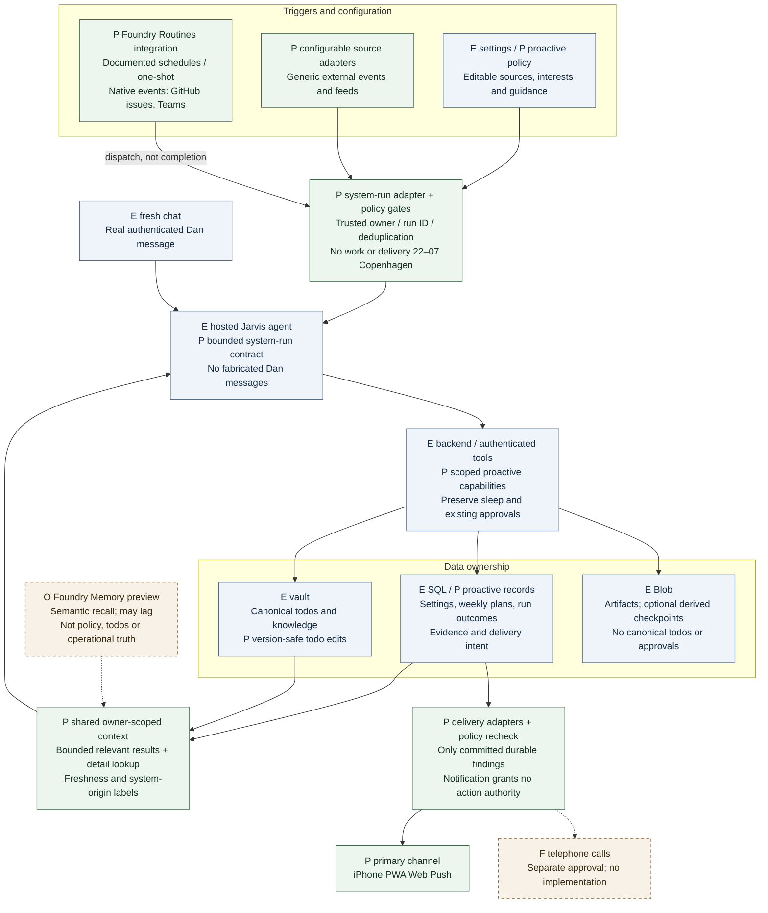
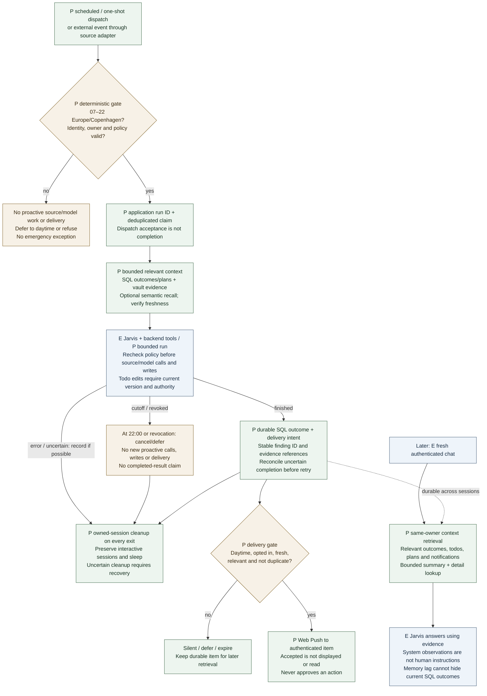

# Proactive assistance diagrams

Discussion proposal, 17 October 2026. No implementation or activation approved.
See [design](proactive-assistance.md) and [plan](../PLAN.md#proactive-assistance--proposed-scope-17-october-2026).

Labels carry status independently of color: **E** = existing repository component,
**P** = proposed application behavior/integration, **O** = optional evaluation,
**F** = future channel. Arrows describe proposed connections, not live verification.
Foundry Routines is a documented capability; Jarvis compatibility, identity and
completion handling remain unverified. Memory is preview, not canonical storage.
Reuse existing components; no cadence or new resource is selected.

## Architecture overview

[SVG preview](assets/proactive-architecture.svg). Mermaid below is editable source.

Foundry's hosted Invocations dispatch can carry JSON; the new adapter must
authenticate and validate it. Generic source events use adapters, not assumed
native Routines triggers. Public capability documentation is linked in the
[architecture recommendation](proactive-assistance.md#recommended-architecture-after-the-foundry-comparison).
Low-to-medium use, bounded lifetime and measured total cost guide evaluation.

## Run and fresh-chat flow

[SVG preview](assets/proactive-flow.svg). This activity diagram separates
dispatch acceptance from completed work and shows the later fresh-chat path.

The delivery branch requires the SQL commit; cleanup is required even on failure.
At the cutoff, only termination/recovery bookkeeping is permitted, not continued
proactive work. No cadence is selected. Tests must prove the full nighttime pause,
retry deduplication, owner isolation, fresh-chat recall and actual sleep/cleanup
cost. These diagrams do not establish deployed compatibility or billing behavior.

## Rendering

Keep SVG previews synchronized with the two Mermaid blocks. Render the first
block to `assets/proactive-architecture.svg` and the second to
`assets/proactive-flow.svg` using Mermaid CLI. No runtime dependency is required.
The checked previews use Mermaid CLI 11.17.0's Mermaid renderer, Arial 17px,
the base theme, `htmlLabels: false`, and flowchart settings `curve: linear`,
`nodeSpacing: 25`, `rankSpacing: 35`, on white. Chromium rendered the source in
memory because this environment blocks the CLI's `file://` page. Both SVGs were
visually inspected and their text bounds checked against the SVG view boxes.
