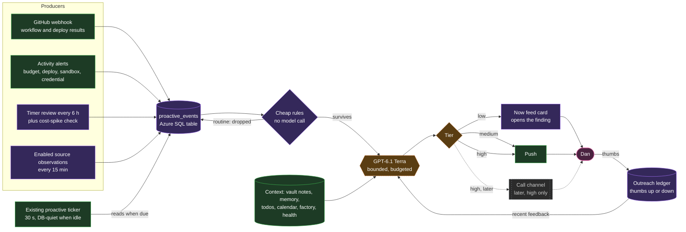

# Event-driven proactive Jarvis (P15-161, #1858)

Status: **implemented, off by default** (`JARVIS_PROACTIVE_EVENTS_ENABLED`, Bicep `proactiveEventsEnabled`). The 07:00 and 18:00 checks are unchanged and keep running either way. No phone call is built.

Owner direction, 15 November 2026: "for the model we should do gpt 6.1, that is very very cheap. so that should be very little. GO ahead and build this but without the calling to begin with." Tiers: "low, medium, and high is push and call".

## 1. The path in one picture

Green exists today, purple is new, orange is model judgement, grey is not built, pink is Dan.

## 2. Parts

| Part | Where (`apps/backend/src/`) | Notes |
| --- | --- | --- |
| Queue | `proactive/events/event-queue.ts`, `database/proactive-event-store.ts`, migrations `0080`/`0091` | One row per event. `source`, `kind` and `summary` are free text; there is no status enum. A row is waiting while `processed_at` is null and `not_before_at` has passed; a lease (`claimed_until`) and `retry_at` make claims safe across restarts; `outcome` is free text. The owner, stable `identity_key`, material hash and dedupe key distinguish a genuine source change from a replay or wording-only change. Processed rows are purged after 45 days. |
| Ticker | `proactive/scheduler.ts` (`onTick`) | The existing 30-second tick also asks the pipeline. The pipeline keeps the next due time in memory and reads SQL only when something is due, so serverless SQL can still pause. |
| Rules | `proactive/events/rules.ts` | Exact checks, no model: too many attempts, source switched off, stale (24 h; timer 1 h), routine success or in-flight results, calendar entries that are over or more than 14 days away, a per-source hourly cap. A timer review is also skipped when the vault, memory, todo, calendar and factory facts are unchanged since the last one. |
| Reasoner | `proactive/events/reasoner.ts`, `event-prompt.ts` | One tool-less JSON call per batch of up to 10 events to `gpt-6.1-terra` at low reasoning effort. At most 32 KB in and a 4 096-token completion. The answer is validated as a whole; a half-valid answer is retried, never partly delivered. |
| Tiers and channels | `proactive/events/channels.ts`, `pipeline.ts` | `low` is a Now feed card. `medium` and `high` are a push. Every outreach also becomes a finding on the Proactive page. At most 6 pushes a day; the surplus is downgraded to a card. |
| Feedback | `database/proactive-outreach-store.ts`, `proactive/routes.ts` | `POST /proactive/outreach/:id/feedback` with `{rating: "up" or "down", note?}`. The Proactive page's useful and wrong buttons rate the same outreach. The last 20 outreaches of 30 days, with ratings and notes, go into the next model call. |
| Budget | `core/usage-pricing.ts`, `proactive/budget.ts` | Terra is priced at USD 1 input and USD 5 output per million tokens. Every call is recorded in the shared `proactive_spend` ledger, and the hard monthly stop (default 100 DKK) is checked before each call. |

## 3. Event sources

| Source | How it reaches the queue | Limits |
| --- | --- | --- |
| Timer | A review at 00, 06, 12 and 18 UTC (clock-aligned dedupe key), plus a cost-spike check: today at least 15 DKK and at least 3 times the previous seven-day average | Uses `usageStore.list`; no new service. |
| GitHub | The existing signed webhook's `onMapping`: finished workflow runs and deployment results | Pull request, push and check events are not queued: failed workflows already cover broken builds, and stalled repositories are noticed by the timer review. |
| Cost and budget alerts | `AlertActivityStore.record` queues every new alert (budget 80 %, deployment failure, sandbox crash, credential expiry, task start failure) | Outreach cards are written through the same store and are skipped, so there is no loop. |
| Build and deploy results | The GitHub rows above and the deployment-failure alerts | |
| Enabled PI sources | When the PI brain is enabled, the existing 15-minute poller refreshes enabled sources independently of model work. Mail/calendar material changes still use their own events; other material observations become bounded source events only after the first baseline. The first poll never floods PI. | Gmail push needs Google Pub/Sub, a new cloud service, so it is not used. Calendar watch channels need a public receiver and renewal; not built. Polling is what is possible without a new service. |
| Situational follow-ups | A source-linked `followUps[].dueAt` and its state revision commit together with `pi_situation_outbox`; the event consumer reconciles that exact latest revision into this same queue with `not_before_at`. Material updates supersede an active identity, explicit policy/state invalidation marks it reopenable, and a returning valid version gets a new event ID. Delivered material stays deduped. | There is no separate follow-up scheduler, timer or brain. State and outbox never commit independently; queue application is idempotent and retryable from the durable revision. Old workers can settle only their retired ID, never a reopened generation. |
| Health and Watch | Health and nutrition facts join the model's context on each batch | Health values change all day, so they never queue events. A Watch-specific event is not built. |
| Banking | Out of scope (future Chrome extension) | |

## 4. Interrupt policy

- **low**: a card in the Now feed (an `alert`-group activity row) that opens the finding on the Proactive page, where the thumbs are.
- **medium** and **high**: a push through the existing sender, native iPhone first and Web Push as fallback. Tapping it opens chat with the finding as context (existing continuity). Quiet hours do not apply: the owner's phone is on Do Not Disturb at night. The 07:00 and 18:00 path and reminders keep their own quiet-hour rules.
- The model chooses the tier. Only the tier names, the daily push cap and the budget are exact.
- **Extension point for the call**: implement `OutreachChannel` (`proactive/events/types.ts`) with `tiers: ['high']` and add it to the channel list in `proactive/events/wiring.ts`. The policy, the ledger and the feedback need no change.
- The model can only write words. Nothing in this path can send mail, change a calendar or write a file. A draft or suggestion appears as text in the notification.

## 5. Cost

Computed from the code and its tests, not from live traffic (there is none yet):

| Figure | Value |
| --- | --- |
| Terra price | 6.5785 DKK input and 32.8925 DKK output per million tokens (USD 1 and USD 5 at 6.5785 DKK per USD) |
| Typical batch (6 000 in, 600 out) | about 0.06 DKK |
| Worst-case batch (the gate before each call) | about 0.38 DKK |
| Batches a day | at most 12, counting failed or invalid calls too (`proactive_event_batches`, written before each call); a timer review that changes nothing costs no model call |
| Typical ceiling | 12 x 0.06 = 0.7 DKK a day, about 21 DKK a month |
| Hard stop | The monthly limit in Proactive settings (default 100 DKK) is checked against the shared ledger before every call, by the old checks and the new path alike |

Before this change Terra was unlisted and was priced at the highest listed rate, which was the Luna rate, about five times too low. The meter under-counted Terra spend by that factor.

## 6. Turning it on

1. Apply migration `0080_proactive_events.sql` (the normal backend start applies it).
2. Set `proactiveEventsEnabled` to `true` in `infra/main.parameters.json` and Deploy. It needs `JARVIS_PROACTIVE_ENABLED`; pushes also need `JARVIS_PUSH_ENABLED` and `JARVIS_PROACTIVE_ALERTS_ENABLED`, both already on.
3. Watch `GET /proactive/outreach` and the `proactive.events` log lines for a few days before relying on it.

## 7. Not built, and open

- The phone call (VoIP). The channel interface is ready.
- Thumbs on the push itself (iOS notification actions, Web Push actions). The endpoint exists; the buttons need native work that cannot be built or verified on Linux.
- Pull request and stalled-repository events from GitHub beyond the timer review.
- A Now feed card shows only text; it links to the finding for the thumbs.
- Live proof: no production traffic, push delivery or real model call has been observed.
