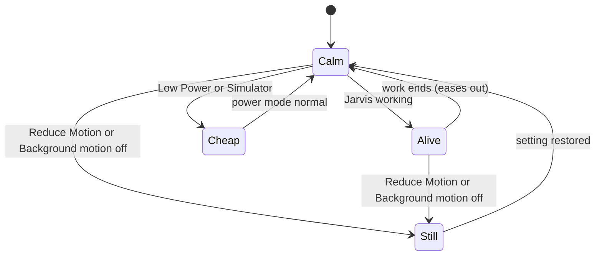

# 3D Notes graph: design brief

Issue #1924 (P15-186). Status: **design brief, written before the designs. The owner has since approved Graph 2, Folder clusters (`approved-folder-clusters.png`), and the first build is P15-190; this text describes the code as it was before that build.**

This brief tells the owner what the screen must contain so he can make the designs himself with an image model. It also records the rendering options and a recommendation, so the build can start the day the designs are approved. Facts about today's code are labelled **Today**. Targets and advice are labelled **Proposal**. Anything the owner must decide is in section 11.

## 1. What the owner asked for

Owner, 16 November 2026, TestFlight build 111:

> "The graph is very 2d, can we make it 3d so I can move it with 2 fingers to twist it and also there should be some life inside the graph, as it's knowledge that connected so it's move and animated but not to much."

Goal: the Graph tab of Notes becomes a 3D knowledge graph. Two fingers rotate and tilt it, a pinch zooms, a tap opens a node's note, and a gentle sense of life (slow drift, soft pulses along links, a subtle response to search and selection) keeps it calm, not busy.

Standing rules: no fallbacks, no new restrictions, the Apple Watch is parked, and the repository is public (neutral English).

## 2. What exists today

| Area | Today | Source |
| --- | --- | --- |
| Renderer | SwiftUI `Canvas` for edges and one `Button` per node over a `ZStack`. Pan with one finger, pinch zoom 0.65 to 4. No rotation. | `apps/ios/Jarvis/JarvisNotesGraphView.swift`, tokens `notesGraph*` in `JarvisDesignSystem.swift` |
| Node data | **Notes only.** `id`, `path`, `title`, `folder`, `directory`, `updatedAt`, `degree`, optional `openTaskCount`. | `KnowledgeGraphNode`, `JarvisNotesClient.swift` |
| Edge data | Two kinds: `link` (an explicit link in a note) and `similar` (with a `score`). Both are drawn the same today. | `KnowledgeGraphEdge` |
| Task data | A per-note open-task count, and a flag when the count is partial (`taskCountsPartial`). Tasks are lines inside notes; they are not graph nodes. | `KnowledgeGraph` |
| Folders | Not nodes. The first path segment of `folder` is the colour group. | `JarvisNotesFolderPalette` |
| Layout | Deterministic 2D: folders on a ring, notes on a golden-angle spiral per folder. Positions depend on a note's index inside its folder, so adding a note moves the later ones. | `JarvisNotesPresentation.graphPositions` |
| Colour | Work is the primary amber, Personal green, People `ambientWarm`, everything else `Color.secondary` (grey). In dark mode People and Work are the **same** value (`#ffb45c`). There is no General colour on iOS. | `JarvisNotesFolderPalette`, `JarvisDesignSystem.swift` |
| Selection | Tap selects, dims everything except the node and its neighbours, shows a label and a preview row with **Open note**. Labels show only for the selection and for search matches. | `JarvisNotesGraphView` |
| Search | Matches light up, the rest dims, matching rows are listed below. | `JarvisNotesArea+Pages.swift` |
| Header menu | Folder scope, List, Recenter. | `JarvisNotesArea+Chrome.swift` |
| List alternative | A sheet listing the graph's notes with their real paths, opened from the header menu. | `graphListSheet` |
| Neural background | Canvas plus `TimelineView`. Network drawn once, signals redrawn per frame. Three effect levels (`full`, `calm`, `still`). Cheap path (no additive glow, fewer frames) in the Simulator and Low Power Mode. | `Neural/JarvisNeuralBackgroundView.swift`, `JarvisNeuralMotion.swift`, style guide section 5 |
| Web graph | A three.js 3D star cloud shipped first, then flattened to 2D on 8 October 2026 because the owner found the spinning cloud "too much in his face". It now drifts gently and sends a few pulses along links, at 30 fps, one draw call for stars and one for lines. | `DESIGN.md` (Knowledge, P7-43), `apps/web/src/knowledge/knowledge-scene.ts` |

Two consequences for the designs:

1. The owner's "node types: notes, folders, tasks" does not match the data. Only notes are nodes today. Folders and tasks can be shown, but as **visual layers on notes**, unless the owner wants new data (section 3 and open question 3).
2. The web history is a warning. A 3D graph that rotates by itself was rejected once. The 3D here must move only when the owner moves it; the idle life must be small.

## 3. What the graph must show

### 3.1 Node types

| Type | Show as | Data | Notes |
| --- | --- | --- | --- |
| Note | A soft point of light. Size grows with `degree` (connections). Colour by scope. | Real nodes | Proposal: 3 to 8 pt at the focal distance; perspective scales it, with a floor of 2.5 pt so far nodes stay visible. |
| Task marker | A thin warm ring around a note that has open tasks. The label gives the count. A partial count shows an em dash instead of a number. | `openTaskCount`, `taskCountsPartial` | Uses the existing task-ring orange (`notesTaskRing`). The ring is a mark on the note, not a node. It must not rely on colour alone: ring shape plus the count in the label. |
| Folder | A faint volume (soft haze) behind the notes of one folder, with the folder name as a billboard label when zoomed out. | Derived from `folder` | Not a node and not a link. `HANDOFF.md` says "Do not infer new graph links", so folders never get hub nodes or connecting lines. |
| Task as its own node | **Not in the default design.** | Would need per-task nodes from the task parser | Open question 3. |

### 3.2 Link types

| Type | Show as | Pulses |
| --- | --- | --- |
| `link` (explicit) | Thin, clear line. | Yes, by default. |
| `similar` (with `score`) | Thinner and fainter; opacity follows `score`. | No, by default (open question 6). |
| Dimmed (outside the selection or search) | Same line at the existing dimmed level. | No. |

Both kinds stay real edges from the service. The designs must not draw any link that the data does not contain.

### 3.3 Scope colour

The owner asked for colour per scope: **Work, Personal, General**. Today's colours do not match (section 2), so the designs need an explicit set.

| Scope | Dark | Light | Source |
| --- | --- | --- | --- |
| Work | `#ffb45c` amber | `#9f5800` | Primary accent; web `--graph-work` |
| Personal | `#3ddc97` green | `#146d49` | Web `--graph-personal`; iOS `notesFolderPersonal` is the near twin `#3ddc84` |
| General | `#b69cff` violet | `#6f4fd6` | Web `--graph-general` only. iOS draws grey today. |
| People | `#4aa8ff` blue | `#1f6acc` | Web only. Not requested; open question 2. |
| Other or root | Neutral grey (`text-muted`) | Same role | |

Style guide hard rule 7 forbids "a new palette per screen" and purple glow. The violet already exists in the web graph tokens, so using it adds no new colour to the product, but the owner should confirm it for iOS. Colour never carries meaning alone: the legend chips (dot plus folder name) stay above the graph, and each node keeps its spoken folder.

Every node and line must reach 3:1 contrast against the page in both appearances (style guide hard rule 6). The page is the neural background (`#02070f` in dark).

### 3.4 Screen composition (kept, not redesigned)

Keep the approved Notes structure from `docs/ui/notes-subpages-2026-11-15/HANDOFF.md`:

```text
┌──────────────────────────────┐
│ Notes                    ⋯   │  page header + ellipsis menu (Folder scope, List, Recenter)
│ ● Work  ● Personal  ● General│  scope legend chips (scroll sideways if they do not fit)
│                              │
│        3D graph              │  fills the space; the neural background shows behind it
│                              │
│ ┌──────────────────────────┐ │
│ │ Selected note · folder   │ │  preview row, appears on selection; Open note
│ └──────────────────────────┘ │
│  [Notes|Tasks|Graph] 🔍  ＋  │  fixed dock; search and + stay
└──────────────────────────────┘
```

Rules from the handoff that stay: no Recent section, no permanent toolbar above the switch, the + from the graph never auto-links a new note, labels appear only for the selection and search matches (folder labels at zoom-out are a proposed addition, open question 7), and showing a label must not move its node or edge endpoints. Controls use the shared Jarvis components only.

## 4. Interactions

| Gesture | Result | Notes |
| --- | --- | --- |
| Two-finger drag | **Orbit:** left and right twist (yaw), up and down tilt (pitch). Ends with a short, damped inertia. | The owner's "twist". Pitch is limited to about ±80° so the graph cannot flip over. No roll by default (open question 5). |
| Pinch | Zoom toward the pinch centre. Range keeps today's 0.65× to 4×. | Perspective zoom (dolly), not only scaling, so depth keeps its meaning. |
| One-finger drag | Pan, as today. | Keeps current behaviour. No new restriction. |
| Tap on a node | Select. The node and its neighbours light, the rest dims, label and preview row appear. | Hit target is at least 44 pt (`controlMinimumHeight`). When several nodes overlap in projection, the nearest to the viewer wins. |
| Tap on empty space | Clear the selection. | |
| Tap the preview title or **Open note** | Open the reader. | As today. |
| Long press on a node | **Focus the neighbourhood:** the camera eases to the node and its direct neighbours, the rest fades. A light haptic confirms it. | Proposal. The owner named long press but not its result (open question 8). Opening the note stays on tap. |
| Search | Matches light with their labels, the rest dims, and the camera eases to frame the matches. Matching rows stay below as the accessible alternative. Clearing search restores the previous camera. | Same contract as today, plus the camera move. |
| Recenter (header menu) | Ease the camera to the default pose, fit the visible nodes, clear selection and search. | Today it resets the view; the 3D version also resets orientation. |
| List (header menu) | Opens the existing graph list sheet. | |
| Folder scope (header menu) | Filters nodes. Remaining nodes keep their 3D positions; the camera refits. | The layout is computed once for the full graph, so scoping never rearranges notes. |

### 4.1 Accessibility

- **VoiceOver and Switch Control:** a few hundred moving nodes are not a usable accessibility tree. The 3D view is **one** element, "Graph, N notes, 3D view", with custom actions Show as list, Recenter, Rotate left, Rotate right, Tilt up, Tilt down, Zoom in and Zoom out. The List sheet is the full accessible alternative: every note with its real path and Open note. Order in the list is folder, then title, never screen position.
- **Selection announcements:** selecting a node (from the canvas, a search row or the list) announces title, folder, connection count and open tasks.
- **Voice Control:** "Show list" and "Recenter" are named controls. Nodes are reachable through the list.
- **Hardware keyboard (iPad):** arrow keys orbit, plus and minus zoom, Return opens the selected note. Proposal.
- **Reduce Motion:** no inertia, no drift, no pulses. Direct manipulation still works because the user causes it. Programmatic camera moves (search, recenter, focus) cut or crossfade instead of flying.
- **Reduce Transparency:** the preview row uses the solid glass surface.
- **Dynamic Type:** labels and the preview row scale; the graph itself does not.
- **Screen edge:** the system back swipe keeps working; the graph does not claim the leading edge.

## 5. Motion language

The graph is a second view of the same living network as the neural background (style guide section 5). It uses the same vocabulary, the same effect levels and the same rules, so the two never disagree.

### 5.1 Layers of life (Proposal)

| Layer | What the owner sees | Size of the effect | Reuses |
| --- | --- | --- | --- |
| Structure | The layout, fixed and stable across launches. | None | |
| Drift | Each node floats on its own very small orbit. A soft swell passes through the cloud. | Orbit radius about 3% of the cloud's spread (the web's value), never a visible shape change. | Web graph tuning |
| Breath | Each node's brightness breathes slowly. | `calm` breathing 0.1 | `JarvisNeuralEffects.breathing` |
| Pulses | A pulse leaves one node, runs along a link and lights the next node, which keeps an afterglow. | At most 2 at once in calm, about one every 1.5 s. Trail about 0.28 route units. Afterglow 2.4 s. | Neural volley model |
| Response | Selection sends one pulse from the selected node out to each neighbour. Search matches glow and keep the afterglow. | Once per action, never looping | |
| Jarvis at work | While Jarvis is genuinely working, pulse rate rises and brightness lifts a little. | Capped at 4 pulses at once (the background's own cap is 9, too busy here) | `JarvisOrbActivity`, neural rates |

Whether the Notes page can read Jarvis's activity today is not verified; the build must check it. If it cannot, the Alive state is dropped rather than faked.

### 5.2 States (Proposal)



| State | Drift | Pulses | Glow passes | Frame rate (idle) | Frame rate (finger moving) |
| --- | --- | --- | --- | --- | --- |
| **Calm** (default) | Yes | 0 to 2 | Yes | 20 fps | Up to 60 fps |
| **Alive** | Yes | up to 4 | Yes | 30 fps | Up to 60 fps |
| **Cheap** (Low Power, Simulator) | Yes, slower | 0 to 1 | **No** | 10 fps | 30 fps |
| **Still** (Reduce Motion, or Settings > General > Background motion off) | No | None | Yes, drawn once | Redraw only when the camera changes | Follows the finger |

Rules (from the style guide and the neural background work):

- Motion has a job: feedback, state or continuity. No perpetual decoration beyond the small drift and breath.
- **No auto-rotation.** The owner rejected a self-spinning cloud once (section 2). The camera moves only because the owner, or a search, focus or recenter action, moves it. Open question 9 asks whether he wants a barely visible camera sway.
- Pulses never imply data that is not real. They run on real links only and mean only "alive". The rate rises only when Jarvis is actually working.
- Pause entirely when the app is inactive, the tab is not visible or the page is covered. Resume without a jump.
- Transitions survive interruption: a new gesture takes over a camera flight from its current position.
- Additive glow is the expensive part. It exists on the quality path only, as in the background.

## 6. Layout in 3D (Proposal)

The layout is a pure function in `JarvisCore`, like `JarvisNeuralScene`, so it can be golden-tested without a device.

1. Folder groups get a centre each on a sphere (a Fibonacci spiral), keeping today's "folders around a ring" idea in 3D.
2. Notes inside a folder are placed around that centre by a hash of the note's `id`, not by its index, so **adding or removing a note never moves the others**.
3. A short relaxation (fixed seed, fixed iteration count of at most 100) pulls linked notes closer and pushes overlapping notes apart. No physics runs while the owner looks at the graph.
4. The result is the same on every launch for the same vault, so the owner builds a spatial memory of where things are.

Cases the designs must cover: zero notes (existing empty state), one note, two notes, disconnected notes floating alone, a note with many connections (a hub), a folder with one note, and a scope that leaves only a few notes.

## 7. Performance budget (Proposal)

**Targets below are proposals, not measurements.** Today's vault has about 150 notes and is growing. The edge count is not recorded here; the first step of the spike is to read it from the live graph.

| Dimension | Target |
| --- | --- |
| Scale | Smooth at **500 notes and 1,500 edges**. Still correct at **1,000 notes**, where 30 fps while moving is acceptable. |
| Oldest device | iPhone 11 class (A13), the oldest hardware iOS 26 supports. |
| While moving | 60 fps. At most 5 dropped frames in a 10 s orbit and zoom test. |
| Idle | See section 5.2. The thermal state stays **nominal** after 5 minutes in Calm. |
| Layout | Under 100 ms for 500 notes, off the main actor. |
| First frame | Under 300 ms after the graph arrives, drawn from cached data first like the other Notes pages. |
| Memory | Under 30 MB added at 500 notes. |
| Energy | Calm graph, screen on, in the same energy class as the existing neural background, measured with the Instruments Energy Log. |
| Drawing cost | A frame costs dozens of batched draw operations, not hundreds. Lines and dots are merged by colour and opacity bucket, as the orb painter already does (6 colour × 12 opacity buckets). |

Ways to stay inside the budget (build decisions, not visible to the owner):

- Project and depth-sort once per frame in a flat array; no per-node views and no per-node animation objects.
- Skip the haze and the far, faint lines on the cheap path.
- Cull nodes outside the view and lines with both ends outside.
- Never run the timeline while paused, hidden or Still.

## 8. Rendering options

**Nothing in this section was measured on a device.** This brief was written on a Linux host without Xcode or a phone, so it relies on Apple's documentation and the repository's own experience. The decision therefore ends in a short measured spike (section 8.2) with pass and fail numbers.

### 8.1 Options compared

| | **A. Projected 3D in `Canvas`** | **B. Metal (`MTKView`)** | **C. RealityKit (`RealityView`)** | **D. SceneKit (`SCNView`)** | **E. SpriteKit pseudo-3D** |
| --- | --- | --- | --- | --- | --- |
| Idea | Camera, rotation and perspective maths in `JarvisCore`. SwiftUI `Canvas` draws the projected points and lines, as the neural background does. | One instanced draw for points and one for lines, in custom shaders. | Real 3D entities, an `Entity` per note and edge. | Real 3D nodes or custom geometry. | 2D sprites with `zPosition` and scale that fake depth. |
| True 3D and depth cues | Yes (own maths: perspective, fade) | Yes | Yes | Yes | No. Rotation is faked. |
| Fits the Jarvis look (thin additive lines on navy, no shaded surfaces) | Yes. Same painter style as the background. | Yes, best control of glow | Weak. Built for lit, shaded objects. Lines have no primitive and need mesh work. | Medium. Custom geometry works. | Medium |
| Clear background over the neural background | Yes (it is SwiftUI) | Yes (`isOpaque = false`) | Unverified for non-AR `RealityView` on iOS. Test in the spike. | Yes (`backgroundColor = .clear`) | Yes |
| Hundreds of nodes and edges | Likely. Batched paths keep draw calls low. Cost is CPU path building. Unmeasured. | Very likely. The GPU does the work. | Possible, but an entity per node and per edge is the heaviest model here. Unmeasured. | Possible. Unmeasured. | Possible. Unmeasured. |
| Gestures | Needs a UIKit two-finger pan recogniser, because SwiftUI's `DragGesture` is one-finger. Same for B, D and E. | Same | Built-in camera controls exist (`realityViewCameraControls`) but do not give the owner's gesture map or tap rules. | Built-in camera control is limited in the same way. | Own gestures |
| Hit-testing nodes | Own maths: nearest projected point within 44 pt | Own maths | Entity hit-test, but the 44 pt target and "nearest wins" need own code | Built-in | Built-in |
| Reduce Motion, Low Power, pause | Direct control through `TimelineView` (as today) | Direct (`preferredFramesPerSecond`, `isPaused`) | Less direct | Direct (`isPlaying`, `preferredFramesPerSecond`) | Direct |
| Accessibility | One element plus custom actions (section 4.1) | Same | Same | Same | Same |
| Testable without a device | **Yes.** The maths is pure, golden tests like the neural scene. | Maths yes, shaders no | Little | Little | Little |
| Platform risk | None. Same stack as today. | Low. Stable, but the most code to own. | Low. Apple's recommended path for new 3D. | **High.** Apple soft-deprecated SceneKit in 2025: "if you're planning a new app or a significant update, SceneKit is not recommended". | None, but a dead end for real 3D |
| Effort (relative) | Medium | Large | Large | Medium | Small, but it does not deliver the brief |

Sources:

- Apple, [Bring your SceneKit project to RealityKit](https://developer.apple.com/videos/play/wwdc2025/288/) (WWDC25): SceneKit is soft-deprecated across all platforms, existing apps keep working, new work is advised to use RealityKit.
- Apple, [Bringing your SceneKit projects to RealityKit](https://developer.apple.com/documentation/realitykit/bringing-your-scenekit-projects-to-realitykit).
- Apple, [`RealityViewCameraContent`](https://developer.apple.com/documentation/realitykit/realityviewcameracontent): on iOS it shows AR camera content by default, and a non-AR mode only when requested or when AR is unavailable.
- In this repository: `Neural/JarvisNeuralBackgroundView.swift` (Canvas plus `TimelineView` with a cheap path), the lattice painter's bucketed strokes (style guide 5.4), and the web graph (`knowledge-scene.ts`: one draw call for stars and one for lines at 30 fps).

### 8.2 Recommendation

**Start with A, projected 3D in `Canvas`, gated by a one-day measured spike. If it misses the budget, move to B (Metal). Ship one renderer, never both.**

Why A first:

1. It is the same stack, painter style, effect levels, cheap path and pause rules as the neural background, which already ships. The graph and the background will look and behave as one thing.
2. The maths (layout, camera, projection, depth fade, pulse routes) is pure `JarvisCore` code that can be golden-tested on any machine, which is how the neural scene is tested. The renderer then only affects the last step, and a move from A to B keeps the maths unchanged.
3. It needs no new framework and carries no deprecation risk.
4. A few hundred batched dots and lines is a small scene. The lattice painter already merges its strokes into a few dozen buckets for the same reason.

Why not the others:

- **SceneKit:** soft-deprecated for new work (Apple, above).
- **RealityKit:** Apple's direction for 3D, but this graph is thin glowing lines and points, the opposite of what a lit, shaded entity engine is for. An entity per node and per edge is the heaviest model here, and background transparency in non-AR iOS is unverified.
- **SpriteKit pseudo-3D:** it fakes depth, so the rotation the owner asked for would not be real. It also adds a second scene system.
- **Metal:** the strongest and the most code. It is the right next step only if A fails measurement.

**Spike (before any build).** On a real iPhone 11 class device and a current device, with a synthetic graph of 150, 500 and 1,000 notes and 3 edges per note, record: frame time while orbiting, dropped frames, CPU and GPU time, memory, energy, and thermal state after 5 minutes in Calm and in Alive. **Pass:** the section 7 targets at 500 notes. **Fail:** below 60 fps while moving at 500 notes, or a thermal state above nominal in Calm. A fail moves the work to B; the maths stays.

## 9. What the owner's designs should include

Make these boards, dark first and light second. Content is illustrative: use plausible note titles and counts, and mark them as sample data. Do not invent features, controls or metrics.

| Board | Shows |
| --- | --- |
| 1. Default pose | The calm graph at rest: scope colours, depth fade, task rings, folder haze, legend chips, dock. |
| 2. Mid-gesture | The graph tilted and twisted by two fingers, to show how depth, size and fade change. |
| 3. Selection | One node selected, its neighbours lit, one pulse leaving it, the preview row with Open note. |
| 4. Search | Several matches lit with labels, the rest dimmed, the matching rows below. |
| 5. Alive | The same graph while Jarvis works: slightly brighter, more pulses, still calm. |
| 6. Quiet states | Reduce Motion and Low Power: no glow, no drift. Also empty, loading and unavailable (with Retry). |
| 7. List alternative | The accessible list that VoiceOver users get from the header menu. |
| 8. Zoomed out and in | Folder names at zoom-out. A close-up with a few labelled nodes. |
| 9. Phone sizes | A small phone and a large phone, plus an iPad width if the owner wants one. |

Design contract for the image prompts:

- Dark navy page under the neural network, sparse cyan lines, amber and cyan as the only warm and cool lights.
- Thin lines, soft points, **no purple or neon glow**, no gradient text, no emoji, no second orb or background.
- Neutral dark smoked glass for any control; amber text for the primary action; no yellow or orange fills.
- Depth is shown by size and fade, not by blur or heavy shadows.
- One headline per block; no eyebrow above and no subtitle below the page title.

## 10. Out of scope

- Any implementation, until designs are approved.
- Backend or data changes. The graph keeps its current nodes and edges. New node kinds (tasks, or folders as nodes) would be a separate decision.
- Inferring links that the data does not have.
- The Apple Watch (parked).
- The web Knowledge page. It stays flat and calm as decided on 8 October.

## 11. Open questions for the owner

Each question has a recommended default. The build uses it if no answer comes.

1. **Scope colours.** Confirm Work amber, Personal green, General violet (the web graph colours). Today iOS draws General grey. *Default: use the web colours.*
2. **People.** In dark mode People and Work share one colour on iOS. Give People blue as on the web, or fold it into the neutral colour? *Default: blue.*
3. **Tasks as nodes.** Show tasks only as a ring on their note, or as small satellites around the note that owns them? Satellites need real per-task data and add many nodes. *Default: ring only.*
4. **Folders.** A soft haze behind each folder's notes, or nothing? *Default: haze.*
5. **Roll.** Allow the graph to roll sideways with a two-finger twist, or keep it upright and orbit only? *Default: upright, pitch limited to about ±80°.*
6. **Pulses on similar links.** Real links only, or also similar links? *Default: real links only.*
7. **Folder labels.** Show folder names at zoom-out, a new label rule? *Default: yes, at zoom-out only, billboarded.*
8. **Long press.** Focus the neighbourhood, or a menu with Open note and Show connections? *Default: focus.*
9. **Camera sway.** Absolutely still unless touched, or a barely visible sway? The web 3D cloud was rejected for spinning. *Default: still.*
10. **When Jarvis works.** Slightly more pulses, or no change from calm? *Default: slightly more, capped at 4.*
11. **First use.** A one-time hint ("Drag with two fingers to rotate"), or none? *Default: one hint, dismissed by the first gesture.*
12. **iPad.** The phone layout with a larger canvas, or a wider design? *Default: the same layout, larger canvas.*

## 12. After approval

1. The owner makes the designs and approves them, or asks for changes.
2. Spike: measure option A against section 7 on a device.
3. Build in the order the maths allows: layout, camera and projection (tested in `JarvisCore`), then the painter, gestures, accessibility actions, motion states, and device verification (VoiceOver, Reduce Motion, Reduce Transparency, Low Power, large text, small phone).

Visual approval does not prove performance or accessibility. Those are verified on a device after the build.
