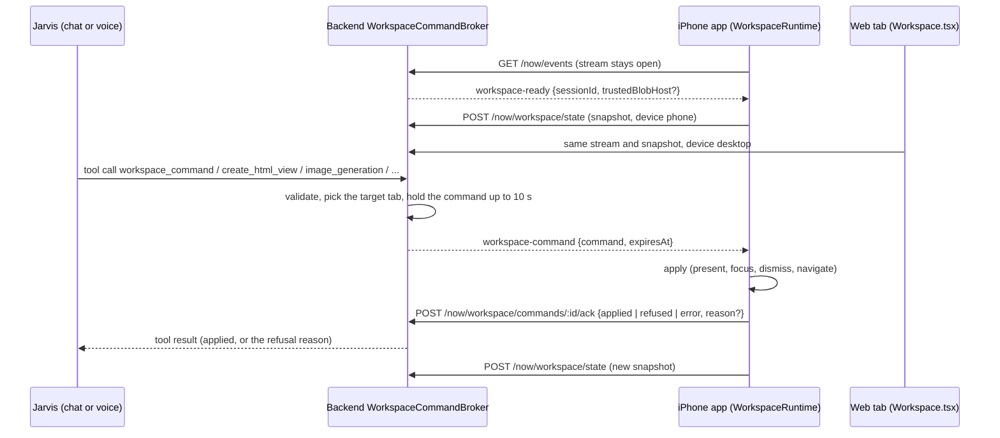

# Jarvis window as a pop-up sheet on iPhone: design brief

Refs #1925 (P15-187). Step one only: investigation and a brief for the owner to turn into designs. Nothing is
implemented, and nothing should be until the owner approves designs.

Evidence labels: **Confirmed** = read in code on `main` at the time of writing (file named). **Unverified** = a
plausible cause or behaviour that could not be run here (no Xcode, no device). The Apple Watch is parked and out of scope.

## 1. Findings in one minute

- A "window" is a workspace view that Jarvis asks the signed-in app to show. The backend sends it as a
  `workspace-command` server-sent event; the app applies it and acknowledges it. The tool Jarvis uses is
  `workspace_command`, and several other tools send the same command (images, HTML apps, research, weather, health,
  vault results).
- **The iPhone app is not ignoring windows.** It already receives these commands and presents one as a full-height sheet
  (`GeneratedWorkspaceSheet`, `ContentView.swift`). The premise in the issue ("likely ignores it") is only partly right.
- What the iPhone does *not* do is most of the command set. Of 21 operations, 8 are applied (`navigate`, `create`,
  `update`, `show`, `focus`, `restore`, `minimise`, `close`). The other 13 are refused with a reason such as "This
  workspace operation is not supported on iPhone". Two of the twelve view types (`knowledge-graph`, `code`) render as a
  "not available on iPhone" card.
- So "Jarvis tried to bring a window and I saw nothing" has several candidate causes (section 4). None can be proven
  from code alone; the brief therefore asks for designs that make every outcome visible, whatever the cause turns out to be.

## 2. What a window is today

### 2.1 Path of one window

### 2.2 Events that exist

Source: `packages/contracts/src/index.d.ts` (`NowSseEvent`), `apps/backend/src/core/now.ts`,
`apps/backend/src/core/workspace-commands.ts`. All **Confirmed**.

| Direction | Name | Payload |
| --- | --- | --- |
| Server to app | `workspace-ready` | `{ sessionId, trustedBlobHost? }`. Sent once per stream; the session id is required for snapshot and acknowledgement. |
| Server to app | `workspace-command` | `{ command, expiresAt }`. `expiresAt` is ten seconds after delivery. |
| Server to app | `workspace-cancel` | `{ commandId }`. Sent when Jarvis gives up on a pending command. The iPhone ignores it. |
| App to server | `POST /now/workspace/state` | Snapshot: `windows[]` (`viewId`, `title`, optional `state`, `placement`, `region`, `pinned`, `front`, `content` up to 8 KiB, `selection` up to 2 KiB), `contextPanelOpen`, `device { kind: desktop, phone or tablet; label }`, optional `frame`, `view`. |
| App to server | `POST /now/workspace/commands/:id/ack` | `{ sessionId, applied, outcome: refused or error, reason (max 300 characters) }`. |

Delivery rules (**Confirmed**, `WorkspaceCommandBroker`):

- One command goes to the target tab: `active` (default) is the tab whose snapshot arrived **most recently**, not the
  tab used most recently. `desktop`, `phone` and `all` are also accepted. With no connected tab the tool is refused.
- A command not acknowledged within 10 seconds fails with "may already have been applied". At most 8 are pending.
- There is **no replay**: a command sent while the phone is disconnected (for example the app is in the background) is
  not delivered later. Architecture notes already call post-reconnect replay "unverified"; the code has none.
- The acknowledgement says "applied" when the app has accepted the command, not when the owner has seen the view.

### 2.3 Operations (`WorkspaceCommand`) and what the iPhone does with each

| Operation | Purpose | iPhone today |
| --- | --- | --- |
| `create`, `update` `{ viewId, view }` | Show or refresh a window | Applied: stores the view and presents the sheet |
| `show`, `focus`, `restore` `{ viewId }` | Bring a known window forward | Applied if the id is known to this app session; else refused ("view not available on iPhone") |
| `close`, `minimise` `{ viewId }` | Remove or hide | Applied if known; `close` forgets the view |
| `navigate` `{ page, section?, taskId?, issueNumber? }` | Switch page | Applied for home, factory, settings, usage, notes, workspaces, status, health; `knowledge` is refused |
| `move`, `resize`, `place`, `arrange`, `layout` | Geometry | Refused (no geometry on a phone) |
| `minimise-all`, `restore-all`, `close-all` | Bulk | Refused |
| `pin`, `unpin` | Keep a window across reloads | Refused |
| `context-panel` `open`, `close`, `toggle` | Side panel, optionally with a view | Refused |
| `conversation` `show`, `hide` | Transcript | Refused |
| `session` `language`, `voice` (`end`), `camera` | Session control | Refused |

Source: `WorkspaceCommandHandler.swift`, `WorkspaceRuntime.swift` (**Confirmed**). The refusal reason is passed back to
Jarvis, who may or may not tell the owner.

### 2.4 Content a window can hold (`GeneratedView`)

Every view has `version`, `title`, `source { id, status, updatedAt?, reason?, page? }` and optional `actions[]`.
Twelve renderers exist (**Confirmed**, `generatedViewRenderers`).

| Renderer | Typical use | iPhone today |
| --- | --- | --- |
| `text` (plain or Markdown) | Summaries, dates | Native |
| `list` (items with title, description, details, optional open-route or open-link action) | Mail, calendar, search results | Native |
| `table`, `detail` (label/value pairs), `timeline`, `status` (ok, warning, error, unknown), `task-card` | Data answers, progress, a task | Native |
| `chart` (line, bar, area; up to 5 series, 1,000 points) | Trends | Native (Swift Charts) |
| `image` (HTTPS URLs with alt text) | Generated or attached images; the public-repository image check | Native |
| `html-app` (`artifactId`, up to 512 KiB, fetched separately) | Richer reports and mini apps | Native in an isolated web view; no bridge, so `window.jarvis` actions (open link, ask, pin, resize) do not work |
| `knowledge-graph` | Vault search result | Card saying it is not available on iPhone, with a link to the web app |
| `code` | Repository file or search result | Same card |
| unknown or newer version | Forward compatibility | Same card |

Actions inside a view (**Confirmed**): `open-route`, `open-link`, `call-tool`, and window actions (`focus`, `minimise`,
`restore`, `close`, `move`, `resize`). On iPhone only these work: open Usage or Settings, open an HTTPS link, and
focus, restore, minimise or close a known window. `call-tool` shows "Tool actions are not available on iPhone".

### 2.5 Who sends windows

| Sender | What appears | Notes |
| --- | --- | --- |
| `workspace_command` (Jarvis, model-driven) | Any operation above | Jarvis picks the viewId and relies on the refusal text |
| `create_html_view`, `update_html_view` | `html-app` | |
| `image_generation` | `image` | |
| `health_show` | `table`, `chart` or `detail` | Refreshes an open view and brings it forward |
| Research and weather jobs | `status` progress view, repeatedly updated, then `html-app` | Progress `update` commands keep arriving for minutes |
| Browser agent | `status` view with action, target and result | Updated per step |
| Vault search and Workspaces items | `knowledge-graph`, saved reports, images, apps | `create` or `update`, then `focus` |
| Automatic "show work" in **voice** | Vault (`knowledge-graph`), repository (`code`), mail and calendar (`list` or `text`), task (`navigate` to the board) | Typed chat opens nothing on its own; voice opens it automatically. Skipped when away mode is "on the move" or the owner switched Settings, Presentation, "show work" off. |
| Public-repository image check | `image` titled "Public repository: confirm this image", no actions | The confirmation itself is a separate chat approval |

Approvals are **not** windows today. They arrive through `pendingConfirmationsChanged` and use the buttons-only row
above the Now bar, with the system large detent for calendar review sheets (`DESIGN.md`).

## 3. What the iPhone does today

- **Single slot.** `WorkspaceRuntime.presentedView` holds one view. A new `create` or `update` replaces whatever is
  showing. There is no list, stack or count of open windows. Closed or dismissed views remain in a per-session
  dictionary so Jarvis can `show` them again; the dictionary is cleared on sign-out or session change.
- **One presentation.** A SwiftUI sheet on the app root, `.large` detent only, drag indicator visible, a close button
  at the top trailing edge, inline navigation title, vertical scroll, ambient background. Dismissing by swipe or button
  clears the slot and re-sends the snapshot.
- **Updates re-present.** An `update` for a view the owner already dismissed sets the slot again, so the sheet comes
  back. Research and browser progress views update repeatedly (**Confirmed** by reading `apply`; not run).
- **Snapshot.** The phone reports at most the one presented window, with title only: no `front`, `content`, `selection`
  or minimised state. `read_window` therefore falls back to the last view the backend sent.
- **Feedback.** The backend hears applied, refused or failed, with a short reason. Nothing is shown to the owner when
  a command is refused, and no accessibility announcement is posted when the sheet appears (**Confirmed**: none in
  `GeneratedWorkspaceView.swift` or `WorkspaceRuntime.swift`).
- **Workspaces page.** It lists saved reports, apps, images and graphs and opens one by asking the backend to send it,
  which targets the active tab, not necessarily the phone (architecture note).
- Plan row P15-45 notes that iOS compilation and simulator evidence for this sheet were pending Mac CI. Treat
  on-device behaviour as **Unverified**.

## 4. Why the owner may have seen nothing (candidate causes)

Ranked by how directly the code supports them. The design must cover all of them.

1. **Unsupported operation (Confirmed in code).** If Jarvis used `conversation`, `session` (camera or voice end),
   `place`, `arrange`, a bulk operation, `pin` or `context-panel`, the phone refused it. Jarvis is told; the owner is not.
2. **Unknown window (Confirmed).** `show` or `focus` for a window created before this app session (earlier session,
   web tab, after relaunch) is refused as "not available on iPhone".
3. **Wrong device (Confirmed).** "Active" is the most recent snapshot. A web tab that reported after the phone receives
   the command and the phone shows nothing, while Jarvis hears "applied".
4. **Phone not connected (Confirmed).** The stream exists only while the app runs. A command sent while the app is
   backgrounded or reconnecting is lost (no replay). Tools that check connection first refuse with "Open the
   signed-in conversation workspace".
5. **Another sheet already showing (Unverified).** The app uses sheets in chat (activity), voice (camera), Notes, Tasks
   and Health. SwiftUI does not present a second sheet while one is up, yet the command was already acknowledged as applied.
6. **Placeholder content (Confirmed).** A vault or code window opens as a "not available on iPhone" card. That is
   visible, but easily read as nothing useful.
7. **Voice screen (Unverified).** A sheet over the voice screen may not be noticed while the owner is looking at the
   orb or listening.

## 5. What the web does today

Source: `apps/web/src/Workspace.tsx`, `window-layout.ts`, `window-fly-away.ts`, `App.tsx`, `DESIGN.md` ("Phones").
**Confirmed** unless stated.

- **Desktop:** floating glass windows on a canvas. Drag, resize, maximise, minimise to a tab in the tab bar, close
  (the window flies off the top right corner; a fade with reduced motion). Jarvis names intent (place left, side by
  side, grid, stack, tidy up) and `window-layout.ts` computes the geometry. A pinned window survives reloads.
- **Phone web:** one window is in front and the others are tabs. Jarvis-opened windows slide up as full-width sheets
  and the open-windows count in the top bar lists them (confirmed by the owner, `docs/decisions.md`, 8 October).
- **Content:** all twelve renderers, including an interactive knowledge graph and a code view with highlighted lines.
  HTML apps run in a sandboxed frame, use `window.jarvis` (`openUrl`, `ask`, `pin`, `unpin`, `resize`) and receive host
  theme tokens.
- **Feedback:** live-region announcements ("<title> foreground", "<n> windows minimised"). A window being refreshed
  by Jarvis shows an "updating" treatment. Failures are explained in the window or by Jarvis.
- **Relation to chat:** the transcript is itself a docked window; typed chat opens nothing by itself, voice opens work
  windows automatically.

## 6. Design brief

### 6.1 Goal and principles

Whatever Jarvis shows the owner appears on the iPhone as a designed sheet, never silently. If it cannot, the owner
sees why in the app, not only in Jarvis's speech. Principles, from `docs/ui/style-guide.md`:

- Dark, calm, quiet. Neutral smoked-glass controls; primary label in amber text; no filled orange. The orb stays the
  identity: the sheet must not draw its own orb or background (hard rule 8). Use the shared controls
  (`JarvisSheetCloseButton`, `JarvisLabelledButton`, `JarvisSheetConfirmButton`) and `jarvisGlassSurface`.
- One headline per block; no eyebrow or subtitle. The window title is the one headline.
- Text sits on translucent surface, never on raw blur. Honour Reduce Transparency and Reduce Motion.
- Honest states: loading, partial, stale, failed and refused each look different, and a failure never looks like success.
- No fallbacks that pretend: a view type that is not designed yet is shown as what it is, with the real reason, not
  as a different view. No new restrictions on what Jarvis may show; the designs decide how each kind looks.

### 6.2 Kinds of content to design

Boards needed for each, in dark and light, with long text and the largest Dynamic Type size.

1. **Reading content:** `text`, `detail`, `list`, `timeline`, `task-card`. Mostly scrolling text with row actions.
2. **Data:** `table` (wide content, horizontal scroll), `chart` (interaction, axis units, legend, one series versus five).
3. **Media:** `image` (single and several, zoom, share, save), including the public-repository image check, which
   pairs a window with a chat approval.
4. **Rich report:** `html-app` (loading, failure, no network, sources; no bridge actions today).
5. **Progress:** `status` and "updating" for research, browser agent and weather runs. A window that stays alive and
   changes for minutes needs a quiet in-place update and a final state ("Done", "Failed, retry").
6. **Not yet native:** `knowledge-graph` and `code`. Decide: native designs, or one honest "continue on the web" card
   that is styled as a handoff and not as an error.
7. **Forms and approvals** (named in the issue). The contract has no form renderer and approvals are not windows. See
   questions 1 and 2; the brief does not assume a decision.
8. **Camera or screen view** (named in the issue). On the web the camera preview is a window and `session camera` is a
   command the phone refuses. See question 3.

### 6.3 How it appears and dismisses

Direction to design (a proposal, not decided):

- **Appears** as a bottom sheet over the current screen, with a short cue (a haptic and a one-line caption naming the
  window) so a window opening during voice, or while the owner is reading elsewhere, is noticed.
- **Detents.** Medium for glanceable content (a status, a short list, one value), large for reading and data, full
  height for an image or HTML app. Jarvis does not choose geometry; the content kind and size do. The drag indicator
  stays visible.
- **Dismiss.** Swipe down, the close button, or "close" by voice. Dismissing does not destroy: the window stays
  reachable (6.5). With Reduce Motion the sheet crossfades instead of sliding.
- **Interruptions.** A window opening must not stop a voice turn or hide the voice controls. While voice is active,
  the minimised voice bar and the end control stay reachable; decide whether Jarvis keeps speaking while the sheet
  appears (question 4).
- **Updates.** An update to a window the owner dismissed must not re-open the sheet over what they are doing. Show an
  unobtrusive "Updated" cue on the window's list entry instead (question 5).
- **Conflicts.** If another sheet is already open (Notes editor, camera, activity), define what happens: queue,
  replace, or a cue on the existing sheet. Never acknowledge "applied" without the view being reachable.
- **Stale and disconnected.** Open windows keep their last content, labelled with the time of the last update. When the
  app returns to the foreground, the owner sees what Jarvis tried to show while it was away (needs replay or a
  "missed" list, section 8).

### 6.4 Actions inside a window

- Usable today: open a link, open Usage or Settings, focus, restore, minimise, close. Design these as sheet-level
  actions (close, share, open in browser) and row-level actions (a list row that opens its link or route).
- Not usable today: tool actions and HTML `window.jarvis` actions (`ask`, `pin`). For each, the design decides whether
  it exists on iPhone. A disabled control needs a visible reason (hard rule 5); a control that does nothing is not allowed.
- Destructive or sending actions follow the existing approval pattern: Decline first (stone), Approve last (amber
  text), 44 pt targets.
- "Ask Jarvis about this window" is the natural iPhone counterpart of the web's `ask`: it would start voice or fill
  the composer with the window as context. Feasibility is unverified; see question 6.

### 6.5 Several windows

The phone holds one window today. Design one of: (a) one sheet that replaces the previous, with a recent-windows
list; (b) a list sheet reached from a small count control (the web phone pattern); (c) a stack. The list shows title,
kind icon, state (running, updated, failed) and age. Closing from the list removes the window; swiping a sheet away
keeps it. Choice: question 7.

### 6.6 Relationship to chat and voice

- **Voice first.** On a phone Jarvis is mostly spoken. A window is the visible part of an answer: Jarvis says what is
  on screen and the sheet carries the detail. The voice caption stays visible while the sheet is open.
- **Chat.** Typed chat does not open windows by itself (existing policy). A window Jarvis opens leaves one tidy row in
  the transcript (title, kind, time) that reopens it, so a missed window is never lost. Today the transcript keeps a
  tool status row but no durable link to the window.
- **Approvals** stay in the Now bar. A window can sit next to one (the image check), but the decision stays in the
  approval row.
- **Refusals.** When the phone cannot do what Jarvis asked, Jarvis says so and the app shows a brief plain notice (for
  example "Jarvis tried to arrange windows; not available on iPhone"). The wording names the limit of the phone.

### 6.7 Accessibility

- Opening a window is announced (title and kind) and focus moves to the sheet title; focus returns to the previous
  control on dismiss. Neither happens today.
- Every control has a name; targets are at least 44 pt. Charts and graphs need a text alternative or table form;
  `image` uses the supplied alt text.
- Dynamic Type up to the largest accessibility sizes without clipped titles; wide tables scroll horizontally in a
  labelled region.
- Contrast 4.5:1 for text and 3:1 for meaningful marks; state never by colour alone (icon plus label).
- Reduce Motion: no slide; Reduce Transparency: the solid glass fallback.
- Voice Control and Switch Control can dismiss and reopen the sheet without a drag gesture.

### 6.8 States each board must show

Loading (artifact fetch, progress), content, partial (`source.status = partial` with its reason), unavailable
(`source.status = unavailable`), error with Retry where retry is possible, stale, offline, refused on iPhone, and
updating in place.

## 7. Open questions for the owner

1. **Forms and approvals.** Should a window ever collect input (a form) or hold an approval, or do these stay in chat
   and the Now bar? The contract has no form view today.
2. **Image check.** Should the public-repository image confirmation become one sheet with the image and the decision together?
3. **Camera and screen.** Should "show me the camera" be a window on iPhone, or stay a voice-screen feature?
4. **During voice.** When a window opens while Jarvis speaks: keep talking, pause, or wait for the end of the
   sentence? Should the sheet open at once, or after a "Show" cue the owner taps?
5. **Updates after dismissal.** Re-open, cue only, or never re-open unless asked?
6. **Ask about this.** Should every window have an "Ask Jarvis" action, and does it start voice or fill the composer?
7. **Several windows.** Replace, list from a count control, or stack?
8. **Knowledge graph and code.** Native designs, or a deliberate "continue on the web" card?
9. **Automatic opening in voice.** Today vault, repository, mail, calendar and task lookups open a window by
   themselves. Keep, trim, or ask first?
10. **Persistence.** Should a window survive an app relaunch? The web can pin; the phone refuses `pin` today.
11. **Missed windows.** If the app was in the background when Jarvis tried to open something, show it on return?
12. **Devices.** With a phone and a web tab both open, where should a window go: the device in use, always the
    phone, or both?

## 8. What the designs will touch (not decided, not part of this step)

Listed so the owner can see the cost of each choice. No implementation is proposed here.

- Presenting without a duplicate sheet and acknowledging only when visible, so the phone's "applied" is honest.
- Routing: "active" means last reported, not last used. A foreground signal from the app would fix the device choice.
- Replay or a missed-windows list after reconnect.
- A durable chat row linking to a window, and a window list for the phone.
- Native renderers for `knowledge-graph` and `code`, and any contract addition for forms.
- Accessibility announcements, detents per kind, and a notice for unsupported commands.
- Reporting `front`, `content` and `selection` in the phone snapshot so `read_window` reads what is on screen.

## 9. Deliverables for the design pass

1. Sheet anatomy at medium, large and full height (dark and light).
2. One board per kind in 6.2, including loading, partial and error.
3. A window opening during voice, and during another sheet.
4. The windows list and the window row in chat.
5. The refused-on-iPhone notice and the stale or disconnected state.
6. VoiceOver reading order, and the largest Dynamic Type size.

## 10. Sources

`apps/ios/Jarvis/ContentView.swift`, `WorkspaceRuntime.swift`, `GeneratedWorkspaceView.swift`, `GeneratedHTMLAppView.swift`,
`WorkspacesView.swift`; `apps/ios/Packages/JarvisCore/Sources/JarvisCore/Workspace/` and `GeneratedViews/`;
`apps/backend/src/core/workspace-commands.ts`, `now.ts`, `work-presentation.ts`, `read-window.ts`, `html-view.ts`,
`image-generation.ts`, `research.ts`, `weather.ts`, `workspaces.ts`, `health/tools/show.ts`;
`packages/contracts/src/index.d.ts`; `apps/web/src/Workspace.tsx`, `window-layout.ts`, `window-fly-away.ts`,
`html-app-document.ts`; `DESIGN.md` ("Phones"); `docs/decisions.md` (8 October and 1 November 2026 entries);
`docs/architecture.md` (generated views on iOS).
