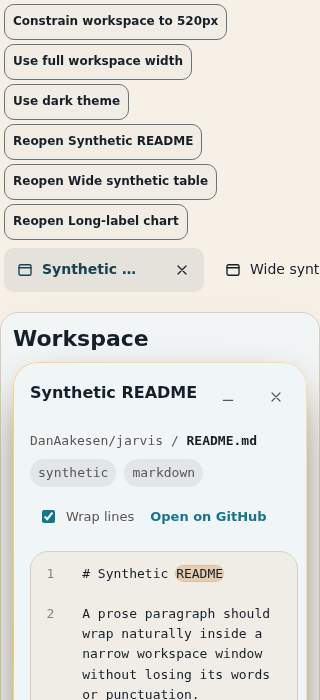
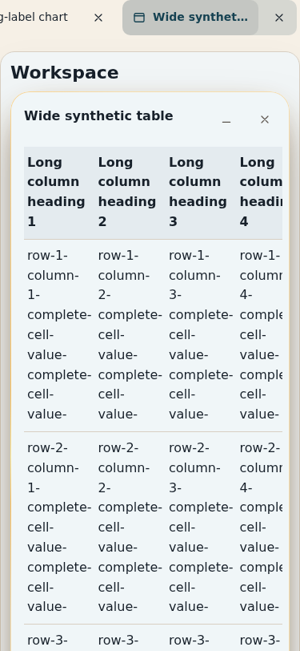
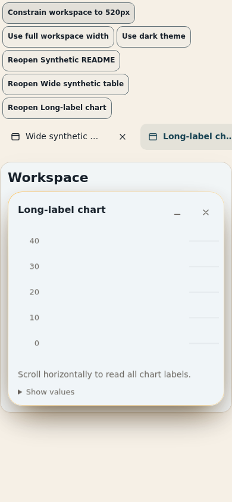
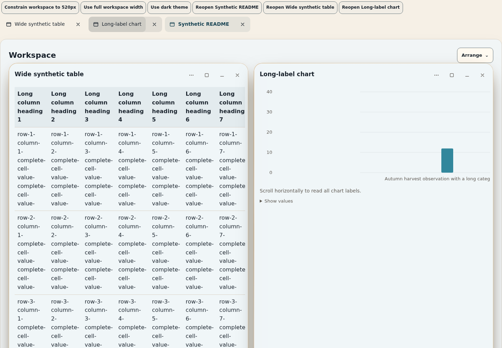
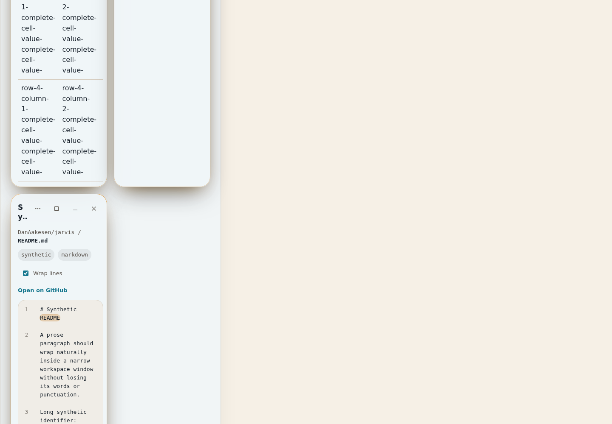

# Workspace content browser evidence

Synthetic fixture only; no real repository data, signed-in account, or service is used. The saved captures show the actual `Workspace`, `CodeView`, table, and chart components with the repository stylesheet.

| Capture | Chromium CSS viewport | State |
| --- | ---: | --- |
| [Phone code](workspace-320-code.png) | 320 × 700 | Wrapped README and highlighted/search-marked text |
| [Phone table](workspace-375-table.png) | 375 × 812 | Wide table in its local scroll container |
| [Phone chart](workspace-390-chart.png) | 390 × 844 | Full long labels in the chart's local scroll container |
| [Desktop](workspace-1440-desktop.png) | 1440 × 1000 | Workspace at full width |
| [Narrow desktop window](workspace-520-narrow-desktop.png) | 1440 × 1000 | Workspace container constrained to 520 CSS px |











## Reproduce the checks

From the repository root with Node 22 and Chromium available at `/usr/bin/chromium`:

```sh
mkdir -p /tmp/jarvis-workspace-browser
npm install --prefix /tmp/jarvis-workspace-browser --no-save --package-lock=false playwright-core@1.64.1
PLAYWRIGHT_CORE_MODULE=/tmp/jarvis-workspace-browser/node_modules/playwright-core/index.mjs \
  node scripts/check-workspace-content-browser.mjs
```

The script starts the existing web Vite configuration, uses only synthetic data in `apps/web/browser-tests/workspace-content.fixture.tsx`, asserts no document/body horizontal overflow, and rewrites the screenshots above. It exercises 320 × 700, 375 × 812, 390 × 844, 844 × 390 touch landscape, 160 × 350 CSS px at DPR 2, 1440 × 1000 desktop, a 520px allocated Workspace at desktop width, and resizing the open Workspace through 1024 × 900 and back. It checks line wrapping and original-line scrolling, exact selected-code clipboard text, line highlights/search marks, all table/chart values, keyboard focus and local horizontal scrolling, foreground switching, close/reopen, and light/dark mode.

## Limits

Chromium emulation is not physical iPhone acceptance or iOS Safari. The 160 CSS px/DPR 2 case is a narrow high-density viewport, **not actual 200% browser zoom**. The screenshot set is light theme; dark theme was exercised by the script without a saved capture. This browser fixture focuses on code, tables, and charts; list/detail/timeline/image and sandbox/CSP/bridge behavior are covered by component/contract tests, not these browser captures. Voice/chat transitions and live services were not exercised. Owner device acceptance remains outstanding.
