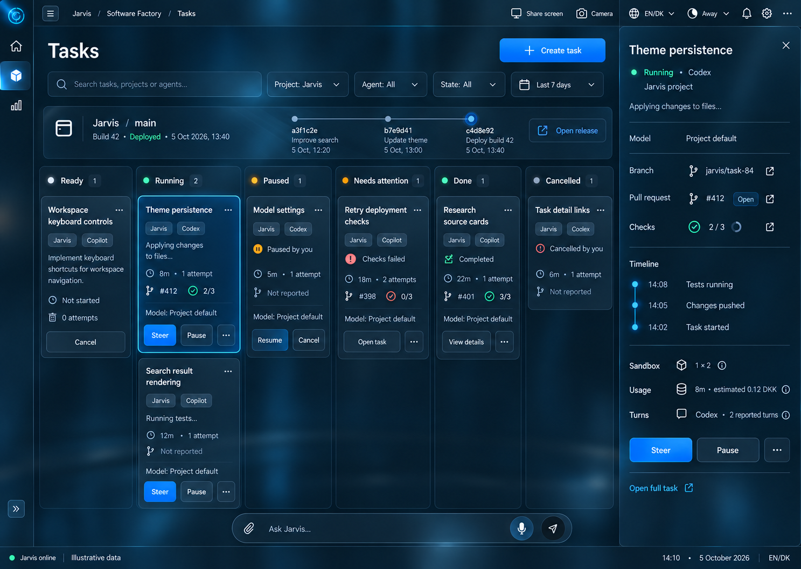

# Approved Software Factory layout — 5 October 2026

Implementation: [issue #369](https://github.com/DanAakesen/jarvis/issues/369), P8-34. Status: implemented offline; live integration acceptance remains unverified. The mockup remains a visual reference and its values are not production data.

**Task:** Implement the approved Software Factory task-board layout, with a project release bar and a contextual task-details pane.

Dan approved the combined concept: image 2 (Task Lens) as the base, the release bar from image 3, and the task details panel on the right. This issue implements that design; it does not rebuild the already implemented task lifecycle or release engine.

### Approved visual reference

[Open the mockup](task-lens-release-bar.png)

The mockup is generated and uses illustrative data. Implement actual controls and source data; do not copy example task titles, PR numbers, commit hashes, prices, timestamps or the fixture footer into production.

### Scope

- Keep the selected dark smoky-glass treatment, narrow left area rail, expandable area navigation, thin shared bars, workspace tabs and Settings at the top right. Tasks, Projects, Releases and Usage remain reachable. Adapt existing tokens for light appearance. The 3D chamber and large orb belong to Jarvis only.
- On `/factory/kanban` (`/factory/tasks` redirects), P10-07 supersedes the original task-state columns with Backlog, Needs Dan, Ready, In progress, In review and Done from `GET /factory/board?project=<id>`. Keep task states, including pending pause, visible on supplied overlays and task details. Preserve create-task, search, project/agent/task-state/update-period filters, task controls, live updates and bounded display. The mockup's old column labels are illustrative, not current requirements.
- Keep the compact release bar beneath filters and above the board: selected project/repository, default branch, latest build/deployment status, short real commit timeline and Open release. Reuse the authenticated release API and full Releases page. Select the first returned active project initially; there is no unsupported All-projects board. Distinguish no releases, unavailable/stale data and failed deployment; selecting a new project must never leave the previous project's board or graph under the new label.
- Selecting a task opens the closable right details pane while preserving filters, task selection and board scroll. Show title, request, project, agent/model, observed state/activity, branch/PR/checks, timeline preview, sandbox/heartbeat/disk and usage as available. Reuse existing detail/timeline/session/usage contracts and Open full task for the complete history. Guard against stale responses during rapid selection and update from real committed events.
- Reuse the contextual panel controller so Jarvis and Dan can open, close and change relevant context. Preserve keyboard focus and existing workspace/tab lifecycle. Connect the shared Ask Jarvis input shown in the mockup to existing conversation/send/explicit voice-start behavior; do not ship a decorative input or start the microphone automatically.
- Keep state-valid controls: Running supports Steer/Pause/Cancel; Paused supports Resume/Cancel; Ready supports Cancel. Show Continue only when an actionable task's completed-turn session expired; show Recover only for an actual active-turn sandbox crash. Ordinary failed checks use Open task and the existing allowed controls; Done does not show Continue. Pending actions and refusals/errors remain visible and cannot duplicate submissions.
- Show Not reported for missing provider data. Label sandbox cost as an estimate; provider-reported Codex/Copilot turns/token/premium usage remain separate, without invented subscription DKK prices. Use written labels with colors, a full-outline/surface selection treatment and accessible focus.
- Issue links and PR/check facts work without a Factory task; never manufacture an overlay to reuse task helpers. Board snapshot time and the 14-day closed-issue scope are explicit. Local filtering precedes the 100-card cap per column, with counts and a truncation explanation. The existing Now stream publishes validated project-scoped board invalidations and connection state; reconnecting refreshes the snapshot. Quiet refreshes retain scroll and selection. If a selected card moves, its pane remains open; keyboard close resolves the new issue title control, or Create project when the issue is hidden.
- Issue-number navigation resolves the selected project's complete board before acknowledging success. Clear other local filters, apply an exact `#number` search, expand the target column and reuse the existing glow/scroll behavior. Task-free issues focus their real title link; linked tasks open the existing task window. Missing, loading, unavailable, expired or cancelled targets refuse with a reason. Preserve Notes drafts and task-ID anchors; keep the shell's broker stream connected when navigating from Settings.
- Report actual visible card focus through the existing workspace `issueNumber` selector; other focus, card removal/collapse or leaving Factory clears it. Discard commands received by a disconnected connection rather than replaying or acknowledging them in its replacement session.

### Released navigation acceptance (13 October 2026)

#810 merged at `b4915164`; Deploy 38479582927 passed Web/smoke. An
authenticated ordinary chat request from Settings navigated to the real #792
card in Ready, with an applied HTTP 204 ack, HTTP 204 Factory issue selector
and one unchanged workspace stream. Collapse and route clearing were also
accepted. Pure focus-away-only clearing remains fixture-only because the
background production canvas does not emit native focus events. The complete
board and visible #790/#793 Done and #792 Ready match Project 2 readback.
These checks do not diagnose the earlier 502 or prove sustained recovery,
all task-overlay controls, live board invalidations or physical-device UX.

### Acceptance criteria

- [x] Implement the approved composition with existing task/release data contracts; retain all six states, create/search/filter and state-valid controls; scope release context to the selected project; preserve selection and board position; cover loading/empty/error/stale states and both appearances.
- [x] Board, compact release bar and open right details pane match the approved composition at a wide browser viewport; closing the pane restores usable board space.
- [x] Project switching, task selection, state controls, links, navigation and the shared input use existing contracts. Focused tests cover task details and conversation handoff; fixture browser checks verify project isolation and retained selection/position. Live Entra/backend/SSE behavior remains unverified.
- [x] Tests cover populated, loading, empty, unavailable, disconnected/stale, pending and rejected-action states; no fixture content is embedded in production.
- [x] Inspect dark/light desktop and 390px phone layouts in Chromium fixtures. Verify no horizontal overflow, keyboard close/focus return, reduced-motion styling and a 44×44px panel close target. Physical-device and live contrast acceptance remain unverified.
- [x] Run relevant web tests, lint and build; add regressions for project-scoped release data, stale task-selection responses and state-dependent actions. Commands/results and fixture screenshots are recorded in [agent-context](../../agent-context.md#setup-and-commands); see the approved mockup above as the illustrative reference.

**Depends on:** P8-31 (#364); P1-08 (#22); P1-09 (#23); P3-08 (#46); P8-04 (#235); P8-07 (#238); P8-08 (#239); P8-15 (#253)

The shared glass task #364 owns canonical shell styling; this issue owns the Software Factory composition and data integration. Wait for its blocker and this design handoff to be on `main` before implementing. Creation of this issue does not start or assign a worker.

Source of truth: [PLAN.md](https://github.com/DanAakesen/jarvis/blob/main/PLAN.md). Follow the [development workflow](https://github.com/DanAakesen/jarvis/blob/main/docs/agent-context.md#development-workflow).

### Before you start

Claim this issue first with your worker label (`Codex`, `Copilot`, `Dan` or `Jarvis`); stop if another worker has claimed it. Use a fresh checkout of current `main`, check blockers and coordinate shared files with active work.

### Definition of done

- [ ] One PR named `P8-34: <short summary>`, containing `Fixes #369`.
- [ ] Acceptance criteria met; actual commands/results, browser evidence and material unverified limits recorded.
- [ ] Update affected PLAN.md, PRODUCT.md, DESIGN.md, ui.md, docs/features.md and docs/decisions.md; update architecture/run documentation if implementation changes their contracts. Preserve other agents' work.
- [ ] Review for missing controls, stale context, credentials, fabricated data and regressions; mark ready only after the required checks.
