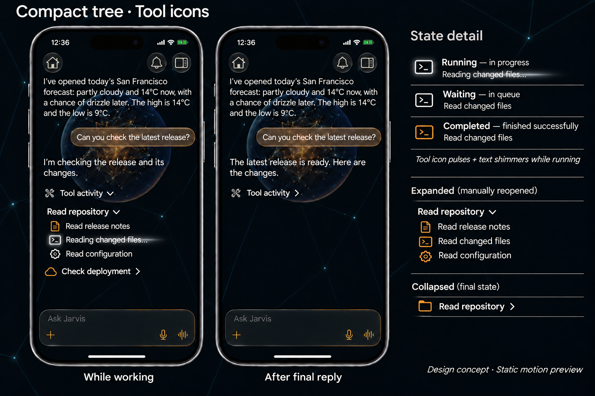

# Tool activity design handover

[Selected layout](selected-compact-tree.png). Dan accepted the visual layout and tool-specific icons, but rejected the icon pulse. The motion correction below supersedes the image's pulse annotation and frozen glow, as well as the earlier far-right-chevron and generic-status-icon treatments. The outline-trace motion is the proposed replacement, not yet previewed in motion.

- Put each disclosure chevron immediately after its label, with a small consistent gap. Right when closed, down when expanded. Do not align chevrons to the far edge.
- Use a meaningful icon for each tool type: document/read, pencil/edit, terminal/command, globe/web, gear/configuration, cloud/deployment. Map icons to the actual tool rather than inferring its type solely from display text.
- Retain the same tool icon across states. Successful completion turns it orange. Running keeps it white with a moving highlight tracing its outline, plus white shimmer clipped to its action text. Queued keeps it white and static. No pulse, breathing, scale change, glow, replacement spinner, checkmark or empty circle.
- No visible call counts, multiplier labels, Done or Queued text in rows. Keep shallow indentation and compact icon spacing. State detail captions in the image are explanatory annotations outside the app.
- Preserve existing automatic expansion while active, collapse on final response, manual history reopening and all surrounding Chat UI.

Proposed active motion: retain the full recognizable tool glyph at a steady white base intensity, with a brighter short highlight travelling around its outline in a continuous approximately 1.4-second loop. The glyph remains upright and fixed in size; the highlight moves rather than the entire icon pulsing. Do not draw an extra ring around it. Stop the trace and text shimmer immediately when the actual tool state settles. Queued icons remain still; successful icons become static orange. Verify the effect at native icon size before adopting the timing.

Screen reader labels must announce tool identity and actual status. Under reduced motion provide accessible nonanimated state information. Failure/cancellation must remain distinguishable and must never appear orange as if successful. No app code or native animation was changed or verified.

## Visual reference

The image establishes layout and tool icons. Its pulse annotation is obsolete: follow the no-pulse motion specification above.

## Implementation checks

Reuse shared Jarvis controls and existing tool events. Preserve Chat UI and existing expansion behavior. Verify long names, mixed running and completed children, group reopening after the final response, state changes during animation, reduced motion, screen reader status, and scroll position. Do not infer successful completion from a final reply alone. These are design deliverables, not implemented or device-verified behavior.

