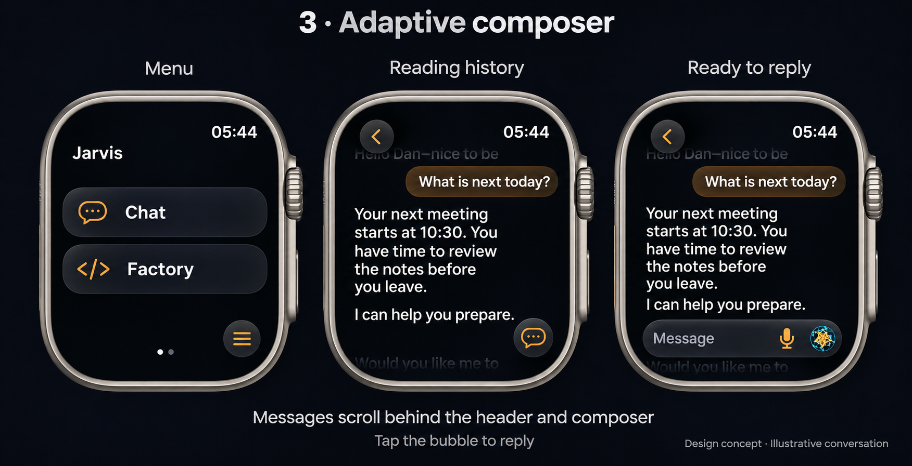

# Watch Chat: adaptive composer

Owner-approved option 3, selected 17 November 2026. This handover defines the Watch menu and Chat design. It is not an implemented or device-verified change. The other two exploration concepts are not selected.

## Menu

- Replace the separate Voice and Dictate destination rows with one **Chat** row opening the existing conversation. Keep **Factory** and other app pages unchanged.
- Place the menu button at the **bottom right**, as shown in the selected image. Keep it clear of page indicators and rounded corners.
- Reserve the upper-right area for Apple's system time. Do not put an app button there or draw a replacement clock.
- Keep the Jarvis title compact, rows easy to tap, and surfaces neutral glass with amber icons. No yellow/orange button fills.

## Chat layout

Use a single continuous conversation scroll view extending behind the shallow header and floating bottom controls. Keep a small back control at top left and the system time at top right. Remove the oversized header and separate Jarvis title row shown in the original photo.

Messages pass beneath translucent overlays instead of being constrained to a short viewport between opaque bars. Protect header controls and time with a restrained material/fade. Text underneath is incidental scroll content, not the only way to read a message. Provide sufficient start/end scroll padding to bring both the first and last messages fully clear of the overlays. Respect rounded corners and preserve comfortable horizontal text margins.

Keep readable native text sizes and Dynamic Type. Recover space from chrome and padding, not tiny fonts. Assistant text is unboxed; user messages retain the softly tinted bubble. Preserve the shared Jarvis look and existing conversation history.

## Adaptive composer behavior

| State | Visible control | Behavior |
| --- | --- | --- |
| Reading older messages | Small speech-bubble button at bottom right | Leaves most of the screen for messages. Tap restores the composer. |
| Ready to reply | Compact floating Message field, microphone and voice orb | Message opens native writing; microphone dictates a draft; orb explicitly starts live voice. |
| Drafting or recording | Relevant input/recording controls remain available | Do not auto-collapse or lose a draft. Preserve native stop/cancel behavior. |

Preserve writing, dictation and live voice within Chat. Opening Chat or expanding the composer does not activate the microphone or send a message. Dictated text remains a draft until the existing explicit send action. Do not introduce a new chat mode, thread or data store.

Collapse the composer only while browsing history and when no active composing/recording interaction would be interrupted. Do not collapse under a finger or while a control has focus. Expansion must not jump the message being read out of position. Preserve drafts across dismissal and navigation according to existing behavior.

Implementation detail to tune on device: the exact scroll threshold for entering reading mode and the compact transition duration. The approved requirement is predictable access to the two shown states; no precise threshold is implied by the static image.

## Interaction and accessibility

- Support both Digital Crown and touch scrolling. Avoid nested vertical scrolling for the conversation itself.
- Keep the menu, reply, back, microphone and voice controls reachable with native hit targets on every supported Watch size. The raster is not a point-size specification.
- Reuse existing Watch/shared design-system controls and the shared lattice orb. Do not copy iPhone-only components into Watch without checking target support; do not create screen-local glass styles or a replacement orb drawing.
- Give icons accessible names: Back, Menu, Reply, Dictate and Start voice. Preserve reading order and accessibility focus when the composer changes shape.
- Make transitions interruptible. Respect Reduce Motion and Reduce Transparency; information and controls must remain usable without animation or blur.
- Preserve existing loading, offline, connection, history-error and interrupted-send feedback. Keep unsent drafts. Never replay sends automatically or fabricate successful connection state.

## Acceptance checks

1. The menu shows Chat and Factory, with no separate Voice/Dictate destinations and no app button in the system-time area.
2. Chat displays the existing conversation. Writing, dictation and voice remain accessible through the expanded composer.
3. Browsing history reduces the composer to the bottom-right reply bubble. Tapping it restores the full composer without losing the draft or reading position.
4. Messages visibly scroll behind header and composer. Every message can be brought fully into readable space, including the first and last messages and long replies.
5. Back, menu and composer controls remain operable; the time remains unobstructed. Recording and active input never disappear because of scroll-triggered collapse.
6. Verify the smallest and largest supported Watch layouts, large text, VoiceOver, keyboard/dictation presentation, Crown/touch scrolling and reduced-motion/transparency settings.
7. Capture the three reference states in a simulator/device and inspect transitions in motion. Record any platform limitation before claiming completion.

## Implementation scope and evidence

This handover is a visual and interaction change, not authorization to change Watch networking or voice capabilities. Inspect current code and operating guidance before implementation. Keep current companion/direct-dictation behavior and existing session/error handling unless separately tasked to change it.

The selected image and local handover links were checked. No app code, vault content, external issue, service or deployment was changed for this handover. Native safe-area behavior, animation, accessibility and physical-device performance remain to be validated.
