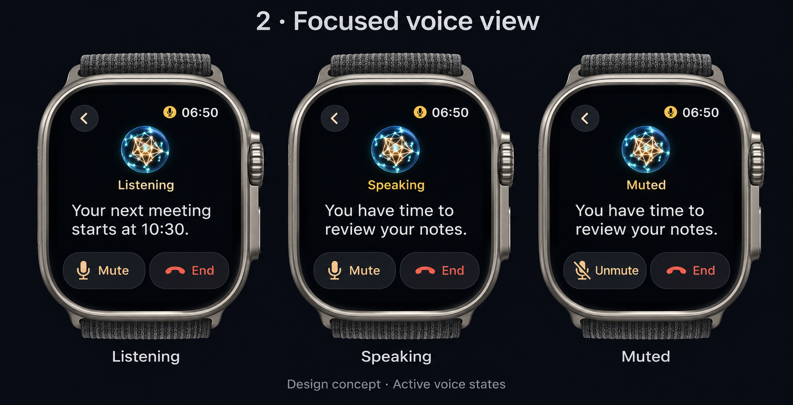

# Watch active voice: focused view

Dan approved **option 2, Focused voice view**, on 17 November 2026. This is the active-voice companion to the [approved Watch Chat and menu design](../watch-chat/HANDOFF.md). The inline voice-dock alternative is not selected. Approval covers the visual direction and interaction requirements; implementation and native validation remain outstanding.

## Composition

Use one dedicated voice presentation within the existing conversation. From top to bottom:

1. Small native back control at top left; system time and any system-provided microphone/privacy indication at top right. No app control in the time area and no separate Jarvis title row.
2. **One** shared cognitive-lattice orb, centred and sized to leave room for readable text.
3. **One** concise state label beneath the orb.
4. The latest transcript excerpt, using readable native text. Full history remains in Chat.
5. **Two** bottom controls: Mute/Unmute and End. Use neutral glass surfaces, amber microphone/label and red hang-up icon/End text. No solid colored button backgrounds.

While this view is active, remove the normal Message composer, dictation button and start-voice orb. Do not stack a voice status row on top of the composer. The single orb above is status/identity, not a second start button. The system's privacy indicator is separate from application controls and must not be hidden or redrawn.

## States and actions

| State | Label | Microphone control | Transcript |
| --- | --- | --- | --- |
| Listening | Listening | Mic + Mute | Most recent transcript remains visible while waiting for speech. |
| Speaking | Speaking | Mic + Mute | Show Jarvis's current spoken reply as available from real transcript events. |
| Microphone muted | Muted | Slashed mic + Unmute | Keep the latest transcript visible. Do not replace it with repeated status text. |

Mute changes microphone capture/transmission according to the existing session contract. It must not imply that assistant audio is paused or that the session ended. Muted microphone and assistant speaking can coexist; preserve that distinction in session state and accessibility information. The display must not say Listening when the microphone is muted.

End explicitly ends the current voice session through existing teardown and returns to Chat with history and any prior draft preserved. Do not start another session merely when reopening a view. Back follows the established native session/navigation policy; inspect it before implementation. If Back retains an active session, keep a clear way to reopen it and reach End. Never leave an invisible, uncontrollable microphone session.

Voice still starts only from an explicit user action in Chat. This design does not change current Watch networking, companion requirements, voice ownership, transcription or authentication. It is not permission to introduce a new voice thread or background recording behavior.

## Transcript and motion

- Use the latest relevant spoken text rather than repeating the entire greeting or all history. The sample meeting text in the image is illustrative, not real calendar data.
- Preserve full existing conversation history and drafts. Missing transcript data must not become invented text. Keep long excerpts scrollable or otherwise fully readable; never silently truncate essential content with no access to the rest.
- Keep Mute/Unmute and End visible while transcript content scrolls. Protect safe areas and rounded corners; adapt at larger text sizes rather than shrinking type.
- Reuse the shared orb's actual Listening/Thinking/Speaking/Connecting states and reduced-motion behavior. Do not add another orb, independent drawing or decorative spinner.
- Connecting, thinking, reconnecting, failed and ended states must come from real session events. Do not leave Listening showing during connection failure. Keep local recovery understandable and preserve transcript content when possible.

## Acceptance checks

1. Start voice from the approved adaptive Chat composer. Show this focused view with one orb, one status and two controls; no Message/dictation/start-voice duplication.
2. Verify Listening, Speaking and Muted against actual session events, including muting while Jarvis speaks and unmuting afterward.
3. Verify End actually stops capture and tears down the existing session, then returns to the same Chat and preserved draft/history.
4. Verify Back behavior and session re-entry without an orphaned session or duplicate voice start.
5. Exercise long transcripts, small/large supported Watch screens, larger text, VoiceOver, Reduce Motion/Transparency and Crown/touch scrolling. Buttons retain accessible names and usable native hit targets.
6. Test connecting, interrupted audio, failed connection and unavailable transcripts. Never infer live availability from static screenshots.
7. Capture native screenshots of the three approved states and inspect orb transitions on simulator/device. The illustration is not a point-size, color-token or animation specification.

## Handover evidence

The selected image is included locally and the handover links were checked. Shared controls, palette and orb components remain authoritative for implementation. No app code, service, deployment, external issue or vault content was changed for this design handover. No native or live voice validation is claimed.
